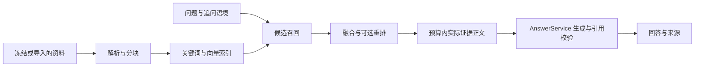

# InfraAgent · Infra Knowledge RAG

面向 AI Infra 技术资料的本地知识检索与问答项目。把训练通信、推理引擎、GPU、系统软件和云原生文档解析为可定位的证据，通过混合检索、可选重排和上下文打包，生成带来源引用的回答。

项目同时提供 CLI、FastAPI、可选的 macOS 悬浮问答界面，以及用于定位检索和证据交付失败的离线评测工具。Python 包名为 `infra-rag`，当前版本为 `0.2.0`。

**默认问答链路仍是 `/chat → AnswerService → RetrievalService`。** 它负责对话、查询处理、检索、生成与引用校验。2026-11 新增的 `graph_rag` 与 `agentic_rag` 是**只在显式 CLI 实验入口启用**的对照链路（`infra-rag chains` / `infra-rag compare-rag`），不接入 `/chat`、不改变默认配置；历史的多轮研究 Agent 入口 `infra-rag agent` 保持移除，其代码与产物只用于追溯。

截至 **2026-11-21**，主线实验分为三段：2026-10-03 的 v7 检索与证据交付实验（110题固定开发问题、1870条配置记录、220次热启动测量）；2026-11-12 的原链路官方120题全量生成实验（P2）；2026-11-21 的 Graph RAG / Agentic RAG 与冻结 P2 基线的配对对比。v7 的技术词处理仅使完整证据交付净增1题，未达到预定质量门槛，因此未切换默认配置；P2 的四项采用门槛有一项未通过（作答子集 Faithfulness 0.885 < 0.9），同样不改默认配置。**证据交付率是回答模型收到必要正文的比例，不是回答正确率。**

本仓库只公开代码与构建配置：`docs/`、`evals/`、`examples/`、`日志.log` 留在本地工作副本，不在版本管理中。README 中提到的这些路径是本地实验材料的位置说明，克隆后不存在。

## 阅读导航

- [项目是什么](#1-项目是什么)：解决什么任务，哪些能力已实现。
- [为什么这样设计](#2-为什么这样设计)：分块、混合召回、重排、预算和来源追溯的理由。
- [怎么使用](#3-怎么使用)：安装、索引、检索、问答和 API。
- [怎么评测](#4-怎么评测)：指标定义、分母、标签和审核规则。
- [评测结果与原因](#5-评测结果与原因)：实际收益、退化及采用决策。
- [怎么复现与开发](#6-怎么复现与开发)：命令、产物和验证。
- [项目结构与文档](#7-项目结构与文档)、[当前边界与下一步](#8-当前边界与下一步)。

## 1. 项目是什么

### 1.1 使用场景

项目针对需要查阅技术原文、核对条件与版本的知识问答，例如：

- 查找 KV Cache、PagedAttention、GQA、MoE、量化和训练并行的机制说明。
- 从指南中定位配置参数、代码或公式，查看出处和适用版本。
- 回答同时涉及“机制是什么”和“限制是什么”的跨段、跨文档问题。
- 检索 PDF 图注或技术示意图，返回页码、图片区域和坐标。
- 排查“资料已入库，为什么回答仍缺必要证据”，区分召回、排序和预算问题。

它既可以作为独立问答服务，也可以让外部 Agent 调用 `/search` 获取证据。当前服务的行动范围是本地资料检索和问答，没有接入运维执行、浏览器操作或工单系统。

### 1.2 已实现的能力

| 能力 | 是什么 | 怎么实现与验证 |
|---|---|---|
| 文本解析与三级分块 | 把文档组织为粗块、父块和可检索子块 | 保留标题、段落、代码围栏；用形态规则、jieba 和向量相似度聚合、细分；有固定窗口对照 |
| PDF 与图片处理 | 同时保存文字、图注、整图与区域 | PyMuPDF 提取文字和 raster 图片；OpenCV/PIL 定位裁剪；CLIP 编码和聚合；保留页码、bbox 与坐标系 |
| 混合检索 | 从关键词和语义两条路径找候选 | BM25 倒排索引、BGE/Chroma 向量检索，启用多模态时加入 CLIP，通过 RRF 融合 |
| 可选重排 | 用完整问题重新比较候选正文 | `bge-reranker-base` Cross-Encoder；保存重排前后顺序及输入截断诊断 |
| 证据交付 | 在有限上下文中交付去重、可引用正文 | 共享 token/字符预算、父块关联、稳定引用 ID、正文截断与省略记录 |
| 对话问答 | 结合追问语境，从本轮证据生成回答 | `AnswerService` 管理 SQLite 历史、可选查询翻译、生成和 JSON/引用 ID 校验 |
| Graph RAG 链路（实验） | 从同一次 hybrid 检索出发，沿文档/父子/邻接/术语关系扩展候选 | 确定性构图，边自带关系类型与证据片段；可审计、可复算，不是实体对齐的事实验知图谱 |
| Agentic RAG 链路（实验） | 模型自主决定检索、读父块与结束，受硬预算约束 | `ResearchAgent` 最多3次模型调用/4次工具调用/180秒，search 的 `top_k` 由系统固定不交给模型；完整轨迹、重试与 usage 落盘 |
| 增量索引 | 对未变化来源和输入复用已有处理结果 | 文件/图注哈希、持久向量缓存、原子快照发布；有重启、删除及配置隔离回归 |
| 离线评测 | 判断必要证据在哪一步丢失 | 固定题集、来源哈希、逐通道候选、排序、实际交付正文、配对统计与待审答案 |

多模态能力已运行真实模型链路，但现有领域合并库结果主要评测文本，不能据此宣称复杂技术图理解准确率。

### 1.3 当前服务与离线实验的区别

| 内容 | 当前状态 |
|---|---|
| 原有 `AnswerService` 问答编排 | 继续采用，服务、桌面端围绕这条链路运行 |
| BM25、BGE、可选重排、共享证据预算 | 已实现；具体配置取决于启动参数 |
| 预处理合并库、分库、版本保护、语言路由 | 独立实验配置，有历史对照；不等同于默认服务 |
| v6 证据选择器、v7 技术词/邻接/子问题实验 | 离线比较，不自动部署 |
| `graph_rag` / `agentic_rag` 对照链路 | 已实现并完成与冻结 P2 基线的 120 题配对对比；只在 `chains` / `compare-rag` 显式启用，不接入 `/chat`，不改默认配置 |
| `ResearchAgent` / `CoverageResearchAgent` | 保留历史代码和产物供追溯，不接入默认 API，不继续作为采用方向 |

“原有 RAG”与“原有 Agent 问答编排”属于当前同一条应用链路。历史对照新增的是模型自主选择检索和结束的另一套执行器，并不是给原系统第一次增加 Agent。

## 2. 为什么这样设计

### 2.1 问答失败不只发生在生成阶段



资料入库只说明内容存在。相关文档被找到，也不代表包含必要条件的子块被召回；子块进入候选，也不代表进入前几名；排名命中，也可能在打包时被截断。即使完整证据已经交付，生成模型仍可能误读否定、范围、数量或版本。

因此项目同时观察候选、排序、实际正文和最终回答，避免只看一个最终分数却无法定位原因。

### 2.2 每个组件要解决什么问题

| 为什么需要 | 怎么做 | 必须注意的边界 |
|---|---|---|
| 文档太长，条件与公式容易淹没在概述中 | 按标题和主题组织父子块，保留代码、表格和定位；长输入分窗口编码 | 分块阈值是启发式；更细的块可能丢前文，更宽的块可能提高命中但增加噪声 |
| 参数名需要精确匹配，改写问题又需要语义匹配 | BM25 与 BGE 并行召回，RRF 按排名融合 | 两路都会漏检；融合不能找回两路候选之外的事实 |
| 不同通道的原始分数尺度不同 | 使用 `Σ 1/(60 + rank)` 的 RRF 合并召回排名 | 这是候选融合；不自动解决不同问题语言下重排分数的可比性 |
| 主题相似不等于满足问题条件 | 可选 Cross-Encoder 用问题与正文重新评分 | 重排不是正确性判断；实验中存在排序退化，不能假定启用就会提升 |
| 同父块内容重复会消耗上下文 | 共享预算、chunk 去重、关联兄弟块和规范 `context_pack` | 必要正文可能被预算省略；来源头开销与正文预算需要分别核算 |
| 同一主题在版本和来源间可能不同 | 保存来源、commit、release、行号、别名及哈希；实验显式验证版本范围 | 默认问答提示并非自动使用全部元数据；保存元数据不等于完成事实或版本审核 |
| 重建大库时重复编码成本高 | 按来源和输入哈希复用向量，索引指纹隔离配置 | 增量收益主要在解析和编码；JSON 快照及版本集合仍完整写入 |

BGE 和 CLIP 各自在自己的向量空间编码和检索。BGE 向量不作为 CLIP 文本向量使用；维度一致不能代替空间一致。图片重排使用图注，不直接判定图像像素内容。

### 2.3 原有问答链路怎么处理一次问题

1. 读取当前会话历史。较短且有指代的追问会结合上一条用户问题形成检索查询。
2. 按配置进行查询翻译；失败时记录回退并使用原文。`search` 与 `evaluate` 使用字面查询，聊天翻译只作用于 `/chat`。
3. 调用 `RetrievalService`：过滤领域/模态，召回、融合、可选重排，按共享预算打包证据。
4. `AnswerService` 把实际交付正文及来源定位交给回答模型；没有证据时返回 `no_evidence`。
5. 校验生成 JSON、`supported`、回答文本和引用 ID；格式或引用校验失败时最多再生成一次。
6. 返回回答、引用、状态和阶段耗时，保存会话。模型报告证据不足或两次校验未通过时返回资料不足提示。

这里的引用校验能检查 ID 是否属于本轮证据，不能证明引用支持主张。`answered` 也不能证明任务完成，需要独立事实审核。

## 3. 怎么使用

### 3.1 先运行不依赖真实模型的检索流程

要求 `uv`。仓库带 `.python-version`（3.12），`uv sync` 会据此选解释器；如果你的 uv 忽略该文件而默认选了 3.15，会因 `onnxruntime` 尚无对应 wheel 失败，此时显式加 `--python 3.12`。在仓库根目录执行：

```bash
uv sync --extra dev

# 演示语料不随仓库分发（`examples/` 不公开），先建一份最小 Markdown 再导入；
# 也可以把 demo-corpus 换成自己的资料目录。
mkdir -p demo-corpus && cat > demo-corpus/inference.md <<'MD'
# LLM 推理服务

## PagedAttention 与 KV Cache
PagedAttention 使用分页管理 KV Cache，把逻辑连续的缓存映射到非连续物理块，减少内存碎片。
KV Cache 保存历史 token 的 Key 和 Value，避免 decode 阶段重复计算。

## 推理指标
TTFT 是从请求提交到首 token 返回的时间，TPOT 是输出 token 间的平均时间。
MD

uv run infra-rag --data-dir data/demo-v2 ingest demo-corpus --domain infra
uv run infra-rag --data-dir data/demo-v2 search 'PagedAttention 怎样管理 KV Cache？' --domain infra --top-k 3
uv run infra-rag --data-dir data/demo-v2 search 'KV Cache' --debug --with-context
uv run infra-rag --data-dir data/demo-v2 status
```

默认索引目录为 `data/default-v2`，上面的演示显式用 `data/demo-v2` 与后续真实索引分开。`demo` 后端使用确定性哈希向量，安装依赖后可离线验证解析、检索接口和证据打包；它不是语义模型，不能用其成绩证明真实检索效果。真实问答还需要单独配置回答模型。

### 3.2 建立真实 BGE 索引

```bash
uv sync --all-extras

uv run --all-extras infra-rag --backend bge --data-dir data/my-bge \
  ingest /path/to/notes --domain infra

uv run --all-extras infra-rag --backend bge --data-dir data/my-bge --rerank \
  search 'KV Cache 的显存瓶颈是什么？' --domain infra --debug --with-context
```

全局参数必须放在子命令之前。BGE 默认使用 `BAAI/bge-small-zh-v1.5`，重排使用 `BAAI/bge-reranker-base`；首次运行需要取得模型。真实模型失败会报错，不会自动替换成 demo。

Qwen 嵌入后端使用 `--backend qwen`，默认模型为 `Qwen/Qwen3-Embedding-0.6B`；模型、提示与分块实验约束见 Qwen Embedding 与 Chunk 对照实验（`docs/embedding-chunks-experiment.md`）。真实嵌入可用 `--embedding-model`、`--embedding-revision`、`--embedding-device`、`--embedding-batch-size` 和 `--embedding-max-length` 固定模型版本、设备与输入上限。

模型、分块和模态等设置写入索引指纹。改变这些设置或预处理版本，应使用独立目录重新导入；不能把 demo 索引直接用于 BGE/Qwen 模式，也不能在 BGE 与 Qwen 索引之间复用目录。

### 3.3 配置回答模型并启动问答 API

项目只保留 moerouter.com 的 OpenAI 兼容链路，回答模型固定为 `glm-5.3-flash`。复制模板并填写本地密钥：

```bash
# 凭据只留本地，不写入仓库或评测产物。
cat > .env.moerouter <<'ENV'
OPENAI_BASE_URL=https://moerouter.com/v1
OPENAI_MODEL=glm-5.3-flash
OPENAI_MAX_TOKENS=2048
OPENAI_API_KEY=YOUR_MOEROUTER_KEY
OPENAI_SYSTEM_IN_USER=1
INFRA_RAG_QUERY_LANGUAGE=none
ENV
chmod 600 .env.moerouter

INFRA_RAG_LLM_ENV_FILE=.env.moerouter uv run --all-extras infra-rag \
  --backend bge --data-dir data/my-bge --query-language none \
  serve --port 8000
```

默认读取 `.env.llm`，不存在时读取 `.env.moerouter`；环境变量优先于文件。`OPENAI_BASE_URL` 必须是 `https://moerouter.com/v1`，`OPENAI_MODEL` 为 `glm-5.3-flash`。该入口会丢弃 system 消息，因此 `OPENAI_SYSTEM_IN_USER=1` 会把系统提示合并到 user 消息；输出预算默认 2048，避免思考 token 截断正文。查询翻译当前关闭（`INFRA_RAG_QUERY_LANGUAGE=none`）。

启动后以 `/health` 显示的实际 provider/model 为准；预热会发起真实模型请求。没有配置密钥时服务仍可启动，`/health` 返回 `assistant.available=false` 并给出原因，`/ingest`、`/search`、`/sources` 照常可用，`/chat` 与 `/warmup` 返回 503——所以只想试检索时不需要先办密钥。详细配置与限制见回答模型配置（`docs/api-models.md`）。

### 3.4 调用 API

服务默认绑定 `127.0.0.1`，接口文档：<http://127.0.0.1:8000/docs>。

```bash
curl http://127.0.0.1:8000/health

curl -X POST http://127.0.0.1:8000/search \
  -H 'Content-Type: application/json' \
  -d '{"query":"KV Cache","top_k":5,"domain":"infra","strategy":"hybrid","debug":true}'

curl -X POST http://127.0.0.1:8000/chat \
  -H 'Content-Type: application/json' \
  -d '{"message":"PagedAttention 怎样管理 KV Cache？","domain":"infra"}'
```

| 接口 | 输入与用途 | 返回/行为 |
|---|---|---|
| `POST /ingest` | `path`、可选 `domain`；导入本地文件或目录 | 处理与索引更新统计 |
| `POST /search` | `query`、`top_k`、`domain`、`modality`、`strategy`、`debug` | 排名 hit、唯一 `context_pack`；debug 时附各阶段诊断 |
| `POST /chat` | `message`、可选 `conversation_id`、`domain` | `answer`、`citations`、`status`、`trace`、会话 ID |
| `POST /warmup` | 预加载检索和回答模型 | 准备状态与耗时；无密钥时 503 |
| `GET /conversations/{id}` | 当前索引内的会话 ID | 保存的对话记录 |
| `GET /parents/{id}` | 父块 ID | 兄弟块及关联整图信息 |
| `GET /sources` / `DELETE /sources` | 查看来源，或按完整 `source` 路径移除活动来源 | 来源列表或删除块数 |
| `GET /health` | 查看运行配置 | 后端、数量、索引指纹及实际回答供应商/模型 |

`strategy` 支持 `bm25`、`dense`、`clip`、`hybrid`；`clip` 需要启用多模态。`modality` 可限定 `text` / `image`。消费证据时使用 `context_pack` 及其引用映射，避免再次拼接所有 hit 的重复父块上下文。

### 3.5 多模态与桌面端

```bash
uv run --all-extras infra-rag --backend bge --multimodal --data-dir data/my-vision \
  ingest /path/to/docs --domain infra

uv run --all-extras infra-rag --backend bge --multimodal --data-dir data/my-vision \
  search 'GPU 架构图' --modality image --with-context
```

独立图片可以附同名 `.txt` 图注。PDF 保存文本、内嵌 raster 图片及可关联的图注；图片区域坐标区分 `image_pixels` / `pdf_points`。缺少真实图注时标记为占位标签，不伪装成图像内容识别。

macOS 界面见 Infra Lens 悬浮问答球（`docs/desktop-macos.md`）。它连接原有问答 API，支持导入、连续追问和查看引用，使用独立桌面索引；不是另一套研究 Agent。

### 3.6 关键检索参数

| 参数 | CLI 缺省值 | 调整目的 |
|---|---|---|
| `--backend` | `demo` | 选择流程验证或真实 BGE/Qwen 检索 |
| `--rerank` | 关闭 | 是否启用文本 Cross-Encoder |
| `--chunk-strategy` / `--chunk-overlap` | `semantic` / `0` | 分块策略；`window_overlap` 需设置小于 `chunk-size` 的重叠 |
| `--candidate-k` | `30` | 各通道候选入口深度；实际至少为请求的 Top K |
| `--fusion-candidates` | `truncate` | 融合后截断至候选深度，或 `union` 保留两路完整并集 |
| `--lexical-query-mode` | `raw` | `technical` 过滤英文停用词；不等同于 v7 的词形/下划线实验 |
| `--context-mode` | `neighbors` | 共享预算上下文；`legacy` 用于旧方式对照 |
| `--context-tokens` / `--context-chars` | `1200` / `4000` | 同时限制证据打包长度 |
| `--query-language` | 无配置时 `none`，可被环境设置 | 仅用于聊天检索的翻译策略 |
| `--heading-context` | 关闭 | 将文件名与标题上下文纳入编码/检索，改变指纹，须独立索引 |

CLI 缺省配置与冻结实验配置分别说明：v7 的 B 使用每路 Top30 **并集**，最多60个原候选；补召回最多增加30个，总数上限90。这不是默认 `truncate` 服务自动获得的候选规模。

### 3.7 实验链路：Graph RAG 与 Agentic RAG

两条对照链路不改变 `/chat`，只通过显式子命令运行。`chains` 做单题接线与轨迹检查，`compare-rag` 在**同一个 `RetrievalService` 实例、同一索引指纹、同一 Top-k 与证据预算**下串行跑所选链路，并只在评测器侧使用冻结标签。

```bash
# 基线与 Graph：不需要回答模型
uv run infra-rag --data-dir data/demo-v2 chains 'KV Cache 的作用是什么？' \
  --chain baseline --chain graph_rag --top-k 5 --output data/experiments/my-graph-run

# 三链路 + 复用 Native RAG 的回答模型配置（默认即 live）
uv run infra-rag --data-dir data/demo-v2 chains 'PagedAttention 有什么作用？' \
  --chain baseline --chain graph_rag --chain agentic_rag --top-k 5 \
  --output data/experiments/my-live-run

# 有标签的配对对比：题集是本地 JSON，每项含 id/query/relevant。
# relevant 写来源路径（--label source）或子块/父块标签，相对题集文件所在目录解析；
# gold 只进评测器，不进链路。
cat > demo-cases.json <<'JSON'
[
  {"id": "q1", "query": "PagedAttention 怎样减少 KV Cache 内存碎片？",
   "relevant": ["demo-corpus/inference.md"]}
]
JSON

# --require-complete 在保存报告后对失败返回非零
uv run infra-rag --data-dir data/demo-v2 compare-rag demo-cases.json \
  --chain baseline --chain graph_rag --chain agentic_rag \
  --label source --top-k 5 --require-complete \
  --output data/experiments/my-paired-comparison
```

| 链路 | 检索与交付 | 主要诊断 |
|---|---|---|
| `baseline` | 现有 hybrid 检索、融合/可选重排与 `pack_context` | 候选、Top-k、实际交付正文、来源与预算 |
| `graph_rag` | 从同一 hybrid 检索出发，按可审计的文档/父子/邻接/术语关系扩展，再按共享预算交付 | 扩展边、关系原因、图统计、缓存、实际交付 |
| `agentic_rag` | `ResearchAgent` 受限调用 `search` / `read_parent` / `final`，可重试 | 全轨迹、重试、候选累计、预算、usage、最终状态与引用边 |

规则：只把 query 与可选 domain 传给链路，`relevant` / gold 始终留在评测器；输出目录创建即冻结，`manifest.json`、`report.json`、逐题 `result.json` 不覆盖；失败保留为 `error`，指标是 null 而非 0；`answer_review.fact_correct` 与 `citation_support` 初始化为 null，状态 `independent_review_required`。Graph 的边由文档结构与术语共现启发式导出，向量相似不能表述为事实三元组；`answered` 与合法引用 ID 也不等于答案正确。`--agent-model offline` 是脚本模型，只验证接口与轨迹。

## 4. 怎么评测

评测分三类记录：检索与证据交付的确定性指标（Recall/MRR/nDCG/完整交付）、Ragas 的 LLM 辅助上下文与回答质量评分（各自单独记录生成与评审用量）、以及 Agent 轨迹的三层规则。生成侧实模成绩见 5.7；Ragas 的配置与消融说明见 `docs/ragas-evaluation.md`。

### 4.1 为什么分三层

| 层级 | 要回答的问题 | 本项目中的依据 |
|---|---|---|
| Component | 资料是否解析正确，必要证据在哪一步丢失？ | 原文、chunk 映射、通道排名、候选、Top K 与实际交付正文 |
| Trajectory | 调用与恢复是否合理，是否重复消耗资源？ | 工具契约、有序步骤、错误/重试关系、返回产物和耗时；需按规则单独采集 |
| End-to-End | 答案是否满足全部目标、事实和约束？ | 实际答案、事实主张、引用支持和独立审核 |

v7 只评检索与正文交付及其性能，没有生成答案；5.7 与 5.8 的 P2 / Agentic 两轮才有真实生成与 Ragas 评分。历史生成与研究 Agent 实验单独归档，不能把组件行追溯改称 Agent 任务成功。

### 4.2 检索与证据指标

每道可回答题预先固定必要证据。比例同时保留分子和分母；不可回答题没有正例 gold，不进入正例召回分母。

| 指标 | 是什么、怎么算 | 为什么需要 |
|---|---|---|
| `Recall@K` | 前 K 内命中的标注相关项 / 全部标注相关项 | 看已标注证据召回多少，标签单位须说明是 chunk/source/parent |
| `Precision@K` | 前 K 内命中的标注相关项 / K | 看指定标签下的结果密度；返回不足 K 仍用 K 作分母 |
| `MRR@K` | 第一条标注相关结果排名的倒数，再按题平均 | 看首个相关结果能否靠前，不保证多项必要证据齐全 |
| `nDCG@K` | 按排名折扣后的相关性得分 / 理想排序得分 | 看整个排序质量；公开数据按其原生相关性规则单独计算 |
| `evidence_coverage` | 候选满足必要要求的比例；多替代组取最高覆盖 | 区分只缺一个条件与完全没找到；报告中也称必要证据召回/覆盖 |
| `candidate_complete_rate` | 候选满足至少一组全部必要证据的题数 / 正例题数 | 判断问题在进入重排前是否已有完整依据 |
| `ranked_complete_rate@K` | 排名 K 内完整证据题数 / 正例题数 | 判断重排是否把已召回的条件压到后面 |
| `evidence_delivery_rate` | 实际交付正文覆盖完整必要证据的题数 / 正例题数 | 判断回答模型究竟收到多少完整依据，核对正文而不是只看 ID |

**必要项是 AND，可接受选项是 OR，完整替代组之间也是 OR。** 例如一题需要“机制解释 A”和“适用限制 B”，只召回 A 不算完整；也可以使用完整的 A′＋B′ 替代组，但不能随意拼接两个不完整组判成功。

完整交付还要求核对实际正文、来源、定位和源文件哈希。代码、公式被省略，或条件句被截断时，即使 chunk ID 在结果里，也不能记为完整。

### 4.3 回答、轨迹、成本与治理指标

| 维度 | 主要指标 | 怎么判定 |
|---|---|---|
| 任务完成 | `task_success_rate`、`partial_success_rate`、约束满足、用户接受 | 所有必要目标与硬约束同时满足；用户接受需要真实反馈 |
| 工具与轨迹 | 工具调用准确率、错误率、步数、重复动作率、恢复率 | 核对冻结契约、实际尝试和恢复后置条件；HTTP 成功不等于任务恢复 |
| 事实与引用 | `citation_precision`、`hallucination_rate`、拒答质量 | 独立审核主张是否有支持、有无矛盾，引用是否支持对应主张 |
| 性能与成本 | `latency_p50/p95`、token 使用量、模型/工具费用、缓存命中 | 记录所有实际尝试及重试，披露计时边界；token 数不等于费用 |
| 安全与治理 | 高风险动作阻断、canary 泄漏、禁止行为、转人工比例 | 按预定义机会和检查评测；未测试项不能写成零违规 |

完整定义、分母和执行契约见 Agent 评估规则（`docs/agent-evaluation-rules.md`）与 `Agent.md`。这些规则和评分器已经实现，不表示默认问答服务已经接入所有治理能力或所有指标已有正式成绩。

未审核字段为 `null`；未知费用不当免费，未测试项不当通过。正常可回答题的拒答和不可回答题的合理拒答分别报告。合法 JSON、合法引用 ID、`answered` 状态都不能代替事实正确率。

### 4.4 数据与实验纪律

- 语料冻结 repository commit、source URL、文件哈希、版本和定位；问题、答案与评测 trace 不进入知识库。
- dev 用于调参，holdout/test 不用于选择参数。原始标签不改写；审核后的替代证据使用新标签版本，所有方法在同一版本内重算。
- 标签主要由 AI 根据冻结原文编写。官方题目在审核账本中登记过题目审核，仓库题及部分新增标签仍待独立审核；题目审核不等于生成答案已审核。
- 标注是稀疏的：未标注的合法替代来源可能被漏计。因此指标衡量冻结证据要求，不能直接宣称所有语义相关证据的召回率。
- 比较使用同一批问题配对；同概念改写和多次运行按问题组处理。配置行数和重复次数不算新增独立题目。
- v7 使用原 `group_id`：官方15组、仓库13组；10000次 cluster bootstrap，seed42，95%区间，多重对照用 Holm 校正。
- 保存 `protocol.json`、实现快照、模型/索引指纹、逐题候选与正文、重排输入/截断、耗时、审核模板及产物 manifest。默认配置只在冻结质量、性能与审核门槛通过后考虑采用。

## 5. 评测结果与原因

### 5.1 最新评测的语料与分母

最新原有 RAG v7 使用合并、预处理的冻结语料：**40篇官方来源＋87篇中文仓库正文，共127篇、16320个文本子块**。

| 题集 | 完整题集规模/划分 | v7 实际评测 | 正例指标分母 |
|---|---|---|---|
| 官方来源题集 | 120题，dev60 / holdout60 | 固定 dev60：54可回答＋6不可回答 | 54 |
| 三仓库题集 | 150题，dev50 / test100 | 固定 dev50，均有正例证据要求 | 50 |

官方组重放冻结英文检索/整问评分查询，仓库组使用原中文；两组分别报告。v7未读取领域 holdout/test；这一限制针对本轮领域实验，不抹去其他公开基准已有的独立记录。

共17个配置×110题＝**1870条评测记录**，其中5个历史候选回放、10个基线及新单因素、1个组合、1个邻接选择。实际热启动性能另测基线/技术词各110次，共220次；没有新增答案生成 API 请求。

### 5.2 先区分历史交付与本轮离线基线

| 冻结口径 | 官方完整候选 | 官方完整正文交付 | 仓库完整候选 | 仓库完整正文交付 |
|---|---:|---:|---:|---:|
| 原 B-T5 历史交付 | 46/54 | 43/54 | 42/50 | 40/50 |
| 同候选＋v6 离线选择器 | 46/54 | 45/54 | 42/50 | 41/50 |

v6 改变证据选择，没有提高候选召回；它是本轮统一的离线选择器，**不代表已部署为默认服务**。旧直接 Top5 完整率、包含邻接补齐的历史交付率和 v6 交付率也不能混为一个指标。

### 5.3 原有 RAG v7 的实际结果

以下均使用同一原始标签、原正文和整问重排；新补召回保留原 B 候选，最多补30个，总数不超过90。正文预算为1200 embedding-token / 4000字符。

| 配置 | 官方完整候选 /54 | 官方完整交付 /54 | 仓库完整候选 /50 | 仓库完整交付 /50 |
|---|---:|---:|---:|---:|
| B：冻结原候选＋v6选择器 | 46 | 45 | 42 | 41 |
| T：技术词词形/下划线处理 | 47 | **46** | 42 | 41 |
| D60：原问两路入口Top60 | 48 | 44 | 44 | 41 |
| D90：原问两路入口Top90 | 48 | 43 | **45** | 42 |
| L：来源/标题上下文词法视图 | 48 | 44 | 44 | 41 |
| E：来源/标题上下文dense视图 | 48 | 44 | 43 | 41 |
| Ladj：再加入相邻段的词法视图 | **50** | 45 | 43 | 41 |
| Eadj：再加入相邻段的dense视图 | 48 | 44 | 42 | 41 |
| Q：产品/版本语境受限的子问题 | 47 | 42 | 43 | 41 |
| Qdepth：与Q入口预算匹配的整问加深 | 48 | 44 | 44 | 41 |
| T＋Ladj 组合 | **50** | 45 | 43 | 41 |
| T＋邻接证据选择 | 48 | 44 | 42 | 41 |

以官方组为例：B完整候选为85.2%，完整交付为83.3%；T交付为85.2%，仅净增1题；Ladj候选为92.6%，但交付仍为83.3%。仓库组B完整候选84.0%、交付82.0%；Ladj候选86.0%、交付仍为82.0%。

**采用结论：没有新配置通过预定质量门槛，保持原有 RAG 默认配置。** 门槛要求两库候选和交付均不低于基线、交付合计至少净增2题、候选及实际累计重排对不超过90、热启动p95不超过基线1.5倍，并满足证据与审核要求。T没有交付退化，但仅恢复 `official-005-2`，净增1题不足。

T官方配对增益的95% bootstrap区间为0～5.66个百分点，cluster permutation及Holm校正p均为1。小幅dev收益不能作为独立确认的提升声明；不显著也不证明所有方法等效。

### 5.4 性能结果

| 配置 | 实测次数 | 热启动p50 | 热启动p95 | 相对基线p95 |
|---|---:|---:|---:|---:|
| B | 110 | 1.422秒 | 3.126秒 | 1.000× |
| T | 110 | 1.458秒 | 3.344秒 | 1.070× |

关闭查询结果和重排分数缓存，交替执行同一批问题；保留正常加载后的模型、词法统计和向量集合。计时包括实际检索、原文重排与正文选择，不包括索引/模型初始化、冻结翻译映射或回答生成。p95按nearest-rank计算，每题每配置1次，实际累计重排对最大74。

T满足性能限制，但不满足质量门槛。其他配置未完成同规模耗时对照，其性能门槛保持未知。缓存组件回放耗时不能代替此表，也不能把这张表当作完整 `/chat` 响应耗时或线上延迟保证。

### 5.5 为什么召回改善，交付仍然有限

1. **入口深度会漏条件段，但加深不能解决所有词义差异。** 原诊断16条候选不完整题中，8条的全部缺失BM25证据位于35～75名；另一些LoRA身份、KV公式、分离阶段条件位于数百至上千名。Top30改Top60/90只能覆盖一部分缺口。
2. **找到具体片段后，整问重排仍可能压低它。** Ladj召回了CUDA条件段，但 `official-026-2` / `026-4` 的必要证据排第29 / 17，没进入固定Top15选择前沿；同一事实在 `026-3` 排第4并成功交付。
3. **新增候选会挤占原证据的排序和预算。** Ladj中 `official-010-3` 的必要证据由第8降至15，`030-4` 由第7降至11，原重排分数不变却丢了交付；恢复的两题被两条退化抵消。本轮重排语言未变，不能把这种竞争直接归为跨语言分数偏差。
4. **进入选择前沿不等于交付完整正文。** `repo-075-2` 必要段排第6，仍未完整交付；`official-012-4` 和 `repo-045-2` 继续是候选齐全但交付失败，需要分别检查选择与长度预算。
5. **稀疏标签和材料事实质量需要独立审核。** MoE、SmoothQuant等题存在值得审核的替代来源；历史bug/fix与版本标签的混合也不能仅靠字符串判断。未审核前不补计成功，不把AI材料审计当事实修订。

完整依据见 v7 结果与失败分析（`evals/merged-corpus-v2/original-rag-v7/run-20261003-v3/diagnosis-report.md`）、全部配置及聚类统计（`evals/merged-corpus-v2/original-rag-v7/run-20261003-v3/summary.json`）、逐题得失与失败阶段（`evals/merged-corpus-v2/original-rag-v7/run-20261003-v3/failure-deltas.json`）。

### 5.6 历史结果怎样理解

早期60题学习笔记实验包含27道直问、27道改写和6道多证据题，使用真实BGE模型：

| 配置 | Recall@5 | MRR@5 | nDCG@5 |
|---|---:|---:|---:|
| 语义分块＋BM25 | 0.975 | 0.893 | 0.910 |
| 语义分块＋BGE | 0.983 | 0.912 | 0.929 |
| 两路RRF融合 | 0.983 | 0.931 | 0.942 |
| 融合＋BGE重排 | 0.983 | 0.883 | 0.910 |

这组小语料上，重排没有提高Recall且降低排序指标。固定窗口Recall@5为1.000，但分块范围及标签粒度不同，不能只看Recall断言固定窗口优于语义分块。它与127篇合并库的完整证据交付指标不是同一实验。详见 60题消融报告（`evals/results/bge/comparison.md`）。

历史新增研究Agent的6题三组真实模型对照中，原链路完整交付5/6，新执行器FIFO组2/6、覆盖排序组3/6；模型请求分别6、13、13次。样本小、提示及有效预算口径不同，全部18份事实/引用审核待完成，不能推广为总体正确率优劣。用户已决定保持原链路，详见同题对照与限制（`evals/rag-agent-comparison-v1/review-report.md`）。

其他独立实验包括公开检索基准与局限（`evals/public-benchmarks/experiment-analysis.md`）、官方领域生成对照（`evals/infra-official-v1-reviewed/results/deepseek-comparison.md`）、多模态链路验证（`evals/results/multimodal/`）。生成可用性、格式校验与事实审核分别报告；合成图片/PDF只验证工程链路，不代表真实复杂图准确率。

### 5.7 原链路官方120题全量生成实验（P2，2026-11-12）

这一轮跑真实 `AnswerService`：查询翻译、子问题分解、BM25+Dense RRF、Top10、2400 token / 8000 字符交付预算全部启用，生成与 Ragas 评审都用 `glm-5.3-flash`，索引是冻结的 **2037 个 BGE-M3 子块 / 40 个源文件**。官方 holdout 在上一轮已消费，因此本轮只作为固定集全量报告，不再当作未见数据。

| 指标 | 全部120 | dev60 | holdout60 |
|---|---:|---:|---:|
| 作答率（108可回答） | 0.926 | 0.926 | 0.926 |
| 错误拒答率（108可回答） | 0.074 | 0.074 | 0.074 |
| Recall@10 | 0.861 | 0.864 | 0.858 |
| 完整@10 | 0.824 | 0.833 | 0.815 |
| **交付完整** | **0.852** | 0.833 | 0.870 |
| Faithfulness（分母120，拒答记0） | 0.749 | 0.745 | 0.752 |
| Faithfulness（分母118） | 0.820 | 0.810 | 0.829 |
| Faithfulness（作答子集） | 0.885 | 0.874 | 0.896 |
| p50 / p95 响应 | 20.70s / 29.38s | — | — |

12 道不可回答题的正确拒答为 1.000。作答子集上的 Ragas 四项：Context Precision 0.690、Context Recall 0.970、Faithfulness 0.885、Response Relevancy 0.746，四项评分覆盖 120/120，没有补插缺失值。按题型（108道可回答）的作答率 / 交付完整 / 拒答记0 Faithfulness：`code_api` 1.000/0.944/0.903、`conditional` 0.875/0.917/0.731、`debugging` 0.958/0.792/0.852、`multi_hop` **0.750/0.417/0.652**、`single_hop` 0.967/0.967/0.881。多跳题仍是明显短板。

资源按 provider 原始计数记录，不换算美元：生成 361 次调用 / 401,118 tokens；评审 3402 次调用 / 4,080,544 tokens。与更早的 `rrf_reranker` 轮（检索与交付协议不同，只能作方向参考）相比：交付完整 0.472→0.852、错误拒答 0.324→0.074、Faithfulness 0.526→0.749。

**采用判断：四项门槛三项通过，一项未通过，因此不改默认配置、不宣称线上质量。**

| 门槛 | 目标 | 实测 | 通过 |
|---|---|---:|---|
| 作答率 | ≥ 0.90 | 0.926 | 是 |
| 交付完整 | ≥ 0.85 | 0.852 | 是 |
| 错误拒答 | ≤ 0.10 | 0.074 | 是 |
| 作答子集 Faithfulness | ≥ 0.90 | 0.885 | 否 |

限制：holdout 已消费；翻译与子问题质量未独立审核；Ragas 是 LLM 辅助评分，不是人工事实审核；本轮同时改动了多个因素，不能归因到单一改动。完整协议与逐项口径见本地 `evals/ragas-p2-v1/run-20261112/report.md`。

### 5.8 Graph RAG / Agentic RAG 与冻结 P2 基线的配对对比（2026-11-21）

协议：复用冻结的 P2 基线（同一批官方120题、同一 2037 子块 BGE-M3 索引、同一 RAGAS 评审模型与设置），只对 Agentic 侧做新的在线采集；配对统计按问题聚类（30 个 cluster）。Agentic 的约束是 3 次模型调用 / 4 次工具调用 / 每题 180 秒 / 1 次重试，search 固定 `top_k=10`，不做隐式翻译或子问题分解。

| 口径 | 基线 P2 | Agentic |
|---|---:|---:|
| 作答（108道可回答） | 100 | 94 |
| 错误拒答 | 8 | 3 |
| 升级为「证据不足」（可回答题） | 0 | 11 |
| 交付完整 | 92 | 88 |
| 不可回答题正确拒答 | 12/12 | 11/12 |
| 生成 calls / tokens | 361 / 401,118 | 269 / 766,679 |
| p50 / p95 | 20700 / 29380 ms | **10210** / 24447 ms |

两边都作答的 90 题上做配对 Ragas 比较：Context Precision +0.0023（95% CI −0.0580～0.0530，p=0.941）、Context Recall +0.0037（p=1.0）、Faithfulness 0.8791→0.8226（Δ−0.0565，CI −0.1110～−0.0024，p=0.0518）、Response Relevancy −0.0166（p=0.128）。111 题配对口径下 CP 0.6640→0.6714、CR 0.9339→0.8829、Faithfulness 0.7914→0.7498，三项置信区间都跨 0。

读法：Agentic 用约 **1.9 倍的 token** 换来更少的错误拒答（8→3）和大约一半的 p50 延迟，但交付完整没有提升（92→88），Faithfulness 在配对子集上略降且区间刚好不跨 0。11 次升级里有 4 题的 `delivered_complete=1`，是引用校验（`inline_citation_not_in_claim_edges` / `invalid_claim_or_citation`）把答案判成升级，不是检索没找到证据。工具调用分布 0/1/2 次为 9/87/24，实际检索轮次 0/1/2 为 9/95/16；基线一共发出 462 次查询，Agentic 只发了 127 次检索。Agentic 平均交付 13.61 条证据（中位 15），基线 19.69（中位 20）。

**结论：没有证据支持把默认 `/chat` 换成 Agentic 或 Graph 链路。** 两者的价值目前在于「同一预算下自主检索的收益与代价能被同一套指标量化」，而不是质量提升。Graph 只在 6 题接线验证中跑过，没有进入 120 题效果对比，因此不能声称其效果。Ragas 有 9 题 27 个指标在重试后仍缺失，全部保留为缺失、未插补。

三链路 6 题 demo 接线记录（2026-11-21，仅为接线验证，不是效果实验）：各 6/6 成功，交付 source Recall 均 1.0、P@3 均 0.3333，p50/p95 分别为 baseline 0.2795/1.967 ms、graph_rag 0.4155/1.059 ms、agentic_rag 1.605/1.754 ms。完整产物与读法见本地 `evals/agentic-rag-vs-p2-v1/run-20261121/comparison.json`、`docs/agentic-rag-120-analysis.md`。

## 6. 怎么复现与开发

### 6.1 运行工程检查

```bash
uv sync --extra dev
uv run --extra dev pytest -q
uv run --extra dev ruff check src tests scripts
uv run --extra dev ruff format --check src tests scripts
uv build
```

在本地完整工作副本（含 `evals/`、`examples/` 和冻结索引）中，截至 **2026-11-21** 为 **576 项测试通过**（`pytest -q`，10 秒），`ruff check` 与 `ruff format --check` 均无问题。刚克隆的仓库没有这些本地评测材料，依赖它们的用例会显式 `skip`：同一提交在干净副本中为 **566 passed / 10 skipped**，跳过的是历史评测回归与冻结产物校验，不是失败。2026-10-03 的 v7 归档记录为 280 项测试通过；1870 条质量记录的候选上限、原候选保留、正文/定位、预算及最多 8 段检查均通过。测试通过验证工程约束，不代表问答准确率。

实际模型行为由独立脚本验证；demo测试主要验证流程、过滤、持久化、缓存失效、证据解析和API契约：

```bash
uv run --all-extras python scripts/verify_models.py
uv run --all-extras python scripts/verify_multimodal.py
```

### 6.2 自定义基础检索评测

题集使用JSON，每题提供 `id`、`query`、`relevant` 和可选领域/模态。`--label chunk` 还可以使用预先指定的 `relevant_spans`，把source＋原文解析为子块标签；证据解析失败报错，不根据检索结果补造gold。

```bash
uv run --all-extras infra-rag --backend bge --data-dir data/my-eval \
  ingest /path/to/eval-corpus --domain infra

uv run --all-extras infra-rag --backend bge --data-dir data/my-eval \
  evaluate /path/to/queries.json --label chunk --top-k 5 \
  --output /path/to/new-retrieval-report.json
```

这条CLI命令计算基础相关性检索指标；完整替代证据组、实际交付正文和答案审核使用领域评测脚本，不能用基础Recall代替。

### 6.3 复现最新原有RAG实验

先安装真实模型依赖，并准备协议中记录的冻结语料、模型快照、v3子问题、v4候选和v6结果。`data/`及本地模型缓存不随仓库分发；已有归档包含机器上的本地快照路径，新机器需要恢复匹配哈希的资料和模型并按新环境冻结协议，不能只复制README命令就假定完整复现。

```bash
uv sync --all-extras

# 使用新输出目录，不覆盖已发布的run-20261003-v3。
uv run python scripts/benchmark_original_rag_v7.py \
  --output evals/merged-corpus-v2/original-rag-v7/new-run \
  --phase all

uv run python scripts/analyze_original_rag_v7.py \
  --run evals/merged-corpus-v2/original-rag-v7/new-run
```

支持 `replay`、`retrieval`、`selection`、`latency`、`report` 阶段；依赖前一阶段的产物，或直接使用 `all`。实现/输入变化后须另建输出目录。`--reuse-run`仅用于带中止manifest的可验证缓存复用，不作为一般成绩导入。

| 产物 | 用途 |
|---|---|
| `protocol.json`、`implementation/` | 配置、预算、输入与实现哈希、模型快照、统计规则 |
| `bundles/`、`rows.jsonl` | 完整候选、排序、选择轨迹、实际正文与来源头开销 |
| `recall-cache/`、`rerank-scores.json` | 检索快照与精确query/body/model评分缓存 |
| `score-inputs.jsonl`、`accounting.jsonl` | 真实评分输入/截断及实际调用、缓存账目 |
| `latency.jsonl` | 关闭结果缓存的热启动检索与交付耗时 |
| `summary.json`、`failure-deltas.json` | 指标、配对得失、聚类统计、失败阶段与不变量审核 |
| `label-review-pending.json`、`decision.json` | 待独立审核材料与不自动采用的决策 |
| `final-artifacts-manifest.json` | 最终发布产物的文件哈希 |

最终完整结果在 run-20261003-v3（`evals/merged-corpus-v2/original-rag-v7/run-20261003-v3/diagnosis-report.md`）。前两个开发运行因组合资格、邻接前沿和重复重排控制修订而中止，保留原快照与原因，仅供追溯及验证缓存，不计为完整实验。

### 6.4 评测答案和Agent轨迹

领域答案审核流程见官方评测说明（`docs/official-evaluation.md`）。评分模板绑定实际答案与证据哈希，独立审核未完成时保留空值；不能用同一模型自审获得正式事实正确率。

通用轨迹评分提供20条合成case和trace，覆盖正常、边界、工具失败和安全类别：

```bash
# 20 条合成 case/trace 与输出目录都在本地工作副本中（不随仓库分发）。
uv run python scripts/score_agent_traces.py \
  --cases examples/eval-cases.jsonl --traces examples/eval-traces.jsonl \
  --require-complete --output evals/agent-rules-v1/new-fixture-score.json
```

这是评分器契约验证，不是真实Agent通过20题的成绩。正式轨迹还需独立审核、完整运行清单和逐调用成本记录，详见评测规则与scorer（`docs/agent-evaluation-rules.md`）。

## 7. 项目结构与文档

| 路径 | 职责 | 是否在仓库中 |
|---|---|---|
| `src/infra_rag/` | 解析分块、编码、索引、检索、上下文、问答、API/CLI和评测实现 | 是（仅 `.py`） |
| `tests/` | 工程契约与回归测试；临时目录隔离索引 | 是（仅 `.py`） |
| `scripts/` | 语料准备、模型验证、数据集构建、实验与诊断命令 | 是（仅 `.py`） |
| `desktop/` | macOS悬浮问答界面及后端启动支持 | 是（`.swift` / `.sh`） |
| `web/` | 本地问答页面的静态前端资源，由 `scripts/serve_local.py` 提供 | 是 |
| `examples/` | 演示语料、图示、模型配置模板、合成评测样例 | 否，本地保留 |
| `evals/` | 冻结题集、来源清单、协议、实验报告及审核材料 | 否，本地保留 |
| `docs/` | 实现细节、运行指南和评测限制；带日期的历史方案、进度与交接记录归档在 `docs/archive/` | 否，本地保留 |
| `artifacts/` | 超过 GitHub 单文件限制的冻结实验归档及清单 | 否，本地保留 |
| `data/` | 本地语料、资产、索引和缓存 | 忽略 |
| `dist/` | 本地构建产物（wheel、macOS app） | 忽略 |
| `日志.log` | 操作原因、实际结果、失败与实验结论；只追加 | 否，本地保留 |

`.gitignore` 采用白名单：只发布代码、构建配置与本 README（`pyproject.toml`、`uv.lock`、`.python-version`、`src/`、`scripts/`、`tests/`、`desktop/`、`web/`、`README.md`）。实验数据、报告、日志与个人笔记不随仓库分发，克隆后上述“否”的路径不存在；README 里对它们的引用是本地工作副本中的位置说明。

按需要继续阅读（以下均为本地路径）：

- 运行与索引：增量处理、诊断与上下文（`docs/retrieval-updates.md`）、模型配置（`docs/api-models.md`）、桌面运行（`docs/desktop-macos.md`）。
- 实验链路：三链路设计与读法（`docs/rag-chain-comparison.md`）、120 题 Agentic 分析（`docs/agentic-rag-120-analysis.md`）。
- 数据与来源：官方候选集（`evals/infra-official-v1/README.md`）、三仓库数据集（`evals/repository-benchmark/README.md`）、独立合并语料（`evals/merged-corpus-v1/README.md`）、预处理与分库实验（`evals/merged-corpus-v2/README.md`）。
- 实验与治理：v7冻结计划（`evals/merged-corpus-v2/original-rag-v7/experiment-plan.md`）、召回原因诊断（`evals/merged-corpus-v2/recall-diagnosis-20261003/review-report-v2.md`）、Agent评测规则（`docs/agent-evaluation-rules.md`）。
- 工程验收：能力验收（`docs/acceptance.md`）、项目总结（`docs/project-summary.md`）。历史总结应结合本页最新口径阅读。

## 8. 当前边界与下一步

当前是本地单进程原型：导入同步执行，父块索引在进程内存中从快照恢复；CLI与API不应同时写同一目录。旧Chroma集合、图片资产和向量缓存默认保留；`cleanup`可预览，`cleanup --apply`显式清理非活动资产。删除来源移除的是活动索引，不代表清除所有历史产物。

PDF处理尚不包含OCR、通用双栏阅读顺序或矢量图识别；图片区域与图注匹配也不保证准确表达每个子图。中文BGE和现有重排器对跨语言、关系、条件与公式的能力需要目标语料对照验证，不能从当前漏检直接归因于单一模型瓶颈。

默认问答尚未形成独立事实审核的线上闭环；通用安全评分器不能替代鉴权或业务执行控制。任务队列、并发写入、源码符号解析、仓库自动同步和更广泛多模态评测仍需后续工程工作。

实验链路本身的边界也要说清：Graph 的边来自文档结构与术语共现的启发式，不是实体对齐、带置信度的事实知识图谱，没有进入 120 题效果对比；Agentic 的 120 题配对是单遍采集，`answered`、合法引用 ID、`delivered_complete=1` 都不等于答案正确，事实与引用审核字段仍为 null。两者都在单进程、串行执行下测量，时延不能外推生产性能。

下一轮优先在固定候选下验证**问题条件覆盖、Top15选择前沿、保护首段和正文预算**，同时独立审核替代证据及版本/事实范围；先证明新增候选能稳定变成完整交付，再考虑采用。Agentic 方向的下一步是把 11 次升级里那 4 条「证据已交付但引用校验失败」的题拆分出来，先修引用契约再谈是否重测。当前继续保留原有RAG，不重新引入历史多轮研究Agent。

## GitHub 实验记录还原

大型冻结实验文件以无损 gzip 副本上传。克隆后运行
`python3 scripts/restore_github_artifacts.py` 还原，原始 SHA256 保持不变。
存储范围与验证方式见 GitHub 实验记录说明（`docs/github-artifacts.md`）。
