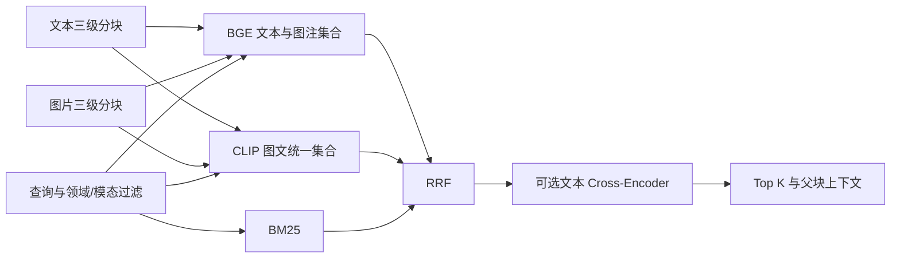

# Infra Knowledge RAG · v0.2

新增[语料预处理与分库检索实验](evals/merged-corpus-v2/README.md)：结构化处理127篇冻结材料，
保留来源和版本映射，提供AI材料审计、分库候选名额及版本优先。
固定dev对照显示预处理改善证据覆盖，完整组合未达到采用门槛；原默认服务不切换。

新增[独立合并语料索引](evals/merged-corpus-v1/README.md)：合并40篇官方来源与87篇中文仓库正文，
保留版本与来源信息，审计重复片段，并提供固定中文dev检索及回答对照。原索引与评测结果保留。

面向 AI Infra、训练通信、推理引擎、GPU、系统软件和云原生知识的本地问答与证据检索项目。
参考 `../InfraResearch-Agent` 的结构化解析、混合召回、来源定位和评估思路，提供
Agent 可直接调用的证据检索 API。

新增[官方来源评测候选集](evals/infra-official-v1/README.md)：40篇冻结官方正文、120道AI候选题、
dev60/holdout60及独立人工审核表。提供[分层离线评测与SciFact对照工具](docs/official-evaluation.md)，
分别记录召回、实际交付证据和生成；候选未审核前禁止holdout，事实评分保持空值，线上配置不变。
本轮[领域dev诊断、真实生成冒烟与SciFact结果](evals/infra-official-v1/results/experiment-analysis.md)
已保存；生成答案的事实评分仍待独立人工审核。
后续已按kylin（2026-10-01）的声明登记120题审核通过，完成[正式dev首轮300条采集与错误定位](evals/infra-official-v1-reviewed/results/dev-first-round.md)。
生成答案仍待审核；两条可复现生成服务错误已做独立参数诊断，holdout尚未运行。

支持[本地、DeepSeek与AIHubMix API配置切换](docs/api-models.md)，保留Ollama。
当前 `.env.llm` 已恢复官方 DeepSeek `deepseek-flash`，英文查询翻译用于中文问题检索英文技术资料。
其他服务配置独立保留。优化启动与 dev 结果见[DeepSeek 优化说明](docs/deepseek-optimization.md)。
AIHubMix的[完整dev执行记录及额度诊断](evals/infra-official-v1-reviewed/results/aihubmix-comparison.md)
已保存；因试用额度与调用错误未形成有效完整模型评测。
官方模型名使用`deepseek-flash`；密钥放在忽略的`.env.deepseek`，模板含切换注释。
已完成[官方API与本地4B的300条dev对照](evals/infra-official-v1-reviewed/results/deepseek-comparison.md)：
API调用错误0条，生成结构校验通过；作答数与耗时改善，事实评分仍待独立评审。

已加入[三仓库真实语料数据集](evals/repository-benchmark/README.md)：87篇正文、150道
有原文证据的AI构建题，分为dev50/test100，提供固定版本来源、复现脚本及完整语料检索基线。
尚未经独立人工审核；与早期60题小语料实验分开保存。

后续[等价证据标注与dev对照](evals/repository-benchmark/annotations-v2/README.md)
比较BM25重排、完整候选并集重排、标题层级上下文，保持原始模型与test划分固定。

已完成[公开数据实验与改进分析](evals/public-benchmarks/experiment-analysis.md)：
BRIGHT完整文档库检索、TechQA上下文池试验及C-Eval题目质量审计。
BM25已改用倒排索引和Top-k堆选择，默认排名保持一致；英文问题可选
`--lexical-query-mode technical`，默认仍为`raw`。`--candidate-k`控制重排候选数量。
上述查询选项不改变索引指纹，不需要重新构建现有索引。

已加入[增量处理、检索诊断与上下文交付](docs/retrieval-updates.md)：按文件/图注哈希跳过
未变化来源，持久复用 BGE/CLIP 向量；`search --debug` 显示各召回通道、融合截断、
重排变化与输入长度；默认按共享预算返回去重证据和稳定引用，`--context-mode legacy`
保留原上下文方式。真实模型验收与固定 dev50 回归保存在 `evals/results/retrieval-updates/`。
新版本 Chroma 集合及 JSON 快照仍完整写入，增量收益主要在解析与编码阶段。

macOS 用户可运行 [Infra Lens 悬浮问答球](docs/desktop-macos.md)：点击可拖动的置顶小球
展开对话面板，导入本地文档、用 Ollama 生成带引用的回答并连续追问。

## 运行

Python 3.12+、uv。安装基础依赖后，demo 模式运行无需网络或 GPU；哈希向量只验证流程。

```bash
uv sync --python 3.12 --extra dev
uv run infra-rag ingest examples/corpus
uv run infra-rag search 'PagedAttention 怎样管理 KV Cache？' --top-k 3
uv run infra-rag serve
```

访问 http://127.0.0.1:8000/docs 。新默认索引目录为 `data/default-v2`，保留旧版本目录。
分块、模型、模态配置写入索引指纹；改变配置应使用新目录重新导入。

```bash
# 真实 BGE、Chroma、重排、PDF 和图片区域处理
uv sync --all-extras
uv run --all-extras infra-rag --backend bge --data-dir data/text-v2 ingest /path/to/notes --domain inference
uv run --all-extras infra-rag --backend bge --data-dir data/text-v2 search 'KV Cache 的显存瓶颈'
uv run --all-extras infra-rag --backend bge --data-dir data/text-v2 --rerank serve

# CLIP 图文集合与图片三级分块
uv run --all-extras infra-rag --backend bge --multimodal --data-dir data/vision-v2 ingest /path/to/docs
uv run --all-extras infra-rag --backend bge --multimodal --data-dir data/vision-v2 search 'GPU 架构图' --modality image
```

全局参数放在子命令之前。真实模式初次运行下载模型；失败会报错，不会替换成 demo。
模型中文为主，英文论文场景可通过 `--embedding-model` 另建索引并评估双语模型。

## 五项能力的实现

| 能力 | 当前实现 | 适用边界 |
|---|---|---|
| 文本三级分块 | 空行/标题粗分块；正则与 jieba 词性判定标题；BGE 段落聚合；句向量相似度识别主题边界并细化 | 标题判定和相似度阈值为启发式，需用目标语料调参 |
| PDF 差异化处理 | PyMuPDF 文本复用文本分块；内嵌 raster 图片独立处理；邻近 Figure/Fig/图编号关联真实图注 | 不实现 OCR、通用双栏布局推断或矢量图识别 |
| 图片三级分块 | Canny/形态学/轮廓粗定位；PIL 裁剪；CLIP 相似度与几何距离聚合；大区域按尺寸和边缘细化 | 区域检测不能保证等于语义上的子图；保留整图作为上下文 |
| 元数据及父块索引 | 稳定父子 ID、模态、块类型、领域、来源、坐标系、bbox、图注来源；字典父索引查询 | 父索引保存在单进程内存中，重启从快照重建 |
| 多模态混合检索及评估 | BM25 + BGE + CLIP + RRF + 可选文本 reranker；JSON 子块标签、指标与消融 | reranker 对图片使用图注，不能直接判断图像像素 |

### 文本分块

粗处理保留标题、空行段落和 Markdown 代码围栏。短的孤立 TXT 行先满足形态约束，再以
jieba 词性和 Infra 词典辅助识别名词短语标题；正文不跨标题聚合。聚合依据当前父块的
累计段落向量和新段落相似度。二次细化使用相邻句子的向量相似度，在主题变化或长度
超限时切分；极长单句使用字符/token 边界兜底。

BGE 真实模式按 tokenizer 控制子块长度，长的粗段落通过 token 窗口分别编码后归一化
平均，避免聚合阶段只看到段落前缀。CLIP 长文本也在自身空间内窗口编码后平均。
`--chunk-strategy window` 提供固定窗口对照。

### 图片与 PDF

独立图片可附 `figure.png.txt` 图注。没有说明时仅用文件名，`caption_source=label`
明确区分占位标签。PDF 先筛选带图编号的邻近文本块，再按几何距离匹配；真实图注保存
来源定位，没有匹配时使用页码标签。扫描页在多模态模式可以作为图片索引，但不宣称
提取了文字；文本模式对无文本页提示 OCR 要求。

图片保存整图和区域子块；所有区域共用整图父 ID。保存 edge density、contrast 和
area fraction 等视觉统计，并用 CLIP 特征驱动区域聚合与检索。`bbox` 使用
`image_pixels` 或 `pdf_points` 显式区分；PDF 区域坐标由图像放置范围映射。
图注描述整图，不保证准确描述每个区域。复杂旋转/变换、多栏交错、连接线和嵌套子图
可能影响区域或图注匹配，需要在实际论文中继续评测。

### 向量库与重排



Chroma 包含两个互补集合：BGE 保存文字与图片说明；CLIP 集合通过配套多语言文本编码器
和视觉编码器同时保存文字与图片，实现真实的 CLIP 空间图文检索。查询分别编码，候选
按 chunk ID 做 RRF 排名融合。

**BGE 向量不输入 CLIP 文本分支。** 相同维度不代表相同空间；统一图文空间由配套 CLIP
编码器产生。bge-reranker-base 对文字和图片图注重新排序，其分数不是视觉相关性或答案
正确性的概率。问答接口另调用本机 Ollama 生成答案，并保留原始检索证据供核对。

## Agent API

- `POST /ingest`：`{"path":"/local/docs","domain":"inference"}`。
- `POST /search`：查询、top_k、domain、modality、strategy。
- `POST /chat`：`{"message":"PagedAttention 怎样管理 KV Cache？"}`；可选
  `conversation_id` 和 `domain`，返回回答、证据引用、状态与检索/生成耗时。
- `POST /warmup`：预加载检索编码器和本机回答模型，供桌面版启动后后台调用。
- `GET /conversations/{conversation_id}`：读取本机保存的对话历史。
- `GET /parents/{parent_id}`：通过父索引获取兄弟块和整图，未找到返回 404。
- `GET /sources`、`DELETE /sources?source=<完整路径>`：活动来源管理。
- `GET /health`：后端、模型模式、模态、数量和索引指纹。

`strategy` 支持 bm25、dense、clip、hybrid；dense 只召回 BGE，clip 只召回 CLIP，hybrid
融合所有启用通道。modality 可以限定 text/image。结果含 chunk、召回通道、RRF 分数、
可选重排分数、父上下文和实际交付的关联子块 ID。默认同父块上下文只返回一次，
其他 hit 通过 context_ref 引用；API 的 context_pack 提供唯一上下文及证据引用映射。
文字行号定位到父块范围，PDF 保留页码。`debug=true` 可额外返回检索阶段诊断。

问答使用本机 [Ollama](https://docs.ollama.com/api/chat) 的 `qwen3:4b`，先运行
`ollama pull qwen3:4b` 并启动 Ollama。它在本轮检索证据中回答，校验模型给出的引用 ID，
将最近对话保存在索引目录的 SQLite 文件中；证据不足时会给出提示。引用 ID 校验不等于
事实核验，回答仍需结合来源判断。目前没有业务意图分类、转人工工单与自动评测闭环。

## 已运行的实验

真实模型预检通过：BGE、bge-reranker-base、CLIP。
60 题 AI 自编 Infra 学习笔记子块评测包括 27 道直问、27 道改写和 6 道多证据题。

| 配置 | Recall@5 | MRR@5 | nDCG@5 |
|---|---:|---:|---:|
| 三级分块 + BM25 | 0.975 | 0.893 | 0.910 |
| 三级分块 + BGE | 0.983 | 0.912 | 0.929 |
| 三级分块 + BGE/BM25 融合 | 0.983 | 0.931 | 0.942 |
| 上述融合 + BGE 重排 | 0.983 | 0.883 | 0.910 |

本题集上重排降低了排序指标，保留失败结果；不宣称每种组件都会提升效果。
固定窗口对照 Recall@5=1.000、MRR@5=0.868；窗口包含更宽的主题范围，子块级标签粒度
不同，不能只看 recall 判断分块优劣。完整 precision/F1、Top-1/3/5/10、逐题结果和
预热后 P50/P95 见 [真实模型报告](evals/results/bge/comparison.md)。

多模态实测包含六张程序绘制的技术示意图和一份重复整图的合成 PDF，实际执行图片分块、
BGE/CLIP 编码、统一图文集合、过滤与图注重排。结果见 [多模态记录](evals/results/multimodal/)。
它验证真实链路，不代表复杂技术图理解准确率。

```bash
uv run --all-extras pytest -q
uv run --all-extras ruff check src tests scripts
uv run --all-extras python scripts/verify_models.py
uv run --all-extras python scripts/benchmark.py --backend bge
uv run --all-extras python scripts/verify_multimodal.py
```

测试包括语义主题切换、token 上限、图片裁剪与坐标、视觉聚合、图注关联、父索引生命周期、
Chroma 重启/替换/删除和 API。核心测试使用确定性编码器；上面三个脚本单独验证真实模型。

### 自定义 JSON 评估

每题包含 `id`、`query`、`relevant` 和可选 domain/modality。`--label chunk` 使用子块 ID；
也可提供 `relevant_spans`，指定 source 和 text，在检索前映射为子块标签。解析失败会报错，
不会用检索结果补造标签。`--label source` 使用相对于题集的来源路径；`--label parent`
用于整图相关性。Precision 分母固定为 K，返回不足仍计入；source/parent 对当前召回的
K 个子块去重，不额外扩大召回。空标签拒答题需另设拒答评估，不能混入召回指标。

```bash
uv run --all-extras infra-rag --backend bge --data-dir data/my-eval ingest evals/corpus
uv run --all-extras infra-rag --backend bge --data-dir data/my-eval evaluate evals/infra-60.json --label chunk --top-k 5 --output evals/results/custom.json
```

题集较小且与笔记同源，尚未验证大型外部语料。语料说明和技术资料见
[来源与标注](evals/corpus-sources.md)。旧 6 题 demo 记录只用于流程验证。

## 当前工程边界

本地单进程原型，BM25 按过滤条件懒构建并缓存统计；导入同步执行，更新写入完整版本集合。
文件哈希跳过未变化来源，持久缓存复用已有向量；JSON 快照原子发布，解析失败不发布部分索引。
旧 Chroma 集合、图片资产与缓存默认保留，可用 cleanup 预览、cleanup --apply 显式清理。
删除来源只移除活动索引。API 与 CLI 不应同时写入同一目录。
API 仅绑定 localhost；任务队列、鉴权、OCR、源码符号切分及仓库同步仍属后续工程扩展。

实现依据：[BGE](https://huggingface.co/BAAI/bge-small-zh-v1.5)、
[CLIP 配套多语言编码器](https://www.sbert.net/docs/sentence_transformer/pretrained_models.html)、
[Chroma](https://docs.trychroma.com/docs/collections/add-data)、
[OpenCV 轮廓](https://docs.opencv.org/4.13.0/da/d0c/tutorial_bounding_rects_circles.html)、
[PyMuPDF](https://pymupdf.readthedocs.io/en/latest/page.html)、
[jieba](https://github.com/fxsjy/jieba)。

[项目总结与简历素材](docs/project-summary.md) · [能力验收](docs/acceptance.md)

## Agent 分层评测规则

已新增独立的[只读研究 Agent](docs/read-only-agent.md)与[20题端到端开发实验](evals/agent-e2e-v1/review-report.md)，支持预算内工具选择、真实轨迹采集与失败原因排查；原 `/chat` 默认流程保持不变。实模结果和独立事实审核分别报告。

新增[Agent评估指标与可执行规则](docs/agent-evaluation-rules.md)：任务硬门槛、工具与恢复、
候选/实际交付、hash绑定独立事实审核、安全canary和成本口径。提供20条合成case与trace、
JSON schema及离线评分脚本；合成样例只验证评分器，不代表真实Agent成绩。
现有RAG默认流程和已冻结实验保持原口径。
