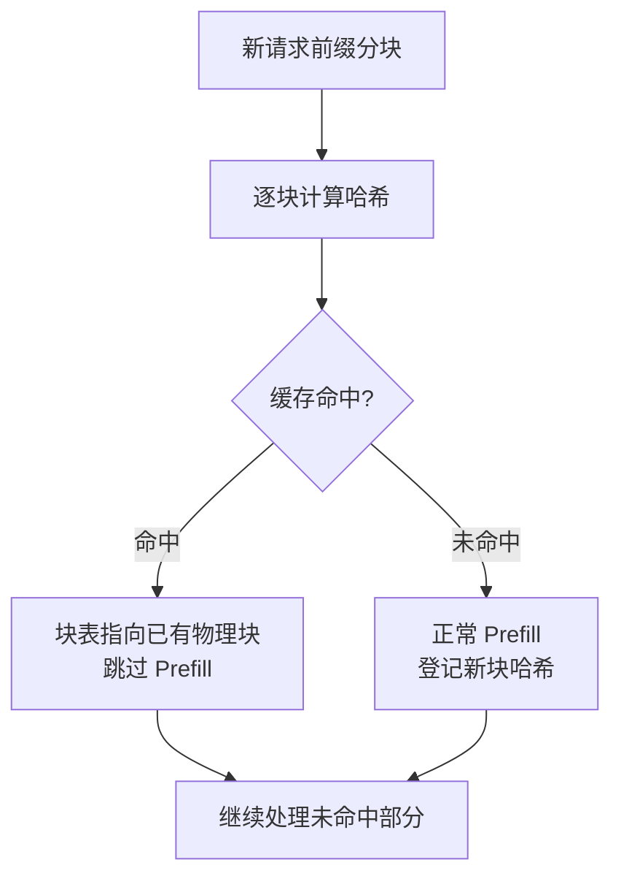

# 答案独立人工复核

填写 answer-review.json；事实字段留空表示尚未评分。
引用 ID 合法不代表陈述受到证据支持。

## official-002-1:official_english

vLLM v0.10.2：缓存块身份除了文本还需要哪些额外哈希？

必要要点：额外哈希包含LoRA ID、多模态输入哈希和租户隔离盐。

禁止误读：缓存键只需文本token，适配器和图像不影响身份。

```json
{
  "conversation_id": "b25347d4-3eff-49e9-8ba5-0b2d330b2b68",
  "answer": "除文本（块内 token 及前缀 token）外，缓存块身份还需要额外哈希（Extra hashes），例如 LoRA ID、多模态输入哈希，以及用于在多租户环境中隔离缓存的多租户 cache salt。[E3129f01f4bc9f6da4c0fbbdc]",
  "citations": [
    {
      "citation_id": "E3129f01f4bc9f6da4c0fbbdc",
      "chunk_id": "94b777157ed4ca867fa7d39a",
      "parent_id": "d7c7d1d7bc7c37bb0fe0a092",
      "source": "/Users/jennyma/Projects/InfraAgent/data/official-evals/infra-official-v1/corpus/vllm-prefix_caching.md",
      "locator": "/Users/jennyma/Projects/InfraAgent/data/official-evals/infra-official-v1/corpus/vllm-prefix_caching.md#L7-L19",
      "page": null,
      "start_line": 7,
      "end_line": 19,
      "modality": "text",
      "bbox": null,
      "coordinate_space": null,
      "image_path": null,
      "caption_source": null,
      "caption_locator": null,
      "content": "* Parent hash value: The hash value of the parent hash block.\n* Block tokens: A tuple of tokens in this block.\nThe reason to include the exact tokens is to reduce potential hash value collision.\n* Extra hashes: Other values required to make this block unique, such as LoRA IDs, multi-modality input hashes (see the example below), and cache salts to isolate caches in multi-tenant environments.",
      "truncated": false,
      "source_position": 1831
    }
  ],
  "status": "answered",
  "trace": [
    {
      "step": "retrieve",
      "duration_ms": 0.0,
      "query": "vLLM v0.10.2：缓存块身份除了文本还需要哪些额外哈希？",
      "hits": 0,
      "evidence": 8
    },
    {
      "step": "generate",
      "duration_ms": 826.5,
      "provider": "anthropic-compatible",
      "model": "deepseek-flash",
      "validated": true
    }
  ]
}
```

实际输入证据：

### E3129f01f4bc9f6da4c0fbbdc

/Users/jennyma/Projects/InfraAgent/data/official-evals/infra-official-v1/corpus/vllm-prefix_caching.md#L7-L19

```text
* Parent hash value: The hash value of the parent hash block.
* Block tokens: A tuple of tokens in this block.
The reason to include the exact tokens is to reduce potential hash value collision.
* Extra hashes: Other values required to make this block unique, such as LoRA IDs, multi-modality input hashes (see the example below), and cache salts to isolate caches in multi-tenant environments.
```

### E1463499a732287269ea92129

/Users/jennyma/Projects/InfraAgent/data/official-evals/infra-official-v1/corpus/vllm-prefix_caching.md#L79-L98

```text
To improve privacy in shared environments, vLLM supports isolating prefix cache reuse through optional per-request salting.
By including a `cache_salt` in the request, this value is injected into the hash of the first block, ensuring that only requests with the same salt can reuse cached KV blocks.
This prevents timing-based attacks where an adversary could infer cached content by observing latency differences.
```

### E5523a72b4594378eb43cf26d

/Users/jennyma/Projects/InfraAgent/data/official-evals/infra-official-v1/corpus/vllm-prefix_caching.md#L1-L5

```text
Since prefix caching is almost a free lunch and won’t change model outputs, it has been widely used by many public endpoints (e.g., OpenAI, Anthropic, etc) and most open source LLM inference frameworks (e.g., SGLang).
While there are many ways to implement prefix caching, vLLM chooses a hash-based approach.
Specifically, we hash each kv-cache block by the tokens in the block and the tokens in the prefix before the block:
```

### Ea538466a6d9a83baf54eb455

/Users/jennyma/Projects/InfraAgent/data/official-evals/infra-official-v1/corpus/vllm-prefix_caching.md#L178-L192

```text
In v0, when detecting block 3 is duplicated, we free block 3 and let Request 2 use block 1 instead, so its block table becomes `[0, 1]` in Time 1.
However, the block table in vLLM v1 is append-only, meaning that changing the block table from `[0, 3]` to `[0, 1]` is not allowed.
As a result, we will have duplicated blocks for the hash key E-H.
This duplication will be eliminated when the request is freed.
```

### Ef7976fc29beb7970d9d9ec07

/Users/jennyma/Projects/InfraAgent/data/official-evals/infra-official-v1/corpus/vllm-paged_attention.md#L103-L108

```text
  1 handles the elements at index 1, 3, 5, 7.
- **Block**: The key and value cache data in vLLM are split into
  blocks. Each block stores data for a fixed number(`BLOCK_SIZE`)
  of tokens at one head. Each block may contain only a portion of the
  whole context tokens. For example, if the block size is 16 and the
  head size is 128, then for one head, one block can store 16 * 128 =
```

### E8d533d57622ee10185804654

/Users/jennyma/Projects/InfraAgent/data/official-evals/infra-official-v1/corpus/vllm-prefix_caching.md#L7-L19

```text
In the example above, the KV cache in the first block can be uniquely identified with the token “A gentle breeze stirred”.
The third block can be uniquely identified with the tokens in the block “laughed in the distance”, along with the prefix tokens “A gentle breeze stirred the leaves as children”.
Therefore, we can build the block hash of `hash(tuple[components])`, where components are:
```

### E6bf6963ad3666b2917421e34

/Users/jennyma/Projects/InfraAgent/data/official-evals/infra-official-v1/corpus/vllm-prefix_caching.md#L7-L19

```text
```text
                    Block 1                  Block 2                  Block 3
         [A gentle breeze stirred] [the leaves as children] [laughed in the distance]
Block 1: |<--- block tokens ---->|
Block 2: |<------- prefix ------>| |<--- block tokens --->|
Block 3: |<------------------ prefix -------------------->| |<--- block tokens ---->|
```
```

### E9179e0166553b73ef2a10c4b

/Users/jennyma/Projects/InfraAgent/data/official-evals/infra-official-v1/corpus/vllm-prefix_caching.md#L79-L98

```text
!!
! note
Cache isolation is not supported in engine V0.
```

## official-002-2:official_english

vLLM v0.10.2：两个适配器使用相同文本，是否可以只按文本共享缓存？

必要要点：额外哈希包含LoRA ID、多模态输入哈希和租户隔离盐。

禁止误读：缓存键只需文本token，适配器和图像不影响身份。

```json
{
  "conversation_id": "b5c65802-36af-4941-a785-9f1d79be5863",
  "answer": "当前检索到的资料不足以可靠回答这个问题。可以补充文档或把问题问得更具体。",
  "citations": [],
  "status": "no_evidence",
  "trace": [
    {
      "step": "retrieve",
      "duration_ms": 0.0,
      "query": "vLLM v0.10.2：两个适配器使用相同文本，是否可以只按文本共享缓存？",
      "hits": 0,
      "evidence": 11
    },
    {
      "step": "generate",
      "duration_ms": 710.8,
      "provider": "anthropic-compatible",
      "model": "deepseek-flash",
      "validated": true
    }
  ]
}
```

实际输入证据：

### E2b6004c6cf7a4cdaa0bb3a8a

/Users/jennyma/Projects/InfraAgent/data/official-evals/infra-official-v1/corpus/cuda-unified-memory-programming.md#L946-L946

```text
Note that it is not possible to share memory between different hosts and their devices using this technique.
```

### E1463499a732287269ea92129

/Users/jennyma/Projects/InfraAgent/data/official-evals/infra-official-v1/corpus/vllm-prefix_caching.md#L79-L98

```text
To improve privacy in shared environments, vLLM supports isolating prefix cache reuse through optional per-request salting.
By including a `cache_salt` in the request, this value is injected into the hash of the first block, ensuring that only requests with the same salt can reuse cached KV blocks.
This prevents timing-based attacks where an adversary could infer cached content by observing latency differences.
```

### Ef7976fc29beb7970d9d9ec07

/Users/jennyma/Projects/InfraAgent/data/official-evals/infra-official-v1/corpus/vllm-paged_attention.md#L103-L108

```text
  1 handles the elements at index 1, 3, 5, 7.
- **Block**: The key and value cache data in vLLM are split into
  blocks. Each block stores data for a fixed number(`BLOCK_SIZE`)
  of tokens at one head. Each block may contain only a portion of the
  whole context tokens. For example, if the block size is 16 and the
  head size is 128, then for one head, one block can store 16 * 128 =
```

### E7a51e60df856b74fc98356f1

/Users/jennyma/Projects/InfraAgent/data/official-evals/infra-official-v1/corpus/cuda-unified-memory-programming.md#L1060-L1079

```text
when there is contention from multiple processors within a cache line, only the cache line is exchanged which is much smaller than the smallest page-size,
and when the different processors access different cache-lines within a page, then there is no contention.
```

### Ec94bd3c0efd3b0755001340f

/Users/jennyma/Projects/InfraAgent/data/official-evals/infra-official-v1/corpus/vllm-docker.md#L5-L37

```text
!!
! note
You can either use the `ipc=host` flag or `--shm-size` flag to allow the
container to access the host's shared memory.
vLLM uses PyTorch, which uses shared
memory to share data between processes under the hood, particularly for tensor parallel inference.
```

### E5dda40ed0c5092aadb08696f

/Users/jennyma/Projects/InfraAgent/data/official-evals/infra-official-v1/corpus/vllm-prefix_caching.md#L79-L98

```text
In the rest of this document, we first introduce the data structure used for prefix caching in vLLM v1, followed by the prefix caching workflow of major KV cache operators (e.g., allocate, append, free, eviction).
Finally, we use an example to illustrate the end to end prefix caching workflow.
**Cache Isolation for Security**
```

### Ea78a5260abf923558a637c53

/Users/jennyma/Projects/InfraAgent/data/official-evals/infra-official-v1/corpus/vllm-prefix_caching.md#L79-L98

```text
This offers protection without compromising performance.
```json
{
  "messages": [
    {"role": "system", "content": "You are a helpful assistant."},
    {"role": "user", "content": "Here is a document with details about the world series: ..."},
    {"role": "user", "content": "Who won the world series in 2020?"}
  ],
  "cache_salt": "your-cache-salt"
}
```
```

### E5d8fe7ed6ec122403b10c915

/Users/jennyma/Projects/InfraAgent/data/official-evals/infra-official-v1/corpus/vllm-prefix_caching.md#L79-L98

```text
With this setup, cache sharing is limited to users or requests that explicitly agree on a common salt, enabling cache reuse within a trust group while isolating others.
```

### E9179e0166553b73ef2a10c4b

/Users/jennyma/Projects/InfraAgent/data/official-evals/infra-official-v1/corpus/vllm-prefix_caching.md#L79-L98

```text
!!
! note
Cache isolation is not supported in engine V0.
```

### E58a9f23e4562d38c6cabee02

/Users/jennyma/Projects/InfraAgent/data/official-evals/infra-official-v1/corpus/cuda-unified-memory-programming.md#L1060-L1079

```text
Overall, hardware coherent systems provide significant performance benefits
compared to software coherent systems in cases where frequent concurrent accesses
to the same memory page are made by both CPU and GPU threads:
less page-faults: these systems do not need to use page-faults for emulating coherency or migrating memory,
less contention: these systems are coherent at cache-line granularity instead of page-size granularity, that is,
```

### Ef9eae978f71ee6bad0ff0dc0

/Users/jennyma/Projects/InfraAgent/data/official-evals/infra-official-v1/corpus/cuda-unified-memory-programming.md#L1060-L1079

```text
it becomes valid/active.
the physical page backing this virtual page must be moved/migrated to the processor
```

## official-002-3:official_english

vLLM v0.10.2：多租户前缀相同但需要隔离，应检查缓存键中的什么信息？

必要要点：额外哈希包含LoRA ID、多模态输入哈希和租户隔离盐。

禁止误读：缓存键只需文本token，适配器和图像不影响身份。

```json
{
  "conversation_id": "5fc1abf5-ad63-435f-ab56-0becfbdda4f6",
  "answer": "应检查缓存键中的 cache salt（缓存盐）信息。vLLM 支持通过可选的按请求 salting 来隔离前缀缓存复用：请求中携带的 `cache_salt` 会被注入到第一个块的哈希中，只有携带相同 salt 的请求才能复用缓存的 KV 块，从而在多租户环境中实现缓存隔离 [E1463499a732287269ea92129]。此外，缓存键的 Extra hashes 组件也包含用于在多租户环境中隔离缓存的 cache salts [E3129f01f4bc9f6da4c0fbbdc]。",
  "citations": [
    {
      "citation_id": "E1463499a732287269ea92129",
      "chunk_id": "5d0deace325a4e6f0db68487",
      "parent_id": "612762eb6e0414a8b894b688",
      "source": "/Users/jennyma/Projects/InfraAgent/data/official-evals/infra-official-v1/corpus/vllm-prefix_caching.md",
      "locator": "/Users/jennyma/Projects/InfraAgent/data/official-evals/infra-official-v1/corpus/vllm-prefix_caching.md#L79-L98",
      "page": null,
      "start_line": 79,
      "end_line": 98,
      "modality": "text",
      "bbox": null,
      "coordinate_space": null,
      "image_path": null,
      "caption_source": null,
      "caption_locator": null,
      "content": "To improve privacy in shared environments, vLLM supports isolating prefix cache reuse through optional per-request salting.\nBy including a `cache_salt` in the request, this value is injected into the hash of the first block, ensuring that only requests with the same salt can reuse cached KV blocks.\nThis prevents timing-based attacks where an adversary could infer cached content by observing latency differences.",
      "truncated": false,
      "source_position": 1841
    },
    {
      "citation_id": "E3129f01f4bc9f6da4c0fbbdc",
      "chunk_id": "94b777157ed4ca867fa7d39a",
      "parent_id": "d7c7d1d7bc7c37bb0fe0a092",
      "source": "/Users/jennyma/Projects/InfraAgent/data/official-evals/infra-official-v1/corpus/vllm-prefix_caching.md",
      "locator": "/Users/jennyma/Projects/InfraAgent/data/official-evals/infra-official-v1/corpus/vllm-prefix_caching.md#L7-L19",
      "page": null,
      "start_line": 7,
      "end_line": 19,
      "modality": "text",
      "bbox": null,
      "coordinate_space": null,
      "image_path": null,
      "caption_source": null,
      "caption_locator": null,
      "content": "* Parent hash value: The hash value of the parent hash block.\n* Block tokens: A tuple of tokens in this block.\nThe reason to include the exact tokens is to reduce potential hash value collision.\n* Extra hashes: Other values required to make this block unique, such as LoRA IDs, multi-modality input hashes (see the example below), and cache salts to isolate caches in multi-tenant environments.",
      "truncated": false,
      "source_position": 1831
    }
  ],
  "status": "answered",
  "trace": [
    {
      "step": "retrieve",
      "duration_ms": 0.0,
      "query": "vLLM v0.10.2：多租户前缀相同但需要隔离，应检查缓存键中的什么信息？",
      "hits": 0,
      "evidence": 8
    },
    {
      "step": "generate",
      "duration_ms": 1618.2,
      "provider": "anthropic-compatible",
      "model": "deepseek-flash",
      "validated": true
    }
  ]
}
```

实际输入证据：

### E3129f01f4bc9f6da4c0fbbdc

/Users/jennyma/Projects/InfraAgent/data/official-evals/infra-official-v1/corpus/vllm-prefix_caching.md#L7-L19

```text
* Parent hash value: The hash value of the parent hash block.
* Block tokens: A tuple of tokens in this block.
The reason to include the exact tokens is to reduce potential hash value collision.
* Extra hashes: Other values required to make this block unique, such as LoRA IDs, multi-modality input hashes (see the example below), and cache salts to isolate caches in multi-tenant environments.
```

### E1463499a732287269ea92129

/Users/jennyma/Projects/InfraAgent/data/official-evals/infra-official-v1/corpus/vllm-prefix_caching.md#L79-L98

```text
To improve privacy in shared environments, vLLM supports isolating prefix cache reuse through optional per-request salting.
By including a `cache_salt` in the request, this value is injected into the hash of the first block, ensuring that only requests with the same salt can reuse cached KV blocks.
This prevents timing-based attacks where an adversary could infer cached content by observing latency differences.
```

### E5dda40ed0c5092aadb08696f

/Users/jennyma/Projects/InfraAgent/data/official-evals/infra-official-v1/corpus/vllm-prefix_caching.md#L79-L98

```text
In the rest of this document, we first introduce the data structure used for prefix caching in vLLM v1, followed by the prefix caching workflow of major KV cache operators (e.g., allocate, append, free, eviction).
Finally, we use an example to illustrate the end to end prefix caching workflow.
**Cache Isolation for Security**
```

### E0ba72e65234add842fa94e1f

/Users/jennyma/Projects/InfraAgent/data/official-evals/infra-official-v1/corpus/vllm-paged_attention.md#L1-L23

```text
# Paged Attention
!
!!
warning
This is a historical document based on the [original paper for vLLM](https://arxiv.org/abs/2309.06180).
It no longer describes the code used in vLLM today.
Currently, vLLM utilizes its own implementation of a multi-head query
attention kernel (`csrc/attention/attention_kernels.cu`).
This kernel is designed to be compatible with
vLLM's paged KV caches, where the key and value cache are stored in
```

### Ec669dff2283a34cffde7adb6

/Users/jennyma/Projects/InfraAgent/data/official-evals/infra-official-v1/corpus/vllm-prefix_caching.md#L24-L29

```text
!!
! note "Note 2"
The above hash key structure is not 100% collision free.
Theoretically it’s still possible for the different prefix tokens to have the same hash value.
To avoid any hash collisions **in a multi-tenant setup, we advise to use SHA256** as hash function instead of the default builtin hash.
SHA256 is supported since vLLM v0.8.3 and must be enabled with a command line argument.
```

### E8d533d57622ee10185804654

/Users/jennyma/Projects/InfraAgent/data/official-evals/infra-official-v1/corpus/vllm-prefix_caching.md#L7-L19

```text
In the example above, the KV cache in the first block can be uniquely identified with the token “A gentle breeze stirred”.
The third block can be uniquely identified with the tokens in the block “laughed in the distance”, along with the prefix tokens “A gentle breeze stirred the leaves as children”.
Therefore, we can build the block hash of `hash(tuple[components])`, where components are:
```

### E6bf6963ad3666b2917421e34

/Users/jennyma/Projects/InfraAgent/data/official-evals/infra-official-v1/corpus/vllm-prefix_caching.md#L7-L19

```text
```text
                    Block 1                  Block 2                  Block 3
         [A gentle breeze stirred] [the leaves as children] [laughed in the distance]
Block 1: |<--- block tokens ---->|
Block 2: |<------- prefix ------>| |<--- block tokens --->|
Block 3: |<------------------ prefix -------------------->| |<--- block tokens ---->|
```
```

### E9179e0166553b73ef2a10c4b

/Users/jennyma/Projects/InfraAgent/data/official-evals/infra-official-v1/corpus/vllm-prefix_caching.md#L79-L98

```text
!!
! note
Cache isolation is not supported in engine V0.
```

## official-002-4:official_english

vLLM v0.10.2：先确认服务模型支持LoRA，再考虑两个LoRA请求文本相同，为什么缓存键仍需额外区分身份？

必要要点：额外哈希包含LoRA ID、多模态输入哈希和租户隔离盐。；服务模型须支持LoRA；切换适配器时缓存键还需要适配器身份。

禁止误读：缓存键只需文本token，适配器和图像不影响身份。

```json
{
  "conversation_id": "26d6e291-a3f8-42a6-97f8-ebc4bdda68c8",
  "answer": "当前检索到的资料不足以可靠回答这个问题。可以补充文档或把问题问得更具体。",
  "citations": [],
  "status": "no_evidence",
  "trace": [
    {
      "step": "retrieve",
      "duration_ms": 0.0,
      "query": "vLLM v0.10.2：先确认服务模型支持LoRA，再考虑两个LoRA请求文本相同，为什么缓存键仍需额外区分身份？",
      "hits": 0,
      "evidence": 7
    },
    {
      "step": "generate",
      "duration_ms": 1227.1,
      "provider": "anthropic-compatible",
      "model": "deepseek-flash",
      "validated": true
    }
  ]
}
```

实际输入证据：

### Ef768335d9dec6977b163f79a

/Users/jennyma/Projects/InfraAgent/data/official-evals/infra-official-v1/corpus/vllm-lora.md#L1-L27

```text
We can now submit the prompts and call `llm.generate` with the `lora_request` parameter.
The first parameter
of `LoRARequest` is a human identifiable name, the second parameter is a globally unique ID for the adapter and
the third parameter is the path to the LoRA adapter.
```

### E18b40967bf69bdff910d3cff

/Users/jennyma/Projects/InfraAgent/data/official-evals/infra-official-v1/corpus/vllm-lora.md#L52-L61

```text
## Serving LoRA Adapters

LoRA adapted models can also be served with the Open-AI compatible vLLM server. To do so, we use
`--lora-modules {name}={path} {name}={path}` to specify each LoRA module when we kick off the server:

```bash
vllm serve meta-llama/Llama-2-7b-hf \
    --enable-lora \
    --lora-modules sql-lora=$HOME/.cache/huggingface/hub/models--yard1--llama-2-7b-sql-lora-test/snapshots/0dfa347e8877a4d4ed19ee56c140fa518470028c/
```
```

### Efc55291935303ead3eaceed3

/Users/jennyma/Projects/InfraAgent/data/official-evals/infra-official-v1/corpus/vllm-lora.md#L108-L110

```text
## Dynamically serving LoRA Adapters

In addition to serving LoRA adapters at server startup, the vLLM server supports dynamically configuring LoRA adapters at runtime through dedicated API endpoints and plugins. This feature can be particularly useful when the flexibility to change models on-the-fly is needed.
```

### E6cd3244c6b47a95ad98986d3

/Users/jennyma/Projects/InfraAgent/data/official-evals/infra-official-v1/corpus/vllm-lora.md#L286-L341

```text
{
                "role": "user",
                "content": question
            }
        ]
        return tokenizer.apply_chat_template(chat, tokenize=False)


    llm = LLM(
        model=model_id,
        enable_lora=True,
        max_lora_rank=64,
        max_model_len=2048,
        limit_mm_per_prompt={"audio": 1},
        # Will always pass a `LoRARequest` with the `model_id`
        # whenever audio is contained in the request data.
    
```

### Ea0370fa72812b6d39ca1d0a4

/Users/jennyma/Projects/InfraAgent/data/official-evals/infra-official-v1/corpus/vllm-lora.md#L233-L238

```text
## LoRA model lineage in model card
The new format of `--lora-modules` is mainly to support the display of parent model information in the model card.
Here's an explanation of how your current response supports this:
- The `parent` field of LoRA model `sql-lora` now links to its base model `meta-llama/Llama-2-7b-hf`.
This correctly reflects the hierarchical relationship between the base model and the LoRA adapter.
```

### Eb3c216cd74d8eff556f10602

/Users/jennyma/Projects/InfraAgent/data/official-evals/infra-official-v1/corpus/vllm-lora.md#L1-L27

```text
```python
from huggingface_hub import snapshot_download

sql_lora_path = snapshot_download(repo_id="yard1/llama-2-7b-sql-lora-test")
```
Then we instantiate the base model and pass in the `enable_lora=True` flag:
```python
from vllm import LLM, SamplingParams
from vllm.lora.request import LoRARequest

llm = LLM(model="meta-llama/Llama-2-7b-hf", enable_lora=True)
```
```

### E73367775116b0ea04ade603e

/Users/jennyma/Projects/InfraAgent/data/official-evals/infra-official-v1/corpus/vllm-lora.md#L1-L27

```text
# LoRA Adapters
This document shows you how to use [LoRA adapters](https://arxiv.org/abs/2106.09685) with vLLM on top of a base model.
LoRA adapters can be used with any vLLM model that implements [SupportsLoRA][vllm.model_executor.models.interfaces.SupportsLoRA].
Adapters can be efficiently served on a per request basis with minimal overhead.
First we download the adapter(s) and save
them locally with
```

## official-004-1:official_english

vLLM v0.10.2：Ampere在此版本支持的FP8配置与kernel是什么？

必要要点：Ampere的该支持是使用Marlin的W8A16权重量化。

禁止误读：Ampere文档中的该支持等同于W8A8。

```json
{
  "conversation_id": "ce4a7569-3a13-424d-a2b0-dd2f374dc53e",
  "answer": "在 vLLM 中，Ampere GPU 支持 W8A16（weight-only FP8），使用 FP8 Marlin kernel；FP8 计算本身需要 compute capability > 8.9（Ada Lovelace、Hopper），Ampere 上以 weight-only W8A16 方式运行。[E707fd541c52eb73c2ed6c6d8][E304d729ae809670c7310aad7]",
  "citations": [
    {
      "citation_id": "E707fd541c52eb73c2ed6c6d8",
      "chunk_id": "a2df220c82c59eb08a6b868e",
      "parent_id": "6b6ae87689f336faaf9c8a1a",
      "source": "/Users/jennyma/Projects/InfraAgent/data/official-evals/infra-official-v1/corpus/vllm-fp8.md",
      "locator": "/Users/jennyma/Projects/InfraAgent/data/official-evals/infra-official-v1/corpus/vllm-fp8.md#L1-L6",
      "page": null,
      "start_line": 1,
      "end_line": 6,
      "modality": "text",
      "bbox": null,
      "coordinate_space": null,
      "image_path": null,
      "caption_source": null,
      "caption_locator": null,
      "content": "# FP8 W8A8\nvLLM supports FP8 (8-bit floating point) weight and activation quantization using hardware acceleration on GPUs such as Nvidia H100 and AMD MI300x.\nCurrently, only Hopper and Ada Lovelace GPUs are officially supported for W8A8.\nAmpere GPUs are supported for W8A16 (weight-only FP8) utilizing Marlin kernels.",
      "truncated": false,
      "source_position": 1441
    },
    {
      "citation_id": "E304d729ae809670c7310aad7",
      "chunk_id": "b5c56188263e0df5c1181742",
      "parent_id": "525c8a560c4231e6c326de0c",
      "source": "/Users/jennyma/Projects/InfraAgent/data/official-evals/infra-official-v1/corpus/vllm-fp8.md",
      "locator": "/Users/jennyma/Projects/InfraAgent/data/official-evals/infra-official-v1/corpus/vllm-fp8.md#L15-L17",
      "page": null,
      "start_line": 15,
      "end_line": 17,
      "modality": "text",
      "bbox": null,
      "coordinate_space": null,
      "image_path": null,
      "caption_source": null,
      "caption_locator": null,
      "content": "!!! note\n    FP8 computation is supported on NVIDIA GPUs with compute capability > 8.9 (Ada Lovelace, Hopper).\n    FP8 models will run on compute capability > 8.0 (Ampere) as weight-only W8A16, utilizing FP8 Marlin.",
      "truncated": false,
      "source_position": 1446
    }
  ],
  "status": "answered",
  "trace": [
    {
      "step": "retrieve",
      "duration_ms": 0.0,
      "query": "vLLM v0.10.2：Ampere在此版本支持的FP8配置与kernel是什么？",
      "hits": 0,
      "evidence": 6
    },
    {
      "step": "generate",
      "duration_ms": 810.9,
      "provider": "anthropic-compatible",
      "model": "deepseek-flash",
      "validated": true
    }
  ]
}
```

实际输入证据：

### E707fd541c52eb73c2ed6c6d8

/Users/jennyma/Projects/InfraAgent/data/official-evals/infra-official-v1/corpus/vllm-fp8.md#L1-L6

```text
# FP8 W8A8
vLLM supports FP8 (8-bit floating point) weight and activation quantization using hardware acceleration on GPUs such as Nvidia H100 and AMD MI300x.
Currently, only Hopper and Ada Lovelace GPUs are officially supported for W8A8.
Ampere GPUs are supported for W8A16 (weight-only FP8) utilizing Marlin kernels.
```

### E8c0a6d8da59e340ff546c81b

/Users/jennyma/Projects/InfraAgent/data/official-evals/infra-official-v1/corpus/vllm-fp8.md#L10-L10

```text
The FP8 types typically supported in hardware have two distinct representations, each useful in different scenarios:
```

### E304d729ae809670c7310aad7

/Users/jennyma/Projects/InfraAgent/data/official-evals/infra-official-v1/corpus/vllm-fp8.md#L15-L17

```text
!!! note
    FP8 computation is supported on NVIDIA GPUs with compute capability > 8.9 (Ada Lovelace, Hopper).
    FP8 models will run on compute capability > 8.0 (Ampere) as weight-only W8A16, utilizing FP8 Marlin.
```

### Ea69ba78298695847964cf47f

/Users/jennyma/Projects/InfraAgent/data/official-evals/infra-official-v1/corpus/vllm-quantized_kvcache.md#L54-L56

```text
- `"auto"`: Uses the model's default "unquantized" data type
- `"fp8"` or `"fp8_e4m3"`: Supported on CUDA 11.8+ and ROCm (AMD GPU)
- `"fp8_e5m2"`: Supported on CUDA 11.8+
```

### Ed6d39e475341f4ab01dc6509

/Users/jennyma/Projects/InfraAgent/data/official-evals/infra-official-v1/corpus/vllm-issue-21175.md#L50-L51

```text
### To reproduce:
vllm version: v0.9.2
```

### Ef54934c2952f9f0e01ac3b8e

/Users/jennyma/Projects/InfraAgent/data/official-evals/infra-official-v1/corpus/vllm-fp8.md#L1-L6

```text
Quantization of models with FP8 allows for a 2x reduction in model memory requirements and up to a 1.6x improvement in throughput with minimal impact on accuracy.
```

## official-004-2:official_english

vLLM v0.10.2：能否把Ampere的W8A16支持解释为W8A8？

必要要点：Ampere的该支持是使用Marlin的W8A16权重量化。

禁止误读：Ampere文档中的该支持等同于W8A8。

```json
{
  "conversation_id": "7df83b51-aeda-42f3-a22a-3456c5824e9f",
  "answer": "不能。Ampere GPU 上支持的是 W8A16（weight-only FP8），使用 Marlin kernels，而非 W8A8；W8A8 目前仅官方支持 Hopper 和 Ada Lovelace GPU。[E707fd541c52eb73c2ed6c6d8][E304d729ae809670c7310aad7]",
  "citations": [
    {
      "citation_id": "E707fd541c52eb73c2ed6c6d8",
      "chunk_id": "a2df220c82c59eb08a6b868e",
      "parent_id": "6b6ae87689f336faaf9c8a1a",
      "source": "/Users/jennyma/Projects/InfraAgent/data/official-evals/infra-official-v1/corpus/vllm-fp8.md",
      "locator": "/Users/jennyma/Projects/InfraAgent/data/official-evals/infra-official-v1/corpus/vllm-fp8.md#L1-L6",
      "page": null,
      "start_line": 1,
      "end_line": 6,
      "modality": "text",
      "bbox": null,
      "coordinate_space": null,
      "image_path": null,
      "caption_source": null,
      "caption_locator": null,
      "content": "# FP8 W8A8\nvLLM supports FP8 (8-bit floating point) weight and activation quantization using hardware acceleration on GPUs such as Nvidia H100 and AMD MI300x.\nCurrently, only Hopper and Ada Lovelace GPUs are officially supported for W8A8.\nAmpere GPUs are supported for W8A16 (weight-only FP8) utilizing Marlin kernels.",
      "truncated": false,
      "source_position": 1441
    },
    {
      "citation_id": "E304d729ae809670c7310aad7",
      "chunk_id": "b5c56188263e0df5c1181742",
      "parent_id": "525c8a560c4231e6c326de0c",
      "source": "/Users/jennyma/Projects/InfraAgent/data/official-evals/infra-official-v1/corpus/vllm-fp8.md",
      "locator": "/Users/jennyma/Projects/InfraAgent/data/official-evals/infra-official-v1/corpus/vllm-fp8.md#L15-L17",
      "page": null,
      "start_line": 15,
      "end_line": 17,
      "modality": "text",
      "bbox": null,
      "coordinate_space": null,
      "image_path": null,
      "caption_source": null,
      "caption_locator": null,
      "content": "!!! note\n    FP8 computation is supported on NVIDIA GPUs with compute capability > 8.9 (Ada Lovelace, Hopper).\n    FP8 models will run on compute capability > 8.0 (Ampere) as weight-only W8A16, utilizing FP8 Marlin.",
      "truncated": false,
      "source_position": 1446
    }
  ],
  "status": "answered",
  "trace": [
    {
      "step": "retrieve",
      "duration_ms": 0.0,
      "query": "vLLM v0.10.2：能否把Ampere的W8A16支持解释为W8A8？",
      "hits": 0,
      "evidence": 8
    },
    {
      "step": "generate",
      "duration_ms": 919.0,
      "provider": "anthropic-compatible",
      "model": "deepseek-flash",
      "validated": true
    }
  ]
}
```

实际输入证据：

### E707fd541c52eb73c2ed6c6d8

/Users/jennyma/Projects/InfraAgent/data/official-evals/infra-official-v1/corpus/vllm-fp8.md#L1-L6

```text
# FP8 W8A8
vLLM supports FP8 (8-bit floating point) weight and activation quantization using hardware acceleration on GPUs such as Nvidia H100 and AMD MI300x.
Currently, only Hopper and Ada Lovelace GPUs are officially supported for W8A8.
Ampere GPUs are supported for W8A16 (weight-only FP8) utilizing Marlin kernels.
```

### E304d729ae809670c7310aad7

/Users/jennyma/Projects/InfraAgent/data/official-evals/infra-official-v1/corpus/vllm-fp8.md#L15-L17

```text
!!! note
    FP8 computation is supported on NVIDIA GPUs with compute capability > 8.9 (Ada Lovelace, Hopper).
    FP8 models will run on compute capability > 8.0 (Ampere) as weight-only W8A16, utilizing FP8 Marlin.
```

### E904c381bf1f5f1779dedef72

/Users/jennyma/Projects/InfraAgent/data/official-evals/infra-official-v1/corpus/sglang-quantization.md#L26-L39

```text
This action will ignore the Hugging Face config's quantization settings.
For instance, with `neuralmagic/Meta-Llama-3.1-8B-Instruct-FP8-dynamic`, if you execute with `--quantization w8a8_fp8`, the system will use the `W8A8Fp8Config` from SGLang to invoke the sgl-kernel, rather than the `CompressedTensorsConfig` for vLLM kernels.
```

### E14044dab8ed7a3b5d78abf38

/Users/jennyma/Projects/InfraAgent/data/official-evals/infra-official-v1/corpus/vllm-optimization.md#L63-L65

```text
## Parallelism Strategies

vLLM supports multiple parallelism strategies that can be combined to optimize performance across different hardware configurations.
```

### Ed6d39e475341f4ab01dc6509

/Users/jennyma/Projects/InfraAgent/data/official-evals/infra-official-v1/corpus/vllm-issue-21175.md#L50-L51

```text
### To reproduce:
vllm version: v0.9.2
```

### Ef54934c2952f9f0e01ac3b8e

/Users/jennyma/Projects/InfraAgent/data/official-evals/infra-official-v1/corpus/vllm-fp8.md#L1-L6

```text
Quantization of models with FP8 allows for a 2x reduction in model memory requirements and up to a 1.6x improvement in throughput with minimal impact on accuracy.
```

### E74b994b5ce8fbeb1f2a0b11e

/Users/jennyma/Projects/InfraAgent/data/official-evals/infra-official-v1/corpus/sglang-quantization.md#L26-L39

```text
```bash
python3 -m sglang.launch_server \
    --model-path hugging-quants/Meta-Llama-3.1-8B-Instruct-AWQ-INT4 \
    --port 30000 --host 0.0.0.0
```
Take note, if your model is **per-channel quantized (INT8 or FP8) with per-token dynamic quantization activation**, you can opt to include `--quantization w8a8_int8` or `--quantization w8a8_fp8` to invoke the corresponding CUTLASS int8_kernel or fp8_kernel in sgl-kernel.
```

### Ef6c630563d458d3c5beb00ac

/Users/jennyma/Projects/InfraAgent/data/official-evals/infra-official-v1/corpus/sglang-quantization.md#L26-L39

```text
```bash
python3 -m sglang.launch_server \
    --model-path neuralmagic/Meta-Llama-3.1-8B-Instruct-FP8-dynamic \
    --quantization w8a8_fp8 \
    --port 30000 --host 0.0.0.0
```
```

## official-004-3:official_english

vLLM v0.10.2：在Ampere部署FP8模型时把激活也按8bit支持处理，应先核对哪个限制？

必要要点：Ampere的该支持是使用Marlin的W8A16权重量化。

禁止误读：Ampere文档中的该支持等同于W8A8。

```json
{
  "conversation_id": "77502f03-3099-4012-866e-8a0d016364e0",
  "answer": "应先核对GPU计算能力（compute capability）限制：FP8计算（W8A8）仅在compute capability > 8.9的Ada Lovelace和Hopper上支持，Ampere（compute capability > 8.0）只支持weight-only的W8A16（FP8 Marlin），因此Ampere上不能把激活也按8bit处理。[E304d729ae809670c7310aad7][E707fd541c52eb73c2ed6c6d8]",
  "citations": [
    {
      "citation_id": "E304d729ae809670c7310aad7",
      "chunk_id": "b5c56188263e0df5c1181742",
      "parent_id": "525c8a560c4231e6c326de0c",
      "source": "/Users/jennyma/Projects/InfraAgent/data/official-evals/infra-official-v1/corpus/vllm-fp8.md",
      "locator": "/Users/jennyma/Projects/InfraAgent/data/official-evals/infra-official-v1/corpus/vllm-fp8.md#L15-L17",
      "page": null,
      "start_line": 15,
      "end_line": 17,
      "modality": "text",
      "bbox": null,
      "coordinate_space": null,
      "image_path": null,
      "caption_source": null,
      "caption_locator": null,
      "content": "!!! note\n    FP8 computation is supported on NVIDIA GPUs with compute capability > 8.9 (Ada Lovelace, Hopper).\n    FP8 models will run on compute capability > 8.0 (Ampere) as weight-only W8A16, utilizing FP8 Marlin.",
      "truncated": false,
      "source_position": 1446
    },
    {
      "citation_id": "E707fd541c52eb73c2ed6c6d8",
      "chunk_id": "a2df220c82c59eb08a6b868e",
      "parent_id": "6b6ae87689f336faaf9c8a1a",
      "source": "/Users/jennyma/Projects/InfraAgent/data/official-evals/infra-official-v1/corpus/vllm-fp8.md",
      "locator": "/Users/jennyma/Projects/InfraAgent/data/official-evals/infra-official-v1/corpus/vllm-fp8.md#L1-L6",
      "page": null,
      "start_line": 1,
      "end_line": 6,
      "modality": "text",
      "bbox": null,
      "coordinate_space": null,
      "image_path": null,
      "caption_source": null,
      "caption_locator": null,
      "content": "# FP8 W8A8\nvLLM supports FP8 (8-bit floating point) weight and activation quantization using hardware acceleration on GPUs such as Nvidia H100 and AMD MI300x.\nCurrently, only Hopper and Ada Lovelace GPUs are officially supported for W8A8.\nAmpere GPUs are supported for W8A16 (weight-only FP8) utilizing Marlin kernels.",
      "truncated": false,
      "source_position": 1441
    }
  ],
  "status": "answered",
  "trace": [
    {
      "step": "retrieve",
      "duration_ms": 0.3,
      "query": "vLLM v0.10.2：在Ampere部署FP8模型时把激活也按8bit支持处理，应先核对哪个限制？",
      "hits": 0,
      "evidence": 6
    },
    {
      "step": "generate",
      "duration_ms": 1010.0,
      "provider": "anthropic-compatible",
      "model": "deepseek-flash",
      "validated": true
    }
  ]
}
```

实际输入证据：

### E707fd541c52eb73c2ed6c6d8

/Users/jennyma/Projects/InfraAgent/data/official-evals/infra-official-v1/corpus/vllm-fp8.md#L1-L6

```text
# FP8 W8A8
vLLM supports FP8 (8-bit floating point) weight and activation quantization using hardware acceleration on GPUs such as Nvidia H100 and AMD MI300x.
Currently, only Hopper and Ada Lovelace GPUs are officially supported for W8A8.
Ampere GPUs are supported for W8A16 (weight-only FP8) utilizing Marlin kernels.
```

### Ea69ba78298695847964cf47f

/Users/jennyma/Projects/InfraAgent/data/official-evals/infra-official-v1/corpus/vllm-quantized_kvcache.md#L54-L56

```text
- `"auto"`: Uses the model's default "unquantized" data type
- `"fp8"` or `"fp8_e4m3"`: Supported on CUDA 11.8+ and ROCm (AMD GPU)
- `"fp8_e5m2"`: Supported on CUDA 11.8+
```

### E8c0a6d8da59e340ff546c81b

/Users/jennyma/Projects/InfraAgent/data/official-evals/infra-official-v1/corpus/vllm-fp8.md#L10-L10

```text
The FP8 types typically supported in hardware have two distinct representations, each useful in different scenarios:
```

### Ee4f4fbccc9548d5e3f51da06

/Users/jennyma/Projects/InfraAgent/data/official-evals/infra-official-v1/corpus/vllm-quantized_kvcache.md#L140-L150

```text
When running the model you must specify `kv_cache_dtype="fp8"` in order to enable the kv cache quantization and use the scales.

```python
from vllm import LLM, SamplingParams

sampling_params = SamplingParams(temperature=0.7, top_p=0.8)
llm = LLM(model="Llama-3.1-8B-Instruct-FP8-KV", kv_cache_dtype="fp8")
prompt = "London is the capital of"
out = llm.generate(prompt, sampling_params)[0].outputs[0].text
print(out)
```
```

### E304d729ae809670c7310aad7

/Users/jennyma/Projects/InfraAgent/data/official-evals/infra-official-v1/corpus/vllm-fp8.md#L15-L17

```text
!!! note
    FP8 computation is supported on NVIDIA GPUs with compute capability > 8.9 (Ada Lovelace, Hopper).
    FP8 models will run on compute capability > 8.0 (Ampere) as weight-only W8A16, utilizing FP8 Marlin.
```

### Ef54934c2952f9f0e01ac3b8e

/Users/jennyma/Projects/InfraAgent/data/official-evals/infra-official-v1/corpus/vllm-fp8.md#L1-L6

```text
Quantization of models with FP8 allows for a 2x reduction in model memory requirements and up to a 1.6x improvement in throughput with minimal impact on accuracy.
```

## official-004-4:official_english

vLLM v0.10.2：先界定vLLM Ampere FP8支持的精度组合，再判断能否把它照搬到SGLang AMD DeepSeekV3，应核对PR中的哪种FP8格式？

必要要点：Ampere的该支持是使用Marlin的W8A16权重量化。；Ampere的W8A16不是通用W8A8保证；AMD DeepSeekV3修复另涉及e4m3fnuz，需按硬件和模型核验。

禁止误读：Ampere文档中的该支持等同于W8A8。

```json
{
  "conversation_id": "89356fa5-731b-4cca-bc00-77a0d19c540e",
  "answer": "vLLM v0.10.2 中，Ampere GPU 仅支持 W8A16（weight-only FP8，使用 Marlin kernels），W8A8 官方只支持 Hopper 和 Ada Lovelace [E707fd541c52eb73c2ed6c6d8]。因此不能把 Ampere 的 FP8 支持照搬到 SGLang AMD DeepSeekV3；应核对 PR 中针对 AMD 的 FP8 格式 e4m3fnuz [E870326793d056a107a5a1672]。",
  "citations": [
    {
      "citation_id": "E707fd541c52eb73c2ed6c6d8",
      "chunk_id": "a2df220c82c59eb08a6b868e",
      "parent_id": "6b6ae87689f336faaf9c8a1a",
      "source": "/Users/jennyma/Projects/InfraAgent/data/official-evals/infra-official-v1/corpus/vllm-fp8.md",
      "locator": "/Users/jennyma/Projects/InfraAgent/data/official-evals/infra-official-v1/corpus/vllm-fp8.md#L1-L6",
      "page": null,
      "start_line": 1,
      "end_line": 6,
      "modality": "text",
      "bbox": null,
      "coordinate_space": null,
      "image_path": null,
      "caption_source": null,
      "caption_locator": null,
      "content": "# FP8 W8A8\nvLLM supports FP8 (8-bit floating point) weight and activation quantization using hardware acceleration on GPUs such as Nvidia H100 and AMD MI300x.\nCurrently, only Hopper and Ada Lovelace GPUs are officially supported for W8A8.\nAmpere GPUs are supported for W8A16 (weight-only FP8) utilizing Marlin kernels.",
      "truncated": false,
      "source_position": 1441
    },
    {
      "citation_id": "E870326793d056a107a5a1672",
      "chunk_id": "d8d46d9520e81b96110bb9de",
      "parent_id": "3ad9d6d6285d96e72ffaf505",
      "source": "/Users/jennyma/Projects/InfraAgent/data/official-evals/infra-official-v1/corpus/sglang-pr-2601.md",
      "locator": "/Users/jennyma/Projects/InfraAgent/data/official-evals/infra-official-v1/corpus/sglang-pr-2601.md#L8-L11",
      "page": null,
      "start_line": 8,
      "end_line": 11,
      "modality": "text",
      "bbox": null,
      "coordinate_space": null,
      "image_path": null,
      "caption_source": null,
      "caption_locator": null,
      "content": "## Modifications\n- Add proper fix for AMD FP8 ```e4m3fnuz``` to support DeepseekV3 FP8 model\n- Bypass ```FlashInfer backend bmm_fp8``` to cast FP8 to BF16 in MLA\n- Add AMD ```triton stages``` config",
      "truncated": false,
      "source_position": 982
    }
  ],
  "status": "answered",
  "trace": [
    {
      "step": "retrieve",
      "duration_ms": 0.0,
      "query": "vLLM v0.10.2：先界定vLLM Ampere FP8支持的精度组合，再判断能否把它照搬到SGLang AMD DeepSeekV3，应核对PR中的哪种FP8格式？",
      "hits": 0,
      "evidence": 6
    },
    {
      "step": "generate",
      "duration_ms": 1091.0,
      "provider": "anthropic-compatible",
      "model": "deepseek-flash",
      "validated": true
    }
  ]
}
```

实际输入证据：

### E4a99edc287be8e7e99295b08

/Users/jennyma/Projects/InfraAgent/data/official-evals/infra-official-v1/corpus/sglang-quantization.md#L105-L105

```text
Then, you can directly use the quantized model with `SGLang`, by using the following command:
```

### E707fd541c52eb73c2ed6c6d8

/Users/jennyma/Projects/InfraAgent/data/official-evals/infra-official-v1/corpus/vllm-fp8.md#L1-L6

```text
# FP8 W8A8
vLLM supports FP8 (8-bit floating point) weight and activation quantization using hardware acceleration on GPUs such as Nvidia H100 and AMD MI300x.
Currently, only Hopper and Ada Lovelace GPUs are officially supported for W8A8.
Ampere GPUs are supported for W8A16 (weight-only FP8) utilizing Marlin kernels.
```

### Ee4f4fbccc9548d5e3f51da06

/Users/jennyma/Projects/InfraAgent/data/official-evals/infra-official-v1/corpus/vllm-quantized_kvcache.md#L140-L150

```text
When running the model you must specify `kv_cache_dtype="fp8"` in order to enable the kv cache quantization and use the scales.

```python
from vllm import LLM, SamplingParams

sampling_params = SamplingParams(temperature=0.7, top_p=0.8)
llm = LLM(model="Llama-3.1-8B-Instruct-FP8-KV", kv_cache_dtype="fp8")
prompt = "London is the capital of"
out = llm.generate(prompt, sampling_params)[0].outputs[0].text
print(out)
```
```

### E870326793d056a107a5a1672

/Users/jennyma/Projects/InfraAgent/data/official-evals/infra-official-v1/corpus/sglang-pr-2601.md#L8-L11

```text
## Modifications
- Add proper fix for AMD FP8 ```e4m3fnuz``` to support DeepseekV3 FP8 model
- Bypass ```FlashInfer backend bmm_fp8``` to cast FP8 to BF16 in MLA
- Add AMD ```triton stages``` config
```

### Ea69ba78298695847964cf47f

/Users/jennyma/Projects/InfraAgent/data/official-evals/infra-official-v1/corpus/vllm-quantized_kvcache.md#L54-L56

```text
- `"auto"`: Uses the model's default "unquantized" data type
- `"fp8"` or `"fp8_e4m3"`: Supported on CUDA 11.8+ and ROCm (AMD GPU)
- `"fp8_e5m2"`: Supported on CUDA 11.8+
```

### Ef54934c2952f9f0e01ac3b8e

/Users/jennyma/Projects/InfraAgent/data/official-evals/infra-official-v1/corpus/vllm-fp8.md#L1-L6

```text
Quantization of models with FP8 allows for a 2x reduction in model memory requirements and up to a 1.6x improvement in throughput with minimal impact on accuracy.
```

## official-014-3:official_english

SGLang v0.5.2：启动预量化模型时应如何处理用于在线量化的quantization参数？

必要要点：预量化模型不应同时通过quantization参数启用在线量化。

禁止误读：预量化模型总要再执行一次在线量化。

```json
{
  "conversation_id": "af47568e-a314-4672-8be2-24cf4acc2d35",
  "answer": "启动预量化模型时，不应再添加 `--quantization` 参数来同时启用在线量化；量化方法会从下载的 Hugging Face config 中解析。[E7a70794e3abe0baba0df156e][E0d564c3bb80088a446830783]",
  "citations": [
    {
      "citation_id": "E7a70794e3abe0baba0df156e",
      "chunk_id": "c13e763d01c2ecff093a8882",
      "parent_id": "82893cfc75fabf23654dc018",
      "source": "/Users/jennyma/Projects/InfraAgent/data/official-evals/infra-official-v1/corpus/sglang-quantization.md",
      "locator": "/Users/jennyma/Projects/InfraAgent/data/official-evals/infra-official-v1/corpus/sglang-quantization.md#L14-L18",
      "page": null,
      "start_line": 14,
      "end_line": 18,
      "modality": "text",
      "bbox": null,
      "coordinate_space": null,
      "image_path": null,
      "caption_source": null,
      "caption_locator": null,
      "content": "If you use a pre-quantized model, do not add `--quantization` to enable online quantization at the same time.\nFor popular pre-quantized models, please visit [ModelCloud](https://huggingface.co/collections/ModelCloud/vortex-673743382af0a52b2a8b9fe2)\nor [NeuralMagic](https://huggingface.co/collections/neuralmagic) collections on HF for some\npopular quality validated quantized models.",
      "truncated": false,
      "source_position": 999
    },
    {
      "citation_id": "E0d564c3bb80088a446830783",
      "chunk_id": "a6271bf71ec2557ec2340d6f",
      "parent_id": "cc53c60bfdcc2b6b55d6d3d2",
      "source": "/Users/jennyma/Projects/InfraAgent/data/official-evals/infra-official-v1/corpus/sglang-quantization.md",
      "locator": "/Users/jennyma/Projects/InfraAgent/data/official-evals/infra-official-v1/corpus/sglang-quantization.md#L20-L24",
      "page": null,
      "start_line": 20,
      "end_line": 24,
      "modality": "text",
      "bbox": null,
      "coordinate_space": null,
      "image_path": null,
      "caption_source": null,
      "caption_locator": null,
      "content": "## Offline Quantization\n\nTo load already quantized models, simply load the model weights and config. **Again, if the model has been quantized offline,\nthere's no need to add `--quantization` argument when starting the engine. The quantization method will be parsed from the\ndownloaded Hugging Face config. For example, DeepSeek V3/R1 models are already in FP8, so do not add redundant parameters.**",
      "truncated": false,
      "source_position": 1001
    }
  ],
  "status": "answered",
  "trace": [
    {
      "step": "retrieve",
      "duration_ms": 0.9,
      "query": "SGLang v0.5.2：启动预量化模型时应如何处理用于在线量化的quantization参数？",
      "hits": 0,
      "evidence": 7
    },
    {
      "step": "generate",
      "duration_ms": 833.8,
      "provider": "anthropic-compatible",
      "model": "deepseek-flash",
      "validated": true
    }
  ]
}
```

实际输入证据：

### E9e27ac051ce62af8450419a8

/Users/jennyma/Projects/InfraAgent/data/official-evals/infra-official-v1/corpus/sglang-quantization.md#L1-L12

```text
# Quantization
SGLang supports various quantization methods, including offline quantization and online dynamic quantization.
Offline quantization loads pre-quantized model weights directly during inference.
This is required for quantization methods
such as GPTQ and AWQ, which collect and pre-compute various statistics from the original weights using the calibration dataset.
```

### E54fe6490f3a729888b8673da

/Users/jennyma/Projects/InfraAgent/data/official-evals/infra-official-v1/corpus/sglang-quantization.md#L113-L135

```text
## Online Quantization
To enable online quantization, you can simply specify `--quantization` in the command line.
For example, you can launch the server with the following command to enable `FP8` quantization for model `meta-llama/Meta-Llama-3.1-8B-Instruct`:
```bash
python3 -m sglang.launch_server \
    --model-path meta-llama/Meta-Llama-3.1-8B-Instruct \
    --quantization fp8 \
    --port 30000 --host 0.0.0.0
```
```

### E7a70794e3abe0baba0df156e

/Users/jennyma/Projects/InfraAgent/data/official-evals/infra-official-v1/corpus/sglang-quantization.md#L14-L18

```text
If you use a pre-quantized model, do not add `--quantization` to enable online quantization at the same time.
For popular pre-quantized models, please visit [ModelCloud](https://huggingface.co/collections/ModelCloud/vortex-673743382af0a52b2a8b9fe2)
or [NeuralMagic](https://huggingface.co/collections/neuralmagic) collections on HF for some
popular quality validated quantized models.
```

### Ecdc32b4e8bd9acdbd7d27b9f

/Users/jennyma/Projects/InfraAgent/data/official-evals/infra-official-v1/corpus/sglang-quantization.md#L1-L12

```text
Online quantization dynamically computes scaling parameters—such as the maximum/minimum values of model weights—during runtime.
Like NVIDIA FP8 training's [delayed scaling](https://docs.nvidia.com/deeplearning/transformer-engine/user-guide/examples/fp8_primer.html#Mixed-precision-training-with-FP8) mechanism, online quantization calculates the appropriate scaling factors
on-the-fly to convert high-precision weights into a lower-precision format.
```

### E0d564c3bb80088a446830783

/Users/jennyma/Projects/InfraAgent/data/official-evals/infra-official-v1/corpus/sglang-quantization.md#L20-L24

```text
## Offline Quantization

To load already quantized models, simply load the model weights and config. **Again, if the model has been quantized offline,
there's no need to add `--quantization` argument when starting the engine. The quantization method will be parsed from the
downloaded Hugging Face config. For example, DeepSeek V3/R1 models are already in FP8, so do not add redundant parameters.**
```

### E72b0308bd3dc8dd15e8e2d6c

/Users/jennyma/Projects/InfraAgent/data/official-evals/infra-official-v1/corpus/sglang-quantization.md#L1-L12

```text
**Note: For better performance, usability and convenience, offline quantization is recommended over online quantization.**
```

### Effe6cbd5d4289a524020e9a5

/Users/jennyma/Projects/InfraAgent/data/official-evals/infra-official-v1/corpus/sglang-quantization.md#L113-L135

```text
Our team is working on supporting more online quantization methods.
SGLang will soon support methods including but not limited to `["awq", "gptq", "marlin", "gptq_marlin", "awq_marlin", "bitsandbytes", "gguf"]`.
SGLang also supports quantization methods based on [torchao](https://github.com/pytorch/ao).
You can simply specify `--torchao-config` in the command line to support this feature.
```

## official-014-4:official_english

SGLang v0.5.2：仅凭当前官方资料，能给出我未提供硬件、模型和日志的私有部署在quantization场景下精确的P95延迟毫秒值吗？

必要要点：明确说明缺少所需测量或环境信息，不能推断精确答案。

禁止误读：编造未提供的配置、测量值或运行日志。

```json
{
  "conversation_id": "b987840c-acf1-477c-9e87-5397d00452a4",
  "answer": "当前检索到的资料不足以可靠回答这个问题。可以补充文档或把问题问得更具体。",
  "citations": [],
  "status": "no_evidence",
  "trace": [
    {
      "step": "retrieve",
      "duration_ms": 2.9,
      "query": "SGLang v0.5.2：仅凭当前官方资料，能给出我未提供硬件、模型和日志的私有部署在quantization场景下精确的P95延迟毫秒值吗？",
      "hits": 0,
      "evidence": 9
    },
    {
      "step": "generate",
      "duration_ms": 899.7,
      "provider": "anthropic-compatible",
      "model": "deepseek-flash",
      "validated": true
    }
  ]
}
```

实际输入证据：

### E6532df59fd0dd55e6db3b9fc

/Users/jennyma/Projects/InfraAgent/data/official-evals/infra-official-v1/corpus/sglang-torch_compile_cache.md#L1-L4

```text
# Enabling cache for torch.compile

SGLang uses `max-autotune-no-cudagraphs` mode of torch.compile. The auto-tuning can be slow.
If you want to deploy a model on many different machines, you can ship the torch.compile cache to these machines and skip the compilation steps.
```

### E4a99edc287be8e7e99295b08

/Users/jennyma/Projects/InfraAgent/data/official-evals/infra-official-v1/corpus/sglang-quantization.md#L105-L105

```text
Then, you can directly use the quantized model with `SGLang`, by using the following command:
```

### E836c7d1b89a88031ebc19bb7

/Users/jennyma/Projects/InfraAgent/data/official-evals/infra-official-v1/corpus/sglang-install.md#L126-L131

```text
You can install the frontend locally without needing a GPU, while the backend can be set up on a GPU-enabled machine.
To install the frontend, run `pip install sglang`, and for the backend, use `pip install sglang[srt]`.
`srt` is the abbreviation of SGLang runtime.
```

### E9e27ac051ce62af8450419a8

/Users/jennyma/Projects/InfraAgent/data/official-evals/infra-official-v1/corpus/sglang-quantization.md#L1-L12

```text
# Quantization
SGLang supports various quantization methods, including offline quantization and online dynamic quantization.
Offline quantization loads pre-quantized model weights directly during inference.
This is required for quantization methods
such as GPTQ and AWQ, which collect and pre-compute various statistics from the original weights using the calibration dataset.
```

### E0980d4a98ece9c6b02c1f27e

/Users/jennyma/Projects/InfraAgent/data/official-evals/infra-official-v1/corpus/sglang-quantization.md#L113-L135

```text
SGLang supports the following quantization methods based on torchao `["int8dq", "int8wo", "fp8wo", "fp8dq-per_tensor", "fp8dq-per_row", "int4wo-32", "int4wo-64", "int4wo-128", "int4wo-256"]`.
```

### E60efa2876c564037d25230c7

/Users/jennyma/Projects/InfraAgent/data/official-evals/infra-official-v1/corpus/sglang-install.md#L126-L131

```text
- To reinstall flashinfer locally, use the following command: `pip3 install --upgrade flashinfer-python --force-reinstall --no-deps` and then delete the cache with `rm -rf ~/.cache/flashinfer`.
- If you only need to use OpenAI API models with the frontend language, you can avoid installing other dependencies by using `pip install "sglang[openai]"`.
- The language frontend operates independently of the backend runtime.
```

### Eb87769bfc3e391ac8b6ece77

/Users/jennyma/Projects/InfraAgent/data/official-evals/infra-official-v1/corpus/sglang-install.md#L126-L131

```text
It only supports sm75 and above.
If you encounter any FlashInfer-related issues on sm75+ devices (e.g., T4, A10, A100, L4, L40S, H100), please switch to other kernels by adding `--attention-backend triton --sampling-backend pytorch` and open an issue on GitHub.
```

### Ed40ac9f26230255755dbb880

/Users/jennyma/Projects/InfraAgent/data/official-evals/infra-official-v1/corpus/sglang-install.md#L126-L131

```text
## Common Notes
- [FlashInfer](https://github.com/flashinfer-ai/flashinfer) is the default attention kernel backend.
```

### Ecdc32b4e8bd9acdbd7d27b9f

/Users/jennyma/Projects/InfraAgent/data/official-evals/infra-official-v1/corpus/sglang-quantization.md#L1-L12

```text
Online quantization dynamically computes scaling parameters—such as the maximum/minimum values of model weights—during runtime.
Like NVIDIA FP8 training's [delayed scaling](https://docs.nvidia.com/deeplearning/transformer-engine/user-guide/examples/fp8_primer.html#Mixed-precision-training-with-FP8) mechanism, online quantization calculates the appropriate scaling factors
on-the-fly to convert high-precision weights into a lower-precision format.
```

## official-016-3:official_english

SGLang v0.5.2：启动路由器时希望选择缓存感知策略，policy参数应填什么？

必要要点：policy可选cache_aware、random、round_robin、power_of_two。

禁止误读：路由策略只有轮询一种。

```json
{
  "conversation_id": "28b48a30-1b1f-4e7f-8b64-38befbc42c46",
  "answer": "启动路由器时选择缓存感知策略，--policy 参数应填 cache_aware。[Ee9d9f152784db7b4347bb660]",
  "citations": [
    {
      "citation_id": "Ee9d9f152784db7b4347bb660",
      "chunk_id": "876167b1120d5b91253a04bd",
      "parent_id": "387a2764b5df401e4c5a08fc",
      "source": "/Users/jennyma/Projects/InfraAgent/data/official-evals/infra-official-v1/corpus/sglang-router.md",
      "locator": "/Users/jennyma/Projects/InfraAgent/data/official-evals/infra-official-v1/corpus/sglang-router.md#L108-L114",
      "page": null,
      "start_line": 108,
      "end_line": 114,
      "modality": "text",
      "bbox": null,
      "coordinate_space": null,
      "image_path": null,
      "caption_source": null,
      "caption_locator": null,
      "content": "```bash\npython -m sglang_router.launch_router \\\n    --worker-urls http://worker1:8000 http://worker2:8001 \\\n    --host 0.0.0.0 \\\n    --port 30000 \\\n    --policy cache_aware  # or random, round_robin, power_of_two\n```",
      "truncated": false,
      "source_position": 1039
    }
  ],
  "status": "answered",
  "trace": [
    {
      "step": "retrieve",
      "duration_ms": 0.0,
      "query": "SGLang v0.5.2：启动路由器时希望选择缓存感知策略，policy参数应填什么？",
      "hits": 0,
      "evidence": 8
    },
    {
      "step": "generate",
      "duration_ms": 1011.2,
      "provider": "anthropic-compatible",
      "model": "deepseek-flash",
      "validated": true
    }
  ]
}
```

实际输入证据：

### E5d703c7b97b67f658450e964

/Users/jennyma/Projects/InfraAgent/data/official-evals/infra-official-v1/corpus/sglang-router.md#L261-L266

```text
```bash
--policy cache_aware \
--cache-threshold 0.5 \
--balance-abs-threshold 32 \
--balance-rel-threshold 1.0001
```
```

### E87da218a58471d09aa9c455b

/Users/jennyma/Projects/InfraAgent/data/official-evals/infra-official-v1/corpus/sglang-router.md#L120-L129

```text
```bash
python -m sglang_router.launch_router \
    --pd-disaggregation \
    --prefill http://prefill1:8000 9000 \
    --prefill http://prefill2:8001 9001 \
    --decode http://decode1:8002 \
    --decode http://decode2:8003 \
    --prefill-policy cache_aware \
    --decode-policy round_robin
```
```

### Eb21de41bd9abccda7860e337

/Users/jennyma/Projects/InfraAgent/data/official-evals/infra-official-v1/corpus/sglang-router.md#L142-L157

```text
Example with mixed policies:
```bash
python -m sglang_router.launch_router \
    --pd-disaggregation \
    --prefill http://prefill1:8000
    --prefill http://prefill2:8000 \
    --decode http://decode1:8001
    --decode http://decode2:8001 \
    --policy round_robin \
    --prefill-policy cache_aware  # Prefill uses cache_aware and decode uses round_robin from --policy
```
```

### Ee9d9f152784db7b4347bb660

/Users/jennyma/Projects/InfraAgent/data/official-evals/infra-official-v1/corpus/sglang-router.md#L108-L114

```text
```bash
python -m sglang_router.launch_router \
    --worker-urls http://worker1:8000 http://worker2:8001 \
    --host 0.0.0.0 \
    --port 30000 \
    --policy cache_aware  # or random, round_robin, power_of_two
```
```

### Ebcc291b3c6bc07b25f46a8f6

/Users/jennyma/Projects/InfraAgent/data/official-evals/infra-official-v1/corpus/sglang-amd_gpu.md#L17-L17

```text
Below are a few key settings to confirm or enable for SGLang:
```

### E1c7a85f00f61773ead210bcb

/Users/jennyma/Projects/InfraAgent/data/official-evals/infra-official-v1/corpus/sglang-router.md#L142-L157

```text
4.
**All three specified**: Prefill nodes use `--prefill-policy`, decode nodes use `--decode-policy` (main `--policy` is ignored)
```

### E52424825f1fdd2370ae03999

/Users/jennyma/Projects/InfraAgent/data/official-evals/infra-official-v1/corpus/sglang-router.md#L142-L157

```text
3.
**`--policy` and `--decode-policy` specified**: Prefill nodes use `--policy`, decode nodes use `--decode-policy`
```

### E14004c472a06f97c258a0b18

/Users/jennyma/Projects/InfraAgent/data/official-evals/infra-official-v1/corpus/sglang-router.md#L142-L157

```text
1.
**Only `--policy` specified**: Both prefill and decode nodes use this policy
2.
**`--policy` and `--prefill-policy` specified**: Prefill nodes use `--prefill-policy`, decode nodes use `--policy`
```

## official-016-4:official_english

SGLang v0.5.2：仅凭当前官方资料，能给出我未提供硬件、模型和日志的私有部署在router场景下精确的P95延迟毫秒值吗？

必要要点：明确说明缺少所需测量或环境信息，不能推断精确答案。

禁止误读：编造未提供的配置、测量值或运行日志。

```json
{
  "conversation_id": "f334b816-b987-4f5c-b30c-f9ef0bd894d1",
  "answer": "当前检索到的资料不足以可靠回答这个问题。可以补充文档或把问题问得更具体。",
  "citations": [],
  "status": "no_evidence",
  "trace": [
    {
      "step": "retrieve",
      "duration_ms": 0.0,
      "query": "SGLang v0.5.2：仅凭当前官方资料，能给出我未提供硬件、模型和日志的私有部署在router场景下精确的P95延迟毫秒值吗？",
      "hits": 0,
      "evidence": 8
    },
    {
      "step": "generate",
      "duration_ms": 1278.0,
      "provider": "anthropic-compatible",
      "model": "deepseek-flash",
      "validated": true
    }
  ]
}
```

实际输入证据：

### E6532df59fd0dd55e6db3b9fc

/Users/jennyma/Projects/InfraAgent/data/official-evals/infra-official-v1/corpus/sglang-torch_compile_cache.md#L1-L4

```text
# Enabling cache for torch.compile

SGLang uses `max-autotune-no-cudagraphs` mode of torch.compile. The auto-tuning can be slow.
If you want to deploy a model on many different machines, you can ship the torch.compile cache to these machines and skip the compilation steps.
```

### Edfac3d789064dcde7b3d9b5c

/Users/jennyma/Projects/InfraAgent/data/official-evals/infra-official-v1/corpus/sglang-pd_disaggregation.md#L20-L22

```text
## Router Integration

For deploying PD disaggregation at scale with load balancing and fault tolerance, SGLang provides a router. The router can distribute requests between prefill and decode instances using various routing policies. For detailed information on setting up routing with PD disaggregation, including configuration options and deployment patterns, see the [SGLang Router documentation](router.md#mode-3-prefill-decode-disaggregation).
```

### E0d967a55fa6ea9bae371dca8

/Users/jennyma/Projects/InfraAgent/data/official-evals/infra-official-v1/corpus/sglang-router.md#L38-L49

```text
### Mode 1: Co-launch Router and Workers

This mode launches both the router and multiple worker instances in a single command. It's the simplest deployment option and replaces the `--dp-size` argument of SGLang Runtime.

```bash
# Launch router with 4 workers
python -m sglang_router.launch_server \
    --model-path meta-llama/Meta-Llama-3.1-8B-Instruct \
    --dp-size 4 \
    --host 0.0.0.0 \
    --port 30000
```
```

### Ee5403a25cedd554bda9e4410

/Users/jennyma/Projects/InfraAgent/data/official-evals/infra-official-v1/corpus/sglang-server_arguments.md#L9-L27

```text
It can also be used together with tensor parallelism.
The following command uses 4 GPUs in total.
We recommend [SGLang Router](../advanced_features/router.md) for data parallelism.
```bash
  python -m sglang_router.launch_server --model-path meta-llama/Meta-Llama-3-8B-Instruct --dp 2 --tp 2
  ```
```

### E112b956fffe3fc7785a2dec1

/Users/jennyma/Projects/InfraAgent/data/official-evals/infra-official-v1/corpus/sglang-environment_variables.md#L52-L62

```text
## Model-Specific Options
| Environment Variable | Description | Default Value |
| --- | --- | --- |
| `SGLANG_USE_AITER` | Use AITER optimize implementation | `false` |
| `SGLANG_INT4_WEIGHT` | Enable INT4 weight quantization | `false` |
| `SGLANG_MOE_PADDING` | Enable MoE padding (sets padding size to 128 if value is `1`, often set to `1` in Docker builds) | `0` |
```

### E9b57a84b4c35fdd281e418e5

/Users/jennyma/Projects/InfraAgent/data/official-evals/infra-official-v1/corpus/sglang-server_arguments.md#L9-L27

```text
## Common launch commands
- To enable multi-GPU tensor parallelism, add `--tp 2`.
If it reports the error "peer access is not supported between these two devices", add `--enable-p2p-check` to the server launch command.
```bash
  python -m sglang.launch_server --model-path meta-llama/Meta-Llama-3-8B-Instruct --tp 2
  ```
- To enable multi-GPU data parallelism, add `--dp 2`.
Data parallelism is better for throughput if there is enough memory.
```

### E0f4f4d685998aef8e888d8b9

/Users/jennyma/Projects/InfraAgent/data/official-evals/infra-official-v1/corpus/sglang-server_arguments.md#L9-L27

```text
- If you see out-of-memory errors during serving, try to reduce the memory usage of the KV cache pool by setting a smaller value of `--mem-fraction-static`.
The default value is `0.9`.
```

### E16f7d126776da84bba5a8652

/Users/jennyma/Projects/InfraAgent/data/official-evals/infra-official-v1/corpus/sglang-environment_variables.md#L52-L62

```text
| `SGLANG_FORCE_FP8_MARLIN` | Force using FP8 MARLIN kernels even if other FP8 kernels are available | `false` |
```

## official-002-1:merged_english

vLLM v0.10.2：缓存块身份除了文本还需要哪些额外哈希？

必要要点：额外哈希包含LoRA ID、多模态输入哈希和租户隔离盐。

禁止误读：缓存键只需文本token，适配器和图像不影响身份。

```json
{
  "conversation_id": "fb2e7c55-11b3-4259-b75b-9cab5c246bf8",
  "answer": "除文本（块内 token 及前缀 token）外，缓存块身份还需要额外哈希（Extra hashes），例如 LoRA ID、多模态输入哈希，以及用于多租户环境隔离缓存的 cache salt。[E3129f01f4bc9f6da4c0fbbdc]",
  "citations": [
    {
      "citation_id": "E3129f01f4bc9f6da4c0fbbdc",
      "chunk_id": "94b777157ed4ca867fa7d39a",
      "parent_id": "d7c7d1d7bc7c37bb0fe0a092",
      "source": "/Users/jennyma/Projects/InfraAgent/data/official-evals/infra-official-v1/corpus/vllm-prefix_caching.md",
      "locator": "/Users/jennyma/Projects/InfraAgent/data/official-evals/infra-official-v1/corpus/vllm-prefix_caching.md#L7-L19",
      "page": null,
      "start_line": 7,
      "end_line": 19,
      "modality": "text",
      "bbox": null,
      "coordinate_space": null,
      "image_path": null,
      "caption_source": null,
      "caption_locator": null,
      "content": "* Parent hash value: The hash value of the parent hash block.\n* Block tokens: A tuple of tokens in this block.\nThe reason to include the exact tokens is to reduce potential hash value collision.\n* Extra hashes: Other values required to make this block unique, such as LoRA IDs, multi-modality input hashes (see the example below), and cache salts to isolate caches in multi-tenant environments.",
      "truncated": false,
      "provenance": {
        "collection": "official",
        "id": "vllm-prefix_caching",
        "source": "vllm-prefix_caching.md",
        "raw_path": "data/official-evals/infra-official-v1/raw/vllm-prefix_caching.snapshot",
        "sha256": "0a8a9e9095055c4f8e0cdaf078e3194ab06428222d65abb9c827f6879607ce61",
        "raw_sha256": "0a8a9e9095055c4f8e0cdaf078e3194ab06428222d65abb9c827f6879607ce61",
        "line_map": [
          1,
          2,
          3,
          4,
          5,
          6,
          7,
          8,
          9,
          10,
          11,
          12,
          13,
          14,
          15,
          16,
          17,
          18,
          19,
          20,
          21,
          22,
          23,
          24,
          25,
          26,
          27,
          28,
          29,
          30,
          31,
          32,
          33,
          34,
          35,
          36,
          37,
          38,
          39,
          40,
          41,
          42,
          43,
          44,
          45,
          46,
          47,
          48,
          49,
          50,
          51,
          52,
          53,
          54,
          55,
          56,
          57,
          58,
          59,
          60,
          61,
          62,
          63,
          64,
          65,
          66,
          67,
          68,
          69,
          70,
          71,
          72,
          73,
          74,
          75,
          76,
          77,
          78,
          79,
          80,
          81,
          82,
          83,
          84,
          85,
          86,
          87,
          88,
          89,
          90,
          91,
          92,
          93,
          94,
          95,
          96,
          97,
          98,
          99,
          100,
          101,
          102,
          103,
          104,
          105,
          106,
          107,
          108,
          109,
          110,
          111,
          112,
          113,
          114,
          115,
          116,
          117,
          118,
          119,
          120,
          121,
          122,
          123,
          124,
          125,
          126,
          127,
          128,
          129,
          130,
          131,
          132,
          133,
          134,
          135,
          136,
          137,
          138,
          139,
          140,
          141,
          142,
          143,
          144,
          145,
          146,
          147,
          148,
          149,
          150,
          151,
          152,
          153,
          154,
          155,
          156,
          157,
          158,
          159,
          160,
          161,
          162,
          163,
          164,
          165,
          166,
          167,
          168,
          169,
          170,
          171,
          172,
          173,
          174,
          175,
          176,
          177,
          178,
          179,
          180,
          181,
          182,
          183,
          184,
          185,
          186,
          187,
          188,
          189,
          190,
          191,
          192,
          193,
          194,
          195,
          196,
          197,
          198,
          199,
          200,
          201,
          202,
          203,
          204,
          205,
          206,
          207,
          208,
          209,
          210,
          211,
          212,
          213,
          214,
          215,
          216,
          217,
          218,
          219,
          220,
          221,
          222,
          223,
          224,
          225,
          226,
          227,
          228,
          229,
          230,
          231,
          232,
          233,
          234
        ],
        "downloaded_at": "2026-10-01T09:30:37.155265+00:00",
        "project": "vllm",
        "source_type": "documentation",
        "release": "v0.10.2",
        "commit": "01efc7ef781391e744ed08c3292817a773d654e6",
        "download_url": "https://raw.githubusercontent.com/vllm-project/vllm/01efc7ef781391e744ed08c3292817a773d654e6/docs/design/prefix_caching.md",
        "url": "https://github.com/vllm-project/vllm/blob/01efc7ef781391e744ed08c3292817a773d654e6/docs/design/prefix_caching.md"
      },
      "source_position": 1831
    }
  ],
  "status": "answered",
  "trace": [
    {
      "step": "retrieve",
      "duration_ms": 0.2,
      "query": "vLLM v0.10.2：缓存块身份除了文本还需要哪些额外哈希？",
      "hits": 0,
      "evidence": 8
    },
    {
      "step": "generate",
      "duration_ms": 761.4,
      "provider": "anthropic-compatible",
      "model": "deepseek-flash",
      "validated": true
    }
  ]
}
```

实际输入证据：

### E3129f01f4bc9f6da4c0fbbdc

/Users/jennyma/Projects/InfraAgent/data/official-evals/infra-official-v1/corpus/vllm-prefix_caching.md#L7-L19

```text
* Parent hash value: The hash value of the parent hash block.
* Block tokens: A tuple of tokens in this block.
The reason to include the exact tokens is to reduce potential hash value collision.
* Extra hashes: Other values required to make this block unique, such as LoRA IDs, multi-modality input hashes (see the example below), and cache salts to isolate caches in multi-tenant environments.
```

### E1463499a732287269ea92129

/Users/jennyma/Projects/InfraAgent/data/official-evals/infra-official-v1/corpus/vllm-prefix_caching.md#L79-L98

```text
To improve privacy in shared environments, vLLM supports isolating prefix cache reuse through optional per-request salting.
By including a `cache_salt` in the request, this value is injected into the hash of the first block, ensuring that only requests with the same salt can reuse cached KV blocks.
This prevents timing-based attacks where an adversary could infer cached content by observing latency differences.
```

### E5523a72b4594378eb43cf26d

/Users/jennyma/Projects/InfraAgent/data/official-evals/infra-official-v1/corpus/vllm-prefix_caching.md#L1-L5

```text
Since prefix caching is almost a free lunch and won’t change model outputs, it has been widely used by many public endpoints (e.g., OpenAI, Anthropic, etc) and most open source LLM inference frameworks (e.g., SGLang).
While there are many ways to implement prefix caching, vLLM chooses a hash-based approach.
Specifically, we hash each kv-cache block by the tokens in the block and the tokens in the prefix before the block:
```

### Ea538466a6d9a83baf54eb455

/Users/jennyma/Projects/InfraAgent/data/official-evals/infra-official-v1/corpus/vllm-prefix_caching.md#L178-L192

```text
In v0, when detecting block 3 is duplicated, we free block 3 and let Request 2 use block 1 instead, so its block table becomes `[0, 1]` in Time 1.
However, the block table in vLLM v1 is append-only, meaning that changing the block table from `[0, 3]` to `[0, 1]` is not allowed.
As a result, we will have duplicated blocks for the hash key E-H.
This duplication will be eliminated when the request is freed.
```

### Ef7976fc29beb7970d9d9ec07

/Users/jennyma/Projects/InfraAgent/data/official-evals/infra-official-v1/corpus/vllm-paged_attention.md#L103-L108

```text
  1 handles the elements at index 1, 3, 5, 7.
- **Block**: The key and value cache data in vLLM are split into
  blocks. Each block stores data for a fixed number(`BLOCK_SIZE`)
  of tokens at one head. Each block may contain only a portion of the
  whole context tokens. For example, if the block size is 16 and the
  head size is 128, then for one head, one block can store 16 * 128 =
```

### E8d533d57622ee10185804654

/Users/jennyma/Projects/InfraAgent/data/official-evals/infra-official-v1/corpus/vllm-prefix_caching.md#L7-L19

```text
In the example above, the KV cache in the first block can be uniquely identified with the token “A gentle breeze stirred”.
The third block can be uniquely identified with the tokens in the block “laughed in the distance”, along with the prefix tokens “A gentle breeze stirred the leaves as children”.
Therefore, we can build the block hash of `hash(tuple[components])`, where components are:
```

### E6bf6963ad3666b2917421e34

/Users/jennyma/Projects/InfraAgent/data/official-evals/infra-official-v1/corpus/vllm-prefix_caching.md#L7-L19

```text
```text
                    Block 1                  Block 2                  Block 3
         [A gentle breeze stirred] [the leaves as children] [laughed in the distance]
Block 1: |<--- block tokens ---->|
Block 2: |<------- prefix ------>| |<--- block tokens --->|
Block 3: |<------------------ prefix -------------------->| |<--- block tokens ---->|
```
```

### E9179e0166553b73ef2a10c4b

/Users/jennyma/Projects/InfraAgent/data/official-evals/infra-official-v1/corpus/vllm-prefix_caching.md#L79-L98

```text
!!
! note
Cache isolation is not supported in engine V0.
```

## official-002-2:merged_english

vLLM v0.10.2：两个适配器使用相同文本，是否可以只按文本共享缓存？

必要要点：额外哈希包含LoRA ID、多模态输入哈希和租户隔离盐。

禁止误读：缓存键只需文本token，适配器和图像不影响身份。

```json
{
  "conversation_id": "775c9d01-601a-4158-af18-ceeaeb62cf30",
  "answer": "不能仅按文本共享缓存。vLLM 支持通过可选的 per-request salting 隔离前缀缓存复用：请求中的 cache_salt 会被注入第一个块的哈希，只有具有相同 salt 的请求才能复用缓存的 KV 块 [E1463499a732287269ea92129]。因此缓存共享仅限于显式约定相同 salt 的用户或请求 [E5d8fe7ed6ec122403b10c915]。",
  "citations": [
    {
      "citation_id": "E1463499a732287269ea92129",
      "chunk_id": "5d0deace325a4e6f0db68487",
      "parent_id": "612762eb6e0414a8b894b688",
      "source": "/Users/jennyma/Projects/InfraAgent/data/official-evals/infra-official-v1/corpus/vllm-prefix_caching.md",
      "locator": "/Users/jennyma/Projects/InfraAgent/data/official-evals/infra-official-v1/corpus/vllm-prefix_caching.md#L79-L98",
      "page": null,
      "start_line": 79,
      "end_line": 98,
      "modality": "text",
      "bbox": null,
      "coordinate_space": null,
      "image_path": null,
      "caption_source": null,
      "caption_locator": null,
      "content": "To improve privacy in shared environments, vLLM supports isolating prefix cache reuse through optional per-request salting.\nBy including a `cache_salt` in the request, this value is injected into the hash of the first block, ensuring that only requests with the same salt can reuse cached KV blocks.\nThis prevents timing-based attacks where an adversary could infer cached content by observing latency differences.",
      "truncated": false,
      "provenance": {
        "collection": "official",
        "id": "vllm-prefix_caching",
        "source": "vllm-prefix_caching.md",
        "raw_path": "data/official-evals/infra-official-v1/raw/vllm-prefix_caching.snapshot",
        "sha256": "0a8a9e9095055c4f8e0cdaf078e3194ab06428222d65abb9c827f6879607ce61",
        "raw_sha256": "0a8a9e9095055c4f8e0cdaf078e3194ab06428222d65abb9c827f6879607ce61",
        "line_map": [
          1,
          2,
          3,
          4,
          5,
          6,
          7,
          8,
          9,
          10,
          11,
          12,
          13,
          14,
          15,
          16,
          17,
          18,
          19,
          20,
          21,
          22,
          23,
          24,
          25,
          26,
          27,
          28,
          29,
          30,
          31,
          32,
          33,
          34,
          35,
          36,
          37,
          38,
          39,
          40,
          41,
          42,
          43,
          44,
          45,
          46,
          47,
          48,
          49,
          50,
          51,
          52,
          53,
          54,
          55,
          56,
          57,
          58,
          59,
          60,
          61,
          62,
          63,
          64,
          65,
          66,
          67,
          68,
          69,
          70,
          71,
          72,
          73,
          74,
          75,
          76,
          77,
          78,
          79,
          80,
          81,
          82,
          83,
          84,
          85,
          86,
          87,
          88,
          89,
          90,
          91,
          92,
          93,
          94,
          95,
          96,
          97,
          98,
          99,
          100,
          101,
          102,
          103,
          104,
          105,
          106,
          107,
          108,
          109,
          110,
          111,
          112,
          113,
          114,
          115,
          116,
          117,
          118,
          119,
          120,
          121,
          122,
          123,
          124,
          125,
          126,
          127,
          128,
          129,
          130,
          131,
          132,
          133,
          134,
          135,
          136,
          137,
          138,
          139,
          140,
          141,
          142,
          143,
          144,
          145,
          146,
          147,
          148,
          149,
          150,
          151,
          152,
          153,
          154,
          155,
          156,
          157,
          158,
          159,
          160,
          161,
          162,
          163,
          164,
          165,
          166,
          167,
          168,
          169,
          170,
          171,
          172,
          173,
          174,
          175,
          176,
          177,
          178,
          179,
          180,
          181,
          182,
          183,
          184,
          185,
          186,
          187,
          188,
          189,
          190,
          191,
          192,
          193,
          194,
          195,
          196,
          197,
          198,
          199,
          200,
          201,
          202,
          203,
          204,
          205,
          206,
          207,
          208,
          209,
          210,
          211,
          212,
          213,
          214,
          215,
          216,
          217,
          218,
          219,
          220,
          221,
          222,
          223,
          224,
          225,
          226,
          227,
          228,
          229,
          230,
          231,
          232,
          233,
          234
        ],
        "downloaded_at": "2026-10-01T09:30:37.155265+00:00",
        "project": "vllm",
        "source_type": "documentation",
        "release": "v0.10.2",
        "commit": "01efc7ef781391e744ed08c3292817a773d654e6",
        "download_url": "https://raw.githubusercontent.com/vllm-project/vllm/01efc7ef781391e744ed08c3292817a773d654e6/docs/design/prefix_caching.md",
        "url": "https://github.com/vllm-project/vllm/blob/01efc7ef781391e744ed08c3292817a773d654e6/docs/design/prefix_caching.md"
      },
      "source_position": 1841
    },
    {
      "citation_id": "E5d8fe7ed6ec122403b10c915",
      "chunk_id": "c5526f786791064d3e121af5",
      "parent_id": "612762eb6e0414a8b894b688",
      "source": "/Users/jennyma/Projects/InfraAgent/data/official-evals/infra-official-v1/corpus/vllm-prefix_caching.md",
      "locator": "/Users/jennyma/Projects/InfraAgent/data/official-evals/infra-official-v1/corpus/vllm-prefix_caching.md#L79-L98",
      "page": null,
      "start_line": 79,
      "end_line": 98,
      "modality": "text",
      "bbox": null,
      "coordinate_space": null,
      "image_path": null,
      "caption_source": null,
      "caption_locator": null,
      "content": "With this setup, cache sharing is limited to users or requests that explicitly agree on a common salt, enabling cache reuse within a trust group while isolating others.",
      "truncated": false,
      "provenance": {
        "collection": "official",
        "id": "vllm-prefix_caching",
        "source": "vllm-prefix_caching.md",
        "raw_path": "data/official-evals/infra-official-v1/raw/vllm-prefix_caching.snapshot",
        "sha256": "0a8a9e9095055c4f8e0cdaf078e3194ab06428222d65abb9c827f6879607ce61",
        "raw_sha256": "0a8a9e9095055c4f8e0cdaf078e3194ab06428222d65abb9c827f6879607ce61",
        "line_map": [
          1,
          2,
          3,
          4,
          5,
          6,
          7,
          8,
          9,
          10,
          11,
          12,
          13,
          14,
          15,
          16,
          17,
          18,
          19,
          20,
          21,
          22,
          23,
          24,
          25,
          26,
          27,
          28,
          29,
          30,
          31,
          32,
          33,
          34,
          35,
          36,
          37,
          38,
          39,
          40,
          41,
          42,
          43,
          44,
          45,
          46,
          47,
          48,
          49,
          50,
          51,
          52,
          53,
          54,
          55,
          56,
          57,
          58,
          59,
          60,
          61,
          62,
          63,
          64,
          65,
          66,
          67,
          68,
          69,
          70,
          71,
          72,
          73,
          74,
          75,
          76,
          77,
          78,
          79,
          80,
          81,
          82,
          83,
          84,
          85,
          86,
          87,
          88,
          89,
          90,
          91,
          92,
          93,
          94,
          95,
          96,
          97,
          98,
          99,
          100,
          101,
          102,
          103,
          104,
          105,
          106,
          107,
          108,
          109,
          110,
          111,
          112,
          113,
          114,
          115,
          116,
          117,
          118,
          119,
          120,
          121,
          122,
          123,
          124,
          125,
          126,
          127,
          128,
          129,
          130,
          131,
          132,
          133,
          134,
          135,
          136,
          137,
          138,
          139,
          140,
          141,
          142,
          143,
          144,
          145,
          146,
          147,
          148,
          149,
          150,
          151,
          152,
          153,
          154,
          155,
          156,
          157,
          158,
          159,
          160,
          161,
          162,
          163,
          164,
          165,
          166,
          167,
          168,
          169,
          170,
          171,
          172,
          173,
          174,
          175,
          176,
          177,
          178,
          179,
          180,
          181,
          182,
          183,
          184,
          185,
          186,
          187,
          188,
          189,
          190,
          191,
          192,
          193,
          194,
          195,
          196,
          197,
          198,
          199,
          200,
          201,
          202,
          203,
          204,
          205,
          206,
          207,
          208,
          209,
          210,
          211,
          212,
          213,
          214,
          215,
          216,
          217,
          218,
          219,
          220,
          221,
          222,
          223,
          224,
          225,
          226,
          227,
          228,
          229,
          230,
          231,
          232,
          233,
          234
        ],
        "downloaded_at": "2026-10-01T09:30:37.155265+00:00",
        "project": "vllm",
        "source_type": "documentation",
        "release": "v0.10.2",
        "commit": "01efc7ef781391e744ed08c3292817a773d654e6",
        "download_url": "https://raw.githubusercontent.com/vllm-project/vllm/01efc7ef781391e744ed08c3292817a773d654e6/docs/design/prefix_caching.md",
        "url": "https://github.com/vllm-project/vllm/blob/01efc7ef781391e744ed08c3292817a773d654e6/docs/design/prefix_caching.md"
      },
      "source_position": 1843
    }
  ],
  "status": "answered",
  "trace": [
    {
      "step": "retrieve",
      "duration_ms": 0.6,
      "query": "vLLM v0.10.2：两个适配器使用相同文本，是否可以只按文本共享缓存？",
      "hits": 0,
      "evidence": 11
    },
    {
      "step": "generate",
      "duration_ms": 995.1,
      "provider": "anthropic-compatible",
      "model": "deepseek-flash",
      "validated": true
    }
  ]
}
```

实际输入证据：

### E2b6004c6cf7a4cdaa0bb3a8a

/Users/jennyma/Projects/InfraAgent/data/official-evals/infra-official-v1/corpus/cuda-unified-memory-programming.md#L946-L946

```text
Note that it is not possible to share memory between different hosts and their devices using this technique.
```

### E1463499a732287269ea92129

/Users/jennyma/Projects/InfraAgent/data/official-evals/infra-official-v1/corpus/vllm-prefix_caching.md#L79-L98

```text
To improve privacy in shared environments, vLLM supports isolating prefix cache reuse through optional per-request salting.
By including a `cache_salt` in the request, this value is injected into the hash of the first block, ensuring that only requests with the same salt can reuse cached KV blocks.
This prevents timing-based attacks where an adversary could infer cached content by observing latency differences.
```

### Ef7976fc29beb7970d9d9ec07

/Users/jennyma/Projects/InfraAgent/data/official-evals/infra-official-v1/corpus/vllm-paged_attention.md#L103-L108

```text
  1 handles the elements at index 1, 3, 5, 7.
- **Block**: The key and value cache data in vLLM are split into
  blocks. Each block stores data for a fixed number(`BLOCK_SIZE`)
  of tokens at one head. Each block may contain only a portion of the
  whole context tokens. For example, if the block size is 16 and the
  head size is 128, then for one head, one block can store 16 * 128 =
```

### E7a51e60df856b74fc98356f1

/Users/jennyma/Projects/InfraAgent/data/official-evals/infra-official-v1/corpus/cuda-unified-memory-programming.md#L1060-L1079

```text
when there is contention from multiple processors within a cache line, only the cache line is exchanged which is much smaller than the smallest page-size,
and when the different processors access different cache-lines within a page, then there is no contention.
```

### Ec94bd3c0efd3b0755001340f

/Users/jennyma/Projects/InfraAgent/data/official-evals/infra-official-v1/corpus/vllm-docker.md#L5-L37

```text
!!
! note
You can either use the `ipc=host` flag or `--shm-size` flag to allow the
container to access the host's shared memory.
vLLM uses PyTorch, which uses shared
memory to share data between processes under the hood, particularly for tensor parallel inference.
```

### E5dda40ed0c5092aadb08696f

/Users/jennyma/Projects/InfraAgent/data/official-evals/infra-official-v1/corpus/vllm-prefix_caching.md#L79-L98

```text
In the rest of this document, we first introduce the data structure used for prefix caching in vLLM v1, followed by the prefix caching workflow of major KV cache operators (e.g., allocate, append, free, eviction).
Finally, we use an example to illustrate the end to end prefix caching workflow.
**Cache Isolation for Security**
```

### Ea78a5260abf923558a637c53

/Users/jennyma/Projects/InfraAgent/data/official-evals/infra-official-v1/corpus/vllm-prefix_caching.md#L79-L98

```text
This offers protection without compromising performance.
```json
{
  "messages": [
    {"role": "system", "content": "You are a helpful assistant."},
    {"role": "user", "content": "Here is a document with details about the world series: ..."},
    {"role": "user", "content": "Who won the world series in 2020?"}
  ],
  "cache_salt": "your-cache-salt"
}
```
```

### E5d8fe7ed6ec122403b10c915

/Users/jennyma/Projects/InfraAgent/data/official-evals/infra-official-v1/corpus/vllm-prefix_caching.md#L79-L98

```text
With this setup, cache sharing is limited to users or requests that explicitly agree on a common salt, enabling cache reuse within a trust group while isolating others.
```

### E9179e0166553b73ef2a10c4b

/Users/jennyma/Projects/InfraAgent/data/official-evals/infra-official-v1/corpus/vllm-prefix_caching.md#L79-L98

```text
!!
! note
Cache isolation is not supported in engine V0.
```

### E58a9f23e4562d38c6cabee02

/Users/jennyma/Projects/InfraAgent/data/official-evals/infra-official-v1/corpus/cuda-unified-memory-programming.md#L1060-L1079

```text
Overall, hardware coherent systems provide significant performance benefits
compared to software coherent systems in cases where frequent concurrent accesses
to the same memory page are made by both CPU and GPU threads:
less page-faults: these systems do not need to use page-faults for emulating coherency or migrating memory,
less contention: these systems are coherent at cache-line granularity instead of page-size granularity, that is,
```

### Ef9eae978f71ee6bad0ff0dc0

/Users/jennyma/Projects/InfraAgent/data/official-evals/infra-official-v1/corpus/cuda-unified-memory-programming.md#L1060-L1079

```text
it becomes valid/active.
the physical page backing this virtual page must be moved/migrated to the processor
```

## official-002-3:merged_english

vLLM v0.10.2：多租户前缀相同但需要隔离，应检查缓存键中的什么信息？

必要要点：额外哈希包含LoRA ID、多模态输入哈希和租户隔离盐。

禁止误读：缓存键只需文本token，适配器和图像不影响身份。

```json
{
  "conversation_id": "161dcc04-d89f-476a-9363-0acb9524d7be",
  "answer": "应检查缓存键中的 cache salt（缓存盐）信息。vLLM 支持通过可选的按请求 salting 来隔离前缀缓存复用：请求中携带的 `cache_salt` 会被注入到第一个块的哈希中，只有具有相同 salt 的请求才能复用缓存的 KV 块，从而在多租户环境中实现缓存隔离 [E1463499a732287269ea92129]。此外，缓存键的 Extra hashes 组件也包含用于在多租户环境中隔离缓存的 cache salts [E3129f01f4bc9f6da4c0fbbdc]。",
  "citations": [
    {
      "citation_id": "E1463499a732287269ea92129",
      "chunk_id": "5d0deace325a4e6f0db68487",
      "parent_id": "612762eb6e0414a8b894b688",
      "source": "/Users/jennyma/Projects/InfraAgent/data/official-evals/infra-official-v1/corpus/vllm-prefix_caching.md",
      "locator": "/Users/jennyma/Projects/InfraAgent/data/official-evals/infra-official-v1/corpus/vllm-prefix_caching.md#L79-L98",
      "page": null,
      "start_line": 79,
      "end_line": 98,
      "modality": "text",
      "bbox": null,
      "coordinate_space": null,
      "image_path": null,
      "caption_source": null,
      "caption_locator": null,
      "content": "To improve privacy in shared environments, vLLM supports isolating prefix cache reuse through optional per-request salting.\nBy including a `cache_salt` in the request, this value is injected into the hash of the first block, ensuring that only requests with the same salt can reuse cached KV blocks.\nThis prevents timing-based attacks where an adversary could infer cached content by observing latency differences.",
      "truncated": false,
      "provenance": {
        "collection": "official",
        "id": "vllm-prefix_caching",
        "source": "vllm-prefix_caching.md",
        "raw_path": "data/official-evals/infra-official-v1/raw/vllm-prefix_caching.snapshot",
        "sha256": "0a8a9e9095055c4f8e0cdaf078e3194ab06428222d65abb9c827f6879607ce61",
        "raw_sha256": "0a8a9e9095055c4f8e0cdaf078e3194ab06428222d65abb9c827f6879607ce61",
        "line_map": [
          1,
          2,
          3,
          4,
          5,
          6,
          7,
          8,
          9,
          10,
          11,
          12,
          13,
          14,
          15,
          16,
          17,
          18,
          19,
          20,
          21,
          22,
          23,
          24,
          25,
          26,
          27,
          28,
          29,
          30,
          31,
          32,
          33,
          34,
          35,
          36,
          37,
          38,
          39,
          40,
          41,
          42,
          43,
          44,
          45,
          46,
          47,
          48,
          49,
          50,
          51,
          52,
          53,
          54,
          55,
          56,
          57,
          58,
          59,
          60,
          61,
          62,
          63,
          64,
          65,
          66,
          67,
          68,
          69,
          70,
          71,
          72,
          73,
          74,
          75,
          76,
          77,
          78,
          79,
          80,
          81,
          82,
          83,
          84,
          85,
          86,
          87,
          88,
          89,
          90,
          91,
          92,
          93,
          94,
          95,
          96,
          97,
          98,
          99,
          100,
          101,
          102,
          103,
          104,
          105,
          106,
          107,
          108,
          109,
          110,
          111,
          112,
          113,
          114,
          115,
          116,
          117,
          118,
          119,
          120,
          121,
          122,
          123,
          124,
          125,
          126,
          127,
          128,
          129,
          130,
          131,
          132,
          133,
          134,
          135,
          136,
          137,
          138,
          139,
          140,
          141,
          142,
          143,
          144,
          145,
          146,
          147,
          148,
          149,
          150,
          151,
          152,
          153,
          154,
          155,
          156,
          157,
          158,
          159,
          160,
          161,
          162,
          163,
          164,
          165,
          166,
          167,
          168,
          169,
          170,
          171,
          172,
          173,
          174,
          175,
          176,
          177,
          178,
          179,
          180,
          181,
          182,
          183,
          184,
          185,
          186,
          187,
          188,
          189,
          190,
          191,
          192,
          193,
          194,
          195,
          196,
          197,
          198,
          199,
          200,
          201,
          202,
          203,
          204,
          205,
          206,
          207,
          208,
          209,
          210,
          211,
          212,
          213,
          214,
          215,
          216,
          217,
          218,
          219,
          220,
          221,
          222,
          223,
          224,
          225,
          226,
          227,
          228,
          229,
          230,
          231,
          232,
          233,
          234
        ],
        "downloaded_at": "2026-10-01T09:30:37.155265+00:00",
        "project": "vllm",
        "source_type": "documentation",
        "release": "v0.10.2",
        "commit": "01efc7ef781391e744ed08c3292817a773d654e6",
        "download_url": "https://raw.githubusercontent.com/vllm-project/vllm/01efc7ef781391e744ed08c3292817a773d654e6/docs/design/prefix_caching.md",
        "url": "https://github.com/vllm-project/vllm/blob/01efc7ef781391e744ed08c3292817a773d654e6/docs/design/prefix_caching.md"
      },
      "source_position": 1841
    },
    {
      "citation_id": "E3129f01f4bc9f6da4c0fbbdc",
      "chunk_id": "94b777157ed4ca867fa7d39a",
      "parent_id": "d7c7d1d7bc7c37bb0fe0a092",
      "source": "/Users/jennyma/Projects/InfraAgent/data/official-evals/infra-official-v1/corpus/vllm-prefix_caching.md",
      "locator": "/Users/jennyma/Projects/InfraAgent/data/official-evals/infra-official-v1/corpus/vllm-prefix_caching.md#L7-L19",
      "page": null,
      "start_line": 7,
      "end_line": 19,
      "modality": "text",
      "bbox": null,
      "coordinate_space": null,
      "image_path": null,
      "caption_source": null,
      "caption_locator": null,
      "content": "* Parent hash value: The hash value of the parent hash block.\n* Block tokens: A tuple of tokens in this block.\nThe reason to include the exact tokens is to reduce potential hash value collision.\n* Extra hashes: Other values required to make this block unique, such as LoRA IDs, multi-modality input hashes (see the example below), and cache salts to isolate caches in multi-tenant environments.",
      "truncated": false,
      "provenance": {
        "collection": "official",
        "id": "vllm-prefix_caching",
        "source": "vllm-prefix_caching.md",
        "raw_path": "data/official-evals/infra-official-v1/raw/vllm-prefix_caching.snapshot",
        "sha256": "0a8a9e9095055c4f8e0cdaf078e3194ab06428222d65abb9c827f6879607ce61",
        "raw_sha256": "0a8a9e9095055c4f8e0cdaf078e3194ab06428222d65abb9c827f6879607ce61",
        "line_map": [
          1,
          2,
          3,
          4,
          5,
          6,
          7,
          8,
          9,
          10,
          11,
          12,
          13,
          14,
          15,
          16,
          17,
          18,
          19,
          20,
          21,
          22,
          23,
          24,
          25,
          26,
          27,
          28,
          29,
          30,
          31,
          32,
          33,
          34,
          35,
          36,
          37,
          38,
          39,
          40,
          41,
          42,
          43,
          44,
          45,
          46,
          47,
          48,
          49,
          50,
          51,
          52,
          53,
          54,
          55,
          56,
          57,
          58,
          59,
          60,
          61,
          62,
          63,
          64,
          65,
          66,
          67,
          68,
          69,
          70,
          71,
          72,
          73,
          74,
          75,
          76,
          77,
          78,
          79,
          80,
          81,
          82,
          83,
          84,
          85,
          86,
          87,
          88,
          89,
          90,
          91,
          92,
          93,
          94,
          95,
          96,
          97,
          98,
          99,
          100,
          101,
          102,
          103,
          104,
          105,
          106,
          107,
          108,
          109,
          110,
          111,
          112,
          113,
          114,
          115,
          116,
          117,
          118,
          119,
          120,
          121,
          122,
          123,
          124,
          125,
          126,
          127,
          128,
          129,
          130,
          131,
          132,
          133,
          134,
          135,
          136,
          137,
          138,
          139,
          140,
          141,
          142,
          143,
          144,
          145,
          146,
          147,
          148,
          149,
          150,
          151,
          152,
          153,
          154,
          155,
          156,
          157,
          158,
          159,
          160,
          161,
          162,
          163,
          164,
          165,
          166,
          167,
          168,
          169,
          170,
          171,
          172,
          173,
          174,
          175,
          176,
          177,
          178,
          179,
          180,
          181,
          182,
          183,
          184,
          185,
          186,
          187,
          188,
          189,
          190,
          191,
          192,
          193,
          194,
          195,
          196,
          197,
          198,
          199,
          200,
          201,
          202,
          203,
          204,
          205,
          206,
          207,
          208,
          209,
          210,
          211,
          212,
          213,
          214,
          215,
          216,
          217,
          218,
          219,
          220,
          221,
          222,
          223,
          224,
          225,
          226,
          227,
          228,
          229,
          230,
          231,
          232,
          233,
          234
        ],
        "downloaded_at": "2026-10-01T09:30:37.155265+00:00",
        "project": "vllm",
        "source_type": "documentation",
        "release": "v0.10.2",
        "commit": "01efc7ef781391e744ed08c3292817a773d654e6",
        "download_url": "https://raw.githubusercontent.com/vllm-project/vllm/01efc7ef781391e744ed08c3292817a773d654e6/docs/design/prefix_caching.md",
        "url": "https://github.com/vllm-project/vllm/blob/01efc7ef781391e744ed08c3292817a773d654e6/docs/design/prefix_caching.md"
      },
      "source_position": 1831
    }
  ],
  "status": "answered",
  "trace": [
    {
      "step": "retrieve",
      "duration_ms": 6.2,
      "query": "vLLM v0.10.2：多租户前缀相同但需要隔离，应检查缓存键中的什么信息？",
      "hits": 0,
      "evidence": 8
    },
    {
      "step": "generate",
      "duration_ms": 1145.6,
      "provider": "anthropic-compatible",
      "model": "deepseek-flash",
      "validated": true
    }
  ]
}
```

实际输入证据：

### E3129f01f4bc9f6da4c0fbbdc

/Users/jennyma/Projects/InfraAgent/data/official-evals/infra-official-v1/corpus/vllm-prefix_caching.md#L7-L19

```text
* Parent hash value: The hash value of the parent hash block.
* Block tokens: A tuple of tokens in this block.
The reason to include the exact tokens is to reduce potential hash value collision.
* Extra hashes: Other values required to make this block unique, such as LoRA IDs, multi-modality input hashes (see the example below), and cache salts to isolate caches in multi-tenant environments.
```

### E1463499a732287269ea92129

/Users/jennyma/Projects/InfraAgent/data/official-evals/infra-official-v1/corpus/vllm-prefix_caching.md#L79-L98

```text
To improve privacy in shared environments, vLLM supports isolating prefix cache reuse through optional per-request salting.
By including a `cache_salt` in the request, this value is injected into the hash of the first block, ensuring that only requests with the same salt can reuse cached KV blocks.
This prevents timing-based attacks where an adversary could infer cached content by observing latency differences.
```

### E5dda40ed0c5092aadb08696f

/Users/jennyma/Projects/InfraAgent/data/official-evals/infra-official-v1/corpus/vllm-prefix_caching.md#L79-L98

```text
In the rest of this document, we first introduce the data structure used for prefix caching in vLLM v1, followed by the prefix caching workflow of major KV cache operators (e.g., allocate, append, free, eviction).
Finally, we use an example to illustrate the end to end prefix caching workflow.
**Cache Isolation for Security**
```

### E0ba72e65234add842fa94e1f

/Users/jennyma/Projects/InfraAgent/data/official-evals/infra-official-v1/corpus/vllm-paged_attention.md#L1-L23

```text
# Paged Attention
!
!!
warning
This is a historical document based on the [original paper for vLLM](https://arxiv.org/abs/2309.06180).
It no longer describes the code used in vLLM today.
Currently, vLLM utilizes its own implementation of a multi-head query
attention kernel (`csrc/attention/attention_kernels.cu`).
This kernel is designed to be compatible with
vLLM's paged KV caches, where the key and value cache are stored in
```

### Ec669dff2283a34cffde7adb6

/Users/jennyma/Projects/InfraAgent/data/official-evals/infra-official-v1/corpus/vllm-prefix_caching.md#L24-L29

```text
!!
! note "Note 2"
The above hash key structure is not 100% collision free.
Theoretically it’s still possible for the different prefix tokens to have the same hash value.
To avoid any hash collisions **in a multi-tenant setup, we advise to use SHA256** as hash function instead of the default builtin hash.
SHA256 is supported since vLLM v0.8.3 and must be enabled with a command line argument.
```

### E8d533d57622ee10185804654

/Users/jennyma/Projects/InfraAgent/data/official-evals/infra-official-v1/corpus/vllm-prefix_caching.md#L7-L19

```text
In the example above, the KV cache in the first block can be uniquely identified with the token “A gentle breeze stirred”.
The third block can be uniquely identified with the tokens in the block “laughed in the distance”, along with the prefix tokens “A gentle breeze stirred the leaves as children”.
Therefore, we can build the block hash of `hash(tuple[components])`, where components are:
```

### E6bf6963ad3666b2917421e34

/Users/jennyma/Projects/InfraAgent/data/official-evals/infra-official-v1/corpus/vllm-prefix_caching.md#L7-L19

```text
```text
                    Block 1                  Block 2                  Block 3
         [A gentle breeze stirred] [the leaves as children] [laughed in the distance]
Block 1: |<--- block tokens ---->|
Block 2: |<------- prefix ------>| |<--- block tokens --->|
Block 3: |<------------------ prefix -------------------->| |<--- block tokens ---->|
```
```

### E9179e0166553b73ef2a10c4b

/Users/jennyma/Projects/InfraAgent/data/official-evals/infra-official-v1/corpus/vllm-prefix_caching.md#L79-L98

```text
!!
! note
Cache isolation is not supported in engine V0.
```

## official-002-4:merged_english

vLLM v0.10.2：先确认服务模型支持LoRA，再考虑两个LoRA请求文本相同，为什么缓存键仍需额外区分身份？

必要要点：额外哈希包含LoRA ID、多模态输入哈希和租户隔离盐。；服务模型须支持LoRA；切换适配器时缓存键还需要适配器身份。

禁止误读：缓存键只需文本token，适配器和图像不影响身份。

```json
{
  "conversation_id": "8748fda9-661b-461a-87fc-b668a67ad675",
  "answer": "当前检索到的资料不足以可靠回答这个问题。可以补充文档或把问题问得更具体。",
  "citations": [],
  "status": "no_evidence",
  "trace": [
    {
      "step": "retrieve",
      "duration_ms": 0.0,
      "query": "vLLM v0.10.2：先确认服务模型支持LoRA，再考虑两个LoRA请求文本相同，为什么缓存键仍需额外区分身份？",
      "hits": 0,
      "evidence": 7
    },
    {
      "step": "generate",
      "duration_ms": 436.6,
      "provider": "anthropic-compatible",
      "model": "deepseek-flash",
      "validated": true
    }
  ]
}
```

实际输入证据：

### Ef768335d9dec6977b163f79a

/Users/jennyma/Projects/InfraAgent/data/official-evals/infra-official-v1/corpus/vllm-lora.md#L1-L27

```text
We can now submit the prompts and call `llm.generate` with the `lora_request` parameter.
The first parameter
of `LoRARequest` is a human identifiable name, the second parameter is a globally unique ID for the adapter and
the third parameter is the path to the LoRA adapter.
```

### E18b40967bf69bdff910d3cff

/Users/jennyma/Projects/InfraAgent/data/official-evals/infra-official-v1/corpus/vllm-lora.md#L52-L61

```text
## Serving LoRA Adapters

LoRA adapted models can also be served with the Open-AI compatible vLLM server. To do so, we use
`--lora-modules {name}={path} {name}={path}` to specify each LoRA module when we kick off the server:

```bash
vllm serve meta-llama/Llama-2-7b-hf \
    --enable-lora \
    --lora-modules sql-lora=$HOME/.cache/huggingface/hub/models--yard1--llama-2-7b-sql-lora-test/snapshots/0dfa347e8877a4d4ed19ee56c140fa518470028c/
```
```

### Efc55291935303ead3eaceed3

/Users/jennyma/Projects/InfraAgent/data/official-evals/infra-official-v1/corpus/vllm-lora.md#L108-L110

```text
## Dynamically serving LoRA Adapters

In addition to serving LoRA adapters at server startup, the vLLM server supports dynamically configuring LoRA adapters at runtime through dedicated API endpoints and plugins. This feature can be particularly useful when the flexibility to change models on-the-fly is needed.
```

### E6cd3244c6b47a95ad98986d3

/Users/jennyma/Projects/InfraAgent/data/official-evals/infra-official-v1/corpus/vllm-lora.md#L286-L341

```text
{
                "role": "user",
                "content": question
            }
        ]
        return tokenizer.apply_chat_template(chat, tokenize=False)


    llm = LLM(
        model=model_id,
        enable_lora=True,
        max_lora_rank=64,
        max_model_len=2048,
        limit_mm_per_prompt={"audio": 1},
        # Will always pass a `LoRARequest` with the `model_id`
        # whenever audio is contained in the request data.
    
```

### Ea0370fa72812b6d39ca1d0a4

/Users/jennyma/Projects/InfraAgent/data/official-evals/infra-official-v1/corpus/vllm-lora.md#L233-L238

```text
## LoRA model lineage in model card
The new format of `--lora-modules` is mainly to support the display of parent model information in the model card.
Here's an explanation of how your current response supports this:
- The `parent` field of LoRA model `sql-lora` now links to its base model `meta-llama/Llama-2-7b-hf`.
This correctly reflects the hierarchical relationship between the base model and the LoRA adapter.
```

### Eb3c216cd74d8eff556f10602

/Users/jennyma/Projects/InfraAgent/data/official-evals/infra-official-v1/corpus/vllm-lora.md#L1-L27

```text
```python
from huggingface_hub import snapshot_download

sql_lora_path = snapshot_download(repo_id="yard1/llama-2-7b-sql-lora-test")
```
Then we instantiate the base model and pass in the `enable_lora=True` flag:
```python
from vllm import LLM, SamplingParams
from vllm.lora.request import LoRARequest

llm = LLM(model="meta-llama/Llama-2-7b-hf", enable_lora=True)
```
```

### E73367775116b0ea04ade603e

/Users/jennyma/Projects/InfraAgent/data/official-evals/infra-official-v1/corpus/vllm-lora.md#L1-L27

```text
# LoRA Adapters
This document shows you how to use [LoRA adapters](https://arxiv.org/abs/2106.09685) with vLLM on top of a base model.
LoRA adapters can be used with any vLLM model that implements [SupportsLoRA][vllm.model_executor.models.interfaces.SupportsLoRA].
Adapters can be efficiently served on a per request basis with minimal overhead.
First we download the adapter(s) and save
them locally with
```

## official-004-1:merged_english

vLLM v0.10.2：Ampere在此版本支持的FP8配置与kernel是什么？

必要要点：Ampere的该支持是使用Marlin的W8A16权重量化。

禁止误读：Ampere文档中的该支持等同于W8A8。

```json
{
  "conversation_id": "50a87ae6-b185-441a-98cd-3f2eca70cbea",
  "answer": "在 vLLM 中，Ampere GPU 支持 W8A16（weight-only FP8），使用 FP8 Marlin kernel；FP8 计算本身需要 compute capability > 8.9（Ada Lovelace、Hopper），而 Ampere（compute capability > 8.0）以 weight-only W8A16 方式运行 FP8 模型。[E707fd541c52eb73c2ed6c6d8][E304d729ae809670c7310aad7]",
  "citations": [
    {
      "citation_id": "E707fd541c52eb73c2ed6c6d8",
      "chunk_id": "a2df220c82c59eb08a6b868e",
      "parent_id": "6b6ae87689f336faaf9c8a1a",
      "source": "/Users/jennyma/Projects/InfraAgent/data/official-evals/infra-official-v1/corpus/vllm-fp8.md",
      "locator": "/Users/jennyma/Projects/InfraAgent/data/official-evals/infra-official-v1/corpus/vllm-fp8.md#L1-L6",
      "page": null,
      "start_line": 1,
      "end_line": 6,
      "modality": "text",
      "bbox": null,
      "coordinate_space": null,
      "image_path": null,
      "caption_source": null,
      "caption_locator": null,
      "content": "# FP8 W8A8\nvLLM supports FP8 (8-bit floating point) weight and activation quantization using hardware acceleration on GPUs such as Nvidia H100 and AMD MI300x.\nCurrently, only Hopper and Ada Lovelace GPUs are officially supported for W8A8.\nAmpere GPUs are supported for W8A16 (weight-only FP8) utilizing Marlin kernels.",
      "truncated": false,
      "provenance": {
        "collection": "official",
        "id": "vllm-fp8",
        "source": "vllm-fp8.md",
        "raw_path": "data/official-evals/infra-official-v1/raw/vllm-fp8.snapshot",
        "sha256": "a8df8bd97e708315f83286e9390250a0e8292d8d205fe4c12e2a1ff23dadfb43",
        "raw_sha256": "a8df8bd97e708315f83286e9390250a0e8292d8d205fe4c12e2a1ff23dadfb43",
        "line_map": [
          1,
          2,
          3,
          4,
          5,
          6,
          7,
          8,
          9,
          10,
          11,
          12,
          13,
          14,
          15,
          16,
          17,
          18,
          19,
          20,
          21,
          22,
          23,
          24,
          25,
          26,
          27,
          28,
          29,
          30,
          31,
          32,
          33,
          34,
          35,
          36,
          37,
          38,
          39,
          40,
          41,
          42,
          43,
          44,
          45,
          46,
          47,
          48,
          49,
          50,
          51,
          52,
          53,
          54,
          55,
          56,
          57,
          58,
          59,
          60,
          61,
          62,
          63,
          64,
          65,
          66,
          67,
          68,
          69,
          70,
          71,
          72,
          73,
          74,
          75,
          76,
          77,
          78,
          79,
          80,
          81,
          82,
          83,
          84,
          85,
          86,
          87,
          88,
          89,
          90,
          91,
          92,
          93,
          94,
          95,
          96,
          97,
          98,
          99,
          100,
          101,
          102,
          103,
          104,
          105,
          106,
          107,
          108,
          109,
          110,
          111,
          112,
          113,
          114,
          115,
          116,
          117,
          118,
          119,
          120,
          121,
          122,
          123,
          124,
          125,
          126,
          127,
          128,
          129,
          130,
          131,
          132,
          133,
          134,
          135,
          136,
          137
        ],
        "downloaded_at": "2026-10-01T09:30:40.253587+00:00",
        "project": "vllm",
        "source_type": "documentation",
        "release": "v0.10.2",
        "commit": "01efc7ef781391e744ed08c3292817a773d654e6",
        "download_url": "https://raw.githubusercontent.com/vllm-project/vllm/01efc7ef781391e744ed08c3292817a773d654e6/docs/features/quantization/fp8.md",
        "url": "https://github.com/vllm-project/vllm/blob/01efc7ef781391e744ed08c3292817a773d654e6/docs/features/quantization/fp8.md"
      },
      "source_position": 1441
    },
    {
      "citation_id": "E304d729ae809670c7310aad7",
      "chunk_id": "b5c56188263e0df5c1181742",
      "parent_id": "525c8a560c4231e6c326de0c",
      "source": "/Users/jennyma/Projects/InfraAgent/data/official-evals/infra-official-v1/corpus/vllm-fp8.md",
      "locator": "/Users/jennyma/Projects/InfraAgent/data/official-evals/infra-official-v1/corpus/vllm-fp8.md#L15-L17",
      "page": null,
      "start_line": 15,
      "end_line": 17,
      "modality": "text",
      "bbox": null,
      "coordinate_space": null,
      "image_path": null,
      "caption_source": null,
      "caption_locator": null,
      "content": "!!! note\n    FP8 computation is supported on NVIDIA GPUs with compute capability > 8.9 (Ada Lovelace, Hopper).\n    FP8 models will run on compute capability > 8.0 (Ampere) as weight-only W8A16, utilizing FP8 Marlin.",
      "truncated": false,
      "provenance": {
        "collection": "official",
        "id": "vllm-fp8",
        "source": "vllm-fp8.md",
        "raw_path": "data/official-evals/infra-official-v1/raw/vllm-fp8.snapshot",
        "sha256": "a8df8bd97e708315f83286e9390250a0e8292d8d205fe4c12e2a1ff23dadfb43",
        "raw_sha256": "a8df8bd97e708315f83286e9390250a0e8292d8d205fe4c12e2a1ff23dadfb43",
        "line_map": [
          1,
          2,
          3,
          4,
          5,
          6,
          7,
          8,
          9,
          10,
          11,
          12,
          13,
          14,
          15,
          16,
          17,
          18,
          19,
          20,
          21,
          22,
          23,
          24,
          25,
          26,
          27,
          28,
          29,
          30,
          31,
          32,
          33,
          34,
          35,
          36,
          37,
          38,
          39,
          40,
          41,
          42,
          43,
          44,
          45,
          46,
          47,
          48,
          49,
          50,
          51,
          52,
          53,
          54,
          55,
          56,
          57,
          58,
          59,
          60,
          61,
          62,
          63,
          64,
          65,
          66,
          67,
          68,
          69,
          70,
          71,
          72,
          73,
          74,
          75,
          76,
          77,
          78,
          79,
          80,
          81,
          82,
          83,
          84,
          85,
          86,
          87,
          88,
          89,
          90,
          91,
          92,
          93,
          94,
          95,
          96,
          97,
          98,
          99,
          100,
          101,
          102,
          103,
          104,
          105,
          106,
          107,
          108,
          109,
          110,
          111,
          112,
          113,
          114,
          115,
          116,
          117,
          118,
          119,
          120,
          121,
          122,
          123,
          124,
          125,
          126,
          127,
          128,
          129,
          130,
          131,
          132,
          133,
          134,
          135,
          136,
          137
        ],
        "downloaded_at": "2026-10-01T09:30:40.253587+00:00",
        "project": "vllm",
        "source_type": "documentation",
        "release": "v0.10.2",
        "commit": "01efc7ef781391e744ed08c3292817a773d654e6",
        "download_url": "https://raw.githubusercontent.com/vllm-project/vllm/01efc7ef781391e744ed08c3292817a773d654e6/docs/features/quantization/fp8.md",
        "url": "https://github.com/vllm-project/vllm/blob/01efc7ef781391e744ed08c3292817a773d654e6/docs/features/quantization/fp8.md"
      },
      "source_position": 1446
    }
  ],
  "status": "answered",
  "trace": [
    {
      "step": "retrieve",
      "duration_ms": 0.0,
      "query": "vLLM v0.10.2：Ampere在此版本支持的FP8配置与kernel是什么？",
      "hits": 0,
      "evidence": 9
    },
    {
      "step": "generate",
      "duration_ms": 1039.9,
      "provider": "anthropic-compatible",
      "model": "deepseek-flash",
      "validated": true
    }
  ]
}
```

实际输入证据：

### E707fd541c52eb73c2ed6c6d8

/Users/jennyma/Projects/InfraAgent/data/official-evals/infra-official-v1/corpus/vllm-fp8.md#L1-L6

```text
# FP8 W8A8
vLLM supports FP8 (8-bit floating point) weight and activation quantization using hardware acceleration on GPUs such as Nvidia H100 and AMD MI300x.
Currently, only Hopper and Ada Lovelace GPUs are officially supported for W8A8.
Ampere GPUs are supported for W8A16 (weight-only FP8) utilizing Marlin kernels.
```

### E8c0a6d8da59e340ff546c81b

/Users/jennyma/Projects/InfraAgent/data/official-evals/infra-official-v1/corpus/vllm-fp8.md#L10-L10

```text
The FP8 types typically supported in hardware have two distinct representations, each useful in different scenarios:
```

### E304d729ae809670c7310aad7

/Users/jennyma/Projects/InfraAgent/data/official-evals/infra-official-v1/corpus/vllm-fp8.md#L15-L17

```text
!!! note
    FP8 computation is supported on NVIDIA GPUs with compute capability > 8.9 (Ada Lovelace, Hopper).
    FP8 models will run on compute capability > 8.0 (Ampere) as weight-only W8A16, utilizing FP8 Marlin.
```

### Ea69ba78298695847964cf47f

/Users/jennyma/Projects/InfraAgent/data/official-evals/infra-official-v1/corpus/vllm-quantized_kvcache.md#L54-L56

```text
- `"auto"`: Uses the model's default "unquantized" data type
- `"fp8"` or `"fp8_e4m3"`: Supported on CUDA 11.8+ and ROCm (AMD GPU)
- `"fp8_e5m2"`: Supported on CUDA 11.8+
```

### E89847cad528bee0939cb2a61

/Users/jennyma/Projects/InfraAgent/data/official-evals/infra-official-v1/corpus/vllm-fp8.md#L121-L137

```text
In this mode, all Linear modules (except for the final `lm_head`) have their weights quantized down to FP8_E4M3 precision with a per-tensor scale.
Activations have their minimum and maximum values calculated during each forward pass to provide a dynamic per-tensor scale for high accuracy.
As a result, latency improvements are limited in this mode.
```

### Ef54934c2952f9f0e01ac3b8e

/Users/jennyma/Projects/InfraAgent/data/official-evals/infra-official-v1/corpus/vllm-fp8.md#L1-L6

```text
Quantization of models with FP8 allows for a 2x reduction in model memory requirements and up to a 1.6x improvement in throughput with minimal impact on accuracy.
```

### Ea6bcaebd8167730f80fdf7fa

/Users/jennyma/Projects/InfraAgent/data/official-evals/infra-official-v1/corpus/vllm-fp8.md#L121-L137

```text
## Online Dynamic Quantization
Dynamic quantization of an original precision BF16/FP16 model to FP8 can be achieved with vLLM without any calibration data required.
You can enable the feature by specifying `--quantization="fp8"` in the command line or setting `quantization="fp8"` in the LLM constructor.
```

### E234e1c6204abd1316e61d229

/Users/jennyma/Projects/InfraAgent/data/official-evals/infra-official-v1/corpus/vllm-fp8.md#L121-L137

```text
```python
from vllm import LLM

llm = LLM("facebook/opt-125m", quantization="fp8")
# INFO 06-10 17:55:42 model_runner.py:157] Loading model weights took 0.1550 GB
result = llm.generate("Hello, my name is")
print(result[0].outputs[0].text)
```
```

### Efed7071e79f74c856c3435e5

/Users/jennyma/Projects/InfraAgent/data/official-evals/infra-official-v1/corpus/vllm-fp8.md#L121-L137

```text
!!
! warning
Currently, we load the model at original precision before quantizing down to 8-bits, so you need enough memory to load the whole model.
```

## official-004-2:merged_english

vLLM v0.10.2：能否把Ampere的W8A16支持解释为W8A8？

必要要点：Ampere的该支持是使用Marlin的W8A16权重量化。

禁止误读：Ampere文档中的该支持等同于W8A8。

```json
{
  "conversation_id": "44ab925a-4606-43db-9e60-784c32038a9e",
  "answer": "不能。Ampere GPU 上支持的是 W8A16（weight-only FP8），使用 Marlin kernels，而非 W8A8。[E707fd541c52eb73c2ed6c6d8] 官方仅对 Hopper 和 Ada Lovelace GPU 支持 W8A8。[E707fd541c52eb73c2ed6c6d8] FP8 计算需要 compute capability > 8.9（Ada Lovelace、Hopper），而 Ampere（compute capability > 8.0）只能以 weight-only W8A16 方式运行 FP8 模型。[E304d729ae809670c7310aad7]",
  "citations": [
    {
      "citation_id": "E707fd541c52eb73c2ed6c6d8",
      "chunk_id": "a2df220c82c59eb08a6b868e",
      "parent_id": "6b6ae87689f336faaf9c8a1a",
      "source": "/Users/jennyma/Projects/InfraAgent/data/official-evals/infra-official-v1/corpus/vllm-fp8.md",
      "locator": "/Users/jennyma/Projects/InfraAgent/data/official-evals/infra-official-v1/corpus/vllm-fp8.md#L1-L6",
      "page": null,
      "start_line": 1,
      "end_line": 6,
      "modality": "text",
      "bbox": null,
      "coordinate_space": null,
      "image_path": null,
      "caption_source": null,
      "caption_locator": null,
      "content": "# FP8 W8A8\nvLLM supports FP8 (8-bit floating point) weight and activation quantization using hardware acceleration on GPUs such as Nvidia H100 and AMD MI300x.\nCurrently, only Hopper and Ada Lovelace GPUs are officially supported for W8A8.\nAmpere GPUs are supported for W8A16 (weight-only FP8) utilizing Marlin kernels.",
      "truncated": false,
      "provenance": {
        "collection": "official",
        "id": "vllm-fp8",
        "source": "vllm-fp8.md",
        "raw_path": "data/official-evals/infra-official-v1/raw/vllm-fp8.snapshot",
        "sha256": "a8df8bd97e708315f83286e9390250a0e8292d8d205fe4c12e2a1ff23dadfb43",
        "raw_sha256": "a8df8bd97e708315f83286e9390250a0e8292d8d205fe4c12e2a1ff23dadfb43",
        "line_map": [
          1,
          2,
          3,
          4,
          5,
          6,
          7,
          8,
          9,
          10,
          11,
          12,
          13,
          14,
          15,
          16,
          17,
          18,
          19,
          20,
          21,
          22,
          23,
          24,
          25,
          26,
          27,
          28,
          29,
          30,
          31,
          32,
          33,
          34,
          35,
          36,
          37,
          38,
          39,
          40,
          41,
          42,
          43,
          44,
          45,
          46,
          47,
          48,
          49,
          50,
          51,
          52,
          53,
          54,
          55,
          56,
          57,
          58,
          59,
          60,
          61,
          62,
          63,
          64,
          65,
          66,
          67,
          68,
          69,
          70,
          71,
          72,
          73,
          74,
          75,
          76,
          77,
          78,
          79,
          80,
          81,
          82,
          83,
          84,
          85,
          86,
          87,
          88,
          89,
          90,
          91,
          92,
          93,
          94,
          95,
          96,
          97,
          98,
          99,
          100,
          101,
          102,
          103,
          104,
          105,
          106,
          107,
          108,
          109,
          110,
          111,
          112,
          113,
          114,
          115,
          116,
          117,
          118,
          119,
          120,
          121,
          122,
          123,
          124,
          125,
          126,
          127,
          128,
          129,
          130,
          131,
          132,
          133,
          134,
          135,
          136,
          137
        ],
        "downloaded_at": "2026-10-01T09:30:40.253587+00:00",
        "project": "vllm",
        "source_type": "documentation",
        "release": "v0.10.2",
        "commit": "01efc7ef781391e744ed08c3292817a773d654e6",
        "download_url": "https://raw.githubusercontent.com/vllm-project/vllm/01efc7ef781391e744ed08c3292817a773d654e6/docs/features/quantization/fp8.md",
        "url": "https://github.com/vllm-project/vllm/blob/01efc7ef781391e744ed08c3292817a773d654e6/docs/features/quantization/fp8.md"
      },
      "source_position": 1441
    },
    {
      "citation_id": "E304d729ae809670c7310aad7",
      "chunk_id": "b5c56188263e0df5c1181742",
      "parent_id": "525c8a560c4231e6c326de0c",
      "source": "/Users/jennyma/Projects/InfraAgent/data/official-evals/infra-official-v1/corpus/vllm-fp8.md",
      "locator": "/Users/jennyma/Projects/InfraAgent/data/official-evals/infra-official-v1/corpus/vllm-fp8.md#L15-L17",
      "page": null,
      "start_line": 15,
      "end_line": 17,
      "modality": "text",
      "bbox": null,
      "coordinate_space": null,
      "image_path": null,
      "caption_source": null,
      "caption_locator": null,
      "content": "!!! note\n    FP8 computation is supported on NVIDIA GPUs with compute capability > 8.9 (Ada Lovelace, Hopper).\n    FP8 models will run on compute capability > 8.0 (Ampere) as weight-only W8A16, utilizing FP8 Marlin.",
      "truncated": false,
      "provenance": {
        "collection": "official",
        "id": "vllm-fp8",
        "source": "vllm-fp8.md",
        "raw_path": "data/official-evals/infra-official-v1/raw/vllm-fp8.snapshot",
        "sha256": "a8df8bd97e708315f83286e9390250a0e8292d8d205fe4c12e2a1ff23dadfb43",
        "raw_sha256": "a8df8bd97e708315f83286e9390250a0e8292d8d205fe4c12e2a1ff23dadfb43",
        "line_map": [
          1,
          2,
          3,
          4,
          5,
          6,
          7,
          8,
          9,
          10,
          11,
          12,
          13,
          14,
          15,
          16,
          17,
          18,
          19,
          20,
          21,
          22,
          23,
          24,
          25,
          26,
          27,
          28,
          29,
          30,
          31,
          32,
          33,
          34,
          35,
          36,
          37,
          38,
          39,
          40,
          41,
          42,
          43,
          44,
          45,
          46,
          47,
          48,
          49,
          50,
          51,
          52,
          53,
          54,
          55,
          56,
          57,
          58,
          59,
          60,
          61,
          62,
          63,
          64,
          65,
          66,
          67,
          68,
          69,
          70,
          71,
          72,
          73,
          74,
          75,
          76,
          77,
          78,
          79,
          80,
          81,
          82,
          83,
          84,
          85,
          86,
          87,
          88,
          89,
          90,
          91,
          92,
          93,
          94,
          95,
          96,
          97,
          98,
          99,
          100,
          101,
          102,
          103,
          104,
          105,
          106,
          107,
          108,
          109,
          110,
          111,
          112,
          113,
          114,
          115,
          116,
          117,
          118,
          119,
          120,
          121,
          122,
          123,
          124,
          125,
          126,
          127,
          128,
          129,
          130,
          131,
          132,
          133,
          134,
          135,
          136,
          137
        ],
        "downloaded_at": "2026-10-01T09:30:40.253587+00:00",
        "project": "vllm",
        "source_type": "documentation",
        "release": "v0.10.2",
        "commit": "01efc7ef781391e744ed08c3292817a773d654e6",
        "download_url": "https://raw.githubusercontent.com/vllm-project/vllm/01efc7ef781391e744ed08c3292817a773d654e6/docs/features/quantization/fp8.md",
        "url": "https://github.com/vllm-project/vllm/blob/01efc7ef781391e744ed08c3292817a773d654e6/docs/features/quantization/fp8.md"
      },
      "source_position": 1446
    }
  ],
  "status": "answered",
  "trace": [
    {
      "step": "retrieve",
      "duration_ms": 0.0,
      "query": "vLLM v0.10.2：能否把Ampere的W8A16支持解释为W8A8？",
      "hits": 0,
      "evidence": 8
    },
    {
      "step": "generate",
      "duration_ms": 895.2,
      "provider": "anthropic-compatible",
      "model": "deepseek-flash",
      "validated": true
    }
  ]
}
```

实际输入证据：

### E707fd541c52eb73c2ed6c6d8

/Users/jennyma/Projects/InfraAgent/data/official-evals/infra-official-v1/corpus/vllm-fp8.md#L1-L6

```text
# FP8 W8A8
vLLM supports FP8 (8-bit floating point) weight and activation quantization using hardware acceleration on GPUs such as Nvidia H100 and AMD MI300x.
Currently, only Hopper and Ada Lovelace GPUs are officially supported for W8A8.
Ampere GPUs are supported for W8A16 (weight-only FP8) utilizing Marlin kernels.
```

### E304d729ae809670c7310aad7

/Users/jennyma/Projects/InfraAgent/data/official-evals/infra-official-v1/corpus/vllm-fp8.md#L15-L17

```text
!!! note
    FP8 computation is supported on NVIDIA GPUs with compute capability > 8.9 (Ada Lovelace, Hopper).
    FP8 models will run on compute capability > 8.0 (Ampere) as weight-only W8A16, utilizing FP8 Marlin.
```

### E904c381bf1f5f1779dedef72

/Users/jennyma/Projects/InfraAgent/data/official-evals/infra-official-v1/corpus/sglang-quantization.md#L26-L39

```text
This action will ignore the Hugging Face config's quantization settings.
For instance, with `neuralmagic/Meta-Llama-3.1-8B-Instruct-FP8-dynamic`, if you execute with `--quantization w8a8_fp8`, the system will use the `W8A8Fp8Config` from SGLang to invoke the sgl-kernel, rather than the `CompressedTensorsConfig` for vLLM kernels.
```

### E14044dab8ed7a3b5d78abf38

/Users/jennyma/Projects/InfraAgent/data/official-evals/infra-official-v1/corpus/vllm-optimization.md#L63-L65

```text
## Parallelism Strategies

vLLM supports multiple parallelism strategies that can be combined to optimize performance across different hardware configurations.
```

### Ed6d39e475341f4ab01dc6509

/Users/jennyma/Projects/InfraAgent/data/official-evals/infra-official-v1/corpus/vllm-issue-21175.md#L50-L51

```text
### To reproduce:
vllm version: v0.9.2
```

### Ef54934c2952f9f0e01ac3b8e

/Users/jennyma/Projects/InfraAgent/data/official-evals/infra-official-v1/corpus/vllm-fp8.md#L1-L6

```text
Quantization of models with FP8 allows for a 2x reduction in model memory requirements and up to a 1.6x improvement in throughput with minimal impact on accuracy.
```

### E74b994b5ce8fbeb1f2a0b11e

/Users/jennyma/Projects/InfraAgent/data/official-evals/infra-official-v1/corpus/sglang-quantization.md#L26-L39

```text
```bash
python3 -m sglang.launch_server \
    --model-path hugging-quants/Meta-Llama-3.1-8B-Instruct-AWQ-INT4 \
    --port 30000 --host 0.0.0.0
```
Take note, if your model is **per-channel quantized (INT8 or FP8) with per-token dynamic quantization activation**, you can opt to include `--quantization w8a8_int8` or `--quantization w8a8_fp8` to invoke the corresponding CUTLASS int8_kernel or fp8_kernel in sgl-kernel.
```

### Ef6c630563d458d3c5beb00ac

/Users/jennyma/Projects/InfraAgent/data/official-evals/infra-official-v1/corpus/sglang-quantization.md#L26-L39

```text
```bash
python3 -m sglang.launch_server \
    --model-path neuralmagic/Meta-Llama-3.1-8B-Instruct-FP8-dynamic \
    --quantization w8a8_fp8 \
    --port 30000 --host 0.0.0.0
```
```

## official-004-3:merged_english

vLLM v0.10.2：在Ampere部署FP8模型时把激活也按8bit支持处理，应先核对哪个限制？

必要要点：Ampere的该支持是使用Marlin的W8A16权重量化。

禁止误读：Ampere文档中的该支持等同于W8A8。

```json
{
  "conversation_id": "888d050b-edf3-4f6f-96e5-1f4c2fbddbd4",
  "answer": "应先核对GPU计算能力（compute capability）限制：FP8计算（W8A8）仅在compute capability > 8.9的Ada Lovelace和Hopper上支持，Ampere（compute capability > 8.0）只支持weight-only的W8A16（FP8 Marlin），因此Ampere上不能把激活也按8bit处理。[E304d729ae809670c7310aad7][E707fd541c52eb73c2ed6c6d8]",
  "citations": [
    {
      "citation_id": "E304d729ae809670c7310aad7",
      "chunk_id": "b5c56188263e0df5c1181742",
      "parent_id": "525c8a560c4231e6c326de0c",
      "source": "/Users/jennyma/Projects/InfraAgent/data/official-evals/infra-official-v1/corpus/vllm-fp8.md",
      "locator": "/Users/jennyma/Projects/InfraAgent/data/official-evals/infra-official-v1/corpus/vllm-fp8.md#L15-L17",
      "page": null,
      "start_line": 15,
      "end_line": 17,
      "modality": "text",
      "bbox": null,
      "coordinate_space": null,
      "image_path": null,
      "caption_source": null,
      "caption_locator": null,
      "content": "!!! note\n    FP8 computation is supported on NVIDIA GPUs with compute capability > 8.9 (Ada Lovelace, Hopper).\n    FP8 models will run on compute capability > 8.0 (Ampere) as weight-only W8A16, utilizing FP8 Marlin.",
      "truncated": false,
      "provenance": {
        "collection": "official",
        "id": "vllm-fp8",
        "source": "vllm-fp8.md",
        "raw_path": "data/official-evals/infra-official-v1/raw/vllm-fp8.snapshot",
        "sha256": "a8df8bd97e708315f83286e9390250a0e8292d8d205fe4c12e2a1ff23dadfb43",
        "raw_sha256": "a8df8bd97e708315f83286e9390250a0e8292d8d205fe4c12e2a1ff23dadfb43",
        "line_map": [
          1,
          2,
          3,
          4,
          5,
          6,
          7,
          8,
          9,
          10,
          11,
          12,
          13,
          14,
          15,
          16,
          17,
          18,
          19,
          20,
          21,
          22,
          23,
          24,
          25,
          26,
          27,
          28,
          29,
          30,
          31,
          32,
          33,
          34,
          35,
          36,
          37,
          38,
          39,
          40,
          41,
          42,
          43,
          44,
          45,
          46,
          47,
          48,
          49,
          50,
          51,
          52,
          53,
          54,
          55,
          56,
          57,
          58,
          59,
          60,
          61,
          62,
          63,
          64,
          65,
          66,
          67,
          68,
          69,
          70,
          71,
          72,
          73,
          74,
          75,
          76,
          77,
          78,
          79,
          80,
          81,
          82,
          83,
          84,
          85,
          86,
          87,
          88,
          89,
          90,
          91,
          92,
          93,
          94,
          95,
          96,
          97,
          98,
          99,
          100,
          101,
          102,
          103,
          104,
          105,
          106,
          107,
          108,
          109,
          110,
          111,
          112,
          113,
          114,
          115,
          116,
          117,
          118,
          119,
          120,
          121,
          122,
          123,
          124,
          125,
          126,
          127,
          128,
          129,
          130,
          131,
          132,
          133,
          134,
          135,
          136,
          137
        ],
        "downloaded_at": "2026-10-01T09:30:40.253587+00:00",
        "project": "vllm",
        "source_type": "documentation",
        "release": "v0.10.2",
        "commit": "01efc7ef781391e744ed08c3292817a773d654e6",
        "download_url": "https://raw.githubusercontent.com/vllm-project/vllm/01efc7ef781391e744ed08c3292817a773d654e6/docs/features/quantization/fp8.md",
        "url": "https://github.com/vllm-project/vllm/blob/01efc7ef781391e744ed08c3292817a773d654e6/docs/features/quantization/fp8.md"
      },
      "source_position": 1446
    },
    {
      "citation_id": "E707fd541c52eb73c2ed6c6d8",
      "chunk_id": "a2df220c82c59eb08a6b868e",
      "parent_id": "6b6ae87689f336faaf9c8a1a",
      "source": "/Users/jennyma/Projects/InfraAgent/data/official-evals/infra-official-v1/corpus/vllm-fp8.md",
      "locator": "/Users/jennyma/Projects/InfraAgent/data/official-evals/infra-official-v1/corpus/vllm-fp8.md#L1-L6",
      "page": null,
      "start_line": 1,
      "end_line": 6,
      "modality": "text",
      "bbox": null,
      "coordinate_space": null,
      "image_path": null,
      "caption_source": null,
      "caption_locator": null,
      "content": "# FP8 W8A8\nvLLM supports FP8 (8-bit floating point) weight and activation quantization using hardware acceleration on GPUs such as Nvidia H100 and AMD MI300x.\nCurrently, only Hopper and Ada Lovelace GPUs are officially supported for W8A8.\nAmpere GPUs are supported for W8A16 (weight-only FP8) utilizing Marlin kernels.",
      "truncated": false,
      "provenance": {
        "collection": "official",
        "id": "vllm-fp8",
        "source": "vllm-fp8.md",
        "raw_path": "data/official-evals/infra-official-v1/raw/vllm-fp8.snapshot",
        "sha256": "a8df8bd97e708315f83286e9390250a0e8292d8d205fe4c12e2a1ff23dadfb43",
        "raw_sha256": "a8df8bd97e708315f83286e9390250a0e8292d8d205fe4c12e2a1ff23dadfb43",
        "line_map": [
          1,
          2,
          3,
          4,
          5,
          6,
          7,
          8,
          9,
          10,
          11,
          12,
          13,
          14,
          15,
          16,
          17,
          18,
          19,
          20,
          21,
          22,
          23,
          24,
          25,
          26,
          27,
          28,
          29,
          30,
          31,
          32,
          33,
          34,
          35,
          36,
          37,
          38,
          39,
          40,
          41,
          42,
          43,
          44,
          45,
          46,
          47,
          48,
          49,
          50,
          51,
          52,
          53,
          54,
          55,
          56,
          57,
          58,
          59,
          60,
          61,
          62,
          63,
          64,
          65,
          66,
          67,
          68,
          69,
          70,
          71,
          72,
          73,
          74,
          75,
          76,
          77,
          78,
          79,
          80,
          81,
          82,
          83,
          84,
          85,
          86,
          87,
          88,
          89,
          90,
          91,
          92,
          93,
          94,
          95,
          96,
          97,
          98,
          99,
          100,
          101,
          102,
          103,
          104,
          105,
          106,
          107,
          108,
          109,
          110,
          111,
          112,
          113,
          114,
          115,
          116,
          117,
          118,
          119,
          120,
          121,
          122,
          123,
          124,
          125,
          126,
          127,
          128,
          129,
          130,
          131,
          132,
          133,
          134,
          135,
          136,
          137
        ],
        "downloaded_at": "2026-10-01T09:30:40.253587+00:00",
        "project": "vllm",
        "source_type": "documentation",
        "release": "v0.10.2",
        "commit": "01efc7ef781391e744ed08c3292817a773d654e6",
        "download_url": "https://raw.githubusercontent.com/vllm-project/vllm/01efc7ef781391e744ed08c3292817a773d654e6/docs/features/quantization/fp8.md",
        "url": "https://github.com/vllm-project/vllm/blob/01efc7ef781391e744ed08c3292817a773d654e6/docs/features/quantization/fp8.md"
      },
      "source_position": 1441
    }
  ],
  "status": "answered",
  "trace": [
    {
      "step": "retrieve",
      "duration_ms": 0.0,
      "query": "vLLM v0.10.2：在Ampere部署FP8模型时把激活也按8bit支持处理，应先核对哪个限制？",
      "hits": 0,
      "evidence": 6
    },
    {
      "step": "generate",
      "duration_ms": 1057.6,
      "provider": "anthropic-compatible",
      "model": "deepseek-flash",
      "validated": true
    }
  ]
}
```

实际输入证据：

### E707fd541c52eb73c2ed6c6d8

/Users/jennyma/Projects/InfraAgent/data/official-evals/infra-official-v1/corpus/vllm-fp8.md#L1-L6

```text
# FP8 W8A8
vLLM supports FP8 (8-bit floating point) weight and activation quantization using hardware acceleration on GPUs such as Nvidia H100 and AMD MI300x.
Currently, only Hopper and Ada Lovelace GPUs are officially supported for W8A8.
Ampere GPUs are supported for W8A16 (weight-only FP8) utilizing Marlin kernels.
```

### Ea69ba78298695847964cf47f

/Users/jennyma/Projects/InfraAgent/data/official-evals/infra-official-v1/corpus/vllm-quantized_kvcache.md#L54-L56

```text
- `"auto"`: Uses the model's default "unquantized" data type
- `"fp8"` or `"fp8_e4m3"`: Supported on CUDA 11.8+ and ROCm (AMD GPU)
- `"fp8_e5m2"`: Supported on CUDA 11.8+
```

### E8c0a6d8da59e340ff546c81b

/Users/jennyma/Projects/InfraAgent/data/official-evals/infra-official-v1/corpus/vllm-fp8.md#L10-L10

```text
The FP8 types typically supported in hardware have two distinct representations, each useful in different scenarios:
```

### Ee4f4fbccc9548d5e3f51da06

/Users/jennyma/Projects/InfraAgent/data/official-evals/infra-official-v1/corpus/vllm-quantized_kvcache.md#L140-L150

```text
When running the model you must specify `kv_cache_dtype="fp8"` in order to enable the kv cache quantization and use the scales.

```python
from vllm import LLM, SamplingParams

sampling_params = SamplingParams(temperature=0.7, top_p=0.8)
llm = LLM(model="Llama-3.1-8B-Instruct-FP8-KV", kv_cache_dtype="fp8")
prompt = "London is the capital of"
out = llm.generate(prompt, sampling_params)[0].outputs[0].text
print(out)
```
```

### E304d729ae809670c7310aad7

/Users/jennyma/Projects/InfraAgent/data/official-evals/infra-official-v1/corpus/vllm-fp8.md#L15-L17

```text
!!! note
    FP8 computation is supported on NVIDIA GPUs with compute capability > 8.9 (Ada Lovelace, Hopper).
    FP8 models will run on compute capability > 8.0 (Ampere) as weight-only W8A16, utilizing FP8 Marlin.
```

### Ef54934c2952f9f0e01ac3b8e

/Users/jennyma/Projects/InfraAgent/data/official-evals/infra-official-v1/corpus/vllm-fp8.md#L1-L6

```text
Quantization of models with FP8 allows for a 2x reduction in model memory requirements and up to a 1.6x improvement in throughput with minimal impact on accuracy.
```

## official-004-4:merged_english

vLLM v0.10.2：先界定vLLM Ampere FP8支持的精度组合，再判断能否把它照搬到SGLang AMD DeepSeekV3，应核对PR中的哪种FP8格式？

必要要点：Ampere的该支持是使用Marlin的W8A16权重量化。；Ampere的W8A16不是通用W8A8保证；AMD DeepSeekV3修复另涉及e4m3fnuz，需按硬件和模型核验。

禁止误读：Ampere文档中的该支持等同于W8A8。

```json
{
  "conversation_id": "5525151f-e800-427a-8da0-706577a03d50",
  "answer": "vLLM v0.10.2 中，Ampere GPU 仅支持 W8A16（weight-only FP8，使用 Marlin kernels），而 W8A8 官方仅支持 Hopper 和 Ada Lovelace GPU [E707fd541c52eb73c2ed6c6d8]。因此不能把 Ampere 的 FP8 支持直接照搬到 SGLang AMD DeepSeekV3；应核对 PR 中的 FP8 格式为 AMD 的 e4m3fnuz [E870326793d056a107a5a1672]。",
  "citations": [
    {
      "citation_id": "E707fd541c52eb73c2ed6c6d8",
      "chunk_id": "a2df220c82c59eb08a6b868e",
      "parent_id": "6b6ae87689f336faaf9c8a1a",
      "source": "/Users/jennyma/Projects/InfraAgent/data/official-evals/infra-official-v1/corpus/vllm-fp8.md",
      "locator": "/Users/jennyma/Projects/InfraAgent/data/official-evals/infra-official-v1/corpus/vllm-fp8.md#L1-L6",
      "page": null,
      "start_line": 1,
      "end_line": 6,
      "modality": "text",
      "bbox": null,
      "coordinate_space": null,
      "image_path": null,
      "caption_source": null,
      "caption_locator": null,
      "content": "# FP8 W8A8\nvLLM supports FP8 (8-bit floating point) weight and activation quantization using hardware acceleration on GPUs such as Nvidia H100 and AMD MI300x.\nCurrently, only Hopper and Ada Lovelace GPUs are officially supported for W8A8.\nAmpere GPUs are supported for W8A16 (weight-only FP8) utilizing Marlin kernels.",
      "truncated": false,
      "provenance": {
        "collection": "official",
        "id": "vllm-fp8",
        "source": "vllm-fp8.md",
        "raw_path": "data/official-evals/infra-official-v1/raw/vllm-fp8.snapshot",
        "sha256": "a8df8bd97e708315f83286e9390250a0e8292d8d205fe4c12e2a1ff23dadfb43",
        "raw_sha256": "a8df8bd97e708315f83286e9390250a0e8292d8d205fe4c12e2a1ff23dadfb43",
        "line_map": [
          1,
          2,
          3,
          4,
          5,
          6,
          7,
          8,
          9,
          10,
          11,
          12,
          13,
          14,
          15,
          16,
          17,
          18,
          19,
          20,
          21,
          22,
          23,
          24,
          25,
          26,
          27,
          28,
          29,
          30,
          31,
          32,
          33,
          34,
          35,
          36,
          37,
          38,
          39,
          40,
          41,
          42,
          43,
          44,
          45,
          46,
          47,
          48,
          49,
          50,
          51,
          52,
          53,
          54,
          55,
          56,
          57,
          58,
          59,
          60,
          61,
          62,
          63,
          64,
          65,
          66,
          67,
          68,
          69,
          70,
          71,
          72,
          73,
          74,
          75,
          76,
          77,
          78,
          79,
          80,
          81,
          82,
          83,
          84,
          85,
          86,
          87,
          88,
          89,
          90,
          91,
          92,
          93,
          94,
          95,
          96,
          97,
          98,
          99,
          100,
          101,
          102,
          103,
          104,
          105,
          106,
          107,
          108,
          109,
          110,
          111,
          112,
          113,
          114,
          115,
          116,
          117,
          118,
          119,
          120,
          121,
          122,
          123,
          124,
          125,
          126,
          127,
          128,
          129,
          130,
          131,
          132,
          133,
          134,
          135,
          136,
          137
        ],
        "downloaded_at": "2026-10-01T09:30:40.253587+00:00",
        "project": "vllm",
        "source_type": "documentation",
        "release": "v0.10.2",
        "commit": "01efc7ef781391e744ed08c3292817a773d654e6",
        "download_url": "https://raw.githubusercontent.com/vllm-project/vllm/01efc7ef781391e744ed08c3292817a773d654e6/docs/features/quantization/fp8.md",
        "url": "https://github.com/vllm-project/vllm/blob/01efc7ef781391e744ed08c3292817a773d654e6/docs/features/quantization/fp8.md"
      },
      "source_position": 1441
    },
    {
      "citation_id": "E870326793d056a107a5a1672",
      "chunk_id": "d8d46d9520e81b96110bb9de",
      "parent_id": "3ad9d6d6285d96e72ffaf505",
      "source": "/Users/jennyma/Projects/InfraAgent/data/official-evals/infra-official-v1/corpus/sglang-pr-2601.md",
      "locator": "/Users/jennyma/Projects/InfraAgent/data/official-evals/infra-official-v1/corpus/sglang-pr-2601.md#L8-L11",
      "page": null,
      "start_line": 8,
      "end_line": 11,
      "modality": "text",
      "bbox": null,
      "coordinate_space": null,
      "image_path": null,
      "caption_source": null,
      "caption_locator": null,
      "content": "## Modifications\n- Add proper fix for AMD FP8 ```e4m3fnuz``` to support DeepseekV3 FP8 model\n- Bypass ```FlashInfer backend bmm_fp8``` to cast FP8 to BF16 in MLA\n- Add AMD ```triton stages``` config",
      "truncated": false,
      "provenance": {
        "collection": "official",
        "id": "sglang-pr-2601",
        "source": "sglang-pr-2601.md",
        "raw_path": "data/official-evals/infra-official-v1/raw/sglang-pr-2601.snapshot",
        "sha256": "e28cfb8d7430a6e546c1052f45e6c67fc4244acc4b891214436e8c516f6ac88f",
        "raw_sha256": "a434c0d9e62d8e3bda5101b855d31b2df03863a0278992ffafa5f4e1d88c6b43",
        "line_map": [
          1,
          1,
          1,
          1,
          1,
          1,
          1,
          1,
          1,
          1,
          1,
          1,
          1,
          1,
          1,
          1,
          1,
          1,
          1,
          1,
          1,
          1,
          1,
          1,
          1,
          1,
          1,
          1,
          1,
          1,
          1,
          1,
          1,
          1,
          1,
          1,
          1,
          1,
          1,
          1,
          1,
          1,
          1,
          1,
          1,
          1,
          1,
          1,
          1,
          1,
          1,
          1,
          1,
          1,
          1,
          1,
          1,
          1,
          1,
          1,
          1,
          1,
          1,
          1,
          1,
          1,
          1,
          1,
          1,
          1,
          1,
          1,
          1,
          1,
          1,
          1,
          1,
          1,
          1,
          1,
          1,
          1,
          1,
          1
        ],
        "downloaded_at": "2026-10-01T09:31:00.152012+00:00",
        "project": "sglang",
        "source_type": "pull_request",
        "release": "historical fix",
        "commit": "c7ae474a49f9167c6ef3046c5a968e1442b926c8",
        "download_url": "https://api.github.com/repos/sgl-project/sglang/pulls/2601",
        "url": "https://github.com/sgl-project/sglang/pull/2601",
        "merged_at": "2025-01-03T00:23:19Z",
        "line_coordinate": "normalized PR snapshot",
        "limitations": "Merged PR description; deployment applicability requires review"
      },
      "source_position": 982
    }
  ],
  "status": "answered",
  "trace": [
    {
      "step": "retrieve",
      "duration_ms": 1.1,
      "query": "vLLM v0.10.2：先界定vLLM Ampere FP8支持的精度组合，再判断能否把它照搬到SGLang AMD DeepSeekV3，应核对PR中的哪种FP8格式？",
      "hits": 0,
      "evidence": 6
    },
    {
      "step": "generate",
      "duration_ms": 867.4,
      "provider": "anthropic-compatible",
      "model": "deepseek-flash",
      "validated": true
    }
  ]
}
```

实际输入证据：

### E4a99edc287be8e7e99295b08

/Users/jennyma/Projects/InfraAgent/data/official-evals/infra-official-v1/corpus/sglang-quantization.md#L105-L105

```text
Then, you can directly use the quantized model with `SGLang`, by using the following command:
```

### E8c0a6d8da59e340ff546c81b

/Users/jennyma/Projects/InfraAgent/data/official-evals/infra-official-v1/corpus/vllm-fp8.md#L10-L10

```text
The FP8 types typically supported in hardware have two distinct representations, each useful in different scenarios:
```

### E707fd541c52eb73c2ed6c6d8

/Users/jennyma/Projects/InfraAgent/data/official-evals/infra-official-v1/corpus/vllm-fp8.md#L1-L6

```text
# FP8 W8A8
vLLM supports FP8 (8-bit floating point) weight and activation quantization using hardware acceleration on GPUs such as Nvidia H100 and AMD MI300x.
Currently, only Hopper and Ada Lovelace GPUs are officially supported for W8A8.
Ampere GPUs are supported for W8A16 (weight-only FP8) utilizing Marlin kernels.
```

### Ee4f4fbccc9548d5e3f51da06

/Users/jennyma/Projects/InfraAgent/data/official-evals/infra-official-v1/corpus/vllm-quantized_kvcache.md#L140-L150

```text
When running the model you must specify `kv_cache_dtype="fp8"` in order to enable the kv cache quantization and use the scales.

```python
from vllm import LLM, SamplingParams

sampling_params = SamplingParams(temperature=0.7, top_p=0.8)
llm = LLM(model="Llama-3.1-8B-Instruct-FP8-KV", kv_cache_dtype="fp8")
prompt = "London is the capital of"
out = llm.generate(prompt, sampling_params)[0].outputs[0].text
print(out)
```
```

### E870326793d056a107a5a1672

/Users/jennyma/Projects/InfraAgent/data/official-evals/infra-official-v1/corpus/sglang-pr-2601.md#L8-L11

```text
## Modifications
- Add proper fix for AMD FP8 ```e4m3fnuz``` to support DeepseekV3 FP8 model
- Bypass ```FlashInfer backend bmm_fp8``` to cast FP8 to BF16 in MLA
- Add AMD ```triton stages``` config
```

### Ef54934c2952f9f0e01ac3b8e

/Users/jennyma/Projects/InfraAgent/data/official-evals/infra-official-v1/corpus/vllm-fp8.md#L1-L6

```text
Quantization of models with FP8 allows for a 2x reduction in model memory requirements and up to a 1.6x improvement in throughput with minimal impact on accuracy.
```

## official-014-3:merged_english

SGLang v0.5.2：启动预量化模型时应如何处理用于在线量化的quantization参数？

必要要点：预量化模型不应同时通过quantization参数启用在线量化。

禁止误读：预量化模型总要再执行一次在线量化。

```json
{
  "conversation_id": "33f6008c-c20e-4da5-935d-19b0cb458a5f",
  "answer": "启动预量化模型时，不应再添加 `--quantization` 参数来同时启用在线量化；量化方法会从下载的 Hugging Face config 中解析。[E7a70794e3abe0baba0df156e][E0d564c3bb80088a446830783]",
  "citations": [
    {
      "citation_id": "E7a70794e3abe0baba0df156e",
      "chunk_id": "c13e763d01c2ecff093a8882",
      "parent_id": "82893cfc75fabf23654dc018",
      "source": "/Users/jennyma/Projects/InfraAgent/data/official-evals/infra-official-v1/corpus/sglang-quantization.md",
      "locator": "/Users/jennyma/Projects/InfraAgent/data/official-evals/infra-official-v1/corpus/sglang-quantization.md#L14-L18",
      "page": null,
      "start_line": 14,
      "end_line": 18,
      "modality": "text",
      "bbox": null,
      "coordinate_space": null,
      "image_path": null,
      "caption_source": null,
      "caption_locator": null,
      "content": "If you use a pre-quantized model, do not add `--quantization` to enable online quantization at the same time.\nFor popular pre-quantized models, please visit [ModelCloud](https://huggingface.co/collections/ModelCloud/vortex-673743382af0a52b2a8b9fe2)\nor [NeuralMagic](https://huggingface.co/collections/neuralmagic) collections on HF for some\npopular quality validated quantized models.",
      "truncated": false,
      "provenance": {
        "collection": "official",
        "id": "sglang-quantization",
        "source": "sglang-quantization.md",
        "raw_path": "data/official-evals/infra-official-v1/raw/sglang-quantization.snapshot",
        "sha256": "962c27de0d84fac54f92d0e550bb8442efe52b559bdc6a19be9ed4efa86a6045",
        "raw_sha256": "962c27de0d84fac54f92d0e550bb8442efe52b559bdc6a19be9ed4efa86a6045",
        "line_map": [
          1,
          2,
          3,
          4,
          5,
          6,
          7,
          8,
          9,
          10,
          11,
          12,
          13,
          14,
          15,
          16,
          17,
          18,
          19,
          20,
          21,
          22,
          23,
          24,
          25,
          26,
          27,
          28,
          29,
          30,
          31,
          32,
          33,
          34,
          35,
          36,
          37,
          38,
          39,
          40,
          41,
          42,
          43,
          44,
          45,
          46,
          47,
          48,
          49,
          50,
          51,
          52,
          53,
          54,
          55,
          56,
          57,
          58,
          59,
          60,
          61,
          62,
          63,
          64,
          65,
          66,
          67,
          68,
          69,
          70,
          71,
          72,
          73,
          74,
          75,
          76,
          77,
          78,
          79,
          80,
          81,
          82,
          83,
          84,
          85,
          86,
          87,
          88,
          89,
          90,
          91,
          92,
          93,
          94,
          95,
          96,
          97,
          98,
          99,
          100,
          101,
          102,
          103,
          104,
          105,
          106,
          107,
          108,
          109,
          110,
          111,
          112,
          113,
          114,
          115,
          116,
          117,
          118,
          119,
          120,
          121,
          122,
          123,
          124,
          125,
          126,
          127,
          128,
          129,
          130,
          131,
          132,
          133,
          134,
          135,
          136,
          137,
          138,
          139,
          140,
          141,
          142,
          143,
          144,
          145,
          146,
          147,
          148,
          149,
          150,
          151,
          152
        ],
        "downloaded_at": "2026-10-01T09:30:49.341645+00:00",
        "project": "sglang",
        "source_type": "documentation",
        "release": "v0.5.2",
        "commit": "b0d25e72c401f37b55d689ddbf05b8c583afe854",
        "download_url": "https://raw.githubusercontent.com/sgl-project/sglang/b0d25e72c401f37b55d689ddbf05b8c583afe854/docs/advanced_features/quantization.md",
        "url": "https://github.com/sgl-project/sglang/blob/b0d25e72c401f37b55d689ddbf05b8c583afe854/docs/advanced_features/quantization.md"
      },
      "source_position": 999
    },
    {
      "citation_id": "E0d564c3bb80088a446830783",
      "chunk_id": "a6271bf71ec2557ec2340d6f",
      "parent_id": "cc53c60bfdcc2b6b55d6d3d2",
      "source": "/Users/jennyma/Projects/InfraAgent/data/official-evals/infra-official-v1/corpus/sglang-quantization.md",
      "locator": "/Users/jennyma/Projects/InfraAgent/data/official-evals/infra-official-v1/corpus/sglang-quantization.md#L20-L24",
      "page": null,
      "start_line": 20,
      "end_line": 24,
      "modality": "text",
      "bbox": null,
      "coordinate_space": null,
      "image_path": null,
      "caption_source": null,
      "caption_locator": null,
      "content": "## Offline Quantization\n\nTo load already quantized models, simply load the model weights and config. **Again, if the model has been quantized offline,\nthere's no need to add `--quantization` argument when starting the engine. The quantization method will be parsed from the\ndownloaded Hugging Face config. For example, DeepSeek V3/R1 models are already in FP8, so do not add redundant parameters.**",
      "truncated": false,
      "provenance": {
        "collection": "official",
        "id": "sglang-quantization",
        "source": "sglang-quantization.md",
        "raw_path": "data/official-evals/infra-official-v1/raw/sglang-quantization.snapshot",
        "sha256": "962c27de0d84fac54f92d0e550bb8442efe52b559bdc6a19be9ed4efa86a6045",
        "raw_sha256": "962c27de0d84fac54f92d0e550bb8442efe52b559bdc6a19be9ed4efa86a6045",
        "line_map": [
          1,
          2,
          3,
          4,
          5,
          6,
          7,
          8,
          9,
          10,
          11,
          12,
          13,
          14,
          15,
          16,
          17,
          18,
          19,
          20,
          21,
          22,
          23,
          24,
          25,
          26,
          27,
          28,
          29,
          30,
          31,
          32,
          33,
          34,
          35,
          36,
          37,
          38,
          39,
          40,
          41,
          42,
          43,
          44,
          45,
          46,
          47,
          48,
          49,
          50,
          51,
          52,
          53,
          54,
          55,
          56,
          57,
          58,
          59,
          60,
          61,
          62,
          63,
          64,
          65,
          66,
          67,
          68,
          69,
          70,
          71,
          72,
          73,
          74,
          75,
          76,
          77,
          78,
          79,
          80,
          81,
          82,
          83,
          84,
          85,
          86,
          87,
          88,
          89,
          90,
          91,
          92,
          93,
          94,
          95,
          96,
          97,
          98,
          99,
          100,
          101,
          102,
          103,
          104,
          105,
          106,
          107,
          108,
          109,
          110,
          111,
          112,
          113,
          114,
          115,
          116,
          117,
          118,
          119,
          120,
          121,
          122,
          123,
          124,
          125,
          126,
          127,
          128,
          129,
          130,
          131,
          132,
          133,
          134,
          135,
          136,
          137,
          138,
          139,
          140,
          141,
          142,
          143,
          144,
          145,
          146,
          147,
          148,
          149,
          150,
          151,
          152
        ],
        "downloaded_at": "2026-10-01T09:30:49.341645+00:00",
        "project": "sglang",
        "source_type": "documentation",
        "release": "v0.5.2",
        "commit": "b0d25e72c401f37b55d689ddbf05b8c583afe854",
        "download_url": "https://raw.githubusercontent.com/sgl-project/sglang/b0d25e72c401f37b55d689ddbf05b8c583afe854/docs/advanced_features/quantization.md",
        "url": "https://github.com/sgl-project/sglang/blob/b0d25e72c401f37b55d689ddbf05b8c583afe854/docs/advanced_features/quantization.md"
      },
      "source_position": 1001
    }
  ],
  "status": "answered",
  "trace": [
    {
      "step": "retrieve",
      "duration_ms": 0.4,
      "query": "SGLang v0.5.2：启动预量化模型时应如何处理用于在线量化的quantization参数？",
      "hits": 0,
      "evidence": 7
    },
    {
      "step": "generate",
      "duration_ms": 586.4,
      "provider": "anthropic-compatible",
      "model": "deepseek-flash",
      "validated": true
    }
  ]
}
```

实际输入证据：

### E9e27ac051ce62af8450419a8

/Users/jennyma/Projects/InfraAgent/data/official-evals/infra-official-v1/corpus/sglang-quantization.md#L1-L12

```text
# Quantization
SGLang supports various quantization methods, including offline quantization and online dynamic quantization.
Offline quantization loads pre-quantized model weights directly during inference.
This is required for quantization methods
such as GPTQ and AWQ, which collect and pre-compute various statistics from the original weights using the calibration dataset.
```

### E54fe6490f3a729888b8673da

/Users/jennyma/Projects/InfraAgent/data/official-evals/infra-official-v1/corpus/sglang-quantization.md#L113-L135

```text
## Online Quantization
To enable online quantization, you can simply specify `--quantization` in the command line.
For example, you can launch the server with the following command to enable `FP8` quantization for model `meta-llama/Meta-Llama-3.1-8B-Instruct`:
```bash
python3 -m sglang.launch_server \
    --model-path meta-llama/Meta-Llama-3.1-8B-Instruct \
    --quantization fp8 \
    --port 30000 --host 0.0.0.0
```
```

### E7a70794e3abe0baba0df156e

/Users/jennyma/Projects/InfraAgent/data/official-evals/infra-official-v1/corpus/sglang-quantization.md#L14-L18

```text
If you use a pre-quantized model, do not add `--quantization` to enable online quantization at the same time.
For popular pre-quantized models, please visit [ModelCloud](https://huggingface.co/collections/ModelCloud/vortex-673743382af0a52b2a8b9fe2)
or [NeuralMagic](https://huggingface.co/collections/neuralmagic) collections on HF for some
popular quality validated quantized models.
```

### Ecdc32b4e8bd9acdbd7d27b9f

/Users/jennyma/Projects/InfraAgent/data/official-evals/infra-official-v1/corpus/sglang-quantization.md#L1-L12

```text
Online quantization dynamically computes scaling parameters—such as the maximum/minimum values of model weights—during runtime.
Like NVIDIA FP8 training's [delayed scaling](https://docs.nvidia.com/deeplearning/transformer-engine/user-guide/examples/fp8_primer.html#Mixed-precision-training-with-FP8) mechanism, online quantization calculates the appropriate scaling factors
on-the-fly to convert high-precision weights into a lower-precision format.
```

### E0d564c3bb80088a446830783

/Users/jennyma/Projects/InfraAgent/data/official-evals/infra-official-v1/corpus/sglang-quantization.md#L20-L24

```text
## Offline Quantization

To load already quantized models, simply load the model weights and config. **Again, if the model has been quantized offline,
there's no need to add `--quantization` argument when starting the engine. The quantization method will be parsed from the
downloaded Hugging Face config. For example, DeepSeek V3/R1 models are already in FP8, so do not add redundant parameters.**
```

### E72b0308bd3dc8dd15e8e2d6c

/Users/jennyma/Projects/InfraAgent/data/official-evals/infra-official-v1/corpus/sglang-quantization.md#L1-L12

```text
**Note: For better performance, usability and convenience, offline quantization is recommended over online quantization.**
```

### Effe6cbd5d4289a524020e9a5

/Users/jennyma/Projects/InfraAgent/data/official-evals/infra-official-v1/corpus/sglang-quantization.md#L113-L135

```text
Our team is working on supporting more online quantization methods.
SGLang will soon support methods including but not limited to `["awq", "gptq", "marlin", "gptq_marlin", "awq_marlin", "bitsandbytes", "gguf"]`.
SGLang also supports quantization methods based on [torchao](https://github.com/pytorch/ao).
You can simply specify `--torchao-config` in the command line to support this feature.
```

## official-014-4:merged_english

SGLang v0.5.2：仅凭当前官方资料，能给出我未提供硬件、模型和日志的私有部署在quantization场景下精确的P95延迟毫秒值吗？

必要要点：明确说明缺少所需测量或环境信息，不能推断精确答案。

禁止误读：编造未提供的配置、测量值或运行日志。

```json
{
  "conversation_id": "ce4d1d92-eb80-4f97-b9e7-289748aaf0fc",
  "answer": "当前检索到的资料不足以可靠回答这个问题。可以补充文档或把问题问得更具体。",
  "citations": [],
  "status": "no_evidence",
  "trace": [
    {
      "step": "retrieve",
      "duration_ms": 0.0,
      "query": "SGLang v0.5.2：仅凭当前官方资料，能给出我未提供硬件、模型和日志的私有部署在quantization场景下精确的P95延迟毫秒值吗？",
      "hits": 0,
      "evidence": 9
    },
    {
      "step": "generate",
      "duration_ms": 982.2,
      "provider": "anthropic-compatible",
      "model": "deepseek-flash",
      "validated": true
    }
  ]
}
```

实际输入证据：

### E6532df59fd0dd55e6db3b9fc

/Users/jennyma/Projects/InfraAgent/data/official-evals/infra-official-v1/corpus/sglang-torch_compile_cache.md#L1-L4

```text
# Enabling cache for torch.compile

SGLang uses `max-autotune-no-cudagraphs` mode of torch.compile. The auto-tuning can be slow.
If you want to deploy a model on many different machines, you can ship the torch.compile cache to these machines and skip the compilation steps.
```

### E4a99edc287be8e7e99295b08

/Users/jennyma/Projects/InfraAgent/data/official-evals/infra-official-v1/corpus/sglang-quantization.md#L105-L105

```text
Then, you can directly use the quantized model with `SGLang`, by using the following command:
```

### E836c7d1b89a88031ebc19bb7

/Users/jennyma/Projects/InfraAgent/data/official-evals/infra-official-v1/corpus/sglang-install.md#L126-L131

```text
You can install the frontend locally without needing a GPU, while the backend can be set up on a GPU-enabled machine.
To install the frontend, run `pip install sglang`, and for the backend, use `pip install sglang[srt]`.
`srt` is the abbreviation of SGLang runtime.
```

### E9e27ac051ce62af8450419a8

/Users/jennyma/Projects/InfraAgent/data/official-evals/infra-official-v1/corpus/sglang-quantization.md#L1-L12

```text
# Quantization
SGLang supports various quantization methods, including offline quantization and online dynamic quantization.
Offline quantization loads pre-quantized model weights directly during inference.
This is required for quantization methods
such as GPTQ and AWQ, which collect and pre-compute various statistics from the original weights using the calibration dataset.
```

### E112b956fffe3fc7785a2dec1

/Users/jennyma/Projects/InfraAgent/data/official-evals/infra-official-v1/corpus/sglang-environment_variables.md#L52-L62

```text
## Model-Specific Options
| Environment Variable | Description | Default Value |
| --- | --- | --- |
| `SGLANG_USE_AITER` | Use AITER optimize implementation | `false` |
| `SGLANG_INT4_WEIGHT` | Enable INT4 weight quantization | `false` |
| `SGLANG_MOE_PADDING` | Enable MoE padding (sets padding size to 128 if value is `1`, often set to `1` in Docker builds) | `0` |
```

### E60efa2876c564037d25230c7

/Users/jennyma/Projects/InfraAgent/data/official-evals/infra-official-v1/corpus/sglang-install.md#L126-L131

```text
- To reinstall flashinfer locally, use the following command: `pip3 install --upgrade flashinfer-python --force-reinstall --no-deps` and then delete the cache with `rm -rf ~/.cache/flashinfer`.
- If you only need to use OpenAI API models with the frontend language, you can avoid installing other dependencies by using `pip install "sglang[openai]"`.
- The language frontend operates independently of the backend runtime.
```

### Eb87769bfc3e391ac8b6ece77

/Users/jennyma/Projects/InfraAgent/data/official-evals/infra-official-v1/corpus/sglang-install.md#L126-L131

```text
It only supports sm75 and above.
If you encounter any FlashInfer-related issues on sm75+ devices (e.g., T4, A10, A100, L4, L40S, H100), please switch to other kernels by adding `--attention-backend triton --sampling-backend pytorch` and open an issue on GitHub.
```

### Ed40ac9f26230255755dbb880

/Users/jennyma/Projects/InfraAgent/data/official-evals/infra-official-v1/corpus/sglang-install.md#L126-L131

```text
## Common Notes
- [FlashInfer](https://github.com/flashinfer-ai/flashinfer) is the default attention kernel backend.
```

### Ecdc32b4e8bd9acdbd7d27b9f

/Users/jennyma/Projects/InfraAgent/data/official-evals/infra-official-v1/corpus/sglang-quantization.md#L1-L12

```text
Online quantization dynamically computes scaling parameters—such as the maximum/minimum values of model weights—during runtime.
Like NVIDIA FP8 training's [delayed scaling](https://docs.nvidia.com/deeplearning/transformer-engine/user-guide/examples/fp8_primer.html#Mixed-precision-training-with-FP8) mechanism, online quantization calculates the appropriate scaling factors
```

## official-016-3:merged_english

SGLang v0.5.2：启动路由器时希望选择缓存感知策略，policy参数应填什么？

必要要点：policy可选cache_aware、random、round_robin、power_of_two。

禁止误读：路由策略只有轮询一种。

```json
{
  "conversation_id": "7c025651-f8e4-4097-8c8f-a3967f407555",
  "answer": "启动路由器时选择缓存感知策略，--policy 参数应填 cache_aware。[Ee9d9f152784db7b4347bb660]",
  "citations": [
    {
      "citation_id": "Ee9d9f152784db7b4347bb660",
      "chunk_id": "876167b1120d5b91253a04bd",
      "parent_id": "387a2764b5df401e4c5a08fc",
      "source": "/Users/jennyma/Projects/InfraAgent/data/official-evals/infra-official-v1/corpus/sglang-router.md",
      "locator": "/Users/jennyma/Projects/InfraAgent/data/official-evals/infra-official-v1/corpus/sglang-router.md#L108-L114",
      "page": null,
      "start_line": 108,
      "end_line": 114,
      "modality": "text",
      "bbox": null,
      "coordinate_space": null,
      "image_path": null,
      "caption_source": null,
      "caption_locator": null,
      "content": "```bash\npython -m sglang_router.launch_router \\\n    --worker-urls http://worker1:8000 http://worker2:8001 \\\n    --host 0.0.0.0 \\\n    --port 30000 \\\n    --policy cache_aware  # or random, round_robin, power_of_two\n```",
      "truncated": false,
      "provenance": {
        "collection": "official",
        "id": "sglang-router",
        "source": "sglang-router.md",
        "raw_path": "data/official-evals/infra-official-v1/raw/sglang-router.snapshot",
        "sha256": "4906500752aa9a178eee16d41b2b852625431831b53573849fb8387e7180cf39",
        "raw_sha256": "4906500752aa9a178eee16d41b2b852625431831b53573849fb8387e7180cf39",
        "line_map": [
          1,
          2,
          3,
          4,
          5,
          6,
          7,
          8,
          9,
          10,
          11,
          12,
          13,
          14,
          15,
          16,
          17,
          18,
          19,
          20,
          21,
          22,
          23,
          24,
          25,
          26,
          27,
          28,
          29,
          30,
          31,
          32,
          33,
          34,
          35,
          36,
          37,
          38,
          39,
          40,
          41,
          42,
          43,
          44,
          45,
          46,
          47,
          48,
          49,
          50,
          51,
          52,
          53,
          54,
          55,
          56,
          57,
          58,
          59,
          60,
          61,
          62,
          63,
          64,
          65,
          66,
          67,
          68,
          69,
          70,
          71,
          72,
          73,
          74,
          75,
          76,
          77,
          78,
          79,
          80,
          81,
          82,
          83,
          84,
          85,
          86,
          87,
          88,
          89,
          90,
          91,
          92,
          93,
          94,
          95,
          96,
          97,
          98,
          99,
          100,
          101,
          102,
          103,
          104,
          105,
          106,
          107,
          108,
          109,
          110,
          111,
          112,
          113,
          114,
          115,
          116,
          117,
          118,
          119,
          120,
          121,
          122,
          123,
          124,
          125,
          126,
          127,
          128,
          129,
          130,
          131,
          132,
          133,
          134,
          135,
          136,
          137,
          138,
          139,
          140,
          141,
          142,
          143,
          144,
          145,
          146,
          147,
          148,
          149,
          150,
          151,
          152,
          153,
          154,
          155,
          156,
          157,
          158,
          159,
          160,
          161,
          162,
          163,
          164,
          165,
          166,
          167,
          168,
          169,
          170,
          171,
          172,
          173,
          174,
          175,
          176,
          177,
          178,
          179,
          180,
          181,
          182,
          183,
          184,
          185,
          186,
          187,
          188,
          189,
          190,
          191,
          192,
          193,
          194,
          195,
          196,
          197,
          198,
          199,
          200,
          201,
          202,
          203,
          204,
          205,
          206,
          207,
          208,
          209,
          210,
          211,
          212,
          213,
          214,
          215,
          216,
          217,
          218,
          219,
          220,
          221,
          222,
          223,
          224,
          225,
          226,
          227,
          228,
          229,
          230,
          231,
          232,
          233,
          234,
          235,
          236,
          237,
          238,
          239,
          240,
          241,
          242,
          243,
          244,
          245,
          246,
          247,
          248,
          249,
          250,
          251,
          252,
          253,
          254,
          255,
          256,
          257,
          258,
          259,
          260,
          261,
          262,
          263,
          264,
          265,
          266,
          267,
          268,
          269,
          270,
          271,
          272,
          273,
          274,
          275,
          276,
          277,
          278,
          279,
          280,
          281,
          282,
          283,
          284,
          285,
          286,
          287,
          288,
          289,
          290,
          291,
          292,
          293,
          294,
          295,
          296,
          297,
          298,
          299,
          300,
          301,
          302,
          303,
          304,
          305,
          306,
          307,
          308,
          309,
          310,
          311,
          312,
          313,
          314,
          315,
          316,
          317,
          318,
          319,
          320,
          321,
          322,
          323,
          324,
          325,
          326,
          327,
          328,
          329,
          330,
          331,
          332,
          333,
          334,
          335,
          336,
          337,
          338,
          339,
          340,
          341,
          342,
          343,
          344,
          345,
          346,
          347,
          348,
          349,
          350,
          351,
          352,
          353,
          354,
          355,
          356,
          357,
          358,
          359,
          360,
          361,
          362,
          363,
          364,
          365,
          366,
          367,
          368,
          369,
          370,
          371,
          372,
          373,
          374,
          375,
          376,
          377,
          378,
          379,
          380,
          381,
          382,
          383,
          384,
          385,
          386,
          387,
          388,
          389,
          390,
          391,
          392,
          393,
          394,
          395,
          396,
          397,
          398,
          399,
          400,
          401,
          402,
          403,
          404,
          405,
          406,
          407,
          408,
          409,
          410,
          411,
          412,
          413,
          414,
          415,
          416,
          417,
          418,
          419,
          420,
          421,
          422,
          423,
          424,
          425,
          426,
          427,
          428,
          429,
          430,
          431,
          432,
          433,
          434,
          435,
          436,
          437,
          438,
          439,
          440,
          441,
          442,
          443,
          444,
          445
        ],
        "downloaded_at": "2026-10-01T09:30:52.039015+00:00",
        "project": "sglang",
        "source_type": "documentation",
        "release": "v0.5.2",
        "commit": "b0d25e72c401f37b55d689ddbf05b8c583afe854",
        "download_url": "https://raw.githubusercontent.com/sgl-project/sglang/b0d25e72c401f37b55d689ddbf05b8c583afe854/docs/advanced_features/router.md",
        "url": "https://github.com/sgl-project/sglang/blob/b0d25e72c401f37b55d689ddbf05b8c583afe854/docs/advanced_features/router.md"
      },
      "source_position": 1039
    }
  ],
  "status": "answered",
  "trace": [
    {
      "step": "retrieve",
      "duration_ms": 0.0,
      "query": "SGLang v0.5.2：启动路由器时希望选择缓存感知策略，policy参数应填什么？",
      "hits": 0,
      "evidence": 8
    },
    {
      "step": "generate",
      "duration_ms": 635.3,
      "provider": "anthropic-compatible",
      "model": "deepseek-flash",
      "validated": true
    }
  ]
}
```

实际输入证据：

### E5d703c7b97b67f658450e964

/Users/jennyma/Projects/InfraAgent/data/official-evals/infra-official-v1/corpus/sglang-router.md#L261-L266

```text
```bash
--policy cache_aware \
--cache-threshold 0.5 \
--balance-abs-threshold 32 \
--balance-rel-threshold 1.0001
```
```

### E87da218a58471d09aa9c455b

/Users/jennyma/Projects/InfraAgent/data/official-evals/infra-official-v1/corpus/sglang-router.md#L120-L129

```text
```bash
python -m sglang_router.launch_router \
    --pd-disaggregation \
    --prefill http://prefill1:8000 9000 \
    --prefill http://prefill2:8001 9001 \
    --decode http://decode1:8002 \
    --decode http://decode2:8003 \
    --prefill-policy cache_aware \
    --decode-policy round_robin
```
```

### Eb21de41bd9abccda7860e337

/Users/jennyma/Projects/InfraAgent/data/official-evals/infra-official-v1/corpus/sglang-router.md#L142-L157

```text
Example with mixed policies:
```bash
python -m sglang_router.launch_router \
    --pd-disaggregation \
    --prefill http://prefill1:8000
    --prefill http://prefill2:8000 \
    --decode http://decode1:8001
    --decode http://decode2:8001 \
    --policy round_robin \
    --prefill-policy cache_aware  # Prefill uses cache_aware and decode uses round_robin from --policy
```
```

### Ee9d9f152784db7b4347bb660

/Users/jennyma/Projects/InfraAgent/data/official-evals/infra-official-v1/corpus/sglang-router.md#L108-L114

```text
```bash
python -m sglang_router.launch_router \
    --worker-urls http://worker1:8000 http://worker2:8001 \
    --host 0.0.0.0 \
    --port 30000 \
    --policy cache_aware  # or random, round_robin, power_of_two
```
```

### Ebcc291b3c6bc07b25f46a8f6

/Users/jennyma/Projects/InfraAgent/data/official-evals/infra-official-v1/corpus/sglang-amd_gpu.md#L17-L17

```text
Below are a few key settings to confirm or enable for SGLang:
```

### E1c7a85f00f61773ead210bcb

/Users/jennyma/Projects/InfraAgent/data/official-evals/infra-official-v1/corpus/sglang-router.md#L142-L157

```text
4.
**All three specified**: Prefill nodes use `--prefill-policy`, decode nodes use `--decode-policy` (main `--policy` is ignored)
```

### E52424825f1fdd2370ae03999

/Users/jennyma/Projects/InfraAgent/data/official-evals/infra-official-v1/corpus/sglang-router.md#L142-L157

```text
3.
**`--policy` and `--decode-policy` specified**: Prefill nodes use `--policy`, decode nodes use `--decode-policy`
```

### E14004c472a06f97c258a0b18

/Users/jennyma/Projects/InfraAgent/data/official-evals/infra-official-v1/corpus/sglang-router.md#L142-L157

```text
1.
**Only `--policy` specified**: Both prefill and decode nodes use this policy
2.
**`--policy` and `--prefill-policy` specified**: Prefill nodes use `--prefill-policy`, decode nodes use `--policy`
```

## official-016-4:merged_english

SGLang v0.5.2：仅凭当前官方资料，能给出我未提供硬件、模型和日志的私有部署在router场景下精确的P95延迟毫秒值吗？

必要要点：明确说明缺少所需测量或环境信息，不能推断精确答案。

禁止误读：编造未提供的配置、测量值或运行日志。

```json
{
  "conversation_id": "126a33e1-98d8-4ee0-bed2-ff4bd886b827",
  "answer": "当前检索到的资料不足以可靠回答这个问题。可以补充文档或把问题问得更具体。",
  "citations": [],
  "status": "no_evidence",
  "trace": [
    {
      "step": "retrieve",
      "duration_ms": 0.0,
      "query": "SGLang v0.5.2：仅凭当前官方资料，能给出我未提供硬件、模型和日志的私有部署在router场景下精确的P95延迟毫秒值吗？",
      "hits": 0,
      "evidence": 8
    },
    {
      "step": "generate",
      "duration_ms": 1181.0,
      "provider": "anthropic-compatible",
      "model": "deepseek-flash",
      "validated": true
    }
  ]
}
```

实际输入证据：

### E6532df59fd0dd55e6db3b9fc

/Users/jennyma/Projects/InfraAgent/data/official-evals/infra-official-v1/corpus/sglang-torch_compile_cache.md#L1-L4

```text
# Enabling cache for torch.compile

SGLang uses `max-autotune-no-cudagraphs` mode of torch.compile. The auto-tuning can be slow.
If you want to deploy a model on many different machines, you can ship the torch.compile cache to these machines and skip the compilation steps.
```

### Edfac3d789064dcde7b3d9b5c

/Users/jennyma/Projects/InfraAgent/data/official-evals/infra-official-v1/corpus/sglang-pd_disaggregation.md#L20-L22

```text
## Router Integration

For deploying PD disaggregation at scale with load balancing and fault tolerance, SGLang provides a router. The router can distribute requests between prefill and decode instances using various routing policies. For detailed information on setting up routing with PD disaggregation, including configuration options and deployment patterns, see the [SGLang Router documentation](router.md#mode-3-prefill-decode-disaggregation).
```

### Ee5403a25cedd554bda9e4410

/Users/jennyma/Projects/InfraAgent/data/official-evals/infra-official-v1/corpus/sglang-server_arguments.md#L9-L27

```text
It can also be used together with tensor parallelism.
The following command uses 4 GPUs in total.
We recommend [SGLang Router](../advanced_features/router.md) for data parallelism.
```bash
  python -m sglang_router.launch_server --model-path meta-llama/Meta-Llama-3-8B-Instruct --dp 2 --tp 2
  ```
```

### E112b956fffe3fc7785a2dec1

/Users/jennyma/Projects/InfraAgent/data/official-evals/infra-official-v1/corpus/sglang-environment_variables.md#L52-L62

```text
## Model-Specific Options
| Environment Variable | Description | Default Value |
| --- | --- | --- |
| `SGLANG_USE_AITER` | Use AITER optimize implementation | `false` |
| `SGLANG_INT4_WEIGHT` | Enable INT4 weight quantization | `false` |
| `SGLANG_MOE_PADDING` | Enable MoE padding (sets padding size to 128 if value is `1`, often set to `1` in Docker builds) | `0` |
```

### E8dc2fb2a5fca69b5d1a146b7

/Users/jennyma/Projects/InfraAgent/data/official-evals/infra-official-v1/corpus/sglang-router.md#L1-L3

```text
# SGLang Router

The SGLang Router is a high-performance request distribution system that routes inference requests across multiple SGLang runtime instances. It features cache-aware load balancing, fault tolerance, and support for advanced deployment patterns including data parallelism and prefill-decode disaggregation.
```

### E9b57a84b4c35fdd281e418e5

/Users/jennyma/Projects/InfraAgent/data/official-evals/infra-official-v1/corpus/sglang-server_arguments.md#L9-L27

```text
## Common launch commands
- To enable multi-GPU tensor parallelism, add `--tp 2`.
If it reports the error "peer access is not supported between these two devices", add `--enable-p2p-check` to the server launch command.
```bash
  python -m sglang.launch_server --model-path meta-llama/Meta-Llama-3-8B-Instruct --tp 2
  ```
- To enable multi-GPU data parallelism, add `--dp 2`.
Data parallelism is better for throughput if there is enough memory.
```

### E0f4f4d685998aef8e888d8b9

/Users/jennyma/Projects/InfraAgent/data/official-evals/infra-official-v1/corpus/sglang-server_arguments.md#L9-L27

```text
- If you see out-of-memory errors during serving, try to reduce the memory usage of the KV cache pool by setting a smaller value of `--mem-fraction-static`.
The default value is `0.9`.
```

### Ebe8fb23b46c130fcafe23fa5

/Users/jennyma/Projects/InfraAgent/data/official-evals/infra-official-v1/corpus/sglang-server_arguments.md#L9-L27

```text
```bash
  python -m sglang.launch_server --model-path meta-llama/Meta-Llama-3-8B-Instruct --mem-fraction-static 0.7
  ```
```

## official-002-1:merged_bilingual

vLLM v0.10.2：缓存块身份除了文本还需要哪些额外哈希？

必要要点：额外哈希包含LoRA ID、多模态输入哈希和租户隔离盐。

禁止误读：缓存键只需文本token，适配器和图像不影响身份。

```json
{
  "conversation_id": "a4eeb7f2-7d76-4e04-a557-5694ec7cc152",
  "answer": "vLLM 的块哈希除文本（block_tokens）外，还包含父块哈希（parent_hash）和额外项（extra）[E9e75a612279381e4dbefa78c]。",
  "citations": [
    {
      "citation_id": "E9e75a612279381e4dbefa78c",
      "chunk_id": "4b9b0c137463e6825f9acf29",
      "parent_id": "1e1a0865a1f0af4e77c8bc1b",
      "source": "/Users/jennyma/Projects/InfraAgent/data/datasets/infra-repos-v1/corpus/AIInfraGuide/docs/guides/模块四-推理优化/第2章-推理引擎核心技术/2.3-Prefix Cache 与 RadixAttention.md",
      "locator": "/Users/jennyma/Projects/InfraAgent/data/datasets/infra-repos-v1/corpus/AIInfraGuide/docs/guides/模块四-推理优化/第2章-推理引擎核心技术/2.3-Prefix Cache 与 RadixAttention.md#L72-L74",
      "page": null,
      "start_line": 72,
      "end_line": 74,
      "modality": "text",
      "bbox": null,
      "coordinate_space": null,
      "image_path": null,
      "caption_source": null,
      "caption_locator": null,
      "content": "$$\n\\text{block\\_hash} = \\text{Hash}(\\text{parent\\_hash},\\ \\text{block\\_tokens},\\ \\text{extra})\n$$",
      "truncated": false,
      "provenance": {
        "collection": "community",
        "id": "AIInfraGuide/docs/guides/模块四-推理优化/第2章-推理引擎核心技术/2.3-Prefix Cache 与 RadixAttention.md",
        "repository": "AIInfraGuide",
        "commit": "a3b63eeb81d6d36a3c42c8cfc5a1bdd96e36bab1",
        "path": "docs/guides/模块四-推理优化/第2章-推理引擎核心技术/2.3-Prefix Cache 与 RadixAttention.md",
        "source": "AIInfraGuide/docs/guides/模块四-推理优化/第2章-推理引擎核心技术/2.3-Prefix Cache 与 RadixAttention.md",
        "url": "https://github.com/caomaolufei/AIInfraGuide/blob/a3b63eeb81d6d36a3c42c8cfc5a1bdd96e36bab1/docs/guides/%E6%A8%A1%E5%9D%97%E5%9B%9B-%E6%8E%A8%E7%90%86%E4%BC%98%E5%8C%96/%E7%AC%AC2%E7%AB%A0-%E6%8E%A8%E7%90%86%E5%BC%95%E6%93%8E%E6%A0%B8%E5%BF%83%E6%8A%80%E6%9C%AF/2.3-Prefix%20Cache%20%E4%B8%8E%20RadixAttention.md",
        "raw_sha256": "8f4d3ffd5ba40792bb038e162d7c78e65cb329d413af069398d51e747b5cfe08",
        "sha256": "870f1a0091ee5f5d2079faa925bfeecd788ec5f71e473baf13effd102f56e1cf",
        "git_blob": "fdf0f7410ba84b5fdfe6e494f297d0f87caafac3",
        "characters": 7872,
        "lines": 239,
        "license": "not_found_at_root"
      },
      "source_position": 7918
    }
  ],
  "status": "answered",
  "trace": [
    {
      "step": "retrieve",
      "duration_ms": 0.3,
      "query": "vLLM v0.10.2：缓存块身份除了文本还需要哪些额外哈希？",
      "hits": 0,
      "evidence": 7
    },
    {
      "step": "generate",
      "duration_ms": 540.7,
      "provider": "anthropic-compatible",
      "model": "deepseek-flash",
      "validated": true
    }
  ]
}
```

实际输入证据：

### E35ef16fa2f97a243afec4564

/Users/jennyma/Projects/InfraAgent/data/datasets/infra-repos-v1/corpus/AIInfraGuide/docs/guides/模块四-推理优化/第2章-推理引擎核心技术/2.3-Prefix Cache 与 RadixAttention.md#L118-L137

```text
| 📊 维度 | vLLM Automatic Prefix Caching | SGLang RadixAttention |
|---|---|---|
| 数据结构 | Hash 表（块哈希 → 块 ID） | Radix Tree（压缩前缀树） |
| 匹配方式 | 块对齐的前缀哈希匹配 | 树上最长前缀匹配 |
| 擅长场景 | 通用共享前缀（System Prompt、Few-shot） | 树状共享（多轮对话、树采样） |
```

### E9e75a612279381e4dbefa78c

/Users/jennyma/Projects/InfraAgent/data/datasets/infra-repos-v1/corpus/AIInfraGuide/docs/guides/模块四-推理优化/第2章-推理引擎核心技术/2.3-Prefix Cache 与 RadixAttention.md#L72-L74

```text
$$
\text{block\_hash} = \text{Hash}(\text{parent\_hash},\ \text{block\_tokens},\ \text{extra})
$$
```

### Edd68973603889ebee78ed1cb

/Users/jennyma/Projects/InfraAgent/data/datasets/infra-repos-v1/corpus/AIInfraGuide/docs/guides/模块四-推理优化/第2章-推理引擎核心技术/2.3-Prefix Cache 与 RadixAttention.md#L60-L62

```text
## 3. vLLM 的 Automatic Prefix Caching

vLLM 的方案叫 **Automatic Prefix Caching（APC，自动前缀缓存）**。"Automatic"是它的一大亮点——**你不需要手动声明哪段是共享前缀，引擎自动检测并复用**。它靠的是对 KV 块做哈希。
```

### E369cbf2f7dfab96a5689f6e9

/Users/jennyma/Projects/InfraAgent/data/datasets/infra-repos-v1/corpus/AIInfraGuide/docs/guides/模块四-推理优化/第2章-推理引擎核心技术/2.3-Prefix Cache 与 RadixAttention.md#L80-L95

```text
### 3.2 匹配与复用流程

新请求进来时，vLLM 逐块计算前缀哈希，拿去缓存表（hash → block ID 的映射）里查：

- **命中**：对应的物理块还在缓存里，直接把请求的块表指向它、增加引用计数，**跳过这部分 Prefill**。
- **未命中**：正常 Prefill 计算，算完后把新块的哈希登记进缓存，供后续请求复用。


```

### Ea1fd166b491178913c2c42f7

/Users/jennyma/Projects/InfraAgent/data/datasets/infra-repos-v1/corpus/AIInfraGuide/docs/guides/模块四-推理优化/第2章-推理引擎核心技术/2.3-Prefix Cache 与 RadixAttention.md#L213-L220

```text
## 📝 总结
- Prefix Cache 复用**共享前缀的 KV**，跳过重复 Prefill，核心收益是**降低 TTFT + 提升吞吐**。
- 它的物理基础是 PagedAttention 的**块级共享 + 引用计数 + CoW**，把块共享从"并存请求"延伸到"先后请求"。
- vLLM 的 **Automatic Prefix Caching** 用**含父块哈希的块哈希**自动检测相同前缀；
```

### E36336a706b9844e0273ae1bf

/Users/jennyma/Projects/InfraAgent/data/datasets/infra-repos-v1/corpus/AIInfraGuide/docs/guides/模块四-推理优化/第2章-推理引擎核心技术/2.3-Prefix Cache 与 RadixAttention.md#L118-L137

```text
SGLang 提出的 **RadixAttention** 用一棵 **Radix Tree（基数树/压缩前缀树）** 来管理 KV Cache 的复用：
- 树的每条边代表一段 Token 序列，从根到某节点的路径就是一段前缀，对应缓存的 KV。
- 新请求到来时，沿树做**最长前缀匹配**，匹配到的路径部分直接复用 KV，只对分叉之后的新内容做计算。
- 分叉天然对应"共同前缀 + 不同后续"，非常契合多轮对话（同一段历史派生多轮）和并行采样（同一 Prompt 采样多个回答）。
```

### E6807c0dff36f7ad01609286a

/Users/jennyma/Projects/InfraAgent/data/datasets/infra-repos-v1/corpus/AIInfraGuide/docs/guides/模块四-推理优化/第2章-推理引擎核心技术/2.3-Prefix Cache 与 RadixAttention.md#L118-L137

```text
| 淘汰策略 | LRU + 引用计数 | 基于树的 LRU |
🔑 **核心概念**：两者目标一致——**复用共享前缀的 KV、跳过重复 Prefill**；
区别在数据结构。
Hash 表简单高效、适合线性前缀；
```

## official-002-2:merged_bilingual

vLLM v0.10.2：两个适配器使用相同文本，是否可以只按文本共享缓存？

必要要点：额外哈希包含LoRA ID、多模态输入哈希和租户隔离盐。

禁止误读：缓存键只需文本token，适配器和图像不影响身份。

```json
{
  "conversation_id": "5bcaa26e-74db-4c86-8db6-133c94e1eed2",
  "answer": "当前检索到的资料不足以可靠回答这个问题。可以补充文档或把问题问得更具体。",
  "citations": [],
  "status": "no_evidence",
  "trace": [
    {
      "step": "retrieve",
      "duration_ms": 1.3,
      "query": "vLLM v0.10.2：两个适配器使用相同文本，是否可以只按文本共享缓存？",
      "hits": 0,
      "evidence": 6
    },
    {
      "step": "generate",
      "duration_ms": 637.6,
      "provider": "anthropic-compatible",
      "model": "deepseek-flash",
      "validated": true
    }
  ]
}
```

实际输入证据：

### Efe434705b261cea5ca504b69

/Users/jennyma/Projects/InfraAgent/data/datasets/infra-repos-v1/corpus/ai-infra-book/manuscripts/09-分布式推理.md#L495-L503

```text
容量相加并不会自动形成共享缓存。
两个实例各有 4 GiB 私有的主机内存缓存时，同一份 1.125 GiB 前缀会在两边各存一份，共占 2.25 GiB，而两个实例都无法使用对方那一份。
若两者连接到同一个共享存储后端（接收和提供缓存对象的存储服务），一份对象就能服务两边，但每一边在生成前可能还要把它取回本地。
```

### E602f7aa3bbd12d5e6d51f5cb

/Users/jennyma/Projects/InfraAgent/data/datasets/infra-repos-v1/corpus/ai-infra-book/manuscripts/07-数据中心网络.md#L369-L381

```text
两种接口都可以采用内存语义，但不能仅凭接口名称推断缓存一致性。
单边 Read／Write 不要求远端应用逐次提交接收请求（Receive）来配对，仍需要事先授权和内存有效期；
Load／Store 也不保证跨节点共享缓存自动一致。
OpenURMA 实现的 Load／Store 路径不维护跨节点的缓存一致，写入、发布、读取之间的依赖由应用自己安排。
其省去的 PCIe 往返来自控制器位置和请求路径的改变，把软件接口改名为 Load 并不能得到同样的收益。
```

### E2ed5a8655dc1e73441e4054e

/Users/jennyma/Projects/InfraAgent/data/datasets/infra-repos-v1/corpus/AIInfraGuide/docs/guides/模块四-推理优化/第2章-推理引擎核心技术/2.3-Prefix Cache 与 RadixAttention.md#L204-L209

```text
- 每个请求前缀都不同（如无模板的自由问答）
- 共享部分放在了 Prompt**中间或末尾**——前缀缓存只能复用**从头开始连续相同**的部分，共享内容一旦不在开头就无法命中

📌 **关键点**：想吃到前缀缓存的红利，**Prompt 工程上要有意识地"把公共内容前置"**——固定不变的指令、示例、上下文放最前面，变化的用户输入放最后。这是一条几乎零成本却常被忽视的优化。

⚠️ **注意**：前缀缓存**不改变模型输出**（复用的是数学上完全等价的 KV），可以放心开启。但要留意多租户环境下的隔离——vLLM 提供 `cache_salt` 等机制，避免不同租户/权限的请求意外命中彼此的缓存造成信息泄露。
```

### E45e9d5f8a3a3dd3bb0166360

/Users/jennyma/Projects/InfraAgent/data/datasets/infra-repos-v1/corpus/ai-infra-book/manuscripts/07-数据中心网络.md#L577-L577

```text
除了在不同关系之间共享，状态还可以分层存储。完整状态放在主存，频繁使用的部分缓存在网卡片上。共享可以减少重复记录，使同样大小的缓存容纳更多通信关系。经常使用的状态留在缓存中，也就减少了从主存读取状态的次数。这样，节省状态空间还可以降低请求处理开销。
```

### E920d5fd30b391d87ed884dfd

/Users/jennyma/Projects/InfraAgent/data/datasets/infra-repos-v1/corpus/AIInfraGuide/docs/guides/模块四-推理优化/第2章-推理引擎核心技术/2.3-Prefix Cache 与 RadixAttention.md#L11-L11

```text
真实业务里，海量请求往往共享同一段开头——同一个几百 Token 的 System Prompt、同一份 Few-shot 示例、多轮对话里不断重复的历史。每来一个请求就把这段共享前缀重新 Prefill 一遍，是巨大的浪费。Prefix Cache 就是把这段共享前缀的 KV Cache 缓存下来、后续请求直接复用的技术。这一节讲清 vLLM 基于 Hash 的自动前缀缓存怎么工作，以及 SGLang 的 RadixAttention 在此之上的进阶思路。
```

### Ea680771339825a144bef6745

/Users/jennyma/Projects/InfraAgent/data/datasets/infra-repos-v1/corpus/ai-infra-book/manuscripts/09-分布式推理.md#L495-L503

```text
### 9.5.1 缓存标识、共享范围与可用状态
前两节靠改变执行位置和任务分配，减少了当前请求的耗时。
另一种节省计算的方法，是让后续请求直接使用前一次计算留下的 KV。
```

## official-002-3:merged_bilingual

vLLM v0.10.2：多租户前缀相同但需要隔离，应检查缓存键中的什么信息？

必要要点：额外哈希包含LoRA ID、多模态输入哈希和租户隔离盐。

禁止误读：缓存键只需文本token，适配器和图像不影响身份。

```json
{
  "conversation_id": "09acb36f-4def-4863-8054-c8a97ade861d",
  "answer": "应检查缓存键中的额外哈希（Extra hashes）信息，其中包含用于多租户环境隔离缓存的 cache salt（缓存盐）。[E3129f01f4bc9f6da4c0fbbdc] vLLM 提供 cache_salt 等机制，避免不同租户/权限的请求意外命中彼此的缓存造成信息泄露。[E2ed5a8655dc1e73441e4054e]",
  "citations": [
    {
      "citation_id": "E3129f01f4bc9f6da4c0fbbdc",
      "chunk_id": "94b777157ed4ca867fa7d39a",
      "parent_id": "d7c7d1d7bc7c37bb0fe0a092",
      "source": "/Users/jennyma/Projects/InfraAgent/data/official-evals/infra-official-v1/corpus/vllm-prefix_caching.md",
      "locator": "/Users/jennyma/Projects/InfraAgent/data/official-evals/infra-official-v1/corpus/vllm-prefix_caching.md#L7-L19",
      "page": null,
      "start_line": 7,
      "end_line": 19,
      "modality": "text",
      "bbox": null,
      "coordinate_space": null,
      "image_path": null,
      "caption_source": null,
      "caption_locator": null,
      "content": "* Parent hash value: The hash value of the parent hash block.\n* Block tokens: A tuple of tokens in this block.\nThe reason to include the exact tokens is to reduce potential hash value collision.\n* Extra hashes: Other values required to make this block unique, such as LoRA IDs, multi-modality input hashes (see the example below), and cache salts to isolate caches in multi-tenant environments.",
      "truncated": false,
      "provenance": {
        "collection": "official",
        "id": "vllm-prefix_caching",
        "source": "vllm-prefix_caching.md",
        "raw_path": "data/official-evals/infra-official-v1/raw/vllm-prefix_caching.snapshot",
        "sha256": "0a8a9e9095055c4f8e0cdaf078e3194ab06428222d65abb9c827f6879607ce61",
        "raw_sha256": "0a8a9e9095055c4f8e0cdaf078e3194ab06428222d65abb9c827f6879607ce61",
        "line_map": [
          1,
          2,
          3,
          4,
          5,
          6,
          7,
          8,
          9,
          10,
          11,
          12,
          13,
          14,
          15,
          16,
          17,
          18,
          19,
          20,
          21,
          22,
          23,
          24,
          25,
          26,
          27,
          28,
          29,
          30,
          31,
          32,
          33,
          34,
          35,
          36,
          37,
          38,
          39,
          40,
          41,
          42,
          43,
          44,
          45,
          46,
          47,
          48,
          49,
          50,
          51,
          52,
          53,
          54,
          55,
          56,
          57,
          58,
          59,
          60,
          61,
          62,
          63,
          64,
          65,
          66,
          67,
          68,
          69,
          70,
          71,
          72,
          73,
          74,
          75,
          76,
          77,
          78,
          79,
          80,
          81,
          82,
          83,
          84,
          85,
          86,
          87,
          88,
          89,
          90,
          91,
          92,
          93,
          94,
          95,
          96,
          97,
          98,
          99,
          100,
          101,
          102,
          103,
          104,
          105,
          106,
          107,
          108,
          109,
          110,
          111,
          112,
          113,
          114,
          115,
          116,
          117,
          118,
          119,
          120,
          121,
          122,
          123,
          124,
          125,
          126,
          127,
          128,
          129,
          130,
          131,
          132,
          133,
          134,
          135,
          136,
          137,
          138,
          139,
          140,
          141,
          142,
          143,
          144,
          145,
          146,
          147,
          148,
          149,
          150,
          151,
          152,
          153,
          154,
          155,
          156,
          157,
          158,
          159,
          160,
          161,
          162,
          163,
          164,
          165,
          166,
          167,
          168,
          169,
          170,
          171,
          172,
          173,
          174,
          175,
          176,
          177,
          178,
          179,
          180,
          181,
          182,
          183,
          184,
          185,
          186,
          187,
          188,
          189,
          190,
          191,
          192,
          193,
          194,
          195,
          196,
          197,
          198,
          199,
          200,
          201,
          202,
          203,
          204,
          205,
          206,
          207,
          208,
          209,
          210,
          211,
          212,
          213,
          214,
          215,
          216,
          217,
          218,
          219,
          220,
          221,
          222,
          223,
          224,
          225,
          226,
          227,
          228,
          229,
          230,
          231,
          232,
          233,
          234
        ],
        "downloaded_at": "2026-10-01T09:30:37.155265+00:00",
        "project": "vllm",
        "source_type": "documentation",
        "release": "v0.10.2",
        "commit": "01efc7ef781391e744ed08c3292817a773d654e6",
        "download_url": "https://raw.githubusercontent.com/vllm-project/vllm/01efc7ef781391e744ed08c3292817a773d654e6/docs/design/prefix_caching.md",
        "url": "https://github.com/vllm-project/vllm/blob/01efc7ef781391e744ed08c3292817a773d654e6/docs/design/prefix_caching.md"
      },
      "source_position": 1831
    },
    {
      "citation_id": "E2ed5a8655dc1e73441e4054e",
      "chunk_id": "2fd5ae7aaa56fa5696ad8ae5",
      "parent_id": "14dd4ed8a580ed48e6da0d28",
      "source": "/Users/jennyma/Projects/InfraAgent/data/datasets/infra-repos-v1/corpus/AIInfraGuide/docs/guides/模块四-推理优化/第2章-推理引擎核心技术/2.3-Prefix Cache 与 RadixAttention.md",
      "locator": "/Users/jennyma/Projects/InfraAgent/data/datasets/infra-repos-v1/corpus/AIInfraGuide/docs/guides/模块四-推理优化/第2章-推理引擎核心技术/2.3-Prefix Cache 与 RadixAttention.md#L204-L209",
      "page": null,
      "start_line": 204,
      "end_line": 209,
      "modality": "text",
      "bbox": null,
      "coordinate_space": null,
      "image_path": null,
      "caption_source": null,
      "caption_locator": null,
      "content": "- 每个请求前缀都不同（如无模板的自由问答）\n- 共享部分放在了 Prompt**中间或末尾**——前缀缓存只能复用**从头开始连续相同**的部分，共享内容一旦不在开头就无法命中\n\n📌 **关键点**：想吃到前缀缓存的红利，**Prompt 工程上要有意识地\"把公共内容前置\"**——固定不变的指令、示例、上下文放最前面，变化的用户输入放最后。这是一条几乎零成本却常被忽视的优化。\n\n⚠️ **注意**：前缀缓存**不改变模型输出**（复用的是数学上完全等价的 KV），可以放心开启。但要留意多租户环境下的隔离——vLLM 提供 `cache_salt` 等机制，避免不同租户/权限的请求意外命中彼此的缓存造成信息泄露。",
      "truncated": false,
      "provenance": {
        "collection": "community",
        "id": "AIInfraGuide/docs/guides/模块四-推理优化/第2章-推理引擎核心技术/2.3-Prefix Cache 与 RadixAttention.md",
        "repository": "AIInfraGuide",
        "commit": "a3b63eeb81d6d36a3c42c8cfc5a1bdd96e36bab1",
        "path": "docs/guides/模块四-推理优化/第2章-推理引擎核心技术/2.3-Prefix Cache 与 RadixAttention.md",
        "source": "AIInfraGuide/docs/guides/模块四-推理优化/第2章-推理引擎核心技术/2.3-Prefix Cache 与 RadixAttention.md",
        "url": "https://github.com/caomaolufei/AIInfraGuide/blob/a3b63eeb81d6d36a3c42c8cfc5a1bdd96e36bab1/docs/guides/%E6%A8%A1%E5%9D%97%E5%9B%9B-%E6%8E%A8%E7%90%86%E4%BC%98%E5%8C%96/%E7%AC%AC2%E7%AB%A0-%E6%8E%A8%E7%90%86%E5%BC%95%E6%93%8E%E6%A0%B8%E5%BF%83%E6%8A%80%E6%9C%AF/2.3-Prefix%20Cache%20%E4%B8%8E%20RadixAttention.md",
        "raw_sha256": "8f4d3ffd5ba40792bb038e162d7c78e65cb329d413af069398d51e747b5cfe08",
        "sha256": "870f1a0091ee5f5d2079faa925bfeecd788ec5f71e473baf13effd102f56e1cf",
        "git_blob": "fdf0f7410ba84b5fdfe6e494f297d0f87caafac3",
        "characters": 7872,
        "lines": 239,
        "license": "not_found_at_root"
      },
      "source_position": 7946
    }
  ],
  "status": "answered",
  "trace": [
    {
      "step": "retrieve",
      "duration_ms": 0.3,
      "query": "vLLM v0.10.2：多租户前缀相同但需要隔离，应检查缓存键中的什么信息？",
      "hits": 0,
      "evidence": 7
    },
    {
      "step": "generate",
      "duration_ms": 1165.1,
      "provider": "anthropic-compatible",
      "model": "deepseek-flash",
      "validated": true
    }
  ]
}
```

实际输入证据：

### E5f9b37209ebc80ef9167bc3d

/Users/jennyma/Projects/InfraAgent/data/datasets/infra-repos-v1/corpus/AIInfraGuide/docs/guides/模块四-推理优化/第2章-推理引擎核心技术/2.3-Prefix Cache 与 RadixAttention.md#L213-L220

```text
- 实践中要**把公共内容前置**才能命中，并注意多租户下的缓存隔离。
```

### E2ed5a8655dc1e73441e4054e

/Users/jennyma/Projects/InfraAgent/data/datasets/infra-repos-v1/corpus/AIInfraGuide/docs/guides/模块四-推理优化/第2章-推理引擎核心技术/2.3-Prefix Cache 与 RadixAttention.md#L204-L209

```text
- 每个请求前缀都不同（如无模板的自由问答）
- 共享部分放在了 Prompt**中间或末尾**——前缀缓存只能复用**从头开始连续相同**的部分，共享内容一旦不在开头就无法命中

📌 **关键点**：想吃到前缀缓存的红利，**Prompt 工程上要有意识地"把公共内容前置"**——固定不变的指令、示例、上下文放最前面，变化的用户输入放最后。这是一条几乎零成本却常被忽视的优化。

⚠️ **注意**：前缀缓存**不改变模型输出**（复用的是数学上完全等价的 KV），可以放心开启。但要留意多租户环境下的隔离——vLLM 提供 `cache_salt` 等机制，避免不同租户/权限的请求意外命中彼此的缓存造成信息泄露。
```

### Efa8958168e8b12821c62f964

/Users/jennyma/Projects/InfraAgent/data/datasets/infra-repos-v1/corpus/ai-infra-book/manuscripts/01-初识 AI Infra.md#L381-L381

```text
这项设计要同时满足两个要求：既把更多 CPU 核留给租户的应用，又能快速更新网络隔离、转发和访问控制规则。云服务器上的网络处理占用的正是这些 CPU 核：CPU 除了运行应用，还要处理收发的数据包。虚拟机是在一台物理主机上划分出的独立计算环境。多个虚拟机共用物理网络时，平台需要识别数据的归属、查找转发规则、完成封装，并维持隔离。
```

### Ea5886a4cf15f47201043f527

/Users/jennyma/Projects/InfraAgent/data/datasets/infra-repos-v1/corpus/JennyMa11.github.io/infra/inference_accel_handbook_zh.md#L2216-L2228

```text
| Prefix hash 错 | 不同 prompt 命中同块，logits 错 | token 序列、模型上下文、hash key、碰撞策略 | 扩大 key 或强哈希/校验；
跨租户隔离测试 |
| Preemption / Batch 错位 | 只在高并发错 token | request_id→row、position、block table 每轮快照 | 更新状态与 GPU 输入的同一版本；
```

### E3129f01f4bc9f6da4c0fbbdc

/Users/jennyma/Projects/InfraAgent/data/official-evals/infra-official-v1/corpus/vllm-prefix_caching.md#L7-L19

```text
* Parent hash value: The hash value of the parent hash block.
* Block tokens: A tuple of tokens in this block.
The reason to include the exact tokens is to reduce potential hash value collision.
* Extra hashes: Other values required to make this block unique, such as LoRA IDs, multi-modality input hashes (see the example below), and cache salts to isolate caches in multi-tenant environments.
```

### Ea161a1d65ca6b6824ce02a10

/Users/jennyma/Projects/InfraAgent/data/datasets/infra-repos-v1/corpus/AIInfraGuide/docs/guides/模块四-推理优化/第2章-推理引擎核心技术/2.3-Prefix Cache 与 RadixAttention.md#L213-L220

```text
V1 做到近乎零开销、默认开启；
用 **LRU + 引用计数**淘汰，并按逆序入队优先淘汰个性化的尾块。
- SGLang 的 **RadixAttention** 用 **Radix Tree** 做最长前缀匹配，更擅长多轮对话、树状采样等树状复用场景。
- 源码上，vLLM 用 `NONE_HASH` 起始的**链式块哈希**把前缀匹配压成 $O(1)$ 查表，配合"块池 + 空闲链表 + 哈希表 + 请求表"四结构完成复用与 LRU 淘汰。
```

### Ea1fd166b491178913c2c42f7

/Users/jennyma/Projects/InfraAgent/data/datasets/infra-repos-v1/corpus/AIInfraGuide/docs/guides/模块四-推理优化/第2章-推理引擎核心技术/2.3-Prefix Cache 与 RadixAttention.md#L213-L220

```text
## 📝 总结
- Prefix Cache 复用**共享前缀的 KV**，跳过重复 Prefill，核心收益是**降低 TTFT + 提升吞吐**。
- 它的物理基础是 PagedAttention 的**块级共享 + 引用计数 + CoW**，把块共享从"并存请求"延伸到"先后请求"。
```

## official-002-4:merged_bilingual

vLLM v0.10.2：先确认服务模型支持LoRA，再考虑两个LoRA请求文本相同，为什么缓存键仍需额外区分身份？

必要要点：额外哈希包含LoRA ID、多模态输入哈希和租户隔离盐。；服务模型须支持LoRA；切换适配器时缓存键还需要适配器身份。

禁止误读：缓存键只需文本token，适配器和图像不影响身份。

```json
{
  "conversation_id": "8c8b2ee8-9b78-41a7-bf12-a008094636ef",
  "answer": "服务模型支持 LoRA 时，需通过 --enable-lora 与 --lora-modules 指定各 LoRA 模块 [E18b40967bf69bdff910d3cff]；即便两个 LoRA 请求文本相同，缓存复用时也必须校验模型、LoRA、token 序列、位置、KV dtype/布局等影响结果的上下文 [E92c9a05204a4f41b5372153d]，因此缓存键需额外区分 LoRA 身份。",
  "citations": [
    {
      "citation_id": "E18b40967bf69bdff910d3cff",
      "chunk_id": "b981b49768239d7aa009e3de",
      "parent_id": "95363b845c67cb57cf4d44ea",
      "source": "/Users/jennyma/Projects/InfraAgent/data/official-evals/infra-official-v1/corpus/vllm-lora.md",
      "locator": "/Users/jennyma/Projects/InfraAgent/data/official-evals/infra-official-v1/corpus/vllm-lora.md#L52-L61",
      "page": null,
      "start_line": 52,
      "end_line": 61,
      "modality": "text",
      "bbox": null,
      "coordinate_space": null,
      "image_path": null,
      "caption_source": null,
      "caption_locator": null,
      "content": "## Serving LoRA Adapters\n\nLoRA adapted models can also be served with the Open-AI compatible vLLM server. To do so, we use\n`--lora-modules {name}={path} {name}={path}` to specify each LoRA module when we kick off the server:\n\n```bash\nvllm serve meta-llama/Llama-2-7b-hf \\\n    --enable-lora \\\n    --lora-modules sql-lora=$HOME/.cache/huggingface/hub/models--yard1--llama-2-7b-sql-lora-test/snapshots/0dfa347e8877a4d4ed19ee56c140fa518470028c/\n```",
      "truncated": false,
      "provenance": {
        "collection": "official",
        "id": "vllm-lora",
        "source": "vllm-lora.md",
        "raw_path": "data/official-evals/infra-official-v1/raw/vllm-lora.snapshot",
        "sha256": "ea46686b99b86733243e952f49574c17f9011b5a96ca270a48f4d140c1a3d6c8",
        "raw_sha256": "ea46686b99b86733243e952f49574c17f9011b5a96ca270a48f4d140c1a3d6c8",
        "line_map": [
          1,
          2,
          3,
          4,
          5,
          6,
          7,
          8,
          9,
          10,
          11,
          12,
          13,
          14,
          15,
          16,
          17,
          18,
          19,
          20,
          21,
          22,
          23,
          24,
          25,
          26,
          27,
          28,
          29,
          30,
          31,
          32,
          33,
          34,
          35,
          36,
          37,
          38,
          39,
          40,
          41,
          42,
          43,
          44,
          45,
          46,
          47,
          48,
          49,
          50,
          51,
          52,
          53,
          54,
          55,
          56,
          57,
          58,
          59,
          60,
          61,
          62,
          63,
          64,
          65,
          66,
          67,
          68,
          69,
          70,
          71,
          72,
          73,
          74,
          75,
          76,
          77,
          78,
          79,
          80,
          81,
          82,
          83,
          84,
          85,
          86,
          87,
          88,
          89,
          90,
          91,
          92,
          93,
          94,
          95,
          96,
          97,
          98,
          99,
          100,
          101,
          102,
          103,
          104,
          105,
          106,
          107,
          108,
          109,
          110,
          111,
          112,
          113,
          114,
          115,
          116,
          117,
          118,
          119,
          120,
          121,
          122,
          123,
          124,
          125,
          126,
          127,
          128,
          129,
          130,
          131,
          132,
          133,
          134,
          135,
          136,
          137,
          138,
          139,
          140,
          141,
          142,
          143,
          144,
          145,
          146,
          147,
          148,
          149,
          150,
          151,
          152,
          153,
          154,
          155,
          156,
          157,
          158,
          159,
          160,
          161,
          162,
          163,
          164,
          165,
          166,
          167,
          168,
          169,
          170,
          171,
          172,
          173,
          174,
          175,
          176,
          177,
          178,
          179,
          180,
          181,
          182,
          183,
          184,
          185,
          186,
          187,
          188,
          189,
          190,
          191,
          192,
          193,
          194,
          195,
          196,
          197,
          198,
          199,
          200,
          201,
          202,
          203,
          204,
          205,
          206,
          207,
          208,
          209,
          210,
          211,
          212,
          213,
          214,
          215,
          216,
          217,
          218,
          219,
          220,
          221,
          222,
          223,
          224,
          225,
          226,
          227,
          228,
          229,
          230,
          231,
          232,
          233,
          234,
          235,
          236,
          237,
          238,
          239,
          240,
          241,
          242,
          243,
          244,
          245,
          246,
          247,
          248,
          249,
          250,
          251,
          252,
          253,
          254,
          255,
          256,
          257,
          258,
          259,
          260,
          261,
          262,
          263,
          264,
          265,
          266,
          267,
          268,
          269,
          270,
          271,
          272,
          273,
          274,
          275,
          276,
          277,
          278,
          279,
          280,
          281,
          282,
          283,
          284,
          285,
          286,
          287,
          288,
          289,
          290,
          291,
          292,
          293,
          294,
          295,
          296,
          297,
          298,
          299,
          300,
          301,
          302,
          303,
          304,
          305,
          306,
          307,
          308,
          309,
          310,
          311,
          312,
          313,
          314,
          315,
          316,
          317,
          318,
          319,
          320,
          321,
          322,
          323,
          324,
          325,
          326,
          327,
          328,
          329,
          330,
          331,
          332,
          333,
          334,
          335,
          336,
          337,
          338,
          339,
          340,
          341,
          342,
          343,
          344,
          345,
          346,
          347,
          348,
          349,
          350,
          351,
          352,
          353,
          354,
          355,
          356,
          357,
          358,
          359,
          360,
          361,
          362,
          363,
          364,
          365,
          366,
          367,
          368,
          369,
          370,
          371,
          372
        ],
        "downloaded_at": "2026-10-01T09:30:45.602452+00:00",
        "project": "vllm",
        "source_type": "documentation",
        "release": "v0.10.2",
        "commit": "01efc7ef781391e744ed08c3292817a773d654e6",
        "download_url": "https://raw.githubusercontent.com/vllm-project/vllm/01efc7ef781391e744ed08c3292817a773d654e6/docs/features/lora.md",
        "url": "https://github.com/vllm-project/vllm/blob/01efc7ef781391e744ed08c3292817a773d654e6/docs/features/lora.md"
      },
      "source_position": 1515
    },
    {
      "citation_id": "E92c9a05204a4f41b5372153d",
      "chunk_id": "0879ae440a74276685f94bab",
      "parent_id": "81087049a97c12f6938f28e2",
      "source": "/Users/jennyma/Projects/InfraAgent/data/datasets/infra-repos-v1/corpus/JennyMa11.github.io/infra/inference_accel_handbook_zh.md",
      "locator": "/Users/jennyma/Projects/InfraAgent/data/datasets/infra-repos-v1/corpus/JennyMa11.github.io/infra/inference_accel_handbook_zh.md#L751-L755",
      "page": null,
      "start_line": 751,
      "end_line": 755,
      "modality": "text",
      "bbox": null,
      "coordinate_space": null,
      "image_path": null,
      "caption_source": null,
      "caption_locator": null,
      "content": "这段只展示块分配，不含 Prefix Cache、共享块写时复制、跨层混合缓存或异步释放。\n真正管理器必须维护 `free + used + cached = total` 的守恒关系，释放不能重复入 free list，复用时要校验**模型、LoRA、token 序列、位置、KV dtype/布局等影响结果的上下文**。\nPrefix Cache 命中后要区分完整前缀和待计算尾部；\n是否需要重新计算一个 token 取决于引擎如何获得采样 logits，不能一概规定“必须留一个块重算”。\n**源码对照**：[vLLM V1 `KVCacheManager.get_computed_blocks` / `allocate_slots`](https://github.com/vllm-project/vllm/blob/main/vllm/v1/core/kv_cache_manager.py) 先查已计算块，再判断新增槽位与可用块；",
      "truncated": false,
      "provenance": {
        "collection": "community",
        "id": "JennyMa11.github.io/infra/inference_accel_handbook_zh.md",
        "repository": "JennyMa11.github.io",
        "commit": "188467456afaff48887869462951a1b5457c0387",
        "path": "infra/inference_accel_handbook_zh.md",
        "source": "JennyMa11.github.io/infra/inference_accel_handbook_zh.md",
        "url": "https://github.com/JennyMa11/JennyMa11.github.io/blob/188467456afaff48887869462951a1b5457c0387/infra/inference_accel_handbook_zh.md",
        "raw_sha256": "a2d543063b239e2e17f6d870c5d4485c050c968c27c82ba62884054cd26f2ee9",
        "sha256": "a2d543063b239e2e17f6d870c5d4485c050c968c27c82ba62884054cd26f2ee9",
        "git_blob": "827db54876394372a7a243c3848c1438d7883e4a",
        "characters": 102549,
        "lines": 2685,
        "license": "not_found_at_root"
      },
      "source_position": 8359
    }
  ],
  "status": "answered",
  "trace": [
    {
      "step": "retrieve",
      "duration_ms": 0.0,
      "query": "vLLM v0.10.2：先确认服务模型支持LoRA，再考虑两个LoRA请求文本相同，为什么缓存键仍需额外区分身份？",
      "hits": 0,
      "evidence": 7
    },
    {
      "step": "generate",
      "duration_ms": 845.3,
      "provider": "anthropic-compatible",
      "model": "deepseek-flash",
      "validated": true
    }
  ]
}
```

实际输入证据：

### Ea24ffc902dc76e2b7726e34b

/Users/jennyma/Projects/InfraAgent/data/datasets/infra-repos-v1/corpus/AIInfraGuide/docs/guides/模块一-前置知识/transformer/3.5 Transformer位置编码深入理解.md#L89-L89

```text
这就是为什么我们必须额外引入位置编码：**Attention 本身是"位置盲"的，需要外部注入位置信号才能区分不同词序。**
```

### E18b40967bf69bdff910d3cff

/Users/jennyma/Projects/InfraAgent/data/official-evals/infra-official-v1/corpus/vllm-lora.md#L52-L61

```text
## Serving LoRA Adapters

LoRA adapted models can also be served with the Open-AI compatible vLLM server. To do so, we use
`--lora-modules {name}={path} {name}={path}` to specify each LoRA module when we kick off the server:

```bash
vllm serve meta-llama/Llama-2-7b-hf \
    --enable-lora \
    --lora-modules sql-lora=$HOME/.cache/huggingface/hub/models--yard1--llama-2-7b-sql-lora-test/snapshots/0dfa347e8877a4d4ed19ee56c140fa518470028c/
```
```

### E5250516f21d7831cb0a790e6

/Users/jennyma/Projects/InfraAgent/data/datasets/infra-repos-v1/corpus/AIInfraGuide/docs/guides/模块四-推理优化/第8章-生产级服务特性.md#L10-L12

```text
## 本章简介

前几章聚焦"跑得快、装得下"，但真实业务把模型接进产品时，往往卡在另一类需求上：输出必须是合法 JSON、要能调用工具、要在一份权重上服务多个业务的 LoRA、要处理图文混合输入。本章系统梳理 vLLM 面向生产的服务特性——它们不改变推理速度的上限，却决定了模型能不能真正落地。
```

### E92c9a05204a4f41b5372153d

/Users/jennyma/Projects/InfraAgent/data/datasets/infra-repos-v1/corpus/JennyMa11.github.io/infra/inference_accel_handbook_zh.md#L751-L755

```text
这段只展示块分配，不含 Prefix Cache、共享块写时复制、跨层混合缓存或异步释放。
真正管理器必须维护 `free + used + cached = total` 的守恒关系，释放不能重复入 free list，复用时要校验**模型、LoRA、token 序列、位置、KV dtype/布局等影响结果的上下文**。
Prefix Cache 命中后要区分完整前缀和待计算尾部；
是否需要重新计算一个 token 取决于引擎如何获得采样 logits，不能一概规定“必须留一个块重算”。
**源码对照**：[vLLM V1 `KVCacheManager.get_computed_blocks` / `allocate_slots`](https://github.com/vllm-project/vllm/blob/main/vllm/v1/core/kv_cache_manager.py) 先查已计算块，再判断新增槽位与可用块；
```

### Ebd417708ca6c39c6b97c74fc

/Users/jennyma/Projects/InfraAgent/data/official-evals/infra-official-v1/corpus/vllm-lora.md#L172-L203

```text
lora_request = LoRARequest(
                    lora_name=lora_name,
                    lora_path=local_path,
                    lora_int_id=abs(hash(lora_name))
                )
                return lora_request
        ```
```

### E4845e2d5b10886aee1a74dbe

/Users/jennyma/Projects/InfraAgent/data/datasets/infra-repos-v1/corpus/JennyMa11.github.io/infra/inference_accel_handbook_zh.md#L751-L755

```text
当前实现对完整 Prefix 命中会限制最大命中长度为 `prompt_length - 1`，为取得 logits 重算末尾 token。
这是该实现的明确选择；
阅读其他引擎时仍要查看其 logits 取得方式。
[SGLang RadixCache](https://github.com/sgl-project/sglang/blob/main/python/sglang/srt/mem_cache/radix_cache.py) 则从压缩前缀树的匹配、引用与淘汰入口读起。
**Paged Attention Kernel**：Q 由本轮计算得到，Kernel 依次从 Block Table 查 K/V 物理块，按有效长度 mask 读取，在线累加 softmax。
```

### E6cd05938bfebd105e76e29ea

/Users/jennyma/Projects/InfraAgent/data/datasets/infra-repos-v1/corpus/JennyMa11.github.io/infra/inference_accel_handbook_zh.md#L751-L755

```text
它解决 KV 的非连续物理布局；
与 FlashAttention 的 tiling 可以组合。
```

## official-004-1:merged_bilingual

vLLM v0.10.2：Ampere在此版本支持的FP8配置与kernel是什么？

必要要点：Ampere的该支持是使用Marlin的W8A16权重量化。

禁止误读：Ampere文档中的该支持等同于W8A8。

```json
{
  "conversation_id": "e48b8140-98e9-4b32-b222-a4524827ac49",
  "answer": "在 vLLM 中，Ampere GPU 支持 W8A16（weight-only FP8），使用 FP8 Marlin kernel；FP8 计算本身需要 compute capability > 8.9（Ada Lovelace、Hopper），Ampere 上以 weight-only W8A16 方式运行。[E707fd541c52eb73c2ed6c6d8][E304d729ae809670c7310aad7]",
  "citations": [
    {
      "citation_id": "E707fd541c52eb73c2ed6c6d8",
      "chunk_id": "a2df220c82c59eb08a6b868e",
      "parent_id": "6b6ae87689f336faaf9c8a1a",
      "source": "/Users/jennyma/Projects/InfraAgent/data/official-evals/infra-official-v1/corpus/vllm-fp8.md",
      "locator": "/Users/jennyma/Projects/InfraAgent/data/official-evals/infra-official-v1/corpus/vllm-fp8.md#L1-L6",
      "page": null,
      "start_line": 1,
      "end_line": 6,
      "modality": "text",
      "bbox": null,
      "coordinate_space": null,
      "image_path": null,
      "caption_source": null,
      "caption_locator": null,
      "content": "# FP8 W8A8\nvLLM supports FP8 (8-bit floating point) weight and activation quantization using hardware acceleration on GPUs such as Nvidia H100 and AMD MI300x.\nCurrently, only Hopper and Ada Lovelace GPUs are officially supported for W8A8.\nAmpere GPUs are supported for W8A16 (weight-only FP8) utilizing Marlin kernels.",
      "truncated": false,
      "provenance": {
        "collection": "official",
        "id": "vllm-fp8",
        "source": "vllm-fp8.md",
        "raw_path": "data/official-evals/infra-official-v1/raw/vllm-fp8.snapshot",
        "sha256": "a8df8bd97e708315f83286e9390250a0e8292d8d205fe4c12e2a1ff23dadfb43",
        "raw_sha256": "a8df8bd97e708315f83286e9390250a0e8292d8d205fe4c12e2a1ff23dadfb43",
        "line_map": [
          1,
          2,
          3,
          4,
          5,
          6,
          7,
          8,
          9,
          10,
          11,
          12,
          13,
          14,
          15,
          16,
          17,
          18,
          19,
          20,
          21,
          22,
          23,
          24,
          25,
          26,
          27,
          28,
          29,
          30,
          31,
          32,
          33,
          34,
          35,
          36,
          37,
          38,
          39,
          40,
          41,
          42,
          43,
          44,
          45,
          46,
          47,
          48,
          49,
          50,
          51,
          52,
          53,
          54,
          55,
          56,
          57,
          58,
          59,
          60,
          61,
          62,
          63,
          64,
          65,
          66,
          67,
          68,
          69,
          70,
          71,
          72,
          73,
          74,
          75,
          76,
          77,
          78,
          79,
          80,
          81,
          82,
          83,
          84,
          85,
          86,
          87,
          88,
          89,
          90,
          91,
          92,
          93,
          94,
          95,
          96,
          97,
          98,
          99,
          100,
          101,
          102,
          103,
          104,
          105,
          106,
          107,
          108,
          109,
          110,
          111,
          112,
          113,
          114,
          115,
          116,
          117,
          118,
          119,
          120,
          121,
          122,
          123,
          124,
          125,
          126,
          127,
          128,
          129,
          130,
          131,
          132,
          133,
          134,
          135,
          136,
          137
        ],
        "downloaded_at": "2026-10-01T09:30:40.253587+00:00",
        "project": "vllm",
        "source_type": "documentation",
        "release": "v0.10.2",
        "commit": "01efc7ef781391e744ed08c3292817a773d654e6",
        "download_url": "https://raw.githubusercontent.com/vllm-project/vllm/01efc7ef781391e744ed08c3292817a773d654e6/docs/features/quantization/fp8.md",
        "url": "https://github.com/vllm-project/vllm/blob/01efc7ef781391e744ed08c3292817a773d654e6/docs/features/quantization/fp8.md"
      },
      "source_position": 1441
    },
    {
      "citation_id": "E304d729ae809670c7310aad7",
      "chunk_id": "b5c56188263e0df5c1181742",
      "parent_id": "525c8a560c4231e6c326de0c",
      "source": "/Users/jennyma/Projects/InfraAgent/data/official-evals/infra-official-v1/corpus/vllm-fp8.md",
      "locator": "/Users/jennyma/Projects/InfraAgent/data/official-evals/infra-official-v1/corpus/vllm-fp8.md#L15-L17",
      "page": null,
      "start_line": 15,
      "end_line": 17,
      "modality": "text",
      "bbox": null,
      "coordinate_space": null,
      "image_path": null,
      "caption_source": null,
      "caption_locator": null,
      "content": "!!! note\n    FP8 computation is supported on NVIDIA GPUs with compute capability > 8.9 (Ada Lovelace, Hopper).\n    FP8 models will run on compute capability > 8.0 (Ampere) as weight-only W8A16, utilizing FP8 Marlin.",
      "truncated": false,
      "provenance": {
        "collection": "official",
        "id": "vllm-fp8",
        "source": "vllm-fp8.md",
        "raw_path": "data/official-evals/infra-official-v1/raw/vllm-fp8.snapshot",
        "sha256": "a8df8bd97e708315f83286e9390250a0e8292d8d205fe4c12e2a1ff23dadfb43",
        "raw_sha256": "a8df8bd97e708315f83286e9390250a0e8292d8d205fe4c12e2a1ff23dadfb43",
        "line_map": [
          1,
          2,
          3,
          4,
          5,
          6,
          7,
          8,
          9,
          10,
          11,
          12,
          13,
          14,
          15,
          16,
          17,
          18,
          19,
          20,
          21,
          22,
          23,
          24,
          25,
          26,
          27,
          28,
          29,
          30,
          31,
          32,
          33,
          34,
          35,
          36,
          37,
          38,
          39,
          40,
          41,
          42,
          43,
          44,
          45,
          46,
          47,
          48,
          49,
          50,
          51,
          52,
          53,
          54,
          55,
          56,
          57,
          58,
          59,
          60,
          61,
          62,
          63,
          64,
          65,
          66,
          67,
          68,
          69,
          70,
          71,
          72,
          73,
          74,
          75,
          76,
          77,
          78,
          79,
          80,
          81,
          82,
          83,
          84,
          85,
          86,
          87,
          88,
          89,
          90,
          91,
          92,
          93,
          94,
          95,
          96,
          97,
          98,
          99,
          100,
          101,
          102,
          103,
          104,
          105,
          106,
          107,
          108,
          109,
          110,
          111,
          112,
          113,
          114,
          115,
          116,
          117,
          118,
          119,
          120,
          121,
          122,
          123,
          124,
          125,
          126,
          127,
          128,
          129,
          130,
          131,
          132,
          133,
          134,
          135,
          136,
          137
        ],
        "downloaded_at": "2026-10-01T09:30:40.253587+00:00",
        "project": "vllm",
        "source_type": "documentation",
        "release": "v0.10.2",
        "commit": "01efc7ef781391e744ed08c3292817a773d654e6",
        "download_url": "https://raw.githubusercontent.com/vllm-project/vllm/01efc7ef781391e744ed08c3292817a773d654e6/docs/features/quantization/fp8.md",
        "url": "https://github.com/vllm-project/vllm/blob/01efc7ef781391e744ed08c3292817a773d654e6/docs/features/quantization/fp8.md"
      },
      "source_position": 1446
    }
  ],
  "status": "answered",
  "trace": [
    {
      "step": "retrieve",
      "duration_ms": 0.3,
      "query": "vLLM v0.10.2：Ampere在此版本支持的FP8配置与kernel是什么？",
      "hits": 0,
      "evidence": 6
    },
    {
      "step": "generate",
      "duration_ms": 1166.6,
      "provider": "anthropic-compatible",
      "model": "deepseek-flash",
      "validated": true
    }
  ]
}
```

实际输入证据：

### E707fd541c52eb73c2ed6c6d8

/Users/jennyma/Projects/InfraAgent/data/official-evals/infra-official-v1/corpus/vllm-fp8.md#L1-L6

```text
# FP8 W8A8
vLLM supports FP8 (8-bit floating point) weight and activation quantization using hardware acceleration on GPUs such as Nvidia H100 and AMD MI300x.
Currently, only Hopper and Ada Lovelace GPUs are officially supported for W8A8.
Ampere GPUs are supported for W8A16 (weight-only FP8) utilizing Marlin kernels.
```

### Ea69ba78298695847964cf47f

/Users/jennyma/Projects/InfraAgent/data/official-evals/infra-official-v1/corpus/vllm-quantized_kvcache.md#L54-L56

```text
- `"auto"`: Uses the model's default "unquantized" data type
- `"fp8"` or `"fp8_e4m3"`: Supported on CUDA 11.8+ and ROCm (AMD GPU)
- `"fp8_e5m2"`: Supported on CUDA 11.8+
```

### E304d729ae809670c7310aad7

/Users/jennyma/Projects/InfraAgent/data/official-evals/infra-official-v1/corpus/vllm-fp8.md#L15-L17

```text
!!! note
    FP8 computation is supported on NVIDIA GPUs with compute capability > 8.9 (Ada Lovelace, Hopper).
    FP8 models will run on compute capability > 8.0 (Ampere) as weight-only W8A16, utilizing FP8 Marlin.
```

### E3198b0838b3dc33b816478fa

/Users/jennyma/Projects/InfraAgent/data/datasets/infra-repos-v1/corpus/AIInfraGuide/docs/guides/模块四-推理优化/第3章-深入vLLM/第3章-深入vLLM.md#L16-L20

```text
**整体架构**拆解 vLLM 的分层设计：`LLMEngine` / `AsyncLLM` 入口、`EngineCore` 执行循环、`Scheduler` 调度器、`KVCacheManager` 显存管理、`Worker` / `ModelRunner` 模型执行，理清一个请求从进入到返回的完整数据流。

**V1 引擎**是 vLLM 近年最重要的重构：多进程隔离让 Tokenize/Detokenize 等 CPU 任务与核心循环重叠、统一 Token 预算调度器抹平 Prefill/Decode 边界、零开销 Prefix Cache 默认开启、Persistent Batch 只传增量 diff，整体吞吐相比 V0 提升约 1.7 倍。

**调度器源码导读**深入 Waiting/Running 队列、Token Budget 分配、抢占（Preemption）与重计算（Recompute）机制，看懂 vLLM 每一步 step 到底做了什么。
```

### E5460f2558856729100bcc5a4

/Users/jennyma/Projects/InfraAgent/data/datasets/infra-repos-v1/corpus/ai-infra-book/manuscripts/05-算子与运行时.md#L950-L950

```text
[^exp9]: [实验 5-9 的 kernel 实现、执行记录与 11 对请求](../experiments/ch05/05-09/README.md)。vLLM 0.23，替换后的 kernel 采用 block256／4-warps 调度，11 对输出 token 一致。客户端中位数为 816.640／815.406 ms，配对时间差的中位数 1.343 ms，首 token 中位数 435.674／436.353 ms。单独采集的性能分析记录中，prefill 为 11.218659／11.244366 ms，decode 为 2.369803／0.920376 ms。原 kernel 耗时 13.588462 ms，替换后 12.164742 ms，采集区间 850.848989 ms；各热点与其他观测 GPU 工作的时间交集为零。
```

### Ef54934c2952f9f0e01ac3b8e

/Users/jennyma/Projects/InfraAgent/data/official-evals/infra-official-v1/corpus/vllm-fp8.md#L1-L6

```text
Quantization of models with FP8 allows for a 2x reduction in model memory requirements and up to a 1.6x improvement in throughput with minimal impact on accuracy.
```

## official-004-2:merged_bilingual

vLLM v0.10.2：能否把Ampere的W8A16支持解释为W8A8？

必要要点：Ampere的该支持是使用Marlin的W8A16权重量化。

禁止误读：Ampere文档中的该支持等同于W8A8。

```json
{
  "conversation_id": "8f66747c-438c-41c6-902d-e7c045fa2288",
  "answer": "不能。Ampere GPU 上 vLLM 对 FP8 的支持是 weight-only 的 W8A16，即只量化权重、激活仍为 16 位，利用 FP8 Marlin 运行 [E707fd541c52eb73c2ed6c6d8]；而 W8A8 需要权重和激活都量化到 8 位，官方仅支持 Hopper 和 Ada Lovelace [E707fd541c52eb73c2ed6c6d8]。FP8 计算需要 compute capability > 8.9（Ada Lovelace、Hopper），Ampere（compute capability > 8.0）只能以 weight-only W8A16 运行 [E304d729ae809670c7310aad7]。因此 Ampere 的 W8A16 不能解释为 W8A8。",
  "citations": [
    {
      "citation_id": "E707fd541c52eb73c2ed6c6d8",
      "chunk_id": "a2df220c82c59eb08a6b868e",
      "parent_id": "6b6ae87689f336faaf9c8a1a",
      "source": "/Users/jennyma/Projects/InfraAgent/data/official-evals/infra-official-v1/corpus/vllm-fp8.md",
      "locator": "/Users/jennyma/Projects/InfraAgent/data/official-evals/infra-official-v1/corpus/vllm-fp8.md#L1-L6",
      "page": null,
      "start_line": 1,
      "end_line": 6,
      "modality": "text",
      "bbox": null,
      "coordinate_space": null,
      "image_path": null,
      "caption_source": null,
      "caption_locator": null,
      "content": "# FP8 W8A8\nvLLM supports FP8 (8-bit floating point) weight and activation quantization using hardware acceleration on GPUs such as Nvidia H100 and AMD MI300x.\nCurrently, only Hopper and Ada Lovelace GPUs are officially supported for W8A8.\nAmpere GPUs are supported for W8A16 (weight-only FP8) utilizing Marlin kernels.",
      "truncated": false,
      "provenance": {
        "collection": "official",
        "id": "vllm-fp8",
        "source": "vllm-fp8.md",
        "raw_path": "data/official-evals/infra-official-v1/raw/vllm-fp8.snapshot",
        "sha256": "a8df8bd97e708315f83286e9390250a0e8292d8d205fe4c12e2a1ff23dadfb43",
        "raw_sha256": "a8df8bd97e708315f83286e9390250a0e8292d8d205fe4c12e2a1ff23dadfb43",
        "line_map": [
          1,
          2,
          3,
          4,
          5,
          6,
          7,
          8,
          9,
          10,
          11,
          12,
          13,
          14,
          15,
          16,
          17,
          18,
          19,
          20,
          21,
          22,
          23,
          24,
          25,
          26,
          27,
          28,
          29,
          30,
          31,
          32,
          33,
          34,
          35,
          36,
          37,
          38,
          39,
          40,
          41,
          42,
          43,
          44,
          45,
          46,
          47,
          48,
          49,
          50,
          51,
          52,
          53,
          54,
          55,
          56,
          57,
          58,
          59,
          60,
          61,
          62,
          63,
          64,
          65,
          66,
          67,
          68,
          69,
          70,
          71,
          72,
          73,
          74,
          75,
          76,
          77,
          78,
          79,
          80,
          81,
          82,
          83,
          84,
          85,
          86,
          87,
          88,
          89,
          90,
          91,
          92,
          93,
          94,
          95,
          96,
          97,
          98,
          99,
          100,
          101,
          102,
          103,
          104,
          105,
          106,
          107,
          108,
          109,
          110,
          111,
          112,
          113,
          114,
          115,
          116,
          117,
          118,
          119,
          120,
          121,
          122,
          123,
          124,
          125,
          126,
          127,
          128,
          129,
          130,
          131,
          132,
          133,
          134,
          135,
          136,
          137
        ],
        "downloaded_at": "2026-10-01T09:30:40.253587+00:00",
        "project": "vllm",
        "source_type": "documentation",
        "release": "v0.10.2",
        "commit": "01efc7ef781391e744ed08c3292817a773d654e6",
        "download_url": "https://raw.githubusercontent.com/vllm-project/vllm/01efc7ef781391e744ed08c3292817a773d654e6/docs/features/quantization/fp8.md",
        "url": "https://github.com/vllm-project/vllm/blob/01efc7ef781391e744ed08c3292817a773d654e6/docs/features/quantization/fp8.md"
      },
      "source_position": 1441
    },
    {
      "citation_id": "E304d729ae809670c7310aad7",
      "chunk_id": "b5c56188263e0df5c1181742",
      "parent_id": "525c8a560c4231e6c326de0c",
      "source": "/Users/jennyma/Projects/InfraAgent/data/official-evals/infra-official-v1/corpus/vllm-fp8.md",
      "locator": "/Users/jennyma/Projects/InfraAgent/data/official-evals/infra-official-v1/corpus/vllm-fp8.md#L15-L17",
      "page": null,
      "start_line": 15,
      "end_line": 17,
      "modality": "text",
      "bbox": null,
      "coordinate_space": null,
      "image_path": null,
      "caption_source": null,
      "caption_locator": null,
      "content": "!!! note\n    FP8 computation is supported on NVIDIA GPUs with compute capability > 8.9 (Ada Lovelace, Hopper).\n    FP8 models will run on compute capability > 8.0 (Ampere) as weight-only W8A16, utilizing FP8 Marlin.",
      "truncated": false,
      "provenance": {
        "collection": "official",
        "id": "vllm-fp8",
        "source": "vllm-fp8.md",
        "raw_path": "data/official-evals/infra-official-v1/raw/vllm-fp8.snapshot",
        "sha256": "a8df8bd97e708315f83286e9390250a0e8292d8d205fe4c12e2a1ff23dadfb43",
        "raw_sha256": "a8df8bd97e708315f83286e9390250a0e8292d8d205fe4c12e2a1ff23dadfb43",
        "line_map": [
          1,
          2,
          3,
          4,
          5,
          6,
          7,
          8,
          9,
          10,
          11,
          12,
          13,
          14,
          15,
          16,
          17,
          18,
          19,
          20,
          21,
          22,
          23,
          24,
          25,
          26,
          27,
          28,
          29,
          30,
          31,
          32,
          33,
          34,
          35,
          36,
          37,
          38,
          39,
          40,
          41,
          42,
          43,
          44,
          45,
          46,
          47,
          48,
          49,
          50,
          51,
          52,
          53,
          54,
          55,
          56,
          57,
          58,
          59,
          60,
          61,
          62,
          63,
          64,
          65,
          66,
          67,
          68,
          69,
          70,
          71,
          72,
          73,
          74,
          75,
          76,
          77,
          78,
          79,
          80,
          81,
          82,
          83,
          84,
          85,
          86,
          87,
          88,
          89,
          90,
          91,
          92,
          93,
          94,
          95,
          96,
          97,
          98,
          99,
          100,
          101,
          102,
          103,
          104,
          105,
          106,
          107,
          108,
          109,
          110,
          111,
          112,
          113,
          114,
          115,
          116,
          117,
          118,
          119,
          120,
          121,
          122,
          123,
          124,
          125,
          126,
          127,
          128,
          129,
          130,
          131,
          132,
          133,
          134,
          135,
          136,
          137
        ],
        "downloaded_at": "2026-10-01T09:30:40.253587+00:00",
        "project": "vllm",
        "source_type": "documentation",
        "release": "v0.10.2",
        "commit": "01efc7ef781391e744ed08c3292817a773d654e6",
        "download_url": "https://raw.githubusercontent.com/vllm-project/vllm/01efc7ef781391e744ed08c3292817a773d654e6/docs/features/quantization/fp8.md",
        "url": "https://github.com/vllm-project/vllm/blob/01efc7ef781391e744ed08c3292817a773d654e6/docs/features/quantization/fp8.md"
      },
      "source_position": 1446
    }
  ],
  "status": "answered",
  "trace": [
    {
      "step": "retrieve",
      "duration_ms": 0.4,
      "query": "vLLM v0.10.2：能否把Ampere的W8A16支持解释为W8A8？",
      "hits": 0,
      "evidence": 6
    },
    {
      "step": "generate",
      "duration_ms": 1211.8,
      "provider": "anthropic-compatible",
      "model": "deepseek-flash",
      "validated": true
    }
  ]
}
```

实际输入证据：

### E707fd541c52eb73c2ed6c6d8

/Users/jennyma/Projects/InfraAgent/data/official-evals/infra-official-v1/corpus/vllm-fp8.md#L1-L6

```text
# FP8 W8A8
vLLM supports FP8 (8-bit floating point) weight and activation quantization using hardware acceleration on GPUs such as Nvidia H100 and AMD MI300x.
Currently, only Hopper and Ada Lovelace GPUs are officially supported for W8A8.
Ampere GPUs are supported for W8A16 (weight-only FP8) utilizing Marlin kernels.
```

### Ec0879ecb869870a644513c5a

/Users/jennyma/Projects/InfraAgent/data/datasets/infra-repos-v1/corpus/AIInfraGuide/docs/guides/AI Infra学习路线.md#L377-L380

```text
- **方案选择**：团队要上线一个 70B 模型但只有 2 张 A100 80GB，你能快速判断：FP16 参数就要 140GB 放不下，必须量化；
W8A8 可以压到 ~70GB 但两卡还是紧张；
INT4 weight-only 可以压到 ~35GB 单卡就能放下，但要评估精度损失和 kernel 效率
- **动手验证**：用 vLLM 或 TensorRT-LLM 分别加载同一模型的 FP16 和 AWQ-INT4 版本，跑同一组 benchmark prompt，输出 throughput 对比 + 几组生成结果的人工比对，能写成一个可复用的评测报告
- **反直觉理解**：别人说"量化位数越低越快"，你能解释为什么某些场景下 INT4 反而比 INT8 慢——INT4 kernel 需要额外的 unpack/dequant 计算，在小 batch size 下这个开销可能超过带宽节省；
或者 INT4 的 Tensor Core 利用率不如 INT8 的 native 支持
```

### Edb322feef5bf9daf97064b62

/Users/jennyma/Projects/InfraAgent/data/datasets/infra-repos-v1/corpus/JennyMa11.github.io/infra/inference_accel_handbook_zh.md#L1481-L1482

```text
**追问：为什么 SmoothQuant 能帮到 W8A8？**
> LLM 激活里存在**离群值（outlier）**，少数通道幅值极大，per-tensor 量化会被这些离群值把 scale 撑大，导致其余通道分辨率极差。SmoothQuant 用数学等价变换把难度从激活转移到权重（权重分布更平滑，好量化），从而让激活也能安全地量化到 INT8。
```

### E18d043685f3b9323b2477f6a

/Users/jennyma/Projects/InfraAgent/data/datasets/infra-repos-v1/corpus/AIInfraGuide/docs/guides/AI Infra学习路线.md#L363-L371

```text
| 类型 | 资料 | 说明 |
|------|------|------|
| 论文 | SmoothQuant Paper | W8A8 量化的经典方案 |
| 论文 | GPTQ Paper | Weight-only PTQ 3/4-bit |
| 论文 | AWQ Paper | 基于 activation 分布的 4-bit 量化 |
| 论文 | KIVI Paper | 2-bit KV Cache 量化 |
| 论文 | Marlin Paper（FP16xINT4） | INT4 高性能 matmul kernel |
| 代码 | TensorRT-LLM 量化工具链 | FP8/INT4/AWQ/SmoothQuant 集成 |
| 代码 | vLLM 量化支持 | GPTQ/AWQ/FP8/INT8 多种接入 |
```

### E304d729ae809670c7310aad7

/Users/jennyma/Projects/InfraAgent/data/official-evals/infra-official-v1/corpus/vllm-fp8.md#L15-L17

```text
!!! note
    FP8 computation is supported on NVIDIA GPUs with compute capability > 8.9 (Ada Lovelace, Hopper).
    FP8 models will run on compute capability > 8.0 (Ampere) as weight-only W8A16, utilizing FP8 Marlin.
```

### Ef54934c2952f9f0e01ac3b8e

/Users/jennyma/Projects/InfraAgent/data/official-evals/infra-official-v1/corpus/vllm-fp8.md#L1-L6

```text
Quantization of models with FP8 allows for a 2x reduction in model memory requirements and up to a 1.6x improvement in throughput with minimal impact on accuracy.
```

## official-004-3:merged_bilingual

vLLM v0.10.2：在Ampere部署FP8模型时把激活也按8bit支持处理，应先核对哪个限制？

必要要点：Ampere的该支持是使用Marlin的W8A16权重量化。

禁止误读：Ampere文档中的该支持等同于W8A8。

```json
{
  "conversation_id": "fc161455-50b8-423a-a0c8-d95e636f6e28",
  "answer": "应先核对GPU架构支持限制：vLLM官方目前仅Hopper和Ada Lovelace GPU正式支持W8A8（权重与激活均8bit），Ampere GPU仅支持W8A16（weight-only FP8，使用Marlin内核），因此Ampere上不能把激活也按8bit处理。[E707fd541c52eb73c2ed6c6d8]",
  "citations": [
    {
      "citation_id": "E707fd541c52eb73c2ed6c6d8",
      "chunk_id": "a2df220c82c59eb08a6b868e",
      "parent_id": "6b6ae87689f336faaf9c8a1a",
      "source": "/Users/jennyma/Projects/InfraAgent/data/official-evals/infra-official-v1/corpus/vllm-fp8.md",
      "locator": "/Users/jennyma/Projects/InfraAgent/data/official-evals/infra-official-v1/corpus/vllm-fp8.md#L1-L6",
      "page": null,
      "start_line": 1,
      "end_line": 6,
      "modality": "text",
      "bbox": null,
      "coordinate_space": null,
      "image_path": null,
      "caption_source": null,
      "caption_locator": null,
      "content": "# FP8 W8A8\nvLLM supports FP8 (8-bit floating point) weight and activation quantization using hardware acceleration on GPUs such as Nvidia H100 and AMD MI300x.\nCurrently, only Hopper and Ada Lovelace GPUs are officially supported for W8A8.\nAmpere GPUs are supported for W8A16 (weight-only FP8) utilizing Marlin kernels.",
      "truncated": false,
      "provenance": {
        "collection": "official",
        "id": "vllm-fp8",
        "source": "vllm-fp8.md",
        "raw_path": "data/official-evals/infra-official-v1/raw/vllm-fp8.snapshot",
        "sha256": "a8df8bd97e708315f83286e9390250a0e8292d8d205fe4c12e2a1ff23dadfb43",
        "raw_sha256": "a8df8bd97e708315f83286e9390250a0e8292d8d205fe4c12e2a1ff23dadfb43",
        "line_map": [
          1,
          2,
          3,
          4,
          5,
          6,
          7,
          8,
          9,
          10,
          11,
          12,
          13,
          14,
          15,
          16,
          17,
          18,
          19,
          20,
          21,
          22,
          23,
          24,
          25,
          26,
          27,
          28,
          29,
          30,
          31,
          32,
          33,
          34,
          35,
          36,
          37,
          38,
          39,
          40,
          41,
          42,
          43,
          44,
          45,
          46,
          47,
          48,
          49,
          50,
          51,
          52,
          53,
          54,
          55,
          56,
          57,
          58,
          59,
          60,
          61,
          62,
          63,
          64,
          65,
          66,
          67,
          68,
          69,
          70,
          71,
          72,
          73,
          74,
          75,
          76,
          77,
          78,
          79,
          80,
          81,
          82,
          83,
          84,
          85,
          86,
          87,
          88,
          89,
          90,
          91,
          92,
          93,
          94,
          95,
          96,
          97,
          98,
          99,
          100,
          101,
          102,
          103,
          104,
          105,
          106,
          107,
          108,
          109,
          110,
          111,
          112,
          113,
          114,
          115,
          116,
          117,
          118,
          119,
          120,
          121,
          122,
          123,
          124,
          125,
          126,
          127,
          128,
          129,
          130,
          131,
          132,
          133,
          134,
          135,
          136,
          137
        ],
        "downloaded_at": "2026-10-01T09:30:40.253587+00:00",
        "project": "vllm",
        "source_type": "documentation",
        "release": "v0.10.2",
        "commit": "01efc7ef781391e744ed08c3292817a773d654e6",
        "download_url": "https://raw.githubusercontent.com/vllm-project/vllm/01efc7ef781391e744ed08c3292817a773d654e6/docs/features/quantization/fp8.md",
        "url": "https://github.com/vllm-project/vllm/blob/01efc7ef781391e744ed08c3292817a773d654e6/docs/features/quantization/fp8.md"
      },
      "source_position": 1441
    }
  ],
  "status": "answered",
  "trace": [
    {
      "step": "retrieve",
      "duration_ms": 0.3,
      "query": "vLLM v0.10.2：在Ampere部署FP8模型时把激活也按8bit支持处理，应先核对哪个限制？",
      "hits": 0,
      "evidence": 8
    },
    {
      "step": "generate",
      "duration_ms": 885.8,
      "provider": "anthropic-compatible",
      "model": "deepseek-flash",
      "validated": true
    }
  ]
}
```

实际输入证据：

### Ef6cb846460b561741e008bd9

/Users/jennyma/Projects/InfraAgent/data/datasets/infra-repos-v1/corpus/JennyMa11.github.io/infra/inference_accel_handbook_zh.md#L1484-L1487

```text
## 9.4 FP8

**速查**：FP8 是 8-bit 浮点，比 INT8 多了指数位，动态范围大得多，适合大模型权重/激活，且能被 Hopper/Blackwell 的 Tensor Core 原生加速。
```

### E61f4e8329cccbbaaf60aa57f

/Users/jennyma/Projects/InfraAgent/data/datasets/infra-repos-v1/corpus/ai-infra-book/manuscripts/12-端边云协同.md#L168-L177

```text
容纳模型之后，剩余内存直接决定上下文长度。
16 GB 一档也是 8-bit 量化的分界：q8_0 权重约 8.70 GB，扣除预留后剩约 3.30 GB，可放两条 8K 请求；
更小内存的手机无法容纳 8-bit 的 8B 模型。
```

### Ea69ba78298695847964cf47f

/Users/jennyma/Projects/InfraAgent/data/official-evals/infra-official-v1/corpus/vllm-quantized_kvcache.md#L54-L56

```text
- `"auto"`: Uses the model's default "unquantized" data type
- `"fp8"` or `"fp8_e4m3"`: Supported on CUDA 11.8+ and ROCm (AMD GPU)
- `"fp8_e5m2"`: Supported on CUDA 11.8+
```

### E17670c6d21c43f35ce5473e1

/Users/jennyma/Projects/InfraAgent/data/datasets/infra-repos-v1/corpus/ai-infra-book/manuscripts/06-超节点.md#L946-L958

```text
模型的内存需求会限制可用的部署方式。
本例中先被排除的是 TP1：128K 会话的 KV 让单卡需求达到 102.03 GB。
上下文缩短到 32K 时，单卡可以容纳一个会话，但八步续写要 173.3 ms，仍超过 130 ms 的期限，这时 TP1 是被时间排除的。
```

### E707fd541c52eb73c2ed6c6d8

/Users/jennyma/Projects/InfraAgent/data/official-evals/infra-official-v1/corpus/vllm-fp8.md#L1-L6

```text
# FP8 W8A8
vLLM supports FP8 (8-bit floating point) weight and activation quantization using hardware acceleration on GPUs such as Nvidia H100 and AMD MI300x.
Currently, only Hopper and Ada Lovelace GPUs are officially supported for W8A8.
Ampere GPUs are supported for W8A16 (weight-only FP8) utilizing Marlin kernels.
```

### Ed6b16d394c198d746fcbcd3f

/Users/jennyma/Projects/InfraAgent/data/datasets/infra-repos-v1/corpus/ai-infra-book/manuscripts/12-端边云协同.md#L168-L177

```text
|---|---:|---|
| 6 GB | 约 −2.61 GB | 无法容纳 8B；
3B 级 q4 模型约 1.7 GB，可以容纳 |
| 12 GB | 约 3.39 GB | 两条 8K 请求，或单条约 2.3 万 token |
| 16 GB | 约 7.39 GB | 六条 8K 请求，或单条约 5.0 万 token |
| 24 GB | 约 15.39 GB | 十二条 8K 请求，或单条约 10.4 万 token |
一条 8K 请求的 BF16 KV 为 1.21 GB，每 token 占 147,456 bytes，随上下文长度线性增长；
```

### E3c61db3f040e3f1e40b6ce11

/Users/jennyma/Projects/InfraAgent/data/datasets/infra-repos-v1/corpus/ai-infra-book/manuscripts/12-端边云协同.md#L168-L177

```text
**容量决定能容纳什么模型、留下多长上下文。
** 沿用第 2.6.2 节的容量公式：可用内存减去权重与固定预留，剩余部分除以每条请求的状态大小。
手机内存取 Micron LPDDR5X 的 6、12、24 GB 三种容量选项，再加旗舰手机常用的 16 GB，系统与工作区预留 4 GB。
[^phone] Qwen3-8B 的 BF16 权重共 16.38 GB，比每步读取的 15.14 GB 多出约 1.24 GB 的词嵌入表：decode 每步只按 token 查一行，整张表却要常驻内存。
按常驻口径，只有 24 GB 一档能容纳，扣除预留后剩约 3.62 GB，仅够两条 8K 请求；
量化到 q4_0 后约 4.61 GB：
| 手机内存 | 扣除预留与 4.61 GB 权重后 | 可容纳的请求与上下文 |
```

### E65112760743674647205e91b

/Users/jennyma/Projects/InfraAgent/data/datasets/infra-repos-v1/corpus/ai-infra-book/manuscripts/06-超节点.md#L946-L958

```text
先找出内存容量足够的部署方案，再比较这些方案的执行时间和成本。
[^cost]
```

## official-004-4:merged_bilingual

vLLM v0.10.2：先界定vLLM Ampere FP8支持的精度组合，再判断能否把它照搬到SGLang AMD DeepSeekV3，应核对PR中的哪种FP8格式？

必要要点：Ampere的该支持是使用Marlin的W8A16权重量化。；Ampere的W8A16不是通用W8A8保证；AMD DeepSeekV3修复另涉及e4m3fnuz，需按硬件和模型核验。

禁止误读：Ampere文档中的该支持等同于W8A8。

```json
{
  "conversation_id": "c0e359c6-9962-4b9e-9536-db7a18cc9e11",
  "answer": "当前检索到的资料不足以可靠回答这个问题。可以补充文档或把问题问得更具体。",
  "citations": [],
  "status": "no_evidence",
  "trace": [
    {
      "step": "retrieve",
      "duration_ms": 0.4,
      "query": "vLLM v0.10.2：先界定vLLM Ampere FP8支持的精度组合，再判断能否把它照搬到SGLang AMD DeepSeekV3，应核对PR中的哪种FP8格式？",
      "hits": 0,
      "evidence": 8
    },
    {
      "step": "generate",
      "duration_ms": 984.3,
      "provider": "anthropic-compatible",
      "model": "deepseek-flash",
      "validated": true
    }
  ]
}
```

实际输入证据：

### E5097ec72f4ca5014e021b4e3

/Users/jennyma/Projects/InfraAgent/data/datasets/infra-repos-v1/corpus/AIInfraGuide/docs/guides/模块二-CUDA编程与算子优化/CUDA编程入门指南.md#L1007-L1010

```text
- 支持 PagedAttention（vLLM 风格的分页 KV Cache）
- 支持多种 KV 布局（连续、分页、分块）的可组合格式
- 支持 KV Cache 量化（FP8、INT4）
- 支持 Prefill 和 Decode 的统一接口
```

### E181cf182758098b8c42621c4

/Users/jennyma/Projects/InfraAgent/data/datasets/infra-repos-v1/corpus/AIInfraGuide/docs/guides/模块一-前置知识/gpu/gpu-basics.md#L210-L218

```text
| 📊 精度 | 位宽 | 动态范围 | 首次 Tensor Core 支持 | 典型应用 |
|---|---|---|---|---|
| FP32 | 32 bit | 高 | — | 基准精度、loss 累加 |
| TF32 | 19 bit | 同 FP32 | Ampere（A100） | 训练（Ampere 上的默认 FP32 路径） |
| FP16 | 16 bit | 较窄 | Volta（V100） | 混合精度训练（需 loss scaling） |
| BF16 | 16 bit | 同 FP32 | Ampere（A100） | 混合精度训练（推荐，无需 loss scaling） |
| FP8（E4M3/E5M2） | 8 bit | 可选 | Hopper（H100） | 训练 + 推理 |
| INT8 | 8 bit | 整数 | Turing（T4） | 推理量化 |
```

### E674c11c4d639f6ebd7f75b71

/Users/jennyma/Projects/InfraAgent/data/datasets/infra-repos-v1/corpus/AIInfraGuide/docs/guides/模块四-推理优化/第4章-量化.md#L24-L24

```text
**在 vLLM 中启用量化实战**：介绍 vLLM 对 compressed-tensors、GPTQ、AWQ、FP8、NVFP4 等格式的开箱即用支持，并用 vLLM 对比 FP16 与 AWQ-INT4 的 Throughput 与生成质量。
```

### Efaa96b492ebf14be6bbc81ed

/Users/jennyma/Projects/InfraAgent/data/datasets/infra-repos-v1/corpus/JennyMa11.github.io/infra/inference_accel_handbook_zh.md#L937-L952

```text
|---|---|---|---|---|
| **① 数值精度** | KV Cache 量化 | FP16/BF16 → FP8 / INT8 / INT4 | INT8 ≈ 1/2，INT4 ≈ 1/4 | 精度损失、需融合反量化 |
| **② Head 数** | MQA / GQA | 减少 K/V Head 数 | 1/n ~ g/n | 轻微质量损失 |
| **③ 表示压缩** | MLA | KV 压到低维 latent | ~1/10 | 需模型原生支持、多一次上投影 |
```

### E98f748e176a93f757fb1e7c4

/Users/jennyma/Projects/InfraAgent/data/datasets/infra-repos-v1/corpus/AIInfraGuide/docs/guides/模块一-前置知识/gpu/nvidia-gpu-evolution.md#L232-L234

```text
#### FP8 训练 —— 精度再压一刀

Hopper 的第四代 Tensor Core 支持 **FP8** 精度（E4M3 和 E5M2 两种格式），将训练精度从 BF16 的 16 位进一步压缩到 8 位。
```

### Eade2022e1f642b4e9320933a

/Users/jennyma/Projects/InfraAgent/data/datasets/infra-repos-v1/corpus/AIInfraGuide/docs/guides/模块一-前置知识/gpu/gpu-basics.md#L210-L218

```text
| FP4 | 4 bit | 极窄 | Blackwell（B200） | 推理量化 |
```

### Eef741ffb0cc89a8ef8dc32f9

/Users/jennyma/Projects/InfraAgent/data/datasets/infra-repos-v1/corpus/JennyMa11.github.io/infra/inference_accel_handbook_zh.md#L937-L952

```text
## 6.7 减少 KV Cache 的六类手段（面试必背）
!
[图 6-1 减少 KV Cache 的六类手段](figures/fig_06_kv_reduction.png)
*图 6-1 · 六类手段、机制与压缩比一览*
| 类别 | 手段 | 机制 | 压缩比 | 代价 |
```

### Edb194c39aff9c9b3f9a1a4be

/Users/jennyma/Projects/InfraAgent/data/datasets/infra-repos-v1/corpus/JennyMa11.github.io/infra/inference_accel_handbook_zh.md#L937-L952

```text
| **④ 缓存长度** | 滑动窗口 / StreamingLLM | 只保留最近 N 个 Token | 与窗口大小成正比 | 丢失长程信息 |
| **⑤ 跨请求复用** | Prefix Cache / RadixAttention | 共享前缀的 KV | 取决于共享度 | 哈希/索引开销、Block 粒度损失 |
| **⑥ 存储层级** | KV Offload / Swap | 换出到 CPU/NVMe | 释放 HBM | PCIe/SSD 带宽瓶颈、延迟上升 |
```

## official-014-3:merged_bilingual

SGLang v0.5.2：启动预量化模型时应如何处理用于在线量化的quantization参数？

必要要点：预量化模型不应同时通过quantization参数启用在线量化。

禁止误读：预量化模型总要再执行一次在线量化。

```json
{
  "conversation_id": "a349ff7a-4b03-45b3-a61f-2b0c7b229700",
  "answer": "启动预量化模型时不应添加 `--quantization` 参数来同时启用在线量化；量化方法会从下载的 Hugging Face config 中解析。[E7a70794e3abe0baba0df156e][E0d564c3bb80088a446830783]",
  "citations": [
    {
      "citation_id": "E7a70794e3abe0baba0df156e",
      "chunk_id": "c13e763d01c2ecff093a8882",
      "parent_id": "82893cfc75fabf23654dc018",
      "source": "/Users/jennyma/Projects/InfraAgent/data/official-evals/infra-official-v1/corpus/sglang-quantization.md",
      "locator": "/Users/jennyma/Projects/InfraAgent/data/official-evals/infra-official-v1/corpus/sglang-quantization.md#L14-L18",
      "page": null,
      "start_line": 14,
      "end_line": 18,
      "modality": "text",
      "bbox": null,
      "coordinate_space": null,
      "image_path": null,
      "caption_source": null,
      "caption_locator": null,
      "content": "If you use a pre-quantized model, do not add `--quantization` to enable online quantization at the same time.\nFor popular pre-quantized models, please visit [ModelCloud](https://huggingface.co/collections/ModelCloud/vortex-673743382af0a52b2a8b9fe2)\nor [NeuralMagic](https://huggingface.co/collections/neuralmagic) collections on HF for some\npopular quality validated quantized models.",
      "truncated": false,
      "provenance": {
        "collection": "official",
        "id": "sglang-quantization",
        "source": "sglang-quantization.md",
        "raw_path": "data/official-evals/infra-official-v1/raw/sglang-quantization.snapshot",
        "sha256": "962c27de0d84fac54f92d0e550bb8442efe52b559bdc6a19be9ed4efa86a6045",
        "raw_sha256": "962c27de0d84fac54f92d0e550bb8442efe52b559bdc6a19be9ed4efa86a6045",
        "line_map": [
          1,
          2,
          3,
          4,
          5,
          6,
          7,
          8,
          9,
          10,
          11,
          12,
          13,
          14,
          15,
          16,
          17,
          18,
          19,
          20,
          21,
          22,
          23,
          24,
          25,
          26,
          27,
          28,
          29,
          30,
          31,
          32,
          33,
          34,
          35,
          36,
          37,
          38,
          39,
          40,
          41,
          42,
          43,
          44,
          45,
          46,
          47,
          48,
          49,
          50,
          51,
          52,
          53,
          54,
          55,
          56,
          57,
          58,
          59,
          60,
          61,
          62,
          63,
          64,
          65,
          66,
          67,
          68,
          69,
          70,
          71,
          72,
          73,
          74,
          75,
          76,
          77,
          78,
          79,
          80,
          81,
          82,
          83,
          84,
          85,
          86,
          87,
          88,
          89,
          90,
          91,
          92,
          93,
          94,
          95,
          96,
          97,
          98,
          99,
          100,
          101,
          102,
          103,
          104,
          105,
          106,
          107,
          108,
          109,
          110,
          111,
          112,
          113,
          114,
          115,
          116,
          117,
          118,
          119,
          120,
          121,
          122,
          123,
          124,
          125,
          126,
          127,
          128,
          129,
          130,
          131,
          132,
          133,
          134,
          135,
          136,
          137,
          138,
          139,
          140,
          141,
          142,
          143,
          144,
          145,
          146,
          147,
          148,
          149,
          150,
          151,
          152
        ],
        "downloaded_at": "2026-10-01T09:30:49.341645+00:00",
        "project": "sglang",
        "source_type": "documentation",
        "release": "v0.5.2",
        "commit": "b0d25e72c401f37b55d689ddbf05b8c583afe854",
        "download_url": "https://raw.githubusercontent.com/sgl-project/sglang/b0d25e72c401f37b55d689ddbf05b8c583afe854/docs/advanced_features/quantization.md",
        "url": "https://github.com/sgl-project/sglang/blob/b0d25e72c401f37b55d689ddbf05b8c583afe854/docs/advanced_features/quantization.md"
      },
      "source_position": 999
    },
    {
      "citation_id": "E0d564c3bb80088a446830783",
      "chunk_id": "a6271bf71ec2557ec2340d6f",
      "parent_id": "cc53c60bfdcc2b6b55d6d3d2",
      "source": "/Users/jennyma/Projects/InfraAgent/data/official-evals/infra-official-v1/corpus/sglang-quantization.md",
      "locator": "/Users/jennyma/Projects/InfraAgent/data/official-evals/infra-official-v1/corpus/sglang-quantization.md#L20-L24",
      "page": null,
      "start_line": 20,
      "end_line": 24,
      "modality": "text",
      "bbox": null,
      "coordinate_space": null,
      "image_path": null,
      "caption_source": null,
      "caption_locator": null,
      "content": "## Offline Quantization\n\nTo load already quantized models, simply load the model weights and config. **Again, if the model has been quantized offline,\nthere's no need to add `--quantization` argument when starting the engine. The quantization method will be parsed from the\ndownloaded Hugging Face config. For example, DeepSeek V3/R1 models are already in FP8, so do not add redundant parameters.**",
      "truncated": false,
      "provenance": {
        "collection": "official",
        "id": "sglang-quantization",
        "source": "sglang-quantization.md",
        "raw_path": "data/official-evals/infra-official-v1/raw/sglang-quantization.snapshot",
        "sha256": "962c27de0d84fac54f92d0e550bb8442efe52b559bdc6a19be9ed4efa86a6045",
        "raw_sha256": "962c27de0d84fac54f92d0e550bb8442efe52b559bdc6a19be9ed4efa86a6045",
        "line_map": [
          1,
          2,
          3,
          4,
          5,
          6,
          7,
          8,
          9,
          10,
          11,
          12,
          13,
          14,
          15,
          16,
          17,
          18,
          19,
          20,
          21,
          22,
          23,
          24,
          25,
          26,
          27,
          28,
          29,
          30,
          31,
          32,
          33,
          34,
          35,
          36,
          37,
          38,
          39,
          40,
          41,
          42,
          43,
          44,
          45,
          46,
          47,
          48,
          49,
          50,
          51,
          52,
          53,
          54,
          55,
          56,
          57,
          58,
          59,
          60,
          61,
          62,
          63,
          64,
          65,
          66,
          67,
          68,
          69,
          70,
          71,
          72,
          73,
          74,
          75,
          76,
          77,
          78,
          79,
          80,
          81,
          82,
          83,
          84,
          85,
          86,
          87,
          88,
          89,
          90,
          91,
          92,
          93,
          94,
          95,
          96,
          97,
          98,
          99,
          100,
          101,
          102,
          103,
          104,
          105,
          106,
          107,
          108,
          109,
          110,
          111,
          112,
          113,
          114,
          115,
          116,
          117,
          118,
          119,
          120,
          121,
          122,
          123,
          124,
          125,
          126,
          127,
          128,
          129,
          130,
          131,
          132,
          133,
          134,
          135,
          136,
          137,
          138,
          139,
          140,
          141,
          142,
          143,
          144,
          145,
          146,
          147,
          148,
          149,
          150,
          151,
          152
        ],
        "downloaded_at": "2026-10-01T09:30:49.341645+00:00",
        "project": "sglang",
        "source_type": "documentation",
        "release": "v0.5.2",
        "commit": "b0d25e72c401f37b55d689ddbf05b8c583afe854",
        "download_url": "https://raw.githubusercontent.com/sgl-project/sglang/b0d25e72c401f37b55d689ddbf05b8c583afe854/docs/advanced_features/quantization.md",
        "url": "https://github.com/sgl-project/sglang/blob/b0d25e72c401f37b55d689ddbf05b8c583afe854/docs/advanced_features/quantization.md"
      },
      "source_position": 1001
    }
  ],
  "status": "answered",
  "trace": [
    {
      "step": "retrieve",
      "duration_ms": 0.0,
      "query": "SGLang v0.5.2：启动预量化模型时应如何处理用于在线量化的quantization参数？",
      "hits": 0,
      "evidence": 7
    },
    {
      "step": "generate",
      "duration_ms": 804.0,
      "provider": "anthropic-compatible",
      "model": "deepseek-flash",
      "validated": true
    }
  ]
}
```

实际输入证据：

### E9e27ac051ce62af8450419a8

/Users/jennyma/Projects/InfraAgent/data/official-evals/infra-official-v1/corpus/sglang-quantization.md#L1-L12

```text
# Quantization
SGLang supports various quantization methods, including offline quantization and online dynamic quantization.
Offline quantization loads pre-quantized model weights directly during inference.
This is required for quantization methods
such as GPTQ and AWQ, which collect and pre-compute various statistics from the original weights using the calibration dataset.
```

### E54fe6490f3a729888b8673da

/Users/jennyma/Projects/InfraAgent/data/official-evals/infra-official-v1/corpus/sglang-quantization.md#L113-L135

```text
## Online Quantization
To enable online quantization, you can simply specify `--quantization` in the command line.
For example, you can launch the server with the following command to enable `FP8` quantization for model `meta-llama/Meta-Llama-3.1-8B-Instruct`:
```bash
python3 -m sglang.launch_server \
    --model-path meta-llama/Meta-Llama-3.1-8B-Instruct \
    --quantization fp8 \
    --port 30000 --host 0.0.0.0
```
```

### E7a70794e3abe0baba0df156e

/Users/jennyma/Projects/InfraAgent/data/official-evals/infra-official-v1/corpus/sglang-quantization.md#L14-L18

```text
If you use a pre-quantized model, do not add `--quantization` to enable online quantization at the same time.
For popular pre-quantized models, please visit [ModelCloud](https://huggingface.co/collections/ModelCloud/vortex-673743382af0a52b2a8b9fe2)
or [NeuralMagic](https://huggingface.co/collections/neuralmagic) collections on HF for some
popular quality validated quantized models.
```

### Ecdc32b4e8bd9acdbd7d27b9f

/Users/jennyma/Projects/InfraAgent/data/official-evals/infra-official-v1/corpus/sglang-quantization.md#L1-L12

```text
Online quantization dynamically computes scaling parameters—such as the maximum/minimum values of model weights—during runtime.
Like NVIDIA FP8 training's [delayed scaling](https://docs.nvidia.com/deeplearning/transformer-engine/user-guide/examples/fp8_primer.html#Mixed-precision-training-with-FP8) mechanism, online quantization calculates the appropriate scaling factors
on-the-fly to convert high-precision weights into a lower-precision format.
```

### E0d564c3bb80088a446830783

/Users/jennyma/Projects/InfraAgent/data/official-evals/infra-official-v1/corpus/sglang-quantization.md#L20-L24

```text
## Offline Quantization

To load already quantized models, simply load the model weights and config. **Again, if the model has been quantized offline,
there's no need to add `--quantization` argument when starting the engine. The quantization method will be parsed from the
downloaded Hugging Face config. For example, DeepSeek V3/R1 models are already in FP8, so do not add redundant parameters.**
```

### E72b0308bd3dc8dd15e8e2d6c

/Users/jennyma/Projects/InfraAgent/data/official-evals/infra-official-v1/corpus/sglang-quantization.md#L1-L12

```text
**Note: For better performance, usability and convenience, offline quantization is recommended over online quantization.**
```

### Effe6cbd5d4289a524020e9a5

/Users/jennyma/Projects/InfraAgent/data/official-evals/infra-official-v1/corpus/sglang-quantization.md#L113-L135

```text
Our team is working on supporting more online quantization methods.
SGLang will soon support methods including but not limited to `["awq", "gptq", "marlin", "gptq_marlin", "awq_marlin", "bitsandbytes", "gguf"]`.
SGLang also supports quantization methods based on [torchao](https://github.com/pytorch/ao).
You can simply specify `--torchao-config` in the command line to support this feature.
```

## official-014-4:merged_bilingual

SGLang v0.5.2：仅凭当前官方资料，能给出我未提供硬件、模型和日志的私有部署在quantization场景下精确的P95延迟毫秒值吗？

必要要点：明确说明缺少所需测量或环境信息，不能推断精确答案。

禁止误读：编造未提供的配置、测量值或运行日志。

```json
{
  "conversation_id": "9143464e-0222-4f4b-a9f5-95925a64ef2b",
  "answer": "当前检索到的资料不足以可靠回答这个问题。可以补充文档或把问题问得更具体。",
  "citations": [],
  "status": "no_evidence",
  "trace": [
    {
      "step": "retrieve",
      "duration_ms": 0.0,
      "query": "SGLang v0.5.2：仅凭当前官方资料，能给出我未提供硬件、模型和日志的私有部署在quantization场景下精确的P95延迟毫秒值吗？",
      "hits": 0,
      "evidence": 5
    },
    {
      "step": "generate",
      "duration_ms": 1066.6,
      "provider": "anthropic-compatible",
      "model": "deepseek-flash",
      "validated": true
    }
  ]
}
```

实际输入证据：

### Ed6d22721d4ef204f9ee92909

/Users/jennyma/Projects/InfraAgent/data/datasets/infra-repos-v1/corpus/AIInfraGuide/docs/guides/模块四-推理优化/第2章-推理引擎核心技术/2.2-Continuous Batching.md#L208-L208

```text
⚠️ **注意**：Continuous Batching 让延迟指标变得**对负载敏感**。低负载时批次小、延迟低；高负载时批次变大、排队变长，P95/P99 尾延迟会明显上升。做容量规划时，一定要在**目标并发下**压测延迟，而不是看空载数据。
```

### E4e0e617769148cfc7cb265ee

/Users/jennyma/Projects/InfraAgent/data/datasets/infra-repos-v1/corpus/ai-infra-book/manuscripts/03-推理与训练负载.md#L131-L133

```text


*图 3-8　同一实际实例回放两种到达序列的结果。完整请求 p95 接近，首响应 p95 则相差约 16 秒；模型、加速器、KV 池与并发上限均按正文实验条件固定。*
```

### E672bdf5dd5d993f464a99024

/Users/jennyma/Projects/InfraAgent/data/datasets/infra-repos-v1/corpus/JennyMa11.github.io/infra/inference_accel_handbook_zh.md#L1260-L1260

```text
**服务指标**：同时画 TTFT、TPOT 的 P50/P95/P99 与输出 token/s，并记录 waiting/running 数、KV free blocks、preemption 次数、prefix hit tokens。总 token/s 变高而 P99 TPOT 变差时，优先检查长 Prefill 是否占用整轮预算、调度公平性和输出回传积压。追问：为何 GPU 利用率高仍可能服务差？SLA 由排队、每轮时延与尾延迟决定。
```

### E757ef58640d5ffa743ac9480

/Users/jennyma/Projects/InfraAgent/data/datasets/infra-repos-v1/corpus/AIInfraGuide/docs/guides/模块四-推理优化/第3章-深入vLLM/第3章-深入vLLM.md#L24-L24

```text
**框架横向对比**用统一维度对照 vLLM（通用、生态最全）、SGLang（RadixAttention、结构化输出、Agent 场景）、TensorRT-LLM（NVIDIA 深度优化、极限延迟），给出选型决策表。
```

### Eb4a0d0d80d4b4382ab7ec049

/Users/jennyma/Projects/InfraAgent/data/datasets/infra-repos-v1/corpus/AIInfraGuide/docs/guides/模块一-前置知识/gpu/nvidia-gpu-evolution.md#L109-L111

```text
### 4.1 解决的问题

Volta 主要面向训练场景。但到了模型部署阶段，推理对延迟和吞吐量的要求更加苛刻，且推理负载通常不需要 FP16 那么高的精度——很多模型用 INT8 就能保持足够的准确率。Volta 的 Tensor Core 只支持 FP16，在推理场景下算力利用不够充分。
```

## official-016-3:merged_bilingual

SGLang v0.5.2：启动路由器时希望选择缓存感知策略，policy参数应填什么？

必要要点：policy可选cache_aware、random、round_robin、power_of_two。

禁止误读：路由策略只有轮询一种。

```json
{
  "conversation_id": "be04d36d-71ed-4c17-98f6-57071e38d587",
  "answer": "启动路由器时选择缓存感知策略，--policy 参数应填 cache_aware。[Ee9d9f152784db7b4347bb660]",
  "citations": [
    {
      "citation_id": "Ee9d9f152784db7b4347bb660",
      "chunk_id": "876167b1120d5b91253a04bd",
      "parent_id": "387a2764b5df401e4c5a08fc",
      "source": "/Users/jennyma/Projects/InfraAgent/data/official-evals/infra-official-v1/corpus/sglang-router.md",
      "locator": "/Users/jennyma/Projects/InfraAgent/data/official-evals/infra-official-v1/corpus/sglang-router.md#L108-L114",
      "page": null,
      "start_line": 108,
      "end_line": 114,
      "modality": "text",
      "bbox": null,
      "coordinate_space": null,
      "image_path": null,
      "caption_source": null,
      "caption_locator": null,
      "content": "```bash\npython -m sglang_router.launch_router \\\n    --worker-urls http://worker1:8000 http://worker2:8001 \\\n    --host 0.0.0.0 \\\n    --port 30000 \\\n    --policy cache_aware  # or random, round_robin, power_of_two\n```",
      "truncated": false,
      "provenance": {
        "collection": "official",
        "id": "sglang-router",
        "source": "sglang-router.md",
        "raw_path": "data/official-evals/infra-official-v1/raw/sglang-router.snapshot",
        "sha256": "4906500752aa9a178eee16d41b2b852625431831b53573849fb8387e7180cf39",
        "raw_sha256": "4906500752aa9a178eee16d41b2b852625431831b53573849fb8387e7180cf39",
        "line_map": [
          1,
          2,
          3,
          4,
          5,
          6,
          7,
          8,
          9,
          10,
          11,
          12,
          13,
          14,
          15,
          16,
          17,
          18,
          19,
          20,
          21,
          22,
          23,
          24,
          25,
          26,
          27,
          28,
          29,
          30,
          31,
          32,
          33,
          34,
          35,
          36,
          37,
          38,
          39,
          40,
          41,
          42,
          43,
          44,
          45,
          46,
          47,
          48,
          49,
          50,
          51,
          52,
          53,
          54,
          55,
          56,
          57,
          58,
          59,
          60,
          61,
          62,
          63,
          64,
          65,
          66,
          67,
          68,
          69,
          70,
          71,
          72,
          73,
          74,
          75,
          76,
          77,
          78,
          79,
          80,
          81,
          82,
          83,
          84,
          85,
          86,
          87,
          88,
          89,
          90,
          91,
          92,
          93,
          94,
          95,
          96,
          97,
          98,
          99,
          100,
          101,
          102,
          103,
          104,
          105,
          106,
          107,
          108,
          109,
          110,
          111,
          112,
          113,
          114,
          115,
          116,
          117,
          118,
          119,
          120,
          121,
          122,
          123,
          124,
          125,
          126,
          127,
          128,
          129,
          130,
          131,
          132,
          133,
          134,
          135,
          136,
          137,
          138,
          139,
          140,
          141,
          142,
          143,
          144,
          145,
          146,
          147,
          148,
          149,
          150,
          151,
          152,
          153,
          154,
          155,
          156,
          157,
          158,
          159,
          160,
          161,
          162,
          163,
          164,
          165,
          166,
          167,
          168,
          169,
          170,
          171,
          172,
          173,
          174,
          175,
          176,
          177,
          178,
          179,
          180,
          181,
          182,
          183,
          184,
          185,
          186,
          187,
          188,
          189,
          190,
          191,
          192,
          193,
          194,
          195,
          196,
          197,
          198,
          199,
          200,
          201,
          202,
          203,
          204,
          205,
          206,
          207,
          208,
          209,
          210,
          211,
          212,
          213,
          214,
          215,
          216,
          217,
          218,
          219,
          220,
          221,
          222,
          223,
          224,
          225,
          226,
          227,
          228,
          229,
          230,
          231,
          232,
          233,
          234,
          235,
          236,
          237,
          238,
          239,
          240,
          241,
          242,
          243,
          244,
          245,
          246,
          247,
          248,
          249,
          250,
          251,
          252,
          253,
          254,
          255,
          256,
          257,
          258,
          259,
          260,
          261,
          262,
          263,
          264,
          265,
          266,
          267,
          268,
          269,
          270,
          271,
          272,
          273,
          274,
          275,
          276,
          277,
          278,
          279,
          280,
          281,
          282,
          283,
          284,
          285,
          286,
          287,
          288,
          289,
          290,
          291,
          292,
          293,
          294,
          295,
          296,
          297,
          298,
          299,
          300,
          301,
          302,
          303,
          304,
          305,
          306,
          307,
          308,
          309,
          310,
          311,
          312,
          313,
          314,
          315,
          316,
          317,
          318,
          319,
          320,
          321,
          322,
          323,
          324,
          325,
          326,
          327,
          328,
          329,
          330,
          331,
          332,
          333,
          334,
          335,
          336,
          337,
          338,
          339,
          340,
          341,
          342,
          343,
          344,
          345,
          346,
          347,
          348,
          349,
          350,
          351,
          352,
          353,
          354,
          355,
          356,
          357,
          358,
          359,
          360,
          361,
          362,
          363,
          364,
          365,
          366,
          367,
          368,
          369,
          370,
          371,
          372,
          373,
          374,
          375,
          376,
          377,
          378,
          379,
          380,
          381,
          382,
          383,
          384,
          385,
          386,
          387,
          388,
          389,
          390,
          391,
          392,
          393,
          394,
          395,
          396,
          397,
          398,
          399,
          400,
          401,
          402,
          403,
          404,
          405,
          406,
          407,
          408,
          409,
          410,
          411,
          412,
          413,
          414,
          415,
          416,
          417,
          418,
          419,
          420,
          421,
          422,
          423,
          424,
          425,
          426,
          427,
          428,
          429,
          430,
          431,
          432,
          433,
          434,
          435,
          436,
          437,
          438,
          439,
          440,
          441,
          442,
          443,
          444,
          445
        ],
        "downloaded_at": "2026-10-01T09:30:52.039015+00:00",
        "project": "sglang",
        "source_type": "documentation",
        "release": "v0.5.2",
        "commit": "b0d25e72c401f37b55d689ddbf05b8c583afe854",
        "download_url": "https://raw.githubusercontent.com/sgl-project/sglang/b0d25e72c401f37b55d689ddbf05b8c583afe854/docs/advanced_features/router.md",
        "url": "https://github.com/sgl-project/sglang/blob/b0d25e72c401f37b55d689ddbf05b8c583afe854/docs/advanced_features/router.md"
      },
      "source_position": 1039
    }
  ],
  "status": "answered",
  "trace": [
    {
      "step": "retrieve",
      "duration_ms": 0.4,
      "query": "SGLang v0.5.2：启动路由器时希望选择缓存感知策略，policy参数应填什么？",
      "hits": 0,
      "evidence": 8
    },
    {
      "step": "generate",
      "duration_ms": 807.2,
      "provider": "anthropic-compatible",
      "model": "deepseek-flash",
      "validated": true
    }
  ]
}
```

实际输入证据：

### Ee9d9f152784db7b4347bb660

/Users/jennyma/Projects/InfraAgent/data/official-evals/infra-official-v1/corpus/sglang-router.md#L108-L114

```text
```bash
python -m sglang_router.launch_router \
    --worker-urls http://worker1:8000 http://worker2:8001 \
    --host 0.0.0.0 \
    --port 30000 \
    --policy cache_aware  # or random, round_robin, power_of_two
```
```

### E5d703c7b97b67f658450e964

/Users/jennyma/Projects/InfraAgent/data/official-evals/infra-official-v1/corpus/sglang-router.md#L261-L266

```text
```bash
--policy cache_aware \
--cache-threshold 0.5 \
--balance-abs-threshold 32 \
--balance-rel-threshold 1.0001
```
```

### Eb21de41bd9abccda7860e337

/Users/jennyma/Projects/InfraAgent/data/official-evals/infra-official-v1/corpus/sglang-router.md#L142-L157

```text
Example with mixed policies:
```bash
python -m sglang_router.launch_router \
    --pd-disaggregation \
    --prefill http://prefill1:8000
    --prefill http://prefill2:8000 \
    --decode http://decode1:8001
    --decode http://decode2:8001 \
    --policy round_robin \
    --prefill-policy cache_aware  # Prefill uses cache_aware and decode uses round_robin from --policy
```
```

### E143d7e4c0435d326ffc23b46

/Users/jennyma/Projects/InfraAgent/data/datasets/infra-repos-v1/corpus/JennyMa11.github.io/infra/inference_accel_handbook_zh.md#L853-L856

```text
- **Prefix Cache（前缀缓存）**：缓存已计算的前缀 KV，供后续同前缀请求复用。
- **RadixAttention（基数树注意力）**：SGLang 提出的方案，用基数树管理前缀 KV，支持任意长度的前缀匹配与淘汰。
- **LRU（Least Recently Used，最近最少使用）**：一种缓存淘汰策略，优先淘汰最久未访问的条目。
- **链式哈希（Chained Hash）**：后一块的哈希值由「前一块哈希 + 本块 Token」共同决定，使哈希编码完整前缀路径。
```

### E8dc2fb2a5fca69b5d1a146b7

/Users/jennyma/Projects/InfraAgent/data/official-evals/infra-official-v1/corpus/sglang-router.md#L1-L3

```text
# SGLang Router

The SGLang Router is a high-performance request distribution system that routes inference requests across multiple SGLang runtime instances. It features cache-aware load balancing, fault tolerance, and support for advanced deployment patterns including data parallelism and prefill-decode disaggregation.
```

### E1c7a85f00f61773ead210bcb

/Users/jennyma/Projects/InfraAgent/data/official-evals/infra-official-v1/corpus/sglang-router.md#L142-L157

```text
4.
**All three specified**: Prefill nodes use `--prefill-policy`, decode nodes use `--decode-policy` (main `--policy` is ignored)
```

### E52424825f1fdd2370ae03999

/Users/jennyma/Projects/InfraAgent/data/official-evals/infra-official-v1/corpus/sglang-router.md#L142-L157

```text
3.
**`--policy` and `--decode-policy` specified**: Prefill nodes use `--policy`, decode nodes use `--decode-policy`
```

### E14004c472a06f97c258a0b18

/Users/jennyma/Projects/InfraAgent/data/official-evals/infra-official-v1/corpus/sglang-router.md#L142-L157

```text
1.
**Only `--policy` specified**: Both prefill and decode nodes use this policy
2.
**`--policy` and `--prefill-policy` specified**: Prefill nodes use `--prefill-policy`, decode nodes use `--policy`
```

## official-016-4:merged_bilingual

SGLang v0.5.2：仅凭当前官方资料，能给出我未提供硬件、模型和日志的私有部署在router场景下精确的P95延迟毫秒值吗？

必要要点：明确说明缺少所需测量或环境信息，不能推断精确答案。

禁止误读：编造未提供的配置、测量值或运行日志。

```json
{
  "conversation_id": "be8da63a-4b31-44f8-890f-77d03e671fde",
  "answer": "当前检索到的资料不足以可靠回答这个问题。可以补充文档或把问题问得更具体。",
  "citations": [],
  "status": "no_evidence",
  "trace": [
    {
      "step": "retrieve",
      "duration_ms": 0.0,
      "query": "SGLang v0.5.2：仅凭当前官方资料，能给出我未提供硬件、模型和日志的私有部署在router场景下精确的P95延迟毫秒值吗？",
      "hits": 0,
      "evidence": 5
    },
    {
      "step": "generate",
      "duration_ms": 1010.8,
      "provider": "anthropic-compatible",
      "model": "deepseek-flash",
      "validated": true
    }
  ]
}
```

实际输入证据：

### Ed6d22721d4ef204f9ee92909

/Users/jennyma/Projects/InfraAgent/data/datasets/infra-repos-v1/corpus/AIInfraGuide/docs/guides/模块四-推理优化/第2章-推理引擎核心技术/2.2-Continuous Batching.md#L208-L208

```text
⚠️ **注意**：Continuous Batching 让延迟指标变得**对负载敏感**。低负载时批次小、延迟低；高负载时批次变大、排队变长，P95/P99 尾延迟会明显上升。做容量规划时，一定要在**目标并发下**压测延迟，而不是看空载数据。
```

### E4e0e617769148cfc7cb265ee

/Users/jennyma/Projects/InfraAgent/data/datasets/infra-repos-v1/corpus/ai-infra-book/manuscripts/03-推理与训练负载.md#L131-L133

```text


*图 3-8　同一实际实例回放两种到达序列的结果。完整请求 p95 接近，首响应 p95 则相差约 16 秒；模型、加速器、KV 池与并发上限均按正文实验条件固定。*
```

### E8651ea1f0391d57e95cc940c

/Users/jennyma/Projects/InfraAgent/data/official-evals/infra-official-v1/corpus/sglang-install.md#L1-L3

```text
# Install SGLang

You can install SGLang using one of the methods below.
```

### E672bdf5dd5d993f464a99024

/Users/jennyma/Projects/InfraAgent/data/datasets/infra-repos-v1/corpus/JennyMa11.github.io/infra/inference_accel_handbook_zh.md#L1260-L1260

```text
**服务指标**：同时画 TTFT、TPOT 的 P50/P95/P99 与输出 token/s，并记录 waiting/running 数、KV free blocks、preemption 次数、prefix hit tokens。总 token/s 变高而 P99 TPOT 变差时，优先检查长 Prefill 是否占用整轮预算、调度公平性和输出回传积压。追问：为何 GPU 利用率高仍可能服务差？SLA 由排队、每轮时延与尾延迟决定。
```

### E6532df59fd0dd55e6db3b9fc

/Users/jennyma/Projects/InfraAgent/data/official-evals/infra-official-v1/corpus/sglang-torch_compile_cache.md#L1-L4

```text
# Enabling cache for torch.compile

SGLang uses `max-autotune-no-cudagraphs` mode of torch.compile. The auto-tuning can be slow.
If you want to deploy a model on many different machines, you can ship the torch.compile cache to these machines and skip the compilation steps.
```

