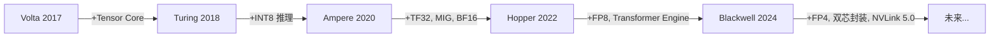
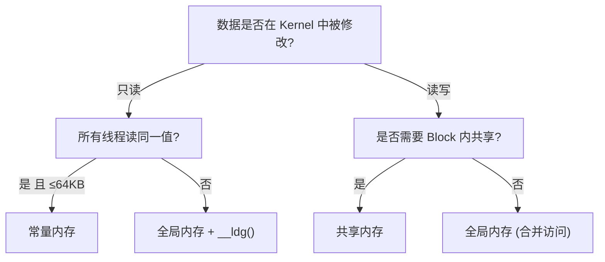

# 答案独立人工复核

填写 answer-review.json；事实字段留空表示尚未评分。
引用 ID 合法不代表陈述受到证据支持。

## official:official-002-1:P0-T

vLLM v0.10.2：缓存块身份除了文本还需要哪些额外哈希？

必要要点：额外哈希包含LoRA ID、多模态输入哈希和租户隔离盐。

禁止误读：缓存键只需文本token，适配器和图像不影响身份。

```json
{
  "conversation_id": "ff46600f-2b26-4a4e-878c-d672bba6dc62",
  "answer": "除文本（块内 token 及前缀 token）外，缓存块身份还需要额外哈希（Extra hashes），例如 LoRA ID、多模态输入哈希，以及用于多租户环境隔离缓存的 cache salt。[E3684ca4dceac3907e2f63078]",
  "citations": [
    {
      "citation_id": "E3684ca4dceac3907e2f63078",
      "chunk_id": "d2ff94675785a324f32b455e",
      "parent_id": "2b1bb7e8a9dfe47e1a43df32",
      "source": "/Users/jennyma/Projects/InfraAgent/data/official-evals/infra-official-v1/corpus/vllm-prefix_caching.md",
      "locator": "/Users/jennyma/Projects/InfraAgent/data/official-evals/infra-official-v1/corpus/vllm-prefix_caching.md#L17-L19",
      "page": null,
      "start_line": 17,
      "end_line": 19,
      "modality": "text",
      "bbox": null,
      "coordinate_space": null,
      "image_path": null,
      "caption_source": null,
      "caption_locator": null,
      "content": "* Parent hash value: The hash value of the parent hash block.\n* Block tokens: A tuple of tokens in this block. The reason to include the exact tokens is to reduce potential hash value collision.\n* Extra hashes: Other values required to make this block unique, such as LoRA IDs, multi-modality input hashes (see the example below), and cache salts to isolate caches in multi-tenant environments.",
      "truncated": false,
      "metadata": {
        "collection": "official",
        "document_id": "vllm-prefix_caching",
        "url": "https://github.com/vllm-project/vllm/blob/01efc7ef781391e744ed08c3292817a773d654e6/docs/design/prefix_caching.md",
        "commit": "01efc7ef781391e744ed08c3292817a773d654e6",
        "release": "v0.10.2",
        "sha256": "0a8a9e9095055c4f8e0cdaf078e3194ab06428222d65abb9c827f6879607ce61",
        "product": "vllm",
        "metadata_method": "frozen_manifest",
        "preprocessing_version": "rules-structure-v1",
        "body_type": "explanation",
        "original_lines": [
          17,
          19
        ],
        "topic": "Automatic Prefix Caching",
        "hardware_mentions": [],
        "original_chunk_ids": [
          "47a8a3a804e4497c937560cd",
          "52d06965a14a4454a59d58ee",
          "94b777157ed4ca867fa7d39a"
        ]
      },
      "source_position": 21
    }
  ],
  "status": "answered",
  "trace": [
    {
      "step": "retrieve",
      "duration_ms": 0.0,
      "query": "vLLM v0.10.2：缓存块身份除了文本还需要哪些额外哈希？",
      "hits": 0,
      "evidence": 9
    },
    {
      "step": "generate",
      "duration_ms": 757.1,
      "provider": "anthropic-compatible",
      "model": "deepseek-flash",
      "validated": true
    }
  ]
}
```

实际输入证据：

### E3684ca4dceac3907e2f63078

/Users/jennyma/Projects/InfraAgent/data/official-evals/infra-official-v1/corpus/vllm-prefix_caching.md#L17-L19

```text
* Parent hash value: The hash value of the parent hash block.
* Block tokens: A tuple of tokens in this block. The reason to include the exact tokens is to reduce potential hash value collision.
* Extra hashes: Other values required to make this block unique, such as LoRA IDs, multi-modality input hashes (see the example below), and cache salts to isolate caches in multi-tenant environments.
```

### E67bd2114a97b0bf090567874

/Users/jennyma/Projects/InfraAgent/data/official-evals/infra-official-v1/corpus/vllm-prefix_caching.md#L5-L5

```text
While there are many ways to implement prefix caching, vLLM chooses a hash-based approach. Specifically, we hash each kv-cache block by the tokens in the block and the tokens in the prefix before the block:
```

### E81323e7463b06b06736e226d

/Users/jennyma/Projects/InfraAgent/data/official-evals/infra-official-v1/corpus/vllm-prefix_caching.md#L81-L82

```text
**Cache Isolation for Security**
To improve privacy in shared environments, vLLM supports isolating prefix cache reuse through optional per-request salting.
By including a `cache_salt` in the request, this value is injected into the hash of the first block, ensuring that only requests with the same salt can reuse cached KV blocks.
This prevents timing-based attacks where an adversary could infer cached content by observing latency differences.
```

### E39e133e40e8e83a1b801a8b1

/Users/jennyma/Projects/InfraAgent/data/official-evals/infra-official-v1/corpus/vllm-prefix_caching.md#L192-L192

```text
As can be seen, block 3 is a new full block and is cached.
However, it is redundant as block 1, meaning that we cached the same block twice.
In v0, when detecting block 3 is duplicated, we free block 3 and let Request 2 use block 1 instead, so its block table becomes `[0, 1]` in Time 1.
However, the block table in vLLM v1 is append-only, meaning that changing the block table from `[0, 3]` to `[0, 1]` is not allowed.
```

### E08e006fb1c4dc5c85b5de5b2

/Users/jennyma/Projects/InfraAgent/data/official-evals/infra-official-v1/corpus/vllm-pr-21611.md#L31-L194

```text
```
***info: image_2 single input the 2nd time. It should not form aother new hash.***
**Expected storage path length after llm generate: 2**
Adding requests: 100%|██████████████████████████████████████████████████████████████████████████████████████████████████████████████████████████████████████████████████████████████████| 1/1 [00:00<00:00, 93.91it/s]
```
```

### Eb164b41ccda7a89cd9647b5d

/Users/jennyma/Projects/InfraAgent/data/official-evals/infra-official-v1/corpus/vllm-pr-21611.md#L30-L30

```text
## Test Result
```

### Ec7f61dbe54a702f487007e68

/Users/jennyma/Projects/InfraAgent/data/official-evals/infra-official-v1/corpus/vllm-prefix_caching.md#L3-L3

```text
Since prefix caching is almost a free lunch and won’t change model outputs, it has been widely used by many public endpoints (e.g., OpenAI, Anthropic, etc) and most open source LLM inference frameworks (e.g., SGLang).
```

### Eb3e553641b20c08a05c35bd7

/Users/jennyma/Projects/InfraAgent/data/official-evals/infra-official-v1/corpus/vllm-prefix_caching.md#L7-L13

```text
```text
                    Block 1                  Block 2                  Block 3
         [A gentle breeze stirred] [the leaves as children] [laughed in the distance]
Block 1: |<--- block tokens ---->|
Block 2: |<------- prefix ------>| |<--- block tokens --->|
Block 3: |<------------------ prefix -------------------->| |<--- block tokens ---->|
```
```

### E41e6e211435ec5b85ec07c34

/Users/jennyma/Projects/InfraAgent/data/official-evals/infra-official-v1/corpus/vllm-prefix_caching.md#L15-L15

```text
In the example above, the KV cache in the first block can be uniquely identified with the token “A gentle breeze stirred”. The third block can be uniquely identified with the tokens in the block “laughed in the distance”, along with the prefix tokens “A gentle breeze stirred the leaves as children”.
```

## official:official-002-2:P0-T

vLLM v0.10.2：两个适配器使用相同文本，是否可以只按文本共享缓存？

必要要点：额外哈希包含LoRA ID、多模态输入哈希和租户隔离盐。

禁止误读：缓存键只需文本token，适配器和图像不影响身份。

```json
{
  "conversation_id": "27d39b04-0897-463f-a096-f74c9415bddb",
  "answer": "当前检索到的资料不足以可靠回答这个问题。可以补充文档或把问题问得更具体。",
  "citations": [],
  "status": "no_evidence",
  "trace": [
    {
      "step": "retrieve",
      "duration_ms": 0.0,
      "query": "vLLM v0.10.2：两个适配器使用相同文本，是否可以只按文本共享缓存？",
      "hits": 0,
      "evidence": 9
    },
    {
      "step": "generate",
      "duration_ms": 890.7,
      "provider": "anthropic-compatible",
      "model": "deepseek-flash",
      "validated": true
    }
  ]
}
```

实际输入证据：

### E39e133e40e8e83a1b801a8b1

/Users/jennyma/Projects/InfraAgent/data/official-evals/infra-official-v1/corpus/vllm-prefix_caching.md#L192-L192

```text
As can be seen, block 3 is a new full block and is cached.
However, it is redundant as block 1, meaning that we cached the same block twice.
In v0, when detecting block 3 is duplicated, we free block 3 and let Request 2 use block 1 instead, so its block table becomes `[0, 1]` in Time 1.
However, the block table in vLLM v1 is append-only, meaning that changing the block table from `[0, 3]` to `[0, 1]` is not allowed.
```

### Eab35c51094c1a56143f050ba

/Users/jennyma/Projects/InfraAgent/data/official-evals/infra-official-v1/corpus/cuda-unified-memory-programming.md#L946-L946

```text
Note that it is not possible to share memory between different hosts and their devices using this technique.
```

### E81323e7463b06b06736e226d

/Users/jennyma/Projects/InfraAgent/data/official-evals/infra-official-v1/corpus/vllm-prefix_caching.md#L81-L82

```text
**Cache Isolation for Security**
To improve privacy in shared environments, vLLM supports isolating prefix cache reuse through optional per-request salting.
By including a `cache_salt` in the request, this value is injected into the hash of the first block, ensuring that only requests with the same salt can reuse cached KV blocks.
This prevents timing-based attacks where an adversary could infer cached content by observing latency differences.
```

### Eb95ef72523a1e13f5f38e62d

/Users/jennyma/Projects/InfraAgent/data/official-evals/infra-official-v1/corpus/vllm-docker.md#L34-L37

```text
!!! note
    You can either use the `ipc=host` flag or `--shm-size` flag to allow the
    container to access the host's shared memory. vLLM uses PyTorch, which uses shared
    memory to share data between processes under the hood, particularly for tensor parallel inference.
```

### E2eec58a512990f7feac77fcc

/Users/jennyma/Projects/InfraAgent/data/official-evals/infra-official-v1/corpus/cuda-streams.md#L79-L82

```text
For example, on devices that do not support concurrent data transfers, the two streams of the code sample of Creation and Destruction of Streams
do not overlap at all because the memory copy from host to device is issued to stream[1] after the memory copy from device to host
is issued to stream[0], so it can only start once the memory copy from device to host issued to stream[0] has completed.
If the
```

### E2dec512ed6f8c9b464b0894d

/Users/jennyma/Projects/InfraAgent/data/official-evals/infra-official-v1/corpus/vllm-prefix_caching.md#L178-L190

```text
```text
Prompt: [A, B, C, D, E, F]
Output: [G, H, I]

Time 0:
  Tokens: [A, B, C, D, E, F, G]
  Block Table: [0 (ABCD), 3 (EFG)]
  Cache Blocks: 0, 1
Time 1:
  Tokens: [A, B, C, D, E, F, G, H]
  Block Table: [0 (ABCD), 3 (EFGH)]
  Cache Blocks: 0, 1, 3
```
```

### Ed7363cdf5777398175b61e8a

/Users/jennyma/Projects/InfraAgent/data/official-evals/infra-official-v1/corpus/vllm-prefix_caching.md#L192-L192

```text
As a result, we will have duplicated blocks for the hash key E-H.
This duplication will be eliminated when the request is freed.
```

### E7ef1b6030cdae238e97a7a90

/Users/jennyma/Projects/InfraAgent/data/official-evals/infra-official-v1/corpus/vllm-prefix_caching.md#L176-L176

```text
Now block 0 and block 1 are cached, and we send the same request again (Request 2\) with greedy sampling, so that it will produce exactly the same outputs as the Request 1:
```

### Eac876098e0aee3543416fabe

/Users/jennyma/Projects/InfraAgent/data/official-evals/infra-official-v1/corpus/vllm-prefix_caching.md#L158-L174

```text
```text
Prompt: [A, B, C, D, E, F]
Output: [G, H, I]

Time 0:
  Tokens: [A, B, C, D, E, F, G]
  Block Table: [0 (ABCD), 1 (EFG)]
  Cache Blocks: 0
Time 1:
  Tokens: [A, B, C, D, E, F, G, H]
  Block Table: [0 (ABCD), 1 (EFGH)]
  Cache Blocks: 0, 1
Time 2:
  Tokens: [A, B, C, D, E, F, G, H, I]
  Block Table: [0 (ABCD), 1 (EFGH), 2 (I)]
  Cache Blocks: 0, 1
```
```

## official:official-002-3:P0-T

vLLM v0.10.2：多租户前缀相同但需要隔离，应检查缓存键中的什么信息？

必要要点：额外哈希包含LoRA ID、多模态输入哈希和租户隔离盐。

禁止误读：缓存键只需文本token，适配器和图像不影响身份。

```json
{
  "conversation_id": "895d16de-668e-4744-9122-9a64612483c5",
  "answer": "应检查缓存键中的 Extra hashes（额外哈希）信息，其中包含用于在多租户环境中隔离缓存的 cache salts；也可通过请求中的 cache_salt 注入首个块的哈希，使只有相同 salt 的请求才能复用缓存 KV 块。[E3684ca4dceac3907e2f63078][E81323e7463b06b06736e226d]",
  "citations": [
    {
      "citation_id": "E3684ca4dceac3907e2f63078",
      "chunk_id": "d2ff94675785a324f32b455e",
      "parent_id": "2b1bb7e8a9dfe47e1a43df32",
      "source": "/Users/jennyma/Projects/InfraAgent/data/official-evals/infra-official-v1/corpus/vllm-prefix_caching.md",
      "locator": "/Users/jennyma/Projects/InfraAgent/data/official-evals/infra-official-v1/corpus/vllm-prefix_caching.md#L17-L19",
      "page": null,
      "start_line": 17,
      "end_line": 19,
      "modality": "text",
      "bbox": null,
      "coordinate_space": null,
      "image_path": null,
      "caption_source": null,
      "caption_locator": null,
      "content": "* Parent hash value: The hash value of the parent hash block.\n* Block tokens: A tuple of tokens in this block. The reason to include the exact tokens is to reduce potential hash value collision.\n* Extra hashes: Other values required to make this block unique, such as LoRA IDs, multi-modality input hashes (see the example below), and cache salts to isolate caches in multi-tenant environments.",
      "truncated": false,
      "metadata": {
        "collection": "official",
        "document_id": "vllm-prefix_caching",
        "url": "https://github.com/vllm-project/vllm/blob/01efc7ef781391e744ed08c3292817a773d654e6/docs/design/prefix_caching.md",
        "commit": "01efc7ef781391e744ed08c3292817a773d654e6",
        "release": "v0.10.2",
        "sha256": "0a8a9e9095055c4f8e0cdaf078e3194ab06428222d65abb9c827f6879607ce61",
        "product": "vllm",
        "metadata_method": "frozen_manifest",
        "preprocessing_version": "rules-structure-v1",
        "body_type": "explanation",
        "original_lines": [
          17,
          19
        ],
        "topic": "Automatic Prefix Caching",
        "hardware_mentions": [],
        "original_chunk_ids": [
          "47a8a3a804e4497c937560cd",
          "52d06965a14a4454a59d58ee",
          "94b777157ed4ca867fa7d39a"
        ]
      },
      "source_position": 21
    },
    {
      "citation_id": "E81323e7463b06b06736e226d",
      "chunk_id": "6d941118fc906ea21ee58302",
      "parent_id": "2b1bb7e8a9dfe47e1a43df32",
      "source": "/Users/jennyma/Projects/InfraAgent/data/official-evals/infra-official-v1/corpus/vllm-prefix_caching.md",
      "locator": "/Users/jennyma/Projects/InfraAgent/data/official-evals/infra-official-v1/corpus/vllm-prefix_caching.md#L81-L82",
      "page": null,
      "start_line": 81,
      "end_line": 82,
      "modality": "text",
      "bbox": null,
      "coordinate_space": null,
      "image_path": null,
      "caption_source": null,
      "caption_locator": null,
      "content": "**Cache Isolation for Security**\nTo improve privacy in shared environments, vLLM supports isolating prefix cache reuse through optional per-request salting.\nBy including a `cache_salt` in the request, this value is injected into the hash of the first block, ensuring that only requests with the same salt can reuse cached KV blocks.\nThis prevents timing-based attacks where an adversary could infer cached content by observing latency differences.",
      "truncated": false,
      "metadata": {
        "collection": "official",
        "document_id": "vllm-prefix_caching",
        "url": "https://github.com/vllm-project/vllm/blob/01efc7ef781391e744ed08c3292817a773d654e6/docs/design/prefix_caching.md",
        "commit": "01efc7ef781391e744ed08c3292817a773d654e6",
        "release": "v0.10.2",
        "sha256": "0a8a9e9095055c4f8e0cdaf078e3194ab06428222d65abb9c827f6879607ce61",
        "product": "vllm",
        "metadata_method": "frozen_manifest",
        "preprocessing_version": "rules-structure-v1",
        "body_type": "condition",
        "original_lines": [
          81,
          82
        ],
        "topic": "Automatic Prefix Caching",
        "hardware_mentions": [],
        "original_chunk_ids": [
          "4d76112419b3dedaddc121f8",
          "5d0deace325a4e6f0db68487",
          "8d6240eabf6c5fa7554004b0",
          "c5526f786791064d3e121af5",
          "fa3783b786a5a34f47d17bd8"
        ]
      },
      "source_position": 33
    }
  ],
  "status": "answered",
  "trace": [
    {
      "step": "retrieve",
      "duration_ms": 0.0,
      "query": "vLLM v0.10.2：多租户前缀相同但需要隔离，应检查缓存键中的什么信息？",
      "hits": 0,
      "evidence": 10
    },
    {
      "step": "generate",
      "duration_ms": 977.5,
      "provider": "anthropic-compatible",
      "model": "deepseek-flash",
      "validated": true
    }
  ]
}
```

实际输入证据：

### E3684ca4dceac3907e2f63078

/Users/jennyma/Projects/InfraAgent/data/official-evals/infra-official-v1/corpus/vllm-prefix_caching.md#L17-L19

```text
* Parent hash value: The hash value of the parent hash block.
* Block tokens: A tuple of tokens in this block. The reason to include the exact tokens is to reduce potential hash value collision.
* Extra hashes: Other values required to make this block unique, such as LoRA IDs, multi-modality input hashes (see the example below), and cache salts to isolate caches in multi-tenant environments.
```

### E81323e7463b06b06736e226d

/Users/jennyma/Projects/InfraAgent/data/official-evals/infra-official-v1/corpus/vllm-prefix_caching.md#L81-L82

```text
**Cache Isolation for Security**
To improve privacy in shared environments, vLLM supports isolating prefix cache reuse through optional per-request salting.
By including a `cache_salt` in the request, this value is injected into the hash of the first block, ensuring that only requests with the same salt can reuse cached KV blocks.
This prevents timing-based attacks where an adversary could infer cached content by observing latency differences.
```

### E920d5fd30b391d87ed884dfd

/Users/jennyma/Projects/InfraAgent/data/datasets/infra-repos-v1/corpus/AIInfraGuide/docs/guides/模块四-推理优化/第2章-推理引擎核心技术/2.3-Prefix Cache 与 RadixAttention.md#L11-L11

```text
真实业务里，海量请求往往共享同一段开头——同一个几百 Token 的 System Prompt、同一份 Few-shot 示例、多轮对话里不断重复的历史。每来一个请求就把这段共享前缀重新 Prefill 一遍，是巨大的浪费。Prefix Cache 就是把这段共享前缀的 KV Cache 缓存下来、后续请求直接复用的技术。这一节讲清 vLLM 基于 Hash 的自动前缀缓存怎么工作，以及 SGLang 的 RadixAttention 在此之上的进阶思路。
```

### E88fe94a338464d3bf86e48a8

/Users/jennyma/Projects/InfraAgent/data/official-evals/infra-official-v1/corpus/vllm-paged_attention.md#L7-L14

```text
Currently, vLLM utilizes its own implementation of a multi-head query
attention kernel (`csrc/attention/attention_kernels.cu`).
This kernel is designed to be compatible with
vLLM's paged KV caches, where the key and value cache are stored in
separate blocks (note that this block concept differs from the GPU
thread block.
So in a later document, I will refer to vLLM paged
attention block as "block", while refer to GPU thread block as
```

### E9b566228b7480fac0b55425a

/Users/jennyma/Projects/InfraAgent/data/official-evals/infra-official-v1/corpus/vllm-prefix_caching.md#L24-L26

```text
!!
! note "Note 2"
The above hash key structure is not 100% collision free.
Theoretically it’s still possible for the different prefix tokens to have the same hash value.
To avoid any hash collisions **in a multi-tenant setup, we advise to use SHA256** as hash function instead of the default builtin hash.
SHA256 is supported since vLLM v0.8.3 and must be enabled with a command line argument.
```

### E41e6e211435ec5b85ec07c34

/Users/jennyma/Projects/InfraAgent/data/official-evals/infra-official-v1/corpus/vllm-prefix_caching.md#L15-L15

```text
In the example above, the KV cache in the first block can be uniquely identified with the token “A gentle breeze stirred”. The third block can be uniquely identified with the tokens in the block “laughed in the distance”, along with the prefix tokens “A gentle breeze stirred the leaves as children”. Therefore, we can build the block hash of `hash(tuple[components])`, where components are:
```

### E303bd4355691dee98763220d

/Users/jennyma/Projects/InfraAgent/data/official-evals/infra-official-v1/corpus/vllm-prefix_caching.md#L21-L22

```text
!!! note "Note 1"
    We only cache full blocks.
```

### Eafc10a8d33d249c14b60228e

/Users/jennyma/Projects/InfraAgent/data/official-evals/infra-official-v1/corpus/vllm-prefix_caching.md#L24-L26

```text
It comes with a performance impact of about 100-200ns per token (~6ms for 50k tokens of context).
```

### E72b9a56cf654f6429a53a8cf

/Users/jennyma/Projects/InfraAgent/data/official-evals/infra-official-v1/corpus/vllm-prefix_caching.md#L81-L82

```text
This offers protection without compromising performance.
```

### E8d1c51a849fb55f30ebf045d

/Users/jennyma/Projects/InfraAgent/data/official-evals/infra-official-v1/corpus/vllm-prefix_caching.md#L45-L45

```text
It will become the following prompt:
```

## official:official-002-4:P0-T

vLLM v0.10.2：先确认服务模型支持LoRA，再考虑两个LoRA请求文本相同，为什么缓存键仍需额外区分身份？

必要要点：额外哈希包含LoRA ID、多模态输入哈希和租户隔离盐。；服务模型须支持LoRA；切换适配器时缓存键还需要适配器身份。

禁止误读：缓存键只需文本token，适配器和图像不影响身份。

```json
{
  "conversation_id": "d710c4cb-1c47-4ba7-9a37-fb28829895c3",
  "answer": "当前检索到的资料不足以可靠回答这个问题。可以补充文档或把问题问得更具体。",
  "citations": [],
  "status": "no_evidence",
  "trace": [
    {
      "step": "retrieve",
      "duration_ms": 0.0,
      "query": "vLLM v0.10.2：先确认服务模型支持LoRA，再考虑两个LoRA请求文本相同，为什么缓存键仍需额外区分身份？",
      "hits": 0,
      "evidence": 11
    },
    {
      "step": "generate",
      "duration_ms": 1189.3,
      "provider": "anthropic-compatible",
      "model": "deepseek-flash",
      "validated": true
    }
  ]
}
```

实际输入证据：

### E5e801c761a85c7d2f8d43c6d

/Users/jennyma/Projects/InfraAgent/data/official-evals/infra-official-v1/corpus/vllm-lora.md#L54-L55

```text
LoRA adapted models can also be served with the Open-AI compatible vLLM server. To do so, we use
`--lora-modules {name}={path} {name}={path}` to specify each LoRA module when we kick off the server:
```

### E84032c59952b25f6711a2833

/Users/jennyma/Projects/InfraAgent/data/official-evals/infra-official-v1/corpus/vllm-lora.md#L25-L27

```text
We can now submit the prompts and call `llm.generate` with the `lora_request` parameter. The first parameter
of `LoRARequest` is a human identifiable name, the second parameter is a globally unique ID for the adapter and
the third parameter is the path to the LoRA adapter.
```

### E6633d0981a33a0e244ff4111

/Users/jennyma/Projects/InfraAgent/data/official-evals/infra-official-v1/corpus/vllm-lora.md#L110-L110

```text
In addition to serving LoRA adapters at server startup, the vLLM server supports dynamically configuring LoRA adapters at runtime through dedicated API endpoints and plugins. This feature can be particularly useful when the flexibility to change models on-the-fly is needed.
```

### E3495aa766781aa2294b702ec

/Users/jennyma/Projects/InfraAgent/data/official-evals/infra-official-v1/corpus/vllm-lora.md#L280-L280

```text
This can be a bit tedious to manage with the above approaches, as it requires the user to send the `LoRARequest` (offline) or to filter requests between the base model and LoRA model (server) depending on the content of the request's multimodal data.
```

### Ebd889942b4a96dd5cbc58f41

/Users/jennyma/Projects/InfraAgent/data/official-evals/infra-official-v1/corpus/vllm-lora.md#L235-L235

```text
The new format of `--lora-modules` is mainly to support the display of parent model information in the model card. Here's an explanation of how your current response supports this:
```

### Ea68f202bd2e109da86f63bf4

/Users/jennyma/Projects/InfraAgent/data/official-evals/infra-official-v1/corpus/vllm-lora.md#L52-L52

```text
## Serving LoRA Adapters
```

### E71173cb7177e423f64b908eb

/Users/jennyma/Projects/InfraAgent/data/official-evals/infra-official-v1/corpus/vllm-lora.md#L57-L61

```text
```bash
vllm serve meta-llama/Llama-2-7b-hf \
    --enable-lora \
    --lora-modules sql-lora=$HOME/.cache/huggingface/hub/models--yard1--llama-2-7b-sql-lora-test/snapshots/0dfa347e8877a4d4ed19ee56c140fa518470028c/
```
```

### E2027cf40438d32ac062bce01

/Users/jennyma/Projects/InfraAgent/data/official-evals/infra-official-v1/corpus/vllm-lora.md#L63-L64

```text
!!! note
    The commit ID `0dfa347e8877a4d4ed19ee56c140fa518470028c` may change over time. Please check the latest commit ID in your environment to ensure you are using the correct one.
```

### Ecb4f854231352b9831e2c0a8

/Users/jennyma/Projects/InfraAgent/data/official-evals/infra-official-v1/corpus/vllm-lora.md#L66-L68

```text
The server entrypoint accepts all other LoRA configuration parameters (`max_loras`, `max_lora_rank`, `max_cpu_loras`,
etc.), which will apply to all forthcoming requests. Upon querying the `/models` endpoint, we should see our LoRA along
with its base model (if `jq` is not installed, you can follow [this guide](https://jqlang.org/download/) to install it.):
```

### Ec0b086b07067229181444c6b

/Users/jennyma/Projects/InfraAgent/data/official-evals/infra-official-v1/corpus/vllm-lora.md#L70-L70

```text
??? console "Command"
```

### E248759b6f8bc44e03dbf3579

/Users/jennyma/Projects/InfraAgent/data/official-evals/infra-official-v1/corpus/vllm-lora.md#L72-L89

```text
    ```bash
    curl localhost:8000/v1/models | jq .
    {
        "object": "list",
        "data": [
            {
                "id": "meta-llama/Llama-2-7b-hf",
                "object": "model",
                ...
            },
            {
                "id": "sql-lora",
                "object": "model",
                ...
            }
        ]
    }
    ```
```

## official:official-004-1:P0-T

vLLM v0.10.2：Ampere在此版本支持的FP8配置与kernel是什么？

必要要点：Ampere的该支持是使用Marlin的W8A16权重量化。

禁止误读：Ampere文档中的该支持等同于W8A8。

```json
{
  "conversation_id": "61476253-4bf1-4275-8ded-0b955f061f52",
  "answer": "在 Ampere GPU 上，vLLM 支持 W8A16（weight-only FP8），使用 FP8 Marlin kernel；FP8 计算本身需要 compute capability > 8.9（Ada Lovelace、Hopper），Ampere 属于 compute capability > 8.0，因此仅以 weight-only W8A16 方式运行。[E6922656a68144517af890f74][E304d729ae809670c7310aad7]",
  "citations": [
    {
      "citation_id": "E6922656a68144517af890f74",
      "chunk_id": "0ecfdf4402bc966538acf242",
      "parent_id": "f33bdc394c727dc02060df33",
      "source": "/Users/jennyma/Projects/InfraAgent/data/official-evals/infra-official-v1/corpus/vllm-fp8.md",
      "locator": "/Users/jennyma/Projects/InfraAgent/data/official-evals/infra-official-v1/corpus/vllm-fp8.md#L3-L6",
      "page": null,
      "start_line": 3,
      "end_line": 6,
      "modality": "text",
      "bbox": null,
      "coordinate_space": null,
      "image_path": null,
      "caption_source": null,
      "caption_locator": null,
      "content": "vLLM supports FP8 (8-bit floating point) weight and activation quantization using hardware acceleration on GPUs such as Nvidia H100 and AMD MI300x.\nCurrently, only Hopper and Ada Lovelace GPUs are officially supported for W8A8.\nAmpere GPUs are supported for W8A16 (weight-only FP8) utilizing Marlin kernels.",
      "truncated": false,
      "metadata": {
        "collection": "official",
        "document_id": "vllm-fp8",
        "url": "https://github.com/vllm-project/vllm/blob/01efc7ef781391e744ed08c3292817a773d654e6/docs/features/quantization/fp8.md",
        "commit": "01efc7ef781391e744ed08c3292817a773d654e6",
        "release": "v0.10.2",
        "sha256": "a8df8bd97e708315f83286e9390250a0e8292d8d205fe4c12e2a1ff23dadfb43",
        "product": "vllm",
        "metadata_method": "frozen_manifest",
        "preprocessing_version": "rules-structure-v1",
        "body_type": "condition",
        "original_lines": [
          3,
          6
        ],
        "topic": "FP8 W8A8",
        "hardware_mentions": [
          "AMD",
          "Ada Lovelace",
          "Ampere",
          "H100",
          "Hopper",
          "MI300x",
          "Nvidia"
        ],
        "original_chunk_ids": [
          "a2df220c82c59eb08a6b868e",
          "476c07c43bf304ca06bc6c41"
        ]
      },
      "source_position": 305
    },
    {
      "citation_id": "E304d729ae809670c7310aad7",
      "chunk_id": "b5c56188263e0df5c1181742",
      "parent_id": "f33bdc394c727dc02060df33",
      "source": "/Users/jennyma/Projects/InfraAgent/data/official-evals/infra-official-v1/corpus/vllm-fp8.md",
      "locator": "/Users/jennyma/Projects/InfraAgent/data/official-evals/infra-official-v1/corpus/vllm-fp8.md#L15-L17",
      "page": null,
      "start_line": 15,
      "end_line": 17,
      "modality": "text",
      "bbox": null,
      "coordinate_space": null,
      "image_path": null,
      "caption_source": null,
      "caption_locator": null,
      "content": "!!! note\n    FP8 computation is supported on NVIDIA GPUs with compute capability > 8.9 (Ada Lovelace, Hopper).\n    FP8 models will run on compute capability > 8.0 (Ampere) as weight-only W8A16, utilizing FP8 Marlin.",
      "truncated": false,
      "metadata": {
        "collection": "official",
        "document_id": "vllm-fp8",
        "url": "https://github.com/vllm-project/vllm/blob/01efc7ef781391e744ed08c3292817a773d654e6/docs/features/quantization/fp8.md",
        "commit": "01efc7ef781391e744ed08c3292817a773d654e6",
        "release": "v0.10.2",
        "sha256": "a8df8bd97e708315f83286e9390250a0e8292d8d205fe4c12e2a1ff23dadfb43",
        "product": "vllm",
        "metadata_method": "frozen_manifest",
        "preprocessing_version": "rules-structure-v1",
        "body_type": "condition",
        "original_lines": [
          15,
          17
        ],
        "topic": "FP8 W8A8",
        "hardware_mentions": [
          "Ada Lovelace",
          "Ampere",
          "Hopper",
          "NVIDIA"
        ],
        "original_chunk_ids": [
          "b5c56188263e0df5c1181742"
        ]
      },
      "source_position": 310
    }
  ],
  "status": "answered",
  "trace": [
    {
      "step": "retrieve",
      "duration_ms": 0.0,
      "query": "vLLM v0.10.2：Ampere在此版本支持的FP8配置与kernel是什么？",
      "hits": 0,
      "evidence": 12
    },
    {
      "step": "generate",
      "duration_ms": 1112.7,
      "provider": "anthropic-compatible",
      "model": "deepseek-flash",
      "validated": true
    }
  ]
}
```

实际输入证据：

### E6922656a68144517af890f74

/Users/jennyma/Projects/InfraAgent/data/official-evals/infra-official-v1/corpus/vllm-fp8.md#L3-L6

```text
vLLM supports FP8 (8-bit floating point) weight and activation quantization using hardware acceleration on GPUs such as Nvidia H100 and AMD MI300x.
Currently, only Hopper and Ada Lovelace GPUs are officially supported for W8A8.
Ampere GPUs are supported for W8A16 (weight-only FP8) utilizing Marlin kernels.
```

### E8c0a6d8da59e340ff546c81b

/Users/jennyma/Projects/InfraAgent/data/official-evals/infra-official-v1/corpus/vllm-fp8.md#L10-L10

```text
The FP8 types typically supported in hardware have two distinct representations, each useful in different scenarios:
```

### E940348688ebf10127223674a

/Users/jennyma/Projects/InfraAgent/data/official-evals/infra-official-v1/corpus/vllm-quantized_kvcache.md#L54-L56

```text
- `"auto"`: Uses the model's default "unquantized" data type
- `"fp8"` or `"fp8_e4m3"`: Supported on CUDA 11.8+ and ROCm (AMD GPU)
- `"fp8_e5m2"`: Supported on CUDA 11.8+
```

### Eedf27b0fd40ef96bea7e201d

/Users/jennyma/Projects/InfraAgent/data/official-evals/infra-official-v1/corpus/vllm-issue-21175.md#L51-L51

```text
vllm version: v0.9.2
```

### E5e49414d117d9e757684d6d8

/Users/jennyma/Projects/InfraAgent/data/official-evals/infra-official-v1/corpus/vllm-fp8.md#L125-L125

```text
In this mode, all Linear modules (except for the final `lm_head`) have their weights quantized down to FP8_E4M3 precision with a per-tensor scale. Activations have their minimum and maximum values calculated during each forward pass to provide a dynamic per-tensor scale for high accuracy. As a result, latency improvements are limited in this mode.
```

### E810a5849c576473c85ec6f1f

/Users/jennyma/Projects/InfraAgent/data/official-evals/infra-official-v1/corpus/vllm-fp8.md#L1-L1

```text
# FP8 W8A8
```

### Ea14ed728e97e79044319ff9d

/Users/jennyma/Projects/InfraAgent/data/official-evals/infra-official-v1/corpus/vllm-fp8.md#L3-L6

```text
Quantization of models with FP8 allows for a 2x reduction in model memory requirements and up to a 1.6x improvement in throughput with minimal impact on accuracy.
```

### E400a2325c86135a091062b95

/Users/jennyma/Projects/InfraAgent/data/official-evals/infra-official-v1/corpus/vllm-fp8.md#L8-L8

```text
Please visit the HF collection of [quantized FP8 checkpoints of popular LLMs ready to use with vLLM](https://huggingface.co/collections/neuralmagic/fp8-llms-for-vllm-666742ed2b78b7ac8df13127).
```

### E510da03c4c044d4ae38ed9f5

/Users/jennyma/Projects/InfraAgent/data/official-evals/infra-official-v1/corpus/vllm-fp8.md#L12-L13

```text
- **E4M3**: Consists of 1 sign bit, 4 exponent bits, and 3 bits of mantissa. It can store values up to +/-448 and `nan`.
- **E5M2**: Consists of 1 sign bit, 5 exponent bits, and 2 bits of mantissa. It can store values up to +/-57344, +/- `inf`, and `nan`. The tradeoff for the increased dynamic range is lower precision of the stored values.
```

### E304d729ae809670c7310aad7

/Users/jennyma/Projects/InfraAgent/data/official-evals/infra-official-v1/corpus/vllm-fp8.md#L15-L17

```text
!!! note
    FP8 computation is supported on NVIDIA GPUs with compute capability > 8.9 (Ada Lovelace, Hopper).
    FP8 models will run on compute capability > 8.0 (Ampere) as weight-only W8A16, utilizing FP8 Marlin.
```

### Ee308998b3ac017de3d09c1a0

/Users/jennyma/Projects/InfraAgent/data/official-evals/infra-official-v1/corpus/vllm-quantized_kvcache.md#L52-L52

```text
The `kv_cache_dtype` argument specifies the data type for KV cache storage:
```

### E40755944f3906993a4fddc37

/Users/jennyma/Projects/InfraAgent/data/official-evals/infra-official-v1/corpus/vllm-quantized_kvcache.md#L37-L50

```text
    ```python
    out = llm.generate(prompt, sampling_params)[0].outputs[0].text
    print(out)
    ```
```

## official:official-004-2:P0-T

vLLM v0.10.2：能否把Ampere的W8A16支持解释为W8A8？

必要要点：Ampere的该支持是使用Marlin的W8A16权重量化。

禁止误读：Ampere文档中的该支持等同于W8A8。

```json
{
  "conversation_id": "69f2be8c-615f-4e28-b6ea-a66fa4924d00",
  "answer": "不能。证据明确区分了两种支持：Ampere GPU 仅支持 W8A16（weight-only FP8），使用 Marlin kernels [E6922656a68144517af890f74]；而 W8A8 目前仅官方支持 Hopper 和 Ada Lovelace GPU [E6922656a68144517af890f74]。另有说明指出 FP8 计算需要 compute capability > 8.9（Ada Lovelace、Hopper），在 compute capability > 8.0（Ampere）上只能以 weight-only W8A16 运行 [E304d729ae809670c7310aad7]。因此 Ampere 的 W8A16 不能解释为 W8A8。",
  "citations": [
    {
      "citation_id": "E6922656a68144517af890f74",
      "chunk_id": "0ecfdf4402bc966538acf242",
      "parent_id": "f33bdc394c727dc02060df33",
      "source": "/Users/jennyma/Projects/InfraAgent/data/official-evals/infra-official-v1/corpus/vllm-fp8.md",
      "locator": "/Users/jennyma/Projects/InfraAgent/data/official-evals/infra-official-v1/corpus/vllm-fp8.md#L3-L6",
      "page": null,
      "start_line": 3,
      "end_line": 6,
      "modality": "text",
      "bbox": null,
      "coordinate_space": null,
      "image_path": null,
      "caption_source": null,
      "caption_locator": null,
      "content": "vLLM supports FP8 (8-bit floating point) weight and activation quantization using hardware acceleration on GPUs such as Nvidia H100 and AMD MI300x.\nCurrently, only Hopper and Ada Lovelace GPUs are officially supported for W8A8.\nAmpere GPUs are supported for W8A16 (weight-only FP8) utilizing Marlin kernels.",
      "truncated": false,
      "metadata": {
        "collection": "official",
        "document_id": "vllm-fp8",
        "url": "https://github.com/vllm-project/vllm/blob/01efc7ef781391e744ed08c3292817a773d654e6/docs/features/quantization/fp8.md",
        "commit": "01efc7ef781391e744ed08c3292817a773d654e6",
        "release": "v0.10.2",
        "sha256": "a8df8bd97e708315f83286e9390250a0e8292d8d205fe4c12e2a1ff23dadfb43",
        "product": "vllm",
        "metadata_method": "frozen_manifest",
        "preprocessing_version": "rules-structure-v1",
        "body_type": "condition",
        "original_lines": [
          3,
          6
        ],
        "topic": "FP8 W8A8",
        "hardware_mentions": [
          "AMD",
          "Ada Lovelace",
          "Ampere",
          "H100",
          "Hopper",
          "MI300x",
          "Nvidia"
        ],
        "original_chunk_ids": [
          "a2df220c82c59eb08a6b868e",
          "476c07c43bf304ca06bc6c41"
        ]
      },
      "source_position": 305
    },
    {
      "citation_id": "E304d729ae809670c7310aad7",
      "chunk_id": "b5c56188263e0df5c1181742",
      "parent_id": "f33bdc394c727dc02060df33",
      "source": "/Users/jennyma/Projects/InfraAgent/data/official-evals/infra-official-v1/corpus/vllm-fp8.md",
      "locator": "/Users/jennyma/Projects/InfraAgent/data/official-evals/infra-official-v1/corpus/vllm-fp8.md#L15-L17",
      "page": null,
      "start_line": 15,
      "end_line": 17,
      "modality": "text",
      "bbox": null,
      "coordinate_space": null,
      "image_path": null,
      "caption_source": null,
      "caption_locator": null,
      "content": "!!! note\n    FP8 computation is supported on NVIDIA GPUs with compute capability > 8.9 (Ada Lovelace, Hopper).\n    FP8 models will run on compute capability > 8.0 (Ampere) as weight-only W8A16, utilizing FP8 Marlin.",
      "truncated": false,
      "metadata": {
        "collection": "official",
        "document_id": "vllm-fp8",
        "url": "https://github.com/vllm-project/vllm/blob/01efc7ef781391e744ed08c3292817a773d654e6/docs/features/quantization/fp8.md",
        "commit": "01efc7ef781391e744ed08c3292817a773d654e6",
        "release": "v0.10.2",
        "sha256": "a8df8bd97e708315f83286e9390250a0e8292d8d205fe4c12e2a1ff23dadfb43",
        "product": "vllm",
        "metadata_method": "frozen_manifest",
        "preprocessing_version": "rules-structure-v1",
        "body_type": "condition",
        "original_lines": [
          15,
          17
        ],
        "topic": "FP8 W8A8",
        "hardware_mentions": [
          "Ada Lovelace",
          "Ampere",
          "Hopper",
          "NVIDIA"
        ],
        "original_chunk_ids": [
          "b5c56188263e0df5c1181742"
        ]
      },
      "source_position": 310
    }
  ],
  "status": "answered",
  "trace": [
    {
      "step": "retrieve",
      "duration_ms": 0.0,
      "query": "vLLM v0.10.2：能否把Ampere的W8A16支持解释为W8A8？",
      "hits": 0,
      "evidence": 11
    },
    {
      "step": "generate",
      "duration_ms": 1251.2,
      "provider": "anthropic-compatible",
      "model": "deepseek-flash",
      "validated": true
    }
  ]
}
```

实际输入证据：

### E6922656a68144517af890f74

/Users/jennyma/Projects/InfraAgent/data/official-evals/infra-official-v1/corpus/vllm-fp8.md#L3-L6

```text
vLLM supports FP8 (8-bit floating point) weight and activation quantization using hardware acceleration on GPUs such as Nvidia H100 and AMD MI300x.
Currently, only Hopper and Ada Lovelace GPUs are officially supported for W8A8.
Ampere GPUs are supported for W8A16 (weight-only FP8) utilizing Marlin kernels.
```

### E304d729ae809670c7310aad7

/Users/jennyma/Projects/InfraAgent/data/official-evals/infra-official-v1/corpus/vllm-fp8.md#L15-L17

```text
!!! note
    FP8 computation is supported on NVIDIA GPUs with compute capability > 8.9 (Ada Lovelace, Hopper).
    FP8 models will run on compute capability > 8.0 (Ampere) as weight-only W8A16, utilizing FP8 Marlin.
```

### Ef50dc834ac5ab8438313dbf3

/Users/jennyma/Projects/InfraAgent/data/official-evals/infra-official-v1/corpus/sglang-quantization.md#L32-L32

```text
For instance, with `neuralmagic/Meta-Llama-3.1-8B-Instruct-FP8-dynamic`, if you execute with `--quantization w8a8_fp8`, the system will use the `W8A8Fp8Config` from SGLang to invoke the sgl-kernel, rather than the `CompressedTensorsConfig` for vLLM kernels.
```

### E5f2285c35be98ae59e7a0741

/Users/jennyma/Projects/InfraAgent/data/official-evals/infra-official-v1/corpus/vllm-optimization.md#L65-L65

```text
vLLM supports multiple parallelism strategies that can be combined to optimize performance across different hardware configurations.
```

### Eedf27b0fd40ef96bea7e201d

/Users/jennyma/Projects/InfraAgent/data/official-evals/infra-official-v1/corpus/vllm-issue-21175.md#L51-L51

```text
vllm version: v0.9.2
```

### E810a5849c576473c85ec6f1f

/Users/jennyma/Projects/InfraAgent/data/official-evals/infra-official-v1/corpus/vllm-fp8.md#L1-L1

```text
# FP8 W8A8
```

### Ea14ed728e97e79044319ff9d

/Users/jennyma/Projects/InfraAgent/data/official-evals/infra-official-v1/corpus/vllm-fp8.md#L3-L6

```text
Quantization of models with FP8 allows for a 2x reduction in model memory requirements and up to a 1.6x improvement in throughput with minimal impact on accuracy.
```

### E510da03c4c044d4ae38ed9f5

/Users/jennyma/Projects/InfraAgent/data/official-evals/infra-official-v1/corpus/vllm-fp8.md#L12-L13

```text
- **E4M3**: Consists of 1 sign bit, 4 exponent bits, and 3 bits of mantissa. It can store values up to +/-448 and `nan`.
- **E5M2**: Consists of 1 sign bit, 5 exponent bits, and 2 bits of mantissa. It can store values up to +/-57344, +/- `inf`, and `nan`. The tradeoff for the increased dynamic range is lower precision of the stored values.
```

### E400a2325c86135a091062b95

/Users/jennyma/Projects/InfraAgent/data/official-evals/infra-official-v1/corpus/vllm-fp8.md#L8-L8

```text
Please visit the HF collection of [quantized FP8 checkpoints of popular LLMs ready to use with vLLM](https://huggingface.co/collections/neuralmagic/fp8-llms-for-vllm-666742ed2b78b7ac8df13127).
```

### E8c0a6d8da59e340ff546c81b

/Users/jennyma/Projects/InfraAgent/data/official-evals/infra-official-v1/corpus/vllm-fp8.md#L10-L10

```text
The FP8 types typically supported in hardware have two distinct representations, each useful in different scenarios:
```

### E81d61d3a0f0efa44bae48475

/Users/jennyma/Projects/InfraAgent/data/official-evals/infra-official-v1/corpus/sglang-quantization.md#L32-L32

```text
Take note, if your model is **per-channel quantized (INT8 or FP8) with per-token dynamic quantization activation**, you can opt to include `--quantization w8a8_int8` or `--quantization w8a8_fp8` to invoke the corresponding CUTLASS int8_kernel or fp8_kernel in sgl-kernel.
This action will ignore the Hugging Face config's quantization settings.
```

## official:official-004-3:P0-T

vLLM v0.10.2：在Ampere部署FP8模型时把激活也按8bit支持处理，应先核对哪个限制？

必要要点：Ampere的该支持是使用Marlin的W8A16权重量化。

禁止误读：Ampere文档中的该支持等同于W8A8。

```json
{
  "conversation_id": "660c5f67-0842-487d-b142-6f6ac3518f5c",
  "answer": "应先核对GPU计算能力（compute capability）限制：FP8计算（W8A8）仅在compute capability > 8.9的GPU（Ada Lovelace、Hopper）上受支持，而Ampere（compute capability > 8.0）只能以weight-only W8A16方式运行FP8模型，使用FP8 Marlin。[E304d729ae809670c7310aad7] 官方也仅对Hopper和Ada Lovelace GPU支持W8A8，Ampere仅支持W8A16（weight-only FP8）。[E6922656a68144517af890f74]",
  "citations": [
    {
      "citation_id": "E304d729ae809670c7310aad7",
      "chunk_id": "b5c56188263e0df5c1181742",
      "parent_id": "f33bdc394c727dc02060df33",
      "source": "/Users/jennyma/Projects/InfraAgent/data/official-evals/infra-official-v1/corpus/vllm-fp8.md",
      "locator": "/Users/jennyma/Projects/InfraAgent/data/official-evals/infra-official-v1/corpus/vllm-fp8.md#L15-L17",
      "page": null,
      "start_line": 15,
      "end_line": 17,
      "modality": "text",
      "bbox": null,
      "coordinate_space": null,
      "image_path": null,
      "caption_source": null,
      "caption_locator": null,
      "content": "!!! note\n    FP8 computation is supported on NVIDIA GPUs with compute capability > 8.9 (Ada Lovelace, Hopper).\n    FP8 models will run on compute capability > 8.0 (Ampere) as weight-only W8A16, utilizing FP8 Marlin.",
      "truncated": false,
      "metadata": {
        "collection": "official",
        "document_id": "vllm-fp8",
        "url": "https://github.com/vllm-project/vllm/blob/01efc7ef781391e744ed08c3292817a773d654e6/docs/features/quantization/fp8.md",
        "commit": "01efc7ef781391e744ed08c3292817a773d654e6",
        "release": "v0.10.2",
        "sha256": "a8df8bd97e708315f83286e9390250a0e8292d8d205fe4c12e2a1ff23dadfb43",
        "product": "vllm",
        "metadata_method": "frozen_manifest",
        "preprocessing_version": "rules-structure-v1",
        "body_type": "condition",
        "original_lines": [
          15,
          17
        ],
        "topic": "FP8 W8A8",
        "hardware_mentions": [
          "Ada Lovelace",
          "Ampere",
          "Hopper",
          "NVIDIA"
        ],
        "original_chunk_ids": [
          "b5c56188263e0df5c1181742"
        ]
      },
      "source_position": 310
    },
    {
      "citation_id": "E6922656a68144517af890f74",
      "chunk_id": "0ecfdf4402bc966538acf242",
      "parent_id": "f33bdc394c727dc02060df33",
      "source": "/Users/jennyma/Projects/InfraAgent/data/official-evals/infra-official-v1/corpus/vllm-fp8.md",
      "locator": "/Users/jennyma/Projects/InfraAgent/data/official-evals/infra-official-v1/corpus/vllm-fp8.md#L3-L6",
      "page": null,
      "start_line": 3,
      "end_line": 6,
      "modality": "text",
      "bbox": null,
      "coordinate_space": null,
      "image_path": null,
      "caption_source": null,
      "caption_locator": null,
      "content": "vLLM supports FP8 (8-bit floating point) weight and activation quantization using hardware acceleration on GPUs such as Nvidia H100 and AMD MI300x.\nCurrently, only Hopper and Ada Lovelace GPUs are officially supported for W8A8.\nAmpere GPUs are supported for W8A16 (weight-only FP8) utilizing Marlin kernels.",
      "truncated": false,
      "metadata": {
        "collection": "official",
        "document_id": "vllm-fp8",
        "url": "https://github.com/vllm-project/vllm/blob/01efc7ef781391e744ed08c3292817a773d654e6/docs/features/quantization/fp8.md",
        "commit": "01efc7ef781391e744ed08c3292817a773d654e6",
        "release": "v0.10.2",
        "sha256": "a8df8bd97e708315f83286e9390250a0e8292d8d205fe4c12e2a1ff23dadfb43",
        "product": "vllm",
        "metadata_method": "frozen_manifest",
        "preprocessing_version": "rules-structure-v1",
        "body_type": "condition",
        "original_lines": [
          3,
          6
        ],
        "topic": "FP8 W8A8",
        "hardware_mentions": [
          "AMD",
          "Ada Lovelace",
          "Ampere",
          "H100",
          "Hopper",
          "MI300x",
          "Nvidia"
        ],
        "original_chunk_ids": [
          "a2df220c82c59eb08a6b868e",
          "476c07c43bf304ca06bc6c41"
        ]
      },
      "source_position": 305
    }
  ],
  "status": "answered",
  "trace": [
    {
      "step": "retrieve",
      "duration_ms": 0.0,
      "query": "vLLM v0.10.2：在Ampere部署FP8模型时把激活也按8bit支持处理，应先核对哪个限制？",
      "hits": 0,
      "evidence": 13
    },
    {
      "step": "generate",
      "duration_ms": 910.5,
      "provider": "anthropic-compatible",
      "model": "deepseek-flash",
      "validated": true
    }
  ]
}
```

实际输入证据：

### E6922656a68144517af890f74

/Users/jennyma/Projects/InfraAgent/data/official-evals/infra-official-v1/corpus/vllm-fp8.md#L3-L6

```text
vLLM supports FP8 (8-bit floating point) weight and activation quantization using hardware acceleration on GPUs such as Nvidia H100 and AMD MI300x.
Currently, only Hopper and Ada Lovelace GPUs are officially supported for W8A8.
Ampere GPUs are supported for W8A16 (weight-only FP8) utilizing Marlin kernels.
```

### E940348688ebf10127223674a

/Users/jennyma/Projects/InfraAgent/data/official-evals/infra-official-v1/corpus/vllm-quantized_kvcache.md#L54-L56

```text
- `"auto"`: Uses the model's default "unquantized" data type
- `"fp8"` or `"fp8_e4m3"`: Supported on CUDA 11.8+ and ROCm (AMD GPU)
- `"fp8_e5m2"`: Supported on CUDA 11.8+
```

### E8c0a6d8da59e340ff546c81b

/Users/jennyma/Projects/InfraAgent/data/official-evals/infra-official-v1/corpus/vllm-fp8.md#L10-L10

```text
The FP8 types typically supported in hardware have two distinct representations, each useful in different scenarios:
```

### E9bf81ce974e00eb37e84a64a

/Users/jennyma/Projects/InfraAgent/data/official-evals/infra-official-v1/corpus/vllm-quantized_kvcache.md#L33-L33

```text
Here is an example of how to enable FP8 quantization:
```

### E304d729ae809670c7310aad7

/Users/jennyma/Projects/InfraAgent/data/official-evals/infra-official-v1/corpus/vllm-fp8.md#L15-L17

```text
!!! note
    FP8 computation is supported on NVIDIA GPUs with compute capability > 8.9 (Ada Lovelace, Hopper).
    FP8 models will run on compute capability > 8.0 (Ampere) as weight-only W8A16, utilizing FP8 Marlin.
```

### E810a5849c576473c85ec6f1f

/Users/jennyma/Projects/InfraAgent/data/official-evals/infra-official-v1/corpus/vllm-fp8.md#L1-L1

```text
# FP8 W8A8
```

### Ea14ed728e97e79044319ff9d

/Users/jennyma/Projects/InfraAgent/data/official-evals/infra-official-v1/corpus/vllm-fp8.md#L3-L6

```text
Quantization of models with FP8 allows for a 2x reduction in model memory requirements and up to a 1.6x improvement in throughput with minimal impact on accuracy.
```

### E400a2325c86135a091062b95

/Users/jennyma/Projects/InfraAgent/data/official-evals/infra-official-v1/corpus/vllm-fp8.md#L8-L8

```text
Please visit the HF collection of [quantized FP8 checkpoints of popular LLMs ready to use with vLLM](https://huggingface.co/collections/neuralmagic/fp8-llms-for-vllm-666742ed2b78b7ac8df13127).
```

### E510da03c4c044d4ae38ed9f5

/Users/jennyma/Projects/InfraAgent/data/official-evals/infra-official-v1/corpus/vllm-fp8.md#L12-L13

```text
- **E4M3**: Consists of 1 sign bit, 4 exponent bits, and 3 bits of mantissa. It can store values up to +/-448 and `nan`.
- **E5M2**: Consists of 1 sign bit, 5 exponent bits, and 2 bits of mantissa. It can store values up to +/-57344, +/- `inf`, and `nan`. The tradeoff for the increased dynamic range is lower precision of the stored values.
```

### E4dfab2ec87c1ae0230238880

/Users/jennyma/Projects/InfraAgent/data/official-evals/infra-official-v1/corpus/vllm-quantized_kvcache.md#L31-L31

```text
## Usage Example
```

### Ee90644b82d5201ef7dd2e82c

/Users/jennyma/Projects/InfraAgent/data/official-evals/infra-official-v1/corpus/vllm-quantized_kvcache.md#L35-L35

```text
??? code
```

### Ee308998b3ac017de3d09c1a0

/Users/jennyma/Projects/InfraAgent/data/official-evals/infra-official-v1/corpus/vllm-quantized_kvcache.md#L52-L52

```text
The `kv_cache_dtype` argument specifies the data type for KV cache storage:
```

### Ee0a7b46477711704f63aac3c

/Users/jennyma/Projects/InfraAgent/data/official-evals/infra-official-v1/corpus/vllm-quantized_kvcache.md#L37-L50

```text
    ```python
    # To calculate kv cache scales on the fly enable the calculate_kv_scales
    # parameter

    from vllm import LLM, SamplingParams

    sampling_params = SamplingParams(temperature=0.7, top_p=0.8)
    llm = LLM(model="meta-llama/Llama-2-7b-chat-hf",
            kv_cache_dtype="fp8",
            calculate_kv_scales=True)
    prompt = "London is the capital of"
    ```
```

## official:official-004-4:P0-T

vLLM v0.10.2：先界定vLLM Ampere FP8支持的精度组合，再判断能否把它照搬到SGLang AMD DeepSeekV3，应核对PR中的哪种FP8格式？

必要要点：Ampere的该支持是使用Marlin的W8A16权重量化。；Ampere的W8A16不是通用W8A8保证；AMD DeepSeekV3修复另涉及e4m3fnuz，需按硬件和模型核验。

禁止误读：Ampere文档中的该支持等同于W8A8。

```json
{
  "conversation_id": "b724475b-4cd4-4d02-910c-700328482658",
  "answer": "vLLM 对 Ampere GPU 的 FP8 支持为 W8A16（weight-only FP8，使用 Marlin kernels），而 W8A8 仅官方支持 Hopper 和 Ada Lovelace GPU [E6922656a68144517af890f74]。因此不能把 vLLM 的 Ampere FP8 精度组合照搬到 SGLang AMD DeepSeekV3；SGLang 相关 PR 针对 AMD 的 FP8 格式是 e4m3fnuz，应核对 PR 中的 e4m3fnuz 格式 [Ea8fb12bdee8f6b3e805f4fe3]。",
  "citations": [
    {
      "citation_id": "E6922656a68144517af890f74",
      "chunk_id": "0ecfdf4402bc966538acf242",
      "parent_id": "f33bdc394c727dc02060df33",
      "source": "/Users/jennyma/Projects/InfraAgent/data/official-evals/infra-official-v1/corpus/vllm-fp8.md",
      "locator": "/Users/jennyma/Projects/InfraAgent/data/official-evals/infra-official-v1/corpus/vllm-fp8.md#L3-L6",
      "page": null,
      "start_line": 3,
      "end_line": 6,
      "modality": "text",
      "bbox": null,
      "coordinate_space": null,
      "image_path": null,
      "caption_source": null,
      "caption_locator": null,
      "content": "vLLM supports FP8 (8-bit floating point) weight and activation quantization using hardware acceleration on GPUs such as Nvidia H100 and AMD MI300x.\nCurrently, only Hopper and Ada Lovelace GPUs are officially supported for W8A8.\nAmpere GPUs are supported for W8A16 (weight-only FP8) utilizing Marlin kernels.",
      "truncated": false,
      "metadata": {
        "collection": "official",
        "document_id": "vllm-fp8",
        "url": "https://github.com/vllm-project/vllm/blob/01efc7ef781391e744ed08c3292817a773d654e6/docs/features/quantization/fp8.md",
        "commit": "01efc7ef781391e744ed08c3292817a773d654e6",
        "release": "v0.10.2",
        "sha256": "a8df8bd97e708315f83286e9390250a0e8292d8d205fe4c12e2a1ff23dadfb43",
        "product": "vllm",
        "metadata_method": "frozen_manifest",
        "preprocessing_version": "rules-structure-v1",
        "body_type": "condition",
        "original_lines": [
          3,
          6
        ],
        "topic": "FP8 W8A8",
        "hardware_mentions": [
          "AMD",
          "Ada Lovelace",
          "Ampere",
          "H100",
          "Hopper",
          "MI300x",
          "Nvidia"
        ],
        "original_chunk_ids": [
          "a2df220c82c59eb08a6b868e",
          "476c07c43bf304ca06bc6c41"
        ]
      },
      "source_position": 305
    },
    {
      "citation_id": "Ea8fb12bdee8f6b3e805f4fe3",
      "chunk_id": "40af40446cee05a6e49aabb7",
      "parent_id": "c8fcb8d9039b347c4ed15873",
      "source": "/Users/jennyma/Projects/InfraAgent/data/official-evals/infra-official-v1/corpus/sglang-pr-2601.md",
      "locator": "/Users/jennyma/Projects/InfraAgent/data/official-evals/infra-official-v1/corpus/sglang-pr-2601.md#L9-L11",
      "page": null,
      "start_line": 9,
      "end_line": 11,
      "modality": "text",
      "bbox": null,
      "coordinate_space": null,
      "image_path": null,
      "caption_source": null,
      "caption_locator": null,
      "content": "- Add proper fix for AMD FP8 ```e4m3fnuz``` to support DeepseekV3 FP8 model\n- Bypass ```FlashInfer backend bmm_fp8``` to cast FP8 to BF16 in MLA\n- Add AMD ```triton stages``` config",
      "truncated": false,
      "metadata": {
        "collection": "official",
        "document_id": "sglang-pr-2601",
        "url": "https://github.com/sgl-project/sglang/pull/2601",
        "commit": "c7ae474a49f9167c6ef3046c5a968e1442b926c8",
        "release": "historical fix",
        "sha256": "e28cfb8d7430a6e546c1052f45e6c67fc4244acc4b891214436e8c516f6ac88f",
        "product": "sglang",
        "metadata_method": "frozen_manifest",
        "preprocessing_version": "rules-structure-v1",
        "body_type": "explanation",
        "original_lines": [
          9,
          11
        ],
        "topic": "[Feature, Hardware] Enable DeepseekV3 on AMD GPUs > Modifications",
        "hardware_mentions": [
          "AMD"
        ],
        "original_chunk_ids": [
          "d8d46d9520e81b96110bb9de"
        ]
      },
      "source_position": 2611
    }
  ],
  "status": "answered",
  "trace": [
    {
      "step": "retrieve",
      "duration_ms": 0.0,
      "query": "vLLM v0.10.2：先界定vLLM Ampere FP8支持的精度组合，再判断能否把它照搬到SGLang AMD DeepSeekV3，应核对PR中的哪种FP8格式？",
      "hits": 0,
      "evidence": 9
    },
    {
      "step": "generate",
      "duration_ms": 1141.9,
      "provider": "anthropic-compatible",
      "model": "deepseek-flash",
      "validated": true
    }
  ]
}
```

实际输入证据：

### Eb5293d9eb8ea2b549de4ab13

/Users/jennyma/Projects/InfraAgent/data/official-evals/infra-official-v1/corpus/sglang-quantization.md#L105-L105

```text
Then, you can directly use the quantized model with `SGLang`, by using the following command:
```

### E6922656a68144517af890f74

/Users/jennyma/Projects/InfraAgent/data/official-evals/infra-official-v1/corpus/vllm-fp8.md#L3-L6

```text
vLLM supports FP8 (8-bit floating point) weight and activation quantization using hardware acceleration on GPUs such as Nvidia H100 and AMD MI300x.
Currently, only Hopper and Ada Lovelace GPUs are officially supported for W8A8.
Ampere GPUs are supported for W8A16 (weight-only FP8) utilizing Marlin kernels.
```

### Ef50dc834ac5ab8438313dbf3

/Users/jennyma/Projects/InfraAgent/data/official-evals/infra-official-v1/corpus/sglang-quantization.md#L32-L32

```text
For instance, with `neuralmagic/Meta-Llama-3.1-8B-Instruct-FP8-dynamic`, if you execute with `--quantization w8a8_fp8`, the system will use the `W8A8Fp8Config` from SGLang to invoke the sgl-kernel, rather than the `CompressedTensorsConfig` for vLLM kernels.
```

### Ea8fb12bdee8f6b3e805f4fe3

/Users/jennyma/Projects/InfraAgent/data/official-evals/infra-official-v1/corpus/sglang-pr-2601.md#L9-L11

```text
- Add proper fix for AMD FP8 ```e4m3fnuz``` to support DeepseekV3 FP8 model
- Bypass ```FlashInfer backend bmm_fp8``` to cast FP8 to BF16 in MLA
- Add AMD ```triton stages``` config
```

### Ed5b362bb7fdb5f984fc358db

/Users/jennyma/Projects/InfraAgent/data/official-evals/infra-official-v1/corpus/vllm-quantized_kvcache.md#L142-L150

```text
```python
from vllm import LLM, SamplingParams

sampling_params = SamplingParams(temperature=0.7, top_p=0.8)
llm = LLM(model="Llama-3.1-8B-Instruct-FP8-KV", kv_cache_dtype="fp8")
prompt = "London is the capital of"
out = llm.generate(prompt, sampling_params)[0].outputs[0].text
print(out)
```
```

### Ea3cf09354d75403df94717d2

/Users/jennyma/Projects/InfraAgent/data/official-evals/infra-official-v1/corpus/vllm-quantized_kvcache.md#L140-L140

```text
When running the model you must specify `kv_cache_dtype="fp8"` in order to enable the kv cache quantization and use the scales.
```

### E4dc7a7ae5e3c814fc78ac88c

/Users/jennyma/Projects/InfraAgent/data/official-evals/infra-official-v1/corpus/sglang-quantization.md#L78-L103

```text
```python
tokenizer.save_pretrained(SAVE_DIR)
```
```

### E91e7befb381808b0e115cc9d

/Users/jennyma/Projects/InfraAgent/data/official-evals/infra-official-v1/corpus/sglang-quantization.md#L107-L111

```text
```bash
python3 -m sglang.launch_server \
    --model-path $PWD/Meta-Llama-3-8B-Instruct-FP8-Dynamic \
    --port 30000 --host 0.0.0.0
```
```

### E4c03e47c9147bad0113d91da

/Users/jennyma/Projects/InfraAgent/data/official-evals/infra-official-v1/corpus/sglang-quantization.md#L76-L76

```text
Here, we take quantize `meta-llama/Meta-Llama-3-8B-Instruct` to `FP8` as an example to elaborate on how to do offline quantization.
```

## official:official-010-4:P0-T

历史修复 PR21611：先从Issue21175辨认错误输出与KV复用的关系，再说明PR21611在哪个输入身份信息上修复了connector缓存键。

必要要点：修复把请求的mm_hashes带入connector缓存键，区分不同多模态输入。；Issue描述不同图像请求误复用KV；对应PR通过请求mm_hashes修正connector键。

禁止误读：图像只需尺寸一致便能安全共用KV。

```json
{
  "conversation_id": "6aa58e59-63db-4619-bcbc-9d8188d13cb5",
  "answer": "Issue 21175 描述：使用 Qwen2.5-VL-3B-Instruct 进行 V1 PD 分离、单图输入时，发送两个文本提示相同但输入图像不同（图像尺寸相同）的请求，后一个请求会错误地复用前一个请求的 KV，导致返回与前一请求完全相同的输出 [E83e5ccbf6341e69e4bf18efa]；第 3 个请求（图像 C）因图像尺寸同为 1200*900，复用了第 2 个请求缓存的 KV，输出与第 2 个请求相同，尽管图像 B 和 C 完全不同，且共享存储路径下没有生成新的 KV 缓存文件夹 [Ed6e2bde4824f679d062a8e7b]。PR21611 将 Request 中的 mm_hashes 引入 connector 以形成正确的键，从而区分不同多模态输入的 KV，修复了该 issue 中错误复用 KV 的问题 [Ecdf00123e1bf105831e21391]。",
  "citations": [
    {
      "citation_id": "E83e5ccbf6341e69e4bf18efa",
      "chunk_id": "9ca2cef45aa7a20c86133b9a",
      "parent_id": "e85429cb54297ad274901854",
      "source": "/Users/jennyma/Projects/InfraAgent/data/official-evals/infra-official-v1/corpus/vllm-issue-21175.md",
      "locator": "/Users/jennyma/Projects/InfraAgent/data/official-evals/infra-official-v1/corpus/vllm-issue-21175.md#L10-L11",
      "page": null,
      "start_line": 10,
      "end_line": 11,
      "modality": "text",
      "bbox": null,
      "coordinate_space": null,
      "image_path": null,
      "caption_source": null,
      "caption_locator": null,
      "content": "**I use the model Qwen2.5-VL-3B-Instruct for V1 PD disaggregation with 1 image input; \nEverything is fine until I sent 2 different requests, with identical text prompt, but different input images in same image size. It wrongly reuses KV for the later request, which cause it wrongly returning an identical output with the previous request.**",
      "truncated": false,
      "metadata": {
        "collection": "official",
        "document_id": "vllm-issue-21175",
        "url": "https://github.com/vllm-project/vllm/issues/21175",
        "commit": null,
        "release": "historical bug",
        "sha256": "ec9fc7e9ae51f94262d64c578ea0adb2f447d977b7521232250110e014e36b49",
        "product": "vllm",
        "metadata_method": "frozen_manifest",
        "preprocessing_version": "rules-structure-v1",
        "body_type": "explanation",
        "original_lines": [
          10,
          11
        ],
        "topic": "[Bug]: Wrongly reuse KV, for V1 PD disaggregation with multimodal input > 🐛 Describe the bug",
        "hardware_mentions": [],
        "original_chunk_ids": [
          "fc882d40b2784a69f3eaedc6",
          "6cfcab0371629d17104a6194",
          "76f097c664d6542ac2d8d95d",
          "dfee61db9069f9a2ddcee77a"
        ]
      },
      "source_position": 2633
    },
    {
      "citation_id": "Ed6e2bde4824f679d062a8e7b",
      "chunk_id": "396e299d5bc261f5aa47a9d8",
      "parent_id": "0a8b957da90874b3bcf1c51e",
      "source": "/Users/jennyma/Projects/InfraAgent/data/official-evals/infra-official-v1/corpus/vllm-issue-21175.md",
      "locator": "/Users/jennyma/Projects/InfraAgent/data/official-evals/infra-official-v1/corpus/vllm-issue-21175.md#L37-L38",
      "page": null,
      "start_line": 37,
      "end_line": 38,
      "modality": "text",
      "bbox": null,
      "coordinate_space": null,
      "image_path": null,
      "caption_source": null,
      "caption_locator": null,
      "content": "**However for the 3rd request (Image C), since the image size is also 1200*900, it reuses the KV cached from the 2nd request; And gives the identical output with the 2nd request, even though Image B and C are entirely different image. No new KV cache folder in generated under the shared_storage_path.**\n",
      "truncated": false,
      "metadata": {
        "collection": "official",
        "document_id": "vllm-issue-21175",
        "url": "https://github.com/vllm-project/vllm/issues/21175",
        "commit": null,
        "release": "historical bug",
        "sha256": "ec9fc7e9ae51f94262d64c578ea0adb2f447d977b7521232250110e014e36b49",
        "product": "vllm",
        "metadata_method": "frozen_manifest",
        "preprocessing_version": "rules-structure-v1",
        "body_type": "explanation",
        "original_lines": [
          37,
          38
        ],
        "topic": "[Bug]: Wrongly reuse KV, for V1 PD disaggregation with multimodal input > **Request 3 with Image C (Abnormal):**",
        "hardware_mentions": [],
        "original_chunk_ids": [
          "6cab7d6a169627cbc97cba6d",
          "73db6134a7426be013ebb9d6"
        ]
      },
      "source_position": 2645
    },
    {
      "citation_id": "Ecdf00123e1bf105831e21391",
      "chunk_id": "e085d31e7b124f5399b5f94d",
      "parent_id": "ebe8abf5003adfca7b0473bf",
      "source": "/Users/jennyma/Projects/InfraAgent/data/official-evals/infra-official-v1/corpus/vllm-pr-21611.md",
      "locator": "/Users/jennyma/Projects/InfraAgent/data/official-evals/infra-official-v1/corpus/vllm-pr-21611.md#L17-L18",
      "page": null,
      "start_line": 17,
      "end_line": 18,
      "modality": "text",
      "bbox": null,
      "coordinate_space": null,
      "image_path": null,
      "caption_source": null,
      "caption_locator": null,
      "content": "It brings in the mm_hashes from the Request to the connector to form a proper key; that can help distinguish kv for different mm input. It fix the problems about wrongly reusing the kv mentioned in the issue.\nSupport multiple multimodal inputs as well.",
      "truncated": false,
      "metadata": {
        "collection": "official",
        "document_id": "vllm-pr-21611",
        "url": "https://github.com/vllm-project/vllm/pull/21611",
        "commit": "4904e53c3277e92c881bf2a1442805bdc3da983f",
        "release": "historical fix",
        "sha256": "7d3033ada2ece1525b5728dc8ffd910fb884c75a2b660c144aa9c29e56048989",
        "product": "vllm",
        "metadata_method": "frozen_manifest",
        "preprocessing_version": "rules-structure-v1",
        "body_type": "explanation",
        "original_lines": [
          17,
          18
        ],
        "topic": "[Bugfix] SharedStorage Connector for V1 PD multimodal > Purpose",
        "hardware_mentions": [],
        "original_chunk_ids": [
          "e595fa3d2cfb8f1f5364bb60"
        ]
      },
      "source_position": 2537
    }
  ],
  "status": "answered",
  "trace": [
    {
      "step": "retrieve",
      "duration_ms": 0.0,
      "query": "历史修复 PR21611：先从Issue21175辨认错误输出与KV复用的关系，再说明PR21611在哪个输入身份信息上修复了connector缓存键。",
      "hits": 0,
      "evidence": 9
    },
    {
      "step": "generate",
      "duration_ms": 1468.3,
      "provider": "anthropic-compatible",
      "model": "deepseek-flash",
      "validated": true
    }
  ]
}
```

实际输入证据：

### Ecdf00123e1bf105831e21391

/Users/jennyma/Projects/InfraAgent/data/official-evals/infra-official-v1/corpus/vllm-pr-21611.md#L17-L18

```text
It brings in the mm_hashes from the Request to the connector to form a proper key; that can help distinguish kv for different mm input. It fix the problems about wrongly reusing the kv mentioned in the issue.
Support multiple multimodal inputs as well.
```

### E83e5ccbf6341e69e4bf18efa

/Users/jennyma/Projects/InfraAgent/data/official-evals/infra-official-v1/corpus/vllm-issue-21175.md#L10-L11

```text
**I use the model Qwen2.5-VL-3B-Instruct for V1 PD disaggregation with 1 image input; 
Everything is fine until I sent 2 different requests, with identical text prompt, but different input images in same image size. It wrongly reuses KV for the later request, which cause it wrongly returning an identical output with the previous request.**
```

### Ed6e2bde4824f679d062a8e7b

/Users/jennyma/Projects/InfraAgent/data/official-evals/infra-official-v1/corpus/vllm-issue-21175.md#L37-L38

```text
**However for the 3rd request (Image C), since the image size is also 1200*900, it reuses the KV cached from the 2nd request; And gives the identical output with the 2nd request, even though Image B and C are entirely different image. No new KV cache folder in generated under the shared_storage_path.**

```

### E973ec4bee38a237d2114249d

/Users/jennyma/Projects/InfraAgent/data/official-evals/infra-official-v1/corpus/vllm-pr-21611.md#L31-L194

```text
```
Processed prompts:   0%|                                                                                                                    | 0/1 [00:00<?, ?it/s, est. speed input: 0.00 toks/s, output: 0.00 toks/s]INFO 07-30 02:52:28 [shared_storage_connector.py:257] External Cache Hit!
WARNING 07-30 02:52:29 [shared_storage_connector.py:152] In connector.start_load_kv, but the attn_metadata is None
```
```

### E71c79695b79a8a1d53c763d0

/Users/jennyma/Projects/InfraAgent/data/official-evals/infra-official-v1/corpus/vllm-pr-21611.md#L31-L194

```text
```
Processed prompts:   0%|                                                                                                                    | 0/1 [00:00<?, ?it/s, est. speed input: 0.00 toks/s, output: 0.00 toks/s]INFO 07-30 02:52:27 [shared_storage_connector.py:257] External Cache Hit!
WARNING 07-30 02:52:28 [shared_storage_connector.py:152] In connector.start_load_kv, but the attn_metadata is None
```
```

### Eb164b41ccda7a89cd9647b5d

/Users/jennyma/Projects/InfraAgent/data/official-evals/infra-official-v1/corpus/vllm-pr-21611.md#L30-L30

```text
## Test Result
```

### E21884a64ab192b82129abbcb

/Users/jennyma/Projects/InfraAgent/data/official-evals/infra-official-v1/corpus/vllm-pr-21611.md#L16-L16

```text
## Purpose
```

### E45203e9294520400b77fdd92

/Users/jennyma/Projects/InfraAgent/data/official-evals/infra-official-v1/corpus/vllm-issue-21175.md#L8-L8

```text
### 🐛 Describe the bug
```

### E337a78f0b1b988f59068cc0d

/Users/jennyma/Projects/InfraAgent/data/official-evals/infra-official-v1/corpus/vllm-issue-21175.md#L13-L13

```text
**I use the `SharedStorageConnector` to faciliate the v1 PD disagg; but I guess there is no design/implementation for this issue yet for other connector as well?**
```

## official:official-012-2:P0-T

SGLang v0.5.2：能否仅凭queue-req为零就判定GPU太慢？

必要要点：频繁队列为空提示客户端提交速度可能太慢。

禁止误读：队列为空必然说明GPU算力不足。

```json
{
  "conversation_id": "10a65f39-df13-4f41-ae4c-b0807b369bac",
  "answer": "不能。证据指出，如果频繁看到 `#queue-req: 0`，说明客户端提交请求太慢，而不是 GPU 太慢；健康的 `#queue-req` 范围是 100–2000 [Ec1ce3feac579ae3fd00359c5]。",
  "citations": [
    {
      "citation_id": "Ec1ce3feac579ae3fd00359c5",
      "chunk_id": "b3002cb9f2fb1d6f7771637a",
      "parent_id": "b3074286b1577f0dbe082802",
      "source": "/Users/jennyma/Projects/InfraAgent/data/official-evals/infra-official-v1/corpus/sglang-hyperparameter_tuning.md",
      "locator": "/Users/jennyma/Projects/InfraAgent/data/official-evals/infra-official-v1/corpus/sglang-hyperparameter_tuning.md#L8-L43",
      "page": null,
      "start_line": 8,
      "end_line": 43,
      "modality": "text",
      "bbox": null,
      "coordinate_space": null,
      "image_path": null,
      "caption_source": null,
      "caption_locator": null,
      "content": "```Decode batch. #running-req: 233, #token: 370959, token usage: 0.82, cuda graph: True, gen throughput (token/s): 4594.01, #queue-req: 317```\n\n### Adjust the request submission speed to control `#queue-req`\n\n`#queue-req` indicates the number of requests in the queue.\nIf you frequently see `#queue-req: 0`, it suggests that your client code is submitting requests too slowly.\nA healthy range for `#queue-req` is `100 - 2000`.\n```",
      "truncated": false,
      "metadata": {
        "collection": "official",
        "document_id": "sglang-hyperparameter_tuning",
        "url": "https://github.com/sgl-project/sglang/blob/b0d25e72c401f37b55d689ddbf05b8c583afe854/docs/advanced_features/hyperparameter_tuning.md",
        "commit": "b0d25e72c401f37b55d689ddbf05b8c583afe854",
        "release": "v0.5.2",
        "sha256": "4db4ce65864acf8211583ec0e68820869cffc9bf7603edf6e9a4afe73a8f9f00",
        "product": "sglang",
        "metadata_method": "frozen_manifest",
        "preprocessing_version": "rules-structure-v1",
        "body_type": "code",
        "original_lines": [
          8,
          43
        ],
        "topic": "Hyperparameter Tuning > Achieving high throughput for offline batch inference",
        "hardware_mentions": [],
        "description_lines": [
          5,
          6
        ],
        "original_chunk_ids": [
          "81e1d302399f428df5069aff",
          "f76a7afbf5abdcd6c6152a49",
          "882aa59dc2d23597ef510b5d",
          "4f53fb1e2ad7298899544177",
          "428e1e8f78d62df91578b0d9",
          "0e3e36b4a4860032763704ca",
          "72aad7203790dee9a6cf051c",
          "8253e74f581ccc0fcdc7048f",
          "847c81b158ad9d6cecca5ce8",
          "b523bffe7c35cdd4d6e5bf7c",
          "61f880579c1a3fc8a7fe1586",
          "8c1fc92a41c28b26a0598f07",
          "2e434fb57b5d5dddd64998fb"
        ]
      },
      "source_position": 776
    }
  ],
  "status": "answered",
  "trace": [
    {
      "step": "retrieve",
      "duration_ms": 0.0,
      "query": "SGLang v0.5.2：能否仅凭queue-req为零就判定GPU太慢？",
      "hits": 0,
      "evidence": 9
    },
    {
      "step": "generate",
      "duration_ms": 936.7,
      "provider": "anthropic-compatible",
      "model": "deepseek-flash",
      "validated": true
    }
  ]
}
```

实际输入证据：

### E1a6cfb17b8a0a1b3cd0757b7

/Users/jennyma/Projects/InfraAgent/data/official-evals/infra-official-v1/corpus/sglang-torch_compile_cache.md#L3-L4

```text
SGLang uses `max-autotune-no-cudagraphs` mode of torch.compile. The auto-tuning can be slow.
If you want to deploy a model on many different machines, you can ship the torch.compile cache to these machines and skip the compilation steps.
```

### E3824d5912782b75f952a1d0a

/Users/jennyma/Projects/InfraAgent/data/official-evals/infra-official-v1/corpus/sglang-server_arguments.md#L105-L120

```text
| Arguments | Description | Defaults |
|-----------|-------------|----------|
| `--base-gpu-id` | The base GPU ID to start allocating GPUs from. Useful when running multiple instances on the same machine. | 0 |
| `--gpu-id-step` | The delta between consecutive GPU IDs that are used. For example, setting it to 2 will use GPU 0,2,4,.... | 1 |
| `--sleep-on-idle` | Reduce CPU usage when sglang is idle. | False |
```

### Eae5ba89708bfc7606e853719

/Users/jennyma/Projects/InfraAgent/data/official-evals/infra-official-v1/corpus/sglang-hyperparameter_tuning.md#L8-L43

```text
```Decode batch. #running-req: 233, #token: 370959, token usage: 0.82, cuda graph: True, gen throughput (token/s): 4594.01, #queue-req: 317```
SGLang uses simple heuristics to set the default value of `--mem-fraction-static`, but you can optimize it for your use cases.
As a rule of thumb, reserving 5–8 GB of memory for activations is typically sufficient. You can check this by inspecting the logs just before the server is ready.
```
```

### Ec1ce3feac579ae3fd00359c5

/Users/jennyma/Projects/InfraAgent/data/official-evals/infra-official-v1/corpus/sglang-hyperparameter_tuning.md#L8-L43

```text
```Decode batch. #running-req: 233, #token: 370959, token usage: 0.82, cuda graph: True, gen throughput (token/s): 4594.01, #queue-req: 317```

### Adjust the request submission speed to control `#queue-req`

`#queue-req` indicates the number of requests in the queue.
If you frequently see `#queue-req: 0`, it suggests that your client code is submitting requests too slowly.
A healthy range for `#queue-req` is `100 - 2000`.
```
```

### E98748020972dfb094c12ceb4

/Users/jennyma/Projects/InfraAgent/data/official-evals/infra-official-v1/corpus/sglang-hyperparameter_tuning.md#L8-L43

```text
```Decode batch. #running-req: 233, #token: 370959, token usage: 0.82, cuda graph: True, gen throughput (token/s): 4594.01, #queue-req: 317```
If you frequently see `token usage < 0.9` and `#queue-req > 0`, it means the server is too conservative about taking in new requests. You can decrease `--schedule-conservativeness` to a value like 0.3.
```
```

### E54b2d7ba1e5178e6cffc262d

/Users/jennyma/Projects/InfraAgent/data/official-evals/infra-official-v1/corpus/sglang-server_arguments.md#L103-L103

```text
## Runtime options
```

### E8a437e89115edda9646b4e19

/Users/jennyma/Projects/InfraAgent/data/official-evals/infra-official-v1/corpus/sglang-hyperparameter_tuning.md#L5-L6

```text
Achieving a large batch size is the most important thing for attaining high throughput in offline batch inference.
When the server is running at full load in a steady state, look for the following in the log:
```

### E49c8cb48bf875c36d4094847

/Users/jennyma/Projects/InfraAgent/data/official-evals/infra-official-v1/corpus/sglang-torch_compile_cache.md#L1-L1

```text
# Enabling cache for torch.compile
```

### E0848746ccaed8c0487a0e7aa

/Users/jennyma/Projects/InfraAgent/data/official-evals/infra-official-v1/corpus/sglang-torch_compile_cache.md#L9-L9

```text
1.
```

## official:official-012-3:P0-T

SGLang v0.5.2：离线吞吐低且队列经常为空，应先检查请求提交的哪一环？

必要要点：频繁队列为空提示客户端提交速度可能太慢。

禁止误读：队列为空必然说明GPU算力不足。

```json
{
  "conversation_id": "93aed14f-ccf6-48d5-a1b0-8c7cee740d77",
  "answer": "应检查请求提交速度（客户端提交请求是否过慢）。若日志中频繁出现 `#queue-req: 0`，说明客户端代码提交请求太慢，健康的 `#queue-req` 范围是 100–2000 [Ec1ce3feac579ae3fd00359c5]。",
  "citations": [
    {
      "citation_id": "Ec1ce3feac579ae3fd00359c5",
      "chunk_id": "b3002cb9f2fb1d6f7771637a",
      "parent_id": "b3074286b1577f0dbe082802",
      "source": "/Users/jennyma/Projects/InfraAgent/data/official-evals/infra-official-v1/corpus/sglang-hyperparameter_tuning.md",
      "locator": "/Users/jennyma/Projects/InfraAgent/data/official-evals/infra-official-v1/corpus/sglang-hyperparameter_tuning.md#L8-L43",
      "page": null,
      "start_line": 8,
      "end_line": 43,
      "modality": "text",
      "bbox": null,
      "coordinate_space": null,
      "image_path": null,
      "caption_source": null,
      "caption_locator": null,
      "content": "```Decode batch. #running-req: 233, #token: 370959, token usage: 0.82, cuda graph: True, gen throughput (token/s): 4594.01, #queue-req: 317```\n\n### Adjust the request submission speed to control `#queue-req`\n\n`#queue-req` indicates the number of requests in the queue.\nIf you frequently see `#queue-req: 0`, it suggests that your client code is submitting requests too slowly.\nA healthy range for `#queue-req` is `100 - 2000`.\n```",
      "truncated": false,
      "metadata": {
        "collection": "official",
        "document_id": "sglang-hyperparameter_tuning",
        "url": "https://github.com/sgl-project/sglang/blob/b0d25e72c401f37b55d689ddbf05b8c583afe854/docs/advanced_features/hyperparameter_tuning.md",
        "commit": "b0d25e72c401f37b55d689ddbf05b8c583afe854",
        "release": "v0.5.2",
        "sha256": "4db4ce65864acf8211583ec0e68820869cffc9bf7603edf6e9a4afe73a8f9f00",
        "product": "sglang",
        "metadata_method": "frozen_manifest",
        "preprocessing_version": "rules-structure-v1",
        "body_type": "code",
        "original_lines": [
          8,
          43
        ],
        "topic": "Hyperparameter Tuning > Achieving high throughput for offline batch inference",
        "hardware_mentions": [],
        "description_lines": [
          5,
          6
        ],
        "original_chunk_ids": [
          "81e1d302399f428df5069aff",
          "f76a7afbf5abdcd6c6152a49",
          "882aa59dc2d23597ef510b5d",
          "4f53fb1e2ad7298899544177",
          "428e1e8f78d62df91578b0d9",
          "0e3e36b4a4860032763704ca",
          "72aad7203790dee9a6cf051c",
          "8253e74f581ccc0fcdc7048f",
          "847c81b158ad9d6cecca5ce8",
          "b523bffe7c35cdd4d6e5bf7c",
          "61f880579c1a3fc8a7fe1586",
          "8c1fc92a41c28b26a0598f07",
          "2e434fb57b5d5dddd64998fb"
        ]
      },
      "source_position": 776
    }
  ],
  "status": "answered",
  "trace": [
    {
      "step": "retrieve",
      "duration_ms": 0.0,
      "query": "SGLang v0.5.2：离线吞吐低且队列经常为空，应先检查请求提交的哪一环？",
      "hits": 0,
      "evidence": 9
    },
    {
      "step": "generate",
      "duration_ms": 813.1,
      "provider": "anthropic-compatible",
      "model": "deepseek-flash",
      "validated": true
    }
  ]
}
```

实际输入证据：

### Ed0253a08ad57366a33377420

/Users/jennyma/Projects/InfraAgent/data/official-evals/infra-official-v1/corpus/sglang-amd_gpu.md#L17-L17

```text
Below are a few key settings to confirm or enable for SGLang:
```

### E4097cac294b2d88976a2953c

/Users/jennyma/Projects/InfraAgent/data/official-evals/infra-official-v1/corpus/sglang-sampling_params.md#L3-L4

```text
This doc describes the sampling parameters of the SGLang Runtime. It is the low-level endpoint of the runtime.
If you want a high-level endpoint that can automatically handle chat templates, consider using the [OpenAI Compatible API](openai_api_completions.ipynb).
```

### Eae5ba89708bfc7606e853719

/Users/jennyma/Projects/InfraAgent/data/official-evals/infra-official-v1/corpus/sglang-hyperparameter_tuning.md#L8-L43

```text
```Decode batch. #running-req: 233, #token: 370959, token usage: 0.82, cuda graph: True, gen throughput (token/s): 4594.01, #queue-req: 317```
SGLang uses simple heuristics to set the default value of `--mem-fraction-static`, but you can optimize it for your use cases.
As a rule of thumb, reserving 5–8 GB of memory for activations is typically sufficient. You can check this by inspecting the logs just before the server is ready.
```
```

### Ec1ce3feac579ae3fd00359c5

/Users/jennyma/Projects/InfraAgent/data/official-evals/infra-official-v1/corpus/sglang-hyperparameter_tuning.md#L8-L43

```text
```Decode batch. #running-req: 233, #token: 370959, token usage: 0.82, cuda graph: True, gen throughput (token/s): 4594.01, #queue-req: 317```

### Adjust the request submission speed to control `#queue-req`

`#queue-req` indicates the number of requests in the queue.
If you frequently see `#queue-req: 0`, it suggests that your client code is submitting requests too slowly.
A healthy range for `#queue-req` is `100 - 2000`.
```
```

### Ee2a36a54a4ea4150f273038c

/Users/jennyma/Projects/InfraAgent/data/official-evals/infra-official-v1/corpus/sglang-environment_variables.md#L5-L5

```text
*Note: SGLang uses two prefixes for environment variables: `SGL_` and `SGLANG_`. This is likely due to historical reasons. While both are currently supported for different settings, future versions might consolidate them.*
```

### E8a437e89115edda9646b4e19

/Users/jennyma/Projects/InfraAgent/data/official-evals/infra-official-v1/corpus/sglang-hyperparameter_tuning.md#L5-L6

```text
Achieving a large batch size is the most important thing for attaining high throughput in offline batch inference.
When the server is running at full load in a steady state, look for the following in the log:
```

### E33c0f906225e32c930a268f3

/Users/jennyma/Projects/InfraAgent/data/official-evals/infra-official-v1/corpus/sglang-amd_gpu.md#L15-L15

```text
**NOTE:** We strongly recommend reading these docs and guides entirely to fully utilize your system.
```

### Ecb9f66aaa1e01a87e255b231

/Users/jennyma/Projects/InfraAgent/data/official-evals/infra-official-v1/corpus/sglang-amd_gpu.md#L9-L13

```text
- [AMD Instinct MI300X Workload Optimization](https://rocm.docs.amd.com/en/latest/how-to/rocm-for-ai/inference-optimization/workload.html)
- [Supercharge DeepSeek-R1 Inference on AMD Instinct MI300X](https://rocm.blogs.amd.com/artificial-intelligence/DeepSeekR1-Part2/README.html)
```

### E34ed46d97197acea6dcdbc76

/Users/jennyma/Projects/InfraAgent/data/official-evals/infra-official-v1/corpus/sglang-amd_gpu.md#L9-L13

```text
- [AMD MI300X Tuning Guides](https://rocm.docs.amd.com/en/latest/how-to/tuning-guides/mi300x/index.html)
- [LLM inference performance validation on AMD Instinct MI300X](https://rocm.docs.amd.com/en/latest/how-to/rocm-for-ai/inference/vllm-benchmark.html)
```

## official:official-014-3:P0-T

SGLang v0.5.2：启动预量化模型时应如何处理用于在线量化的quantization参数？

必要要点：预量化模型不应同时通过quantization参数启用在线量化。

禁止误读：预量化模型总要再执行一次在线量化。

```json
{
  "conversation_id": "f64c848b-2214-4173-9468-1ed5fa0822e4",
  "answer": "启动预量化模型时，不要同时添加 `--quantization` 来启用在线量化。[E7a70794e3abe0baba0df156e]",
  "citations": [
    {
      "citation_id": "E7a70794e3abe0baba0df156e",
      "chunk_id": "c13e763d01c2ecff093a8882",
      "parent_id": "89c5ba7dfe4e4ba00f7f1983",
      "source": "/Users/jennyma/Projects/InfraAgent/data/official-evals/infra-official-v1/corpus/sglang-quantization.md",
      "locator": "/Users/jennyma/Projects/InfraAgent/data/official-evals/infra-official-v1/corpus/sglang-quantization.md#L14-L18",
      "page": null,
      "start_line": 14,
      "end_line": 18,
      "modality": "text",
      "bbox": null,
      "coordinate_space": null,
      "image_path": null,
      "caption_source": null,
      "caption_locator": null,
      "content": "If you use a pre-quantized model, do not add `--quantization` to enable online quantization at the same time.\nFor popular pre-quantized models, please visit [ModelCloud](https://huggingface.co/collections/ModelCloud/vortex-673743382af0a52b2a8b9fe2)\nor [NeuralMagic](https://huggingface.co/collections/neuralmagic) collections on HF for some\npopular quality validated quantized models.",
      "truncated": false,
      "metadata": {
        "collection": "official",
        "document_id": "sglang-quantization",
        "url": "https://github.com/sgl-project/sglang/blob/b0d25e72c401f37b55d689ddbf05b8c583afe854/docs/advanced_features/quantization.md",
        "commit": "b0d25e72c401f37b55d689ddbf05b8c583afe854",
        "release": "v0.5.2",
        "sha256": "962c27de0d84fac54f92d0e550bb8442efe52b559bdc6a19be9ed4efa86a6045",
        "product": "sglang",
        "metadata_method": "frozen_manifest",
        "preprocessing_version": "rules-structure-v1",
        "body_type": "condition",
        "original_lines": [
          14,
          18
        ],
        "topic": "Quantization",
        "hardware_mentions": [],
        "original_chunk_ids": [
          "c13e763d01c2ecff093a8882",
          "8ef5a6088f861edb45f98294"
        ]
      },
      "source_position": 830
    }
  ],
  "status": "answered",
  "trace": [
    {
      "step": "retrieve",
      "duration_ms": 0.0,
      "query": "SGLang v0.5.2：启动预量化模型时应如何处理用于在线量化的quantization参数？",
      "hits": 0,
      "evidence": 12
    },
    {
      "step": "generate",
      "duration_ms": 773.6,
      "provider": "anthropic-compatible",
      "model": "deepseek-flash",
      "validated": true
    }
  ]
}
```

实际输入证据：

### E7a70794e3abe0baba0df156e

/Users/jennyma/Projects/InfraAgent/data/official-evals/infra-official-v1/corpus/sglang-quantization.md#L14-L18

```text
If you use a pre-quantized model, do not add `--quantization` to enable online quantization at the same time.
For popular pre-quantized models, please visit [ModelCloud](https://huggingface.co/collections/ModelCloud/vortex-673743382af0a52b2a8b9fe2)
or [NeuralMagic](https://huggingface.co/collections/neuralmagic) collections on HF for some
popular quality validated quantized models.
```

### Eaafa159e1dc2e0ebf9c74268

/Users/jennyma/Projects/InfraAgent/data/official-evals/infra-official-v1/corpus/sglang-quantization.md#L5-L6

```text
Offline quantization loads pre-quantized model weights directly during inference. This is required for quantization methods
such as GPTQ and AWQ, which collect and pre-compute various statistics from the original weights using the calibration dataset.
```

### E8ae342350dddcdce845fb273

/Users/jennyma/Projects/InfraAgent/data/official-evals/infra-official-v1/corpus/sglang-quantization.md#L8-L10

```text
Online quantization dynamically computes scaling parameters—such as the maximum/minimum values of model weights—during runtime.
Like NVIDIA FP8 training's [delayed scaling](https://docs.nvidia.com/deeplearning/transformer-engine/user-guide/examples/fp8_primer.html#Mixed-precision-training-with-FP8) mechanism, online quantization calculates the appropriate scaling factors
on-the-fly to convert high-precision weights into a lower-precision format.
```

### Ea95bb886d9c9a9e460fe86b5

/Users/jennyma/Projects/InfraAgent/data/official-evals/infra-official-v1/corpus/sglang-quantization.md#L3-L3

```text
SGLang supports various quantization methods, including offline quantization and online dynamic quantization.
```

### Eee5977c4f75929659293e6fb

/Users/jennyma/Projects/InfraAgent/data/official-evals/infra-official-v1/corpus/sglang-quantization.md#L115-L115

```text
To enable online quantization, you can simply specify `--quantization` in the command line. For example, you can launch the server with the following command to enable `FP8` quantization for model `meta-llama/Meta-Llama-3.1-8B-Instruct`:
```

### Ec2b733274e48b35809906a69

/Users/jennyma/Projects/InfraAgent/data/official-evals/infra-official-v1/corpus/sglang-quantization.md#L1-L1

```text
# Quantization
```

### Ebf1286b7c5027c6cddb46248

/Users/jennyma/Projects/InfraAgent/data/official-evals/infra-official-v1/corpus/sglang-quantization.md#L12-L12

```text
**Note: For better performance, usability and convenience, offline quantization is recommended over online quantization.**
```

### Eddfea029d340e1d84866aa66

/Users/jennyma/Projects/InfraAgent/data/official-evals/infra-official-v1/corpus/sglang-quantization.md#L14-L18

```text
Quantized models must be validated via benchmarks post-quantization
to guard against abnormal quantization loss regressions.
```

### E57a9674c60c64e7b58197830

/Users/jennyma/Projects/InfraAgent/data/official-evals/infra-official-v1/corpus/sglang-quantization.md#L113-L113

```text
## Online Quantization
```

### E3bf1de0155bcadaa1fef11da

/Users/jennyma/Projects/InfraAgent/data/official-evals/infra-official-v1/corpus/sglang-quantization.md#L117-L122

```text
```bash
python3 -m sglang.launch_server \
    --model-path meta-llama/Meta-Llama-3.1-8B-Instruct \
    --quantization fp8 \
    --port 30000 --host 0.0.0.0
```
```

### E1464a4695676ff853f4d894e

/Users/jennyma/Projects/InfraAgent/data/official-evals/infra-official-v1/corpus/sglang-quantization.md#L124-L124

```text
Our team is working on supporting more online quantization methods. SGLang will soon support methods including but not limited to `["awq", "gptq", "marlin", "gptq_marlin", "awq_marlin", "bitsandbytes", "gguf"]`.
```

### Eab576727a95b151246a78213

/Users/jennyma/Projects/InfraAgent/data/official-evals/infra-official-v1/corpus/sglang-quantization.md#L126-L126

```text
SGLang also supports quantization methods based on [torchao](https://github.com/pytorch/ao).
```

## official:official-014-4:P0-T

SGLang v0.5.2：仅凭当前官方资料，能给出我未提供硬件、模型和日志的私有部署在quantization场景下精确的P95延迟毫秒值吗？

必要要点：明确说明缺少所需测量或环境信息，不能推断精确答案。

禁止误读：编造未提供的配置、测量值或运行日志。

```json
{
  "conversation_id": "ea4614e0-538a-4acb-980f-1d50038032af",
  "answer": "当前检索到的资料不足以可靠回答这个问题。可以补充文档或把问题问得更具体。",
  "citations": [],
  "status": "no_evidence",
  "trace": [
    {
      "step": "retrieve",
      "duration_ms": 0.0,
      "query": "SGLang v0.5.2：仅凭当前官方资料，能给出我未提供硬件、模型和日志的私有部署在quantization场景下精确的P95延迟毫秒值吗？",
      "hits": 0,
      "evidence": 13
    },
    {
      "step": "generate",
      "duration_ms": 1224.6,
      "provider": "anthropic-compatible",
      "model": "deepseek-flash",
      "validated": true
    }
  ]
}
```

实际输入证据：

### Ea95bb886d9c9a9e460fe86b5

/Users/jennyma/Projects/InfraAgent/data/official-evals/infra-official-v1/corpus/sglang-quantization.md#L3-L3

```text
SGLang supports various quantization methods, including offline quantization and online dynamic quantization.
```

### Ea5af341779c04b3942bf01db

/Users/jennyma/Projects/InfraAgent/data/official-evals/infra-official-v1/corpus/sglang-environment_variables.md#L3-L3

```text
SGLang supports various environment variables that can be used to configure its runtime behavior. This document provides a comprehensive list and aims to stay updated over time.
```

### Ea1ca3283ae8eda43f3b4f51c

/Users/jennyma/Projects/InfraAgent/data/official-evals/infra-official-v1/corpus/sglang-attention_backend.md#L3-L4

```text
SGLang supports multiple attention backends. Each of them has different pros and cons.
You can test them according to your needs.
```

### E1a6cfb17b8a0a1b3cd0757b7

/Users/jennyma/Projects/InfraAgent/data/official-evals/infra-official-v1/corpus/sglang-torch_compile_cache.md#L3-L4

```text
SGLang uses `max-autotune-no-cudagraphs` mode of torch.compile. The auto-tuning can be slow.
If you want to deploy a model on many different machines, you can ship the torch.compile cache to these machines and skip the compilation steps.
```

### Eb5293d9eb8ea2b549de4ab13

/Users/jennyma/Projects/InfraAgent/data/official-evals/infra-official-v1/corpus/sglang-quantization.md#L105-L105

```text
Then, you can directly use the quantized model with `SGLang`, by using the following command:
```

### Ec2b733274e48b35809906a69

/Users/jennyma/Projects/InfraAgent/data/official-evals/infra-official-v1/corpus/sglang-quantization.md#L1-L1

```text
# Quantization
```

### Eaafa159e1dc2e0ebf9c74268

/Users/jennyma/Projects/InfraAgent/data/official-evals/infra-official-v1/corpus/sglang-quantization.md#L5-L6

```text
Offline quantization loads pre-quantized model weights directly during inference. This is required for quantization methods
such as GPTQ and AWQ, which collect and pre-compute various statistics from the original weights using the calibration dataset.
```

### E8ae342350dddcdce845fb273

/Users/jennyma/Projects/InfraAgent/data/official-evals/infra-official-v1/corpus/sglang-quantization.md#L8-L10

```text
Online quantization dynamically computes scaling parameters—such as the maximum/minimum values of model weights—during runtime.
Like NVIDIA FP8 training's [delayed scaling](https://docs.nvidia.com/deeplearning/transformer-engine/user-guide/examples/fp8_primer.html#Mixed-precision-training-with-FP8) mechanism, online quantization calculates the appropriate scaling factors
on-the-fly to convert high-precision weights into a lower-precision format.
```

### Ebf1286b7c5027c6cddb46248

/Users/jennyma/Projects/InfraAgent/data/official-evals/infra-official-v1/corpus/sglang-quantization.md#L12-L12

```text
**Note: For better performance, usability and convenience, offline quantization is recommended over online quantization.**
```

### E7a70794e3abe0baba0df156e

/Users/jennyma/Projects/InfraAgent/data/official-evals/infra-official-v1/corpus/sglang-quantization.md#L14-L18

```text
If you use a pre-quantized model, do not add `--quantization` to enable online quantization at the same time.
For popular pre-quantized models, please visit [ModelCloud](https://huggingface.co/collections/ModelCloud/vortex-673743382af0a52b2a8b9fe2)
or [NeuralMagic](https://huggingface.co/collections/neuralmagic) collections on HF for some
popular quality validated quantized models.
```

### Eddfea029d340e1d84866aa66

/Users/jennyma/Projects/InfraAgent/data/official-evals/infra-official-v1/corpus/sglang-quantization.md#L14-L18

```text
Quantized models must be validated via benchmarks post-quantization
to guard against abnormal quantization loss regressions.
```

### Ea10722b559c095143954b25e

/Users/jennyma/Projects/InfraAgent/data/official-evals/infra-official-v1/corpus/sglang-environment_variables.md#L1-L1

```text
# Environment Variables
```

### Ee2a36a54a4ea4150f273038c

/Users/jennyma/Projects/InfraAgent/data/official-evals/infra-official-v1/corpus/sglang-environment_variables.md#L5-L5

```text
*Note: SGLang uses two prefixes for environment variables: `SGL_` and `SGLANG_`.
```

## official:official-016-3:P0-T

SGLang v0.5.2：启动路由器时希望选择缓存感知策略，policy参数应填什么？

必要要点：policy可选cache_aware、random、round_robin、power_of_two。

禁止误读：路由策略只有轮询一种。

```json
{
  "conversation_id": "be3ee92f-7ff0-4394-af97-a6e908518db9",
  "answer": "policy 参数应填 cache_aware。[Eab2c32ad4837f183b582c5a1][E77414a9f5453c773fd66ae38]",
  "citations": [
    {
      "citation_id": "Eab2c32ad4837f183b582c5a1",
      "chunk_id": "dace9c404d42840268323fcf",
      "parent_id": "b10d152ed821f0f07487c767",
      "source": "/Users/jennyma/Projects/InfraAgent/data/official-evals/infra-official-v1/corpus/sglang-router.md",
      "locator": "/Users/jennyma/Projects/InfraAgent/data/official-evals/infra-official-v1/corpus/sglang-router.md#L298-L306",
      "page": null,
      "start_line": 298,
      "end_line": 306,
      "modality": "text",
      "bbox": null,
      "coordinate_space": null,
      "image_path": null,
      "caption_source": null,
      "caption_locator": null,
      "content": "| Parameter                   | Type | Default     | Description                                                     |\n| --------------------------- | ---- | ----------- | --------------------------------------------------------------- |\n| `--policy`                  | str  | cache_aware | Routing policy (random, round_robin, cache_aware, power_of_two) |",
      "truncated": false,
      "metadata": {
        "collection": "official",
        "document_id": "sglang-router",
        "url": "https://github.com/sgl-project/sglang/blob/b0d25e72c401f37b55d689ddbf05b8c583afe854/docs/advanced_features/router.md",
        "commit": "b0d25e72c401f37b55d689ddbf05b8c583afe854",
        "release": "v0.5.2",
        "sha256": "4906500752aa9a178eee16d41b2b852625431831b53573849fb8387e7180cf39",
        "product": "sglang",
        "metadata_method": "frozen_manifest",
        "preprocessing_version": "rules-structure-v1",
        "body_type": "table",
        "original_lines": [
          298,
          306
        ],
        "topic": "SGLang Router > Configuration Reference > Core Settings",
        "hardware_mentions": [],
        "description_lines": [
          296,
          296
        ],
        "original_chunk_ids": [
          "05c96d2e79f9b2f9b913be0a",
          "2bfe37a0b5142aba02675c0d",
          "a1e2fb278bfef86c7e84e426",
          "07b427768d1bec80aa133e6a",
          "1d513b5a8092ad2e960f4c19"
        ]
      },
      "source_position": 1127
    },
    {
      "citation_id": "E77414a9f5453c773fd66ae38",
      "chunk_id": "7db1a7a4f6721debf99732ba",
      "parent_id": "00dfb0e7616e26fd725f4632",
      "source": "/Users/jennyma/Projects/InfraAgent/data/official-evals/infra-official-v1/corpus/sglang-router.md",
      "locator": "/Users/jennyma/Projects/InfraAgent/data/official-evals/infra-official-v1/corpus/sglang-router.md#L108-L114",
      "page": null,
      "start_line": 108,
      "end_line": 114,
      "modality": "text",
      "bbox": null,
      "coordinate_space": null,
      "image_path": null,
      "caption_source": null,
      "caption_locator": null,
      "content": "```bash\npython -m sglang_router.launch_router \\\n    --worker-urls http://worker1:8000 http://worker2:8001 \\\n    --host 0.0.0.0 \\\n    --port 30000 \\\n    --policy cache_aware  # or random, round_robin, power_of_two\n```",
      "truncated": false,
      "metadata": {
        "collection": "official",
        "document_id": "sglang-router",
        "url": "https://github.com/sgl-project/sglang/blob/b0d25e72c401f37b55d689ddbf05b8c583afe854/docs/advanced_features/router.md",
        "commit": "b0d25e72c401f37b55d689ddbf05b8c583afe854",
        "release": "v0.5.2",
        "sha256": "4906500752aa9a178eee16d41b2b852625431831b53573849fb8387e7180cf39",
        "product": "sglang",
        "metadata_method": "frozen_manifest",
        "preprocessing_version": "rules-structure-v1",
        "body_type": "code",
        "original_lines": [
          108,
          114
        ],
        "topic": "SGLang Router > Deployment Modes > Mode 2: Separate Launch Mode > Step 2: Launch Router",
        "hardware_mentions": [],
        "description_lines": [
          106,
          106
        ],
        "original_chunk_ids": [
          "876167b1120d5b91253a04bd"
        ]
      },
      "source_position": 1071
    }
  ],
  "status": "answered",
  "trace": [
    {
      "step": "retrieve",
      "duration_ms": 0.0,
      "query": "SGLang v0.5.2：启动路由器时希望选择缓存感知策略，policy参数应填什么？",
      "hits": 0,
      "evidence": 11
    },
    {
      "step": "generate",
      "duration_ms": 1107.9,
      "provider": "anthropic-compatible",
      "model": "deepseek-flash",
      "validated": true
    }
  ]
}
```

实际输入证据：

### E85e47b230c92876120bab0da

/Users/jennyma/Projects/InfraAgent/data/official-evals/infra-official-v1/corpus/sglang-router.md#L261-L266

```text
```bash
--policy cache_aware \
--cache-threshold 0.5 \
--balance-abs-threshold 32 \
--balance-rel-threshold 1.0001
```
```

### E4d22e76a172977adc62cd1f8

/Users/jennyma/Projects/InfraAgent/data/official-evals/infra-official-v1/corpus/sglang-router.md#L120-L129

```text
```bash
python -m sglang_router.launch_router \
    --pd-disaggregation \
    --prefill http://prefill1:8000 9000 \
    --prefill http://prefill2:8001 9001 \
    --decode http://decode1:8002 \
    --decode http://decode2:8003 \
    --prefill-policy cache_aware \
    --decode-policy round_robin
```
```

### Ead59767fa49f35bc478af70b

/Users/jennyma/Projects/InfraAgent/data/official-evals/infra-official-v1/corpus/sglang-router.md#L163-L172

```text
```bash
python -m sglang_router.launch_router \
    --pd-disaggregation \
    --service-discovery \
    --prefill-selector app=prefill-server tier=gpu \
    --decode-selector app=decode-server tier=cpu \
    --service-discovery-namespace production \
    --prefill-policy cache_aware \
    --decode-policy round_robin
```
```

### Eab2c32ad4837f183b582c5a1

/Users/jennyma/Projects/InfraAgent/data/official-evals/infra-official-v1/corpus/sglang-router.md#L298-L306

```text
| Parameter                   | Type | Default     | Description                                                     |
| --------------------------- | ---- | ----------- | --------------------------------------------------------------- |
| `--policy`                  | str  | cache_aware | Routing policy (random, round_robin, cache_aware, power_of_two) |
```

### E77414a9f5453c773fd66ae38

/Users/jennyma/Projects/InfraAgent/data/official-evals/infra-official-v1/corpus/sglang-router.md#L108-L114

```text
```bash
python -m sglang_router.launch_router \
    --worker-urls http://worker1:8000 http://worker2:8001 \
    --host 0.0.0.0 \
    --port 30000 \
    --policy cache_aware  # or random, round_robin, power_of_two
```
```

### Ee182762ae0bbcfbd33c89962

/Users/jennyma/Projects/InfraAgent/data/official-evals/infra-official-v1/corpus/sglang-router.md#L259-L259

```text
The most sophisticated policy that combines cache optimization with load balancing:
```

### Ebaab16206fbab24b055fa149

/Users/jennyma/Projects/InfraAgent/data/official-evals/infra-official-v1/corpus/sglang-router.md#L118-L118

```text
This advanced mode separates prefill and decode operations for optimized performance:
```

### E052c961833b838cdf9c1c3a0

/Users/jennyma/Projects/InfraAgent/data/official-evals/infra-official-v1/corpus/sglang-router.md#L161-L161

```text
For Kubernetes deployments with separate prefill and decode server pools:
```

### Eada88a50ccb7576f53fa43af

/Users/jennyma/Projects/InfraAgent/data/official-evals/infra-official-v1/corpus/sglang-router.md#L296-L296

```text
### Core Settings
```

### E2593324b16a63f902ed7b165

/Users/jennyma/Projects/InfraAgent/data/official-evals/infra-official-v1/corpus/sglang-router.md#L106-L106

```text
On the router node:
```

### E8b83dc7cd7d7d8447744254e

/Users/jennyma/Projects/InfraAgent/data/official-evals/infra-official-v1/corpus/sglang-router.md#L257-L257

```text
### 4. Cache-Aware Load Balancing (Default)
```

## official:official-016-4:P0-T

SGLang v0.5.2：仅凭当前官方资料，能给出我未提供硬件、模型和日志的私有部署在router场景下精确的P95延迟毫秒值吗？

必要要点：明确说明缺少所需测量或环境信息，不能推断精确答案。

禁止误读：编造未提供的配置、测量值或运行日志。

```json
{
  "conversation_id": "50734655-1436-43ca-a202-773e4bcfcd8a",
  "answer": "当前检索到的资料不足以可靠回答这个问题。可以补充文档或把问题问得更具体。",
  "citations": [],
  "status": "no_evidence",
  "trace": [
    {
      "step": "retrieve",
      "duration_ms": 0.0,
      "query": "SGLang v0.5.2：仅凭当前官方资料，能给出我未提供硬件、模型和日志的私有部署在router场景下精确的P95延迟毫秒值吗？",
      "hits": 0,
      "evidence": 15
    },
    {
      "step": "generate",
      "duration_ms": 848.5,
      "provider": "anthropic-compatible",
      "model": "deepseek-flash",
      "validated": true
    }
  ]
}
```

实际输入证据：

### Ea1ca3283ae8eda43f3b4f51c

/Users/jennyma/Projects/InfraAgent/data/official-evals/infra-official-v1/corpus/sglang-attention_backend.md#L3-L4

```text
SGLang supports multiple attention backends. Each of them has different pros and cons.
You can test them according to your needs.
```

### Ea5af341779c04b3942bf01db

/Users/jennyma/Projects/InfraAgent/data/official-evals/infra-official-v1/corpus/sglang-environment_variables.md#L3-L3

```text
SGLang supports various environment variables that can be used to configure its runtime behavior. This document provides a comprehensive list and aims to stay updated over time.
```

### E1a6cfb17b8a0a1b3cd0757b7

/Users/jennyma/Projects/InfraAgent/data/official-evals/infra-official-v1/corpus/sglang-torch_compile_cache.md#L3-L4

```text
SGLang uses `max-autotune-no-cudagraphs` mode of torch.compile. The auto-tuning can be slow.
If you want to deploy a model on many different machines, you can ship the torch.compile cache to these machines and skip the compilation steps.
```

### E5367e7fd282e4fefab81e230

/Users/jennyma/Projects/InfraAgent/data/official-evals/infra-official-v1/corpus/sglang-pd_disaggregation.md#L22-L22

```text
For deploying PD disaggregation at scale with load balancing and fault tolerance, SGLang provides a router. The router can distribute requests between prefill and decode instances using various routing policies. For detailed information on setting up routing with PD disaggregation, including configuration options and deployment patterns, see the [SGLang Router documentation](router.md#mode-3-prefill-decode-disaggregation).
```

### E70ed6b172ca0fe01bf569193

/Users/jennyma/Projects/InfraAgent/data/official-evals/infra-official-v1/corpus/sglang-amd_gpu.md#L3-L3

```text
This document describes how run SGLang on AMD GPUs. If you encounter issues or have questions, please [open an issue](https://github.com/sgl-project/sglang/issues).
```

### E5b989051b8ed354b56eeaa32

/Users/jennyma/Projects/InfraAgent/data/official-evals/infra-official-v1/corpus/sglang-attention_backend.md#L1-L1

```text
# Attention Backend
```

### Ea10722b559c095143954b25e

/Users/jennyma/Projects/InfraAgent/data/official-evals/infra-official-v1/corpus/sglang-environment_variables.md#L1-L1

```text
# Environment Variables
```

### Ee2a36a54a4ea4150f273038c

/Users/jennyma/Projects/InfraAgent/data/official-evals/infra-official-v1/corpus/sglang-environment_variables.md#L5-L5

```text
*Note: SGLang uses two prefixes for environment variables: `SGL_` and `SGLANG_`. This is likely due to historical reasons. While both are currently supported for different settings, future versions might consolidate them.*
```

### E49c8cb48bf875c36d4094847

/Users/jennyma/Projects/InfraAgent/data/official-evals/infra-official-v1/corpus/sglang-torch_compile_cache.md#L1-L1

```text
# Enabling cache for torch.compile
```

### E2d78cbc882954c36a96fb374

/Users/jennyma/Projects/InfraAgent/data/official-evals/infra-official-v1/corpus/sglang-torch_compile_cache.md#L6-L6

```text
This is based on https://pytorch.org/tutorials/recipes/torch_compile_caching_tutorial.html
```

### E0848746ccaed8c0487a0e7aa

/Users/jennyma/Projects/InfraAgent/data/official-evals/infra-official-v1/corpus/sglang-torch_compile_cache.md#L9-L9

```text
1. Generate the cache by setting TORCHINDUCTOR_CACHE_DIR and running the model once.
```

### E7409f02eff33ee8186e62c7d

/Users/jennyma/Projects/InfraAgent/data/official-evals/infra-official-v1/corpus/sglang-torch_compile_cache.md#L10-L12

```text
```
TORCHINDUCTOR_CACHE_DIR=/root/inductor_root_cache python3 -m sglang.launch_server --model meta-llama/Llama-3.1-8B-Instruct --enable-torch-compile
```
```

### E0f85703601b5b06125fd0cce

/Users/jennyma/Projects/InfraAgent/data/official-evals/infra-official-v1/corpus/sglang-torch_compile_cache.md#L13-L13

```text
2. Copy the cache folder to other machines and launch the server with `TORCHINDUCTOR_CACHE_DIR`.
```

### E933e450e0c43555c9e506c76

/Users/jennyma/Projects/InfraAgent/data/official-evals/infra-official-v1/corpus/sglang-pd_disaggregation.md#L20-L20

```text
## Router Integration
```

### E574bdebcfe797cea8ef60ff7

/Users/jennyma/Projects/InfraAgent/data/official-evals/infra-official-v1/corpus/sglang-amd_gpu.md#L1-L1

```text
# AMD GPUs
```

## official:official-020-2:P0-T

SGLang v0.5.2：能否假定SGLANG_ENABLE_TORCH_COMPILE默认关闭？

必要要点：SGLANG_ENABLE_TORCH_COMPILE控制torch.compile，文档默认true。

禁止误读：该环境变量默认禁用torch.compile。

```json
{
  "conversation_id": "8a3bb594-ea8a-47d8-8586-93c637806434",
  "answer": "不能假定默认关闭。证据显示 SGLANG_ENABLE_TORCH_COMPILE 的默认值为 true。[E2cf1074f7e27cff583478837]",
  "citations": [
    {
      "citation_id": "E2cf1074f7e27cff583478837",
      "chunk_id": "6a7f146bf5cdfd09a95cd11e",
      "parent_id": "f7455a4a660e8d0c58d2e3e1",
      "source": "/Users/jennyma/Projects/InfraAgent/data/official-evals/infra-official-v1/corpus/sglang-environment_variables.md",
      "locator": "/Users/jennyma/Projects/InfraAgent/data/official-evals/infra-official-v1/corpus/sglang-environment_variables.md#L20-L29",
      "page": null,
      "start_line": 20,
      "end_line": 29,
      "modality": "text",
      "bbox": null,
      "coordinate_space": null,
      "image_path": null,
      "caption_source": null,
      "caption_locator": null,
      "content": "| Environment Variable | Description | Default Value |\n| --- | --- | --- |\n| `SGLANG_ENABLE_TORCH_INFERENCE_MODE` | Control whether to use torch.inference_mode | `false` |\n| `SGLANG_ENABLE_TORCH_COMPILE` | Enable torch.compile | `true` |\n| `SGLANG_SET_CPU_AFFINITY` | Enable CPU affinity setting (often set to `1` in Docker builds) | `0` |",
      "truncated": false,
      "metadata": {
        "collection": "official",
        "document_id": "sglang-environment_variables",
        "url": "https://github.com/sgl-project/sglang/blob/b0d25e72c401f37b55d689ddbf05b8c583afe854/docs/references/environment_variables.md",
        "commit": "b0d25e72c401f37b55d689ddbf05b8c583afe854",
        "release": "v0.5.2",
        "sha256": "8c46ce4c475139ecb1daa8e9d94a606095e129ee843750eada9185565d73e737",
        "product": "sglang",
        "metadata_method": "frozen_manifest",
        "preprocessing_version": "rules-structure-v1",
        "body_type": "table",
        "original_lines": [
          20,
          29
        ],
        "topic": "Environment Variables > Performance Tuning",
        "hardware_mentions": [],
        "description_lines": [
          18,
          18
        ],
        "original_chunk_ids": [
          "d218c9f18f846638b0ec75c6",
          "f52e4be613f61ce6391405f4",
          "20a04686ce818740ec6534d0"
        ]
      },
      "source_position": 1298
    }
  ],
  "status": "answered",
  "trace": [
    {
      "step": "retrieve",
      "duration_ms": 0.0,
      "query": "SGLang v0.5.2：能否假定SGLANG_ENABLE_TORCH_COMPILE默认关闭？",
      "hits": 0,
      "evidence": 12
    },
    {
      "step": "generate",
      "duration_ms": 758.4,
      "provider": "anthropic-compatible",
      "model": "deepseek-flash",
      "validated": true
    }
  ]
}
```

实际输入证据：

### E2cf1074f7e27cff583478837

/Users/jennyma/Projects/InfraAgent/data/official-evals/infra-official-v1/corpus/sglang-environment_variables.md#L20-L29

```text
| Environment Variable | Description | Default Value |
| --- | --- | --- |
| `SGLANG_ENABLE_TORCH_INFERENCE_MODE` | Control whether to use torch.inference_mode | `false` |
| `SGLANG_ENABLE_TORCH_COMPILE` | Enable torch.compile | `true` |
| `SGLANG_SET_CPU_AFFINITY` | Enable CPU affinity setting (often set to `1` in Docker builds) | `0` |
```

### E1a6cfb17b8a0a1b3cd0757b7

/Users/jennyma/Projects/InfraAgent/data/official-evals/infra-official-v1/corpus/sglang-torch_compile_cache.md#L3-L4

```text
SGLang uses `max-autotune-no-cudagraphs` mode of torch.compile. The auto-tuning can be slow.
If you want to deploy a model on many different machines, you can ship the torch.compile cache to these machines and skip the compilation steps.
```

### E3989f508c629bfaed98eb0fa

/Users/jennyma/Projects/InfraAgent/data/official-evals/infra-official-v1/corpus/sglang-amd_gpu.md#L45-L58

```text
```bash
# Use the last release branch
git clone -b v0.5.2 https://github.com/sgl-project/sglang.git
cd sglang

# Compile sgl-kernel
pip install --upgrade pip
cd sgl-kernel
python setup_rocm.py install

# Install sglang python package
cd ..
pip install -e "python[all_hip]"
```
```

### Ee86577cc3a307d99945e7034

/Users/jennyma/Projects/InfraAgent/data/official-evals/infra-official-v1/corpus/sglang-server_arguments.md#L37-L42

```text
- To enable `torch.compile` acceleration, add `--enable-torch-compile`.
It accelerates small models on small batch sizes.
By default, the cache path is located at `/tmp/torchinductor_root`, you can customize it using environment variable `TORCHINDUCTOR_CACHE_DIR`.
```

### Edfc4847915c9771641b4eb5b

/Users/jennyma/Projects/InfraAgent/data/official-evals/infra-official-v1/corpus/sglang-install.md#L1-L1

```text
# Install SGLang
```

### Efa74c96b3508b71ef2662323

/Users/jennyma/Projects/InfraAgent/data/official-evals/infra-official-v1/corpus/sglang-environment_variables.md#L18-L18

```text
## Performance Tuning
```

### E4620c312973072442164df71

/Users/jennyma/Projects/InfraAgent/data/official-evals/infra-official-v1/corpus/sglang-amd_gpu.md#L43-L43

```text
### Install from Source
```

### E2d61df53d8d6be660d5f1676

/Users/jennyma/Projects/InfraAgent/data/official-evals/infra-official-v1/corpus/sglang-environment_variables.md#L20-L29

```text
| Environment Variable | Description | Default Value |
| --- | --- | --- |
| `SGLANG_ALLOW_OVERWRITE_LONGER_CONTEXT_LEN` | Allows the scheduler to overwrite longer context length requests (often set to `1` in Docker builds) | `0` |
| `SGLANG_IS_FLASHINFER_AVAILABLE` | Control FlashInfer availability check | `true` |
| `SGLANG_SKIP_P2P_CHECK` | Skip P2P (peer-to-peer) access check | `false` |
```

### Ed692625fcf53d8a253a34287

/Users/jennyma/Projects/InfraAgent/data/official-evals/infra-official-v1/corpus/sglang-environment_variables.md#L20-L29

```text
| Environment Variable | Description | Default Value |
| --- | --- | --- |
| `SGL_CHUNKED_PREFIX_CACHE_THRESHOLD` | Sets the threshold for enabling chunked prefix caching | `8192` |
| `SGLANG_FUSED_MLA_ENABLE_ROPE_FUSION` | Enable RoPE fusion in Fused Multi-Layer Attention | `1` |
```

### E49c8cb48bf875c36d4094847

/Users/jennyma/Projects/InfraAgent/data/official-evals/infra-official-v1/corpus/sglang-torch_compile_cache.md#L1-L1

```text
# Enabling cache for torch.compile
```

### E2d78cbc882954c36a96fb374

/Users/jennyma/Projects/InfraAgent/data/official-evals/infra-official-v1/corpus/sglang-torch_compile_cache.md#L6-L6

```text
This is based on https://pytorch.org/tutorials/recipes/torch_compile_caching_tutorial.html
```

### E0848746ccaed8c0487a0e7aa

/Users/jennyma/Projects/InfraAgent/data/official-evals/infra-official-v1/corpus/sglang-torch_compile_cache.md#L9-L9

```text
1.
```

## official:official-028-4:P0-T

CUDA 13.0.1：对cuda-graphs相关代码进行review时，为何不能接受“CUDA Graph只是把相互依赖的kernel无条件同时启动。”作为正确性依据？

必要要点：CUDA Graph用依赖连接操作，并将定义和执行分开。

禁止误读：CUDA Graph只是把相互依赖的kernel无条件同时启动。

```json
{
  "conversation_id": "71d90726-fcd8-4591-96f3-a94d397756db",
  "answer": "不能接受，因为该说法与证据不符。CUDA Graph 被定义为“由依赖关系连接的一系列操作（如 kernel 启动）”，即操作之间是有依赖的，并非无条件同时启动 [E6bdaa95d2b119020b7da9da7]。",
  "citations": [
    {
      "citation_id": "E6bdaa95d2b119020b7da9da7",
      "chunk_id": "888762570fd5a38a1b76681e",
      "parent_id": "3d31297aa33ec7597b441fe4",
      "source": "/Users/jennyma/Projects/InfraAgent/data/official-evals/infra-official-v1/corpus/cuda-cuda-graphs.md",
      "locator": "/Users/jennyma/Projects/InfraAgent/data/official-evals/infra-official-v1/corpus/cuda-cuda-graphs.md#L3-L3",
      "page": null,
      "start_line": 3,
      "end_line": 3,
      "modality": "text",
      "bbox": null,
      "coordinate_space": null,
      "image_path": null,
      "caption_source": null,
      "caption_locator": null,
      "content": "CUDA Graphs present a new model for work submission in CUDA.\nA graph is a series of operations, such as kernel launches, connected by dependencies, which is defined separately from its execution.\nThis allows a graph to be defined once and then launched repeatedly.",
      "truncated": false,
      "metadata": {
        "collection": "official",
        "document_id": "cuda-cuda-graphs",
        "url": "https://docs.nvidia.com/cuda/archive/13.0.1/cuda-c-programming-guide/index.html#cuda-graphs",
        "commit": null,
        "release": "13.0.1",
        "sha256": "38a73acf853bd504b51cd5863d0073ab54f20298c5ed584da8908772b1ff42c8",
        "product": "cuda",
        "metadata_method": "frozen_manifest",
        "preprocessing_version": "rules-structure-v1",
        "body_type": "condition",
        "original_lines": [
          3,
          3
        ],
        "topic": "",
        "hardware_mentions": [],
        "original_chunk_ids": [
          "64ddc5dc0f5a34a652d0dd1d",
          "b89d44d4178124edcd35108b",
          "aacb3cb5eee837ca7dc15e75",
          "f56599fb8ec196be75b24926"
        ]
      },
      "source_position": 1707
    }
  ],
  "status": "answered",
  "trace": [
    {
      "step": "retrieve",
      "duration_ms": 0.0,
      "query": "CUDA 13.0.1：对cuda-graphs相关代码进行review时，为何不能接受“CUDA Graph只是把相互依赖的kernel无条件同时启动。”作为正确性依据？",
      "hits": 0,
      "evidence": 12
    },
    {
      "step": "generate",
      "duration_ms": 1090.0,
      "provider": "anthropic-compatible",
      "model": "deepseek-flash",
      "validated": true
    }
  ]
}
```

实际输入证据：

### E924b0b640f32a4fd79a08b56

/Users/jennyma/Projects/InfraAgent/data/official-evals/infra-official-v1/corpus/cuda-cuda-graphs.md#L440-L440

```text
Device graphs can be launched from both the host and device, whereas host graphs can only be launched from the host.
Unlike host launches, launching a device graph from the device while a previous launch of the graph is running will result in an error, returning cudaErrorInvalidValue;
therefore, a device graph cannot be launched twice from the device at the same time.
```

### E6bdaa95d2b119020b7da9da7

/Users/jennyma/Projects/InfraAgent/data/official-evals/infra-official-v1/corpus/cuda-cuda-graphs.md#L3-L3

```text
CUDA Graphs present a new model for work submission in CUDA.
A graph is a series of operations, such as kernel launches, connected by dependencies, which is defined separately from its execution.
This allows a graph to be defined once and then launched repeatedly.
```

### E75987c7df5430eaea44fc2b3

/Users/jennyma/Projects/InfraAgent/data/official-evals/infra-official-v1/corpus/cuda-asynchronous-concurrent-execution.md#L138-L141

```text
In either case, the secondary thread blocks might launch
before data written by the primary kernel is visible. As such, when the secondary kernel is configured with Programmatic Dependent Launch,
it must always use cudaGridDependencySynchronize
or other means to verify that the result data from the primary is available.
```

### E5da3de0f48f1ad14c24067ec

/Users/jennyma/Projects/InfraAgent/data/official-evals/infra-official-v1/corpus/cuda-asynchronous-concurrent-execution.md#L59-L62

```text
The Programmatic Dependent Launch mechanism allows for a dependent secondary kernel
to launch before the primary kernel it depends on in the same CUDA stream has finished executing.
Available starting with devices of compute capability 9.0, this technique can provide performance
benefits when the secondary kernel can complete significant work that does not depend on the results of the primary kernel.
```

### Ea15d32b528ca49698623f209

/Users/jennyma/Projects/InfraAgent/data/official-evals/infra-official-v1/corpus/cuda-cuda-graphs.md#L209-L209

```text
These schemes are difficult with CUDA graphs because of the non-fixed pointer or handle for the resource which requires indirection or graph update, and the synchronous CPU code needed each time the work is submitted.
They also do not work with stream capture if these considerations are hidden from the caller of the library, and because of use of disallowed APIs during capture.
Various solutions exist such as exposing the resource to the caller.
```

### Ebbf40ef13bff0d7b76eb3c95

/Users/jennyma/Projects/InfraAgent/data/official-evals/infra-official-v1/corpus/cuda-cuda-graphs.md#L1-L1

```text
6.2.8.7. CUDA Graphs
```

### E05285a3cbbfad4a48e41170d

/Users/jennyma/Projects/InfraAgent/data/official-evals/infra-official-v1/corpus/cuda-cuda-graphs.md#L3-L3

```text
Separating out the definition of a graph from its execution enables a number of optimizations: first, CPU launch costs are reduced compared to streams, because much of the setup is done in advance;
second, presenting the whole workflow to CUDA enables optimizations which might not be possible with the piecewise work submission mechanism of streams.
```

### E5d88d0632e9348aba9cbbfe7

/Users/jennyma/Projects/InfraAgent/data/official-evals/infra-official-v1/corpus/cuda-cuda-graphs.md#L195-L207

```text
// Library API with asynchronous resource deletion
void libraryWork(cudaStream_t stream) {
    Resource *resource = new Resource(...);
    launchWork(stream, resource);
    cudaLaunchHostFunc(
        stream,
        [](void *resource) {
            delete static_cast<Resource *>(resource);
        },
        resource,
        0);
    // Error handling considerations not shown
}
```

### E034e1cdef92549c22b0ff65b

/Users/jennyma/Projects/InfraAgent/data/official-evals/infra-official-v1/corpus/cuda-cuda-graphs.md#L209-L209

```text
CUDA user objects present another approach.
```

### Ebee7c220d0eee379f66091d8

/Users/jennyma/Projects/InfraAgent/data/official-evals/infra-official-v1/corpus/cuda-cuda-graphs.md#L438-L438

```text
Graphs which can be launched from the device will henceforth be referred to as device graphs, and graphs which cannot be launched from the device will be referred to as host graphs.
```

### E9b00706ed86d68abad3fbe86

/Users/jennyma/Projects/InfraAgent/data/official-evals/infra-official-v1/corpus/cuda-cuda-graphs.md#L440-L440

```text
Launching a device graph from the host and device simultaneously will result in undefined behavior.
```

### Ef13f7487100c0b76b6900c90

/Users/jennyma/Projects/InfraAgent/data/official-evals/infra-official-v1/corpus/cuda-cuda-graphs.md#L432-L432

```text
6.2.8.7.7.
```

## official:official-002-1:P1-G

vLLM v0.10.2：缓存块身份除了文本还需要哪些额外哈希？

必要要点：额外哈希包含LoRA ID、多模态输入哈希和租户隔离盐。

禁止误读：缓存键只需文本token，适配器和图像不影响身份。

```json
{
  "conversation_id": "a1aff209-cf3c-4c98-a963-8456b85419b7",
  "answer": "除文本（块内 token 元组）外，缓存块身份还需要额外哈希（extra hashes），例如 LoRA ID、多模态输入哈希，以及用于多租户环境隔离缓存的 cache salt [E3684ca4dceac3907e2f63078]。块哈希由父块哈希、块 token 元组和额外区分量共同计算 [E4f6ccc056102bb14b02d6a66][E74e579b19c9f9f975e420c70]。",
  "citations": [
    {
      "citation_id": "E3684ca4dceac3907e2f63078",
      "chunk_id": "d2ff94675785a324f32b455e",
      "parent_id": "2b1bb7e8a9dfe47e1a43df32",
      "source": "/Users/jennyma/Projects/InfraAgent/data/official-evals/infra-official-v1/corpus/vllm-prefix_caching.md",
      "locator": "/Users/jennyma/Projects/InfraAgent/data/official-evals/infra-official-v1/corpus/vllm-prefix_caching.md#L17-L19",
      "page": null,
      "start_line": 17,
      "end_line": 19,
      "modality": "text",
      "bbox": null,
      "coordinate_space": null,
      "image_path": null,
      "caption_source": null,
      "caption_locator": null,
      "content": "* Parent hash value: The hash value of the parent hash block.\n* Block tokens: A tuple of tokens in this block. The reason to include the exact tokens is to reduce potential hash value collision.\n* Extra hashes: Other values required to make this block unique, such as LoRA IDs, multi-modality input hashes (see the example below), and cache salts to isolate caches in multi-tenant environments.",
      "truncated": false,
      "metadata": {
        "collection": "official",
        "document_id": "vllm-prefix_caching",
        "url": "https://github.com/vllm-project/vllm/blob/01efc7ef781391e744ed08c3292817a773d654e6/docs/design/prefix_caching.md",
        "commit": "01efc7ef781391e744ed08c3292817a773d654e6",
        "release": "v0.10.2",
        "sha256": "0a8a9e9095055c4f8e0cdaf078e3194ab06428222d65abb9c827f6879607ce61",
        "product": "vllm",
        "metadata_method": "frozen_manifest",
        "preprocessing_version": "rules-structure-v1",
        "body_type": "explanation",
        "original_lines": [
          17,
          19
        ],
        "topic": "Automatic Prefix Caching",
        "hardware_mentions": [],
        "original_chunk_ids": [
          "47a8a3a804e4497c937560cd",
          "52d06965a14a4454a59d58ee",
          "94b777157ed4ca867fa7d39a"
        ]
      },
      "source_position": 21
    },
    {
      "citation_id": "E4f6ccc056102bb14b02d6a66",
      "chunk_id": "6bbfa5ed85c9f848211489d0",
      "parent_id": "0cac0695b1d49488c0d8172b",
      "source": "/Users/jennyma/Projects/InfraAgent/data/datasets/infra-repos-v1/corpus/AIInfraGuide/docs/guides/模块四-推理优化/第2章-推理引擎核心技术/2.3-Prefix Cache 与 RadixAttention.md",
      "locator": "/Users/jennyma/Projects/InfraAgent/data/datasets/infra-repos-v1/corpus/AIInfraGuide/docs/guides/模块四-推理优化/第2章-推理引擎核心技术/2.3-Prefix Cache 与 RadixAttention.md#L72-L74",
      "page": null,
      "start_line": 72,
      "end_line": 74,
      "modality": "text",
      "bbox": null,
      "coordinate_space": null,
      "image_path": null,
      "caption_source": null,
      "caption_locator": null,
      "content": "$$\n\\text{block\\_hash} = \\text{Hash}(\\text{parent\\_hash},\\ \\text{block\\_tokens},\\ \\text{extra})\n$$",
      "truncated": false,
      "metadata": {
        "collection": "community",
        "document_id": "AIInfraGuide/docs/guides/模块四-推理优化/第2章-推理引擎核心技术/2.3-Prefix Cache 与 RadixAttention.md",
        "url": "https://github.com/caomaolufei/AIInfraGuide/blob/a3b63eeb81d6d36a3c42c8cfc5a1bdd96e36bab1/docs/guides/%E6%A8%A1%E5%9D%97%E5%9B%9B-%E6%8E%A8%E7%90%86%E4%BC%98%E5%8C%96/%E7%AC%AC2%E7%AB%A0-%E6%8E%A8%E7%90%86%E5%BC%95%E6%93%8E%E6%A0%B8%E5%BF%83%E6%8A%80%E6%9C%AF/2.3-Prefix%20Cache%20%E4%B8%8E%20RadixAttention.md",
        "commit": "a3b63eeb81d6d36a3c42c8cfc5a1bdd96e36bab1",
        "release": null,
        "sha256": "870f1a0091ee5f5d2079faa925bfeecd788ec5f71e473baf13effd102f56e1cf",
        "product": null,
        "metadata_method": "frozen_manifest",
        "preprocessing_version": "rules-structure-v1",
        "body_type": "explanation",
        "original_lines": [
          72,
          74
        ],
        "topic": "3. vLLM 的 Automatic Prefix Caching > 3.1 块哈希：如何判断\"前缀相同\"",
        "hardware_mentions": [],
        "original_chunk_ids": [
          "4b9b0c137463e6825f9acf29"
        ]
      },
      "source_position": 10102
    },
    {
      "citation_id": "E74e579b19c9f9f975e420c70",
      "chunk_id": "3f9f0e0a9251d5c95dccf866",
      "parent_id": "1a67de20d0de3de0b80cf5f9",
      "source": "/Users/jennyma/Projects/InfraAgent/data/datasets/infra-repos-v1/corpus/AIInfraGuide/docs/guides/模块四-推理优化/第2章-推理引擎核心技术/2.3-Prefix Cache 与 RadixAttention.md",
      "locator": "/Users/jennyma/Projects/InfraAgent/data/datasets/infra-repos-v1/corpus/AIInfraGuide/docs/guides/模块四-推理优化/第2章-推理引擎核心技术/2.3-Prefix Cache 与 RadixAttention.md#L149-L151",
      "page": null,
      "start_line": 149,
      "end_line": 151,
      "modality": "text",
      "bbox": null,
      "coordinate_space": null,
      "image_path": null,
      "caption_source": null,
      "caption_locator": null,
      "content": "- **父块的哈希**（前一个块的 `block_hash`，序列第一个块的父哈希是一个常量 `NONE_HASH`）\n- **本块的 Token 元组**（降低哈希碰撞概率）\n- **额外区分量**（LoRA ID、多模态输入哈希、`cache_salt` 等）",
      "truncated": false,
      "metadata": {
        "collection": "community",
        "document_id": "AIInfraGuide/docs/guides/模块四-推理优化/第2章-推理引擎核心技术/2.3-Prefix Cache 与 RadixAttention.md",
        "url": "https://github.com/caomaolufei/AIInfraGuide/blob/a3b63eeb81d6d36a3c42c8cfc5a1bdd96e36bab1/docs/guides/%E6%A8%A1%E5%9D%97%E5%9B%9B-%E6%8E%A8%E7%90%86%E4%BC%98%E5%8C%96/%E7%AC%AC2%E7%AB%A0-%E6%8E%A8%E7%90%86%E5%BC%95%E6%93%8E%E6%A0%B8%E5%BF%83%E6%8A%80%E6%9C%AF/2.3-Prefix%20Cache%20%E4%B8%8E%20RadixAttention.md",
        "commit": "a3b63eeb81d6d36a3c42c8cfc5a1bdd96e36bab1",
        "release": null,
        "sha256": "870f1a0091ee5f5d2079faa925bfeecd788ec5f71e473baf13effd102f56e1cf",
        "product": null,
        "metadata_method": "frozen_manifest",
        "preprocessing_version": "rules-structure-v1",
        "body_type": "explanation",
        "original_lines": [
          149,
          151
        ],
        "topic": "6. 源码走读：vLLM APC 的哈希与匹配 > 6.1 块哈希是怎么\"链\"起来的",
        "hardware_mentions": [],
        "original_chunk_ids": [
          "258474c1cf44c6e7a685349c",
          "53a52d84fa23d5738ead7e42",
          "a847706c259e14df06ade133"
        ]
      },
      "source_position": 10131
    }
  ],
  "status": "answered",
  "trace": [
    {
      "step": "retrieve",
      "duration_ms": 0.0,
      "query": "vLLM v0.10.2：缓存块身份除了文本还需要哪些额外哈希？",
      "hits": 0,
      "evidence": 9
    },
    {
      "step": "generate",
      "duration_ms": 1140.6,
      "provider": "anthropic-compatible",
      "model": "deepseek-flash",
      "validated": true
    }
  ]
}
```

实际输入证据：

### E3684ca4dceac3907e2f63078

/Users/jennyma/Projects/InfraAgent/data/official-evals/infra-official-v1/corpus/vllm-prefix_caching.md#L17-L19

```text
* Parent hash value: The hash value of the parent hash block.
* Block tokens: A tuple of tokens in this block. The reason to include the exact tokens is to reduce potential hash value collision.
* Extra hashes: Other values required to make this block unique, such as LoRA IDs, multi-modality input hashes (see the example below), and cache salts to isolate caches in multi-tenant environments.
```

### E4f6ccc056102bb14b02d6a66

/Users/jennyma/Projects/InfraAgent/data/datasets/infra-repos-v1/corpus/AIInfraGuide/docs/guides/模块四-推理优化/第2章-推理引擎核心技术/2.3-Prefix Cache 与 RadixAttention.md#L72-L74

```text
$$
\text{block\_hash} = \text{Hash}(\text{parent\_hash},\ \text{block\_tokens},\ \text{extra})
$$
```

### Ea3685fa030d54511703b1a29

/Users/jennyma/Projects/InfraAgent/data/datasets/infra-repos-v1/corpus/AIInfraGuide/docs/guides/模块四-推理优化/第2章-推理引擎核心技术/2.3-Prefix Cache 与 RadixAttention.md#L153-L168

```text
```python
        curr_hash = hash((parent_hash, tuple(blk_tokens), extra))
        block_hashes.append(curr_hash)
        parent_hash = curr_hash                   # 链式推进
    return block_hashes
```
```

### E67bd2114a97b0bf090567874

/Users/jennyma/Projects/InfraAgent/data/official-evals/infra-official-v1/corpus/vllm-prefix_caching.md#L5-L5

```text
While there are many ways to implement prefix caching, vLLM chooses a hash-based approach. Specifically, we hash each kv-cache block by the tokens in the block and the tokens in the prefix before the block:
```

### Ea94959a8d0c1aa5e62300392

/Users/jennyma/Projects/InfraAgent/data/datasets/infra-repos-v1/corpus/AIInfraGuide/docs/guides/模块四-推理优化/第2章-推理引擎核心技术/2.3-Prefix Cache 与 RadixAttention.md#L153-L168

```text
```python
# 伪代码：还原 vLLM 块哈希的链式计算（非逐字源码）
NONE_HASH = <进程启动时确定的常量>

def hash_request_tokens(token_ids, block_size, extra):
    block_hashes = []
    parent_hash = NONE_HASH                       # 第一个块没有父块
    for blk_tokens in chunk(token_ids, block_size):
        if len(blk_tokens) < block_size:
            break                                 # 只对"填满的块"算哈希
        # 关键：把父块哈希一起塞进去 → 天然编码了"从头到此的整条前缀"
```
```

### E74e579b19c9f9f975e420c70

/Users/jennyma/Projects/InfraAgent/data/datasets/infra-repos-v1/corpus/AIInfraGuide/docs/guides/模块四-推理优化/第2章-推理引擎核心技术/2.3-Prefix Cache 与 RadixAttention.md#L149-L151

```text
- **父块的哈希**（前一个块的 `block_hash`，序列第一个块的父哈希是一个常量 `NONE_HASH`）
- **本块的 Token 元组**（降低哈希碰撞概率）
- **额外区分量**（LoRA ID、多模态输入哈希、`cache_salt` 等）
```

### Ec7f61dbe54a702f487007e68

/Users/jennyma/Projects/InfraAgent/data/official-evals/infra-official-v1/corpus/vllm-prefix_caching.md#L3-L3

```text
Since prefix caching is almost a free lunch and won’t change model outputs, it has been widely used by many public endpoints (e.g., OpenAI, Anthropic, etc) and most open source LLM inference frameworks (e.g., SGLang).
```

### Eb3e553641b20c08a05c35bd7

/Users/jennyma/Projects/InfraAgent/data/official-evals/infra-official-v1/corpus/vllm-prefix_caching.md#L7-L13

```text
```text
                    Block 1                  Block 2                  Block 3
         [A gentle breeze stirred] [the leaves as children] [laughed in the distance]
Block 1: |<--- block tokens ---->|
Block 2: |<------- prefix ------>| |<--- block tokens --->|
Block 3: |<------------------ prefix -------------------->| |<--- block tokens ---->|
```
```

### E303bd4355691dee98763220d

/Users/jennyma/Projects/InfraAgent/data/official-evals/infra-official-v1/corpus/vllm-prefix_caching.md#L21-L22

```text
!!! note "Note 1"
```

## official:official-002-2:P1-G

vLLM v0.10.2：两个适配器使用相同文本，是否可以只按文本共享缓存？

必要要点：额外哈希包含LoRA ID、多模态输入哈希和租户隔离盐。

禁止误读：缓存键只需文本token，适配器和图像不影响身份。

```json
{
  "conversation_id": "63177256-bea9-4c38-ac2e-06d531207595",
  "answer": "当前检索到的资料不足以可靠回答这个问题。可以补充文档或把问题问得更具体。",
  "citations": [],
  "status": "no_evidence",
  "trace": [
    {
      "step": "retrieve",
      "duration_ms": 0.0,
      "query": "vLLM v0.10.2：两个适配器使用相同文本，是否可以只按文本共享缓存？",
      "hits": 0,
      "evidence": 16
    },
    {
      "step": "generate",
      "duration_ms": 769.1,
      "provider": "anthropic-compatible",
      "model": "deepseek-flash",
      "validated": true
    }
  ]
}
```

实际输入证据：

### E920d5fd30b391d87ed884dfd

/Users/jennyma/Projects/InfraAgent/data/datasets/infra-repos-v1/corpus/AIInfraGuide/docs/guides/模块四-推理优化/第2章-推理引擎核心技术/2.3-Prefix Cache 与 RadixAttention.md#L11-L11

```text
真实业务里，海量请求往往共享同一段开头——同一个几百 Token 的 System Prompt、同一份 Few-shot 示例、多轮对话里不断重复的历史。每来一个请求就把这段共享前缀重新 Prefill 一遍，是巨大的浪费。Prefix Cache 就是把这段共享前缀的 KV Cache 缓存下来、后续请求直接复用的技术。这一节讲清 vLLM 基于 Hash 的自动前缀缓存怎么工作，以及 SGLang 的 RadixAttention 在此之上的进阶思路。
```

### Eab35c51094c1a56143f050ba

/Users/jennyma/Projects/InfraAgent/data/official-evals/infra-official-v1/corpus/cuda-unified-memory-programming.md#L946-L946

```text
Note that it is not possible to share memory between different hosts and their devices using this technique.
```

### E5442de0de98484b1a9d925ab

/Users/jennyma/Projects/InfraAgent/data/datasets/infra-repos-v1/corpus/AIInfraGuide/docs/guides/模块四-推理优化/第2章-推理引擎核心技术/第2章-推理引擎核心技术.md#L18-L18

```text
**Prefix Cache / RadixAttention**针对大量请求共享相同 System Prompt 的场景：vLLM 的 Prefix Cache 通过 Hash 匹配复用已有 KV 块，SGLang 的 RadixAttention 基于 Radix Tree 实现更高效的前缀共享。vLLM V1 引擎已将 Prefix Cache 做到「零命中开销」并默认开启。
```

### E527b0f36b7211c60dee1e610

/Users/jennyma/Projects/InfraAgent/data/datasets/infra-repos-v1/corpus/AIInfraGuide/docs/guides/模块四-推理优化/第2章-推理引擎核心技术/2.3-Prefix Cache 与 RadixAttention.md#L235-L239

```text
- [vLLM Design — Automatic Prefix Caching](https://docs.vllm.ai/en/latest/design/prefix_caching.html)
- [vLLM V1 Alpha Release（零开销前缀缓存）](https://blog.vllm.ai/2025/01/27/v1-alpha-release.html)
- [vLLM V1 源码 — kv_cache_utils.py（块哈希实现）](https://github.com/vllm-project/vllm/blob/main/vllm/v1/core/kv_cache_utils.py)
- [SGLang: Efficient Execution of Structured Language Model Programs（RadixAttention）](https://arxiv.org/abs/2312.07104)
```

### E81323e7463b06b06736e226d

/Users/jennyma/Projects/InfraAgent/data/official-evals/infra-official-v1/corpus/vllm-prefix_caching.md#L81-L82

```text
**Cache Isolation for Security**
To improve privacy in shared environments, vLLM supports isolating prefix cache reuse through optional per-request salting.
By including a `cache_salt` in the request, this value is injected into the hash of the first block, ensuring that only requests with the same salt can reuse cached KV blocks.
This prevents timing-based attacks where an adversary could infer cached content by observing latency differences.
```

### E618118317bb4c841c47f1adc

/Users/jennyma/Projects/InfraAgent/data/official-evals/infra-official-v1/corpus/cuda-unified-memory-programming.md#L944-L944

```text
Linux memfd_create
```

### E399ffee678b8b19d73ce47a7

/Users/jennyma/Projects/InfraAgent/data/official-evals/infra-official-v1/corpus/cuda-unified-memory-programming.md#L948-L948

```text
24.2.2. Performance Tuning
```

### Ed7d987185d4d3d5a6c145412

/Users/jennyma/Projects/InfraAgent/data/official-evals/infra-official-v1/corpus/cuda-unified-memory-programming.md#L942-L942

```text
POSIX IPC APIs
```

### E1288b1578026d6160ceb9280

/Users/jennyma/Projects/InfraAgent/data/official-evals/infra-official-v1/corpus/cuda-unified-memory-programming.md#L950-L950

```text
In order to achieve good performance with Unified Memory, it is important to:
```

### E6ff76da1ee13161f55576f05

/Users/jennyma/Projects/InfraAgent/data/official-evals/infra-official-v1/corpus/cuda-unified-memory-programming.md#L940-L940

```text
mmap with MAP_SHARED
```

### E287b2727ae7e579a54e76c8d

/Users/jennyma/Projects/InfraAgent/data/official-evals/infra-official-v1/corpus/cuda-unified-memory-programming.md#L952-L952

```text
Understand how paging works on your system, and how to avoid unnecessary page faults.
```

### Ef7d5da55737917def75d0f00

/Users/jennyma/Projects/InfraAgent/data/official-evals/infra-official-v1/corpus/cuda-unified-memory-programming.md#L937-L938

```text
See the following references for more information on various ways of creating
IPC-capable System-Allocated Memory under Linux:
```

### Ea8c28e56e6ee139d3312921f

/Users/jennyma/Projects/InfraAgent/data/official-evals/infra-official-v1/corpus/cuda-unified-memory-programming.md#L954-L954

```text
Understand the various mechanisms allowing you to keep data local to the accessing processor.
```

### E327b5a0c989c40719fe26338

/Users/jennyma/Projects/InfraAgent/data/official-evals/infra-official-v1/corpus/cuda-unified-memory-programming.md#L928-L935

```text
similar to File-backed Unified Memory.
```

### Ef3b306e26fa16eb5f5701e2a

/Users/jennyma/Projects/InfraAgent/data/official-evals/infra-official-v1/corpus/cuda-unified-memory-programming.md#L956-L956

```text
Consider tuning your application for the granularity of memory transfers of your system.
```

### Ec4146614bfae05f0c8f3c9d0

/Users/jennyma/Projects/InfraAgent/data/official-evals/infra-official-v1/corpus/cuda-unified-memory-programming.md#L928-L935

```text
CUDA IPC (see Interprocess Communication)
does not support Managed Memory: handles to this type of memory may not be shared through
```

## official:official-002-3:P1-G

vLLM v0.10.2：多租户前缀相同但需要隔离，应检查缓存键中的什么信息？

必要要点：额外哈希包含LoRA ID、多模态输入哈希和租户隔离盐。

禁止误读：缓存键只需文本token，适配器和图像不影响身份。

```json
{
  "conversation_id": "d41d8d29-3431-4daf-ba26-99b341acbfc9",
  "answer": "应检查缓存键中的 Extra hashes（额外哈希）信息，其中包含用于在多租户环境中隔离缓存的 cache salts；此外，可通过在请求中携带 cache_salt，该值会被注入第一个块的哈希，从而确保只有相同 salt 的请求才能复用缓存的 KV 块。[E3684ca4dceac3907e2f63078][E81323e7463b06b06736e226d]",
  "citations": [
    {
      "citation_id": "E3684ca4dceac3907e2f63078",
      "chunk_id": "d2ff94675785a324f32b455e",
      "parent_id": "2b1bb7e8a9dfe47e1a43df32",
      "source": "/Users/jennyma/Projects/InfraAgent/data/official-evals/infra-official-v1/corpus/vllm-prefix_caching.md",
      "locator": "/Users/jennyma/Projects/InfraAgent/data/official-evals/infra-official-v1/corpus/vllm-prefix_caching.md#L17-L19",
      "page": null,
      "start_line": 17,
      "end_line": 19,
      "modality": "text",
      "bbox": null,
      "coordinate_space": null,
      "image_path": null,
      "caption_source": null,
      "caption_locator": null,
      "content": "* Parent hash value: The hash value of the parent hash block.\n* Block tokens: A tuple of tokens in this block. The reason to include the exact tokens is to reduce potential hash value collision.\n* Extra hashes: Other values required to make this block unique, such as LoRA IDs, multi-modality input hashes (see the example below), and cache salts to isolate caches in multi-tenant environments.",
      "truncated": false,
      "metadata": {
        "collection": "official",
        "document_id": "vllm-prefix_caching",
        "url": "https://github.com/vllm-project/vllm/blob/01efc7ef781391e744ed08c3292817a773d654e6/docs/design/prefix_caching.md",
        "commit": "01efc7ef781391e744ed08c3292817a773d654e6",
        "release": "v0.10.2",
        "sha256": "0a8a9e9095055c4f8e0cdaf078e3194ab06428222d65abb9c827f6879607ce61",
        "product": "vllm",
        "metadata_method": "frozen_manifest",
        "preprocessing_version": "rules-structure-v1",
        "body_type": "explanation",
        "original_lines": [
          17,
          19
        ],
        "topic": "Automatic Prefix Caching",
        "hardware_mentions": [],
        "original_chunk_ids": [
          "47a8a3a804e4497c937560cd",
          "52d06965a14a4454a59d58ee",
          "94b777157ed4ca867fa7d39a"
        ]
      },
      "source_position": 21
    },
    {
      "citation_id": "E81323e7463b06b06736e226d",
      "chunk_id": "6d941118fc906ea21ee58302",
      "parent_id": "2b1bb7e8a9dfe47e1a43df32",
      "source": "/Users/jennyma/Projects/InfraAgent/data/official-evals/infra-official-v1/corpus/vllm-prefix_caching.md",
      "locator": "/Users/jennyma/Projects/InfraAgent/data/official-evals/infra-official-v1/corpus/vllm-prefix_caching.md#L81-L82",
      "page": null,
      "start_line": 81,
      "end_line": 82,
      "modality": "text",
      "bbox": null,
      "coordinate_space": null,
      "image_path": null,
      "caption_source": null,
      "caption_locator": null,
      "content": "**Cache Isolation for Security**\nTo improve privacy in shared environments, vLLM supports isolating prefix cache reuse through optional per-request salting.\nBy including a `cache_salt` in the request, this value is injected into the hash of the first block, ensuring that only requests with the same salt can reuse cached KV blocks.\nThis prevents timing-based attacks where an adversary could infer cached content by observing latency differences.",
      "truncated": false,
      "metadata": {
        "collection": "official",
        "document_id": "vllm-prefix_caching",
        "url": "https://github.com/vllm-project/vllm/blob/01efc7ef781391e744ed08c3292817a773d654e6/docs/design/prefix_caching.md",
        "commit": "01efc7ef781391e744ed08c3292817a773d654e6",
        "release": "v0.10.2",
        "sha256": "0a8a9e9095055c4f8e0cdaf078e3194ab06428222d65abb9c827f6879607ce61",
        "product": "vllm",
        "metadata_method": "frozen_manifest",
        "preprocessing_version": "rules-structure-v1",
        "body_type": "condition",
        "original_lines": [
          81,
          82
        ],
        "topic": "Automatic Prefix Caching",
        "hardware_mentions": [],
        "original_chunk_ids": [
          "4d76112419b3dedaddc121f8",
          "5d0deace325a4e6f0db68487",
          "8d6240eabf6c5fa7554004b0",
          "c5526f786791064d3e121af5",
          "fa3783b786a5a34f47d17bd8"
        ]
      },
      "source_position": 33
    }
  ],
  "status": "answered",
  "trace": [
    {
      "step": "retrieve",
      "duration_ms": 0.0,
      "query": "vLLM v0.10.2：多租户前缀相同但需要隔离，应检查缓存键中的什么信息？",
      "hits": 0,
      "evidence": 10
    },
    {
      "step": "generate",
      "duration_ms": 1151.3,
      "provider": "anthropic-compatible",
      "model": "deepseek-flash",
      "validated": true
    }
  ]
}
```

实际输入证据：

### E3684ca4dceac3907e2f63078

/Users/jennyma/Projects/InfraAgent/data/official-evals/infra-official-v1/corpus/vllm-prefix_caching.md#L17-L19

```text
* Parent hash value: The hash value of the parent hash block.
* Block tokens: A tuple of tokens in this block. The reason to include the exact tokens is to reduce potential hash value collision.
* Extra hashes: Other values required to make this block unique, such as LoRA IDs, multi-modality input hashes (see the example below), and cache salts to isolate caches in multi-tenant environments.
```

### E81323e7463b06b06736e226d

/Users/jennyma/Projects/InfraAgent/data/official-evals/infra-official-v1/corpus/vllm-prefix_caching.md#L81-L82

```text
**Cache Isolation for Security**
To improve privacy in shared environments, vLLM supports isolating prefix cache reuse through optional per-request salting.
By including a `cache_salt` in the request, this value is injected into the hash of the first block, ensuring that only requests with the same salt can reuse cached KV blocks.
This prevents timing-based attacks where an adversary could infer cached content by observing latency differences.
```

### Ec3d028c02d1c6be147bcfd57

/Users/jennyma/Projects/InfraAgent/data/official-evals/infra-official-v1/corpus/vllm-paged_attention.md#L77-L127

```text
Each thread handles only a
portion of the token data.
The total number of elements processed by
one thread group is referred as `x`.
For example, if the thread
group contains 2 threads and the head size is 8, then thread 0
handles the query and key elements at index 0, 2, 4, 6, while thread
1 handles the elements at index 1, 3, 5, 7.
- **Block**: The key and value cache data in vLLM are split into
blocks.
```

### E1dffeccf59394a5437929ec7

/Users/jennyma/Projects/InfraAgent/data/datasets/infra-repos-v1/corpus/AIInfraGuide/docs/guides/模块四-推理优化/第3章-深入vLLM/第3章-深入vLLM.md#L18-L18

```text
**V1 引擎**是 vLLM 近年最重要的重构：多进程隔离让 Tokenize/Detokenize 等 CPU 任务与核心循环重叠、统一 Token 预算调度器抹平 Prefill/Decode 边界、零开销 Prefix Cache 默认开启、Persistent Batch 只传增量 diff，整体吞吐相比 V0 提升约 1.7 倍。
```

### E920d5fd30b391d87ed884dfd

/Users/jennyma/Projects/InfraAgent/data/datasets/infra-repos-v1/corpus/AIInfraGuide/docs/guides/模块四-推理优化/第2章-推理引擎核心技术/2.3-Prefix Cache 与 RadixAttention.md#L11-L11

```text
真实业务里，海量请求往往共享同一段开头——同一个几百 Token 的 System Prompt、同一份 Few-shot 示例、多轮对话里不断重复的历史。每来一个请求就把这段共享前缀重新 Prefill 一遍，是巨大的浪费。Prefix Cache 就是把这段共享前缀的 KV Cache 缓存下来、后续请求直接复用的技术。这一节讲清 vLLM 基于 Hash 的自动前缀缓存怎么工作，以及 SGLang 的 RadixAttention 在此之上的进阶思路。
```

### E41e6e211435ec5b85ec07c34

/Users/jennyma/Projects/InfraAgent/data/official-evals/infra-official-v1/corpus/vllm-prefix_caching.md#L15-L15

```text
In the example above, the KV cache in the first block can be uniquely identified with the token “A gentle breeze stirred”. The third block can be uniquely identified with the tokens in the block “laughed in the distance”, along with the prefix tokens “A gentle breeze stirred the leaves as children”. Therefore, we can build the block hash of `hash(tuple[components])`, where components are:
```

### E303bd4355691dee98763220d

/Users/jennyma/Projects/InfraAgent/data/official-evals/infra-official-v1/corpus/vllm-prefix_caching.md#L21-L22

```text
!!! note "Note 1"
    We only cache full blocks.
```

### E80c7850c44b6b66c0d421d0a

/Users/jennyma/Projects/InfraAgent/data/official-evals/infra-official-v1/corpus/vllm-prefix_caching.md#L79-L79

```text
In the rest of this document, we first introduce the data structure used for prefix caching in vLLM v1, followed by the prefix caching workflow of major KV cache operators (e.g., allocate, append, free, eviction). Finally, we use an example to illustrate the end to end prefix caching workflow.
```

### E72b9a56cf654f6429a53a8cf

/Users/jennyma/Projects/InfraAgent/data/official-evals/infra-official-v1/corpus/vllm-prefix_caching.md#L81-L82

```text
This offers protection without compromising performance.
```

### E9b566228b7480fac0b55425a

/Users/jennyma/Projects/InfraAgent/data/official-evals/infra-official-v1/corpus/vllm-prefix_caching.md#L24-L26

```text
!!
!
```

## official:official-002-4:P1-G

vLLM v0.10.2：先确认服务模型支持LoRA，再考虑两个LoRA请求文本相同，为什么缓存键仍需额外区分身份？

必要要点：额外哈希包含LoRA ID、多模态输入哈希和租户隔离盐。；服务模型须支持LoRA；切换适配器时缓存键还需要适配器身份。

禁止误读：缓存键只需文本token，适配器和图像不影响身份。

```json
{
  "conversation_id": "deea0add-8832-4d5d-8bca-ded117bd1144",
  "answer": "服务模型支持 LoRA 可通过启动时使用 --enable-lora 并配合 --lora-modules {name}={path} 指定 LoRA 模块来确认 [E71173cb7177e423f64b908eb][E5e801c761a85c7d2f8d43c6d]。即使两个 LoRA 请求的文本相同，缓存键仍需额外区分身份，是因为缓存键除父块哈希和本块内 Token 序列外，还包含额外标识，如 LoRA ID [Ea29cb2825b53d79065d6fadc]。",
  "citations": [
    {
      "citation_id": "E71173cb7177e423f64b908eb",
      "chunk_id": "ef3c4da782d5fd798e3af703",
      "parent_id": "daeb815960131ce90b16e7f7",
      "source": "/Users/jennyma/Projects/InfraAgent/data/official-evals/infra-official-v1/corpus/vllm-lora.md",
      "locator": "/Users/jennyma/Projects/InfraAgent/data/official-evals/infra-official-v1/corpus/vllm-lora.md#L57-L61",
      "page": null,
      "start_line": 57,
      "end_line": 61,
      "modality": "text",
      "bbox": null,
      "coordinate_space": null,
      "image_path": null,
      "caption_source": null,
      "caption_locator": null,
      "content": "```bash\nvllm serve meta-llama/Llama-2-7b-hf \\\n    --enable-lora \\\n    --lora-modules sql-lora=$HOME/.cache/huggingface/hub/models--yard1--llama-2-7b-sql-lora-test/snapshots/0dfa347e8877a4d4ed19ee56c140fa518470028c/\n```",
      "truncated": false,
      "metadata": {
        "collection": "official",
        "document_id": "vllm-lora",
        "url": "https://github.com/vllm-project/vllm/blob/01efc7ef781391e744ed08c3292817a773d654e6/docs/features/lora.md",
        "commit": "01efc7ef781391e744ed08c3292817a773d654e6",
        "release": "v0.10.2",
        "sha256": "ea46686b99b86733243e952f49574c17f9011b5a96ca270a48f4d140c1a3d6c8",
        "product": "vllm",
        "metadata_method": "frozen_manifest",
        "preprocessing_version": "rules-structure-v1",
        "body_type": "code",
        "original_lines": [
          57,
          61
        ],
        "topic": "LoRA Adapters > Serving LoRA Adapters",
        "hardware_mentions": [],
        "description_lines": [
          54,
          55
        ],
        "original_chunk_ids": [
          "b981b49768239d7aa009e3de"
        ]
      },
      "source_position": 605
    },
    {
      "citation_id": "E5e801c761a85c7d2f8d43c6d",
      "chunk_id": "a54cb1f562e47ca6eb3c7272",
      "parent_id": "daeb815960131ce90b16e7f7",
      "source": "/Users/jennyma/Projects/InfraAgent/data/official-evals/infra-official-v1/corpus/vllm-lora.md",
      "locator": "/Users/jennyma/Projects/InfraAgent/data/official-evals/infra-official-v1/corpus/vllm-lora.md#L54-L55",
      "page": null,
      "start_line": 54,
      "end_line": 55,
      "modality": "text",
      "bbox": null,
      "coordinate_space": null,
      "image_path": null,
      "caption_source": null,
      "caption_locator": null,
      "content": "LoRA adapted models can also be served with the Open-AI compatible vLLM server. To do so, we use\n`--lora-modules {name}={path} {name}={path}` to specify each LoRA module when we kick off the server:",
      "truncated": false,
      "metadata": {
        "collection": "official",
        "document_id": "vllm-lora",
        "url": "https://github.com/vllm-project/vllm/blob/01efc7ef781391e744ed08c3292817a773d654e6/docs/features/lora.md",
        "commit": "01efc7ef781391e744ed08c3292817a773d654e6",
        "release": "v0.10.2",
        "sha256": "ea46686b99b86733243e952f49574c17f9011b5a96ca270a48f4d140c1a3d6c8",
        "product": "vllm",
        "metadata_method": "frozen_manifest",
        "preprocessing_version": "rules-structure-v1",
        "body_type": "explanation",
        "original_lines": [
          54,
          55
        ],
        "topic": "LoRA Adapters > Serving LoRA Adapters",
        "hardware_mentions": [],
        "original_chunk_ids": [
          "b981b49768239d7aa009e3de"
        ]
      },
      "source_position": 604
    },
    {
      "citation_id": "Ea29cb2825b53d79065d6fadc",
      "chunk_id": "026f2d1ff15ebdac67bb02a5",
      "parent_id": "0cac0695b1d49488c0d8172b",
      "source": "/Users/jennyma/Projects/InfraAgent/data/datasets/infra-repos-v1/corpus/AIInfraGuide/docs/guides/模块四-推理优化/第2章-推理引擎核心技术/2.3-Prefix Cache 与 RadixAttention.md",
      "locator": "/Users/jennyma/Projects/InfraAgent/data/datasets/infra-repos-v1/corpus/AIInfraGuide/docs/guides/模块四-推理优化/第2章-推理引擎核心技术/2.3-Prefix Cache 与 RadixAttention.md#L68-L70",
      "page": null,
      "start_line": 68,
      "end_line": 70,
      "modality": "text",
      "bbox": null,
      "coordinate_space": null,
      "image_path": null,
      "caption_source": null,
      "caption_locator": null,
      "content": "- **父块的哈希**（也就是它前面所有前缀块的哈希）\n- **本块内 Token 的序列**\n- **额外标识**（如 LoRA ID、多模态输入的哈希、cache salt 等）",
      "truncated": false,
      "metadata": {
        "collection": "community",
        "document_id": "AIInfraGuide/docs/guides/模块四-推理优化/第2章-推理引擎核心技术/2.3-Prefix Cache 与 RadixAttention.md",
        "url": "https://github.com/caomaolufei/AIInfraGuide/blob/a3b63eeb81d6d36a3c42c8cfc5a1bdd96e36bab1/docs/guides/%E6%A8%A1%E5%9D%97%E5%9B%9B-%E6%8E%A8%E7%90%86%E4%BC%98%E5%8C%96/%E7%AC%AC2%E7%AB%A0-%E6%8E%A8%E7%90%86%E5%BC%95%E6%93%8E%E6%A0%B8%E5%BF%83%E6%8A%80%E6%9C%AF/2.3-Prefix%20Cache%20%E4%B8%8E%20RadixAttention.md",
        "commit": "a3b63eeb81d6d36a3c42c8cfc5a1bdd96e36bab1",
        "release": null,
        "sha256": "870f1a0091ee5f5d2079faa925bfeecd788ec5f71e473baf13effd102f56e1cf",
        "product": null,
        "metadata_method": "frozen_manifest",
        "preprocessing_version": "rules-structure-v1",
        "body_type": "explanation",
        "original_lines": [
          68,
          70
        ],
        "topic": "3. vLLM 的 Automatic Prefix Caching > 3.1 块哈希：如何判断\"前缀相同\"",
        "hardware_mentions": [],
        "original_chunk_ids": [
          "0cbf7204896b7a78da72feb9"
        ]
      },
      "source_position": 10101
    }
  ],
  "status": "answered",
  "trace": [
    {
      "step": "retrieve",
      "duration_ms": 0.0,
      "query": "vLLM v0.10.2：先确认服务模型支持LoRA，再考虑两个LoRA请求文本相同，为什么缓存键仍需额外区分身份？",
      "hits": 0,
      "evidence": 11
    },
    {
      "step": "generate",
      "duration_ms": 1252.9,
      "provider": "anthropic-compatible",
      "model": "deepseek-flash",
      "validated": true
    }
  ]
}
```

实际输入证据：

### E71173cb7177e423f64b908eb

/Users/jennyma/Projects/InfraAgent/data/official-evals/infra-official-v1/corpus/vllm-lora.md#L57-L61

```text
```bash
vllm serve meta-llama/Llama-2-7b-hf \
    --enable-lora \
    --lora-modules sql-lora=$HOME/.cache/huggingface/hub/models--yard1--llama-2-7b-sql-lora-test/snapshots/0dfa347e8877a4d4ed19ee56c140fa518470028c/
```
```

### E5e801c761a85c7d2f8d43c6d

/Users/jennyma/Projects/InfraAgent/data/official-evals/infra-official-v1/corpus/vllm-lora.md#L54-L55

```text
LoRA adapted models can also be served with the Open-AI compatible vLLM server. To do so, we use
`--lora-modules {name}={path} {name}={path}` to specify each LoRA module when we kick off the server:
```

### Ea29cb2825b53d79065d6fadc

/Users/jennyma/Projects/InfraAgent/data/datasets/infra-repos-v1/corpus/AIInfraGuide/docs/guides/模块四-推理优化/第2章-推理引擎核心技术/2.3-Prefix Cache 与 RadixAttention.md#L68-L70

```text
- **父块的哈希**（也就是它前面所有前缀块的哈希）
- **本块内 Token 的序列**
- **额外标识**（如 LoRA ID、多模态输入的哈希、cache salt 等）
```

### E84032c59952b25f6711a2833

/Users/jennyma/Projects/InfraAgent/data/official-evals/infra-official-v1/corpus/vllm-lora.md#L25-L27

```text
We can now submit the prompts and call `llm.generate` with the `lora_request` parameter. The first parameter
of `LoRARequest` is a human identifiable name, the second parameter is a globally unique ID for the adapter and
the third parameter is the path to the LoRA adapter.
```

### E6633d0981a33a0e244ff4111

/Users/jennyma/Projects/InfraAgent/data/official-evals/infra-official-v1/corpus/vllm-lora.md#L110-L110

```text
In addition to serving LoRA adapters at server startup, the vLLM server supports dynamically configuring LoRA adapters at runtime through dedicated API endpoints and plugins. This feature can be particularly useful when the flexibility to change models on-the-fly is needed.
```

### Ea68f202bd2e109da86f63bf4

/Users/jennyma/Projects/InfraAgent/data/official-evals/infra-official-v1/corpus/vllm-lora.md#L52-L52

```text
## Serving LoRA Adapters
```

### E2027cf40438d32ac062bce01

/Users/jennyma/Projects/InfraAgent/data/official-evals/infra-official-v1/corpus/vllm-lora.md#L63-L64

```text
!!! note
    The commit ID `0dfa347e8877a4d4ed19ee56c140fa518470028c` may change over time. Please check the latest commit ID in your environment to ensure you are using the correct one.
```

### Ecb4f854231352b9831e2c0a8

/Users/jennyma/Projects/InfraAgent/data/official-evals/infra-official-v1/corpus/vllm-lora.md#L66-L68

```text
The server entrypoint accepts all other LoRA configuration parameters (`max_loras`, `max_lora_rank`, `max_cpu_loras`,
etc.), which will apply to all forthcoming requests. Upon querying the `/models` endpoint, we should see our LoRA along
with its base model (if `jq` is not installed, you can follow [this guide](https://jqlang.org/download/) to install it.):
```

### Ec0b086b07067229181444c6b

/Users/jennyma/Projects/InfraAgent/data/official-evals/infra-official-v1/corpus/vllm-lora.md#L70-L70

```text
??? console "Command"
```

### E248759b6f8bc44e03dbf3579

/Users/jennyma/Projects/InfraAgent/data/official-evals/infra-official-v1/corpus/vllm-lora.md#L72-L89

```text
    ```bash
    curl localhost:8000/v1/models | jq .
    {
        "object": "list",
        "data": [
            {
                "id": "meta-llama/Llama-2-7b-hf",
                "object": "model",
                ...
            },
            {
                "id": "sql-lora",
                "object": "model",
                ...
            }
        ]
    }
    ```
```

### Ead3ea3a36ac6a669b7c0d6e6

/Users/jennyma/Projects/InfraAgent/data/official-evals/infra-official-v1/corpus/vllm-lora.md#L91-L93

```text
Requests can specify the LoRA adapter as if it were any other model via the `model` request parameter. The requests will be
processed according to the server-wide LoRA configuration (i.e.
```

## official:official-004-1:P1-G

vLLM v0.10.2：Ampere在此版本支持的FP8配置与kernel是什么？

必要要点：Ampere的该支持是使用Marlin的W8A16权重量化。

禁止误读：Ampere文档中的该支持等同于W8A8。

```json
{
  "conversation_id": "892c4094-a25c-4782-b295-89c623a7878e",
  "answer": "在 vLLM 中，Ampere GPU 支持 W8A16（weight-only FP8），使用 Marlin kernels [E6922656a68144517af890f74]。",
  "citations": [
    {
      "citation_id": "E6922656a68144517af890f74",
      "chunk_id": "0ecfdf4402bc966538acf242",
      "parent_id": "f33bdc394c727dc02060df33",
      "source": "/Users/jennyma/Projects/InfraAgent/data/official-evals/infra-official-v1/corpus/vllm-fp8.md",
      "locator": "/Users/jennyma/Projects/InfraAgent/data/official-evals/infra-official-v1/corpus/vllm-fp8.md#L3-L6",
      "page": null,
      "start_line": 3,
      "end_line": 6,
      "modality": "text",
      "bbox": null,
      "coordinate_space": null,
      "image_path": null,
      "caption_source": null,
      "caption_locator": null,
      "content": "vLLM supports FP8 (8-bit floating point) weight and activation quantization using hardware acceleration on GPUs such as Nvidia H100 and AMD MI300x.\nCurrently, only Hopper and Ada Lovelace GPUs are officially supported for W8A8.\nAmpere GPUs are supported for W8A16 (weight-only FP8) utilizing Marlin kernels.",
      "truncated": false,
      "metadata": {
        "collection": "official",
        "document_id": "vllm-fp8",
        "url": "https://github.com/vllm-project/vllm/blob/01efc7ef781391e744ed08c3292817a773d654e6/docs/features/quantization/fp8.md",
        "commit": "01efc7ef781391e744ed08c3292817a773d654e6",
        "release": "v0.10.2",
        "sha256": "a8df8bd97e708315f83286e9390250a0e8292d8d205fe4c12e2a1ff23dadfb43",
        "product": "vllm",
        "metadata_method": "frozen_manifest",
        "preprocessing_version": "rules-structure-v1",
        "body_type": "condition",
        "original_lines": [
          3,
          6
        ],
        "topic": "FP8 W8A8",
        "hardware_mentions": [
          "AMD",
          "Ada Lovelace",
          "Ampere",
          "H100",
          "Hopper",
          "MI300x",
          "Nvidia"
        ],
        "original_chunk_ids": [
          "a2df220c82c59eb08a6b868e",
          "476c07c43bf304ca06bc6c41"
        ]
      },
      "source_position": 305
    }
  ],
  "status": "answered",
  "trace": [
    {
      "step": "retrieve",
      "duration_ms": 0.0,
      "query": "vLLM v0.10.2：Ampere在此版本支持的FP8配置与kernel是什么？",
      "hits": 0,
      "evidence": 10
    },
    {
      "step": "generate",
      "duration_ms": 1070.6,
      "provider": "anthropic-compatible",
      "model": "deepseek-flash",
      "validated": true
    }
  ]
}
```

实际输入证据：

### E6922656a68144517af890f74

/Users/jennyma/Projects/InfraAgent/data/official-evals/infra-official-v1/corpus/vllm-fp8.md#L3-L6

```text
vLLM supports FP8 (8-bit floating point) weight and activation quantization using hardware acceleration on GPUs such as Nvidia H100 and AMD MI300x.
Currently, only Hopper and Ada Lovelace GPUs are officially supported for W8A8.
Ampere GPUs are supported for W8A16 (weight-only FP8) utilizing Marlin kernels.
```

### Ed8a194a64bfbe46d36bcf1d2

/Users/jennyma/Projects/InfraAgent/data/datasets/infra-repos-v1/corpus/AIInfraGuide/docs/guides/模块四-推理优化/第4章-量化.md#L28-L33

```text
- **4.1 量化基础**：对称/非对称、量化粒度、PTQ vs QAT
- **4.2 W8A8 量化（SmoothQuant）**：Activation Outlier 与等价变换
- **4.3 Weight-only INT4**：GPTQ、AWQ、Marlin Kernel
- **4.4 KV Cache 量化**：KIVI 2-bit、FP8 KV Cache
- **4.5 FP8 与 NVFP4/MXFP4**：Hopper 与 Blackwell 的低比特浮点
- **4.6 量化选型与 vLLM 实战**：决策树 + vLLM 启用量化
```

### Ef900b111de559fa1cf55dabb

/Users/jennyma/Projects/InfraAgent/data/datasets/infra-repos-v1/corpus/AIInfraGuide/docs/guides/模块四-推理优化/第2章-推理引擎核心技术/2.5-Attention 后端与图优化.md#L11-L11

```text
前四节讲的都是"宏观"的技术——怎么管显存、怎么组批、怎么复用前缀、怎么切块。这一节把镜头拉到"微观"：**同样一批请求的一次前向计算，怎么让它跑得更快？** 答案落在两件事上：一是选对高效的 **Attention 后端 Kernel**，二是用 **CUDA Graph + torch.compile** 消除 Decode 阶段那些看不见却致命的 CPU 开销。这也是 vLLM V1 相比 V0 提速的重要来源之一。
```

### E96b4f48532421e942f242ab2

/Users/jennyma/Projects/InfraAgent/data/datasets/infra-repos-v1/corpus/JennyMa11.github.io/infra/inference_accel_handbook_zh.md#L1501-L1502

```text
**追问：FP8 和 INT8 怎么选？**
> INT8 的 scale 与分布强相关，遇到离群值需要细粒度（per-token/per-channel）；FP8 自带指数位，动态范围宽，scale 粒度可以更粗，且 Hopper 之后有原生 FP8 Tensor Core。所以新卡上 FP8 通常更省心、吞吐更高；老卡（如 Ampere 架构）只能用 INT8。
```

### E8c0a6d8da59e340ff546c81b

/Users/jennyma/Projects/InfraAgent/data/official-evals/infra-official-v1/corpus/vllm-fp8.md#L10-L10

```text
The FP8 types typically supported in hardware have two distinct representations, each useful in different scenarios:
```

### E810a5849c576473c85ec6f1f

/Users/jennyma/Projects/InfraAgent/data/official-evals/infra-official-v1/corpus/vllm-fp8.md#L1-L1

```text
# FP8 W8A8
```

### Ea14ed728e97e79044319ff9d

/Users/jennyma/Projects/InfraAgent/data/official-evals/infra-official-v1/corpus/vllm-fp8.md#L3-L6

```text
Quantization of models with FP8 allows for a 2x reduction in model memory requirements and up to a 1.6x improvement in throughput with minimal impact on accuracy.
```

### E400a2325c86135a091062b95

/Users/jennyma/Projects/InfraAgent/data/official-evals/infra-official-v1/corpus/vllm-fp8.md#L8-L8

```text
Please visit the HF collection of [quantized FP8 checkpoints of popular LLMs ready to use with vLLM](https://huggingface.co/collections/neuralmagic/fp8-llms-for-vllm-666742ed2b78b7ac8df13127).
```

### E510da03c4c044d4ae38ed9f5

/Users/jennyma/Projects/InfraAgent/data/official-evals/infra-official-v1/corpus/vllm-fp8.md#L12-L13

```text
- **E4M3**: Consists of 1 sign bit, 4 exponent bits, and 3 bits of mantissa. It can store values up to +/-448 and `nan`.
- **E5M2**: Consists of 1 sign bit, 5 exponent bits, and 2 bits of mantissa. It can store values up to +/-57344, +/- `inf`, and `nan`. The tradeoff for the increased dynamic range is lower precision of the stored values.
```

### E304d729ae809670c7310aad7

/Users/jennyma/Projects/InfraAgent/data/official-evals/infra-official-v1/corpus/vllm-fp8.md#L15-L17

```text
!!! note
```

## official:official-004-2:P1-G

vLLM v0.10.2：能否把Ampere的W8A16支持解释为W8A8？

必要要点：Ampere的该支持是使用Marlin的W8A16权重量化。

禁止误读：Ampere文档中的该支持等同于W8A8。

```json
{
  "conversation_id": "fb317613-70af-4746-8682-2ce8b221b47d",
  "answer": "不能。vLLM 官方文档明确区分：只有 Hopper 和 Ada Lovelace GPU 被官方支持 W8A8，而 Ampere GPU 仅支持 W8A16（weight-only FP8），使用 Marlin kernel [E6922656a68144517af890f74]。另一处说明也指出，FP8 计算需要 compute capability > 8.9（Ada Lovelace、Hopper），而 Ampere（compute capability > 8.0）上 FP8 模型以 weight-only W8A16 方式运行 [E304d729ae809670c7310aad7]。因此 Ampere 的 W8A16 是权重-only 方案，不能解释为 W8A8。",
  "citations": [
    {
      "citation_id": "E6922656a68144517af890f74",
      "chunk_id": "0ecfdf4402bc966538acf242",
      "parent_id": "f33bdc394c727dc02060df33",
      "source": "/Users/jennyma/Projects/InfraAgent/data/official-evals/infra-official-v1/corpus/vllm-fp8.md",
      "locator": "/Users/jennyma/Projects/InfraAgent/data/official-evals/infra-official-v1/corpus/vllm-fp8.md#L3-L6",
      "page": null,
      "start_line": 3,
      "end_line": 6,
      "modality": "text",
      "bbox": null,
      "coordinate_space": null,
      "image_path": null,
      "caption_source": null,
      "caption_locator": null,
      "content": "vLLM supports FP8 (8-bit floating point) weight and activation quantization using hardware acceleration on GPUs such as Nvidia H100 and AMD MI300x.\nCurrently, only Hopper and Ada Lovelace GPUs are officially supported for W8A8.\nAmpere GPUs are supported for W8A16 (weight-only FP8) utilizing Marlin kernels.",
      "truncated": false,
      "metadata": {
        "collection": "official",
        "document_id": "vllm-fp8",
        "url": "https://github.com/vllm-project/vllm/blob/01efc7ef781391e744ed08c3292817a773d654e6/docs/features/quantization/fp8.md",
        "commit": "01efc7ef781391e744ed08c3292817a773d654e6",
        "release": "v0.10.2",
        "sha256": "a8df8bd97e708315f83286e9390250a0e8292d8d205fe4c12e2a1ff23dadfb43",
        "product": "vllm",
        "metadata_method": "frozen_manifest",
        "preprocessing_version": "rules-structure-v1",
        "body_type": "condition",
        "original_lines": [
          3,
          6
        ],
        "topic": "FP8 W8A8",
        "hardware_mentions": [
          "AMD",
          "Ada Lovelace",
          "Ampere",
          "H100",
          "Hopper",
          "MI300x",
          "Nvidia"
        ],
        "original_chunk_ids": [
          "a2df220c82c59eb08a6b868e",
          "476c07c43bf304ca06bc6c41"
        ]
      },
      "source_position": 305
    },
    {
      "citation_id": "E304d729ae809670c7310aad7",
      "chunk_id": "b5c56188263e0df5c1181742",
      "parent_id": "f33bdc394c727dc02060df33",
      "source": "/Users/jennyma/Projects/InfraAgent/data/official-evals/infra-official-v1/corpus/vllm-fp8.md",
      "locator": "/Users/jennyma/Projects/InfraAgent/data/official-evals/infra-official-v1/corpus/vllm-fp8.md#L15-L17",
      "page": null,
      "start_line": 15,
      "end_line": 17,
      "modality": "text",
      "bbox": null,
      "coordinate_space": null,
      "image_path": null,
      "caption_source": null,
      "caption_locator": null,
      "content": "!!! note\n    FP8 computation is supported on NVIDIA GPUs with compute capability > 8.9 (Ada Lovelace, Hopper).\n    FP8 models will run on compute capability > 8.0 (Ampere) as weight-only W8A16, utilizing FP8 Marlin.",
      "truncated": false,
      "metadata": {
        "collection": "official",
        "document_id": "vllm-fp8",
        "url": "https://github.com/vllm-project/vllm/blob/01efc7ef781391e744ed08c3292817a773d654e6/docs/features/quantization/fp8.md",
        "commit": "01efc7ef781391e744ed08c3292817a773d654e6",
        "release": "v0.10.2",
        "sha256": "a8df8bd97e708315f83286e9390250a0e8292d8d205fe4c12e2a1ff23dadfb43",
        "product": "vllm",
        "metadata_method": "frozen_manifest",
        "preprocessing_version": "rules-structure-v1",
        "body_type": "condition",
        "original_lines": [
          15,
          17
        ],
        "topic": "FP8 W8A8",
        "hardware_mentions": [
          "Ada Lovelace",
          "Ampere",
          "Hopper",
          "NVIDIA"
        ],
        "original_chunk_ids": [
          "b5c56188263e0df5c1181742"
        ]
      },
      "source_position": 310
    }
  ],
  "status": "answered",
  "trace": [
    {
      "step": "retrieve",
      "duration_ms": 0.0,
      "query": "vLLM v0.10.2：能否把Ampere的W8A16支持解释为W8A8？",
      "hits": 0,
      "evidence": 6
    },
    {
      "step": "generate",
      "duration_ms": 1302.1,
      "provider": "anthropic-compatible",
      "model": "deepseek-flash",
      "validated": true
    }
  ]
}
```

实际输入证据：

### E6922656a68144517af890f74

/Users/jennyma/Projects/InfraAgent/data/official-evals/infra-official-v1/corpus/vllm-fp8.md#L3-L6

```text
vLLM supports FP8 (8-bit floating point) weight and activation quantization using hardware acceleration on GPUs such as Nvidia H100 and AMD MI300x.
Currently, only Hopper and Ada Lovelace GPUs are officially supported for W8A8.
Ampere GPUs are supported for W8A16 (weight-only FP8) utilizing Marlin kernels.
```

### E6999d90a20abfbe412eda4bf

/Users/jennyma/Projects/InfraAgent/data/datasets/infra-repos-v1/corpus/JennyMa11.github.io/infra/inference_accel_handbook_zh.md#L1509-L1517

```text
| 类型 | 位宽构成 | 特点 | 用途 |
|---|---|---|---|
| **FP32** | 1+8+23 | 精度最高（单精度浮点） | 普通计算、参考实现 |
| **TF32** | 1+8+10（19 bit 存储） | 与 FP32 同范围，尾数精度降低 | Ampere Tensor Core 默认 |
| **FP16** | 1+5+10 | 精度高于 FP8，但范围小（易溢出） | 推理/训练 |
| **BF16** | 1+8+7 | 与 FP32 相同指数位，范围大 | LLM 训练/推理主流 |
| **FP8** | 1+4+3 / 1+5+2 | 更低存储、更高 Tensor Core 吞吐 | H100/B200 推理 |
| **INT8** | 1 符号 + 7 数值 | 定点表示，需 scale | W8A8、KV Cache 量化 |
```

### E6943ba8cb51f5ca0f220a7ef

/Users/jennyma/Projects/InfraAgent/data/datasets/infra-repos-v1/corpus/AIInfraGuide/docs/guides/AI Infra学习路线.md#L363-L371

```text
| 类型 | 资料 | 说明 |
|------|------|------|
| 论文 | SmoothQuant Paper | W8A8 量化的经典方案 |
| 论文 | GPTQ Paper | Weight-only PTQ 3/4-bit |
| 论文 | AWQ Paper | 基于 activation 分布的 4-bit 量化 |
| 论文 | KIVI Paper | 2-bit KV Cache 量化 |
| 论文 | Marlin Paper（FP16xINT4） | INT4 高性能 matmul kernel |
| 代码 | TensorRT-LLM 量化工具链 | FP8/INT4/AWQ/SmoothQuant 集成 |
| 代码 | vLLM 量化支持 | GPTQ/AWQ/FP8/INT8 多种接入 |
```

### E0dcf1b961f9ade86b4d570ab

/Users/jennyma/Projects/InfraAgent/data/datasets/infra-repos-v1/corpus/JennyMa11.github.io/infra/inference_accel_handbook_zh.md#L1417-L1423

```text
| 分类维度 | 选项 | 说明 |
|---|---|---|
| 时机 | PTQ / QAT | 工业界推理以 PTQ 为主，QAT 精度更好但成本高 |
| 对象 | Weight-only / W8A8 / KV Cache 量化 | Weight-only 只省显存；W8A8 才能用上 INT8 Tensor Core |
| 粒度 | per-tensor / per-channel / per-token / per-group | 粒度越细精度越好，scale 开销越大 |
| 对称性 | 对称（±127） / 非对称（zero-point） | 对称实现简单，非对称对非零中心分布更好 |
| 映射 | 线性量化 / 非线性（如 NF4） | 低比特（≤4bit）常用非线性 |
```

### E304d729ae809670c7310aad7

/Users/jennyma/Projects/InfraAgent/data/official-evals/infra-official-v1/corpus/vllm-fp8.md#L15-L17

```text
!!! note
    FP8 computation is supported on NVIDIA GPUs with compute capability > 8.9 (Ada Lovelace, Hopper).
    FP8 models will run on compute capability > 8.0 (Ampere) as weight-only W8A16, utilizing FP8 Marlin.
```

### E0fc28755104d1678516e9b98

/Users/jennyma/Projects/InfraAgent/data/datasets/infra-repos-v1/corpus/JennyMa11.github.io/infra/inference_accel_handbook_zh.md#L1507-L1507

```text
**术语解释**：下表的格式记法为「1 符号位 + E 指数位 + M 尾数位」。**指数位决定动态范围（能表示多大/多小）**，**尾数位决定精度（能表示多细）**。
```

## official:official-004-3:P1-G

vLLM v0.10.2：在Ampere部署FP8模型时把激活也按8bit支持处理，应先核对哪个限制？

必要要点：Ampere的该支持是使用Marlin的W8A16权重量化。

禁止误读：Ampere文档中的该支持等同于W8A8。

```json
{
  "conversation_id": "a4ab9430-1ac3-4cfd-96ab-f5f0df37e013",
  "answer": "应先核对GPU架构限制：vLLM官方仅对Hopper和Ada Lovelace GPU支持W8A8（权重和激活均8bit），Ampere GPU只支持W8A16（仅权重量化）并使用Marlin内核；FP8计算需compute capability > 8.9（Ada Lovelace、Hopper），Ampere（compute capability > 8.0）上FP8模型只能以weight-only W8A16运行。[E6922656a68144517af890f74][E304d729ae809670c7310aad7]",
  "citations": [
    {
      "citation_id": "E6922656a68144517af890f74",
      "chunk_id": "0ecfdf4402bc966538acf242",
      "parent_id": "f33bdc394c727dc02060df33",
      "source": "/Users/jennyma/Projects/InfraAgent/data/official-evals/infra-official-v1/corpus/vllm-fp8.md",
      "locator": "/Users/jennyma/Projects/InfraAgent/data/official-evals/infra-official-v1/corpus/vllm-fp8.md#L3-L6",
      "page": null,
      "start_line": 3,
      "end_line": 6,
      "modality": "text",
      "bbox": null,
      "coordinate_space": null,
      "image_path": null,
      "caption_source": null,
      "caption_locator": null,
      "content": "vLLM supports FP8 (8-bit floating point) weight and activation quantization using hardware acceleration on GPUs such as Nvidia H100 and AMD MI300x.\nCurrently, only Hopper and Ada Lovelace GPUs are officially supported for W8A8.\nAmpere GPUs are supported for W8A16 (weight-only FP8) utilizing Marlin kernels.",
      "truncated": false,
      "metadata": {
        "collection": "official",
        "document_id": "vllm-fp8",
        "url": "https://github.com/vllm-project/vllm/blob/01efc7ef781391e744ed08c3292817a773d654e6/docs/features/quantization/fp8.md",
        "commit": "01efc7ef781391e744ed08c3292817a773d654e6",
        "release": "v0.10.2",
        "sha256": "a8df8bd97e708315f83286e9390250a0e8292d8d205fe4c12e2a1ff23dadfb43",
        "product": "vllm",
        "metadata_method": "frozen_manifest",
        "preprocessing_version": "rules-structure-v1",
        "body_type": "condition",
        "original_lines": [
          3,
          6
        ],
        "topic": "FP8 W8A8",
        "hardware_mentions": [
          "AMD",
          "Ada Lovelace",
          "Ampere",
          "H100",
          "Hopper",
          "MI300x",
          "Nvidia"
        ],
        "original_chunk_ids": [
          "a2df220c82c59eb08a6b868e",
          "476c07c43bf304ca06bc6c41"
        ]
      },
      "source_position": 305
    },
    {
      "citation_id": "E304d729ae809670c7310aad7",
      "chunk_id": "b5c56188263e0df5c1181742",
      "parent_id": "f33bdc394c727dc02060df33",
      "source": "/Users/jennyma/Projects/InfraAgent/data/official-evals/infra-official-v1/corpus/vllm-fp8.md",
      "locator": "/Users/jennyma/Projects/InfraAgent/data/official-evals/infra-official-v1/corpus/vllm-fp8.md#L15-L17",
      "page": null,
      "start_line": 15,
      "end_line": 17,
      "modality": "text",
      "bbox": null,
      "coordinate_space": null,
      "image_path": null,
      "caption_source": null,
      "caption_locator": null,
      "content": "!!! note\n    FP8 computation is supported on NVIDIA GPUs with compute capability > 8.9 (Ada Lovelace, Hopper).\n    FP8 models will run on compute capability > 8.0 (Ampere) as weight-only W8A16, utilizing FP8 Marlin.",
      "truncated": false,
      "metadata": {
        "collection": "official",
        "document_id": "vllm-fp8",
        "url": "https://github.com/vllm-project/vllm/blob/01efc7ef781391e744ed08c3292817a773d654e6/docs/features/quantization/fp8.md",
        "commit": "01efc7ef781391e744ed08c3292817a773d654e6",
        "release": "v0.10.2",
        "sha256": "a8df8bd97e708315f83286e9390250a0e8292d8d205fe4c12e2a1ff23dadfb43",
        "product": "vllm",
        "metadata_method": "frozen_manifest",
        "preprocessing_version": "rules-structure-v1",
        "body_type": "condition",
        "original_lines": [
          15,
          17
        ],
        "topic": "FP8 W8A8",
        "hardware_mentions": [
          "Ada Lovelace",
          "Ampere",
          "Hopper",
          "NVIDIA"
        ],
        "original_chunk_ids": [
          "b5c56188263e0df5c1181742"
        ]
      },
      "source_position": 310
    }
  ],
  "status": "answered",
  "trace": [
    {
      "step": "retrieve",
      "duration_ms": 0.0,
      "query": "vLLM v0.10.2：在Ampere部署FP8模型时把激活也按8bit支持处理，应先核对哪个限制？",
      "hits": 0,
      "evidence": 10
    },
    {
      "step": "generate",
      "duration_ms": 1208.9,
      "provider": "anthropic-compatible",
      "model": "deepseek-flash",
      "validated": true
    }
  ]
}
```

实际输入证据：

### E6922656a68144517af890f74

/Users/jennyma/Projects/InfraAgent/data/official-evals/infra-official-v1/corpus/vllm-fp8.md#L3-L6

```text
vLLM supports FP8 (8-bit floating point) weight and activation quantization using hardware acceleration on GPUs such as Nvidia H100 and AMD MI300x.
Currently, only Hopper and Ada Lovelace GPUs are officially supported for W8A8.
Ampere GPUs are supported for W8A16 (weight-only FP8) utilizing Marlin kernels.
```

### E7b2d440298e61a49fc8a3458

/Users/jennyma/Projects/InfraAgent/data/datasets/infra-repos-v1/corpus/JennyMa11.github.io/infra/inference_accel_handbook_zh.md#L1487-L1487

```text
**速查**：FP8 是 8-bit 浮点，比 INT8 多了指数位，动态范围大得多，适合大模型权重/激活，且能被 Hopper/Blackwell 的 Tensor Core 原生加速。
```

### E940348688ebf10127223674a

/Users/jennyma/Projects/InfraAgent/data/official-evals/infra-official-v1/corpus/vllm-quantized_kvcache.md#L54-L56

```text
- `"auto"`: Uses the model's default "unquantized" data type
- `"fp8"` or `"fp8_e4m3"`: Supported on CUDA 11.8+ and ROCm (AMD GPU)
- `"fp8_e5m2"`: Supported on CUDA 11.8+
```

### Eaeaa666c949be3e54e572fbc

/Users/jennyma/Projects/InfraAgent/data/datasets/infra-repos-v1/corpus/JennyMa11.github.io/infra/inference_accel_handbook_zh.md#L1491-L1494

```text
- **FP8（8-bit Floating Point，8 位浮点数）**：总位宽 8 bit 的浮点格式。
- **E4M3 / E5M2**：FP8 的两种具体格式，`E` 后面的数字是**指数位**数量，`M` 后面是**尾数位**数量。E4M3 = 1 符号 + 4 指数 + 3 尾数（范围约 ±448，精度较高）；E5M2 = 1 + 5 + 2（范围约 ±57344，精度较低）。
- **Hopper / Blackwell**：NVIDIA 的两代 GPU 架构（H100/H200 属 Hopper，B200 属 Blackwell），原生支持 FP8 Tensor Core。
- **Transformer Engine**：NVIDIA 提供的 FP8 自动转换与缩放管理库。
```

### E8c0a6d8da59e340ff546c81b

/Users/jennyma/Projects/InfraAgent/data/official-evals/infra-official-v1/corpus/vllm-fp8.md#L10-L10

```text
The FP8 types typically supported in hardware have two distinct representations, each useful in different scenarios:
```

### E810a5849c576473c85ec6f1f

/Users/jennyma/Projects/InfraAgent/data/official-evals/infra-official-v1/corpus/vllm-fp8.md#L1-L1

```text
# FP8 W8A8
```

### Ea14ed728e97e79044319ff9d

/Users/jennyma/Projects/InfraAgent/data/official-evals/infra-official-v1/corpus/vllm-fp8.md#L3-L6

```text
Quantization of models with FP8 allows for a 2x reduction in model memory requirements and up to a 1.6x improvement in throughput with minimal impact on accuracy.
```

### E400a2325c86135a091062b95

/Users/jennyma/Projects/InfraAgent/data/official-evals/infra-official-v1/corpus/vllm-fp8.md#L8-L8

```text
Please visit the HF collection of [quantized FP8 checkpoints of popular LLMs ready to use with vLLM](https://huggingface.co/collections/neuralmagic/fp8-llms-for-vllm-666742ed2b78b7ac8df13127).
```

### E510da03c4c044d4ae38ed9f5

/Users/jennyma/Projects/InfraAgent/data/official-evals/infra-official-v1/corpus/vllm-fp8.md#L12-L13

```text
- **E4M3**: Consists of 1 sign bit, 4 exponent bits, and 3 bits of mantissa. It can store values up to +/-448 and `nan`.
- **E5M2**: Consists of 1 sign bit, 5 exponent bits, and 2 bits of mantissa. It can store values up to +/-57344, +/- `inf`, and `nan`. The tradeoff for the increased dynamic range is lower precision of the stored values.
```

### E304d729ae809670c7310aad7

/Users/jennyma/Projects/InfraAgent/data/official-evals/infra-official-v1/corpus/vllm-fp8.md#L15-L17

```text
!!! note
    FP8 computation is supported on NVIDIA GPUs with compute capability > 8.9 (Ada Lovelace, Hopper).
    FP8 models will run on compute capability > 8.0 (Ampere) as weight-only W8A16, utilizing FP8 Marlin.
```

## official:official-004-4:P1-G

vLLM v0.10.2：先界定vLLM Ampere FP8支持的精度组合，再判断能否把它照搬到SGLang AMD DeepSeekV3，应核对PR中的哪种FP8格式？

必要要点：Ampere的该支持是使用Marlin的W8A16权重量化。；Ampere的W8A16不是通用W8A8保证；AMD DeepSeekV3修复另涉及e4m3fnuz，需按硬件和模型核验。

禁止误读：Ampere文档中的该支持等同于W8A8。

```json
{
  "conversation_id": "d1ac70bf-9595-4ffa-8bef-4a3177551de7",
  "answer": "vLLM 的 FP8 支持中，Ampere GPU 仅支持 W8A16（weight-only FP8，使用 Marlin kernels），而 W8A8 官方仅支持 Hopper 和 Ada Lovelace GPU [E6922656a68144517af890f74]。因此不能把 Ampere 的 FP8 支持照搬到 SGLang AMD DeepSeekV3 场景。FP8 在硬件中通常有两种表示：E4M3（1 符号位、4 指数位、3 尾数位，最大约 ±448）和 E5M2（1 符号位、5 指数位、2 尾数位，最大约 ±57344）[E8c0a6d8da59e340ff546c81b][E510da03c4c044d4ae38ed9f5]。核对 PR 中的 FP8 格式时应确认其使用的是 E4M3 还是 E5M2 [E510da03c4c044d4ae38ed9f5]。",
  "citations": [
    {
      "citation_id": "E6922656a68144517af890f74",
      "chunk_id": "0ecfdf4402bc966538acf242",
      "parent_id": "f33bdc394c727dc02060df33",
      "source": "/Users/jennyma/Projects/InfraAgent/data/official-evals/infra-official-v1/corpus/vllm-fp8.md",
      "locator": "/Users/jennyma/Projects/InfraAgent/data/official-evals/infra-official-v1/corpus/vllm-fp8.md#L3-L6",
      "page": null,
      "start_line": 3,
      "end_line": 6,
      "modality": "text",
      "bbox": null,
      "coordinate_space": null,
      "image_path": null,
      "caption_source": null,
      "caption_locator": null,
      "content": "vLLM supports FP8 (8-bit floating point) weight and activation quantization using hardware acceleration on GPUs such as Nvidia H100 and AMD MI300x.\nCurrently, only Hopper and Ada Lovelace GPUs are officially supported for W8A8.\nAmpere GPUs are supported for W8A16 (weight-only FP8) utilizing Marlin kernels.",
      "truncated": false,
      "metadata": {
        "collection": "official",
        "document_id": "vllm-fp8",
        "url": "https://github.com/vllm-project/vllm/blob/01efc7ef781391e744ed08c3292817a773d654e6/docs/features/quantization/fp8.md",
        "commit": "01efc7ef781391e744ed08c3292817a773d654e6",
        "release": "v0.10.2",
        "sha256": "a8df8bd97e708315f83286e9390250a0e8292d8d205fe4c12e2a1ff23dadfb43",
        "product": "vllm",
        "metadata_method": "frozen_manifest",
        "preprocessing_version": "rules-structure-v1",
        "body_type": "condition",
        "original_lines": [
          3,
          6
        ],
        "topic": "FP8 W8A8",
        "hardware_mentions": [
          "AMD",
          "Ada Lovelace",
          "Ampere",
          "H100",
          "Hopper",
          "MI300x",
          "Nvidia"
        ],
        "original_chunk_ids": [
          "a2df220c82c59eb08a6b868e",
          "476c07c43bf304ca06bc6c41"
        ]
      },
      "source_position": 305
    },
    {
      "citation_id": "E8c0a6d8da59e340ff546c81b",
      "chunk_id": "9318515ee859d3ddfea20595",
      "parent_id": "f33bdc394c727dc02060df33",
      "source": "/Users/jennyma/Projects/InfraAgent/data/official-evals/infra-official-v1/corpus/vllm-fp8.md",
      "locator": "/Users/jennyma/Projects/InfraAgent/data/official-evals/infra-official-v1/corpus/vllm-fp8.md#L10-L10",
      "page": null,
      "start_line": 10,
      "end_line": 10,
      "modality": "text",
      "bbox": null,
      "coordinate_space": null,
      "image_path": null,
      "caption_source": null,
      "caption_locator": null,
      "content": "The FP8 types typically supported in hardware have two distinct representations, each useful in different scenarios:",
      "truncated": false,
      "metadata": {
        "collection": "official",
        "document_id": "vllm-fp8",
        "url": "https://github.com/vllm-project/vllm/blob/01efc7ef781391e744ed08c3292817a773d654e6/docs/features/quantization/fp8.md",
        "commit": "01efc7ef781391e744ed08c3292817a773d654e6",
        "release": "v0.10.2",
        "sha256": "a8df8bd97e708315f83286e9390250a0e8292d8d205fe4c12e2a1ff23dadfb43",
        "product": "vllm",
        "metadata_method": "frozen_manifest",
        "preprocessing_version": "rules-structure-v1",
        "body_type": "explanation",
        "original_lines": [
          10,
          10
        ],
        "topic": "FP8 W8A8",
        "hardware_mentions": [],
        "original_chunk_ids": [
          "9318515ee859d3ddfea20595"
        ]
      },
      "source_position": 308
    },
    {
      "citation_id": "E510da03c4c044d4ae38ed9f5",
      "chunk_id": "c22361c490d1e5b8776b7715",
      "parent_id": "f33bdc394c727dc02060df33",
      "source": "/Users/jennyma/Projects/InfraAgent/data/official-evals/infra-official-v1/corpus/vllm-fp8.md",
      "locator": "/Users/jennyma/Projects/InfraAgent/data/official-evals/infra-official-v1/corpus/vllm-fp8.md#L12-L13",
      "page": null,
      "start_line": 12,
      "end_line": 13,
      "modality": "text",
      "bbox": null,
      "coordinate_space": null,
      "image_path": null,
      "caption_source": null,
      "caption_locator": null,
      "content": "- **E4M3**: Consists of 1 sign bit, 4 exponent bits, and 3 bits of mantissa. It can store values up to +/-448 and `nan`.\n- **E5M2**: Consists of 1 sign bit, 5 exponent bits, and 2 bits of mantissa. It can store values up to +/-57344, +/- `inf`, and `nan`.",
      "truncated": true,
      "metadata": {
        "collection": "official",
        "document_id": "vllm-fp8",
        "url": "https://github.com/vllm-project/vllm/blob/01efc7ef781391e744ed08c3292817a773d654e6/docs/features/quantization/fp8.md",
        "commit": "01efc7ef781391e744ed08c3292817a773d654e6",
        "release": "v0.10.2",
        "sha256": "a8df8bd97e708315f83286e9390250a0e8292d8d205fe4c12e2a1ff23dadfb43",
        "product": "vllm",
        "metadata_method": "frozen_manifest",
        "preprocessing_version": "rules-structure-v1",
        "body_type": "explanation",
        "original_lines": [
          12,
          13
        ],
        "topic": "FP8 W8A8",
        "hardware_mentions": [],
        "original_chunk_ids": [
          "c22361c490d1e5b8776b7715"
        ]
      },
      "source_position": 309
    }
  ],
  "status": "answered",
  "trace": [
    {
      "step": "retrieve",
      "duration_ms": 0.0,
      "query": "vLLM v0.10.2：先界定vLLM Ampere FP8支持的精度组合，再判断能否把它照搬到SGLang AMD DeepSeekV3，应核对PR中的哪种FP8格式？",
      "hits": 0,
      "evidence": 10
    },
    {
      "step": "generate",
      "duration_ms": 1686.6,
      "provider": "anthropic-compatible",
      "model": "deepseek-flash",
      "validated": true
    }
  ]
}
```

实际输入证据：

### E6922656a68144517af890f74

/Users/jennyma/Projects/InfraAgent/data/official-evals/infra-official-v1/corpus/vllm-fp8.md#L3-L6

```text
vLLM supports FP8 (8-bit floating point) weight and activation quantization using hardware acceleration on GPUs such as Nvidia H100 and AMD MI300x.
Currently, only Hopper and Ada Lovelace GPUs are officially supported for W8A8.
Ampere GPUs are supported for W8A16 (weight-only FP8) utilizing Marlin kernels.
```

### Eb5293d9eb8ea2b549de4ab13

/Users/jennyma/Projects/InfraAgent/data/official-evals/infra-official-v1/corpus/sglang-quantization.md#L105-L105

```text
Then, you can directly use the quantized model with `SGLang`, by using the following command:
```

### E9ac74f6ddfc5cdd3f61156cf

/Users/jennyma/Projects/InfraAgent/data/datasets/infra-repos-v1/corpus/AIInfraGuide/docs/guides/模块一-前置知识/gpu/nvidia-gpu-evolution.md#L375-L382

```text

```

### E8c0a6d8da59e340ff546c81b

/Users/jennyma/Projects/InfraAgent/data/official-evals/infra-official-v1/corpus/vllm-fp8.md#L10-L10

```text
The FP8 types typically supported in hardware have two distinct representations, each useful in different scenarios:
```

### Ec04d6b5f1b14a8ec326884f6

/Users/jennyma/Projects/InfraAgent/data/datasets/infra-repos-v1/corpus/ai-infra-book/manuscripts/10-训练系统.md#L910-L910

```text
[^precision]: [混合精度训练论文](../references/text/mixed-precision.txt)（损失缩放机制、8 至 32K 的缩放因子、FP16 可表示范围）、[FP8 格式论文](../references/text/fp8-formats.txt)（E4M3/E5M2 编码与最大正规数）、[DeepSeek-V3 技术报告](../references/files/papers/deepseek-v3.pdf) §3.3（1×128 激活与 128×128 权重分块缩放、每 128 个元素提升为 FP32 累加、相对损失误差低于 0.25%）。FP16 与 BF16 的指数、尾数比较见[第 4.6.1 节](04-加速器架构.md)。
```

### E82e5e847585f1de93fb3a5bd

/Users/jennyma/Projects/InfraAgent/data/datasets/infra-repos-v1/corpus/AIInfraGuide/docs/guides/模块一-前置知识/gpu/nvidia-gpu-evolution.md#L373-L373

```text
### 8.3 关键特性引入时间线
```

### E810a5849c576473c85ec6f1f

/Users/jennyma/Projects/InfraAgent/data/official-evals/infra-official-v1/corpus/vllm-fp8.md#L1-L1

```text
# FP8 W8A8
```

### Ea14ed728e97e79044319ff9d

/Users/jennyma/Projects/InfraAgent/data/official-evals/infra-official-v1/corpus/vllm-fp8.md#L3-L6

```text
Quantization of models with FP8 allows for a 2x reduction in model memory requirements and up to a 1.6x improvement in throughput with minimal impact on accuracy.
```

### E400a2325c86135a091062b95

/Users/jennyma/Projects/InfraAgent/data/official-evals/infra-official-v1/corpus/vllm-fp8.md#L8-L8

```text
Please visit the HF collection of [quantized FP8 checkpoints of popular LLMs ready to use with vLLM](https://huggingface.co/collections/neuralmagic/fp8-llms-for-vllm-666742ed2b78b7ac8df13127).
```

### E510da03c4c044d4ae38ed9f5

/Users/jennyma/Projects/InfraAgent/data/official-evals/infra-official-v1/corpus/vllm-fp8.md#L12-L13

```text
- **E4M3**: Consists of 1 sign bit, 4 exponent bits, and 3 bits of mantissa. It can store values up to +/-448 and `nan`.
- **E5M2**: Consists of 1 sign bit, 5 exponent bits, and 2 bits of mantissa. It can store values up to +/-57344, +/- `inf`, and `nan`.
```

## official:official-010-4:P1-G

历史修复 PR21611：先从Issue21175辨认错误输出与KV复用的关系，再说明PR21611在哪个输入身份信息上修复了connector缓存键。

必要要点：修复把请求的mm_hashes带入connector缓存键，区分不同多模态输入。；Issue描述不同图像请求误复用KV；对应PR通过请求mm_hashes修正connector键。

禁止误读：图像只需尺寸一致便能安全共用KV。

```json
{
  "conversation_id": "e212fb48-73c4-480b-8aa4-6b8124d8c6ab",
  "answer": "Issue 21175 描述：在 V1 PD disaggregation 下使用 Qwen2.5-VL-3B-Instruct 和 1 张图片输入时，发送两个文本提示相同但输入图片不同（图片尺寸相同）的请求，后一个请求被错误地复用了 KV，导致返回与前一请求完全相同的输出 [E83e5ccbf6341e69e4bf18efa]。该问题标题即为“Wrongly reuse KV, for V1 PD disaggregation with multimodal input” [Ea8fa7763be809659577e2faa]，且第 3 个请求（Image C）因图片尺寸同为 1200*900，复用了第 2 个请求缓存的 KV，给出与第 2 个请求相同的输出，尽管 Image B 和 C 完全不同 [Ed6e2bde4824f679d062a8e7b]。PR21611 将 Request 中的 mm_hashes 引入 connector 以形成正确的 key，从而区分不同多模态输入的 KV，修复了该问题 [Ecdf00123e1bf105831e21391]。",
  "citations": [
    {
      "citation_id": "E83e5ccbf6341e69e4bf18efa",
      "chunk_id": "9ca2cef45aa7a20c86133b9a",
      "parent_id": "e85429cb54297ad274901854",
      "source": "/Users/jennyma/Projects/InfraAgent/data/official-evals/infra-official-v1/corpus/vllm-issue-21175.md",
      "locator": "/Users/jennyma/Projects/InfraAgent/data/official-evals/infra-official-v1/corpus/vllm-issue-21175.md#L10-L11",
      "page": null,
      "start_line": 10,
      "end_line": 11,
      "modality": "text",
      "bbox": null,
      "coordinate_space": null,
      "image_path": null,
      "caption_source": null,
      "caption_locator": null,
      "content": "**I use the model Qwen2.5-VL-3B-Instruct for V1 PD disaggregation with 1 image input; \nEverything is fine until I sent 2 different requests, with identical text prompt, but different input images in same image size. It wrongly reuses KV for the later request, which cause it wrongly returning an identical output with the previous request.**",
      "truncated": false,
      "metadata": {
        "collection": "official",
        "document_id": "vllm-issue-21175",
        "url": "https://github.com/vllm-project/vllm/issues/21175",
        "commit": null,
        "release": "historical bug",
        "sha256": "ec9fc7e9ae51f94262d64c578ea0adb2f447d977b7521232250110e014e36b49",
        "product": "vllm",
        "metadata_method": "frozen_manifest",
        "preprocessing_version": "rules-structure-v1",
        "body_type": "explanation",
        "original_lines": [
          10,
          11
        ],
        "topic": "[Bug]: Wrongly reuse KV, for V1 PD disaggregation with multimodal input > 🐛 Describe the bug",
        "hardware_mentions": [],
        "original_chunk_ids": [
          "fc882d40b2784a69f3eaedc6",
          "6cfcab0371629d17104a6194",
          "76f097c664d6542ac2d8d95d",
          "dfee61db9069f9a2ddcee77a"
        ]
      },
      "source_position": 2633
    },
    {
      "citation_id": "Ea8fa7763be809659577e2faa",
      "chunk_id": "c14ce2a835b8dad1adb42e79",
      "parent_id": "ea7bcb1da4acc7cb43a6b7a9",
      "source": "/Users/jennyma/Projects/InfraAgent/data/official-evals/infra-official-v1/corpus/vllm-issue-21175.md",
      "locator": "/Users/jennyma/Projects/InfraAgent/data/official-evals/infra-official-v1/corpus/vllm-issue-21175.md#L1-L1",
      "page": null,
      "start_line": 1,
      "end_line": 1,
      "modality": "text",
      "bbox": null,
      "coordinate_space": null,
      "image_path": null,
      "caption_source": null,
      "caption_locator": null,
      "content": "# [Bug]: Wrongly reuse KV, for V1 PD disaggregation with multimodal input",
      "truncated": false,
      "metadata": {
        "collection": "official",
        "document_id": "vllm-issue-21175",
        "url": "https://github.com/vllm-project/vllm/issues/21175",
        "commit": null,
        "release": "historical bug",
        "sha256": "ec9fc7e9ae51f94262d64c578ea0adb2f447d977b7521232250110e014e36b49",
        "product": "vllm",
        "metadata_method": "frozen_manifest",
        "preprocessing_version": "rules-structure-v1",
        "body_type": "heading",
        "original_lines": [
          1,
          1
        ],
        "topic": "[Bug]: Wrongly reuse KV, for V1 PD disaggregation with multimodal input",
        "hardware_mentions": [],
        "original_chunk_ids": [
          "c14ce2a835b8dad1adb42e79"
        ]
      },
      "source_position": 2629
    },
    {
      "citation_id": "Ed6e2bde4824f679d062a8e7b",
      "chunk_id": "396e299d5bc261f5aa47a9d8",
      "parent_id": "0a8b957da90874b3bcf1c51e",
      "source": "/Users/jennyma/Projects/InfraAgent/data/official-evals/infra-official-v1/corpus/vllm-issue-21175.md",
      "locator": "/Users/jennyma/Projects/InfraAgent/data/official-evals/infra-official-v1/corpus/vllm-issue-21175.md#L37-L38",
      "page": null,
      "start_line": 37,
      "end_line": 38,
      "modality": "text",
      "bbox": null,
      "coordinate_space": null,
      "image_path": null,
      "caption_source": null,
      "caption_locator": null,
      "content": "**However for the 3rd request (Image C), since the image size is also 1200*900, it reuses the KV cached from the 2nd request; And gives the identical output with the 2nd request, even though Image B and C are entirely different image. No new KV cache folder in generated under the shared_storage_path.**\n",
      "truncated": false,
      "metadata": {
        "collection": "official",
        "document_id": "vllm-issue-21175",
        "url": "https://github.com/vllm-project/vllm/issues/21175",
        "commit": null,
        "release": "historical bug",
        "sha256": "ec9fc7e9ae51f94262d64c578ea0adb2f447d977b7521232250110e014e36b49",
        "product": "vllm",
        "metadata_method": "frozen_manifest",
        "preprocessing_version": "rules-structure-v1",
        "body_type": "explanation",
        "original_lines": [
          37,
          38
        ],
        "topic": "[Bug]: Wrongly reuse KV, for V1 PD disaggregation with multimodal input > **Request 3 with Image C (Abnormal):**",
        "hardware_mentions": [],
        "original_chunk_ids": [
          "6cab7d6a169627cbc97cba6d",
          "73db6134a7426be013ebb9d6"
        ]
      },
      "source_position": 2645
    },
    {
      "citation_id": "Ecdf00123e1bf105831e21391",
      "chunk_id": "e085d31e7b124f5399b5f94d",
      "parent_id": "ebe8abf5003adfca7b0473bf",
      "source": "/Users/jennyma/Projects/InfraAgent/data/official-evals/infra-official-v1/corpus/vllm-pr-21611.md",
      "locator": "/Users/jennyma/Projects/InfraAgent/data/official-evals/infra-official-v1/corpus/vllm-pr-21611.md#L17-L18",
      "page": null,
      "start_line": 17,
      "end_line": 18,
      "modality": "text",
      "bbox": null,
      "coordinate_space": null,
      "image_path": null,
      "caption_source": null,
      "caption_locator": null,
      "content": "It brings in the mm_hashes from the Request to the connector to form a proper key; that can help distinguish kv for different mm input. It fix the problems about wrongly reusing the kv mentioned in the issue.\nSupport multiple multimodal inputs as well.",
      "truncated": false,
      "metadata": {
        "collection": "official",
        "document_id": "vllm-pr-21611",
        "url": "https://github.com/vllm-project/vllm/pull/21611",
        "commit": "4904e53c3277e92c881bf2a1442805bdc3da983f",
        "release": "historical fix",
        "sha256": "7d3033ada2ece1525b5728dc8ffd910fb884c75a2b660c144aa9c29e56048989",
        "product": "vllm",
        "metadata_method": "frozen_manifest",
        "preprocessing_version": "rules-structure-v1",
        "body_type": "explanation",
        "original_lines": [
          17,
          18
        ],
        "topic": "[Bugfix] SharedStorage Connector for V1 PD multimodal > Purpose",
        "hardware_mentions": [],
        "original_chunk_ids": [
          "e595fa3d2cfb8f1f5364bb60"
        ]
      },
      "source_position": 2537
    }
  ],
  "status": "answered",
  "trace": [
    {
      "step": "retrieve",
      "duration_ms": 0.0,
      "query": "历史修复 PR21611：先从Issue21175辨认错误输出与KV复用的关系，再说明PR21611在哪个输入身份信息上修复了connector缓存键。",
      "hits": 0,
      "evidence": 9
    },
    {
      "step": "generate",
      "duration_ms": 1836.1,
      "provider": "anthropic-compatible",
      "model": "deepseek-flash",
      "validated": true
    }
  ]
}
```

实际输入证据：

### E83e5ccbf6341e69e4bf18efa

/Users/jennyma/Projects/InfraAgent/data/official-evals/infra-official-v1/corpus/vllm-issue-21175.md#L10-L11

```text
**I use the model Qwen2.5-VL-3B-Instruct for V1 PD disaggregation with 1 image input; 
Everything is fine until I sent 2 different requests, with identical text prompt, but different input images in same image size. It wrongly reuses KV for the later request, which cause it wrongly returning an identical output with the previous request.**
```

### E3d5bf2bcaa0dc85e938671b2

/Users/jennyma/Projects/InfraAgent/data/official-evals/infra-official-v1/corpus/vllm-pr-21611.md#L31-L194

```text
```
Processed prompts:   0%|                                                                                                                    | 0/1 [00:00<?, ?it/s, est. speed input: 0.00 toks/s, output: 0.00 toks/s]INFO 07-30 02:52:24 [shared_storage_connector.py:257] External Cache Hit!
WARNING 07-30 02:52:25 [shared_storage_connector.py:152] In connector.start_load_kv, but the attn_metadata is None
```
```

### Ecdf00123e1bf105831e21391

/Users/jennyma/Projects/InfraAgent/data/official-evals/infra-official-v1/corpus/vllm-pr-21611.md#L17-L18

```text
It brings in the mm_hashes from the Request to the connector to form a proper key; that can help distinguish kv for different mm input. It fix the problems about wrongly reusing the kv mentioned in the issue.
Support multiple multimodal inputs as well.
```

### Ea8fa7763be809659577e2faa

/Users/jennyma/Projects/InfraAgent/data/official-evals/infra-official-v1/corpus/vllm-issue-21175.md#L1-L1

```text
# [Bug]: Wrongly reuse KV, for V1 PD disaggregation with multimodal input
```

### Ed6e2bde4824f679d062a8e7b

/Users/jennyma/Projects/InfraAgent/data/official-evals/infra-official-v1/corpus/vllm-issue-21175.md#L37-L38

```text
**However for the 3rd request (Image C), since the image size is also 1200*900, it reuses the KV cached from the 2nd request; And gives the identical output with the 2nd request, even though Image B and C are entirely different image. No new KV cache folder in generated under the shared_storage_path.**

```

### Eb164b41ccda7a89cd9647b5d

/Users/jennyma/Projects/InfraAgent/data/official-evals/infra-official-v1/corpus/vllm-pr-21611.md#L30-L30

```text
## Test Result
```

### E45203e9294520400b77fdd92

/Users/jennyma/Projects/InfraAgent/data/official-evals/infra-official-v1/corpus/vllm-issue-21175.md#L8-L8

```text
### 🐛 Describe the bug
```

### E337a78f0b1b988f59068cc0d

/Users/jennyma/Projects/InfraAgent/data/official-evals/infra-official-v1/corpus/vllm-issue-21175.md#L13-L13

```text
**I use the `SharedStorageConnector` to faciliate the v1 PD disagg; but I guess there is no design/implementation for this issue yet for other connector as well?**
```

### E3a24be83b77ea79afd19892a

/Users/jennyma/Projects/InfraAgent/data/official-evals/infra-official-v1/corpus/vllm-issue-21175.md#L15-L16

```text
I tried these requests in a single instance (PD mix) case, and a 1P1D disaggregation case in V1.
The outputs in PD disagg are similar/identical to the outputs from PD mix; Prefiller encode the mm_input, then prefill, then Decoder can successfully load KV stored from Prefiller and give decent results.
```

## official:official-012-2:P1-G

SGLang v0.5.2：能否仅凭queue-req为零就判定GPU太慢？

必要要点：频繁队列为空提示客户端提交速度可能太慢。

禁止误读：队列为空必然说明GPU算力不足。

```json
{
  "conversation_id": "f3a582fa-2fe0-42c1-8b02-1b986456b745",
  "answer": "当前检索到的资料不足以可靠回答这个问题。可以补充文档或把问题问得更具体。",
  "citations": [],
  "status": "no_evidence",
  "trace": [
    {
      "step": "retrieve",
      "duration_ms": 0.0,
      "query": "SGLang v0.5.2：能否仅凭queue-req为零就判定GPU太慢？",
      "hits": 0,
      "evidence": 10
    },
    {
      "step": "generate",
      "duration_ms": 756.5,
      "provider": "anthropic-compatible",
      "model": "deepseek-flash",
      "validated": true
    }
  ]
}
```

实际输入证据：

### E9507c84eee9c3b84df196234

/Users/jennyma/Projects/InfraAgent/data/datasets/infra-repos-v1/corpus/AIInfraGuide/docs/guides/模块一-前置知识/transformer/3.3 Self-Attention机制深入理解.md#L672-L672

```text
GPU 的性能受两个指标限制：
```

### E1a6cfb17b8a0a1b3cd0757b7

/Users/jennyma/Projects/InfraAgent/data/official-evals/infra-official-v1/corpus/sglang-torch_compile_cache.md#L3-L4

```text
SGLang uses `max-autotune-no-cudagraphs` mode of torch.compile. The auto-tuning can be slow.
If you want to deploy a model on many different machines, you can ship the torch.compile cache to these machines and skip the compilation steps.
```

### E3824d5912782b75f952a1d0a

/Users/jennyma/Projects/InfraAgent/data/official-evals/infra-official-v1/corpus/sglang-server_arguments.md#L105-L120

```text
| Arguments | Description | Defaults |
|-----------|-------------|----------|
| `--base-gpu-id` | The base GPU ID to start allocating GPUs from. Useful when running multiple instances on the same machine. | 0 |
| `--gpu-id-step` | The delta between consecutive GPU IDs that are used. For example, setting it to 2 will use GPU 0,2,4,.... | 1 |
| `--sleep-on-idle` | Reduce CPU usage when sglang is idle. | False |
```

### Eae5ba89708bfc7606e853719

/Users/jennyma/Projects/InfraAgent/data/official-evals/infra-official-v1/corpus/sglang-hyperparameter_tuning.md#L8-L43

```text
```Decode batch. #running-req: 233, #token: 370959, token usage: 0.82, cuda graph: True, gen throughput (token/s): 4594.01, #queue-req: 317```
SGLang uses simple heuristics to set the default value of `--mem-fraction-static`, but you can optimize it for your use cases.
As a rule of thumb, reserving 5–8 GB of memory for activations is typically sufficient. You can check this by inspecting the logs just before the server is ready.
```
```

### E60361ed8d3a6c5443e769ef7

/Users/jennyma/Projects/InfraAgent/data/datasets/infra-repos-v1/corpus/JennyMa11.github.io/infra/inference_accel_handbook_zh.md#L2164-L2164

```text
这段用于定位 op 与 Kernel，不用 Profiler 包裹正式 Benchmark。Serving 若“GPU busy 很低但 TPOT 高”，先对齐请求时间线与 GPU 时间线：若 `schedule → execute` 之间有长空隙，查 CPU 元数据准备与同步；若长 Prefill Kernel 插入 Decode，查 token 预算与 Chunked Prefill；若 GPU 一直忙且 KV/DRAM 流量高，再考虑 GQA、KV 量化或缩短上下文。
```

### E54b2d7ba1e5178e6cffc262d

/Users/jennyma/Projects/InfraAgent/data/official-evals/infra-official-v1/corpus/sglang-server_arguments.md#L103-L103

```text
## Runtime options
```

### E8a437e89115edda9646b4e19

/Users/jennyma/Projects/InfraAgent/data/official-evals/infra-official-v1/corpus/sglang-hyperparameter_tuning.md#L5-L6

```text
Achieving a large batch size is the most important thing for attaining high throughput in offline batch inference.
When the server is running at full load in a steady state, look for the following in the log:
```

### E88f91c8ff14821b52b1f840f

/Users/jennyma/Projects/InfraAgent/data/datasets/infra-repos-v1/corpus/AIInfraGuide/docs/guides/模块一-前置知识/transformer/3.3 Self-Attention机制深入理解.md#L670-L670

```text
### 11.2 Compute Bound vs Memory Bound
```

### E49b8c54cb66cdd63614d6d0d

/Users/jennyma/Projects/InfraAgent/data/datasets/infra-repos-v1/corpus/AIInfraGuide/docs/guides/模块一-前置知识/transformer/3.3 Self-Attention机制深入理解.md#L674-L675

```text
- **算力**（Compute）：每秒能做多少次浮点运算（FLOPS）
- **带宽**（Memory Bandwidth）：每秒能从 HBM 读写多少数据（GB/s）
```

### Ee9f4513a88534b2064ed807a

/Users/jennyma/Projects/InfraAgent/data/datasets/infra-repos-v1/corpus/AIInfraGuide/docs/guides/模块一-前置知识/transformer/3.3 Self-Attention机制深入理解.md#L684-L684

```text
**Prefill 阶段**（处理完整 prompt）：
```

## official:official-012-3:P1-G

SGLang v0.5.2：离线吞吐低且队列经常为空，应先检查请求提交的哪一环？

必要要点：频繁队列为空提示客户端提交速度可能太慢。

禁止误读：队列为空必然说明GPU算力不足。

```json
{
  "conversation_id": "5364ded8-b1e8-4a62-b695-3443d6d83d3e",
  "answer": "应先检查客户端提交请求的速度：若日志中经常出现 `#queue-req: 0`，说明客户端代码提交请求过慢，应调整请求提交速度以控制 `#queue-req`，健康范围是 100–2000 [Ec1ce3feac579ae3fd00359c5]。",
  "citations": [
    {
      "citation_id": "Ec1ce3feac579ae3fd00359c5",
      "chunk_id": "b3002cb9f2fb1d6f7771637a",
      "parent_id": "b3074286b1577f0dbe082802",
      "source": "/Users/jennyma/Projects/InfraAgent/data/official-evals/infra-official-v1/corpus/sglang-hyperparameter_tuning.md",
      "locator": "/Users/jennyma/Projects/InfraAgent/data/official-evals/infra-official-v1/corpus/sglang-hyperparameter_tuning.md#L8-L43",
      "page": null,
      "start_line": 8,
      "end_line": 43,
      "modality": "text",
      "bbox": null,
      "coordinate_space": null,
      "image_path": null,
      "caption_source": null,
      "caption_locator": null,
      "content": "```Decode batch. #running-req: 233, #token: 370959, token usage: 0.82, cuda graph: True, gen throughput (token/s): 4594.01, #queue-req: 317```\n\n### Adjust the request submission speed to control `#queue-req`\n\n`#queue-req` indicates the number of requests in the queue.\nIf you frequently see `#queue-req: 0`, it suggests that your client code is submitting requests too slowly.\nA healthy range for `#queue-req` is `100 - 2000`.\n```",
      "truncated": false,
      "metadata": {
        "collection": "official",
        "document_id": "sglang-hyperparameter_tuning",
        "url": "https://github.com/sgl-project/sglang/blob/b0d25e72c401f37b55d689ddbf05b8c583afe854/docs/advanced_features/hyperparameter_tuning.md",
        "commit": "b0d25e72c401f37b55d689ddbf05b8c583afe854",
        "release": "v0.5.2",
        "sha256": "4db4ce65864acf8211583ec0e68820869cffc9bf7603edf6e9a4afe73a8f9f00",
        "product": "sglang",
        "metadata_method": "frozen_manifest",
        "preprocessing_version": "rules-structure-v1",
        "body_type": "code",
        "original_lines": [
          8,
          43
        ],
        "topic": "Hyperparameter Tuning > Achieving high throughput for offline batch inference",
        "hardware_mentions": [],
        "description_lines": [
          5,
          6
        ],
        "original_chunk_ids": [
          "81e1d302399f428df5069aff",
          "f76a7afbf5abdcd6c6152a49",
          "882aa59dc2d23597ef510b5d",
          "4f53fb1e2ad7298899544177",
          "428e1e8f78d62df91578b0d9",
          "0e3e36b4a4860032763704ca",
          "72aad7203790dee9a6cf051c",
          "8253e74f581ccc0fcdc7048f",
          "847c81b158ad9d6cecca5ce8",
          "b523bffe7c35cdd4d6e5bf7c",
          "61f880579c1a3fc8a7fe1586",
          "8c1fc92a41c28b26a0598f07",
          "2e434fb57b5d5dddd64998fb"
        ]
      },
      "source_position": 776
    }
  ],
  "status": "answered",
  "trace": [
    {
      "step": "retrieve",
      "duration_ms": 0.0,
      "query": "SGLang v0.5.2：离线吞吐低且队列经常为空，应先检查请求提交的哪一环？",
      "hits": 0,
      "evidence": 11
    },
    {
      "step": "generate",
      "duration_ms": 975.1,
      "provider": "anthropic-compatible",
      "model": "deepseek-flash",
      "validated": true
    }
  ]
}
```

实际输入证据：

### Ed0253a08ad57366a33377420

/Users/jennyma/Projects/InfraAgent/data/official-evals/infra-official-v1/corpus/sglang-amd_gpu.md#L17-L17

```text
Below are a few key settings to confirm or enable for SGLang:
```

### E4097cac294b2d88976a2953c

/Users/jennyma/Projects/InfraAgent/data/official-evals/infra-official-v1/corpus/sglang-sampling_params.md#L3-L4

```text
This doc describes the sampling parameters of the SGLang Runtime. It is the low-level endpoint of the runtime.
If you want a high-level endpoint that can automatically handle chat templates, consider using the [OpenAI Compatible API](openai_api_completions.ipynb).
```

### Eae5ba89708bfc7606e853719

/Users/jennyma/Projects/InfraAgent/data/official-evals/infra-official-v1/corpus/sglang-hyperparameter_tuning.md#L8-L43

```text
```Decode batch. #running-req: 233, #token: 370959, token usage: 0.82, cuda graph: True, gen throughput (token/s): 4594.01, #queue-req: 317```
SGLang uses simple heuristics to set the default value of `--mem-fraction-static`, but you can optimize it for your use cases.
As a rule of thumb, reserving 5–8 GB of memory for activations is typically sufficient. You can check this by inspecting the logs just before the server is ready.
```
```

### Ebf7df94d79ef292e3db6c185

/Users/jennyma/Projects/InfraAgent/data/official-evals/infra-official-v1/corpus/sglang-install.md#L25-L33

```text
```bash
# Use the last release branch
git clone -b v0.5.2 https://github.com/sgl-project/sglang.git
cd sglang

# Install the python packages
pip install --upgrade pip
pip install -e "python[all]"
```
```

### Ec1ce3feac579ae3fd00359c5

/Users/jennyma/Projects/InfraAgent/data/official-evals/infra-official-v1/corpus/sglang-hyperparameter_tuning.md#L8-L43

```text
```Decode batch. #running-req: 233, #token: 370959, token usage: 0.82, cuda graph: True, gen throughput (token/s): 4594.01, #queue-req: 317```

### Adjust the request submission speed to control `#queue-req`

`#queue-req` indicates the number of requests in the queue.
If you frequently see `#queue-req: 0`, it suggests that your client code is submitting requests too slowly.
A healthy range for `#queue-req` is `100 - 2000`.
```
```

### E8a437e89115edda9646b4e19

/Users/jennyma/Projects/InfraAgent/data/official-evals/infra-official-v1/corpus/sglang-hyperparameter_tuning.md#L5-L6

```text
Achieving a large batch size is the most important thing for attaining high throughput in offline batch inference.
When the server is running at full load in a steady state, look for the following in the log:
```

### Ed9b5e3022a8c7de4777e0477

/Users/jennyma/Projects/InfraAgent/data/official-evals/infra-official-v1/corpus/sglang-install.md#L23-L23

```text
## Method 2: From source
```

### E33c0f906225e32c930a268f3

/Users/jennyma/Projects/InfraAgent/data/official-evals/infra-official-v1/corpus/sglang-amd_gpu.md#L15-L15

```text
**NOTE:** We strongly recommend reading these docs and guides entirely to fully utilize your system.
```

### Ecb9f66aaa1e01a87e255b231

/Users/jennyma/Projects/InfraAgent/data/official-evals/infra-official-v1/corpus/sglang-amd_gpu.md#L9-L13

```text
- [AMD Instinct MI300X Workload Optimization](https://rocm.docs.amd.com/en/latest/how-to/rocm-for-ai/inference-optimization/workload.html)
- [Supercharge DeepSeek-R1 Inference on AMD Instinct MI300X](https://rocm.blogs.amd.com/artificial-intelligence/DeepSeekR1-Part2/README.html)
```

### E34ed46d97197acea6dcdbc76

/Users/jennyma/Projects/InfraAgent/data/official-evals/infra-official-v1/corpus/sglang-amd_gpu.md#L9-L13

```text
- [AMD MI300X Tuning Guides](https://rocm.docs.amd.com/en/latest/how-to/tuning-guides/mi300x/index.html)
```

### Eead56989b990fb0810debb70

/Users/jennyma/Projects/InfraAgent/data/official-evals/infra-official-v1/corpus/sglang-amd_gpu.md#L5-L5

```text
## System Configuration
```

## official:official-014-3:P1-G

SGLang v0.5.2：启动预量化模型时应如何处理用于在线量化的quantization参数？

必要要点：预量化模型不应同时通过quantization参数启用在线量化。

禁止误读：预量化模型总要再执行一次在线量化。

```json
{
  "conversation_id": "23c6b445-071c-422b-bd07-914fb183e2c2",
  "answer": "使用预量化模型时，不要同时添加 `--quantization` 来启用在线量化。[E7a70794e3abe0baba0df156e]",
  "citations": [
    {
      "citation_id": "E7a70794e3abe0baba0df156e",
      "chunk_id": "c13e763d01c2ecff093a8882",
      "parent_id": "89c5ba7dfe4e4ba00f7f1983",
      "source": "/Users/jennyma/Projects/InfraAgent/data/official-evals/infra-official-v1/corpus/sglang-quantization.md",
      "locator": "/Users/jennyma/Projects/InfraAgent/data/official-evals/infra-official-v1/corpus/sglang-quantization.md#L14-L18",
      "page": null,
      "start_line": 14,
      "end_line": 18,
      "modality": "text",
      "bbox": null,
      "coordinate_space": null,
      "image_path": null,
      "caption_source": null,
      "caption_locator": null,
      "content": "If you use a pre-quantized model, do not add `--quantization` to enable online quantization at the same time.\nFor popular pre-quantized models, please visit [ModelCloud](https://huggingface.co/collections/ModelCloud/vortex-673743382af0a52b2a8b9fe2)\nor [NeuralMagic](https://huggingface.co/collections/neuralmagic) collections on HF for some\npopular quality validated quantized models.",
      "truncated": false,
      "metadata": {
        "collection": "official",
        "document_id": "sglang-quantization",
        "url": "https://github.com/sgl-project/sglang/blob/b0d25e72c401f37b55d689ddbf05b8c583afe854/docs/advanced_features/quantization.md",
        "commit": "b0d25e72c401f37b55d689ddbf05b8c583afe854",
        "release": "v0.5.2",
        "sha256": "962c27de0d84fac54f92d0e550bb8442efe52b559bdc6a19be9ed4efa86a6045",
        "product": "sglang",
        "metadata_method": "frozen_manifest",
        "preprocessing_version": "rules-structure-v1",
        "body_type": "condition",
        "original_lines": [
          14,
          18
        ],
        "topic": "Quantization",
        "hardware_mentions": [],
        "original_chunk_ids": [
          "c13e763d01c2ecff093a8882",
          "8ef5a6088f861edb45f98294"
        ]
      },
      "source_position": 830
    }
  ],
  "status": "answered",
  "trace": [
    {
      "step": "retrieve",
      "duration_ms": 0.0,
      "query": "SGLang v0.5.2：启动预量化模型时应如何处理用于在线量化的quantization参数？",
      "hits": 0,
      "evidence": 12
    },
    {
      "step": "generate",
      "duration_ms": 672.2,
      "provider": "anthropic-compatible",
      "model": "deepseek-flash",
      "validated": true
    }
  ]
}
```

实际输入证据：

### E8ae342350dddcdce845fb273

/Users/jennyma/Projects/InfraAgent/data/official-evals/infra-official-v1/corpus/sglang-quantization.md#L8-L10

```text
Online quantization dynamically computes scaling parameters—such as the maximum/minimum values of model weights—during runtime.
Like NVIDIA FP8 training's [delayed scaling](https://docs.nvidia.com/deeplearning/transformer-engine/user-guide/examples/fp8_primer.html#Mixed-precision-training-with-FP8) mechanism, online quantization calculates the appropriate scaling factors
on-the-fly to convert high-precision weights into a lower-precision format.
```

### E7a70794e3abe0baba0df156e

/Users/jennyma/Projects/InfraAgent/data/official-evals/infra-official-v1/corpus/sglang-quantization.md#L14-L18

```text
If you use a pre-quantized model, do not add `--quantization` to enable online quantization at the same time.
For popular pre-quantized models, please visit [ModelCloud](https://huggingface.co/collections/ModelCloud/vortex-673743382af0a52b2a8b9fe2)
or [NeuralMagic](https://huggingface.co/collections/neuralmagic) collections on HF for some
popular quality validated quantized models.
```

### Eaafa159e1dc2e0ebf9c74268

/Users/jennyma/Projects/InfraAgent/data/official-evals/infra-official-v1/corpus/sglang-quantization.md#L5-L6

```text
Offline quantization loads pre-quantized model weights directly during inference. This is required for quantization methods
such as GPTQ and AWQ, which collect and pre-compute various statistics from the original weights using the calibration dataset.
```

### Ea95bb886d9c9a9e460fe86b5

/Users/jennyma/Projects/InfraAgent/data/official-evals/infra-official-v1/corpus/sglang-quantization.md#L3-L3

```text
SGLang supports various quantization methods, including offline quantization and online dynamic quantization.
```

### Eee5977c4f75929659293e6fb

/Users/jennyma/Projects/InfraAgent/data/official-evals/infra-official-v1/corpus/sglang-quantization.md#L115-L115

```text
To enable online quantization, you can simply specify `--quantization` in the command line. For example, you can launch the server with the following command to enable `FP8` quantization for model `meta-llama/Meta-Llama-3.1-8B-Instruct`:
```

### Ec2b733274e48b35809906a69

/Users/jennyma/Projects/InfraAgent/data/official-evals/infra-official-v1/corpus/sglang-quantization.md#L1-L1

```text
# Quantization
```

### Ebf1286b7c5027c6cddb46248

/Users/jennyma/Projects/InfraAgent/data/official-evals/infra-official-v1/corpus/sglang-quantization.md#L12-L12

```text
**Note: For better performance, usability and convenience, offline quantization is recommended over online quantization.**
```

### Eddfea029d340e1d84866aa66

/Users/jennyma/Projects/InfraAgent/data/official-evals/infra-official-v1/corpus/sglang-quantization.md#L14-L18

```text
Quantized models must be validated via benchmarks post-quantization
to guard against abnormal quantization loss regressions.
```

### E57a9674c60c64e7b58197830

/Users/jennyma/Projects/InfraAgent/data/official-evals/infra-official-v1/corpus/sglang-quantization.md#L113-L113

```text
## Online Quantization
```

### E3bf1de0155bcadaa1fef11da

/Users/jennyma/Projects/InfraAgent/data/official-evals/infra-official-v1/corpus/sglang-quantization.md#L117-L122

```text
```bash
python3 -m sglang.launch_server \
    --model-path meta-llama/Meta-Llama-3.1-8B-Instruct \
    --quantization fp8 \
    --port 30000 --host 0.0.0.0
```
```

### E1464a4695676ff853f4d894e

/Users/jennyma/Projects/InfraAgent/data/official-evals/infra-official-v1/corpus/sglang-quantization.md#L124-L124

```text
Our team is working on supporting more online quantization methods. SGLang will soon support methods including but not limited to `["awq", "gptq", "marlin", "gptq_marlin", "awq_marlin", "bitsandbytes", "gguf"]`.
```

### Eab576727a95b151246a78213

/Users/jennyma/Projects/InfraAgent/data/official-evals/infra-official-v1/corpus/sglang-quantization.md#L126-L126

```text
SGLang also supports quantization methods based on [torchao](https://github.com/pytorch/ao).
```

## official:official-014-4:P1-G

SGLang v0.5.2：仅凭当前官方资料，能给出我未提供硬件、模型和日志的私有部署在quantization场景下精确的P95延迟毫秒值吗？

必要要点：明确说明缺少所需测量或环境信息，不能推断精确答案。

禁止误读：编造未提供的配置、测量值或运行日志。

```json
{
  "conversation_id": "2ad15000-1ec4-421d-8881-d2b29e4bfdc4",
  "answer": "当前检索到的资料不足以可靠回答这个问题。可以补充文档或把问题问得更具体。",
  "citations": [],
  "status": "no_evidence",
  "trace": [
    {
      "step": "retrieve",
      "duration_ms": 0.0,
      "query": "SGLang v0.5.2：仅凭当前官方资料，能给出我未提供硬件、模型和日志的私有部署在quantization场景下精确的P95延迟毫秒值吗？",
      "hits": 0,
      "evidence": 11
    },
    {
      "step": "generate",
      "duration_ms": 1111.7,
      "provider": "anthropic-compatible",
      "model": "deepseek-flash",
      "validated": true
    }
  ]
}
```

实际输入证据：

### Ea95bb886d9c9a9e460fe86b5

/Users/jennyma/Projects/InfraAgent/data/official-evals/infra-official-v1/corpus/sglang-quantization.md#L3-L3

```text
SGLang supports various quantization methods, including offline quantization and online dynamic quantization.
```

### E5e49414d117d9e757684d6d8

/Users/jennyma/Projects/InfraAgent/data/official-evals/infra-official-v1/corpus/vllm-fp8.md#L125-L125

```text
In this mode, all Linear modules (except for the final `lm_head`) have their weights quantized down to FP8_E4M3 precision with a per-tensor scale. Activations have their minimum and maximum values calculated during each forward pass to provide a dynamic per-tensor scale for high accuracy. As a result, latency improvements are limited in this mode.
```

### E2ec71b5b621f737f112e8f64

/Users/jennyma/Projects/InfraAgent/data/official-evals/infra-official-v1/corpus/cuda-maximize-utilization.md#L3-L3

```text
To maximize utilization the application should be structured in a way that it exposes as much parallelism as possible and efficiently maps this parallelism to the various components of the system to keep them busy most of the time.
```

### Ec5b1c27aaebee4e2c84c6bda

/Users/jennyma/Projects/InfraAgent/data/official-evals/infra-official-v1/corpus/vllm-spec_decode.md#L259-L262

```text
1. **Theoretical Losslessness**
   \- Speculative decoding sampling is theoretically lossless up to the precision limits of hardware numerics. Floating-point errors might
   cause slight variations in output distributions, as discussed
   in [Accelerating Large Language Model Decoding with Speculative Sampling](https://arxiv.org/pdf/2302.01318)
```

### Ea5af341779c04b3942bf01db

/Users/jennyma/Projects/InfraAgent/data/official-evals/infra-official-v1/corpus/sglang-environment_variables.md#L3-L3

```text
SGLang supports various environment variables that can be used to configure its runtime behavior. This document provides a comprehensive list and aims to stay updated over time.
```

### Ec2b733274e48b35809906a69

/Users/jennyma/Projects/InfraAgent/data/official-evals/infra-official-v1/corpus/sglang-quantization.md#L1-L1

```text
# Quantization
```

### Eaafa159e1dc2e0ebf9c74268

/Users/jennyma/Projects/InfraAgent/data/official-evals/infra-official-v1/corpus/sglang-quantization.md#L5-L6

```text
Offline quantization loads pre-quantized model weights directly during inference. This is required for quantization methods
such as GPTQ and AWQ, which collect and pre-compute various statistics from the original weights using the calibration dataset.
```

### E8ae342350dddcdce845fb273

/Users/jennyma/Projects/InfraAgent/data/official-evals/infra-official-v1/corpus/sglang-quantization.md#L8-L10

```text
Online quantization dynamically computes scaling parameters—such as the maximum/minimum values of model weights—during runtime.
Like NVIDIA FP8 training's [delayed scaling](https://docs.nvidia.com/deeplearning/transformer-engine/user-guide/examples/fp8_primer.html#Mixed-precision-training-with-FP8) mechanism, online quantization calculates the appropriate scaling factors
on-the-fly to convert high-precision weights into a lower-precision format.
```

### Ebf1286b7c5027c6cddb46248

/Users/jennyma/Projects/InfraAgent/data/official-evals/infra-official-v1/corpus/sglang-quantization.md#L12-L12

```text
**Note: For better performance, usability and convenience, offline quantization is recommended over online quantization.**
```

### E7a70794e3abe0baba0df156e

/Users/jennyma/Projects/InfraAgent/data/official-evals/infra-official-v1/corpus/sglang-quantization.md#L14-L18

```text
If you use a pre-quantized model, do not add `--quantization` to enable online quantization at the same time.
For popular pre-quantized models, please visit [ModelCloud](https://huggingface.co/collections/ModelCloud/vortex-673743382af0a52b2a8b9fe2)
or [NeuralMagic](https://huggingface.co/collections/neuralmagic) collections on HF for some
popular quality validated quantized models.
```

### Eddfea029d340e1d84866aa66

/Users/jennyma/Projects/InfraAgent/data/official-evals/infra-official-v1/corpus/sglang-quantization.md#L14-L18

```text
Quantized models must be validated via benchmarks post-quantization
```

## official:official-016-3:P1-G

SGLang v0.5.2：启动路由器时希望选择缓存感知策略，policy参数应填什么？

必要要点：policy可选cache_aware、random、round_robin、power_of_two。

禁止误读：路由策略只有轮询一种。

```json
{
  "conversation_id": "bd2d4ffa-b671-401c-b4d4-068cf08cccec",
  "answer": "policy 参数应填 cache_aware。[Eab2c32ad4837f183b582c5a1][E77414a9f5453c773fd66ae38]",
  "citations": [
    {
      "citation_id": "Eab2c32ad4837f183b582c5a1",
      "chunk_id": "dace9c404d42840268323fcf",
      "parent_id": "b10d152ed821f0f07487c767",
      "source": "/Users/jennyma/Projects/InfraAgent/data/official-evals/infra-official-v1/corpus/sglang-router.md",
      "locator": "/Users/jennyma/Projects/InfraAgent/data/official-evals/infra-official-v1/corpus/sglang-router.md#L298-L306",
      "page": null,
      "start_line": 298,
      "end_line": 306,
      "modality": "text",
      "bbox": null,
      "coordinate_space": null,
      "image_path": null,
      "caption_source": null,
      "caption_locator": null,
      "content": "| Parameter                   | Type | Default     | Description                                                     |\n| --------------------------- | ---- | ----------- | --------------------------------------------------------------- |\n| `--policy`                  | str  | cache_aware | Routing policy (random, round_robin, cache_aware, power_of_two) |",
      "truncated": false,
      "metadata": {
        "collection": "official",
        "document_id": "sglang-router",
        "url": "https://github.com/sgl-project/sglang/blob/b0d25e72c401f37b55d689ddbf05b8c583afe854/docs/advanced_features/router.md",
        "commit": "b0d25e72c401f37b55d689ddbf05b8c583afe854",
        "release": "v0.5.2",
        "sha256": "4906500752aa9a178eee16d41b2b852625431831b53573849fb8387e7180cf39",
        "product": "sglang",
        "metadata_method": "frozen_manifest",
        "preprocessing_version": "rules-structure-v1",
        "body_type": "table",
        "original_lines": [
          298,
          306
        ],
        "topic": "SGLang Router > Configuration Reference > Core Settings",
        "hardware_mentions": [],
        "description_lines": [
          296,
          296
        ],
        "original_chunk_ids": [
          "05c96d2e79f9b2f9b913be0a",
          "2bfe37a0b5142aba02675c0d",
          "a1e2fb278bfef86c7e84e426",
          "07b427768d1bec80aa133e6a",
          "1d513b5a8092ad2e960f4c19"
        ]
      },
      "source_position": 1127
    },
    {
      "citation_id": "E77414a9f5453c773fd66ae38",
      "chunk_id": "7db1a7a4f6721debf99732ba",
      "parent_id": "00dfb0e7616e26fd725f4632",
      "source": "/Users/jennyma/Projects/InfraAgent/data/official-evals/infra-official-v1/corpus/sglang-router.md",
      "locator": "/Users/jennyma/Projects/InfraAgent/data/official-evals/infra-official-v1/corpus/sglang-router.md#L108-L114",
      "page": null,
      "start_line": 108,
      "end_line": 114,
      "modality": "text",
      "bbox": null,
      "coordinate_space": null,
      "image_path": null,
      "caption_source": null,
      "caption_locator": null,
      "content": "```bash\npython -m sglang_router.launch_router \\\n    --worker-urls http://worker1:8000 http://worker2:8001 \\\n    --host 0.0.0.0 \\\n    --port 30000 \\\n    --policy cache_aware  # or random, round_robin, power_of_two\n```",
      "truncated": false,
      "metadata": {
        "collection": "official",
        "document_id": "sglang-router",
        "url": "https://github.com/sgl-project/sglang/blob/b0d25e72c401f37b55d689ddbf05b8c583afe854/docs/advanced_features/router.md",
        "commit": "b0d25e72c401f37b55d689ddbf05b8c583afe854",
        "release": "v0.5.2",
        "sha256": "4906500752aa9a178eee16d41b2b852625431831b53573849fb8387e7180cf39",
        "product": "sglang",
        "metadata_method": "frozen_manifest",
        "preprocessing_version": "rules-structure-v1",
        "body_type": "code",
        "original_lines": [
          108,
          114
        ],
        "topic": "SGLang Router > Deployment Modes > Mode 2: Separate Launch Mode > Step 2: Launch Router",
        "hardware_mentions": [],
        "description_lines": [
          106,
          106
        ],
        "original_chunk_ids": [
          "876167b1120d5b91253a04bd"
        ]
      },
      "source_position": 1071
    }
  ],
  "status": "answered",
  "trace": [
    {
      "step": "retrieve",
      "duration_ms": 0.0,
      "query": "SGLang v0.5.2：启动路由器时希望选择缓存感知策略，policy参数应填什么？",
      "hits": 0,
      "evidence": 11
    },
    {
      "step": "generate",
      "duration_ms": 1029.4,
      "provider": "anthropic-compatible",
      "model": "deepseek-flash",
      "validated": true
    }
  ]
}
```

实际输入证据：

### E85e47b230c92876120bab0da

/Users/jennyma/Projects/InfraAgent/data/official-evals/infra-official-v1/corpus/sglang-router.md#L261-L266

```text
```bash
--policy cache_aware \
--cache-threshold 0.5 \
--balance-abs-threshold 32 \
--balance-rel-threshold 1.0001
```
```

### E4d22e76a172977adc62cd1f8

/Users/jennyma/Projects/InfraAgent/data/official-evals/infra-official-v1/corpus/sglang-router.md#L120-L129

```text
```bash
python -m sglang_router.launch_router \
    --pd-disaggregation \
    --prefill http://prefill1:8000 9000 \
    --prefill http://prefill2:8001 9001 \
    --decode http://decode1:8002 \
    --decode http://decode2:8003 \
    --prefill-policy cache_aware \
    --decode-policy round_robin
```
```

### Ead59767fa49f35bc478af70b

/Users/jennyma/Projects/InfraAgent/data/official-evals/infra-official-v1/corpus/sglang-router.md#L163-L172

```text
```bash
python -m sglang_router.launch_router \
    --pd-disaggregation \
    --service-discovery \
    --prefill-selector app=prefill-server tier=gpu \
    --decode-selector app=decode-server tier=cpu \
    --service-discovery-namespace production \
    --prefill-policy cache_aware \
    --decode-policy round_robin
```
```

### Eab2c32ad4837f183b582c5a1

/Users/jennyma/Projects/InfraAgent/data/official-evals/infra-official-v1/corpus/sglang-router.md#L298-L306

```text
| Parameter                   | Type | Default     | Description                                                     |
| --------------------------- | ---- | ----------- | --------------------------------------------------------------- |
| `--policy`                  | str  | cache_aware | Routing policy (random, round_robin, cache_aware, power_of_two) |
```

### E77414a9f5453c773fd66ae38

/Users/jennyma/Projects/InfraAgent/data/official-evals/infra-official-v1/corpus/sglang-router.md#L108-L114

```text
```bash
python -m sglang_router.launch_router \
    --worker-urls http://worker1:8000 http://worker2:8001 \
    --host 0.0.0.0 \
    --port 30000 \
    --policy cache_aware  # or random, round_robin, power_of_two
```
```

### Ee182762ae0bbcfbd33c89962

/Users/jennyma/Projects/InfraAgent/data/official-evals/infra-official-v1/corpus/sglang-router.md#L259-L259

```text
The most sophisticated policy that combines cache optimization with load balancing:
```

### Ebaab16206fbab24b055fa149

/Users/jennyma/Projects/InfraAgent/data/official-evals/infra-official-v1/corpus/sglang-router.md#L118-L118

```text
This advanced mode separates prefill and decode operations for optimized performance:
```

### E052c961833b838cdf9c1c3a0

/Users/jennyma/Projects/InfraAgent/data/official-evals/infra-official-v1/corpus/sglang-router.md#L161-L161

```text
For Kubernetes deployments with separate prefill and decode server pools:
```

### Eada88a50ccb7576f53fa43af

/Users/jennyma/Projects/InfraAgent/data/official-evals/infra-official-v1/corpus/sglang-router.md#L296-L296

```text
### Core Settings
```

### E2593324b16a63f902ed7b165

/Users/jennyma/Projects/InfraAgent/data/official-evals/infra-official-v1/corpus/sglang-router.md#L106-L106

```text
On the router node:
```

### E8b83dc7cd7d7d8447744254e

/Users/jennyma/Projects/InfraAgent/data/official-evals/infra-official-v1/corpus/sglang-router.md#L257-L257

```text
### 4. Cache-Aware Load Balancing (Default)
```

## official:official-016-4:P1-G

SGLang v0.5.2：仅凭当前官方资料，能给出我未提供硬件、模型和日志的私有部署在router场景下精确的P95延迟毫秒值吗？

必要要点：明确说明缺少所需测量或环境信息，不能推断精确答案。

禁止误读：编造未提供的配置、测量值或运行日志。

```json
{
  "conversation_id": "2c10a453-e3c1-405c-b634-fe981644a0f0",
  "answer": "当前检索到的资料不足以可靠回答这个问题。可以补充文档或把问题问得更具体。",
  "citations": [],
  "status": "no_evidence",
  "trace": [
    {
      "step": "retrieve",
      "duration_ms": 0.0,
      "query": "SGLang v0.5.2：仅凭当前官方资料，能给出我未提供硬件、模型和日志的私有部署在router场景下精确的P95延迟毫秒值吗？",
      "hits": 0,
      "evidence": 12
    },
    {
      "step": "generate",
      "duration_ms": 1108.9,
      "provider": "anthropic-compatible",
      "model": "deepseek-flash",
      "validated": true
    }
  ]
}
```

实际输入证据：

### E70ed6b172ca0fe01bf569193

/Users/jennyma/Projects/InfraAgent/data/official-evals/infra-official-v1/corpus/sglang-amd_gpu.md#L3-L3

```text
This document describes how run SGLang on AMD GPUs. If you encounter issues or have questions, please [open an issue](https://github.com/sgl-project/sglang/issues).
```

### Ea5af341779c04b3942bf01db

/Users/jennyma/Projects/InfraAgent/data/official-evals/infra-official-v1/corpus/sglang-environment_variables.md#L3-L3

```text
SGLang supports various environment variables that can be used to configure its runtime behavior. This document provides a comprehensive list and aims to stay updated over time.
```

### E73b924b22b6541251ddb15c6

/Users/jennyma/Projects/InfraAgent/data/datasets/infra-repos-v1/corpus/JennyMa11.github.io/infra/inference_accel_handbook_zh.md#L1041-L1051

```text
```python
def generate_one(prompt_ids, model, kv, max_new_tokens):
    logits = model.forward(prompt_ids, positions=range(len(prompt_ids)), kv=kv)
    token = sample(logits[-1])
    for step in range(max_new_tokens):
        yield token
        if token == EOS or step + 1 == max_new_tokens:
            break
        logits = model.forward([token], positions=[len(prompt_ids) + step], kv=kv)
        token = sample(logits[-1])
```
```

### E2bca436457e749069cf6abd7

/Users/jennyma/Projects/InfraAgent/data/datasets/infra-repos-v1/corpus/AIInfraGuide/docs/guides/模块一-前置知识/transformer/3.4 Transformer前馈网络FFN深入理解.md#L608-L610

```text
$$
\text{MoE}(x) = \sum_{i \in \text{TopK}} g_i(x) \cdot \text{Expert}_i(x)
$$
```

### Ea1ca3283ae8eda43f3b4f51c

/Users/jennyma/Projects/InfraAgent/data/official-evals/infra-official-v1/corpus/sglang-attention_backend.md#L3-L4

```text
SGLang supports multiple attention backends. Each of them has different pros and cons.
You can test them according to your needs.
```

### Ecaab2e6443cf78b6f2419aad

/Users/jennyma/Projects/InfraAgent/data/datasets/infra-repos-v1/corpus/JennyMa11.github.io/infra/inference_accel_handbook_zh.md#L1032-L1032

```text
## 7.1 单请求的真实执行账本
```

### E574bdebcfe797cea8ef60ff7

/Users/jennyma/Projects/InfraAgent/data/official-evals/infra-official-v1/corpus/sglang-amd_gpu.md#L1-L1

```text
# AMD GPUs
```

### Ea10722b559c095143954b25e

/Users/jennyma/Projects/InfraAgent/data/official-evals/infra-official-v1/corpus/sglang-environment_variables.md#L1-L1

```text
# Environment Variables
```

### Ee2a36a54a4ea4150f273038c

/Users/jennyma/Projects/InfraAgent/data/official-evals/infra-official-v1/corpus/sglang-environment_variables.md#L5-L5

```text
*Note: SGLang uses two prefixes for environment variables: `SGL_` and `SGLANG_`. This is likely due to historical reasons. While both are currently supported for different settings, future versions might consolidate them.*
```

### E9944f130068cc33e6b79a078

/Users/jennyma/Projects/InfraAgent/data/datasets/infra-repos-v1/corpus/JennyMa11.github.io/infra/inference_accel_handbook_zh.md#L1034-L1039

```text
```text
prompt token_ids 长度 P
Prefill: 输入 P 个 token → 写 P 份 KV → 只取最后位置 logits → 采样 y0
Decode: 输入 y0(position=P) → 写第 P+1 份 KV → 采样 y1
... → EOS / max_new_tokens / stop 条件 → 释放或保留可复用 KV
```
```

### E43ec8f9b12407ddea6160824

/Users/jennyma/Projects/InfraAgent/data/datasets/infra-repos-v1/corpus/JennyMa11.github.io/infra/inference_accel_handbook_zh.md#L1053-L1053

```text
这是接口伪代码，模型必须区分写入新 KV 与读取历史 KV，且处理空 prompt 与特殊 token。性能上，Prefill 大 GEMM、Attention 计算与激活显存更显著；Decode 单 token 小矩阵和历史 KV 读取常受带宽与 launch/调度开销影响，**具体界限仍需按 Batch 和硬件测量**。用两组实验验证：固定输出长度增加 prompt，观察 TTFT；固定 prompt 增加并发，观察每步有效 token/s 与 TPOT。
```

### E60acea131806dc9eda0985f6

/Users/jennyma/Projects/InfraAgent/data/datasets/infra-repos-v1/corpus/AIInfraGuide/docs/guides/模块一-前置知识/transformer/3.4 Transformer前馈网络FFN深入理解.md#L600-L602

```text
$$
```

## official:official-020-2:P1-G

SGLang v0.5.2：能否假定SGLANG_ENABLE_TORCH_COMPILE默认关闭？

必要要点：SGLANG_ENABLE_TORCH_COMPILE控制torch.compile，文档默认true。

禁止误读：该环境变量默认禁用torch.compile。

```json
{
  "conversation_id": "e59801b7-6ce4-401a-9cce-f43bf86de6db",
  "answer": "不能假定默认关闭。证据显示 SGLANG_ENABLE_TORCH_COMPILE 的默认值为 true [E2cf1074f7e27cff583478837]。",
  "citations": [
    {
      "citation_id": "E2cf1074f7e27cff583478837",
      "chunk_id": "6a7f146bf5cdfd09a95cd11e",
      "parent_id": "f7455a4a660e8d0c58d2e3e1",
      "source": "/Users/jennyma/Projects/InfraAgent/data/official-evals/infra-official-v1/corpus/sglang-environment_variables.md",
      "locator": "/Users/jennyma/Projects/InfraAgent/data/official-evals/infra-official-v1/corpus/sglang-environment_variables.md#L20-L29",
      "page": null,
      "start_line": 20,
      "end_line": 29,
      "modality": "text",
      "bbox": null,
      "coordinate_space": null,
      "image_path": null,
      "caption_source": null,
      "caption_locator": null,
      "content": "| Environment Variable | Description | Default Value |\n| --- | --- | --- |\n| `SGLANG_ENABLE_TORCH_INFERENCE_MODE` | Control whether to use torch.inference_mode | `false` |\n| `SGLANG_ENABLE_TORCH_COMPILE` | Enable torch.compile | `true` |\n| `SGLANG_SET_CPU_AFFINITY` | Enable CPU affinity setting (often set to `1` in Docker builds) | `0` |",
      "truncated": false,
      "metadata": {
        "collection": "official",
        "document_id": "sglang-environment_variables",
        "url": "https://github.com/sgl-project/sglang/blob/b0d25e72c401f37b55d689ddbf05b8c583afe854/docs/references/environment_variables.md",
        "commit": "b0d25e72c401f37b55d689ddbf05b8c583afe854",
        "release": "v0.5.2",
        "sha256": "8c46ce4c475139ecb1daa8e9d94a606095e129ee843750eada9185565d73e737",
        "product": "sglang",
        "metadata_method": "frozen_manifest",
        "preprocessing_version": "rules-structure-v1",
        "body_type": "table",
        "original_lines": [
          20,
          29
        ],
        "topic": "Environment Variables > Performance Tuning",
        "hardware_mentions": [],
        "description_lines": [
          18,
          18
        ],
        "original_chunk_ids": [
          "d218c9f18f846638b0ec75c6",
          "f52e4be613f61ce6391405f4",
          "20a04686ce818740ec6534d0"
        ]
      },
      "source_position": 1298
    }
  ],
  "status": "answered",
  "trace": [
    {
      "step": "retrieve",
      "duration_ms": 0.0,
      "query": "SGLang v0.5.2：能否假定SGLANG_ENABLE_TORCH_COMPILE默认关闭？",
      "hits": 0,
      "evidence": 12
    },
    {
      "step": "generate",
      "duration_ms": 614.9,
      "provider": "anthropic-compatible",
      "model": "deepseek-flash",
      "validated": true
    }
  ]
}
```

实际输入证据：

### E7409f02eff33ee8186e62c7d

/Users/jennyma/Projects/InfraAgent/data/official-evals/infra-official-v1/corpus/sglang-torch_compile_cache.md#L10-L12

```text
```
TORCHINDUCTOR_CACHE_DIR=/root/inductor_root_cache python3 -m sglang.launch_server --model meta-llama/Llama-3.1-8B-Instruct --enable-torch-compile
```
```

### E2cf1074f7e27cff583478837

/Users/jennyma/Projects/InfraAgent/data/official-evals/infra-official-v1/corpus/sglang-environment_variables.md#L20-L29

```text
| Environment Variable | Description | Default Value |
| --- | --- | --- |
| `SGLANG_ENABLE_TORCH_INFERENCE_MODE` | Control whether to use torch.inference_mode | `false` |
| `SGLANG_ENABLE_TORCH_COMPILE` | Enable torch.compile | `true` |
| `SGLANG_SET_CPU_AFFINITY` | Enable CPU affinity setting (often set to `1` in Docker builds) | `0` |
```

### E1a6cfb17b8a0a1b3cd0757b7

/Users/jennyma/Projects/InfraAgent/data/official-evals/infra-official-v1/corpus/sglang-torch_compile_cache.md#L3-L4

```text
SGLang uses `max-autotune-no-cudagraphs` mode of torch.compile. The auto-tuning can be slow.
If you want to deploy a model on many different machines, you can ship the torch.compile cache to these machines and skip the compilation steps.
```

### Eb046a68c542e6b4b4e1daa21

/Users/jennyma/Projects/InfraAgent/data/official-evals/infra-official-v1/corpus/sglang-server_arguments.md#L37-L42

```text
For more details, please refer to [PyTorch official documentation](https://pytorch.org/tutorials/recipes/torch_compile_caching_tutorial.html) and [Enabling cache for torch.compile](https://docs.sglang.ai/backend/hyperparameter_tuning.html#enabling-cache-for-torch-compile).
- To enable torchao quantization, add `--torchao-config int4wo-128`.
```

### E3989f508c629bfaed98eb0fa

/Users/jennyma/Projects/InfraAgent/data/official-evals/infra-official-v1/corpus/sglang-amd_gpu.md#L45-L58

```text
```bash
# Use the last release branch
git clone -b v0.5.2 https://github.com/sgl-project/sglang.git
cd sglang

# Compile sgl-kernel
pip install --upgrade pip
cd sgl-kernel
python setup_rocm.py install

# Install sglang python package
cd ..
pip install -e "python[all_hip]"
```
```

### E0848746ccaed8c0487a0e7aa

/Users/jennyma/Projects/InfraAgent/data/official-evals/infra-official-v1/corpus/sglang-torch_compile_cache.md#L9-L9

```text
1. Generate the cache by setting TORCHINDUCTOR_CACHE_DIR and running the model once.
```

### Efa74c96b3508b71ef2662323

/Users/jennyma/Projects/InfraAgent/data/official-evals/infra-official-v1/corpus/sglang-environment_variables.md#L18-L18

```text
## Performance Tuning
```

### E4620c312973072442164df71

/Users/jennyma/Projects/InfraAgent/data/official-evals/infra-official-v1/corpus/sglang-amd_gpu.md#L43-L43

```text
### Install from Source
```

### E49c8cb48bf875c36d4094847

/Users/jennyma/Projects/InfraAgent/data/official-evals/infra-official-v1/corpus/sglang-torch_compile_cache.md#L1-L1

```text
# Enabling cache for torch.compile
```

### E2d78cbc882954c36a96fb374

/Users/jennyma/Projects/InfraAgent/data/official-evals/infra-official-v1/corpus/sglang-torch_compile_cache.md#L6-L6

```text
This is based on https://pytorch.org/tutorials/recipes/torch_compile_caching_tutorial.html
```

### E0f85703601b5b06125fd0cce

/Users/jennyma/Projects/InfraAgent/data/official-evals/infra-official-v1/corpus/sglang-torch_compile_cache.md#L13-L13

```text
2. Copy the cache folder to other machines and launch the server with `TORCHINDUCTOR_CACHE_DIR`.
```

### E2d61df53d8d6be660d5f1676

/Users/jennyma/Projects/InfraAgent/data/official-evals/infra-official-v1/corpus/sglang-environment_variables.md#L20-L29

```text
| Environment Variable | Description | Default Value |
| --- | --- | --- |
| `SGLANG_ALLOW_OVERWRITE_LONGER_CONTEXT_LEN` | Allows the scheduler to overwrite longer context length requests (often set to `1` in Docker builds) | `0` |
```

## official:official-028-4:P1-G

CUDA 13.0.1：对cuda-graphs相关代码进行review时，为何不能接受“CUDA Graph只是把相互依赖的kernel无条件同时启动。”作为正确性依据？

必要要点：CUDA Graph用依赖连接操作，并将定义和执行分开。

禁止误读：CUDA Graph只是把相互依赖的kernel无条件同时启动。

```json
{
  "conversation_id": "6e09b666-b1b6-455c-8ee2-7bddb3ee416f",
  "answer": "不能接受，因为该说法与证据不符。CUDA Graph 是把一系列 Kernel 预先 Capture 成一张执行图，之后通过 Replay 一次性提交，其优化的是执行调度开销（CPU 调度、Driver 调用和 Kernel Launch 开销），而不是把相互依赖的 Kernel 无条件同时启动 [E93716a5698e407b78e2839ba]。Graph 在 Capture 时就固定了 Kernel 序列，Replay 时无法更换 [E9735e7c7a1664d010163fd06]，且不同 stream 没有天然顺序，异步拷贝源内存过早释放或复用会造成偶发错误 [E000baa7b16344e15dc1e9daf]，因此不能把“无条件同时启动”当作正确性依据。",
  "citations": [
    {
      "citation_id": "E93716a5698e407b78e2839ba",
      "chunk_id": "9ebcb96ae317eaaff3eaf3d8",
      "parent_id": "90c27d5245cbaa4fb37cecd2",
      "source": "/Users/jennyma/Projects/InfraAgent/data/datasets/infra-repos-v1/corpus/JennyMa11.github.io/infra/inference_accel_handbook_zh.md",
      "locator": "/Users/jennyma/Projects/InfraAgent/data/datasets/infra-repos-v1/corpus/JennyMa11.github.io/infra/inference_accel_handbook_zh.md#L1717-L1717",
      "page": null,
      "start_line": 1717,
      "end_line": 1717,
      "modality": "text",
      "bbox": null,
      "coordinate_space": null,
      "image_path": null,
      "caption_source": null,
      "caption_locator": null,
      "content": "**速查**：CUDA Graph 把一系列 Kernel 预先 **Capture（捕获）** 成一张执行图，之后通过 **Replay（重放）** 一次性提交，降低 CPU 调度、Driver 调用和 Kernel Launch 开销。**它优化的是执行调度开销，不是 Attention 的数学计算本身。**",
      "truncated": false,
      "metadata": {
        "collection": "community",
        "document_id": "JennyMa11.github.io/infra/inference_accel_handbook_zh.md",
        "url": "https://github.com/JennyMa11/JennyMa11.github.io/blob/188467456afaff48887869462951a1b5457c0387/infra/inference_accel_handbook_zh.md",
        "commit": "188467456afaff48887869462951a1b5457c0387",
        "release": null,
        "sha256": "a2d543063b239e2e17f6d870c5d4485c050c968c27c82ba62884054cd26f2ee9",
        "product": null,
        "metadata_method": "frozen_manifest",
        "preprocessing_version": "rules-structure-v1",
        "body_type": "explanation",
        "original_lines": [
          1717,
          1717
        ],
        "topic": "第 10 章 运行时：Stream、Graph 与异步流水线 > 10.2 CUDA Graph",
        "hardware_mentions": [],
        "original_chunk_ids": [
          "fbad61d4ed313daacc200b89"
        ]
      },
      "source_position": 10934
    },
    {
      "citation_id": "E9735e7c7a1664d010163fd06",
      "chunk_id": "2eac11241858290bf5148dac",
      "parent_id": "90c27d5245cbaa4fb37cecd2",
      "source": "/Users/jennyma/Projects/InfraAgent/data/datasets/infra-repos-v1/corpus/JennyMa11.github.io/infra/inference_accel_handbook_zh.md",
      "locator": "/Users/jennyma/Projects/InfraAgent/data/datasets/infra-repos-v1/corpus/JennyMa11.github.io/infra/inference_accel_handbook_zh.md#L1778-L1779",
      "page": null,
      "start_line": 1778,
      "end_line": 1779,
      "modality": "text",
      "bbox": null,
      "coordinate_space": null,
      "image_path": null,
      "caption_source": null,
      "caption_locator": null,
      "content": "**追问：CUDA Graph 和动态 Kernel 选择为什么不兼容？**\n> Graph 在 Capture 时就固定了 Kernel 序列，Replay 时无法更换。如果框架想根据 **Context（上下文，此处指历史序列长度）** 长度动态选 Kernel（如两种 Paged Attention 实现），Graph 里就只能捕获其中一种。解决思路是做 `(batch, context_bucket)` 的图池，但显存和捕获成本会上升。",
      "truncated": false,
      "metadata": {
        "collection": "community",
        "document_id": "JennyMa11.github.io/infra/inference_accel_handbook_zh.md",
        "url": "https://github.com/JennyMa11/JennyMa11.github.io/blob/188467456afaff48887869462951a1b5457c0387/infra/inference_accel_handbook_zh.md",
        "commit": "188467456afaff48887869462951a1b5457c0387",
        "release": null,
        "sha256": "a2d543063b239e2e17f6d870c5d4485c050c968c27c82ba62884054cd26f2ee9",
        "product": null,
        "metadata_method": "frozen_manifest",
        "preprocessing_version": "rules-structure-v1",
        "body_type": "condition",
        "original_lines": [
          1778,
          1779
        ],
        "topic": "第 10 章 运行时：Stream、Graph 与异步流水线 > 10.2 CUDA Graph",
        "hardware_mentions": [],
        "original_chunk_ids": [
          "5fc96e4f3c3b45c4a07a3d8b"
        ]
      },
      "source_position": 10947
    },
    {
      "citation_id": "E000baa7b16344e15dc1e9daf",
      "chunk_id": "90e3ea3ad7e35e7d32933417",
      "parent_id": "87b11309e65dae3a30dd6ba1",
      "source": "/Users/jennyma/Projects/InfraAgent/data/datasets/infra-repos-v1/corpus/JennyMa11.github.io/infra/inference_accel_handbook_zh.md",
      "locator": "/Users/jennyma/Projects/InfraAgent/data/datasets/infra-repos-v1/corpus/JennyMa11.github.io/infra/inference_accel_handbook_zh.md#L1712-L1712",
      "page": null,
      "start_line": 1712,
      "end_line": 1712,
      "modality": "text",
      "bbox": null,
      "coordinate_space": null,
      "image_path": null,
      "caption_source": null,
      "caption_locator": null,
      "content": "不同 stream 没有天然顺序；异步拷贝源内存过早释放或复用会造成偶发错误。CUDA Graph 将稳定的 Kernel 提交序列捕获后重放，适合 Shape/地址可固定的 Decode 桶；动态分配、CPU 数据依赖与 Batch 变化需通过 padding/bucketing 或 fallback 处理。Profiler 中如果每个小 Kernel 前都有 CPU 空隙，先看 launch 和 Graph；若 GPU Kernel 本身长，Graph 通常不是第一优先级。",
      "truncated": false,
      "metadata": {
        "collection": "community",
        "document_id": "JennyMa11.github.io/infra/inference_accel_handbook_zh.md",
        "url": "https://github.com/JennyMa11/JennyMa11.github.io/blob/188467456afaff48887869462951a1b5457c0387/infra/inference_accel_handbook_zh.md",
        "commit": "188467456afaff48887869462951a1b5457c0387",
        "release": null,
        "sha256": "a2d543063b239e2e17f6d870c5d4485c050c968c27c82ba62884054cd26f2ee9",
        "product": null,
        "metadata_method": "frozen_manifest",
        "preprocessing_version": "rules-structure-v1",
        "body_type": "condition",
        "original_lines": [
          1712,
          1712
        ],
        "topic": "第 10 章 运行时：Stream、Graph 与异步流水线 > 10.1 Stream、Event、Graph 的先后关系",
        "hardware_mentions": [],
        "original_chunk_ids": [
          "c7446407706cfddd4a1ae79e",
          "891b013ab8396c51151c23e9",
          "e9b84ce05d966d57b931e809"
        ]
      },
      "source_position": 10932
    }
  ],
  "status": "answered",
  "trace": [
    {
      "step": "retrieve",
      "duration_ms": 0.0,
      "query": "CUDA 13.0.1：对cuda-graphs相关代码进行review时，为何不能接受“CUDA Graph只是把相互依赖的kernel无条件同时启动。”作为正确性依据？",
      "hits": 0,
      "evidence": 10
    },
    {
      "step": "generate",
      "duration_ms": 1547.0,
      "provider": "anthropic-compatible",
      "model": "deepseek-flash",
      "validated": true
    }
  ]
}
```

实际输入证据：

### E924b0b640f32a4fd79a08b56

/Users/jennyma/Projects/InfraAgent/data/official-evals/infra-official-v1/corpus/cuda-cuda-graphs.md#L440-L440

```text
Device graphs can be launched from both the host and device, whereas host graphs can only be launched from the host.
Unlike host launches, launching a device graph from the device while a previous launch of the graph is running will result in an error, returning cudaErrorInvalidValue;
therefore, a device graph cannot be launched twice from the device at the same time.
```

### Eceb629fabda9cab538329db9

/Users/jennyma/Projects/InfraAgent/data/datasets/infra-repos-v1/corpus/AIInfraGuide/docs/guides/模块四-推理优化/第2章-推理引擎核心技术/2.5-Attention 后端与图优化.md#L103-L103

```text
CUDA Graph 解决了"启动开销"，但还有一层优化空间：**能不能把很多小 Kernel 本身合并成更少、更大的 Kernel？** 这就是 `torch.compile` 干的事——它把模型的前向计算**编译**成优化后的图，通过算子融合（fusion）等手段减少 Kernel 数量。在 vLLM V1 中，`torch.compile` 默认开启，且**所有编译在开始服务前完成**，避免请求过程中触发编译导致延迟尖刺。
```

### E93716a5698e407b78e2839ba

/Users/jennyma/Projects/InfraAgent/data/datasets/infra-repos-v1/corpus/JennyMa11.github.io/infra/inference_accel_handbook_zh.md#L1717-L1717

```text
**速查**：CUDA Graph 把一系列 Kernel 预先 **Capture（捕获）** 成一张执行图，之后通过 **Replay（重放）** 一次性提交，降低 CPU 调度、Driver 调用和 Kernel Launch 开销。**它优化的是执行调度开销，不是 Attention 的数学计算本身。**
```

### E9735e7c7a1664d010163fd06

/Users/jennyma/Projects/InfraAgent/data/datasets/infra-repos-v1/corpus/JennyMa11.github.io/infra/inference_accel_handbook_zh.md#L1778-L1779

```text
**追问：CUDA Graph 和动态 Kernel 选择为什么不兼容？**
> Graph 在 Capture 时就固定了 Kernel 序列，Replay 时无法更换。如果框架想根据 **Context（上下文，此处指历史序列长度）** 长度动态选 Kernel（如两种 Paged Attention 实现），Graph 里就只能捕获其中一种。解决思路是做 `(batch, context_bucket)` 的图池，但显存和捕获成本会上升。
```

### E000baa7b16344e15dc1e9daf

/Users/jennyma/Projects/InfraAgent/data/datasets/infra-repos-v1/corpus/JennyMa11.github.io/infra/inference_accel_handbook_zh.md#L1712-L1712

```text
不同 stream 没有天然顺序；异步拷贝源内存过早释放或复用会造成偶发错误。CUDA Graph 将稳定的 Kernel 提交序列捕获后重放，适合 Shape/地址可固定的 Decode 桶；动态分配、CPU 数据依赖与 Batch 变化需通过 padding/bucketing 或 fallback 处理。Profiler 中如果每个小 Kernel 前都有 CPU 空隙，先看 launch 和 Graph；若 GPU Kernel 本身长，Graph 通常不是第一优先级。
```

### Ebee7c220d0eee379f66091d8

/Users/jennyma/Projects/InfraAgent/data/official-evals/infra-official-v1/corpus/cuda-cuda-graphs.md#L438-L438

```text
Graphs which can be launched from the device will henceforth be referred to as device graphs, and graphs which cannot be launched from the device will be referred to as host graphs.
```

### E9b00706ed86d68abad3fbe86

/Users/jennyma/Projects/InfraAgent/data/official-evals/infra-official-v1/corpus/cuda-cuda-graphs.md#L440-L440

```text
Launching a device graph from the host and device simultaneously will result in undefined behavior.
```

### E27a642c16bf2207541840e38

/Users/jennyma/Projects/InfraAgent/data/official-evals/infra-official-v1/corpus/cuda-cuda-graphs.md#L436-L436

```text
Device graph launch provides a convenient way to perform dynamic control flow from the device, be it something as simple as a loop or as complex as a device-side work scheduler. This functionality is only available on systems which support unified addressing.
```

### Ece53e4899d511d5de846f9e8

/Users/jennyma/Projects/InfraAgent/data/official-evals/infra-official-v1/corpus/cuda-cuda-graphs.md#L442-L442

```text
6.2.8.7.7.1. Device Graph Creation
```

### Eac0710f15b13a7626f23eabf

/Users/jennyma/Projects/InfraAgent/data/official-evals/infra-official-v1/corpus/cuda-cuda-graphs.md#L444-L444

```text
In order for a graph to be launched from the device, it must be instantiated explicitly for device launch.
```

## repository:repo-002-1:P0-T

CUDA 全局内存访问合并是以什么线程单位进行的？

必要要点：硬件以Warp为单位将线程的全局内存访问合并为较少事务。

禁止误读：

```json
{
  "conversation_id": "998d6128-348d-419e-87b9-be642e008416",
  "answer": "CUDA 全局内存访问合并以 Warp 为单位进行：当一个 Warp 的 32 个线程同时发起内存读写时，硬件会尝试将这些请求合并为最少的内存事务 [E127caf218cf3a14015ccc370]。合并访问要求同一个 Warp 内的 32 个线程访问连续的内存地址，从而将多次访问合并为少量内存事务 [E520a10cc6fe3aeb315213e6d]。",
  "citations": [
    {
      "citation_id": "E127caf218cf3a14015ccc370",
      "chunk_id": "ba5048656773ac11a8d26d13",
      "parent_id": "9db1d9c7b4fd535623e04a8e",
      "source": "/Users/jennyma/Projects/InfraAgent/data/datasets/infra-repos-v1/corpus/AIInfraGuide/docs/guides/模块二-CUDA编程与算子优化/2.2-内存访问优化.md",
      "locator": "/Users/jennyma/Projects/InfraAgent/data/datasets/infra-repos-v1/corpus/AIInfraGuide/docs/guides/模块二-CUDA编程与算子优化/2.2-内存访问优化.md#L60-L60",
      "page": null,
      "start_line": 60,
      "end_line": 60,
      "modality": "text",
      "bbox": null,
      "coordinate_space": null,
      "image_path": null,
      "caption_source": null,
      "caption_locator": null,
      "content": "全局内存的访问以 **Warp** 为单位进行事务（transaction）合并。当一个 Warp 的 32 个线程同时发起内存读写时，硬件会尝试将这些请求合并为最少的内存事务。",
      "truncated": false,
      "metadata": {
        "collection": "community",
        "document_id": "AIInfraGuide/docs/guides/模块二-CUDA编程与算子优化/2.2-内存访问优化.md",
        "url": "https://github.com/caomaolufei/AIInfraGuide/blob/a3b63eeb81d6d36a3c42c8cfc5a1bdd96e36bab1/docs/guides/%E6%A8%A1%E5%9D%97%E4%BA%8C-CUDA%E7%BC%96%E7%A8%8B%E4%B8%8E%E7%AE%97%E5%AD%90%E4%BC%98%E5%8C%96/2.2-%E5%86%85%E5%AD%98%E8%AE%BF%E9%97%AE%E4%BC%98%E5%8C%96.md",
        "commit": "a3b63eeb81d6d36a3c42c8cfc5a1bdd96e36bab1",
        "release": null,
        "sha256": "0faacec955468d6e4185d675eb6564f6e280402703a554773d4c1ab5dc56142b",
        "product": null,
        "metadata_method": "frozen_manifest",
        "preprocessing_version": "rules-structure-v1",
        "body_type": "explanation",
        "original_lines": [
          60,
          60
        ],
        "topic": "2. 全局内存与合并访问 > 2.1 合并访问的原理",
        "hardware_mentions": [],
        "original_chunk_ids": [
          "58033ae63d82da089adc4a98"
        ]
      },
      "source_position": 7952
    },
    {
      "citation_id": "E520a10cc6fe3aeb315213e6d",
      "chunk_id": "4fada5a5fcbe9ce9098ae546",
      "parent_id": "a78abc9cff38b57f5945dca1",
      "source": "/Users/jennyma/Projects/InfraAgent/data/datasets/infra-repos-v1/corpus/AIInfraGuide/docs/guides/模块二-CUDA编程与算子优化/CUDA编程入门指南.md",
      "locator": "/Users/jennyma/Projects/InfraAgent/data/datasets/infra-repos-v1/corpus/AIInfraGuide/docs/guides/模块二-CUDA编程与算子优化/CUDA编程入门指南.md#L338-L338",
      "page": null,
      "start_line": 338,
      "end_line": 338,
      "modality": "text",
      "bbox": null,
      "coordinate_space": null,
      "image_path": null,
      "caption_source": null,
      "caption_locator": null,
      "content": "**合并访问（Coalesced Access）** 是全局内存优化的黄金法则：同一个 Warp 内的 32 个线程应该访问连续的内存地址，这样硬件可以将多次访问合并为少量内存事务。打个比方，合并访问就像一排人依次从传送带上拿东西，一次就能拿完；如果每个人跳着拿，传送带要来回好多次，效率大打折扣。",
      "truncated": false,
      "metadata": {
        "collection": "community",
        "document_id": "AIInfraGuide/docs/guides/模块二-CUDA编程与算子优化/CUDA编程入门指南.md",
        "url": "https://github.com/caomaolufei/AIInfraGuide/blob/a3b63eeb81d6d36a3c42c8cfc5a1bdd96e36bab1/docs/guides/%E6%A8%A1%E5%9D%97%E4%BA%8C-CUDA%E7%BC%96%E7%A8%8B%E4%B8%8E%E7%AE%97%E5%AD%90%E4%BC%98%E5%8C%96/CUDA%E7%BC%96%E7%A8%8B%E5%85%A5%E9%97%A8%E6%8C%87%E5%8D%97.md",
        "commit": "a3b63eeb81d6d36a3c42c8cfc5a1bdd96e36bab1",
        "release": null,
        "sha256": "1d009982e7f87e43bee52a4d57371be3e92aa68b3d02423c15debee11a6c0e36",
        "product": null,
        "metadata_method": "frozen_manifest",
        "preprocessing_version": "rules-structure-v1",
        "body_type": "condition",
        "original_lines": [
          338,
          338
        ],
        "topic": "3. 内存模型 > 3.4 全局内存（Global Memory / HBM）",
        "hardware_mentions": [],
        "original_chunk_ids": [
          "44d2421807665bf22d2693b7"
        ]
      },
      "source_position": 9418
    }
  ],
  "status": "answered",
  "trace": [
    {
      "step": "retrieve",
      "duration_ms": 0.0,
      "query": "CUDA 全局内存访问合并是以什么线程单位进行的？",
      "hits": 0,
      "evidence": 13
    },
    {
      "step": "generate",
      "duration_ms": 1232.9,
      "provider": "anthropic-compatible",
      "model": "deepseek-flash",
      "validated": true
    }
  ]
}
```

实际输入证据：

### E127caf218cf3a14015ccc370

/Users/jennyma/Projects/InfraAgent/data/datasets/infra-repos-v1/corpus/AIInfraGuide/docs/guides/模块二-CUDA编程与算子优化/2.2-内存访问优化.md#L60-L60

```text
全局内存的访问以 **Warp** 为单位进行事务（transaction）合并。当一个 Warp 的 32 个线程同时发起内存读写时，硬件会尝试将这些请求合并为最少的内存事务。
```

### E520a10cc6fe3aeb315213e6d

/Users/jennyma/Projects/InfraAgent/data/datasets/infra-repos-v1/corpus/AIInfraGuide/docs/guides/模块二-CUDA编程与算子优化/CUDA编程入门指南.md#L338-L338

```text
**合并访问（Coalesced Access）** 是全局内存优化的黄金法则：同一个 Warp 内的 32 个线程应该访问连续的内存地址，这样硬件可以将多次访问合并为少量内存事务。打个比方，合并访问就像一排人依次从传送带上拿东西，一次就能拿完；如果每个人跳着拿，传送带要来回好多次，效率大打折扣。
```

### E0681b23ba3f36bfda7573955

/Users/jennyma/Projects/InfraAgent/data/datasets/infra-repos-v1/corpus/AIInfraGuide/docs/guides/模块一-前置知识/gpu/gpu-basics.md#L242-L242

```text
CUDA 程序以 **Kernel** 为单位在 GPU 上执行。Kernel 的线程按三级层次组织：
```

### E7b7af1edfbfcbfd8ceeaf6e8

/Users/jennyma/Projects/InfraAgent/data/datasets/infra-repos-v1/corpus/AIInfraGuide/docs/guides/模块二-CUDA编程与算子优化/1.3-CUDA内存模型.md#L94-L94

```text
全局内存的访问效率取决于**一个 Warp 内 32 个线程的访问模式是否连续对齐**。GPU 以 32B/64B/128B 的粒度从全局内存取数据（一次"事务"），如果 Warp 内线程访问的地址连续，一次事务就能满足所有线程——这就是**合并访问**。
```

### E93b3b5b3e61695e04b2b5a75

/Users/jennyma/Projects/InfraAgent/data/datasets/infra-repos-v1/corpus/AIInfraGuide/docs/guides/模块二-CUDA编程与算子优化/1.3-CUDA内存模型.md#L410-L418

```text

```

### Ec72eefd3e4752b6ab4dffc32

/Users/jennyma/Projects/InfraAgent/data/datasets/infra-repos-v1/corpus/AIInfraGuide/docs/guides/模块二-CUDA编程与算子优化/1.3-CUDA内存模型.md#L408-L408

```text
面对一个新 Kernel，如何决定把数据放在哪里？
```

### E36f93070b32755dc8df63974

/Users/jennyma/Projects/InfraAgent/data/datasets/infra-repos-v1/corpus/AIInfraGuide/docs/guides/模块二-CUDA编程与算子优化/2.2-内存访问优化.md#L58-L58

```text
### 2.1 合并访问的原理
```

### Ebaf7fffb339922aa0f331d96

/Users/jennyma/Projects/InfraAgent/data/datasets/infra-repos-v1/corpus/AIInfraGuide/docs/guides/模块二-CUDA编程与算子优化/2.2-内存访问优化.md#L62-L62

```text
每个内存事务的粒度为 **32 Bytes**（一个 cache line sector）。L1 cache line 为 128 Bytes，由 4 个 32B sector 组成。
```

### E92f52fd15cd2a33af7d8a821

/Users/jennyma/Projects/InfraAgent/data/datasets/infra-repos-v1/corpus/AIInfraGuide/docs/guides/模块二-CUDA编程与算子优化/2.2-内存访问优化.md#L64-L64

```text
💡 **提示**：合并访问的核心原则很简单——让 Warp 内的连续线程访问连续的内存地址。
```

### E9bdaec35020ca231c54be5a6

/Users/jennyma/Projects/InfraAgent/data/datasets/infra-repos-v1/corpus/AIInfraGuide/docs/guides/模块二-CUDA编程与算子优化/2.2-内存访问优化.md#L66-L66

```text
[图示说明] 合并访存与非合并访存对比
```

### E7ff061452751e46e0b47d20c

/Users/jennyma/Projects/InfraAgent/data/datasets/infra-repos-v1/corpus/AIInfraGuide/docs/guides/模块二-CUDA编程与算子优化/CUDA编程入门指南.md#L336-L336

```text
全局内存就是"显存"，容量最大但速度最慢。`cudaMalloc` 分配的内存、kernel 参数中的指针都指向全局内存。
```

### E1bb8aed933b23401201dc729

/Users/jennyma/Projects/InfraAgent/data/datasets/infra-repos-v1/corpus/AIInfraGuide/docs/guides/模块二-CUDA编程与算子优化/CUDA编程入门指南.md#L334-L334

```text
### 3.4 全局内存（Global Memory / HBM）
```

### E39af959eeeda735646cd08d6

/Users/jennyma/Projects/InfraAgent/data/datasets/infra-repos-v1/corpus/AIInfraGuide/docs/guides/模块二-CUDA编程与算子优化/1.3-CUDA内存模型.md#L406-L406

```text
## 9.
```

## repository:repo-002-2:P0-T

32个CUDA线程同时读显存时，为什么不能简单把它当作32次独立内存事务？

必要要点：硬件以Warp为单位将线程的全局内存访问合并为较少事务。

禁止误读：

```json
{
  "conversation_id": "b6447ea8-d785-436f-ace2-222d81b362a4",
  "answer": "因为全局内存访问以 Warp 为单位进行事务合并：当一个 Warp 的 32 个线程同时发起内存读写时，硬件会尝试将这些请求合并为最少的内存事务 [E127caf218cf3a14015ccc370]。若同一 Warp 内 32 个线程访问连续地址，硬件可将多次访问合并为少量内存事务 [E520a10cc6fe3aeb315213e6d]。因此不能简单按 32 次独立事务计算。",
  "citations": [
    {
      "citation_id": "E127caf218cf3a14015ccc370",
      "chunk_id": "ba5048656773ac11a8d26d13",
      "parent_id": "9db1d9c7b4fd535623e04a8e",
      "source": "/Users/jennyma/Projects/InfraAgent/data/datasets/infra-repos-v1/corpus/AIInfraGuide/docs/guides/模块二-CUDA编程与算子优化/2.2-内存访问优化.md",
      "locator": "/Users/jennyma/Projects/InfraAgent/data/datasets/infra-repos-v1/corpus/AIInfraGuide/docs/guides/模块二-CUDA编程与算子优化/2.2-内存访问优化.md#L60-L60",
      "page": null,
      "start_line": 60,
      "end_line": 60,
      "modality": "text",
      "bbox": null,
      "coordinate_space": null,
      "image_path": null,
      "caption_source": null,
      "caption_locator": null,
      "content": "全局内存的访问以 **Warp** 为单位进行事务（transaction）合并。当一个 Warp 的 32 个线程同时发起内存读写时，硬件会尝试将这些请求合并为最少的内存事务。",
      "truncated": false,
      "metadata": {
        "collection": "community",
        "document_id": "AIInfraGuide/docs/guides/模块二-CUDA编程与算子优化/2.2-内存访问优化.md",
        "url": "https://github.com/caomaolufei/AIInfraGuide/blob/a3b63eeb81d6d36a3c42c8cfc5a1bdd96e36bab1/docs/guides/%E6%A8%A1%E5%9D%97%E4%BA%8C-CUDA%E7%BC%96%E7%A8%8B%E4%B8%8E%E7%AE%97%E5%AD%90%E4%BC%98%E5%8C%96/2.2-%E5%86%85%E5%AD%98%E8%AE%BF%E9%97%AE%E4%BC%98%E5%8C%96.md",
        "commit": "a3b63eeb81d6d36a3c42c8cfc5a1bdd96e36bab1",
        "release": null,
        "sha256": "0faacec955468d6e4185d675eb6564f6e280402703a554773d4c1ab5dc56142b",
        "product": null,
        "metadata_method": "frozen_manifest",
        "preprocessing_version": "rules-structure-v1",
        "body_type": "explanation",
        "original_lines": [
          60,
          60
        ],
        "topic": "2. 全局内存与合并访问 > 2.1 合并访问的原理",
        "hardware_mentions": [],
        "original_chunk_ids": [
          "58033ae63d82da089adc4a98"
        ]
      },
      "source_position": 7952
    },
    {
      "citation_id": "E520a10cc6fe3aeb315213e6d",
      "chunk_id": "4fada5a5fcbe9ce9098ae546",
      "parent_id": "a78abc9cff38b57f5945dca1",
      "source": "/Users/jennyma/Projects/InfraAgent/data/datasets/infra-repos-v1/corpus/AIInfraGuide/docs/guides/模块二-CUDA编程与算子优化/CUDA编程入门指南.md",
      "locator": "/Users/jennyma/Projects/InfraAgent/data/datasets/infra-repos-v1/corpus/AIInfraGuide/docs/guides/模块二-CUDA编程与算子优化/CUDA编程入门指南.md#L338-L338",
      "page": null,
      "start_line": 338,
      "end_line": 338,
      "modality": "text",
      "bbox": null,
      "coordinate_space": null,
      "image_path": null,
      "caption_source": null,
      "caption_locator": null,
      "content": "**合并访问（Coalesced Access）** 是全局内存优化的黄金法则：同一个 Warp 内的 32 个线程应该访问连续的内存地址，这样硬件可以将多次访问合并为少量内存事务。打个比方，合并访问就像一排人依次从传送带上拿东西，一次就能拿完；如果每个人跳着拿，传送带要来回好多次，效率大打折扣。",
      "truncated": false,
      "metadata": {
        "collection": "community",
        "document_id": "AIInfraGuide/docs/guides/模块二-CUDA编程与算子优化/CUDA编程入门指南.md",
        "url": "https://github.com/caomaolufei/AIInfraGuide/blob/a3b63eeb81d6d36a3c42c8cfc5a1bdd96e36bab1/docs/guides/%E6%A8%A1%E5%9D%97%E4%BA%8C-CUDA%E7%BC%96%E7%A8%8B%E4%B8%8E%E7%AE%97%E5%AD%90%E4%BC%98%E5%8C%96/CUDA%E7%BC%96%E7%A8%8B%E5%85%A5%E9%97%A8%E6%8C%87%E5%8D%97.md",
        "commit": "a3b63eeb81d6d36a3c42c8cfc5a1bdd96e36bab1",
        "release": null,
        "sha256": "1d009982e7f87e43bee52a4d57371be3e92aa68b3d02423c15debee11a6c0e36",
        "product": null,
        "metadata_method": "frozen_manifest",
        "preprocessing_version": "rules-structure-v1",
        "body_type": "condition",
        "original_lines": [
          338,
          338
        ],
        "topic": "3. 内存模型 > 3.4 全局内存（Global Memory / HBM）",
        "hardware_mentions": [],
        "original_chunk_ids": [
          "44d2421807665bf22d2693b7"
        ]
      },
      "source_position": 9418
    }
  ],
  "status": "answered",
  "trace": [
    {
      "step": "retrieve",
      "duration_ms": 0.0,
      "query": "32个CUDA线程同时读显存时，为什么不能简单把它当作32次独立内存事务？",
      "hits": 0,
      "evidence": 10
    },
    {
      "step": "generate",
      "duration_ms": 1684.4,
      "provider": "anthropic-compatible",
      "model": "deepseek-flash",
      "validated": true
    }
  ]
}
```

实际输入证据：

### E0592da74d22ad882e130c9bf

/Users/jennyma/Projects/InfraAgent/data/datasets/infra-repos-v1/corpus/AIInfraGuide/docs/guides/模块一-前置知识/gpu/gpu-basics.md#L65-L65

```text
这恰好是 GPU 的长项——用成千上万个简单核心同时处理，吞吐量远超 CPU。
```

### E33aa292e8ef38a823d2f3c86

/Users/jennyma/Projects/InfraAgent/data/datasets/infra-repos-v1/corpus/AIInfraGuide/docs/guides/模块二-CUDA编程与算子优化/1.3-CUDA内存模型.md#L313-L313

```text
📌 **关键点**：如果 Warp 内不同线程访问常量内存的不同地址，访问会被串行化为 32 次读取，性能反而比全局内存更差。
```

### E520a10cc6fe3aeb315213e6d

/Users/jennyma/Projects/InfraAgent/data/datasets/infra-repos-v1/corpus/AIInfraGuide/docs/guides/模块二-CUDA编程与算子优化/CUDA编程入门指南.md#L338-L338

```text
**合并访问（Coalesced Access）** 是全局内存优化的黄金法则：同一个 Warp 内的 32 个线程应该访问连续的内存地址，这样硬件可以将多次访问合并为少量内存事务。打个比方，合并访问就像一排人依次从传送带上拿东西，一次就能拿完；如果每个人跳着拿，传送带要来回好多次，效率大打折扣。
```

### E127caf218cf3a14015ccc370

/Users/jennyma/Projects/InfraAgent/data/datasets/infra-repos-v1/corpus/AIInfraGuide/docs/guides/模块二-CUDA编程与算子优化/2.2-内存访问优化.md#L60-L60

```text
全局内存的访问以 **Warp** 为单位进行事务（transaction）合并。当一个 Warp 的 32 个线程同时发起内存读写时，硬件会尝试将这些请求合并为最少的内存事务。
```

### E10c36ca02b46bfa22a1a40a8

/Users/jennyma/Projects/InfraAgent/data/datasets/infra-repos-v1/corpus/AIInfraGuide/docs/guides/模块一-前置知识/transformer/Transformer架构快速入门.md#L242-L242

```text
由分块矩阵乘法的性质，$X \cdot W_Q$ 的结果在列方向上正好就是 $[Q_1, Q_2, \ldots, Q_{32}]$，因此一次大矩阵乘法 + 一次 reshape，就等价于 32 次独立投影：
```

### Ee78719e06b1ddafc65efc8bb

/Users/jennyma/Projects/InfraAgent/data/datasets/infra-repos-v1/corpus/AIInfraGuide/docs/guides/模块一-前置知识/gpu/gpu-basics.md#L62-L63

```text
1. **数据并行度极高**：矩阵中每个元素的计算相互独立，天然可以分配给不同的计算核心
2. **计算模式规则**：不需要复杂的分支判断，所有线程执行相同的指令
```

### E0b40a1b6586c96784825a703

/Users/jennyma/Projects/InfraAgent/data/datasets/infra-repos-v1/corpus/AIInfraGuide/docs/guides/模块一-前置知识/gpu/gpu-basics.md#L67-L67

```text
💡 **提示**：一块 H100 GPU 的 FP16 算力约为 989 TFLOPS，而高端服务器 CPU（如 Intel Xeon w9-3595X）的 FP16 算力通常在个位数 TFLOPS 级别。差距在两个数量级以上。
```

### Ed7e525c5ceb6971a9a9d743e

/Users/jennyma/Projects/InfraAgent/data/datasets/infra-repos-v1/corpus/AIInfraGuide/docs/guides/模块一-前置知识/gpu/gpu-basics.md#L60-L60

```text
这些运算有两个关键特征：
```

### E65b551f60b7ca98906d31574

/Users/jennyma/Projects/InfraAgent/data/datasets/infra-repos-v1/corpus/AIInfraGuide/docs/guides/模块一-前置知识/gpu/gpu-basics.md#L69-L69

```text
---
```

### E3a8d541a042a2162bf95b5ae

/Users/jennyma/Projects/InfraAgent/data/datasets/infra-repos-v1/corpus/AIInfraGuide/docs/guides/模块一-前置知识/gpu/gpu-basics.md#L56-L58

```text
- **前向传播**：每一层都是 $Y = XW + b$，本质是矩阵乘法
- **反向传播**：计算梯度依然是矩阵乘法（$\frac{\partial L}{\partial W} = X^\top \cdot \frac{\partial L}{\partial Y}$）
- **Attention 计算**：$\text{Attention}(Q, K, V) = \text{softmax}\left(\frac{QK^\top}{\sqrt{d_k}}\right)V$，核心还是矩阵乘法
```

## repository:repo-032-1:P0-T

GQA与MQA如何共享K/V Head，主要减少什么资源？

必要要点：GQA分组共享KV头，MQA仅一组，减少缓存和KV读量。

禁止误读：

```json
{
  "conversation_id": "10bddf69-f5e0-471f-823e-18408a16d726",
  "answer": "GQA 让多个 Query Head 共享一组 K/V Head（num_kv_heads < num_q_heads），即把 h 个 Q 头分成 g 个组，每组共享一组 K 和 V；MQA 是极端情况，所有 Query Head 共享唯一一组 K/V。[Eb5b044f8a1339ffbff84f108][E9c75e2bec1d7982d72d0e33a][E223f32718d9c1b67ef21a7ff] 二者主要减少 KV Cache 大小和 Attention 的 K/V 访存量（即 KV Cache 容量和 K/V 的访存带宽），但省不掉 Q 侧那一份注意力计算量。[Eb5b044f8a1339ffbff84f108][E05b3a20289880ae2b4524d35]",
  "citations": [
    {
      "citation_id": "Eb5b044f8a1339ffbff84f108",
      "chunk_id": "cb9a35314f749a7a5ab4e439",
      "parent_id": "16b3b4ca69e90c87bcc96974",
      "source": "/Users/jennyma/Projects/InfraAgent/data/datasets/infra-repos-v1/corpus/JennyMa11.github.io/infra/inference_accel_handbook_zh.md",
      "locator": "/Users/jennyma/Projects/InfraAgent/data/datasets/infra-repos-v1/corpus/JennyMa11.github.io/infra/inference_accel_handbook_zh.md#L575-L575",
      "page": null,
      "start_line": 575,
      "end_line": 575,
      "modality": "text",
      "bbox": null,
      "coordinate_space": null,
      "image_path": null,
      "caption_source": null,
      "caption_locator": null,
      "content": "**速查**：GQA 让多个 Query Head 共享一组 K/V Head（`num_kv_heads < num_q_heads`），MQA 是极端情况（只有 1 组 K/V）。直接减少 KV Cache 大小和 Attention 的 K/V 访存量；质量影响取决于模型训练与 Head 配置。",
      "truncated": false,
      "metadata": {
        "collection": "community",
        "document_id": "JennyMa11.github.io/infra/inference_accel_handbook_zh.md",
        "url": "https://github.com/JennyMa11/JennyMa11.github.io/blob/188467456afaff48887869462951a1b5457c0387/infra/inference_accel_handbook_zh.md",
        "commit": "188467456afaff48887869462951a1b5457c0387",
        "release": null,
        "sha256": "a2d543063b239e2e17f6d870c5d4485c050c968c27c82ba62884054cd26f2ee9",
        "product": null,
        "metadata_method": "frozen_manifest",
        "preprocessing_version": "rules-structure-v1",
        "body_type": "explanation",
        "original_lines": [
          575,
          575
        ],
        "topic": "第 5 章 Attention 与 FlashAttention > 5.2 GQA / MQA",
        "hardware_mentions": [],
        "original_chunk_ids": [
          "649d12858b98f6ac42032591"
        ]
      },
      "source_position": 10644
    },
    {
      "citation_id": "E9c75e2bec1d7982d72d0e33a",
      "chunk_id": "f33c2e02cf0e7a9759d96723",
      "parent_id": "a533706ca3b4a351c7f13c1a",
      "source": "/Users/jennyma/Projects/InfraAgent/data/datasets/infra-repos-v1/corpus/AIInfraGuide/docs/guides/模块一-前置知识/transformer/3.3 Self-Attention机制深入理解.md",
      "locator": "/Users/jennyma/Projects/InfraAgent/data/datasets/infra-repos-v1/corpus/AIInfraGuide/docs/guides/模块一-前置知识/transformer/3.3 Self-Attention机制深入理解.md#L571-L571",
      "page": null,
      "start_line": 571,
      "end_line": 571,
      "modality": "text",
      "bbox": null,
      "coordinate_space": null,
      "image_path": null,
      "caption_source": null,
      "caption_locator": null,
      "content": "GQA 是 MHA 和 MQA 的折中方案（Ainslie et al., 2023）。将 $h$ 个 Q 头分成 $g$ 个组（每组 $h/g$ 个 Q 头），每组共享一组 K 和 V。",
      "truncated": false,
      "metadata": {
        "collection": "community",
        "document_id": "AIInfraGuide/docs/guides/模块一-前置知识/transformer/3.3 Self-Attention机制深入理解.md",
        "url": "https://github.com/caomaolufei/AIInfraGuide/blob/a3b63eeb81d6d36a3c42c8cfc5a1bdd96e36bab1/docs/guides/%E6%A8%A1%E5%9D%97%E4%B8%80-%E5%89%8D%E7%BD%AE%E7%9F%A5%E8%AF%86/transformer/3.3%20Self-Attention%E6%9C%BA%E5%88%B6%E6%B7%B1%E5%85%A5%E7%90%86%E8%A7%A3.md",
        "commit": "a3b63eeb81d6d36a3c42c8cfc5a1bdd96e36bab1",
        "release": null,
        "sha256": "0b375e233ed1edfac3badd76f9191dc24b8bce53811d63658bf9321dc911214a",
        "product": null,
        "metadata_method": "frozen_manifest",
        "preprocessing_version": "rules-structure-v1",
        "body_type": "explanation",
        "original_lines": [
          571,
          571
        ],
        "topic": "9. MHA vs MQA vs GQA vs MLA > 9.3 GQA (Grouped-Query Attention)",
        "hardware_mentions": [],
        "original_chunk_ids": [
          "a3d9c275ad8c436cbaebf73e"
        ]
      },
      "source_position": 3966
    },
    {
      "citation_id": "E223f32718d9c1b67ef21a7ff",
      "chunk_id": "cc2bb40e15dfa8d42c240f77",
      "parent_id": "16b3b4ca69e90c87bcc96974",
      "source": "/Users/jennyma/Projects/InfraAgent/data/datasets/infra-repos-v1/corpus/JennyMa11.github.io/infra/inference_accel_handbook_zh.md",
      "locator": "/Users/jennyma/Projects/InfraAgent/data/datasets/infra-repos-v1/corpus/JennyMa11.github.io/infra/inference_accel_handbook_zh.md#L582-L584",
      "page": null,
      "start_line": 582,
      "end_line": 584,
      "modality": "text",
      "bbox": null,
      "coordinate_space": null,
      "image_path": null,
      "caption_source": null,
      "caption_locator": null,
      "content": "- **MHA（Multi-Head Attention，多头注意力）**：标准注意力，Q/K/V 的 Head 数相同。\n- **MQA（Multi-Query Attention，多查询注意力）**：所有 Query Head 共享唯一一组 K/V。\n- **GQA（Grouped-Query Attention，分组查询注意力）**：Query Head 分组，每组共享一组 K/V，是 MHA 与 MQA 的折中。",
      "truncated": false,
      "metadata": {
        "collection": "community",
        "document_id": "JennyMa11.github.io/infra/inference_accel_handbook_zh.md",
        "url": "https://github.com/JennyMa11/JennyMa11.github.io/blob/188467456afaff48887869462951a1b5457c0387/infra/inference_accel_handbook_zh.md",
        "commit": "188467456afaff48887869462951a1b5457c0387",
        "release": null,
        "sha256": "a2d543063b239e2e17f6d870c5d4485c050c968c27c82ba62884054cd26f2ee9",
        "product": null,
        "metadata_method": "frozen_manifest",
        "preprocessing_version": "rules-structure-v1",
        "body_type": "explanation",
        "original_lines": [
          582,
          584
        ],
        "topic": "第 5 章 Attention 与 FlashAttention > 5.2 GQA / MQA",
        "hardware_mentions": [],
        "original_chunk_ids": [
          "b55ac2ef1e7981d807e8135c"
        ]
      },
      "source_position": 10647
    },
    {
      "citation_id": "E05b3a20289880ae2b4524d35",
      "chunk_id": "198271f22432e2a515f00637",
      "parent_id": "16b3b4ca69e90c87bcc96974",
      "source": "/Users/jennyma/Projects/InfraAgent/data/datasets/infra-repos-v1/corpus/JennyMa11.github.io/infra/inference_accel_handbook_zh.md",
      "locator": "/Users/jennyma/Projects/InfraAgent/data/datasets/infra-repos-v1/corpus/JennyMa11.github.io/infra/inference_accel_handbook_zh.md#L605-L605",
      "page": null,
      "start_line": 605,
      "end_line": 605,
      "modality": "text",
      "bbox": null,
      "coordinate_space": null,
      "image_path": null,
      "caption_source": null,
      "caption_locator": null,
      "content": "> `expand` 不占显存、`reshape` 才物化——所以 GQA 省下的是 **KV Cache 容量**和 **K/V 的访存带宽**，省不掉 Q 侧那一份注意力计算量。面试被追问「GQA 到底省了什么」时，这个区分是加分点。",
      "truncated": false,
      "metadata": {
        "collection": "community",
        "document_id": "JennyMa11.github.io/infra/inference_accel_handbook_zh.md",
        "url": "https://github.com/JennyMa11/JennyMa11.github.io/blob/188467456afaff48887869462951a1b5457c0387/infra/inference_accel_handbook_zh.md",
        "commit": "188467456afaff48887869462951a1b5457c0387",
        "release": null,
        "sha256": "a2d543063b239e2e17f6d870c5d4485c050c968c27c82ba62884054cd26f2ee9",
        "product": null,
        "metadata_method": "frozen_manifest",
        "preprocessing_version": "rules-structure-v1",
        "body_type": "explanation",
        "original_lines": [
          605,
          605
        ],
        "topic": "第 5 章 Attention 与 FlashAttention > 5.2 GQA / MQA",
        "hardware_mentions": [],
        "original_chunk_ids": [
          "b01c9c07410a1dff2a53c997"
        ]
      },
      "source_position": 10651
    }
  ],
  "status": "answered",
  "trace": [
    {
      "step": "retrieve",
      "duration_ms": 0.0,
      "query": "GQA与MQA如何共享K/V Head，主要减少什么资源？",
      "hits": 0,
      "evidence": 9
    },
    {
      "step": "generate",
      "duration_ms": 1475.9,
      "provider": "anthropic-compatible",
      "model": "deepseek-flash",
      "validated": true
    }
  ]
}
```

实际输入证据：

### Eb5b044f8a1339ffbff84f108

/Users/jennyma/Projects/InfraAgent/data/datasets/infra-repos-v1/corpus/JennyMa11.github.io/infra/inference_accel_handbook_zh.md#L575-L575

```text
**速查**：GQA 让多个 Query Head 共享一组 K/V Head（`num_kv_heads < num_q_heads`），MQA 是极端情况（只有 1 组 K/V）。直接减少 KV Cache 大小和 Attention 的 K/V 访存量；质量影响取决于模型训练与 Head 配置。
```

### E9c75e2bec1d7982d72d0e33a

/Users/jennyma/Projects/InfraAgent/data/datasets/infra-repos-v1/corpus/AIInfraGuide/docs/guides/模块一-前置知识/transformer/3.3 Self-Attention机制深入理解.md#L571-L571

```text
GQA 是 MHA 和 MQA 的折中方案（Ainslie et al., 2023）。将 $h$ 个 Q 头分成 $g$ 个组（每组 $h/g$ 个 Q 头），每组共享一组 K 和 V。
```

### E25415a6f37927f66c259df51

/Users/jennyma/Projects/InfraAgent/data/datasets/infra-repos-v1/corpus/ai-infra-book/manuscripts/02-模型架构.md#L314-L314

```text
以只有四个查询头的单层为例。MHA 为四个查询头各存一份 $K$、$V$；GQA 可以让前两个查询头共享第一份 $K$、$V$，后两个共享第二份；MQA 则让四个查询头共用一份。若上下文长度和头宽相同，需要保存的 KV 份数依次为四、二、一。因此，GQA 在此例中把上下文存储量减半。四个查询头仍可给同一段上下文打出四组不同的分数，这正是“共享上下文表示”与“合并查询”之间的区别。
```

### E223f32718d9c1b67ef21a7ff

/Users/jennyma/Projects/InfraAgent/data/datasets/infra-repos-v1/corpus/JennyMa11.github.io/infra/inference_accel_handbook_zh.md#L582-L584

```text
- **MHA（Multi-Head Attention，多头注意力）**：标准注意力，Q/K/V 的 Head 数相同。
- **MQA（Multi-Query Attention，多查询注意力）**：所有 Query Head 共享唯一一组 K/V。
- **GQA（Grouped-Query Attention，分组查询注意力）**：Query Head 分组，每组共享一组 K/V，是 MHA 与 MQA 的折中。
```

### E05b3a20289880ae2b4524d35

/Users/jennyma/Projects/InfraAgent/data/datasets/infra-repos-v1/corpus/JennyMa11.github.io/infra/inference_accel_handbook_zh.md#L605-L605

```text
> `expand` 不占显存、`reshape` 才物化——所以 GQA 省下的是 **KV Cache 容量**和 **K/V 的访存带宽**，省不掉 Q 侧那一份注意力计算量。面试被追问「GQA 到底省了什么」时，这个区分是加分点。
```

### E38d14f5903287f5d3194ba2d

/Users/jennyma/Projects/InfraAgent/data/datasets/infra-repos-v1/corpus/JennyMa11.github.io/infra/inference_accel_handbook_zh.md#L572-L572

```text
## 5.2 GQA / MQA
```

### Ebda4ff4f2a854588089ee291

/Users/jennyma/Projects/InfraAgent/data/datasets/infra-repos-v1/corpus/JennyMa11.github.io/infra/inference_accel_handbook_zh.md#L577-L578

```text

*图 2-2 · 四种注意力变体的 Q Head / KV Head 配比与 KV Cache 压缩比*
```

### Ebed4ec85312186d1f8b89c1a

/Users/jennyma/Projects/InfraAgent/data/datasets/infra-repos-v1/corpus/JennyMa11.github.io/infra/inference_accel_handbook_zh.md#L580-L580

```text
**术语解释**：
```

### Efae9fb0aa7d348de53740070

/Users/jennyma/Projects/InfraAgent/data/datasets/infra-repos-v1/corpus/JennyMa11.github.io/infra/inference_accel_handbook_zh.md#L586-L590

```text
```text
MHA (标准)      Q: n 组   K/V: n 组        KV Cache: 1.0×
GQA (分组)      Q: n 组   K/V: g 组 (g<n)  KV Cache: g/n×
MQA (极端)      Q: n 组   K/V: 1 组        KV Cache: 1/n×
```
```

## repository:repo-032-2:P0-T

注意力KV缓存太大但不想减少查询头，分组共享KV头的结构能缓解什么开销？

必要要点：GQA分组共享KV头，MQA仅一组，减少缓存和KV读量。

禁止误读：

```json
{
  "conversation_id": "cba87ef8-ccc8-4cb9-9530-666cf695f433",
  "answer": "分组共享KV头（GQA）让多个查询头共用一组KV，从而减少服务端必须保存和读取的KV状态，降低推理时的KV Cache开销和内存带宽开销；同时查询头数不变，查询与上下文交互的运算量仍按原查询头数累计。[E2b3db0007f2a71a314998554][E68e873891acf128abbe6dfaf][Ed111efc072bca55ac759e3ee][Ee0fabe47dfcb7b611b62e8ea]",
  "citations": [
    {
      "citation_id": "E2b3db0007f2a71a314998554",
      "chunk_id": "67518fc519d7a6e224095b95",
      "parent_id": "1b53002ff6e1c49a920099a5",
      "source": "/Users/jennyma/Projects/InfraAgent/data/datasets/infra-repos-v1/corpus/ai-infra-book/manuscripts/02-模型架构.md",
      "locator": "/Users/jennyma/Projects/InfraAgent/data/datasets/infra-repos-v1/corpus/ai-infra-book/manuscripts/02-模型架构.md#L330-L330",
      "page": null,
      "start_line": 330,
      "end_line": 330,
      "modality": "text",
      "bbox": null,
      "coordinate_space": null,
      "image_path": null,
      "caption_source": null,
      "caption_locator": null,
      "content": "KV 共享也说明，基础设施的限制会影响模型设计。MQA 的原论文直接把增量推理中的内存带宽开销作为动机；GQA 则在 MHA 的质量与 MQA 的速度之间寻找折中。[^codesign] 减少 KV 头数既改变模型可表达的注意力关系，也减少服务端必须保存和读取的状态。",
      "truncated": false,
      "metadata": {
        "collection": "community",
        "document_id": "ai-infra-book/manuscripts/02-模型架构.md",
        "url": "https://github.com/bojieli/ai-infra-book/blob/56ecb425b07ea6d16e891cba87bf7db416927d09/manuscripts/02-%E6%A8%A1%E5%9E%8B%E6%9E%B6%E6%9E%84.md",
        "commit": "56ecb425b07ea6d16e891cba87bf7db416927d09",
        "release": null,
        "sha256": "bfa7bfe847edf8188b1db40b8e4e385462f38aa441355d27aa0ce29721f31a36",
        "product": null,
        "metadata_method": "frozen_manifest",
        "preprocessing_version": "rules-structure-v1",
        "body_type": "condition",
        "original_lines": [
          330,
          330
        ],
        "topic": "第 2 章 模型架构 > 2.3 上下文状态表示与访问机制 > 2.3.1 多头注意力与 KV 共享",
        "hardware_mentions": [],
        "original_chunk_ids": [
          "ab9b59518ee41c1351024b15",
          "97c3903e44094f001dca6666",
          "4a1a74645d0e69bbaf46024b",
          "df9859e2544003507f973b5a",
          "80e6855fc677d88cfcb2599a",
          "3ac3eace209513b347dc3ef2",
          "8f8543ba448ba8d269fbf49f",
          "722d692f38ece3527461742b"
        ]
      },
      "source_position": 11702
    },
    {
      "citation_id": "E68e873891acf128abbe6dfaf",
      "chunk_id": "983786c13bbd3f3641a069b7",
      "parent_id": "c0b7ded4796f5d0056eac09b",
      "source": "/Users/jennyma/Projects/InfraAgent/data/datasets/infra-repos-v1/corpus/AIInfraGuide/docs/guides/模块一-前置知识/transformer/3.2 Transformer全貌及代码实现.md",
      "locator": "/Users/jennyma/Projects/InfraAgent/data/datasets/infra-repos-v1/corpus/AIInfraGuide/docs/guides/模块一-前置知识/transformer/3.2 Transformer全貌及代码实现.md#L411-L411",
      "page": null,
      "start_line": 411,
      "end_line": 411,
      "modality": "text",
      "bbox": null,
      "coordinate_space": null,
      "image_path": null,
      "caption_source": null,
      "caption_locator": null,
      "content": "注意 70B 模型的一个关键区别：它使用 **GQA（Grouped-Query Attention）**，KV 头数只有 8（而非 64），这意味着每 8 个 Q 头共享一组 KV，大幅减少了推理时的 KV Cache 开销。",
      "truncated": false,
      "metadata": {
        "collection": "community",
        "document_id": "AIInfraGuide/docs/guides/模块一-前置知识/transformer/3.2 Transformer全貌及代码实现.md",
        "url": "https://github.com/caomaolufei/AIInfraGuide/blob/a3b63eeb81d6d36a3c42c8cfc5a1bdd96e36bab1/docs/guides/%E6%A8%A1%E5%9D%97%E4%B8%80-%E5%89%8D%E7%BD%AE%E7%9F%A5%E8%AF%86/transformer/3.2%20Transformer%E5%85%A8%E8%B2%8C%E5%8F%8A%E4%BB%A3%E7%A0%81%E5%AE%9E%E7%8E%B0.md",
        "commit": "a3b63eeb81d6d36a3c42c8cfc5a1bdd96e36bab1",
        "release": null,
        "sha256": "c158486b5309f1485552d00b96257faf69f3439ddc5ec1ed1704c2685df574e8",
        "product": null,
        "metadata_method": "frozen_manifest",
        "preprocessing_version": "rules-structure-v1",
        "body_type": "explanation",
        "original_lines": [
          411,
          411
        ],
        "topic": "7. 从配置文件看真实模型结构 > 7.1 LLaMA-2 系列",
        "hardware_mentions": [],
        "original_chunk_ids": [
          "7dad06843bf41909d7d3b3af"
        ]
      },
      "source_position": 3674
    },
    {
      "citation_id": "Ed111efc072bca55ac759e3ee",
      "chunk_id": "4f17a26929ea82d095d374b1",
      "parent_id": "1b53002ff6e1c49a920099a5",
      "source": "/Users/jennyma/Projects/InfraAgent/data/datasets/infra-repos-v1/corpus/ai-infra-book/manuscripts/02-模型架构.md",
      "locator": "/Users/jennyma/Projects/InfraAgent/data/datasets/infra-repos-v1/corpus/ai-infra-book/manuscripts/02-模型架构.md#L322-L322",
      "page": null,
      "start_line": 322,
      "end_line": 322,
      "modality": "text",
      "bbox": null,
      "coordinate_space": null,
      "image_path": null,
      "caption_source": null,
      "caption_locator": null,
      "content": "共享 $K$、$V$ 改变了被查询的数据，但 32 个 $Q$ 头仍分别计算分数和加权输出。因此，KV 投影和存储量按组数减少，$QK^{\\mathsf T}$ 与 $AV$ 交互仍按查询头数累计。一次读入的 $K$、$V$ 还可以供同组的多个查询头使用，实际计算中就复用了同一份数据。",
      "truncated": false,
      "metadata": {
        "collection": "community",
        "document_id": "ai-infra-book/manuscripts/02-模型架构.md",
        "url": "https://github.com/bojieli/ai-infra-book/blob/56ecb425b07ea6d16e891cba87bf7db416927d09/manuscripts/02-%E6%A8%A1%E5%9E%8B%E6%9E%B6%E6%9E%84.md",
        "commit": "56ecb425b07ea6d16e891cba87bf7db416927d09",
        "release": null,
        "sha256": "bfa7bfe847edf8188b1db40b8e4e385462f38aa441355d27aa0ce29721f31a36",
        "product": null,
        "metadata_method": "frozen_manifest",
        "preprocessing_version": "rules-structure-v1",
        "body_type": "explanation",
        "original_lines": [
          322,
          322
        ],
        "topic": "第 2 章 模型架构 > 2.3 上下文状态表示与访问机制 > 2.3.1 多头注意力与 KV 共享",
        "hardware_mentions": [],
        "original_chunk_ids": [
          "ab9b59518ee41c1351024b15",
          "97c3903e44094f001dca6666",
          "4a1a74645d0e69bbaf46024b",
          "df9859e2544003507f973b5a",
          "80e6855fc677d88cfcb2599a",
          "3ac3eace209513b347dc3ef2",
          "8f8543ba448ba8d269fbf49f",
          "722d692f38ece3527461742b"
        ]
      },
      "source_position": 11698
    },
    {
      "citation_id": "Ee0fabe47dfcb7b611b62e8ea",
      "chunk_id": "fed0e3a43a8c21762af9d906",
      "parent_id": "1b53002ff6e1c49a920099a5",
      "source": "/Users/jennyma/Projects/InfraAgent/data/datasets/infra-repos-v1/corpus/ai-infra-book/manuscripts/02-模型架构.md",
      "locator": "/Users/jennyma/Projects/InfraAgent/data/datasets/infra-repos-v1/corpus/ai-infra-book/manuscripts/02-模型架构.md#L324-L324",
      "page": null,
      "start_line": 324,
      "end_line": 324,
      "modality": "text",
      "bbox": null,
      "coordinate_space": null,
      "image_path": null,
      "caption_source": null,
      "caption_locator": null,
      "content": "可以直接由组数预测资源变化。将 $n_{\\mathrm{KV}}$ 减半，键值投影参数和上下文状态容量都减半；查询头数 $n_Q$ 不变，查询与上下文交互的运算量仍按原来的头数累计。",
      "truncated": false,
      "metadata": {
        "collection": "community",
        "document_id": "ai-infra-book/manuscripts/02-模型架构.md",
        "url": "https://github.com/bojieli/ai-infra-book/blob/56ecb425b07ea6d16e891cba87bf7db416927d09/manuscripts/02-%E6%A8%A1%E5%9E%8B%E6%9E%B6%E6%9E%84.md",
        "commit": "56ecb425b07ea6d16e891cba87bf7db416927d09",
        "release": null,
        "sha256": "bfa7bfe847edf8188b1db40b8e4e385462f38aa441355d27aa0ce29721f31a36",
        "product": null,
        "metadata_method": "frozen_manifest",
        "preprocessing_version": "rules-structure-v1",
        "body_type": "explanation",
        "original_lines": [
          324,
          324
        ],
        "topic": "第 2 章 模型架构 > 2.3 上下文状态表示与访问机制 > 2.3.1 多头注意力与 KV 共享",
        "hardware_mentions": [],
        "original_chunk_ids": [
          "ab9b59518ee41c1351024b15",
          "97c3903e44094f001dca6666",
          "4a1a74645d0e69bbaf46024b",
          "df9859e2544003507f973b5a",
          "80e6855fc677d88cfcb2599a",
          "3ac3eace209513b347dc3ef2",
          "8f8543ba448ba8d269fbf49f",
          "722d692f38ece3527461742b"
        ]
      },
      "source_position": 11699
    }
  ],
  "status": "answered",
  "trace": [
    {
      "step": "retrieve",
      "duration_ms": 0.0,
      "query": "注意力KV缓存太大但不想减少查询头，分组共享KV头的结构能缓解什么开销？",
      "hits": 0,
      "evidence": 7
    },
    {
      "step": "generate",
      "duration_ms": 1115.2,
      "provider": "anthropic-compatible",
      "model": "deepseek-flash",
      "validated": true
    }
  ]
}
```

实际输入证据：

### E2b3db0007f2a71a314998554

/Users/jennyma/Projects/InfraAgent/data/datasets/infra-repos-v1/corpus/ai-infra-book/manuscripts/02-模型架构.md#L330-L330

```text
KV 共享也说明，基础设施的限制会影响模型设计。MQA 的原论文直接把增量推理中的内存带宽开销作为动机；GQA 则在 MHA 的质量与 MQA 的速度之间寻找折中。[^codesign] 减少 KV 头数既改变模型可表达的注意力关系，也减少服务端必须保存和读取的状态。
```

### E68e873891acf128abbe6dfaf

/Users/jennyma/Projects/InfraAgent/data/datasets/infra-repos-v1/corpus/AIInfraGuide/docs/guides/模块一-前置知识/transformer/3.2 Transformer全貌及代码实现.md#L411-L411

```text
注意 70B 模型的一个关键区别：它使用 **GQA（Grouped-Query Attention）**，KV 头数只有 8（而非 64），这意味着每 8 个 Q 头共享一组 KV，大幅减少了推理时的 KV Cache 开销。
```

### E93be7896697da0494ef00778

/Users/jennyma/Projects/InfraAgent/data/datasets/infra-repos-v1/corpus/AIInfraGuide/docs/guides/模块一-前置知识/transformer/Transformer架构快速入门.md#L731-L731

```text
32 GB 的 KV Cache 在 80 GB 显存中已经占了 40%，加上模型参数 13.4 GB，留给其他开销的空间非常有限。这就是为什么 KV Cache 管理是推理优化的核心议题——PagedAttention（虚拟内存分页管理）、KV Cache 量化（用更低精度存储）、GQA（减少 KV 头数）等技术，都是在解决这个"显存刺客"的问题。
```

### Eb51c8ad02de27fda8908fdb0

/Users/jennyma/Projects/InfraAgent/data/datasets/infra-repos-v1/corpus/ai-infra-book/manuscripts/08-推理优化.md#L386-L386

```text
前缀共享通过去除重复的 KV 节省空间。即使请求之间没有相同前缀，也可以用量化减少权重和 KV 的存储量。量化通常将数值分组编码，每组保存较低位宽的编码值，以及 scale 等元数据；计算时再根据这些信息恢复近似数值。
```

### Ed111efc072bca55ac759e3ee

/Users/jennyma/Projects/InfraAgent/data/datasets/infra-repos-v1/corpus/ai-infra-book/manuscripts/02-模型架构.md#L322-L322

```text
共享 $K$、$V$ 改变了被查询的数据，但 32 个 $Q$ 头仍分别计算分数和加权输出。因此，KV 投影和存储量按组数减少，$QK^{\mathsf T}$ 与 $AV$ 交互仍按查询头数累计。一次读入的 $K$、$V$ 还可以供同组的多个查询头使用，实际计算中就复用了同一份数据。
```

### E61156c819e5042767909f6e4

/Users/jennyma/Projects/InfraAgent/data/datasets/infra-repos-v1/corpus/ai-infra-book/manuscripts/02-模型架构.md#L320-L320

```text
Qwen3-8B 采用这种共享方式，让每四个查询头共用一组 KV，总计 32 个查询头、8 个 KV 头。如果给每个查询头单独保存 KV，容量会是当前配置的四倍；如果全部查询共享一组，则会是当前配置的八分之一。实际 GQA 配置保存 8192 个 token 需要 1.125 GiB。本节末的容量图固定上下文长度与头宽，只改变 KV 组数，因此柱高之比直接呈现共享比例。
```

### Ee0fabe47dfcb7b611b62e8ea

/Users/jennyma/Projects/InfraAgent/data/datasets/infra-repos-v1/corpus/ai-infra-book/manuscripts/02-模型架构.md#L324-L324

```text
可以直接由组数预测资源变化。将 $n_{\mathrm{KV}}$ 减半，键值投影参数和上下文状态容量都减半；查询头数 $n_Q$ 不变，查询与上下文交互的运算量仍按原来的头数累计。
```

## repository:repo-053-1:P0-T

MoE为什么能区分总参数量与每token激活参数量？

必要要点：MoE路由少数专家，使总保存参数和每token激活参数可分别调整。

禁止误读：

```json
{
  "conversation_id": "3f2f2e19-5872-4309-b553-9ca38961402a",
  "answer": "MoE 通过稀疏激活实现这一区分：稠密 FFN 对每个 token 使用同一组矩阵，而 MoE 把参数分配给多个专家，由路由器为每个 token 只选择少数专家，因此“模型保存多少参数”与“一个 token 激活多少参数”可以分别调整 [E00864d864ecb201e2ea3d144]。稀疏激活让总参数量与每个 token 实际使用的参数量可以分别调整，模型就能用较少的计算访问较大的参数集合 [Efcf69752905e7c4cc2148d2b]。总参数决定完整模型的容量，而 MoE 的选中专家、注意力机制的类型和调用形状决定当前工作，所以参数更多不代表每个 token 的计算量一定更大 [E92a3cf54c8cecf07cfbb7813]。",
  "citations": [
    {
      "citation_id": "E00864d864ecb201e2ea3d144",
      "chunk_id": "c90a451847f2f62b6b87747d",
      "parent_id": "954fa768f243a9eea33ea243",
      "source": "/Users/jennyma/Projects/InfraAgent/data/datasets/infra-repos-v1/corpus/ai-infra-book/manuscripts/02-模型架构.md",
      "locator": "/Users/jennyma/Projects/InfraAgent/data/datasets/infra-repos-v1/corpus/ai-infra-book/manuscripts/02-模型架构.md#L528-L528",
      "page": null,
      "start_line": 528,
      "end_line": 528,
      "modality": "text",
      "bbox": null,
      "coordinate_space": null,
      "image_path": null,
      "caption_source": null,
      "caption_locator": null,
      "content": "稠密 FFN 对每个 token 使用同一组矩阵；MoE 把参数分配给多个专家，由路由器为每个 token 选择少数专家。这样，“模型保存多少参数”与“一个 token 激活多少参数”就可以分别调整，batch 内各 token 的选择也会影响实际访问的权重集合。",
      "truncated": false,
      "metadata": {
        "collection": "community",
        "document_id": "ai-infra-book/manuscripts/02-模型架构.md",
        "url": "https://github.com/bojieli/ai-infra-book/blob/56ecb425b07ea6d16e891cba87bf7db416927d09/manuscripts/02-%E6%A8%A1%E5%9E%8B%E6%9E%B6%E6%9E%84.md",
        "commit": "56ecb425b07ea6d16e891cba87bf7db416927d09",
        "release": null,
        "sha256": "bfa7bfe847edf8188b1db40b8e4e385462f38aa441355d27aa0ce29721f31a36",
        "product": null,
        "metadata_method": "frozen_manifest",
        "preprocessing_version": "rules-structure-v1",
        "body_type": "explanation",
        "original_lines": [
          528,
          528
        ],
        "topic": "第 2 章 模型架构 > 2.4 条件计算与专家权重复用",
        "hardware_mentions": [],
        "original_chunk_ids": [
          "d85bec66713c322f410ed28a"
        ]
      },
      "source_position": 11790
    },
    {
      "citation_id": "Efcf69752905e7c4cc2148d2b",
      "chunk_id": "94a6b9c956255d4ef9d2eaee",
      "parent_id": "1c0be2b5e0893380e67db206",
      "source": "/Users/jennyma/Projects/InfraAgent/data/datasets/infra-repos-v1/corpus/ai-infra-book/manuscripts/02-模型架构.md",
      "locator": "/Users/jennyma/Projects/InfraAgent/data/datasets/infra-repos-v1/corpus/ai-infra-book/manuscripts/02-模型架构.md#L569-L569",
      "page": null,
      "start_line": 569,
      "end_line": 569,
      "modality": "text",
      "bbox": null,
      "coordinate_space": null,
      "image_path": null,
      "caption_source": null,
      "caption_locator": null,
      "content": "稀疏激活让总参数量与每个 token 实际使用的参数量可以分别调整，模型就能用较少的计算访问较大的参数集合。服务时，路由结果决定每份专家权重供多少 token 复用，例题 2-4 展示的正是这两种访问方式的差别。",
      "truncated": false,
      "metadata": {
        "collection": "community",
        "document_id": "ai-infra-book/manuscripts/02-模型架构.md",
        "url": "https://github.com/bojieli/ai-infra-book/blob/56ecb425b07ea6d16e891cba87bf7db416927d09/manuscripts/02-%E6%A8%A1%E5%9E%8B%E6%9E%B6%E6%9E%84.md",
        "commit": "56ecb425b07ea6d16e891cba87bf7db416927d09",
        "release": null,
        "sha256": "bfa7bfe847edf8188b1db40b8e4e385462f38aa441355d27aa0ce29721f31a36",
        "product": null,
        "metadata_method": "frozen_manifest",
        "preprocessing_version": "rules-structure-v1",
        "body_type": "explanation",
        "original_lines": [
          569,
          569
        ],
        "topic": "第 2 章 模型架构 > 2.4 条件计算与专家权重复用 > 2.4.2 实际运算量与批内权重读取量",
        "hardware_mentions": [],
        "original_chunk_ids": [
          "32c81f62b1772f1fed4c46e4",
          "6cb7b569f4b86061bdc46fe8",
          "389fb8421e352e063a1cff64",
          "b2aa3412dc0e2e5542101198",
          "8bb3883e990bbe074d570a6f"
        ]
      },
      "source_position": 11808
    },
    {
      "citation_id": "E92a3cf54c8cecf07cfbb7813",
      "chunk_id": "e03993994bbc66b0c853c418",
      "parent_id": "3944fa01de9d7d5160a9f587",
      "source": "/Users/jennyma/Projects/InfraAgent/data/datasets/infra-repos-v1/corpus/ai-infra-book/manuscripts/02-模型架构.md",
      "locator": "/Users/jennyma/Projects/InfraAgent/data/datasets/infra-repos-v1/corpus/ai-infra-book/manuscripts/02-模型架构.md#L903-L903",
      "page": null,
      "start_line": 903,
      "end_line": 903,
      "modality": "text",
      "bbox": null,
      "coordinate_space": null,
      "image_path": null,
      "caption_source": null,
      "caption_locator": null,
      "content": "**误区：参数更多，每个 token 的计算量就一定更大。** 总参数决定完整模型的容量；MoE 的选中专家、注意力机制的类型和调用形状决定当前工作。对照表 2-A、表 2-B 与图 2-29，分别解释参数量和计算量由哪些因素决定。",
      "truncated": false,
      "metadata": {
        "collection": "community",
        "document_id": "ai-infra-book/manuscripts/02-模型架构.md",
        "url": "https://github.com/bojieli/ai-infra-book/blob/56ecb425b07ea6d16e891cba87bf7db416927d09/manuscripts/02-%E6%A8%A1%E5%9E%8B%E6%9E%B6%E6%9E%84.md",
        "commit": "56ecb425b07ea6d16e891cba87bf7db416927d09",
        "release": null,
        "sha256": "bfa7bfe847edf8188b1db40b8e4e385462f38aa441355d27aa0ce29721f31a36",
        "product": null,
        "metadata_method": "frozen_manifest",
        "preprocessing_version": "rules-structure-v1",
        "body_type": "explanation",
        "original_lines": [
          903,
          903
        ],
        "topic": "第 2 章 模型架构 > 谬误与陷阱",
        "hardware_mentions": [],
        "original_chunk_ids": [
          "78227cb87df3ee0676c9598f"
        ]
      },
      "source_position": 11946
    }
  ],
  "status": "answered",
  "trace": [
    {
      "step": "retrieve",
      "duration_ms": 0.0,
      "query": "MoE为什么能区分总参数量与每token激活参数量？",
      "hits": 0,
      "evidence": 7
    },
    {
      "step": "generate",
      "duration_ms": 1448.4,
      "provider": "anthropic-compatible",
      "model": "deepseek-flash",
      "validated": true
    }
  ]
}
```

实际输入证据：

### Efcf69752905e7c4cc2148d2b

/Users/jennyma/Projects/InfraAgent/data/datasets/infra-repos-v1/corpus/ai-infra-book/manuscripts/02-模型架构.md#L569-L569

```text
稀疏激活让总参数量与每个 token 实际使用的参数量可以分别调整，模型就能用较少的计算访问较大的参数集合。服务时，路由结果决定每份专家权重供多少 token 复用，例题 2-4 展示的正是这两种访问方式的差别。
```

### E00864d864ecb201e2ea3d144

/Users/jennyma/Projects/InfraAgent/data/datasets/infra-repos-v1/corpus/ai-infra-book/manuscripts/02-模型架构.md#L528-L528

```text
稠密 FFN 对每个 token 使用同一组矩阵；MoE 把参数分配给多个专家，由路由器为每个 token 选择少数专家。这样，“模型保存多少参数”与“一个 token 激活多少参数”就可以分别调整，batch 内各 token 的选择也会影响实际访问的权重集合。
```

### E2b1b16bf667207fe5ec327fe

/Users/jennyma/Projects/InfraAgent/data/datasets/infra-repos-v1/corpus/ai-infra-book/manuscripts/03-推理与训练负载.md#L629-L629

```text
分析大模型和 MoE 时，则要分别列出总参数量与激活参数量。DeepSeek-V3 报告为总参数 671B、每 token 激活约 37B、预训练 14.8T；DeepSeek V4-Flash 为 284B／约 13B、32T，DeepSeek V4-Pro 为 1.6T／约 49B、33T。总权重影响容量，激活参数只提供计算量的粗略估计。DeepSeek V4-Flash 主干专家的三个投影可单独计算：
```

### E92a3cf54c8cecf07cfbb7813

/Users/jennyma/Projects/InfraAgent/data/datasets/infra-repos-v1/corpus/ai-infra-book/manuscripts/02-模型架构.md#L903-L903

```text
**误区：参数更多，每个 token 的计算量就一定更大。** 总参数决定完整模型的容量；MoE 的选中专家、注意力机制的类型和调用形状决定当前工作。对照表 2-A、表 2-B 与图 2-29，分别解释参数量和计算量由哪些因素决定。
```

### E62f15110efebae6a1a3824c1

/Users/jennyma/Projects/InfraAgent/data/datasets/infra-repos-v1/corpus/AIInfraGuide/docs/guides/模块一-前置知识/transformer/3.7 Transformer Decoder Block完整解析.md#L716-L716

```text
**MoE 架构兴起**。DeepSeek-V3 和 Mixtral 采用混合专家模型，用更大的总参数量但更少的激活参数量（每个 token 只激活少数专家）来提升效果。这给分布式训练和推理带来了新的工程挑战（Expert Parallelism、负载均衡等）。
```

### E74ba25f563ca133b76a0b3de

/Users/jennyma/Projects/InfraAgent/data/datasets/infra-repos-v1/corpus/ai-infra-book/manuscripts/02-模型架构.md#L567-L567

```text
把各层累加成整模型再来比较：Qwen3.6 在已有 8192 个 token 上下文、$B=1$ 的 decode 中约需 7.33 GFLOPs，小于 Qwen3-8B 的约 20.0 GFLOPs。整个模型的计算量差异来自几项结构上的变化：2048 维主干缩小投影，30 个线性层使用递推状态，MoE 每次只执行选中的专家及共享分支。专家数量增加使总参数量增大，而每次调用的工作量取决于实际执行了哪些运算。
```

### E5e5cd66c93c543c28178bffc

/Users/jennyma/Projects/InfraAgent/data/datasets/infra-repos-v1/corpus/ai-infra-book/manuscripts/02-模型架构.md#L565-L565

```text
读取量的差别来自每份权重供多少输入行使用：均匀分派时每个专家处理两个 token，集中分派时每个专家处理 64 个 token。同一份权重参与的计算量增至原来的 32 倍，理想权重访问量便降至原来的三十二分之一。与此同时，原来要执行许多输入只有两行的矩阵乘法，现在只需执行少数输入为 64 行的矩阵乘法；
```

## repository:repo-053-2:P0-T

模型参数很大但每token只运行少数FFN子网络，应该怎样解释其存储与计算规模差异？

必要要点：MoE路由少数专家，使总保存参数和每token激活参数可分别调整。

禁止误读：

```json
{
  "conversation_id": "f40926c8-a833-42a1-94c8-de76e5110bfd",
  "answer": "这种差异来自 MoE 的条件计算：MoE 把参数分配给多个专家，由路由器为每个 token 选择少数专家，因此“模型保存多少参数”与“一个 token 激活多少参数”可以分别调整 [E00864d864ecb201e2ea3d144]。例如一个 MoE 层可包含 64 个专家 FFN，但每个 token 只选择其中 2 个专家（Top-2）前向计算，于是模型总参数量是 64 个专家参数量之和（很大），而每个 token 的计算量只是 2 个专家的计算量（很小）[Ed7f22cd859de27f70086f9f8]。这就实现了“参数量大但计算量小”：模型有足够容量存储知识，但推理和训练时的计算成本可控 [Ea5dd196eebeaa10b858a92b6]。因此不能认为参数更多每个 token 的计算量就一定更大，总参数决定完整模型的容量，而当前工作由选中的专家、注意力机制类型和调用形状决定 [E92a3cf54c8cecf07cfbb7813]。",
  "citations": [
    {
      "citation_id": "E00864d864ecb201e2ea3d144",
      "chunk_id": "c90a451847f2f62b6b87747d",
      "parent_id": "954fa768f243a9eea33ea243",
      "source": "/Users/jennyma/Projects/InfraAgent/data/datasets/infra-repos-v1/corpus/ai-infra-book/manuscripts/02-模型架构.md",
      "locator": "/Users/jennyma/Projects/InfraAgent/data/datasets/infra-repos-v1/corpus/ai-infra-book/manuscripts/02-模型架构.md#L528-L528",
      "page": null,
      "start_line": 528,
      "end_line": 528,
      "modality": "text",
      "bbox": null,
      "coordinate_space": null,
      "image_path": null,
      "caption_source": null,
      "caption_locator": null,
      "content": "稠密 FFN 对每个 token 使用同一组矩阵；MoE 把参数分配给多个专家，由路由器为每个 token 选择少数专家。这样，“模型保存多少参数”与“一个 token 激活多少参数”就可以分别调整，batch 内各 token 的选择也会影响实际访问的权重集合。",
      "truncated": false,
      "metadata": {
        "collection": "community",
        "document_id": "ai-infra-book/manuscripts/02-模型架构.md",
        "url": "https://github.com/bojieli/ai-infra-book/blob/56ecb425b07ea6d16e891cba87bf7db416927d09/manuscripts/02-%E6%A8%A1%E5%9E%8B%E6%9E%B6%E6%9E%84.md",
        "commit": "56ecb425b07ea6d16e891cba87bf7db416927d09",
        "release": null,
        "sha256": "bfa7bfe847edf8188b1db40b8e4e385462f38aa441355d27aa0ce29721f31a36",
        "product": null,
        "metadata_method": "frozen_manifest",
        "preprocessing_version": "rules-structure-v1",
        "body_type": "explanation",
        "original_lines": [
          528,
          528
        ],
        "topic": "第 2 章 模型架构 > 2.4 条件计算与专家权重复用",
        "hardware_mentions": [],
        "original_chunk_ids": [
          "d85bec66713c322f410ed28a"
        ]
      },
      "source_position": 11790
    },
    {
      "citation_id": "Ed7f22cd859de27f70086f9f8",
      "chunk_id": "e08c295df3c40b1b6e185353",
      "parent_id": "50534320d0830dc8d1f60f61",
      "source": "/Users/jennyma/Projects/InfraAgent/data/datasets/infra-repos-v1/corpus/AIInfraGuide/docs/guides/模块一-前置知识/transformer/3.4 Transformer前馈网络FFN深入理解.md",
      "locator": "/Users/jennyma/Projects/InfraAgent/data/datasets/infra-repos-v1/corpus/AIInfraGuide/docs/guides/模块一-前置知识/transformer/3.4 Transformer前馈网络FFN深入理解.md#L584-L586",
      "page": null,
      "start_line": 584,
      "end_line": 586,
      "modality": "text",
      "bbox": null,
      "coordinate_space": null,
      "image_path": null,
      "caption_source": null,
      "caption_locator": null,
      "content": "例如，一个 MoE 层可能包含 64 个专家 FFN，但每个 token 只选择其中 2 个专家（Top-2）进行前向计算。这意味着：\n- **模型总参数量** = 64 个专家的参数量之和（很大）\n- **每个 token 的计算量** = 2 个专家的计算量（很小）",
      "truncated": false,
      "metadata": {
        "collection": "community",
        "document_id": "AIInfraGuide/docs/guides/模块一-前置知识/transformer/3.4 Transformer前馈网络FFN深入理解.md",
        "url": "https://github.com/caomaolufei/AIInfraGuide/blob/a3b63eeb81d6d36a3c42c8cfc5a1bdd96e36bab1/docs/guides/%E6%A8%A1%E5%9D%97%E4%B8%80-%E5%89%8D%E7%BD%AE%E7%9F%A5%E8%AF%86/transformer/3.4%20Transformer%E5%89%8D%E9%A6%88%E7%BD%91%E7%BB%9CFFN%E6%B7%B1%E5%85%A5%E7%90%86%E8%A7%A3.md",
        "commit": "a3b63eeb81d6d36a3c42c8cfc5a1bdd96e36bab1",
        "release": null,
        "sha256": "ae1ec3adfd36a2982c6bd22615468ffc963be41d6ba12af83c73e7d59e0daa55",
        "product": null,
        "metadata_method": "frozen_manifest",
        "preprocessing_version": "rules-structure-v1",
        "body_type": "explanation",
        "original_lines": [
          584,
          586
        ],
        "topic": "8. MoE：将 FFN 拆分为多个专家 > 8.1 核心思想",
        "hardware_mentions": [],
        "original_chunk_ids": [
          "34b1d6fdd073b6a8edd7f480"
        ]
      },
      "source_position": 4221
    },
    {
      "citation_id": "Ea5dd196eebeaa10b858a92b6",
      "chunk_id": "5c1bd8ed39df43503a99a005",
      "parent_id": "50534320d0830dc8d1f60f61",
      "source": "/Users/jennyma/Projects/InfraAgent/data/datasets/infra-repos-v1/corpus/AIInfraGuide/docs/guides/模块一-前置知识/transformer/3.4 Transformer前馈网络FFN深入理解.md",
      "locator": "/Users/jennyma/Projects/InfraAgent/data/datasets/infra-repos-v1/corpus/AIInfraGuide/docs/guides/模块一-前置知识/transformer/3.4 Transformer前馈网络FFN深入理解.md#L588-L588",
      "page": null,
      "start_line": 588,
      "end_line": 588,
      "modality": "text",
      "bbox": null,
      "coordinate_space": null,
      "image_path": null,
      "caption_source": null,
      "caption_locator": null,
      "content": "这就实现了\"参数量大但计算量小\"的目标——模型有足够的容量存储知识，但推理和训练时的计算成本可控。",
      "truncated": false,
      "metadata": {
        "collection": "community",
        "document_id": "AIInfraGuide/docs/guides/模块一-前置知识/transformer/3.4 Transformer前馈网络FFN深入理解.md",
        "url": "https://github.com/caomaolufei/AIInfraGuide/blob/a3b63eeb81d6d36a3c42c8cfc5a1bdd96e36bab1/docs/guides/%E6%A8%A1%E5%9D%97%E4%B8%80-%E5%89%8D%E7%BD%AE%E7%9F%A5%E8%AF%86/transformer/3.4%20Transformer%E5%89%8D%E9%A6%88%E7%BD%91%E7%BB%9CFFN%E6%B7%B1%E5%85%A5%E7%90%86%E8%A7%A3.md",
        "commit": "a3b63eeb81d6d36a3c42c8cfc5a1bdd96e36bab1",
        "release": null,
        "sha256": "ae1ec3adfd36a2982c6bd22615468ffc963be41d6ba12af83c73e7d59e0daa55",
        "product": null,
        "metadata_method": "frozen_manifest",
        "preprocessing_version": "rules-structure-v1",
        "body_type": "explanation",
        "original_lines": [
          588,
          588
        ],
        "topic": "8. MoE：将 FFN 拆分为多个专家 > 8.1 核心思想",
        "hardware_mentions": [],
        "original_chunk_ids": [
          "be579089aa105fecdc5c0e23"
        ]
      },
      "source_position": 4222
    },
    {
      "citation_id": "E92a3cf54c8cecf07cfbb7813",
      "chunk_id": "e03993994bbc66b0c853c418",
      "parent_id": "3944fa01de9d7d5160a9f587",
      "source": "/Users/jennyma/Projects/InfraAgent/data/datasets/infra-repos-v1/corpus/ai-infra-book/manuscripts/02-模型架构.md",
      "locator": "/Users/jennyma/Projects/InfraAgent/data/datasets/infra-repos-v1/corpus/ai-infra-book/manuscripts/02-模型架构.md#L903-L903",
      "page": null,
      "start_line": 903,
      "end_line": 903,
      "modality": "text",
      "bbox": null,
      "coordinate_space": null,
      "image_path": null,
      "caption_source": null,
      "caption_locator": null,
      "content": "**误区：参数更多，每个 token 的计算量就一定更大。** 总参数决定完整模型的容量；MoE 的选中专家、注意力机制的类型和调用形状决定当前工作。对照表 2-A、表 2-B 与图 2-29，分别解释参数量和计算量由哪些因素决定。",
      "truncated": false,
      "metadata": {
        "collection": "community",
        "document_id": "ai-infra-book/manuscripts/02-模型架构.md",
        "url": "https://github.com/bojieli/ai-infra-book/blob/56ecb425b07ea6d16e891cba87bf7db416927d09/manuscripts/02-%E6%A8%A1%E5%9E%8B%E6%9E%B6%E6%9E%84.md",
        "commit": "56ecb425b07ea6d16e891cba87bf7db416927d09",
        "release": null,
        "sha256": "bfa7bfe847edf8188b1db40b8e4e385462f38aa441355d27aa0ce29721f31a36",
        "product": null,
        "metadata_method": "frozen_manifest",
        "preprocessing_version": "rules-structure-v1",
        "body_type": "explanation",
        "original_lines": [
          903,
          903
        ],
        "topic": "第 2 章 模型架构 > 谬误与陷阱",
        "hardware_mentions": [],
        "original_chunk_ids": [
          "78227cb87df3ee0676c9598f"
        ]
      },
      "source_position": 11946
    }
  ],
  "status": "answered",
  "trace": [
    {
      "step": "retrieve",
      "duration_ms": 0.0,
      "query": "模型参数很大但每token只运行少数FFN子网络，应该怎样解释其存储与计算规模差异？",
      "hits": 0,
      "evidence": 11
    },
    {
      "step": "generate",
      "duration_ms": 1629.6,
      "provider": "anthropic-compatible",
      "model": "deepseek-flash",
      "validated": true
    }
  ]
}
```

实际输入证据：

### E00864d864ecb201e2ea3d144

/Users/jennyma/Projects/InfraAgent/data/datasets/infra-repos-v1/corpus/ai-infra-book/manuscripts/02-模型架构.md#L528-L528

```text
稠密 FFN 对每个 token 使用同一组矩阵；MoE 把参数分配给多个专家，由路由器为每个 token 选择少数专家。这样，“模型保存多少参数”与“一个 token 激活多少参数”就可以分别调整，batch 内各 token 的选择也会影响实际访问的权重集合。
```

### E92a3cf54c8cecf07cfbb7813

/Users/jennyma/Projects/InfraAgent/data/datasets/infra-repos-v1/corpus/ai-infra-book/manuscripts/02-模型架构.md#L903-L903

```text
**误区：参数更多，每个 token 的计算量就一定更大。** 总参数决定完整模型的容量；MoE 的选中专家、注意力机制的类型和调用形状决定当前工作。对照表 2-A、表 2-B 与图 2-29，分别解释参数量和计算量由哪些因素决定。
```

### E62a5d84042411b933fcd93d4

/Users/jennyma/Projects/InfraAgent/data/datasets/infra-repos-v1/corpus/AIInfraGuide/docs/guides/模块一-前置知识/transformer/3.4 Transformer前馈网络FFN深入理解.md#L46-L46

```text
近年来的研究还发现，FFN 在大模型中扮演着"知识库"的角色。大量的事实性知识（"巴黎是法国的首都"、"水的分子式是 H2O"）被编码在 FFN 的参数中，而 Attention 层更多负责组织和提取这些知识。这也解释了为什么 FFN 占据了模型大部分的参数量——它需要足够大的"存储容量"来记忆海量知识。
```

### Ed7f22cd859de27f70086f9f8

/Users/jennyma/Projects/InfraAgent/data/datasets/infra-repos-v1/corpus/AIInfraGuide/docs/guides/模块一-前置知识/transformer/3.4 Transformer前馈网络FFN深入理解.md#L584-L586

```text
例如，一个 MoE 层可能包含 64 个专家 FFN，但每个 token 只选择其中 2 个专家（Top-2）进行前向计算。这意味着：
- **模型总参数量** = 64 个专家的参数量之和（很大）
- **每个 token 的计算量** = 2 个专家的计算量（很小）
```

### Ea5dd196eebeaa10b858a92b6

/Users/jennyma/Projects/InfraAgent/data/datasets/infra-repos-v1/corpus/AIInfraGuide/docs/guides/模块一-前置知识/transformer/3.4 Transformer前馈网络FFN深入理解.md#L588-L588

```text
这就实现了"参数量大但计算量小"的目标——模型有足够的容量存储知识，但推理和训练时的计算成本可控。
```

### Ecc2c219336246c8f99e13997

/Users/jennyma/Projects/InfraAgent/data/datasets/infra-repos-v1/corpus/ai-infra-book/manuscripts/02-模型架构.md#L526-L526

```text
第 2.3 节通过共享、压缩和递推减少上下文状态。另一个主要数据来源是模型权重：每个 token 是否必须使用模型中的全部参数？本节从 FFN 出发分析这一问题。
```

### E612d41d6d43b8966296f5689

/Users/jennyma/Projects/InfraAgent/data/datasets/infra-repos-v1/corpus/ai-infra-book/manuscripts/02-模型架构.md#L524-L524

```text
## 2.4 条件计算与专家权重复用
```

### Ec1ff46185e27701d97b61194

/Users/jennyma/Projects/InfraAgent/data/datasets/infra-repos-v1/corpus/ai-infra-book/manuscripts/02-模型架构.md#L901-L901

```text
## 谬误与陷阱
```

### E98148893e95ef57e0ff34f64

/Users/jennyma/Projects/InfraAgent/data/datasets/infra-repos-v1/corpus/ai-infra-book/manuscripts/02-模型架构.md#L905-L905

```text
**误区：KV 容量降至四分之一，注意力计算量也会同比下降。** GQA 共享上下文表示，查询头仍分别评分；MLA 改变上下文宽度，也改变上投影的执行位置。先找被改变的矩阵与状态，再计算其余工作。
```

### Ec3e90756cebf0d60adaf4603

/Users/jennyma/Projects/InfraAgent/data/datasets/infra-repos-v1/corpus/ai-infra-book/manuscripts/02-模型架构.md#L907-L907

```text
**误区：状态大小固定，访问开销就可以忽略。** 固定递推矩阵仍需更新；prefill 还可能产生临时块状态。容量、累计访问与峰值工作区分别回答不同问题。
```

### Ed97ea3155b162db0f99baa93

/Users/jennyma/Projects/InfraAgent/data/datasets/infra-repos-v1/corpus/ai-infra-book/manuscripts/02-模型架构.md#L909-L909

```text
**误区：输入 token 数相同，就能公平比较模型能力。** 输入和输出的 token 数适合比较资源结构；
```

## repository:repo-002-1:P1-G

CUDA 全局内存访问合并是以什么线程单位进行的？

必要要点：硬件以Warp为单位将线程的全局内存访问合并为较少事务。

禁止误读：

```json
{
  "conversation_id": "84b44099-81b3-4412-b5b3-403871159b81",
  "answer": "CUDA 全局内存访问合并以 Warp 为单位进行：当一个 Warp 的 32 个线程同时发起内存读写时，硬件会尝试将这些请求合并为最少的内存事务 [E127caf218cf3a14015ccc370]。合并访问要求同一个 Warp 内的 32 个线程访问连续的内存地址，从而将多次访问合并为少量内存事务 [E520a10cc6fe3aeb315213e6d]。",
  "citations": [
    {
      "citation_id": "E127caf218cf3a14015ccc370",
      "chunk_id": "ba5048656773ac11a8d26d13",
      "parent_id": "9db1d9c7b4fd535623e04a8e",
      "source": "/Users/jennyma/Projects/InfraAgent/data/datasets/infra-repos-v1/corpus/AIInfraGuide/docs/guides/模块二-CUDA编程与算子优化/2.2-内存访问优化.md",
      "locator": "/Users/jennyma/Projects/InfraAgent/data/datasets/infra-repos-v1/corpus/AIInfraGuide/docs/guides/模块二-CUDA编程与算子优化/2.2-内存访问优化.md#L60-L60",
      "page": null,
      "start_line": 60,
      "end_line": 60,
      "modality": "text",
      "bbox": null,
      "coordinate_space": null,
      "image_path": null,
      "caption_source": null,
      "caption_locator": null,
      "content": "全局内存的访问以 **Warp** 为单位进行事务（transaction）合并。当一个 Warp 的 32 个线程同时发起内存读写时，硬件会尝试将这些请求合并为最少的内存事务。",
      "truncated": false,
      "metadata": {
        "collection": "community",
        "document_id": "AIInfraGuide/docs/guides/模块二-CUDA编程与算子优化/2.2-内存访问优化.md",
        "url": "https://github.com/caomaolufei/AIInfraGuide/blob/a3b63eeb81d6d36a3c42c8cfc5a1bdd96e36bab1/docs/guides/%E6%A8%A1%E5%9D%97%E4%BA%8C-CUDA%E7%BC%96%E7%A8%8B%E4%B8%8E%E7%AE%97%E5%AD%90%E4%BC%98%E5%8C%96/2.2-%E5%86%85%E5%AD%98%E8%AE%BF%E9%97%AE%E4%BC%98%E5%8C%96.md",
        "commit": "a3b63eeb81d6d36a3c42c8cfc5a1bdd96e36bab1",
        "release": null,
        "sha256": "0faacec955468d6e4185d675eb6564f6e280402703a554773d4c1ab5dc56142b",
        "product": null,
        "metadata_method": "frozen_manifest",
        "preprocessing_version": "rules-structure-v1",
        "body_type": "explanation",
        "original_lines": [
          60,
          60
        ],
        "topic": "2. 全局内存与合并访问 > 2.1 合并访问的原理",
        "hardware_mentions": [],
        "original_chunk_ids": [
          "58033ae63d82da089adc4a98"
        ]
      },
      "source_position": 7952
    },
    {
      "citation_id": "E520a10cc6fe3aeb315213e6d",
      "chunk_id": "4fada5a5fcbe9ce9098ae546",
      "parent_id": "a78abc9cff38b57f5945dca1",
      "source": "/Users/jennyma/Projects/InfraAgent/data/datasets/infra-repos-v1/corpus/AIInfraGuide/docs/guides/模块二-CUDA编程与算子优化/CUDA编程入门指南.md",
      "locator": "/Users/jennyma/Projects/InfraAgent/data/datasets/infra-repos-v1/corpus/AIInfraGuide/docs/guides/模块二-CUDA编程与算子优化/CUDA编程入门指南.md#L338-L338",
      "page": null,
      "start_line": 338,
      "end_line": 338,
      "modality": "text",
      "bbox": null,
      "coordinate_space": null,
      "image_path": null,
      "caption_source": null,
      "caption_locator": null,
      "content": "**合并访问（Coalesced Access）** 是全局内存优化的黄金法则：同一个 Warp 内的 32 个线程应该访问连续的内存地址，这样硬件可以将多次访问合并为少量内存事务。打个比方，合并访问就像一排人依次从传送带上拿东西，一次就能拿完；如果每个人跳着拿，传送带要来回好多次，效率大打折扣。",
      "truncated": false,
      "metadata": {
        "collection": "community",
        "document_id": "AIInfraGuide/docs/guides/模块二-CUDA编程与算子优化/CUDA编程入门指南.md",
        "url": "https://github.com/caomaolufei/AIInfraGuide/blob/a3b63eeb81d6d36a3c42c8cfc5a1bdd96e36bab1/docs/guides/%E6%A8%A1%E5%9D%97%E4%BA%8C-CUDA%E7%BC%96%E7%A8%8B%E4%B8%8E%E7%AE%97%E5%AD%90%E4%BC%98%E5%8C%96/CUDA%E7%BC%96%E7%A8%8B%E5%85%A5%E9%97%A8%E6%8C%87%E5%8D%97.md",
        "commit": "a3b63eeb81d6d36a3c42c8cfc5a1bdd96e36bab1",
        "release": null,
        "sha256": "1d009982e7f87e43bee52a4d57371be3e92aa68b3d02423c15debee11a6c0e36",
        "product": null,
        "metadata_method": "frozen_manifest",
        "preprocessing_version": "rules-structure-v1",
        "body_type": "condition",
        "original_lines": [
          338,
          338
        ],
        "topic": "3. 内存模型 > 3.4 全局内存（Global Memory / HBM）",
        "hardware_mentions": [],
        "original_chunk_ids": [
          "44d2421807665bf22d2693b7"
        ]
      },
      "source_position": 9418
    }
  ],
  "status": "answered",
  "trace": [
    {
      "step": "retrieve",
      "duration_ms": 0.0,
      "query": "CUDA 全局内存访问合并是以什么线程单位进行的？",
      "hits": 0,
      "evidence": 13
    },
    {
      "step": "generate",
      "duration_ms": 1244.5,
      "provider": "anthropic-compatible",
      "model": "deepseek-flash",
      "validated": true
    }
  ]
}
```

实际输入证据：

### E127caf218cf3a14015ccc370

/Users/jennyma/Projects/InfraAgent/data/datasets/infra-repos-v1/corpus/AIInfraGuide/docs/guides/模块二-CUDA编程与算子优化/2.2-内存访问优化.md#L60-L60

```text
全局内存的访问以 **Warp** 为单位进行事务（transaction）合并。当一个 Warp 的 32 个线程同时发起内存读写时，硬件会尝试将这些请求合并为最少的内存事务。
```

### E520a10cc6fe3aeb315213e6d

/Users/jennyma/Projects/InfraAgent/data/datasets/infra-repos-v1/corpus/AIInfraGuide/docs/guides/模块二-CUDA编程与算子优化/CUDA编程入门指南.md#L338-L338

```text
**合并访问（Coalesced Access）** 是全局内存优化的黄金法则：同一个 Warp 内的 32 个线程应该访问连续的内存地址，这样硬件可以将多次访问合并为少量内存事务。打个比方，合并访问就像一排人依次从传送带上拿东西，一次就能拿完；如果每个人跳着拿，传送带要来回好多次，效率大打折扣。
```

### E0681b23ba3f36bfda7573955

/Users/jennyma/Projects/InfraAgent/data/datasets/infra-repos-v1/corpus/AIInfraGuide/docs/guides/模块一-前置知识/gpu/gpu-basics.md#L242-L242

```text
CUDA 程序以 **Kernel** 为单位在 GPU 上执行。Kernel 的线程按三级层次组织：
```

### E7b7af1edfbfcbfd8ceeaf6e8

/Users/jennyma/Projects/InfraAgent/data/datasets/infra-repos-v1/corpus/AIInfraGuide/docs/guides/模块二-CUDA编程与算子优化/1.3-CUDA内存模型.md#L94-L94

```text
全局内存的访问效率取决于**一个 Warp 内 32 个线程的访问模式是否连续对齐**。GPU 以 32B/64B/128B 的粒度从全局内存取数据（一次"事务"），如果 Warp 内线程访问的地址连续，一次事务就能满足所有线程——这就是**合并访问**。
```

### E93b3b5b3e61695e04b2b5a75

/Users/jennyma/Projects/InfraAgent/data/datasets/infra-repos-v1/corpus/AIInfraGuide/docs/guides/模块二-CUDA编程与算子优化/1.3-CUDA内存模型.md#L410-L418

```text

```

### Ec72eefd3e4752b6ab4dffc32

/Users/jennyma/Projects/InfraAgent/data/datasets/infra-repos-v1/corpus/AIInfraGuide/docs/guides/模块二-CUDA编程与算子优化/1.3-CUDA内存模型.md#L408-L408

```text
面对一个新 Kernel，如何决定把数据放在哪里？
```

### E36f93070b32755dc8df63974

/Users/jennyma/Projects/InfraAgent/data/datasets/infra-repos-v1/corpus/AIInfraGuide/docs/guides/模块二-CUDA编程与算子优化/2.2-内存访问优化.md#L58-L58

```text
### 2.1 合并访问的原理
```

### Ebaf7fffb339922aa0f331d96

/Users/jennyma/Projects/InfraAgent/data/datasets/infra-repos-v1/corpus/AIInfraGuide/docs/guides/模块二-CUDA编程与算子优化/2.2-内存访问优化.md#L62-L62

```text
每个内存事务的粒度为 **32 Bytes**（一个 cache line sector）。L1 cache line 为 128 Bytes，由 4 个 32B sector 组成。
```

### E92f52fd15cd2a33af7d8a821

/Users/jennyma/Projects/InfraAgent/data/datasets/infra-repos-v1/corpus/AIInfraGuide/docs/guides/模块二-CUDA编程与算子优化/2.2-内存访问优化.md#L64-L64

```text
💡 **提示**：合并访问的核心原则很简单——让 Warp 内的连续线程访问连续的内存地址。
```

### E9bdaec35020ca231c54be5a6

/Users/jennyma/Projects/InfraAgent/data/datasets/infra-repos-v1/corpus/AIInfraGuide/docs/guides/模块二-CUDA编程与算子优化/2.2-内存访问优化.md#L66-L66

```text
[图示说明] 合并访存与非合并访存对比
```

### E7ff061452751e46e0b47d20c

/Users/jennyma/Projects/InfraAgent/data/datasets/infra-repos-v1/corpus/AIInfraGuide/docs/guides/模块二-CUDA编程与算子优化/CUDA编程入门指南.md#L336-L336

```text
全局内存就是"显存"，容量最大但速度最慢。`cudaMalloc` 分配的内存、kernel 参数中的指针都指向全局内存。
```

### E1bb8aed933b23401201dc729

/Users/jennyma/Projects/InfraAgent/data/datasets/infra-repos-v1/corpus/AIInfraGuide/docs/guides/模块二-CUDA编程与算子优化/CUDA编程入门指南.md#L334-L334

```text
### 3.4 全局内存（Global Memory / HBM）
```

### E39af959eeeda735646cd08d6

/Users/jennyma/Projects/InfraAgent/data/datasets/infra-repos-v1/corpus/AIInfraGuide/docs/guides/模块二-CUDA编程与算子优化/1.3-CUDA内存模型.md#L406-L406

```text
## 9.
```

## repository:repo-002-2:P1-G

32个CUDA线程同时读显存时，为什么不能简单把它当作32次独立内存事务？

必要要点：硬件以Warp为单位将线程的全局内存访问合并为较少事务。

禁止误读：

```json
{
  "conversation_id": "634484a6-4caf-4880-b0cb-f4d16e23e3d0",
  "answer": "因为全局内存访问以 Warp 为单位进行事务合并：当一个 Warp 的 32 个线程同时发起内存读写时，硬件会尝试将这些请求合并为最少的内存事务 [E127caf218cf3a14015ccc370]。若同一 Warp 内 32 个线程访问连续地址，硬件可将多次访问合并为少量内存事务 [E520a10cc6fe3aeb315213e6d]。因此不能简单按 32 次独立事务计算。",
  "citations": [
    {
      "citation_id": "E127caf218cf3a14015ccc370",
      "chunk_id": "ba5048656773ac11a8d26d13",
      "parent_id": "9db1d9c7b4fd535623e04a8e",
      "source": "/Users/jennyma/Projects/InfraAgent/data/datasets/infra-repos-v1/corpus/AIInfraGuide/docs/guides/模块二-CUDA编程与算子优化/2.2-内存访问优化.md",
      "locator": "/Users/jennyma/Projects/InfraAgent/data/datasets/infra-repos-v1/corpus/AIInfraGuide/docs/guides/模块二-CUDA编程与算子优化/2.2-内存访问优化.md#L60-L60",
      "page": null,
      "start_line": 60,
      "end_line": 60,
      "modality": "text",
      "bbox": null,
      "coordinate_space": null,
      "image_path": null,
      "caption_source": null,
      "caption_locator": null,
      "content": "全局内存的访问以 **Warp** 为单位进行事务（transaction）合并。当一个 Warp 的 32 个线程同时发起内存读写时，硬件会尝试将这些请求合并为最少的内存事务。",
      "truncated": false,
      "metadata": {
        "collection": "community",
        "document_id": "AIInfraGuide/docs/guides/模块二-CUDA编程与算子优化/2.2-内存访问优化.md",
        "url": "https://github.com/caomaolufei/AIInfraGuide/blob/a3b63eeb81d6d36a3c42c8cfc5a1bdd96e36bab1/docs/guides/%E6%A8%A1%E5%9D%97%E4%BA%8C-CUDA%E7%BC%96%E7%A8%8B%E4%B8%8E%E7%AE%97%E5%AD%90%E4%BC%98%E5%8C%96/2.2-%E5%86%85%E5%AD%98%E8%AE%BF%E9%97%AE%E4%BC%98%E5%8C%96.md",
        "commit": "a3b63eeb81d6d36a3c42c8cfc5a1bdd96e36bab1",
        "release": null,
        "sha256": "0faacec955468d6e4185d675eb6564f6e280402703a554773d4c1ab5dc56142b",
        "product": null,
        "metadata_method": "frozen_manifest",
        "preprocessing_version": "rules-structure-v1",
        "body_type": "explanation",
        "original_lines": [
          60,
          60
        ],
        "topic": "2. 全局内存与合并访问 > 2.1 合并访问的原理",
        "hardware_mentions": [],
        "original_chunk_ids": [
          "58033ae63d82da089adc4a98"
        ]
      },
      "source_position": 7952
    },
    {
      "citation_id": "E520a10cc6fe3aeb315213e6d",
      "chunk_id": "4fada5a5fcbe9ce9098ae546",
      "parent_id": "a78abc9cff38b57f5945dca1",
      "source": "/Users/jennyma/Projects/InfraAgent/data/datasets/infra-repos-v1/corpus/AIInfraGuide/docs/guides/模块二-CUDA编程与算子优化/CUDA编程入门指南.md",
      "locator": "/Users/jennyma/Projects/InfraAgent/data/datasets/infra-repos-v1/corpus/AIInfraGuide/docs/guides/模块二-CUDA编程与算子优化/CUDA编程入门指南.md#L338-L338",
      "page": null,
      "start_line": 338,
      "end_line": 338,
      "modality": "text",
      "bbox": null,
      "coordinate_space": null,
      "image_path": null,
      "caption_source": null,
      "caption_locator": null,
      "content": "**合并访问（Coalesced Access）** 是全局内存优化的黄金法则：同一个 Warp 内的 32 个线程应该访问连续的内存地址，这样硬件可以将多次访问合并为少量内存事务。打个比方，合并访问就像一排人依次从传送带上拿东西，一次就能拿完；如果每个人跳着拿，传送带要来回好多次，效率大打折扣。",
      "truncated": false,
      "metadata": {
        "collection": "community",
        "document_id": "AIInfraGuide/docs/guides/模块二-CUDA编程与算子优化/CUDA编程入门指南.md",
        "url": "https://github.com/caomaolufei/AIInfraGuide/blob/a3b63eeb81d6d36a3c42c8cfc5a1bdd96e36bab1/docs/guides/%E6%A8%A1%E5%9D%97%E4%BA%8C-CUDA%E7%BC%96%E7%A8%8B%E4%B8%8E%E7%AE%97%E5%AD%90%E4%BC%98%E5%8C%96/CUDA%E7%BC%96%E7%A8%8B%E5%85%A5%E9%97%A8%E6%8C%87%E5%8D%97.md",
        "commit": "a3b63eeb81d6d36a3c42c8cfc5a1bdd96e36bab1",
        "release": null,
        "sha256": "1d009982e7f87e43bee52a4d57371be3e92aa68b3d02423c15debee11a6c0e36",
        "product": null,
        "metadata_method": "frozen_manifest",
        "preprocessing_version": "rules-structure-v1",
        "body_type": "condition",
        "original_lines": [
          338,
          338
        ],
        "topic": "3. 内存模型 > 3.4 全局内存（Global Memory / HBM）",
        "hardware_mentions": [],
        "original_chunk_ids": [
          "44d2421807665bf22d2693b7"
        ]
      },
      "source_position": 9418
    }
  ],
  "status": "answered",
  "trace": [
    {
      "step": "retrieve",
      "duration_ms": 0.1,
      "query": "32个CUDA线程同时读显存时，为什么不能简单把它当作32次独立内存事务？",
      "hits": 0,
      "evidence": 10
    },
    {
      "step": "generate",
      "duration_ms": 1328.1,
      "provider": "anthropic-compatible",
      "model": "deepseek-flash",
      "validated": true
    }
  ]
}
```

实际输入证据：

### E0592da74d22ad882e130c9bf

/Users/jennyma/Projects/InfraAgent/data/datasets/infra-repos-v1/corpus/AIInfraGuide/docs/guides/模块一-前置知识/gpu/gpu-basics.md#L65-L65

```text
这恰好是 GPU 的长项——用成千上万个简单核心同时处理，吞吐量远超 CPU。
```

### E33aa292e8ef38a823d2f3c86

/Users/jennyma/Projects/InfraAgent/data/datasets/infra-repos-v1/corpus/AIInfraGuide/docs/guides/模块二-CUDA编程与算子优化/1.3-CUDA内存模型.md#L313-L313

```text
📌 **关键点**：如果 Warp 内不同线程访问常量内存的不同地址，访问会被串行化为 32 次读取，性能反而比全局内存更差。
```

### E520a10cc6fe3aeb315213e6d

/Users/jennyma/Projects/InfraAgent/data/datasets/infra-repos-v1/corpus/AIInfraGuide/docs/guides/模块二-CUDA编程与算子优化/CUDA编程入门指南.md#L338-L338

```text
**合并访问（Coalesced Access）** 是全局内存优化的黄金法则：同一个 Warp 内的 32 个线程应该访问连续的内存地址，这样硬件可以将多次访问合并为少量内存事务。打个比方，合并访问就像一排人依次从传送带上拿东西，一次就能拿完；如果每个人跳着拿，传送带要来回好多次，效率大打折扣。
```

### E127caf218cf3a14015ccc370

/Users/jennyma/Projects/InfraAgent/data/datasets/infra-repos-v1/corpus/AIInfraGuide/docs/guides/模块二-CUDA编程与算子优化/2.2-内存访问优化.md#L60-L60

```text
全局内存的访问以 **Warp** 为单位进行事务（transaction）合并。当一个 Warp 的 32 个线程同时发起内存读写时，硬件会尝试将这些请求合并为最少的内存事务。
```

### E10c36ca02b46bfa22a1a40a8

/Users/jennyma/Projects/InfraAgent/data/datasets/infra-repos-v1/corpus/AIInfraGuide/docs/guides/模块一-前置知识/transformer/Transformer架构快速入门.md#L242-L242

```text
由分块矩阵乘法的性质，$X \cdot W_Q$ 的结果在列方向上正好就是 $[Q_1, Q_2, \ldots, Q_{32}]$，因此一次大矩阵乘法 + 一次 reshape，就等价于 32 次独立投影：
```

### Ee78719e06b1ddafc65efc8bb

/Users/jennyma/Projects/InfraAgent/data/datasets/infra-repos-v1/corpus/AIInfraGuide/docs/guides/模块一-前置知识/gpu/gpu-basics.md#L62-L63

```text
1. **数据并行度极高**：矩阵中每个元素的计算相互独立，天然可以分配给不同的计算核心
2. **计算模式规则**：不需要复杂的分支判断，所有线程执行相同的指令
```

### E0b40a1b6586c96784825a703

/Users/jennyma/Projects/InfraAgent/data/datasets/infra-repos-v1/corpus/AIInfraGuide/docs/guides/模块一-前置知识/gpu/gpu-basics.md#L67-L67

```text
💡 **提示**：一块 H100 GPU 的 FP16 算力约为 989 TFLOPS，而高端服务器 CPU（如 Intel Xeon w9-3595X）的 FP16 算力通常在个位数 TFLOPS 级别。差距在两个数量级以上。
```

### Ed7e525c5ceb6971a9a9d743e

/Users/jennyma/Projects/InfraAgent/data/datasets/infra-repos-v1/corpus/AIInfraGuide/docs/guides/模块一-前置知识/gpu/gpu-basics.md#L60-L60

```text
这些运算有两个关键特征：
```

### E65b551f60b7ca98906d31574

/Users/jennyma/Projects/InfraAgent/data/datasets/infra-repos-v1/corpus/AIInfraGuide/docs/guides/模块一-前置知识/gpu/gpu-basics.md#L69-L69

```text
---
```

### E3a8d541a042a2162bf95b5ae

/Users/jennyma/Projects/InfraAgent/data/datasets/infra-repos-v1/corpus/AIInfraGuide/docs/guides/模块一-前置知识/gpu/gpu-basics.md#L56-L58

```text
- **前向传播**：每一层都是 $Y = XW + b$，本质是矩阵乘法
- **反向传播**：计算梯度依然是矩阵乘法（$\frac{\partial L}{\partial W} = X^\top \cdot \frac{\partial L}{\partial Y}$）
- **Attention 计算**：$\text{Attention}(Q, K, V) = \text{softmax}\left(\frac{QK^\top}{\sqrt{d_k}}\right)V$，核心还是矩阵乘法
```

## repository:repo-032-1:P1-G

GQA与MQA如何共享K/V Head，主要减少什么资源？

必要要点：GQA分组共享KV头，MQA仅一组，减少缓存和KV读量。

禁止误读：

```json
{
  "conversation_id": "cc221144-aca3-45c2-b6d1-de9eb5651af0",
  "answer": "GQA 让多个 Query Head 共享一组 K/V Head（num_kv_heads < num_q_heads），即把 h 个 Q 头分成 g 个组，每组共享一组 K 和 V；MQA 是极端情况，所有 Query Head 共享唯一一组 K/V。[Eb5b044f8a1339ffbff84f108][E9c75e2bec1d7982d72d0e33a][E223f32718d9c1b67ef21a7ff] 主要减少 KV Cache 大小和 Attention 的 K/V 访存量，即省下 KV Cache 容量和 K/V 的访存带宽，但省不掉 Q 侧那一份注意力计算量。[Eb5b044f8a1339ffbff84f108][E05b3a20289880ae2b4524d35]",
  "citations": [
    {
      "citation_id": "Eb5b044f8a1339ffbff84f108",
      "chunk_id": "cb9a35314f749a7a5ab4e439",
      "parent_id": "16b3b4ca69e90c87bcc96974",
      "source": "/Users/jennyma/Projects/InfraAgent/data/datasets/infra-repos-v1/corpus/JennyMa11.github.io/infra/inference_accel_handbook_zh.md",
      "locator": "/Users/jennyma/Projects/InfraAgent/data/datasets/infra-repos-v1/corpus/JennyMa11.github.io/infra/inference_accel_handbook_zh.md#L575-L575",
      "page": null,
      "start_line": 575,
      "end_line": 575,
      "modality": "text",
      "bbox": null,
      "coordinate_space": null,
      "image_path": null,
      "caption_source": null,
      "caption_locator": null,
      "content": "**速查**：GQA 让多个 Query Head 共享一组 K/V Head（`num_kv_heads < num_q_heads`），MQA 是极端情况（只有 1 组 K/V）。直接减少 KV Cache 大小和 Attention 的 K/V 访存量；质量影响取决于模型训练与 Head 配置。",
      "truncated": false,
      "metadata": {
        "collection": "community",
        "document_id": "JennyMa11.github.io/infra/inference_accel_handbook_zh.md",
        "url": "https://github.com/JennyMa11/JennyMa11.github.io/blob/188467456afaff48887869462951a1b5457c0387/infra/inference_accel_handbook_zh.md",
        "commit": "188467456afaff48887869462951a1b5457c0387",
        "release": null,
        "sha256": "a2d543063b239e2e17f6d870c5d4485c050c968c27c82ba62884054cd26f2ee9",
        "product": null,
        "metadata_method": "frozen_manifest",
        "preprocessing_version": "rules-structure-v1",
        "body_type": "explanation",
        "original_lines": [
          575,
          575
        ],
        "topic": "第 5 章 Attention 与 FlashAttention > 5.2 GQA / MQA",
        "hardware_mentions": [],
        "original_chunk_ids": [
          "649d12858b98f6ac42032591"
        ]
      },
      "source_position": 10644
    },
    {
      "citation_id": "E9c75e2bec1d7982d72d0e33a",
      "chunk_id": "f33c2e02cf0e7a9759d96723",
      "parent_id": "a533706ca3b4a351c7f13c1a",
      "source": "/Users/jennyma/Projects/InfraAgent/data/datasets/infra-repos-v1/corpus/AIInfraGuide/docs/guides/模块一-前置知识/transformer/3.3 Self-Attention机制深入理解.md",
      "locator": "/Users/jennyma/Projects/InfraAgent/data/datasets/infra-repos-v1/corpus/AIInfraGuide/docs/guides/模块一-前置知识/transformer/3.3 Self-Attention机制深入理解.md#L571-L571",
      "page": null,
      "start_line": 571,
      "end_line": 571,
      "modality": "text",
      "bbox": null,
      "coordinate_space": null,
      "image_path": null,
      "caption_source": null,
      "caption_locator": null,
      "content": "GQA 是 MHA 和 MQA 的折中方案（Ainslie et al., 2023）。将 $h$ 个 Q 头分成 $g$ 个组（每组 $h/g$ 个 Q 头），每组共享一组 K 和 V。",
      "truncated": false,
      "metadata": {
        "collection": "community",
        "document_id": "AIInfraGuide/docs/guides/模块一-前置知识/transformer/3.3 Self-Attention机制深入理解.md",
        "url": "https://github.com/caomaolufei/AIInfraGuide/blob/a3b63eeb81d6d36a3c42c8cfc5a1bdd96e36bab1/docs/guides/%E6%A8%A1%E5%9D%97%E4%B8%80-%E5%89%8D%E7%BD%AE%E7%9F%A5%E8%AF%86/transformer/3.3%20Self-Attention%E6%9C%BA%E5%88%B6%E6%B7%B1%E5%85%A5%E7%90%86%E8%A7%A3.md",
        "commit": "a3b63eeb81d6d36a3c42c8cfc5a1bdd96e36bab1",
        "release": null,
        "sha256": "0b375e233ed1edfac3badd76f9191dc24b8bce53811d63658bf9321dc911214a",
        "product": null,
        "metadata_method": "frozen_manifest",
        "preprocessing_version": "rules-structure-v1",
        "body_type": "explanation",
        "original_lines": [
          571,
          571
        ],
        "topic": "9. MHA vs MQA vs GQA vs MLA > 9.3 GQA (Grouped-Query Attention)",
        "hardware_mentions": [],
        "original_chunk_ids": [
          "a3d9c275ad8c436cbaebf73e"
        ]
      },
      "source_position": 3966
    },
    {
      "citation_id": "E223f32718d9c1b67ef21a7ff",
      "chunk_id": "cc2bb40e15dfa8d42c240f77",
      "parent_id": "16b3b4ca69e90c87bcc96974",
      "source": "/Users/jennyma/Projects/InfraAgent/data/datasets/infra-repos-v1/corpus/JennyMa11.github.io/infra/inference_accel_handbook_zh.md",
      "locator": "/Users/jennyma/Projects/InfraAgent/data/datasets/infra-repos-v1/corpus/JennyMa11.github.io/infra/inference_accel_handbook_zh.md#L582-L584",
      "page": null,
      "start_line": 582,
      "end_line": 584,
      "modality": "text",
      "bbox": null,
      "coordinate_space": null,
      "image_path": null,
      "caption_source": null,
      "caption_locator": null,
      "content": "- **MHA（Multi-Head Attention，多头注意力）**：标准注意力，Q/K/V 的 Head 数相同。\n- **MQA（Multi-Query Attention，多查询注意力）**：所有 Query Head 共享唯一一组 K/V。\n- **GQA（Grouped-Query Attention，分组查询注意力）**：Query Head 分组，每组共享一组 K/V，是 MHA 与 MQA 的折中。",
      "truncated": false,
      "metadata": {
        "collection": "community",
        "document_id": "JennyMa11.github.io/infra/inference_accel_handbook_zh.md",
        "url": "https://github.com/JennyMa11/JennyMa11.github.io/blob/188467456afaff48887869462951a1b5457c0387/infra/inference_accel_handbook_zh.md",
        "commit": "188467456afaff48887869462951a1b5457c0387",
        "release": null,
        "sha256": "a2d543063b239e2e17f6d870c5d4485c050c968c27c82ba62884054cd26f2ee9",
        "product": null,
        "metadata_method": "frozen_manifest",
        "preprocessing_version": "rules-structure-v1",
        "body_type": "explanation",
        "original_lines": [
          582,
          584
        ],
        "topic": "第 5 章 Attention 与 FlashAttention > 5.2 GQA / MQA",
        "hardware_mentions": [],
        "original_chunk_ids": [
          "b55ac2ef1e7981d807e8135c"
        ]
      },
      "source_position": 10647
    },
    {
      "citation_id": "E05b3a20289880ae2b4524d35",
      "chunk_id": "198271f22432e2a515f00637",
      "parent_id": "16b3b4ca69e90c87bcc96974",
      "source": "/Users/jennyma/Projects/InfraAgent/data/datasets/infra-repos-v1/corpus/JennyMa11.github.io/infra/inference_accel_handbook_zh.md",
      "locator": "/Users/jennyma/Projects/InfraAgent/data/datasets/infra-repos-v1/corpus/JennyMa11.github.io/infra/inference_accel_handbook_zh.md#L605-L605",
      "page": null,
      "start_line": 605,
      "end_line": 605,
      "modality": "text",
      "bbox": null,
      "coordinate_space": null,
      "image_path": null,
      "caption_source": null,
      "caption_locator": null,
      "content": "> `expand` 不占显存、`reshape` 才物化——所以 GQA 省下的是 **KV Cache 容量**和 **K/V 的访存带宽**，省不掉 Q 侧那一份注意力计算量。面试被追问「GQA 到底省了什么」时，这个区分是加分点。",
      "truncated": false,
      "metadata": {
        "collection": "community",
        "document_id": "JennyMa11.github.io/infra/inference_accel_handbook_zh.md",
        "url": "https://github.com/JennyMa11/JennyMa11.github.io/blob/188467456afaff48887869462951a1b5457c0387/infra/inference_accel_handbook_zh.md",
        "commit": "188467456afaff48887869462951a1b5457c0387",
        "release": null,
        "sha256": "a2d543063b239e2e17f6d870c5d4485c050c968c27c82ba62884054cd26f2ee9",
        "product": null,
        "metadata_method": "frozen_manifest",
        "preprocessing_version": "rules-structure-v1",
        "body_type": "explanation",
        "original_lines": [
          605,
          605
        ],
        "topic": "第 5 章 Attention 与 FlashAttention > 5.2 GQA / MQA",
        "hardware_mentions": [],
        "original_chunk_ids": [
          "b01c9c07410a1dff2a53c997"
        ]
      },
      "source_position": 10651
    }
  ],
  "status": "answered",
  "trace": [
    {
      "step": "retrieve",
      "duration_ms": 0.0,
      "query": "GQA与MQA如何共享K/V Head，主要减少什么资源？",
      "hits": 0,
      "evidence": 9
    },
    {
      "step": "generate",
      "duration_ms": 1201.4,
      "provider": "anthropic-compatible",
      "model": "deepseek-flash",
      "validated": true
    }
  ]
}
```

实际输入证据：

### Eb5b044f8a1339ffbff84f108

/Users/jennyma/Projects/InfraAgent/data/datasets/infra-repos-v1/corpus/JennyMa11.github.io/infra/inference_accel_handbook_zh.md#L575-L575

```text
**速查**：GQA 让多个 Query Head 共享一组 K/V Head（`num_kv_heads < num_q_heads`），MQA 是极端情况（只有 1 组 K/V）。直接减少 KV Cache 大小和 Attention 的 K/V 访存量；质量影响取决于模型训练与 Head 配置。
```

### E9c75e2bec1d7982d72d0e33a

/Users/jennyma/Projects/InfraAgent/data/datasets/infra-repos-v1/corpus/AIInfraGuide/docs/guides/模块一-前置知识/transformer/3.3 Self-Attention机制深入理解.md#L571-L571

```text
GQA 是 MHA 和 MQA 的折中方案（Ainslie et al., 2023）。将 $h$ 个 Q 头分成 $g$ 个组（每组 $h/g$ 个 Q 头），每组共享一组 K 和 V。
```

### E25415a6f37927f66c259df51

/Users/jennyma/Projects/InfraAgent/data/datasets/infra-repos-v1/corpus/ai-infra-book/manuscripts/02-模型架构.md#L314-L314

```text
以只有四个查询头的单层为例。MHA 为四个查询头各存一份 $K$、$V$；GQA 可以让前两个查询头共享第一份 $K$、$V$，后两个共享第二份；MQA 则让四个查询头共用一份。若上下文长度和头宽相同，需要保存的 KV 份数依次为四、二、一。因此，GQA 在此例中把上下文存储量减半。四个查询头仍可给同一段上下文打出四组不同的分数，这正是“共享上下文表示”与“合并查询”之间的区别。
```

### E223f32718d9c1b67ef21a7ff

/Users/jennyma/Projects/InfraAgent/data/datasets/infra-repos-v1/corpus/JennyMa11.github.io/infra/inference_accel_handbook_zh.md#L582-L584

```text
- **MHA（Multi-Head Attention，多头注意力）**：标准注意力，Q/K/V 的 Head 数相同。
- **MQA（Multi-Query Attention，多查询注意力）**：所有 Query Head 共享唯一一组 K/V。
- **GQA（Grouped-Query Attention，分组查询注意力）**：Query Head 分组，每组共享一组 K/V，是 MHA 与 MQA 的折中。
```

### E05b3a20289880ae2b4524d35

/Users/jennyma/Projects/InfraAgent/data/datasets/infra-repos-v1/corpus/JennyMa11.github.io/infra/inference_accel_handbook_zh.md#L605-L605

```text
> `expand` 不占显存、`reshape` 才物化——所以 GQA 省下的是 **KV Cache 容量**和 **K/V 的访存带宽**，省不掉 Q 侧那一份注意力计算量。面试被追问「GQA 到底省了什么」时，这个区分是加分点。
```

### E38d14f5903287f5d3194ba2d

/Users/jennyma/Projects/InfraAgent/data/datasets/infra-repos-v1/corpus/JennyMa11.github.io/infra/inference_accel_handbook_zh.md#L572-L572

```text
## 5.2 GQA / MQA
```

### Ebda4ff4f2a854588089ee291

/Users/jennyma/Projects/InfraAgent/data/datasets/infra-repos-v1/corpus/JennyMa11.github.io/infra/inference_accel_handbook_zh.md#L577-L578

```text

*图 2-2 · 四种注意力变体的 Q Head / KV Head 配比与 KV Cache 压缩比*
```

### Ebed4ec85312186d1f8b89c1a

/Users/jennyma/Projects/InfraAgent/data/datasets/infra-repos-v1/corpus/JennyMa11.github.io/infra/inference_accel_handbook_zh.md#L580-L580

```text
**术语解释**：
```

### Efae9fb0aa7d348de53740070

/Users/jennyma/Projects/InfraAgent/data/datasets/infra-repos-v1/corpus/JennyMa11.github.io/infra/inference_accel_handbook_zh.md#L586-L590

```text
```text
MHA (标准)      Q: n 组   K/V: n 组        KV Cache: 1.0×
GQA (分组)      Q: n 组   K/V: g 组 (g<n)  KV Cache: g/n×
MQA (极端)      Q: n 组   K/V: 1 组        KV Cache: 1/n×
```
```

## repository:repo-032-2:P1-G

注意力KV缓存太大但不想减少查询头，分组共享KV头的结构能缓解什么开销？

必要要点：GQA分组共享KV头，MQA仅一组，减少缓存和KV读量。

禁止误读：

```json
{
  "conversation_id": "1178e453-0cf1-49e9-a010-79fcae283a4c",
  "answer": "分组共享KV头（GQA）让多个查询头共用一组KV，从而减少服务端必须保存和读取的KV状态，降低推理时的KV Cache开销和内存带宽开销；KV投影参数和上下文状态容量按组数减少，但查询头数不变，查询与上下文交互的运算量仍按原查询头数累计。[E2b3db0007f2a71a314998554][E68e873891acf128abbe6dfaf][Ed111efc072bca55ac759e3ee][Ee0fabe47dfcb7b611b62e8ea]",
  "citations": [
    {
      "citation_id": "E2b3db0007f2a71a314998554",
      "chunk_id": "67518fc519d7a6e224095b95",
      "parent_id": "1b53002ff6e1c49a920099a5",
      "source": "/Users/jennyma/Projects/InfraAgent/data/datasets/infra-repos-v1/corpus/ai-infra-book/manuscripts/02-模型架构.md",
      "locator": "/Users/jennyma/Projects/InfraAgent/data/datasets/infra-repos-v1/corpus/ai-infra-book/manuscripts/02-模型架构.md#L330-L330",
      "page": null,
      "start_line": 330,
      "end_line": 330,
      "modality": "text",
      "bbox": null,
      "coordinate_space": null,
      "image_path": null,
      "caption_source": null,
      "caption_locator": null,
      "content": "KV 共享也说明，基础设施的限制会影响模型设计。MQA 的原论文直接把增量推理中的内存带宽开销作为动机；GQA 则在 MHA 的质量与 MQA 的速度之间寻找折中。[^codesign] 减少 KV 头数既改变模型可表达的注意力关系，也减少服务端必须保存和读取的状态。",
      "truncated": false,
      "metadata": {
        "collection": "community",
        "document_id": "ai-infra-book/manuscripts/02-模型架构.md",
        "url": "https://github.com/bojieli/ai-infra-book/blob/56ecb425b07ea6d16e891cba87bf7db416927d09/manuscripts/02-%E6%A8%A1%E5%9E%8B%E6%9E%B6%E6%9E%84.md",
        "commit": "56ecb425b07ea6d16e891cba87bf7db416927d09",
        "release": null,
        "sha256": "bfa7bfe847edf8188b1db40b8e4e385462f38aa441355d27aa0ce29721f31a36",
        "product": null,
        "metadata_method": "frozen_manifest",
        "preprocessing_version": "rules-structure-v1",
        "body_type": "condition",
        "original_lines": [
          330,
          330
        ],
        "topic": "第 2 章 模型架构 > 2.3 上下文状态表示与访问机制 > 2.3.1 多头注意力与 KV 共享",
        "hardware_mentions": [],
        "original_chunk_ids": [
          "ab9b59518ee41c1351024b15",
          "97c3903e44094f001dca6666",
          "4a1a74645d0e69bbaf46024b",
          "df9859e2544003507f973b5a",
          "80e6855fc677d88cfcb2599a",
          "3ac3eace209513b347dc3ef2",
          "8f8543ba448ba8d269fbf49f",
          "722d692f38ece3527461742b"
        ]
      },
      "source_position": 11702
    },
    {
      "citation_id": "E68e873891acf128abbe6dfaf",
      "chunk_id": "983786c13bbd3f3641a069b7",
      "parent_id": "c0b7ded4796f5d0056eac09b",
      "source": "/Users/jennyma/Projects/InfraAgent/data/datasets/infra-repos-v1/corpus/AIInfraGuide/docs/guides/模块一-前置知识/transformer/3.2 Transformer全貌及代码实现.md",
      "locator": "/Users/jennyma/Projects/InfraAgent/data/datasets/infra-repos-v1/corpus/AIInfraGuide/docs/guides/模块一-前置知识/transformer/3.2 Transformer全貌及代码实现.md#L411-L411",
      "page": null,
      "start_line": 411,
      "end_line": 411,
      "modality": "text",
      "bbox": null,
      "coordinate_space": null,
      "image_path": null,
      "caption_source": null,
      "caption_locator": null,
      "content": "注意 70B 模型的一个关键区别：它使用 **GQA（Grouped-Query Attention）**，KV 头数只有 8（而非 64），这意味着每 8 个 Q 头共享一组 KV，大幅减少了推理时的 KV Cache 开销。",
      "truncated": false,
      "metadata": {
        "collection": "community",
        "document_id": "AIInfraGuide/docs/guides/模块一-前置知识/transformer/3.2 Transformer全貌及代码实现.md",
        "url": "https://github.com/caomaolufei/AIInfraGuide/blob/a3b63eeb81d6d36a3c42c8cfc5a1bdd96e36bab1/docs/guides/%E6%A8%A1%E5%9D%97%E4%B8%80-%E5%89%8D%E7%BD%AE%E7%9F%A5%E8%AF%86/transformer/3.2%20Transformer%E5%85%A8%E8%B2%8C%E5%8F%8A%E4%BB%A3%E7%A0%81%E5%AE%9E%E7%8E%B0.md",
        "commit": "a3b63eeb81d6d36a3c42c8cfc5a1bdd96e36bab1",
        "release": null,
        "sha256": "c158486b5309f1485552d00b96257faf69f3439ddc5ec1ed1704c2685df574e8",
        "product": null,
        "metadata_method": "frozen_manifest",
        "preprocessing_version": "rules-structure-v1",
        "body_type": "explanation",
        "original_lines": [
          411,
          411
        ],
        "topic": "7. 从配置文件看真实模型结构 > 7.1 LLaMA-2 系列",
        "hardware_mentions": [],
        "original_chunk_ids": [
          "7dad06843bf41909d7d3b3af"
        ]
      },
      "source_position": 3674
    },
    {
      "citation_id": "Ed111efc072bca55ac759e3ee",
      "chunk_id": "4f17a26929ea82d095d374b1",
      "parent_id": "1b53002ff6e1c49a920099a5",
      "source": "/Users/jennyma/Projects/InfraAgent/data/datasets/infra-repos-v1/corpus/ai-infra-book/manuscripts/02-模型架构.md",
      "locator": "/Users/jennyma/Projects/InfraAgent/data/datasets/infra-repos-v1/corpus/ai-infra-book/manuscripts/02-模型架构.md#L322-L322",
      "page": null,
      "start_line": 322,
      "end_line": 322,
      "modality": "text",
      "bbox": null,
      "coordinate_space": null,
      "image_path": null,
      "caption_source": null,
      "caption_locator": null,
      "content": "共享 $K$、$V$ 改变了被查询的数据，但 32 个 $Q$ 头仍分别计算分数和加权输出。因此，KV 投影和存储量按组数减少，$QK^{\\mathsf T}$ 与 $AV$ 交互仍按查询头数累计。一次读入的 $K$、$V$ 还可以供同组的多个查询头使用，实际计算中就复用了同一份数据。",
      "truncated": false,
      "metadata": {
        "collection": "community",
        "document_id": "ai-infra-book/manuscripts/02-模型架构.md",
        "url": "https://github.com/bojieli/ai-infra-book/blob/56ecb425b07ea6d16e891cba87bf7db416927d09/manuscripts/02-%E6%A8%A1%E5%9E%8B%E6%9E%B6%E6%9E%84.md",
        "commit": "56ecb425b07ea6d16e891cba87bf7db416927d09",
        "release": null,
        "sha256": "bfa7bfe847edf8188b1db40b8e4e385462f38aa441355d27aa0ce29721f31a36",
        "product": null,
        "metadata_method": "frozen_manifest",
        "preprocessing_version": "rules-structure-v1",
        "body_type": "explanation",
        "original_lines": [
          322,
          322
        ],
        "topic": "第 2 章 模型架构 > 2.3 上下文状态表示与访问机制 > 2.3.1 多头注意力与 KV 共享",
        "hardware_mentions": [],
        "original_chunk_ids": [
          "ab9b59518ee41c1351024b15",
          "97c3903e44094f001dca6666",
          "4a1a74645d0e69bbaf46024b",
          "df9859e2544003507f973b5a",
          "80e6855fc677d88cfcb2599a",
          "3ac3eace209513b347dc3ef2",
          "8f8543ba448ba8d269fbf49f",
          "722d692f38ece3527461742b"
        ]
      },
      "source_position": 11698
    },
    {
      "citation_id": "Ee0fabe47dfcb7b611b62e8ea",
      "chunk_id": "fed0e3a43a8c21762af9d906",
      "parent_id": "1b53002ff6e1c49a920099a5",
      "source": "/Users/jennyma/Projects/InfraAgent/data/datasets/infra-repos-v1/corpus/ai-infra-book/manuscripts/02-模型架构.md",
      "locator": "/Users/jennyma/Projects/InfraAgent/data/datasets/infra-repos-v1/corpus/ai-infra-book/manuscripts/02-模型架构.md#L324-L324",
      "page": null,
      "start_line": 324,
      "end_line": 324,
      "modality": "text",
      "bbox": null,
      "coordinate_space": null,
      "image_path": null,
      "caption_source": null,
      "caption_locator": null,
      "content": "可以直接由组数预测资源变化。将 $n_{\\mathrm{KV}}$ 减半，键值投影参数和上下文状态容量都减半；查询头数 $n_Q$ 不变，查询与上下文交互的运算量仍按原来的头数累计。",
      "truncated": false,
      "metadata": {
        "collection": "community",
        "document_id": "ai-infra-book/manuscripts/02-模型架构.md",
        "url": "https://github.com/bojieli/ai-infra-book/blob/56ecb425b07ea6d16e891cba87bf7db416927d09/manuscripts/02-%E6%A8%A1%E5%9E%8B%E6%9E%B6%E6%9E%84.md",
        "commit": "56ecb425b07ea6d16e891cba87bf7db416927d09",
        "release": null,
        "sha256": "bfa7bfe847edf8188b1db40b8e4e385462f38aa441355d27aa0ce29721f31a36",
        "product": null,
        "metadata_method": "frozen_manifest",
        "preprocessing_version": "rules-structure-v1",
        "body_type": "explanation",
        "original_lines": [
          324,
          324
        ],
        "topic": "第 2 章 模型架构 > 2.3 上下文状态表示与访问机制 > 2.3.1 多头注意力与 KV 共享",
        "hardware_mentions": [],
        "original_chunk_ids": [
          "ab9b59518ee41c1351024b15",
          "97c3903e44094f001dca6666",
          "4a1a74645d0e69bbaf46024b",
          "df9859e2544003507f973b5a",
          "80e6855fc677d88cfcb2599a",
          "3ac3eace209513b347dc3ef2",
          "8f8543ba448ba8d269fbf49f",
          "722d692f38ece3527461742b"
        ]
      },
      "source_position": 11699
    }
  ],
  "status": "answered",
  "trace": [
    {
      "step": "retrieve",
      "duration_ms": 0.0,
      "query": "注意力KV缓存太大但不想减少查询头，分组共享KV头的结构能缓解什么开销？",
      "hits": 0,
      "evidence": 7
    },
    {
      "step": "generate",
      "duration_ms": 1197.0,
      "provider": "anthropic-compatible",
      "model": "deepseek-flash",
      "validated": true
    }
  ]
}
```

实际输入证据：

### E2b3db0007f2a71a314998554

/Users/jennyma/Projects/InfraAgent/data/datasets/infra-repos-v1/corpus/ai-infra-book/manuscripts/02-模型架构.md#L330-L330

```text
KV 共享也说明，基础设施的限制会影响模型设计。MQA 的原论文直接把增量推理中的内存带宽开销作为动机；GQA 则在 MHA 的质量与 MQA 的速度之间寻找折中。[^codesign] 减少 KV 头数既改变模型可表达的注意力关系，也减少服务端必须保存和读取的状态。
```

### E68e873891acf128abbe6dfaf

/Users/jennyma/Projects/InfraAgent/data/datasets/infra-repos-v1/corpus/AIInfraGuide/docs/guides/模块一-前置知识/transformer/3.2 Transformer全貌及代码实现.md#L411-L411

```text
注意 70B 模型的一个关键区别：它使用 **GQA（Grouped-Query Attention）**，KV 头数只有 8（而非 64），这意味着每 8 个 Q 头共享一组 KV，大幅减少了推理时的 KV Cache 开销。
```

### E93be7896697da0494ef00778

/Users/jennyma/Projects/InfraAgent/data/datasets/infra-repos-v1/corpus/AIInfraGuide/docs/guides/模块一-前置知识/transformer/Transformer架构快速入门.md#L731-L731

```text
32 GB 的 KV Cache 在 80 GB 显存中已经占了 40%，加上模型参数 13.4 GB，留给其他开销的空间非常有限。这就是为什么 KV Cache 管理是推理优化的核心议题——PagedAttention（虚拟内存分页管理）、KV Cache 量化（用更低精度存储）、GQA（减少 KV 头数）等技术，都是在解决这个"显存刺客"的问题。
```

### Eb51c8ad02de27fda8908fdb0

/Users/jennyma/Projects/InfraAgent/data/datasets/infra-repos-v1/corpus/ai-infra-book/manuscripts/08-推理优化.md#L386-L386

```text
前缀共享通过去除重复的 KV 节省空间。即使请求之间没有相同前缀，也可以用量化减少权重和 KV 的存储量。量化通常将数值分组编码，每组保存较低位宽的编码值，以及 scale 等元数据；计算时再根据这些信息恢复近似数值。
```

### Ed111efc072bca55ac759e3ee

/Users/jennyma/Projects/InfraAgent/data/datasets/infra-repos-v1/corpus/ai-infra-book/manuscripts/02-模型架构.md#L322-L322

```text
共享 $K$、$V$ 改变了被查询的数据，但 32 个 $Q$ 头仍分别计算分数和加权输出。因此，KV 投影和存储量按组数减少，$QK^{\mathsf T}$ 与 $AV$ 交互仍按查询头数累计。一次读入的 $K$、$V$ 还可以供同组的多个查询头使用，实际计算中就复用了同一份数据。
```

### E61156c819e5042767909f6e4

/Users/jennyma/Projects/InfraAgent/data/datasets/infra-repos-v1/corpus/ai-infra-book/manuscripts/02-模型架构.md#L320-L320

```text
Qwen3-8B 采用这种共享方式，让每四个查询头共用一组 KV，总计 32 个查询头、8 个 KV 头。如果给每个查询头单独保存 KV，容量会是当前配置的四倍；如果全部查询共享一组，则会是当前配置的八分之一。实际 GQA 配置保存 8192 个 token 需要 1.125 GiB。本节末的容量图固定上下文长度与头宽，只改变 KV 组数，因此柱高之比直接呈现共享比例。
```

### Ee0fabe47dfcb7b611b62e8ea

/Users/jennyma/Projects/InfraAgent/data/datasets/infra-repos-v1/corpus/ai-infra-book/manuscripts/02-模型架构.md#L324-L324

```text
可以直接由组数预测资源变化。将 $n_{\mathrm{KV}}$ 减半，键值投影参数和上下文状态容量都减半；查询头数 $n_Q$ 不变，查询与上下文交互的运算量仍按原来的头数累计。
```

## repository:repo-053-1:P1-G

MoE为什么能区分总参数量与每token激活参数量？

必要要点：MoE路由少数专家，使总保存参数和每token激活参数可分别调整。

禁止误读：

```json
{
  "conversation_id": "d3efea5a-89c8-4428-b185-0adde2e48378",
  "answer": "MoE 通过稀疏激活实现这一区分：稠密 FFN 对每个 token 使用同一组矩阵，而 MoE 把参数分配给多个专家，由路由器为每个 token 只选择少数专家，因此“模型保存多少参数”与“一个 token 激活多少参数”可以分别调整 [E00864d864ecb201e2ea3d144]。稀疏激活让总参数量与每个 token 实际使用的参数量可以分别调整，模型就能用较少的计算访问较大的参数集合 [Efcf69752905e7c4cc2148d2b]。总参数决定完整模型的容量，而 MoE 的选中专家、注意力机制的类型和调用形状决定当前工作，所以参数更多并不必然意味着每个 token 的计算量更大 [E92a3cf54c8cecf07cfbb7813]。",
  "citations": [
    {
      "citation_id": "E00864d864ecb201e2ea3d144",
      "chunk_id": "c90a451847f2f62b6b87747d",
      "parent_id": "954fa768f243a9eea33ea243",
      "source": "/Users/jennyma/Projects/InfraAgent/data/datasets/infra-repos-v1/corpus/ai-infra-book/manuscripts/02-模型架构.md",
      "locator": "/Users/jennyma/Projects/InfraAgent/data/datasets/infra-repos-v1/corpus/ai-infra-book/manuscripts/02-模型架构.md#L528-L528",
      "page": null,
      "start_line": 528,
      "end_line": 528,
      "modality": "text",
      "bbox": null,
      "coordinate_space": null,
      "image_path": null,
      "caption_source": null,
      "caption_locator": null,
      "content": "稠密 FFN 对每个 token 使用同一组矩阵；MoE 把参数分配给多个专家，由路由器为每个 token 选择少数专家。这样，“模型保存多少参数”与“一个 token 激活多少参数”就可以分别调整，batch 内各 token 的选择也会影响实际访问的权重集合。",
      "truncated": false,
      "metadata": {
        "collection": "community",
        "document_id": "ai-infra-book/manuscripts/02-模型架构.md",
        "url": "https://github.com/bojieli/ai-infra-book/blob/56ecb425b07ea6d16e891cba87bf7db416927d09/manuscripts/02-%E6%A8%A1%E5%9E%8B%E6%9E%B6%E6%9E%84.md",
        "commit": "56ecb425b07ea6d16e891cba87bf7db416927d09",
        "release": null,
        "sha256": "bfa7bfe847edf8188b1db40b8e4e385462f38aa441355d27aa0ce29721f31a36",
        "product": null,
        "metadata_method": "frozen_manifest",
        "preprocessing_version": "rules-structure-v1",
        "body_type": "explanation",
        "original_lines": [
          528,
          528
        ],
        "topic": "第 2 章 模型架构 > 2.4 条件计算与专家权重复用",
        "hardware_mentions": [],
        "original_chunk_ids": [
          "d85bec66713c322f410ed28a"
        ]
      },
      "source_position": 11790
    },
    {
      "citation_id": "Efcf69752905e7c4cc2148d2b",
      "chunk_id": "94a6b9c956255d4ef9d2eaee",
      "parent_id": "1c0be2b5e0893380e67db206",
      "source": "/Users/jennyma/Projects/InfraAgent/data/datasets/infra-repos-v1/corpus/ai-infra-book/manuscripts/02-模型架构.md",
      "locator": "/Users/jennyma/Projects/InfraAgent/data/datasets/infra-repos-v1/corpus/ai-infra-book/manuscripts/02-模型架构.md#L569-L569",
      "page": null,
      "start_line": 569,
      "end_line": 569,
      "modality": "text",
      "bbox": null,
      "coordinate_space": null,
      "image_path": null,
      "caption_source": null,
      "caption_locator": null,
      "content": "稀疏激活让总参数量与每个 token 实际使用的参数量可以分别调整，模型就能用较少的计算访问较大的参数集合。服务时，路由结果决定每份专家权重供多少 token 复用，例题 2-4 展示的正是这两种访问方式的差别。",
      "truncated": false,
      "metadata": {
        "collection": "community",
        "document_id": "ai-infra-book/manuscripts/02-模型架构.md",
        "url": "https://github.com/bojieli/ai-infra-book/blob/56ecb425b07ea6d16e891cba87bf7db416927d09/manuscripts/02-%E6%A8%A1%E5%9E%8B%E6%9E%B6%E6%9E%84.md",
        "commit": "56ecb425b07ea6d16e891cba87bf7db416927d09",
        "release": null,
        "sha256": "bfa7bfe847edf8188b1db40b8e4e385462f38aa441355d27aa0ce29721f31a36",
        "product": null,
        "metadata_method": "frozen_manifest",
        "preprocessing_version": "rules-structure-v1",
        "body_type": "explanation",
        "original_lines": [
          569,
          569
        ],
        "topic": "第 2 章 模型架构 > 2.4 条件计算与专家权重复用 > 2.4.2 实际运算量与批内权重读取量",
        "hardware_mentions": [],
        "original_chunk_ids": [
          "32c81f62b1772f1fed4c46e4",
          "6cb7b569f4b86061bdc46fe8",
          "389fb8421e352e063a1cff64",
          "b2aa3412dc0e2e5542101198",
          "8bb3883e990bbe074d570a6f"
        ]
      },
      "source_position": 11808
    },
    {
      "citation_id": "E92a3cf54c8cecf07cfbb7813",
      "chunk_id": "e03993994bbc66b0c853c418",
      "parent_id": "3944fa01de9d7d5160a9f587",
      "source": "/Users/jennyma/Projects/InfraAgent/data/datasets/infra-repos-v1/corpus/ai-infra-book/manuscripts/02-模型架构.md",
      "locator": "/Users/jennyma/Projects/InfraAgent/data/datasets/infra-repos-v1/corpus/ai-infra-book/manuscripts/02-模型架构.md#L903-L903",
      "page": null,
      "start_line": 903,
      "end_line": 903,
      "modality": "text",
      "bbox": null,
      "coordinate_space": null,
      "image_path": null,
      "caption_source": null,
      "caption_locator": null,
      "content": "**误区：参数更多，每个 token 的计算量就一定更大。** 总参数决定完整模型的容量；MoE 的选中专家、注意力机制的类型和调用形状决定当前工作。对照表 2-A、表 2-B 与图 2-29，分别解释参数量和计算量由哪些因素决定。",
      "truncated": false,
      "metadata": {
        "collection": "community",
        "document_id": "ai-infra-book/manuscripts/02-模型架构.md",
        "url": "https://github.com/bojieli/ai-infra-book/blob/56ecb425b07ea6d16e891cba87bf7db416927d09/manuscripts/02-%E6%A8%A1%E5%9E%8B%E6%9E%B6%E6%9E%84.md",
        "commit": "56ecb425b07ea6d16e891cba87bf7db416927d09",
        "release": null,
        "sha256": "bfa7bfe847edf8188b1db40b8e4e385462f38aa441355d27aa0ce29721f31a36",
        "product": null,
        "metadata_method": "frozen_manifest",
        "preprocessing_version": "rules-structure-v1",
        "body_type": "explanation",
        "original_lines": [
          903,
          903
        ],
        "topic": "第 2 章 模型架构 > 谬误与陷阱",
        "hardware_mentions": [],
        "original_chunk_ids": [
          "78227cb87df3ee0676c9598f"
        ]
      },
      "source_position": 11946
    }
  ],
  "status": "answered",
  "trace": [
    {
      "step": "retrieve",
      "duration_ms": 0.0,
      "query": "MoE为什么能区分总参数量与每token激活参数量？",
      "hits": 0,
      "evidence": 7
    },
    {
      "step": "generate",
      "duration_ms": 1243.2,
      "provider": "anthropic-compatible",
      "model": "deepseek-flash",
      "validated": true
    }
  ]
}
```

实际输入证据：

### Efcf69752905e7c4cc2148d2b

/Users/jennyma/Projects/InfraAgent/data/datasets/infra-repos-v1/corpus/ai-infra-book/manuscripts/02-模型架构.md#L569-L569

```text
稀疏激活让总参数量与每个 token 实际使用的参数量可以分别调整，模型就能用较少的计算访问较大的参数集合。服务时，路由结果决定每份专家权重供多少 token 复用，例题 2-4 展示的正是这两种访问方式的差别。
```

### E00864d864ecb201e2ea3d144

/Users/jennyma/Projects/InfraAgent/data/datasets/infra-repos-v1/corpus/ai-infra-book/manuscripts/02-模型架构.md#L528-L528

```text
稠密 FFN 对每个 token 使用同一组矩阵；MoE 把参数分配给多个专家，由路由器为每个 token 选择少数专家。这样，“模型保存多少参数”与“一个 token 激活多少参数”就可以分别调整，batch 内各 token 的选择也会影响实际访问的权重集合。
```

### E2b1b16bf667207fe5ec327fe

/Users/jennyma/Projects/InfraAgent/data/datasets/infra-repos-v1/corpus/ai-infra-book/manuscripts/03-推理与训练负载.md#L629-L629

```text
分析大模型和 MoE 时，则要分别列出总参数量与激活参数量。DeepSeek-V3 报告为总参数 671B、每 token 激活约 37B、预训练 14.8T；DeepSeek V4-Flash 为 284B／约 13B、32T，DeepSeek V4-Pro 为 1.6T／约 49B、33T。总权重影响容量，激活参数只提供计算量的粗略估计。DeepSeek V4-Flash 主干专家的三个投影可单独计算：
```

### E92a3cf54c8cecf07cfbb7813

/Users/jennyma/Projects/InfraAgent/data/datasets/infra-repos-v1/corpus/ai-infra-book/manuscripts/02-模型架构.md#L903-L903

```text
**误区：参数更多，每个 token 的计算量就一定更大。** 总参数决定完整模型的容量；MoE 的选中专家、注意力机制的类型和调用形状决定当前工作。对照表 2-A、表 2-B 与图 2-29，分别解释参数量和计算量由哪些因素决定。
```

### E62f15110efebae6a1a3824c1

/Users/jennyma/Projects/InfraAgent/data/datasets/infra-repos-v1/corpus/AIInfraGuide/docs/guides/模块一-前置知识/transformer/3.7 Transformer Decoder Block完整解析.md#L716-L716

```text
**MoE 架构兴起**。DeepSeek-V3 和 Mixtral 采用混合专家模型，用更大的总参数量但更少的激活参数量（每个 token 只激活少数专家）来提升效果。这给分布式训练和推理带来了新的工程挑战（Expert Parallelism、负载均衡等）。
```

### E74ba25f563ca133b76a0b3de

/Users/jennyma/Projects/InfraAgent/data/datasets/infra-repos-v1/corpus/ai-infra-book/manuscripts/02-模型架构.md#L567-L567

```text
把各层累加成整模型再来比较：Qwen3.6 在已有 8192 个 token 上下文、$B=1$ 的 decode 中约需 7.33 GFLOPs，小于 Qwen3-8B 的约 20.0 GFLOPs。整个模型的计算量差异来自几项结构上的变化：2048 维主干缩小投影，30 个线性层使用递推状态，MoE 每次只执行选中的专家及共享分支。专家数量增加使总参数量增大，而每次调用的工作量取决于实际执行了哪些运算。
```

### E5e5cd66c93c543c28178bffc

/Users/jennyma/Projects/InfraAgent/data/datasets/infra-repos-v1/corpus/ai-infra-book/manuscripts/02-模型架构.md#L565-L565

```text
读取量的差别来自每份权重供多少输入行使用：均匀分派时每个专家处理两个 token，集中分派时每个专家处理 64 个 token。同一份权重参与的计算量增至原来的 32 倍，理想权重访问量便降至原来的三十二分之一。与此同时，原来要执行许多输入只有两行的矩阵乘法，现在只需执行少数输入为 64 行的矩阵乘法；
```

## repository:repo-053-2:P1-G

模型参数很大但每token只运行少数FFN子网络，应该怎样解释其存储与计算规模差异？

必要要点：MoE路由少数专家，使总保存参数和每token激活参数可分别调整。

禁止误读：

```json
{
  "conversation_id": "913e435b-cd93-4221-8ee6-ab6934b39e53",
  "answer": "这种差异来自 MoE 的条件计算：MoE 把参数分配给多个专家，由路由器为每个 token 选择少数专家，因此“模型保存多少参数”与“一个 token 激活多少参数”可以分别调整 [E00864d864ecb201e2ea3d144]。例如一个 MoE 层可包含 64 个专家 FFN，但每个 token 只选择其中 2 个专家（Top-2）前向计算，于是模型总参数量是 64 个专家参数量之和（很大），而每个 token 的计算量只是 2 个专家的计算量（很小）[Ed7f22cd859de27f70086f9f8]。这实现了“参数量大但计算量小”：模型有足够容量存储知识，推理和训练的计算成本可控 [Ea5dd196eebeaa10b858a92b6]。因此不能认为参数更多每个 token 的计算量就一定更大，总参数决定完整模型容量，而当前工作由选中的专家、注意力机制类型和调用形状决定 [E92a3cf54c8cecf07cfbb7813]。",
  "citations": [
    {
      "citation_id": "E00864d864ecb201e2ea3d144",
      "chunk_id": "c90a451847f2f62b6b87747d",
      "parent_id": "954fa768f243a9eea33ea243",
      "source": "/Users/jennyma/Projects/InfraAgent/data/datasets/infra-repos-v1/corpus/ai-infra-book/manuscripts/02-模型架构.md",
      "locator": "/Users/jennyma/Projects/InfraAgent/data/datasets/infra-repos-v1/corpus/ai-infra-book/manuscripts/02-模型架构.md#L528-L528",
      "page": null,
      "start_line": 528,
      "end_line": 528,
      "modality": "text",
      "bbox": null,
      "coordinate_space": null,
      "image_path": null,
      "caption_source": null,
      "caption_locator": null,
      "content": "稠密 FFN 对每个 token 使用同一组矩阵；MoE 把参数分配给多个专家，由路由器为每个 token 选择少数专家。这样，“模型保存多少参数”与“一个 token 激活多少参数”就可以分别调整，batch 内各 token 的选择也会影响实际访问的权重集合。",
      "truncated": false,
      "metadata": {
        "collection": "community",
        "document_id": "ai-infra-book/manuscripts/02-模型架构.md",
        "url": "https://github.com/bojieli/ai-infra-book/blob/56ecb425b07ea6d16e891cba87bf7db416927d09/manuscripts/02-%E6%A8%A1%E5%9E%8B%E6%9E%B6%E6%9E%84.md",
        "commit": "56ecb425b07ea6d16e891cba87bf7db416927d09",
        "release": null,
        "sha256": "bfa7bfe847edf8188b1db40b8e4e385462f38aa441355d27aa0ce29721f31a36",
        "product": null,
        "metadata_method": "frozen_manifest",
        "preprocessing_version": "rules-structure-v1",
        "body_type": "explanation",
        "original_lines": [
          528,
          528
        ],
        "topic": "第 2 章 模型架构 > 2.4 条件计算与专家权重复用",
        "hardware_mentions": [],
        "original_chunk_ids": [
          "d85bec66713c322f410ed28a"
        ]
      },
      "source_position": 11790
    },
    {
      "citation_id": "Ed7f22cd859de27f70086f9f8",
      "chunk_id": "e08c295df3c40b1b6e185353",
      "parent_id": "50534320d0830dc8d1f60f61",
      "source": "/Users/jennyma/Projects/InfraAgent/data/datasets/infra-repos-v1/corpus/AIInfraGuide/docs/guides/模块一-前置知识/transformer/3.4 Transformer前馈网络FFN深入理解.md",
      "locator": "/Users/jennyma/Projects/InfraAgent/data/datasets/infra-repos-v1/corpus/AIInfraGuide/docs/guides/模块一-前置知识/transformer/3.4 Transformer前馈网络FFN深入理解.md#L584-L586",
      "page": null,
      "start_line": 584,
      "end_line": 586,
      "modality": "text",
      "bbox": null,
      "coordinate_space": null,
      "image_path": null,
      "caption_source": null,
      "caption_locator": null,
      "content": "例如，一个 MoE 层可能包含 64 个专家 FFN，但每个 token 只选择其中 2 个专家（Top-2）进行前向计算。这意味着：\n- **模型总参数量** = 64 个专家的参数量之和（很大）\n- **每个 token 的计算量** = 2 个专家的计算量（很小）",
      "truncated": false,
      "metadata": {
        "collection": "community",
        "document_id": "AIInfraGuide/docs/guides/模块一-前置知识/transformer/3.4 Transformer前馈网络FFN深入理解.md",
        "url": "https://github.com/caomaolufei/AIInfraGuide/blob/a3b63eeb81d6d36a3c42c8cfc5a1bdd96e36bab1/docs/guides/%E6%A8%A1%E5%9D%97%E4%B8%80-%E5%89%8D%E7%BD%AE%E7%9F%A5%E8%AF%86/transformer/3.4%20Transformer%E5%89%8D%E9%A6%88%E7%BD%91%E7%BB%9CFFN%E6%B7%B1%E5%85%A5%E7%90%86%E8%A7%A3.md",
        "commit": "a3b63eeb81d6d36a3c42c8cfc5a1bdd96e36bab1",
        "release": null,
        "sha256": "ae1ec3adfd36a2982c6bd22615468ffc963be41d6ba12af83c73e7d59e0daa55",
        "product": null,
        "metadata_method": "frozen_manifest",
        "preprocessing_version": "rules-structure-v1",
        "body_type": "explanation",
        "original_lines": [
          584,
          586
        ],
        "topic": "8. MoE：将 FFN 拆分为多个专家 > 8.1 核心思想",
        "hardware_mentions": [],
        "original_chunk_ids": [
          "34b1d6fdd073b6a8edd7f480"
        ]
      },
      "source_position": 4221
    },
    {
      "citation_id": "Ea5dd196eebeaa10b858a92b6",
      "chunk_id": "5c1bd8ed39df43503a99a005",
      "parent_id": "50534320d0830dc8d1f60f61",
      "source": "/Users/jennyma/Projects/InfraAgent/data/datasets/infra-repos-v1/corpus/AIInfraGuide/docs/guides/模块一-前置知识/transformer/3.4 Transformer前馈网络FFN深入理解.md",
      "locator": "/Users/jennyma/Projects/InfraAgent/data/datasets/infra-repos-v1/corpus/AIInfraGuide/docs/guides/模块一-前置知识/transformer/3.4 Transformer前馈网络FFN深入理解.md#L588-L588",
      "page": null,
      "start_line": 588,
      "end_line": 588,
      "modality": "text",
      "bbox": null,
      "coordinate_space": null,
      "image_path": null,
      "caption_source": null,
      "caption_locator": null,
      "content": "这就实现了\"参数量大但计算量小\"的目标——模型有足够的容量存储知识，但推理和训练时的计算成本可控。",
      "truncated": false,
      "metadata": {
        "collection": "community",
        "document_id": "AIInfraGuide/docs/guides/模块一-前置知识/transformer/3.4 Transformer前馈网络FFN深入理解.md",
        "url": "https://github.com/caomaolufei/AIInfraGuide/blob/a3b63eeb81d6d36a3c42c8cfc5a1bdd96e36bab1/docs/guides/%E6%A8%A1%E5%9D%97%E4%B8%80-%E5%89%8D%E7%BD%AE%E7%9F%A5%E8%AF%86/transformer/3.4%20Transformer%E5%89%8D%E9%A6%88%E7%BD%91%E7%BB%9CFFN%E6%B7%B1%E5%85%A5%E7%90%86%E8%A7%A3.md",
        "commit": "a3b63eeb81d6d36a3c42c8cfc5a1bdd96e36bab1",
        "release": null,
        "sha256": "ae1ec3adfd36a2982c6bd22615468ffc963be41d6ba12af83c73e7d59e0daa55",
        "product": null,
        "metadata_method": "frozen_manifest",
        "preprocessing_version": "rules-structure-v1",
        "body_type": "explanation",
        "original_lines": [
          588,
          588
        ],
        "topic": "8. MoE：将 FFN 拆分为多个专家 > 8.1 核心思想",
        "hardware_mentions": [],
        "original_chunk_ids": [
          "be579089aa105fecdc5c0e23"
        ]
      },
      "source_position": 4222
    },
    {
      "citation_id": "E92a3cf54c8cecf07cfbb7813",
      "chunk_id": "e03993994bbc66b0c853c418",
      "parent_id": "3944fa01de9d7d5160a9f587",
      "source": "/Users/jennyma/Projects/InfraAgent/data/datasets/infra-repos-v1/corpus/ai-infra-book/manuscripts/02-模型架构.md",
      "locator": "/Users/jennyma/Projects/InfraAgent/data/datasets/infra-repos-v1/corpus/ai-infra-book/manuscripts/02-模型架构.md#L903-L903",
      "page": null,
      "start_line": 903,
      "end_line": 903,
      "modality": "text",
      "bbox": null,
      "coordinate_space": null,
      "image_path": null,
      "caption_source": null,
      "caption_locator": null,
      "content": "**误区：参数更多，每个 token 的计算量就一定更大。** 总参数决定完整模型的容量；MoE 的选中专家、注意力机制的类型和调用形状决定当前工作。对照表 2-A、表 2-B 与图 2-29，分别解释参数量和计算量由哪些因素决定。",
      "truncated": false,
      "metadata": {
        "collection": "community",
        "document_id": "ai-infra-book/manuscripts/02-模型架构.md",
        "url": "https://github.com/bojieli/ai-infra-book/blob/56ecb425b07ea6d16e891cba87bf7db416927d09/manuscripts/02-%E6%A8%A1%E5%9E%8B%E6%9E%B6%E6%9E%84.md",
        "commit": "56ecb425b07ea6d16e891cba87bf7db416927d09",
        "release": null,
        "sha256": "bfa7bfe847edf8188b1db40b8e4e385462f38aa441355d27aa0ce29721f31a36",
        "product": null,
        "metadata_method": "frozen_manifest",
        "preprocessing_version": "rules-structure-v1",
        "body_type": "explanation",
        "original_lines": [
          903,
          903
        ],
        "topic": "第 2 章 模型架构 > 谬误与陷阱",
        "hardware_mentions": [],
        "original_chunk_ids": [
          "78227cb87df3ee0676c9598f"
        ]
      },
      "source_position": 11946
    }
  ],
  "status": "answered",
  "trace": [
    {
      "step": "retrieve",
      "duration_ms": 0.1,
      "query": "模型参数很大但每token只运行少数FFN子网络，应该怎样解释其存储与计算规模差异？",
      "hits": 0,
      "evidence": 11
    },
    {
      "step": "generate",
      "duration_ms": 1428.1,
      "provider": "anthropic-compatible",
      "model": "deepseek-flash",
      "validated": true
    }
  ]
}
```

实际输入证据：

### E00864d864ecb201e2ea3d144

/Users/jennyma/Projects/InfraAgent/data/datasets/infra-repos-v1/corpus/ai-infra-book/manuscripts/02-模型架构.md#L528-L528

```text
稠密 FFN 对每个 token 使用同一组矩阵；MoE 把参数分配给多个专家，由路由器为每个 token 选择少数专家。这样，“模型保存多少参数”与“一个 token 激活多少参数”就可以分别调整，batch 内各 token 的选择也会影响实际访问的权重集合。
```

### E92a3cf54c8cecf07cfbb7813

/Users/jennyma/Projects/InfraAgent/data/datasets/infra-repos-v1/corpus/ai-infra-book/manuscripts/02-模型架构.md#L903-L903

```text
**误区：参数更多，每个 token 的计算量就一定更大。** 总参数决定完整模型的容量；MoE 的选中专家、注意力机制的类型和调用形状决定当前工作。对照表 2-A、表 2-B 与图 2-29，分别解释参数量和计算量由哪些因素决定。
```

### E62a5d84042411b933fcd93d4

/Users/jennyma/Projects/InfraAgent/data/datasets/infra-repos-v1/corpus/AIInfraGuide/docs/guides/模块一-前置知识/transformer/3.4 Transformer前馈网络FFN深入理解.md#L46-L46

```text
近年来的研究还发现，FFN 在大模型中扮演着"知识库"的角色。大量的事实性知识（"巴黎是法国的首都"、"水的分子式是 H2O"）被编码在 FFN 的参数中，而 Attention 层更多负责组织和提取这些知识。这也解释了为什么 FFN 占据了模型大部分的参数量——它需要足够大的"存储容量"来记忆海量知识。
```

### Ed7f22cd859de27f70086f9f8

/Users/jennyma/Projects/InfraAgent/data/datasets/infra-repos-v1/corpus/AIInfraGuide/docs/guides/模块一-前置知识/transformer/3.4 Transformer前馈网络FFN深入理解.md#L584-L586

```text
例如，一个 MoE 层可能包含 64 个专家 FFN，但每个 token 只选择其中 2 个专家（Top-2）进行前向计算。这意味着：
- **模型总参数量** = 64 个专家的参数量之和（很大）
- **每个 token 的计算量** = 2 个专家的计算量（很小）
```

### Ea5dd196eebeaa10b858a92b6

/Users/jennyma/Projects/InfraAgent/data/datasets/infra-repos-v1/corpus/AIInfraGuide/docs/guides/模块一-前置知识/transformer/3.4 Transformer前馈网络FFN深入理解.md#L588-L588

```text
这就实现了"参数量大但计算量小"的目标——模型有足够的容量存储知识，但推理和训练时的计算成本可控。
```

### Ecc2c219336246c8f99e13997

/Users/jennyma/Projects/InfraAgent/data/datasets/infra-repos-v1/corpus/ai-infra-book/manuscripts/02-模型架构.md#L526-L526

```text
第 2.3 节通过共享、压缩和递推减少上下文状态。另一个主要数据来源是模型权重：每个 token 是否必须使用模型中的全部参数？本节从 FFN 出发分析这一问题。
```

### E612d41d6d43b8966296f5689

/Users/jennyma/Projects/InfraAgent/data/datasets/infra-repos-v1/corpus/ai-infra-book/manuscripts/02-模型架构.md#L524-L524

```text
## 2.4 条件计算与专家权重复用
```

### Ec1ff46185e27701d97b61194

/Users/jennyma/Projects/InfraAgent/data/datasets/infra-repos-v1/corpus/ai-infra-book/manuscripts/02-模型架构.md#L901-L901

```text
## 谬误与陷阱
```

### E98148893e95ef57e0ff34f64

/Users/jennyma/Projects/InfraAgent/data/datasets/infra-repos-v1/corpus/ai-infra-book/manuscripts/02-模型架构.md#L905-L905

```text
**误区：KV 容量降至四分之一，注意力计算量也会同比下降。** GQA 共享上下文表示，查询头仍分别评分；MLA 改变上下文宽度，也改变上投影的执行位置。先找被改变的矩阵与状态，再计算其余工作。
```

### Ec3e90756cebf0d60adaf4603

/Users/jennyma/Projects/InfraAgent/data/datasets/infra-repos-v1/corpus/ai-infra-book/manuscripts/02-模型架构.md#L907-L907

```text
**误区：状态大小固定，访问开销就可以忽略。** 固定递推矩阵仍需更新；prefill 还可能产生临时块状态。容量、累计访问与峰值工作区分别回答不同问题。
```

### Ed97ea3155b162db0f99baa93

/Users/jennyma/Projects/InfraAgent/data/datasets/infra-repos-v1/corpus/ai-infra-book/manuscripts/02-模型架构.md#L909-L909

```text
**误区：输入 token 数相同，就能公平比较模型能力。** 输入和输出的 token 数适合比较资源结构；
```

## official:official-002-2:oracle

vLLM v0.10.2：两个适配器使用相同文本，是否可以只按文本共享缓存？

必要要点：额外哈希包含LoRA ID、多模态输入哈希和租户隔离盐。

禁止误读：缓存键只需文本token，适配器和图像不影响身份。

```json
{
  "conversation_id": "b0c1701f-0fe7-4e91-979d-cd042dc8e85c",
  "answer": "当前检索到的资料不足以可靠回答这个问题。可以补充文档或把问题问得更具体。",
  "citations": [],
  "status": "no_evidence",
  "trace": [
    {
      "step": "retrieve",
      "duration_ms": 0.0,
      "query": "vLLM v0.10.2：两个适配器使用相同文本，是否可以只按文本共享缓存？",
      "hits": 0,
      "evidence": 1
    },
    {
      "step": "generate",
      "duration_ms": 1030.1,
      "provider": "anthropic-compatible",
      "model": "deepseek-flash",
      "validated": true
    }
  ]
}
```

实际输入证据：

### E1ea8fd1c1607655904749488

https://github.com/vllm-project/vllm/blob/01efc7ef781391e744ed08c3292817a773d654e6/docs/design/prefix_caching.md

```text
Extra hashes: Other values required to make this block unique, such as LoRA IDs, multi-modality input hashes (see the example below), and cache salts to isolate caches in multi-tenant environments.
```

## official:official-002-4:oracle

vLLM v0.10.2：先确认服务模型支持LoRA，再考虑两个LoRA请求文本相同，为什么缓存键仍需额外区分身份？

必要要点：额外哈希包含LoRA ID、多模态输入哈希和租户隔离盐。；服务模型须支持LoRA；切换适配器时缓存键还需要适配器身份。

禁止误读：缓存键只需文本token，适配器和图像不影响身份。

```json
{
  "conversation_id": "500aa9e5-18a8-4e7c-bba4-7393f29ed48f",
  "answer": "前缀缓存中，除前缀 token 外，还需要额外哈希（Extra hashes）来使块唯一，其中就包括 LoRA ID；因此即使两个 LoRA 请求的文本相同，也需通过 LoRA ID 区分身份，避免不同 LoRA 适配器的缓存块被混用。[E1ea8fd1c1607655904749488]",
  "citations": [
    {
      "citation_id": "E1ea8fd1c1607655904749488",
      "content": "Extra hashes: Other values required to make this block unique, such as LoRA IDs, multi-modality input hashes (see the example below), and cache salts to isolate caches in multi-tenant environments.",
      "source": "/Users/jennyma/Projects/InfraAgent/data/official-evals/infra-official-v1/corpus/vllm-prefix_caching.md",
      "locator": "https://github.com/vllm-project/vllm/blob/01efc7ef781391e744ed08c3292817a773d654e6/docs/design/prefix_caching.md",
      "document_id": "vllm-prefix_caching",
      "truncated": false
    }
  ],
  "status": "answered",
  "trace": [
    {
      "step": "retrieve",
      "duration_ms": 0.0,
      "query": "vLLM v0.10.2：先确认服务模型支持LoRA，再考虑两个LoRA请求文本相同，为什么缓存键仍需额外区分身份？",
      "hits": 0,
      "evidence": 2
    },
    {
      "step": "generate",
      "duration_ms": 1251.0,
      "provider": "anthropic-compatible",
      "model": "deepseek-flash",
      "validated": true
    }
  ]
}
```

实际输入证据：

### E1ea8fd1c1607655904749488

https://github.com/vllm-project/vllm/blob/01efc7ef781391e744ed08c3292817a773d654e6/docs/design/prefix_caching.md

```text
Extra hashes: Other values required to make this block unique, such as LoRA IDs, multi-modality input hashes (see the example below), and cache salts to isolate caches in multi-tenant environments.
```

### E626a0a41fb1d95a0092ba36d

https://github.com/vllm-project/vllm/blob/01efc7ef781391e744ed08c3292817a773d654e6/docs/features/lora.md

```text
LoRA adapters can be used with any vLLM model that implements
```

