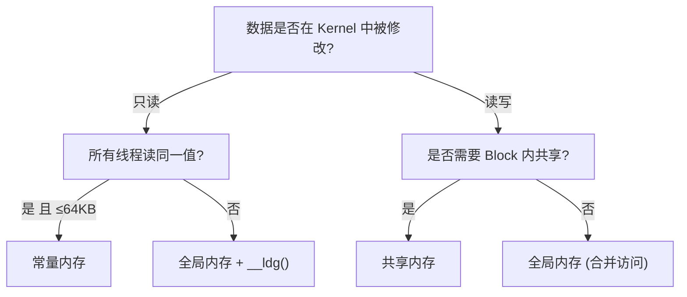

# 答案独立人工复核

填写 answer-review.json；事实字段留空表示尚未评分。
引用 ID 合法不代表陈述受到证据支持。

## official:official-002-1:processed_global30

vLLM v0.10.2：缓存块身份除了文本还需要哪些额外哈希？

必要要点：额外哈希包含LoRA ID、多模态输入哈希和租户隔离盐。

禁止误读：缓存键只需文本token，适配器和图像不影响身份。

```json
{
  "conversation_id": "4e021d87-02dc-474b-ab87-887d70ca6f87",
  "answer": "除文本（块内 token 及前缀 token）外，缓存块身份还需要额外哈希（Extra hashes），例如 LoRA ID、多模态输入哈希，以及用于多租户环境隔离缓存的 cache salt。[E3684ca4dceac3907e2f63078]",
  "citations": [
    {
      "citation_id": "E3684ca4dceac3907e2f63078",
      "chunk_id": "d2ff94675785a324f32b455e",
      "parent_id": "2b1bb7e8a9dfe47e1a43df32",
      "source": "/Users/jennyma/Projects/InfraAgent/data/official-evals/infra-official-v1/corpus/vllm-prefix_caching.md",
      "locator": "/Users/jennyma/Projects/InfraAgent/data/official-evals/infra-official-v1/corpus/vllm-prefix_caching.md#L17-L19",
      "page": null,
      "start_line": 17,
      "end_line": 19,
      "modality": "text",
      "bbox": null,
      "coordinate_space": null,
      "image_path": null,
      "caption_source": null,
      "caption_locator": null,
      "content": "* Parent hash value: The hash value of the parent hash block.\n* Block tokens: A tuple of tokens in this block. The reason to include the exact tokens is to reduce potential hash value collision.\n* Extra hashes: Other values required to make this block unique, such as LoRA IDs, multi-modality input hashes (see the example below), and cache salts to isolate caches in multi-tenant environments.",
      "truncated": false,
      "metadata": {
        "collection": "official",
        "document_id": "vllm-prefix_caching",
        "url": "https://github.com/vllm-project/vllm/blob/01efc7ef781391e744ed08c3292817a773d654e6/docs/design/prefix_caching.md",
        "commit": "01efc7ef781391e744ed08c3292817a773d654e6",
        "release": "v0.10.2",
        "sha256": "0a8a9e9095055c4f8e0cdaf078e3194ab06428222d65abb9c827f6879607ce61",
        "product": "vllm",
        "metadata_method": "frozen_manifest",
        "preprocessing_version": "rules-structure-v1",
        "body_type": "explanation",
        "original_lines": [
          17,
          19
        ],
        "topic": "Automatic Prefix Caching",
        "hardware_mentions": [],
        "original_chunk_ids": [
          "47a8a3a804e4497c937560cd",
          "52d06965a14a4454a59d58ee",
          "94b777157ed4ca867fa7d39a"
        ]
      },
      "source_position": 21
    }
  ],
  "status": "answered",
  "trace": [
    {
      "step": "retrieve",
      "duration_ms": 0.0,
      "query": "vLLM v0.10.2：缓存块身份除了文本还需要哪些额外哈希？",
      "hits": 0,
      "evidence": 9
    },
    {
      "step": "generate",
      "duration_ms": 934.0,
      "provider": "anthropic-compatible",
      "model": "deepseek-flash",
      "validated": true
    }
  ]
}
```

实际输入证据：

### E3684ca4dceac3907e2f63078

/Users/jennyma/Projects/InfraAgent/data/official-evals/infra-official-v1/corpus/vllm-prefix_caching.md#L17-L19

```text
* Parent hash value: The hash value of the parent hash block.
* Block tokens: A tuple of tokens in this block. The reason to include the exact tokens is to reduce potential hash value collision.
* Extra hashes: Other values required to make this block unique, such as LoRA IDs, multi-modality input hashes (see the example below), and cache salts to isolate caches in multi-tenant environments.
```

### E67bd2114a97b0bf090567874

/Users/jennyma/Projects/InfraAgent/data/official-evals/infra-official-v1/corpus/vllm-prefix_caching.md#L5-L5

```text
While there are many ways to implement prefix caching, vLLM chooses a hash-based approach. Specifically, we hash each kv-cache block by the tokens in the block and the tokens in the prefix before the block:
```

### E81323e7463b06b06736e226d

/Users/jennyma/Projects/InfraAgent/data/official-evals/infra-official-v1/corpus/vllm-prefix_caching.md#L81-L82

```text
**Cache Isolation for Security**
To improve privacy in shared environments, vLLM supports isolating prefix cache reuse through optional per-request salting.
By including a `cache_salt` in the request, this value is injected into the hash of the first block, ensuring that only requests with the same salt can reuse cached KV blocks.
This prevents timing-based attacks where an adversary could infer cached content by observing latency differences.
```

### E39e133e40e8e83a1b801a8b1

/Users/jennyma/Projects/InfraAgent/data/official-evals/infra-official-v1/corpus/vllm-prefix_caching.md#L192-L192

```text
As can be seen, block 3 is a new full block and is cached.
However, it is redundant as block 1, meaning that we cached the same block twice.
In v0, when detecting block 3 is duplicated, we free block 3 and let Request 2 use block 1 instead, so its block table becomes `[0, 1]` in Time 1.
However, the block table in vLLM v1 is append-only, meaning that changing the block table from `[0, 3]` to `[0, 1]` is not allowed.
```

### E08e006fb1c4dc5c85b5de5b2

/Users/jennyma/Projects/InfraAgent/data/official-evals/infra-official-v1/corpus/vllm-pr-21611.md#L31-L194

```text
```
***info: image_2 single input the 2nd time. It should not form aother new hash.***
**Expected storage path length after llm generate: 2**
Adding requests: 100%|██████████████████████████████████████████████████████████████████████████████████████████████████████████████████████████████████████████████████████████████████| 1/1 [00:00<00:00, 93.91it/s]
```
```

### Eb164b41ccda7a89cd9647b5d

/Users/jennyma/Projects/InfraAgent/data/official-evals/infra-official-v1/corpus/vllm-pr-21611.md#L30-L30

```text
## Test Result
```

### Ec7f61dbe54a702f487007e68

/Users/jennyma/Projects/InfraAgent/data/official-evals/infra-official-v1/corpus/vllm-prefix_caching.md#L3-L3

```text
Since prefix caching is almost a free lunch and won’t change model outputs, it has been widely used by many public endpoints (e.g., OpenAI, Anthropic, etc) and most open source LLM inference frameworks (e.g., SGLang).
```

### Eb3e553641b20c08a05c35bd7

/Users/jennyma/Projects/InfraAgent/data/official-evals/infra-official-v1/corpus/vllm-prefix_caching.md#L7-L13

```text
```text
                    Block 1                  Block 2                  Block 3
         [A gentle breeze stirred] [the leaves as children] [laughed in the distance]
Block 1: |<--- block tokens ---->|
Block 2: |<------- prefix ------>| |<--- block tokens --->|
Block 3: |<------------------ prefix -------------------->| |<--- block tokens ---->|
```
```

### E41e6e211435ec5b85ec07c34

/Users/jennyma/Projects/InfraAgent/data/official-evals/infra-official-v1/corpus/vllm-prefix_caching.md#L15-L15

```text
In the example above, the KV cache in the first block can be uniquely identified with the token “A gentle breeze stirred”. The third block can be uniquely identified with the tokens in the block “laughed in the distance”, along with the prefix tokens “A gentle breeze stirred the leaves as children”.
```

## official:official-002-2:processed_global30

vLLM v0.10.2：两个适配器使用相同文本，是否可以只按文本共享缓存？

必要要点：额外哈希包含LoRA ID、多模态输入哈希和租户隔离盐。

禁止误读：缓存键只需文本token，适配器和图像不影响身份。

```json
{
  "conversation_id": "d20336fa-3ad2-43a0-863b-e01d53c9ede4",
  "answer": "当前检索到的资料不足以可靠回答这个问题。可以补充文档或把问题问得更具体。",
  "citations": [],
  "status": "no_evidence",
  "trace": [
    {
      "step": "retrieve",
      "duration_ms": 0.0,
      "query": "vLLM v0.10.2：两个适配器使用相同文本，是否可以只按文本共享缓存？",
      "hits": 0,
      "evidence": 9
    },
    {
      "step": "generate",
      "duration_ms": 654.5,
      "provider": "anthropic-compatible",
      "model": "deepseek-flash",
      "validated": true
    }
  ]
}
```

实际输入证据：

### E39e133e40e8e83a1b801a8b1

/Users/jennyma/Projects/InfraAgent/data/official-evals/infra-official-v1/corpus/vllm-prefix_caching.md#L192-L192

```text
As can be seen, block 3 is a new full block and is cached.
However, it is redundant as block 1, meaning that we cached the same block twice.
In v0, when detecting block 3 is duplicated, we free block 3 and let Request 2 use block 1 instead, so its block table becomes `[0, 1]` in Time 1.
However, the block table in vLLM v1 is append-only, meaning that changing the block table from `[0, 3]` to `[0, 1]` is not allowed.
```

### Eab35c51094c1a56143f050ba

/Users/jennyma/Projects/InfraAgent/data/official-evals/infra-official-v1/corpus/cuda-unified-memory-programming.md#L946-L946

```text
Note that it is not possible to share memory between different hosts and their devices using this technique.
```

### E81323e7463b06b06736e226d

/Users/jennyma/Projects/InfraAgent/data/official-evals/infra-official-v1/corpus/vllm-prefix_caching.md#L81-L82

```text
**Cache Isolation for Security**
To improve privacy in shared environments, vLLM supports isolating prefix cache reuse through optional per-request salting.
By including a `cache_salt` in the request, this value is injected into the hash of the first block, ensuring that only requests with the same salt can reuse cached KV blocks.
This prevents timing-based attacks where an adversary could infer cached content by observing latency differences.
```

### Eb95ef72523a1e13f5f38e62d

/Users/jennyma/Projects/InfraAgent/data/official-evals/infra-official-v1/corpus/vllm-docker.md#L34-L37

```text
!!! note
    You can either use the `ipc=host` flag or `--shm-size` flag to allow the
    container to access the host's shared memory. vLLM uses PyTorch, which uses shared
    memory to share data between processes under the hood, particularly for tensor parallel inference.
```

### E2eec58a512990f7feac77fcc

/Users/jennyma/Projects/InfraAgent/data/official-evals/infra-official-v1/corpus/cuda-streams.md#L79-L82

```text
For example, on devices that do not support concurrent data transfers, the two streams of the code sample of Creation and Destruction of Streams
do not overlap at all because the memory copy from host to device is issued to stream[1] after the memory copy from device to host
is issued to stream[0], so it can only start once the memory copy from device to host issued to stream[0] has completed.
If the
```

### E2dec512ed6f8c9b464b0894d

/Users/jennyma/Projects/InfraAgent/data/official-evals/infra-official-v1/corpus/vllm-prefix_caching.md#L178-L190

```text
```text
Prompt: [A, B, C, D, E, F]
Output: [G, H, I]

Time 0:
  Tokens: [A, B, C, D, E, F, G]
  Block Table: [0 (ABCD), 3 (EFG)]
  Cache Blocks: 0, 1
Time 1:
  Tokens: [A, B, C, D, E, F, G, H]
  Block Table: [0 (ABCD), 3 (EFGH)]
  Cache Blocks: 0, 1, 3
```
```

### Ed7363cdf5777398175b61e8a

/Users/jennyma/Projects/InfraAgent/data/official-evals/infra-official-v1/corpus/vllm-prefix_caching.md#L192-L192

```text
As a result, we will have duplicated blocks for the hash key E-H.
This duplication will be eliminated when the request is freed.
```

### E7ef1b6030cdae238e97a7a90

/Users/jennyma/Projects/InfraAgent/data/official-evals/infra-official-v1/corpus/vllm-prefix_caching.md#L176-L176

```text
Now block 0 and block 1 are cached, and we send the same request again (Request 2\) with greedy sampling, so that it will produce exactly the same outputs as the Request 1:
```

### Eac876098e0aee3543416fabe

/Users/jennyma/Projects/InfraAgent/data/official-evals/infra-official-v1/corpus/vllm-prefix_caching.md#L158-L174

```text
```text
Prompt: [A, B, C, D, E, F]
Output: [G, H, I]

Time 0:
  Tokens: [A, B, C, D, E, F, G]
  Block Table: [0 (ABCD), 1 (EFG)]
  Cache Blocks: 0
Time 1:
  Tokens: [A, B, C, D, E, F, G, H]
  Block Table: [0 (ABCD), 1 (EFGH)]
  Cache Blocks: 0, 1
Time 2:
  Tokens: [A, B, C, D, E, F, G, H, I]
  Block Table: [0 (ABCD), 1 (EFGH), 2 (I)]
  Cache Blocks: 0, 1
```
```

## official:official-002-3:processed_global30

vLLM v0.10.2：多租户前缀相同但需要隔离，应检查缓存键中的什么信息？

必要要点：额外哈希包含LoRA ID、多模态输入哈希和租户隔离盐。

禁止误读：缓存键只需文本token，适配器和图像不影响身份。

```json
{
  "conversation_id": "d60053de-48a0-4e62-b782-65d5983a653d",
  "answer": "应检查缓存键中的 Extra hashes（额外哈希）信息，其中包含用于在多租户环境中隔离缓存的 cache salts（缓存盐）。[E3684ca4dceac3907e2f63078] 具体可通过在请求中携带 cache_salt，该值会被注入第一个块的哈希，从而确保只有相同 salt 的请求才能复用缓存的 KV 块。[E81323e7463b06b06736e226d]",
  "citations": [
    {
      "citation_id": "E3684ca4dceac3907e2f63078",
      "chunk_id": "d2ff94675785a324f32b455e",
      "parent_id": "2b1bb7e8a9dfe47e1a43df32",
      "source": "/Users/jennyma/Projects/InfraAgent/data/official-evals/infra-official-v1/corpus/vllm-prefix_caching.md",
      "locator": "/Users/jennyma/Projects/InfraAgent/data/official-evals/infra-official-v1/corpus/vllm-prefix_caching.md#L17-L19",
      "page": null,
      "start_line": 17,
      "end_line": 19,
      "modality": "text",
      "bbox": null,
      "coordinate_space": null,
      "image_path": null,
      "caption_source": null,
      "caption_locator": null,
      "content": "* Parent hash value: The hash value of the parent hash block.\n* Block tokens: A tuple of tokens in this block. The reason to include the exact tokens is to reduce potential hash value collision.\n* Extra hashes: Other values required to make this block unique, such as LoRA IDs, multi-modality input hashes (see the example below), and cache salts to isolate caches in multi-tenant environments.",
      "truncated": false,
      "metadata": {
        "collection": "official",
        "document_id": "vllm-prefix_caching",
        "url": "https://github.com/vllm-project/vllm/blob/01efc7ef781391e744ed08c3292817a773d654e6/docs/design/prefix_caching.md",
        "commit": "01efc7ef781391e744ed08c3292817a773d654e6",
        "release": "v0.10.2",
        "sha256": "0a8a9e9095055c4f8e0cdaf078e3194ab06428222d65abb9c827f6879607ce61",
        "product": "vllm",
        "metadata_method": "frozen_manifest",
        "preprocessing_version": "rules-structure-v1",
        "body_type": "explanation",
        "original_lines": [
          17,
          19
        ],
        "topic": "Automatic Prefix Caching",
        "hardware_mentions": [],
        "original_chunk_ids": [
          "47a8a3a804e4497c937560cd",
          "52d06965a14a4454a59d58ee",
          "94b777157ed4ca867fa7d39a"
        ]
      },
      "source_position": 21
    },
    {
      "citation_id": "E81323e7463b06b06736e226d",
      "chunk_id": "6d941118fc906ea21ee58302",
      "parent_id": "2b1bb7e8a9dfe47e1a43df32",
      "source": "/Users/jennyma/Projects/InfraAgent/data/official-evals/infra-official-v1/corpus/vllm-prefix_caching.md",
      "locator": "/Users/jennyma/Projects/InfraAgent/data/official-evals/infra-official-v1/corpus/vllm-prefix_caching.md#L81-L82",
      "page": null,
      "start_line": 81,
      "end_line": 82,
      "modality": "text",
      "bbox": null,
      "coordinate_space": null,
      "image_path": null,
      "caption_source": null,
      "caption_locator": null,
      "content": "**Cache Isolation for Security**\nTo improve privacy in shared environments, vLLM supports isolating prefix cache reuse through optional per-request salting.\nBy including a `cache_salt` in the request, this value is injected into the hash of the first block, ensuring that only requests with the same salt can reuse cached KV blocks.\nThis prevents timing-based attacks where an adversary could infer cached content by observing latency differences.",
      "truncated": false,
      "metadata": {
        "collection": "official",
        "document_id": "vllm-prefix_caching",
        "url": "https://github.com/vllm-project/vllm/blob/01efc7ef781391e744ed08c3292817a773d654e6/docs/design/prefix_caching.md",
        "commit": "01efc7ef781391e744ed08c3292817a773d654e6",
        "release": "v0.10.2",
        "sha256": "0a8a9e9095055c4f8e0cdaf078e3194ab06428222d65abb9c827f6879607ce61",
        "product": "vllm",
        "metadata_method": "frozen_manifest",
        "preprocessing_version": "rules-structure-v1",
        "body_type": "condition",
        "original_lines": [
          81,
          82
        ],
        "topic": "Automatic Prefix Caching",
        "hardware_mentions": [],
        "original_chunk_ids": [
          "4d76112419b3dedaddc121f8",
          "5d0deace325a4e6f0db68487",
          "8d6240eabf6c5fa7554004b0",
          "c5526f786791064d3e121af5",
          "fa3783b786a5a34f47d17bd8"
        ]
      },
      "source_position": 33
    }
  ],
  "status": "answered",
  "trace": [
    {
      "step": "retrieve",
      "duration_ms": 0.0,
      "query": "vLLM v0.10.2：多租户前缀相同但需要隔离，应检查缓存键中的什么信息？",
      "hits": 0,
      "evidence": 10
    },
    {
      "step": "generate",
      "duration_ms": 1022.4,
      "provider": "anthropic-compatible",
      "model": "deepseek-flash",
      "validated": true
    }
  ]
}
```

实际输入证据：

### E3684ca4dceac3907e2f63078

/Users/jennyma/Projects/InfraAgent/data/official-evals/infra-official-v1/corpus/vllm-prefix_caching.md#L17-L19

```text
* Parent hash value: The hash value of the parent hash block.
* Block tokens: A tuple of tokens in this block. The reason to include the exact tokens is to reduce potential hash value collision.
* Extra hashes: Other values required to make this block unique, such as LoRA IDs, multi-modality input hashes (see the example below), and cache salts to isolate caches in multi-tenant environments.
```

### E81323e7463b06b06736e226d

/Users/jennyma/Projects/InfraAgent/data/official-evals/infra-official-v1/corpus/vllm-prefix_caching.md#L81-L82

```text
**Cache Isolation for Security**
To improve privacy in shared environments, vLLM supports isolating prefix cache reuse through optional per-request salting.
By including a `cache_salt` in the request, this value is injected into the hash of the first block, ensuring that only requests with the same salt can reuse cached KV blocks.
This prevents timing-based attacks where an adversary could infer cached content by observing latency differences.
```

### E920d5fd30b391d87ed884dfd

/Users/jennyma/Projects/InfraAgent/data/datasets/infra-repos-v1/corpus/AIInfraGuide/docs/guides/模块四-推理优化/第2章-推理引擎核心技术/2.3-Prefix Cache 与 RadixAttention.md#L11-L11

```text
真实业务里，海量请求往往共享同一段开头——同一个几百 Token 的 System Prompt、同一份 Few-shot 示例、多轮对话里不断重复的历史。每来一个请求就把这段共享前缀重新 Prefill 一遍，是巨大的浪费。Prefix Cache 就是把这段共享前缀的 KV Cache 缓存下来、后续请求直接复用的技术。这一节讲清 vLLM 基于 Hash 的自动前缀缓存怎么工作，以及 SGLang 的 RadixAttention 在此之上的进阶思路。
```

### E88fe94a338464d3bf86e48a8

/Users/jennyma/Projects/InfraAgent/data/official-evals/infra-official-v1/corpus/vllm-paged_attention.md#L7-L14

```text
Currently, vLLM utilizes its own implementation of a multi-head query
attention kernel (`csrc/attention/attention_kernels.cu`).
This kernel is designed to be compatible with
vLLM's paged KV caches, where the key and value cache are stored in
separate blocks (note that this block concept differs from the GPU
thread block.
So in a later document, I will refer to vLLM paged
attention block as "block", while refer to GPU thread block as
```

### E9b566228b7480fac0b55425a

/Users/jennyma/Projects/InfraAgent/data/official-evals/infra-official-v1/corpus/vllm-prefix_caching.md#L24-L26

```text
!!
! note "Note 2"
The above hash key structure is not 100% collision free.
Theoretically it’s still possible for the different prefix tokens to have the same hash value.
To avoid any hash collisions **in a multi-tenant setup, we advise to use SHA256** as hash function instead of the default builtin hash.
SHA256 is supported since vLLM v0.8.3 and must be enabled with a command line argument.
```

### E41e6e211435ec5b85ec07c34

/Users/jennyma/Projects/InfraAgent/data/official-evals/infra-official-v1/corpus/vllm-prefix_caching.md#L15-L15

```text
In the example above, the KV cache in the first block can be uniquely identified with the token “A gentle breeze stirred”. The third block can be uniquely identified with the tokens in the block “laughed in the distance”, along with the prefix tokens “A gentle breeze stirred the leaves as children”. Therefore, we can build the block hash of `hash(tuple[components])`, where components are:
```

### E303bd4355691dee98763220d

/Users/jennyma/Projects/InfraAgent/data/official-evals/infra-official-v1/corpus/vllm-prefix_caching.md#L21-L22

```text
!!! note "Note 1"
    We only cache full blocks.
```

### Eafc10a8d33d249c14b60228e

/Users/jennyma/Projects/InfraAgent/data/official-evals/infra-official-v1/corpus/vllm-prefix_caching.md#L24-L26

```text
It comes with a performance impact of about 100-200ns per token (~6ms for 50k tokens of context).
```

### E72b9a56cf654f6429a53a8cf

/Users/jennyma/Projects/InfraAgent/data/official-evals/infra-official-v1/corpus/vllm-prefix_caching.md#L81-L82

```text
This offers protection without compromising performance.
```

### E8d1c51a849fb55f30ebf045d

/Users/jennyma/Projects/InfraAgent/data/official-evals/infra-official-v1/corpus/vllm-prefix_caching.md#L45-L45

```text
It will become the following prompt:
```

## official:official-002-4:processed_global30

vLLM v0.10.2：先确认服务模型支持LoRA，再考虑两个LoRA请求文本相同，为什么缓存键仍需额外区分身份？

必要要点：额外哈希包含LoRA ID、多模态输入哈希和租户隔离盐。；服务模型须支持LoRA；切换适配器时缓存键还需要适配器身份。

禁止误读：缓存键只需文本token，适配器和图像不影响身份。

```json
{
  "conversation_id": "c1fc4393-7529-4096-b4cc-1a4a471c9f0a",
  "answer": "服务模型支持LoRA可通过启动时用 `--lora-modules {name}={path}` 指定LoRA模块，并配合 `--enable-lora` 启用 [E5e801c761a85c7d2f8d43c6d][E71173cb7177e423f64b908eb]。LoRARequest 的第一个参数是人类可识别的名称，第二个参数是适配器的全局唯一ID，第三个参数是LoRA适配器路径 [E84032c59952b25f6711a2833]。因此，即使两个LoRA请求的文本相同，缓存键仍需额外区分身份，因为不同LoRA适配器由全局唯一ID标识，身份不同则对应的适配器不同 [E84032c59952b25f6711a2833]。",
  "citations": [
    {
      "citation_id": "E5e801c761a85c7d2f8d43c6d",
      "chunk_id": "a54cb1f562e47ca6eb3c7272",
      "parent_id": "daeb815960131ce90b16e7f7",
      "source": "/Users/jennyma/Projects/InfraAgent/data/official-evals/infra-official-v1/corpus/vllm-lora.md",
      "locator": "/Users/jennyma/Projects/InfraAgent/data/official-evals/infra-official-v1/corpus/vllm-lora.md#L54-L55",
      "page": null,
      "start_line": 54,
      "end_line": 55,
      "modality": "text",
      "bbox": null,
      "coordinate_space": null,
      "image_path": null,
      "caption_source": null,
      "caption_locator": null,
      "content": "LoRA adapted models can also be served with the Open-AI compatible vLLM server. To do so, we use\n`--lora-modules {name}={path} {name}={path}` to specify each LoRA module when we kick off the server:",
      "truncated": false,
      "metadata": {
        "collection": "official",
        "document_id": "vllm-lora",
        "url": "https://github.com/vllm-project/vllm/blob/01efc7ef781391e744ed08c3292817a773d654e6/docs/features/lora.md",
        "commit": "01efc7ef781391e744ed08c3292817a773d654e6",
        "release": "v0.10.2",
        "sha256": "ea46686b99b86733243e952f49574c17f9011b5a96ca270a48f4d140c1a3d6c8",
        "product": "vllm",
        "metadata_method": "frozen_manifest",
        "preprocessing_version": "rules-structure-v1",
        "body_type": "explanation",
        "original_lines": [
          54,
          55
        ],
        "topic": "LoRA Adapters > Serving LoRA Adapters",
        "hardware_mentions": [],
        "original_chunk_ids": [
          "b981b49768239d7aa009e3de"
        ]
      },
      "source_position": 604
    },
    {
      "citation_id": "E71173cb7177e423f64b908eb",
      "chunk_id": "ef3c4da782d5fd798e3af703",
      "parent_id": "daeb815960131ce90b16e7f7",
      "source": "/Users/jennyma/Projects/InfraAgent/data/official-evals/infra-official-v1/corpus/vllm-lora.md",
      "locator": "/Users/jennyma/Projects/InfraAgent/data/official-evals/infra-official-v1/corpus/vllm-lora.md#L57-L61",
      "page": null,
      "start_line": 57,
      "end_line": 61,
      "modality": "text",
      "bbox": null,
      "coordinate_space": null,
      "image_path": null,
      "caption_source": null,
      "caption_locator": null,
      "content": "```bash\nvllm serve meta-llama/Llama-2-7b-hf \\\n    --enable-lora \\\n    --lora-modules sql-lora=$HOME/.cache/huggingface/hub/models--yard1--llama-2-7b-sql-lora-test/snapshots/0dfa347e8877a4d4ed19ee56c140fa518470028c/\n```",
      "truncated": false,
      "metadata": {
        "collection": "official",
        "document_id": "vllm-lora",
        "url": "https://github.com/vllm-project/vllm/blob/01efc7ef781391e744ed08c3292817a773d654e6/docs/features/lora.md",
        "commit": "01efc7ef781391e744ed08c3292817a773d654e6",
        "release": "v0.10.2",
        "sha256": "ea46686b99b86733243e952f49574c17f9011b5a96ca270a48f4d140c1a3d6c8",
        "product": "vllm",
        "metadata_method": "frozen_manifest",
        "preprocessing_version": "rules-structure-v1",
        "body_type": "code",
        "original_lines": [
          57,
          61
        ],
        "topic": "LoRA Adapters > Serving LoRA Adapters",
        "hardware_mentions": [],
        "description_lines": [
          54,
          55
        ],
        "original_chunk_ids": [
          "b981b49768239d7aa009e3de"
        ]
      },
      "source_position": 605
    },
    {
      "citation_id": "E84032c59952b25f6711a2833",
      "chunk_id": "f4ad90f823c831a04883ee0b",
      "parent_id": "6df5ae34fd711c9629f2aee0",
      "source": "/Users/jennyma/Projects/InfraAgent/data/official-evals/infra-official-v1/corpus/vllm-lora.md",
      "locator": "/Users/jennyma/Projects/InfraAgent/data/official-evals/infra-official-v1/corpus/vllm-lora.md#L25-L27",
      "page": null,
      "start_line": 25,
      "end_line": 27,
      "modality": "text",
      "bbox": null,
      "coordinate_space": null,
      "image_path": null,
      "caption_source": null,
      "caption_locator": null,
      "content": "We can now submit the prompts and call `llm.generate` with the `lora_request` parameter. The first parameter\nof `LoRARequest` is a human identifiable name, the second parameter is a globally unique ID for the adapter and\nthe third parameter is the path to the LoRA adapter.",
      "truncated": false,
      "metadata": {
        "collection": "official",
        "document_id": "vllm-lora",
        "url": "https://github.com/vllm-project/vllm/blob/01efc7ef781391e744ed08c3292817a773d654e6/docs/features/lora.md",
        "commit": "01efc7ef781391e744ed08c3292817a773d654e6",
        "release": "v0.10.2",
        "sha256": "ea46686b99b86733243e952f49574c17f9011b5a96ca270a48f4d140c1a3d6c8",
        "product": "vllm",
        "metadata_method": "frozen_manifest",
        "preprocessing_version": "rules-structure-v1",
        "body_type": "explanation",
        "original_lines": [
          25,
          27
        ],
        "topic": "LoRA Adapters",
        "hardware_mentions": [],
        "original_chunk_ids": [
          "f708ecd1d6d6d4a455053055",
          "7e9da1549e25115502d8af34",
          "5b0727bb8690c6252b34637b"
        ]
      },
      "source_position": 598
    }
  ],
  "status": "answered",
  "trace": [
    {
      "step": "retrieve",
      "duration_ms": 0.0,
      "query": "vLLM v0.10.2：先确认服务模型支持LoRA，再考虑两个LoRA请求文本相同，为什么缓存键仍需额外区分身份？",
      "hits": 0,
      "evidence": 11
    },
    {
      "step": "generate",
      "duration_ms": 1265.6,
      "provider": "anthropic-compatible",
      "model": "deepseek-flash",
      "validated": true
    }
  ]
}
```

实际输入证据：

### E5e801c761a85c7d2f8d43c6d

/Users/jennyma/Projects/InfraAgent/data/official-evals/infra-official-v1/corpus/vllm-lora.md#L54-L55

```text
LoRA adapted models can also be served with the Open-AI compatible vLLM server. To do so, we use
`--lora-modules {name}={path} {name}={path}` to specify each LoRA module when we kick off the server:
```

### E84032c59952b25f6711a2833

/Users/jennyma/Projects/InfraAgent/data/official-evals/infra-official-v1/corpus/vllm-lora.md#L25-L27

```text
We can now submit the prompts and call `llm.generate` with the `lora_request` parameter. The first parameter
of `LoRARequest` is a human identifiable name, the second parameter is a globally unique ID for the adapter and
the third parameter is the path to the LoRA adapter.
```

### E6633d0981a33a0e244ff4111

/Users/jennyma/Projects/InfraAgent/data/official-evals/infra-official-v1/corpus/vllm-lora.md#L110-L110

```text
In addition to serving LoRA adapters at server startup, the vLLM server supports dynamically configuring LoRA adapters at runtime through dedicated API endpoints and plugins. This feature can be particularly useful when the flexibility to change models on-the-fly is needed.
```

### E3495aa766781aa2294b702ec

/Users/jennyma/Projects/InfraAgent/data/official-evals/infra-official-v1/corpus/vllm-lora.md#L280-L280

```text
This can be a bit tedious to manage with the above approaches, as it requires the user to send the `LoRARequest` (offline) or to filter requests between the base model and LoRA model (server) depending on the content of the request's multimodal data.
```

### Ebd889942b4a96dd5cbc58f41

/Users/jennyma/Projects/InfraAgent/data/official-evals/infra-official-v1/corpus/vllm-lora.md#L235-L235

```text
The new format of `--lora-modules` is mainly to support the display of parent model information in the model card. Here's an explanation of how your current response supports this:
```

### Ea68f202bd2e109da86f63bf4

/Users/jennyma/Projects/InfraAgent/data/official-evals/infra-official-v1/corpus/vllm-lora.md#L52-L52

```text
## Serving LoRA Adapters
```

### E71173cb7177e423f64b908eb

/Users/jennyma/Projects/InfraAgent/data/official-evals/infra-official-v1/corpus/vllm-lora.md#L57-L61

```text
```bash
vllm serve meta-llama/Llama-2-7b-hf \
    --enable-lora \
    --lora-modules sql-lora=$HOME/.cache/huggingface/hub/models--yard1--llama-2-7b-sql-lora-test/snapshots/0dfa347e8877a4d4ed19ee56c140fa518470028c/
```
```

### E2027cf40438d32ac062bce01

/Users/jennyma/Projects/InfraAgent/data/official-evals/infra-official-v1/corpus/vllm-lora.md#L63-L64

```text
!!! note
    The commit ID `0dfa347e8877a4d4ed19ee56c140fa518470028c` may change over time. Please check the latest commit ID in your environment to ensure you are using the correct one.
```

### Ecb4f854231352b9831e2c0a8

/Users/jennyma/Projects/InfraAgent/data/official-evals/infra-official-v1/corpus/vllm-lora.md#L66-L68

```text
The server entrypoint accepts all other LoRA configuration parameters (`max_loras`, `max_lora_rank`, `max_cpu_loras`,
etc.), which will apply to all forthcoming requests. Upon querying the `/models` endpoint, we should see our LoRA along
with its base model (if `jq` is not installed, you can follow [this guide](https://jqlang.org/download/) to install it.):
```

### Ec0b086b07067229181444c6b

/Users/jennyma/Projects/InfraAgent/data/official-evals/infra-official-v1/corpus/vllm-lora.md#L70-L70

```text
??? console "Command"
```

### E248759b6f8bc44e03dbf3579

/Users/jennyma/Projects/InfraAgent/data/official-evals/infra-official-v1/corpus/vllm-lora.md#L72-L89

```text
    ```bash
    curl localhost:8000/v1/models | jq .
    {
        "object": "list",
        "data": [
            {
                "id": "meta-llama/Llama-2-7b-hf",
                "object": "model",
                ...
            },
            {
                "id": "sql-lora",
                "object": "model",
                ...
            }
        ]
    }
    ```
```

## official:official-004-1:processed_global30

vLLM v0.10.2：Ampere在此版本支持的FP8配置与kernel是什么？

必要要点：Ampere的该支持是使用Marlin的W8A16权重量化。

禁止误读：Ampere文档中的该支持等同于W8A8。

```json
{
  "conversation_id": "887b643b-30d8-43ed-a098-51f2fb435354",
  "answer": "在 vLLM 中，Ampere GPU 支持 W8A16（weight-only FP8），使用 FP8 Marlin kernel；FP8 计算本身需要 compute capability > 8.9（Ada Lovelace、Hopper），而 FP8 模型可在 compute capability > 8.0（Ampere）上以 weight-only W8A16 运行。[E6922656a68144517af890f74][E304d729ae809670c7310aad7]",
  "citations": [
    {
      "citation_id": "E6922656a68144517af890f74",
      "chunk_id": "0ecfdf4402bc966538acf242",
      "parent_id": "f33bdc394c727dc02060df33",
      "source": "/Users/jennyma/Projects/InfraAgent/data/official-evals/infra-official-v1/corpus/vllm-fp8.md",
      "locator": "/Users/jennyma/Projects/InfraAgent/data/official-evals/infra-official-v1/corpus/vllm-fp8.md#L3-L6",
      "page": null,
      "start_line": 3,
      "end_line": 6,
      "modality": "text",
      "bbox": null,
      "coordinate_space": null,
      "image_path": null,
      "caption_source": null,
      "caption_locator": null,
      "content": "vLLM supports FP8 (8-bit floating point) weight and activation quantization using hardware acceleration on GPUs such as Nvidia H100 and AMD MI300x.\nCurrently, only Hopper and Ada Lovelace GPUs are officially supported for W8A8.\nAmpere GPUs are supported for W8A16 (weight-only FP8) utilizing Marlin kernels.",
      "truncated": false,
      "metadata": {
        "collection": "official",
        "document_id": "vllm-fp8",
        "url": "https://github.com/vllm-project/vllm/blob/01efc7ef781391e744ed08c3292817a773d654e6/docs/features/quantization/fp8.md",
        "commit": "01efc7ef781391e744ed08c3292817a773d654e6",
        "release": "v0.10.2",
        "sha256": "a8df8bd97e708315f83286e9390250a0e8292d8d205fe4c12e2a1ff23dadfb43",
        "product": "vllm",
        "metadata_method": "frozen_manifest",
        "preprocessing_version": "rules-structure-v1",
        "body_type": "condition",
        "original_lines": [
          3,
          6
        ],
        "topic": "FP8 W8A8",
        "hardware_mentions": [
          "AMD",
          "Ada Lovelace",
          "Ampere",
          "H100",
          "Hopper",
          "MI300x",
          "Nvidia"
        ],
        "original_chunk_ids": [
          "a2df220c82c59eb08a6b868e",
          "476c07c43bf304ca06bc6c41"
        ]
      },
      "source_position": 305
    },
    {
      "citation_id": "E304d729ae809670c7310aad7",
      "chunk_id": "b5c56188263e0df5c1181742",
      "parent_id": "f33bdc394c727dc02060df33",
      "source": "/Users/jennyma/Projects/InfraAgent/data/official-evals/infra-official-v1/corpus/vllm-fp8.md",
      "locator": "/Users/jennyma/Projects/InfraAgent/data/official-evals/infra-official-v1/corpus/vllm-fp8.md#L15-L17",
      "page": null,
      "start_line": 15,
      "end_line": 17,
      "modality": "text",
      "bbox": null,
      "coordinate_space": null,
      "image_path": null,
      "caption_source": null,
      "caption_locator": null,
      "content": "!!! note\n    FP8 computation is supported on NVIDIA GPUs with compute capability > 8.9 (Ada Lovelace, Hopper).\n    FP8 models will run on compute capability > 8.0 (Ampere) as weight-only W8A16, utilizing FP8 Marlin.",
      "truncated": false,
      "metadata": {
        "collection": "official",
        "document_id": "vllm-fp8",
        "url": "https://github.com/vllm-project/vllm/blob/01efc7ef781391e744ed08c3292817a773d654e6/docs/features/quantization/fp8.md",
        "commit": "01efc7ef781391e744ed08c3292817a773d654e6",
        "release": "v0.10.2",
        "sha256": "a8df8bd97e708315f83286e9390250a0e8292d8d205fe4c12e2a1ff23dadfb43",
        "product": "vllm",
        "metadata_method": "frozen_manifest",
        "preprocessing_version": "rules-structure-v1",
        "body_type": "condition",
        "original_lines": [
          15,
          17
        ],
        "topic": "FP8 W8A8",
        "hardware_mentions": [
          "Ada Lovelace",
          "Ampere",
          "Hopper",
          "NVIDIA"
        ],
        "original_chunk_ids": [
          "b5c56188263e0df5c1181742"
        ]
      },
      "source_position": 310
    }
  ],
  "status": "answered",
  "trace": [
    {
      "step": "retrieve",
      "duration_ms": 0.0,
      "query": "vLLM v0.10.2：Ampere在此版本支持的FP8配置与kernel是什么？",
      "hits": 0,
      "evidence": 12
    },
    {
      "step": "generate",
      "duration_ms": 921.1,
      "provider": "anthropic-compatible",
      "model": "deepseek-flash",
      "validated": true
    }
  ]
}
```

实际输入证据：

### E6922656a68144517af890f74

/Users/jennyma/Projects/InfraAgent/data/official-evals/infra-official-v1/corpus/vllm-fp8.md#L3-L6

```text
vLLM supports FP8 (8-bit floating point) weight and activation quantization using hardware acceleration on GPUs such as Nvidia H100 and AMD MI300x.
Currently, only Hopper and Ada Lovelace GPUs are officially supported for W8A8.
Ampere GPUs are supported for W8A16 (weight-only FP8) utilizing Marlin kernels.
```

### E8c0a6d8da59e340ff546c81b

/Users/jennyma/Projects/InfraAgent/data/official-evals/infra-official-v1/corpus/vllm-fp8.md#L10-L10

```text
The FP8 types typically supported in hardware have two distinct representations, each useful in different scenarios:
```

### E940348688ebf10127223674a

/Users/jennyma/Projects/InfraAgent/data/official-evals/infra-official-v1/corpus/vllm-quantized_kvcache.md#L54-L56

```text
- `"auto"`: Uses the model's default "unquantized" data type
- `"fp8"` or `"fp8_e4m3"`: Supported on CUDA 11.8+ and ROCm (AMD GPU)
- `"fp8_e5m2"`: Supported on CUDA 11.8+
```

### Eedf27b0fd40ef96bea7e201d

/Users/jennyma/Projects/InfraAgent/data/official-evals/infra-official-v1/corpus/vllm-issue-21175.md#L51-L51

```text
vllm version: v0.9.2
```

### E5e49414d117d9e757684d6d8

/Users/jennyma/Projects/InfraAgent/data/official-evals/infra-official-v1/corpus/vllm-fp8.md#L125-L125

```text
In this mode, all Linear modules (except for the final `lm_head`) have their weights quantized down to FP8_E4M3 precision with a per-tensor scale. Activations have their minimum and maximum values calculated during each forward pass to provide a dynamic per-tensor scale for high accuracy. As a result, latency improvements are limited in this mode.
```

### E810a5849c576473c85ec6f1f

/Users/jennyma/Projects/InfraAgent/data/official-evals/infra-official-v1/corpus/vllm-fp8.md#L1-L1

```text
# FP8 W8A8
```

### Ea14ed728e97e79044319ff9d

/Users/jennyma/Projects/InfraAgent/data/official-evals/infra-official-v1/corpus/vllm-fp8.md#L3-L6

```text
Quantization of models with FP8 allows for a 2x reduction in model memory requirements and up to a 1.6x improvement in throughput with minimal impact on accuracy.
```

### E400a2325c86135a091062b95

/Users/jennyma/Projects/InfraAgent/data/official-evals/infra-official-v1/corpus/vllm-fp8.md#L8-L8

```text
Please visit the HF collection of [quantized FP8 checkpoints of popular LLMs ready to use with vLLM](https://huggingface.co/collections/neuralmagic/fp8-llms-for-vllm-666742ed2b78b7ac8df13127).
```

### E510da03c4c044d4ae38ed9f5

/Users/jennyma/Projects/InfraAgent/data/official-evals/infra-official-v1/corpus/vllm-fp8.md#L12-L13

```text
- **E4M3**: Consists of 1 sign bit, 4 exponent bits, and 3 bits of mantissa. It can store values up to +/-448 and `nan`.
- **E5M2**: Consists of 1 sign bit, 5 exponent bits, and 2 bits of mantissa. It can store values up to +/-57344, +/- `inf`, and `nan`. The tradeoff for the increased dynamic range is lower precision of the stored values.
```

### E304d729ae809670c7310aad7

/Users/jennyma/Projects/InfraAgent/data/official-evals/infra-official-v1/corpus/vllm-fp8.md#L15-L17

```text
!!! note
    FP8 computation is supported on NVIDIA GPUs with compute capability > 8.9 (Ada Lovelace, Hopper).
    FP8 models will run on compute capability > 8.0 (Ampere) as weight-only W8A16, utilizing FP8 Marlin.
```

### Ee308998b3ac017de3d09c1a0

/Users/jennyma/Projects/InfraAgent/data/official-evals/infra-official-v1/corpus/vllm-quantized_kvcache.md#L52-L52

```text
The `kv_cache_dtype` argument specifies the data type for KV cache storage:
```

### E40755944f3906993a4fddc37

/Users/jennyma/Projects/InfraAgent/data/official-evals/infra-official-v1/corpus/vllm-quantized_kvcache.md#L37-L50

```text
    ```python
    out = llm.generate(prompt, sampling_params)[0].outputs[0].text
    print(out)
    ```
```

## official:official-004-2:processed_global30

vLLM v0.10.2：能否把Ampere的W8A16支持解释为W8A8？

必要要点：Ampere的该支持是使用Marlin的W8A16权重量化。

禁止误读：Ampere文档中的该支持等同于W8A8。

```json
{
  "conversation_id": "54ddd076-dc7e-4f64-ac77-4d8c0461c411",
  "answer": "不能。证据明确区分了两种支持：Ampere GPU 仅支持 W8A16（weight-only FP8），使用 Marlin kernels [E6922656a68144517af890f74]；而 W8A8 目前仅官方支持 Hopper 和 Ada Lovelace GPU [E6922656a68144517af890f74]。FP8 计算需要 compute capability > 8.9（Ada Lovelace、Hopper），Ampere（compute capability > 8.0）只能以 weight-only W8A16 方式运行 FP8 模型 [E304d729ae809670c7310aad7]。因此 Ampere 的 W8A16 支持不能被解释为 W8A8。",
  "citations": [
    {
      "citation_id": "E6922656a68144517af890f74",
      "chunk_id": "0ecfdf4402bc966538acf242",
      "parent_id": "f33bdc394c727dc02060df33",
      "source": "/Users/jennyma/Projects/InfraAgent/data/official-evals/infra-official-v1/corpus/vllm-fp8.md",
      "locator": "/Users/jennyma/Projects/InfraAgent/data/official-evals/infra-official-v1/corpus/vllm-fp8.md#L3-L6",
      "page": null,
      "start_line": 3,
      "end_line": 6,
      "modality": "text",
      "bbox": null,
      "coordinate_space": null,
      "image_path": null,
      "caption_source": null,
      "caption_locator": null,
      "content": "vLLM supports FP8 (8-bit floating point) weight and activation quantization using hardware acceleration on GPUs such as Nvidia H100 and AMD MI300x.\nCurrently, only Hopper and Ada Lovelace GPUs are officially supported for W8A8.\nAmpere GPUs are supported for W8A16 (weight-only FP8) utilizing Marlin kernels.",
      "truncated": false,
      "metadata": {
        "collection": "official",
        "document_id": "vllm-fp8",
        "url": "https://github.com/vllm-project/vllm/blob/01efc7ef781391e744ed08c3292817a773d654e6/docs/features/quantization/fp8.md",
        "commit": "01efc7ef781391e744ed08c3292817a773d654e6",
        "release": "v0.10.2",
        "sha256": "a8df8bd97e708315f83286e9390250a0e8292d8d205fe4c12e2a1ff23dadfb43",
        "product": "vllm",
        "metadata_method": "frozen_manifest",
        "preprocessing_version": "rules-structure-v1",
        "body_type": "condition",
        "original_lines": [
          3,
          6
        ],
        "topic": "FP8 W8A8",
        "hardware_mentions": [
          "AMD",
          "Ada Lovelace",
          "Ampere",
          "H100",
          "Hopper",
          "MI300x",
          "Nvidia"
        ],
        "original_chunk_ids": [
          "a2df220c82c59eb08a6b868e",
          "476c07c43bf304ca06bc6c41"
        ]
      },
      "source_position": 305
    },
    {
      "citation_id": "E304d729ae809670c7310aad7",
      "chunk_id": "b5c56188263e0df5c1181742",
      "parent_id": "f33bdc394c727dc02060df33",
      "source": "/Users/jennyma/Projects/InfraAgent/data/official-evals/infra-official-v1/corpus/vllm-fp8.md",
      "locator": "/Users/jennyma/Projects/InfraAgent/data/official-evals/infra-official-v1/corpus/vllm-fp8.md#L15-L17",
      "page": null,
      "start_line": 15,
      "end_line": 17,
      "modality": "text",
      "bbox": null,
      "coordinate_space": null,
      "image_path": null,
      "caption_source": null,
      "caption_locator": null,
      "content": "!!! note\n    FP8 computation is supported on NVIDIA GPUs with compute capability > 8.9 (Ada Lovelace, Hopper).\n    FP8 models will run on compute capability > 8.0 (Ampere) as weight-only W8A16, utilizing FP8 Marlin.",
      "truncated": false,
      "metadata": {
        "collection": "official",
        "document_id": "vllm-fp8",
        "url": "https://github.com/vllm-project/vllm/blob/01efc7ef781391e744ed08c3292817a773d654e6/docs/features/quantization/fp8.md",
        "commit": "01efc7ef781391e744ed08c3292817a773d654e6",
        "release": "v0.10.2",
        "sha256": "a8df8bd97e708315f83286e9390250a0e8292d8d205fe4c12e2a1ff23dadfb43",
        "product": "vllm",
        "metadata_method": "frozen_manifest",
        "preprocessing_version": "rules-structure-v1",
        "body_type": "condition",
        "original_lines": [
          15,
          17
        ],
        "topic": "FP8 W8A8",
        "hardware_mentions": [
          "Ada Lovelace",
          "Ampere",
          "Hopper",
          "NVIDIA"
        ],
        "original_chunk_ids": [
          "b5c56188263e0df5c1181742"
        ]
      },
      "source_position": 310
    }
  ],
  "status": "answered",
  "trace": [
    {
      "step": "retrieve",
      "duration_ms": 0.0,
      "query": "vLLM v0.10.2：能否把Ampere的W8A16支持解释为W8A8？",
      "hits": 0,
      "evidence": 11
    },
    {
      "step": "generate",
      "duration_ms": 1450.4,
      "provider": "anthropic-compatible",
      "model": "deepseek-flash",
      "validated": true
    }
  ]
}
```

实际输入证据：

### E6922656a68144517af890f74

/Users/jennyma/Projects/InfraAgent/data/official-evals/infra-official-v1/corpus/vllm-fp8.md#L3-L6

```text
vLLM supports FP8 (8-bit floating point) weight and activation quantization using hardware acceleration on GPUs such as Nvidia H100 and AMD MI300x.
Currently, only Hopper and Ada Lovelace GPUs are officially supported for W8A8.
Ampere GPUs are supported for W8A16 (weight-only FP8) utilizing Marlin kernels.
```

### E304d729ae809670c7310aad7

/Users/jennyma/Projects/InfraAgent/data/official-evals/infra-official-v1/corpus/vllm-fp8.md#L15-L17

```text
!!! note
    FP8 computation is supported on NVIDIA GPUs with compute capability > 8.9 (Ada Lovelace, Hopper).
    FP8 models will run on compute capability > 8.0 (Ampere) as weight-only W8A16, utilizing FP8 Marlin.
```

### Ef50dc834ac5ab8438313dbf3

/Users/jennyma/Projects/InfraAgent/data/official-evals/infra-official-v1/corpus/sglang-quantization.md#L32-L32

```text
For instance, with `neuralmagic/Meta-Llama-3.1-8B-Instruct-FP8-dynamic`, if you execute with `--quantization w8a8_fp8`, the system will use the `W8A8Fp8Config` from SGLang to invoke the sgl-kernel, rather than the `CompressedTensorsConfig` for vLLM kernels.
```

### E5f2285c35be98ae59e7a0741

/Users/jennyma/Projects/InfraAgent/data/official-evals/infra-official-v1/corpus/vllm-optimization.md#L65-L65

```text
vLLM supports multiple parallelism strategies that can be combined to optimize performance across different hardware configurations.
```

### Eedf27b0fd40ef96bea7e201d

/Users/jennyma/Projects/InfraAgent/data/official-evals/infra-official-v1/corpus/vllm-issue-21175.md#L51-L51

```text
vllm version: v0.9.2
```

### E810a5849c576473c85ec6f1f

/Users/jennyma/Projects/InfraAgent/data/official-evals/infra-official-v1/corpus/vllm-fp8.md#L1-L1

```text
# FP8 W8A8
```

### Ea14ed728e97e79044319ff9d

/Users/jennyma/Projects/InfraAgent/data/official-evals/infra-official-v1/corpus/vllm-fp8.md#L3-L6

```text
Quantization of models with FP8 allows for a 2x reduction in model memory requirements and up to a 1.6x improvement in throughput with minimal impact on accuracy.
```

### E510da03c4c044d4ae38ed9f5

/Users/jennyma/Projects/InfraAgent/data/official-evals/infra-official-v1/corpus/vllm-fp8.md#L12-L13

```text
- **E4M3**: Consists of 1 sign bit, 4 exponent bits, and 3 bits of mantissa. It can store values up to +/-448 and `nan`.
- **E5M2**: Consists of 1 sign bit, 5 exponent bits, and 2 bits of mantissa. It can store values up to +/-57344, +/- `inf`, and `nan`. The tradeoff for the increased dynamic range is lower precision of the stored values.
```

### E400a2325c86135a091062b95

/Users/jennyma/Projects/InfraAgent/data/official-evals/infra-official-v1/corpus/vllm-fp8.md#L8-L8

```text
Please visit the HF collection of [quantized FP8 checkpoints of popular LLMs ready to use with vLLM](https://huggingface.co/collections/neuralmagic/fp8-llms-for-vllm-666742ed2b78b7ac8df13127).
```

### E8c0a6d8da59e340ff546c81b

/Users/jennyma/Projects/InfraAgent/data/official-evals/infra-official-v1/corpus/vllm-fp8.md#L10-L10

```text
The FP8 types typically supported in hardware have two distinct representations, each useful in different scenarios:
```

### E81d61d3a0f0efa44bae48475

/Users/jennyma/Projects/InfraAgent/data/official-evals/infra-official-v1/corpus/sglang-quantization.md#L32-L32

```text
Take note, if your model is **per-channel quantized (INT8 or FP8) with per-token dynamic quantization activation**, you can opt to include `--quantization w8a8_int8` or `--quantization w8a8_fp8` to invoke the corresponding CUTLASS int8_kernel or fp8_kernel in sgl-kernel.
This action will ignore the Hugging Face config's quantization settings.
```

## official:official-004-3:processed_global30

vLLM v0.10.2：在Ampere部署FP8模型时把激活也按8bit支持处理，应先核对哪个限制？

必要要点：Ampere的该支持是使用Marlin的W8A16权重量化。

禁止误读：Ampere文档中的该支持等同于W8A8。

```json
{
  "conversation_id": "048aa96e-8961-4aef-acaa-5d3184b833c9",
  "answer": "应先核对GPU计算能力限制：FP8计算（W8A8）仅支持计算能力大于8.9的NVIDIA GPU（Ada Lovelace、Hopper），Ampere（计算能力大于8.0）只能以weight-only W8A16方式运行FP8模型，使用FP8 Marlin。[E304d729ae809670c7310aad7][E6922656a68144517af890f74]",
  "citations": [
    {
      "citation_id": "E304d729ae809670c7310aad7",
      "chunk_id": "b5c56188263e0df5c1181742",
      "parent_id": "f33bdc394c727dc02060df33",
      "source": "/Users/jennyma/Projects/InfraAgent/data/official-evals/infra-official-v1/corpus/vllm-fp8.md",
      "locator": "/Users/jennyma/Projects/InfraAgent/data/official-evals/infra-official-v1/corpus/vllm-fp8.md#L15-L17",
      "page": null,
      "start_line": 15,
      "end_line": 17,
      "modality": "text",
      "bbox": null,
      "coordinate_space": null,
      "image_path": null,
      "caption_source": null,
      "caption_locator": null,
      "content": "!!! note\n    FP8 computation is supported on NVIDIA GPUs with compute capability > 8.9 (Ada Lovelace, Hopper).\n    FP8 models will run on compute capability > 8.0 (Ampere) as weight-only W8A16, utilizing FP8 Marlin.",
      "truncated": false,
      "metadata": {
        "collection": "official",
        "document_id": "vllm-fp8",
        "url": "https://github.com/vllm-project/vllm/blob/01efc7ef781391e744ed08c3292817a773d654e6/docs/features/quantization/fp8.md",
        "commit": "01efc7ef781391e744ed08c3292817a773d654e6",
        "release": "v0.10.2",
        "sha256": "a8df8bd97e708315f83286e9390250a0e8292d8d205fe4c12e2a1ff23dadfb43",
        "product": "vllm",
        "metadata_method": "frozen_manifest",
        "preprocessing_version": "rules-structure-v1",
        "body_type": "condition",
        "original_lines": [
          15,
          17
        ],
        "topic": "FP8 W8A8",
        "hardware_mentions": [
          "Ada Lovelace",
          "Ampere",
          "Hopper",
          "NVIDIA"
        ],
        "original_chunk_ids": [
          "b5c56188263e0df5c1181742"
        ]
      },
      "source_position": 310
    },
    {
      "citation_id": "E6922656a68144517af890f74",
      "chunk_id": "0ecfdf4402bc966538acf242",
      "parent_id": "f33bdc394c727dc02060df33",
      "source": "/Users/jennyma/Projects/InfraAgent/data/official-evals/infra-official-v1/corpus/vllm-fp8.md",
      "locator": "/Users/jennyma/Projects/InfraAgent/data/official-evals/infra-official-v1/corpus/vllm-fp8.md#L3-L6",
      "page": null,
      "start_line": 3,
      "end_line": 6,
      "modality": "text",
      "bbox": null,
      "coordinate_space": null,
      "image_path": null,
      "caption_source": null,
      "caption_locator": null,
      "content": "vLLM supports FP8 (8-bit floating point) weight and activation quantization using hardware acceleration on GPUs such as Nvidia H100 and AMD MI300x.\nCurrently, only Hopper and Ada Lovelace GPUs are officially supported for W8A8.\nAmpere GPUs are supported for W8A16 (weight-only FP8) utilizing Marlin kernels.",
      "truncated": false,
      "metadata": {
        "collection": "official",
        "document_id": "vllm-fp8",
        "url": "https://github.com/vllm-project/vllm/blob/01efc7ef781391e744ed08c3292817a773d654e6/docs/features/quantization/fp8.md",
        "commit": "01efc7ef781391e744ed08c3292817a773d654e6",
        "release": "v0.10.2",
        "sha256": "a8df8bd97e708315f83286e9390250a0e8292d8d205fe4c12e2a1ff23dadfb43",
        "product": "vllm",
        "metadata_method": "frozen_manifest",
        "preprocessing_version": "rules-structure-v1",
        "body_type": "condition",
        "original_lines": [
          3,
          6
        ],
        "topic": "FP8 W8A8",
        "hardware_mentions": [
          "AMD",
          "Ada Lovelace",
          "Ampere",
          "H100",
          "Hopper",
          "MI300x",
          "Nvidia"
        ],
        "original_chunk_ids": [
          "a2df220c82c59eb08a6b868e",
          "476c07c43bf304ca06bc6c41"
        ]
      },
      "source_position": 305
    }
  ],
  "status": "answered",
  "trace": [
    {
      "step": "retrieve",
      "duration_ms": 0.0,
      "query": "vLLM v0.10.2：在Ampere部署FP8模型时把激活也按8bit支持处理，应先核对哪个限制？",
      "hits": 0,
      "evidence": 13
    },
    {
      "step": "generate",
      "duration_ms": 1040.9,
      "provider": "anthropic-compatible",
      "model": "deepseek-flash",
      "validated": true
    }
  ]
}
```

实际输入证据：

### E6922656a68144517af890f74

/Users/jennyma/Projects/InfraAgent/data/official-evals/infra-official-v1/corpus/vllm-fp8.md#L3-L6

```text
vLLM supports FP8 (8-bit floating point) weight and activation quantization using hardware acceleration on GPUs such as Nvidia H100 and AMD MI300x.
Currently, only Hopper and Ada Lovelace GPUs are officially supported for W8A8.
Ampere GPUs are supported for W8A16 (weight-only FP8) utilizing Marlin kernels.
```

### E940348688ebf10127223674a

/Users/jennyma/Projects/InfraAgent/data/official-evals/infra-official-v1/corpus/vllm-quantized_kvcache.md#L54-L56

```text
- `"auto"`: Uses the model's default "unquantized" data type
- `"fp8"` or `"fp8_e4m3"`: Supported on CUDA 11.8+ and ROCm (AMD GPU)
- `"fp8_e5m2"`: Supported on CUDA 11.8+
```

### E8c0a6d8da59e340ff546c81b

/Users/jennyma/Projects/InfraAgent/data/official-evals/infra-official-v1/corpus/vllm-fp8.md#L10-L10

```text
The FP8 types typically supported in hardware have two distinct representations, each useful in different scenarios:
```

### E9bf81ce974e00eb37e84a64a

/Users/jennyma/Projects/InfraAgent/data/official-evals/infra-official-v1/corpus/vllm-quantized_kvcache.md#L33-L33

```text
Here is an example of how to enable FP8 quantization:
```

### E304d729ae809670c7310aad7

/Users/jennyma/Projects/InfraAgent/data/official-evals/infra-official-v1/corpus/vllm-fp8.md#L15-L17

```text
!!! note
    FP8 computation is supported on NVIDIA GPUs with compute capability > 8.9 (Ada Lovelace, Hopper).
    FP8 models will run on compute capability > 8.0 (Ampere) as weight-only W8A16, utilizing FP8 Marlin.
```

### E810a5849c576473c85ec6f1f

/Users/jennyma/Projects/InfraAgent/data/official-evals/infra-official-v1/corpus/vllm-fp8.md#L1-L1

```text
# FP8 W8A8
```

### Ea14ed728e97e79044319ff9d

/Users/jennyma/Projects/InfraAgent/data/official-evals/infra-official-v1/corpus/vllm-fp8.md#L3-L6

```text
Quantization of models with FP8 allows for a 2x reduction in model memory requirements and up to a 1.6x improvement in throughput with minimal impact on accuracy.
```

### E400a2325c86135a091062b95

/Users/jennyma/Projects/InfraAgent/data/official-evals/infra-official-v1/corpus/vllm-fp8.md#L8-L8

```text
Please visit the HF collection of [quantized FP8 checkpoints of popular LLMs ready to use with vLLM](https://huggingface.co/collections/neuralmagic/fp8-llms-for-vllm-666742ed2b78b7ac8df13127).
```

### E510da03c4c044d4ae38ed9f5

/Users/jennyma/Projects/InfraAgent/data/official-evals/infra-official-v1/corpus/vllm-fp8.md#L12-L13

```text
- **E4M3**: Consists of 1 sign bit, 4 exponent bits, and 3 bits of mantissa. It can store values up to +/-448 and `nan`.
- **E5M2**: Consists of 1 sign bit, 5 exponent bits, and 2 bits of mantissa. It can store values up to +/-57344, +/- `inf`, and `nan`. The tradeoff for the increased dynamic range is lower precision of the stored values.
```

### E4dfab2ec87c1ae0230238880

/Users/jennyma/Projects/InfraAgent/data/official-evals/infra-official-v1/corpus/vllm-quantized_kvcache.md#L31-L31

```text
## Usage Example
```

### Ee90644b82d5201ef7dd2e82c

/Users/jennyma/Projects/InfraAgent/data/official-evals/infra-official-v1/corpus/vllm-quantized_kvcache.md#L35-L35

```text
??? code
```

### Ee308998b3ac017de3d09c1a0

/Users/jennyma/Projects/InfraAgent/data/official-evals/infra-official-v1/corpus/vllm-quantized_kvcache.md#L52-L52

```text
The `kv_cache_dtype` argument specifies the data type for KV cache storage:
```

### Ee0a7b46477711704f63aac3c

/Users/jennyma/Projects/InfraAgent/data/official-evals/infra-official-v1/corpus/vllm-quantized_kvcache.md#L37-L50

```text
    ```python
    # To calculate kv cache scales on the fly enable the calculate_kv_scales
    # parameter

    from vllm import LLM, SamplingParams

    sampling_params = SamplingParams(temperature=0.7, top_p=0.8)
    llm = LLM(model="meta-llama/Llama-2-7b-chat-hf",
            kv_cache_dtype="fp8",
            calculate_kv_scales=True)
    prompt = "London is the capital of"
    ```
```

## official:official-004-4:processed_global30

vLLM v0.10.2：先界定vLLM Ampere FP8支持的精度组合，再判断能否把它照搬到SGLang AMD DeepSeekV3，应核对PR中的哪种FP8格式？

必要要点：Ampere的该支持是使用Marlin的W8A16权重量化。；Ampere的W8A16不是通用W8A8保证；AMD DeepSeekV3修复另涉及e4m3fnuz，需按硬件和模型核验。

禁止误读：Ampere文档中的该支持等同于W8A8。

```json
{
  "conversation_id": "9b40ad1f-c5f9-4580-a387-432212ae5695",
  "answer": "vLLM 的 FP8 支持情况为：Hopper 和 Ada Lovelace GPU 官方支持 W8A8，Ampere GPU 仅支持 W8A16（weight-only FP8，使用 Marlin kernels）[E6922656a68144517af890f74]。因此 Ampere 上的精度组合是 W8A16，而非 W8A8。不能直接照搬到 SGLang AMD DeepSeekV3：相关 PR 针对 AMD FP8 使用的是 e4m3fnuz 格式来支持 DeepseekV3 FP8 模型[Ea8fb12bdee8f6b3e805f4fe3]，应核对 PR 中的 FP8 格式是否为 e4m3fnuz。",
  "citations": [
    {
      "citation_id": "E6922656a68144517af890f74",
      "chunk_id": "0ecfdf4402bc966538acf242",
      "parent_id": "f33bdc394c727dc02060df33",
      "source": "/Users/jennyma/Projects/InfraAgent/data/official-evals/infra-official-v1/corpus/vllm-fp8.md",
      "locator": "/Users/jennyma/Projects/InfraAgent/data/official-evals/infra-official-v1/corpus/vllm-fp8.md#L3-L6",
      "page": null,
      "start_line": 3,
      "end_line": 6,
      "modality": "text",
      "bbox": null,
      "coordinate_space": null,
      "image_path": null,
      "caption_source": null,
      "caption_locator": null,
      "content": "vLLM supports FP8 (8-bit floating point) weight and activation quantization using hardware acceleration on GPUs such as Nvidia H100 and AMD MI300x.\nCurrently, only Hopper and Ada Lovelace GPUs are officially supported for W8A8.\nAmpere GPUs are supported for W8A16 (weight-only FP8) utilizing Marlin kernels.",
      "truncated": false,
      "metadata": {
        "collection": "official",
        "document_id": "vllm-fp8",
        "url": "https://github.com/vllm-project/vllm/blob/01efc7ef781391e744ed08c3292817a773d654e6/docs/features/quantization/fp8.md",
        "commit": "01efc7ef781391e744ed08c3292817a773d654e6",
        "release": "v0.10.2",
        "sha256": "a8df8bd97e708315f83286e9390250a0e8292d8d205fe4c12e2a1ff23dadfb43",
        "product": "vllm",
        "metadata_method": "frozen_manifest",
        "preprocessing_version": "rules-structure-v1",
        "body_type": "condition",
        "original_lines": [
          3,
          6
        ],
        "topic": "FP8 W8A8",
        "hardware_mentions": [
          "AMD",
          "Ada Lovelace",
          "Ampere",
          "H100",
          "Hopper",
          "MI300x",
          "Nvidia"
        ],
        "original_chunk_ids": [
          "a2df220c82c59eb08a6b868e",
          "476c07c43bf304ca06bc6c41"
        ]
      },
      "source_position": 305
    },
    {
      "citation_id": "Ea8fb12bdee8f6b3e805f4fe3",
      "chunk_id": "40af40446cee05a6e49aabb7",
      "parent_id": "c8fcb8d9039b347c4ed15873",
      "source": "/Users/jennyma/Projects/InfraAgent/data/official-evals/infra-official-v1/corpus/sglang-pr-2601.md",
      "locator": "/Users/jennyma/Projects/InfraAgent/data/official-evals/infra-official-v1/corpus/sglang-pr-2601.md#L9-L11",
      "page": null,
      "start_line": 9,
      "end_line": 11,
      "modality": "text",
      "bbox": null,
      "coordinate_space": null,
      "image_path": null,
      "caption_source": null,
      "caption_locator": null,
      "content": "- Add proper fix for AMD FP8 ```e4m3fnuz``` to support DeepseekV3 FP8 model\n- Bypass ```FlashInfer backend bmm_fp8``` to cast FP8 to BF16 in MLA\n- Add AMD ```triton stages``` config",
      "truncated": false,
      "metadata": {
        "collection": "official",
        "document_id": "sglang-pr-2601",
        "url": "https://github.com/sgl-project/sglang/pull/2601",
        "commit": "c7ae474a49f9167c6ef3046c5a968e1442b926c8",
        "release": "historical fix",
        "sha256": "e28cfb8d7430a6e546c1052f45e6c67fc4244acc4b891214436e8c516f6ac88f",
        "product": "sglang",
        "metadata_method": "frozen_manifest",
        "preprocessing_version": "rules-structure-v1",
        "body_type": "explanation",
        "original_lines": [
          9,
          11
        ],
        "topic": "[Feature, Hardware] Enable DeepseekV3 on AMD GPUs > Modifications",
        "hardware_mentions": [
          "AMD"
        ],
        "original_chunk_ids": [
          "d8d46d9520e81b96110bb9de"
        ]
      },
      "source_position": 2611
    }
  ],
  "status": "answered",
  "trace": [
    {
      "step": "retrieve",
      "duration_ms": 0.0,
      "query": "vLLM v0.10.2：先界定vLLM Ampere FP8支持的精度组合，再判断能否把它照搬到SGLang AMD DeepSeekV3，应核对PR中的哪种FP8格式？",
      "hits": 0,
      "evidence": 9
    },
    {
      "step": "generate",
      "duration_ms": 1242.2,
      "provider": "anthropic-compatible",
      "model": "deepseek-flash",
      "validated": true
    }
  ]
}
```

实际输入证据：

### Eb5293d9eb8ea2b549de4ab13

/Users/jennyma/Projects/InfraAgent/data/official-evals/infra-official-v1/corpus/sglang-quantization.md#L105-L105

```text
Then, you can directly use the quantized model with `SGLang`, by using the following command:
```

### E6922656a68144517af890f74

/Users/jennyma/Projects/InfraAgent/data/official-evals/infra-official-v1/corpus/vllm-fp8.md#L3-L6

```text
vLLM supports FP8 (8-bit floating point) weight and activation quantization using hardware acceleration on GPUs such as Nvidia H100 and AMD MI300x.
Currently, only Hopper and Ada Lovelace GPUs are officially supported for W8A8.
Ampere GPUs are supported for W8A16 (weight-only FP8) utilizing Marlin kernels.
```

### Ef50dc834ac5ab8438313dbf3

/Users/jennyma/Projects/InfraAgent/data/official-evals/infra-official-v1/corpus/sglang-quantization.md#L32-L32

```text
For instance, with `neuralmagic/Meta-Llama-3.1-8B-Instruct-FP8-dynamic`, if you execute with `--quantization w8a8_fp8`, the system will use the `W8A8Fp8Config` from SGLang to invoke the sgl-kernel, rather than the `CompressedTensorsConfig` for vLLM kernels.
```

### Ea8fb12bdee8f6b3e805f4fe3

/Users/jennyma/Projects/InfraAgent/data/official-evals/infra-official-v1/corpus/sglang-pr-2601.md#L9-L11

```text
- Add proper fix for AMD FP8 ```e4m3fnuz``` to support DeepseekV3 FP8 model
- Bypass ```FlashInfer backend bmm_fp8``` to cast FP8 to BF16 in MLA
- Add AMD ```triton stages``` config
```

### Ed5b362bb7fdb5f984fc358db

/Users/jennyma/Projects/InfraAgent/data/official-evals/infra-official-v1/corpus/vllm-quantized_kvcache.md#L142-L150

```text
```python
from vllm import LLM, SamplingParams

sampling_params = SamplingParams(temperature=0.7, top_p=0.8)
llm = LLM(model="Llama-3.1-8B-Instruct-FP8-KV", kv_cache_dtype="fp8")
prompt = "London is the capital of"
out = llm.generate(prompt, sampling_params)[0].outputs[0].text
print(out)
```
```

### Ea3cf09354d75403df94717d2

/Users/jennyma/Projects/InfraAgent/data/official-evals/infra-official-v1/corpus/vllm-quantized_kvcache.md#L140-L140

```text
When running the model you must specify `kv_cache_dtype="fp8"` in order to enable the kv cache quantization and use the scales.
```

### E4dc7a7ae5e3c814fc78ac88c

/Users/jennyma/Projects/InfraAgent/data/official-evals/infra-official-v1/corpus/sglang-quantization.md#L78-L103

```text
```python
tokenizer.save_pretrained(SAVE_DIR)
```
```

### E91e7befb381808b0e115cc9d

/Users/jennyma/Projects/InfraAgent/data/official-evals/infra-official-v1/corpus/sglang-quantization.md#L107-L111

```text
```bash
python3 -m sglang.launch_server \
    --model-path $PWD/Meta-Llama-3-8B-Instruct-FP8-Dynamic \
    --port 30000 --host 0.0.0.0
```
```

### E4c03e47c9147bad0113d91da

/Users/jennyma/Projects/InfraAgent/data/official-evals/infra-official-v1/corpus/sglang-quantization.md#L76-L76

```text
Here, we take quantize `meta-llama/Meta-Llama-3-8B-Instruct` to `FP8` as an example to elaborate on how to do offline quantization.
```

## official:official-014-3:processed_global30

SGLang v0.5.2：启动预量化模型时应如何处理用于在线量化的quantization参数？

必要要点：预量化模型不应同时通过quantization参数启用在线量化。

禁止误读：预量化模型总要再执行一次在线量化。

```json
{
  "conversation_id": "6f48afa3-7dbc-46f5-a841-aa137d4e6f2d",
  "answer": "使用预量化模型时，不要同时添加 `--quantization` 来启用在线量化。[E7a70794e3abe0baba0df156e]",
  "citations": [
    {
      "citation_id": "E7a70794e3abe0baba0df156e",
      "chunk_id": "c13e763d01c2ecff093a8882",
      "parent_id": "89c5ba7dfe4e4ba00f7f1983",
      "source": "/Users/jennyma/Projects/InfraAgent/data/official-evals/infra-official-v1/corpus/sglang-quantization.md",
      "locator": "/Users/jennyma/Projects/InfraAgent/data/official-evals/infra-official-v1/corpus/sglang-quantization.md#L14-L18",
      "page": null,
      "start_line": 14,
      "end_line": 18,
      "modality": "text",
      "bbox": null,
      "coordinate_space": null,
      "image_path": null,
      "caption_source": null,
      "caption_locator": null,
      "content": "If you use a pre-quantized model, do not add `--quantization` to enable online quantization at the same time.\nFor popular pre-quantized models, please visit [ModelCloud](https://huggingface.co/collections/ModelCloud/vortex-673743382af0a52b2a8b9fe2)\nor [NeuralMagic](https://huggingface.co/collections/neuralmagic) collections on HF for some\npopular quality validated quantized models.",
      "truncated": false,
      "metadata": {
        "collection": "official",
        "document_id": "sglang-quantization",
        "url": "https://github.com/sgl-project/sglang/blob/b0d25e72c401f37b55d689ddbf05b8c583afe854/docs/advanced_features/quantization.md",
        "commit": "b0d25e72c401f37b55d689ddbf05b8c583afe854",
        "release": "v0.5.2",
        "sha256": "962c27de0d84fac54f92d0e550bb8442efe52b559bdc6a19be9ed4efa86a6045",
        "product": "sglang",
        "metadata_method": "frozen_manifest",
        "preprocessing_version": "rules-structure-v1",
        "body_type": "condition",
        "original_lines": [
          14,
          18
        ],
        "topic": "Quantization",
        "hardware_mentions": [],
        "original_chunk_ids": [
          "c13e763d01c2ecff093a8882",
          "8ef5a6088f861edb45f98294"
        ]
      },
      "source_position": 830
    }
  ],
  "status": "answered",
  "trace": [
    {
      "step": "retrieve",
      "duration_ms": 0.0,
      "query": "SGLang v0.5.2：启动预量化模型时应如何处理用于在线量化的quantization参数？",
      "hits": 0,
      "evidence": 12
    },
    {
      "step": "generate",
      "duration_ms": 628.5,
      "provider": "anthropic-compatible",
      "model": "deepseek-flash",
      "validated": true
    }
  ]
}
```

实际输入证据：

### E7a70794e3abe0baba0df156e

/Users/jennyma/Projects/InfraAgent/data/official-evals/infra-official-v1/corpus/sglang-quantization.md#L14-L18

```text
If you use a pre-quantized model, do not add `--quantization` to enable online quantization at the same time.
For popular pre-quantized models, please visit [ModelCloud](https://huggingface.co/collections/ModelCloud/vortex-673743382af0a52b2a8b9fe2)
or [NeuralMagic](https://huggingface.co/collections/neuralmagic) collections on HF for some
popular quality validated quantized models.
```

### Eaafa159e1dc2e0ebf9c74268

/Users/jennyma/Projects/InfraAgent/data/official-evals/infra-official-v1/corpus/sglang-quantization.md#L5-L6

```text
Offline quantization loads pre-quantized model weights directly during inference. This is required for quantization methods
such as GPTQ and AWQ, which collect and pre-compute various statistics from the original weights using the calibration dataset.
```

### E8ae342350dddcdce845fb273

/Users/jennyma/Projects/InfraAgent/data/official-evals/infra-official-v1/corpus/sglang-quantization.md#L8-L10

```text
Online quantization dynamically computes scaling parameters—such as the maximum/minimum values of model weights—during runtime.
Like NVIDIA FP8 training's [delayed scaling](https://docs.nvidia.com/deeplearning/transformer-engine/user-guide/examples/fp8_primer.html#Mixed-precision-training-with-FP8) mechanism, online quantization calculates the appropriate scaling factors
on-the-fly to convert high-precision weights into a lower-precision format.
```

### Ea95bb886d9c9a9e460fe86b5

/Users/jennyma/Projects/InfraAgent/data/official-evals/infra-official-v1/corpus/sglang-quantization.md#L3-L3

```text
SGLang supports various quantization methods, including offline quantization and online dynamic quantization.
```

### Eee5977c4f75929659293e6fb

/Users/jennyma/Projects/InfraAgent/data/official-evals/infra-official-v1/corpus/sglang-quantization.md#L115-L115

```text
To enable online quantization, you can simply specify `--quantization` in the command line. For example, you can launch the server with the following command to enable `FP8` quantization for model `meta-llama/Meta-Llama-3.1-8B-Instruct`:
```

### Ec2b733274e48b35809906a69

/Users/jennyma/Projects/InfraAgent/data/official-evals/infra-official-v1/corpus/sglang-quantization.md#L1-L1

```text
# Quantization
```

### Ebf1286b7c5027c6cddb46248

/Users/jennyma/Projects/InfraAgent/data/official-evals/infra-official-v1/corpus/sglang-quantization.md#L12-L12

```text
**Note: For better performance, usability and convenience, offline quantization is recommended over online quantization.**
```

### Eddfea029d340e1d84866aa66

/Users/jennyma/Projects/InfraAgent/data/official-evals/infra-official-v1/corpus/sglang-quantization.md#L14-L18

```text
Quantized models must be validated via benchmarks post-quantization
to guard against abnormal quantization loss regressions.
```

### E57a9674c60c64e7b58197830

/Users/jennyma/Projects/InfraAgent/data/official-evals/infra-official-v1/corpus/sglang-quantization.md#L113-L113

```text
## Online Quantization
```

### E3bf1de0155bcadaa1fef11da

/Users/jennyma/Projects/InfraAgent/data/official-evals/infra-official-v1/corpus/sglang-quantization.md#L117-L122

```text
```bash
python3 -m sglang.launch_server \
    --model-path meta-llama/Meta-Llama-3.1-8B-Instruct \
    --quantization fp8 \
    --port 30000 --host 0.0.0.0
```
```

### E1464a4695676ff853f4d894e

/Users/jennyma/Projects/InfraAgent/data/official-evals/infra-official-v1/corpus/sglang-quantization.md#L124-L124

```text
Our team is working on supporting more online quantization methods. SGLang will soon support methods including but not limited to `["awq", "gptq", "marlin", "gptq_marlin", "awq_marlin", "bitsandbytes", "gguf"]`.
```

### Eab576727a95b151246a78213

/Users/jennyma/Projects/InfraAgent/data/official-evals/infra-official-v1/corpus/sglang-quantization.md#L126-L126

```text
SGLang also supports quantization methods based on [torchao](https://github.com/pytorch/ao).
```

## official:official-014-4:processed_global30

SGLang v0.5.2：仅凭当前官方资料，能给出我未提供硬件、模型和日志的私有部署在quantization场景下精确的P95延迟毫秒值吗？

必要要点：明确说明缺少所需测量或环境信息，不能推断精确答案。

禁止误读：编造未提供的配置、测量值或运行日志。

```json
{
  "conversation_id": "2796e278-1054-4e3f-913c-d3b9284393ed",
  "answer": "当前检索到的资料不足以可靠回答这个问题。可以补充文档或把问题问得更具体。",
  "citations": [],
  "status": "no_evidence",
  "trace": [
    {
      "step": "retrieve",
      "duration_ms": 0.0,
      "query": "SGLang v0.5.2：仅凭当前官方资料，能给出我未提供硬件、模型和日志的私有部署在quantization场景下精确的P95延迟毫秒值吗？",
      "hits": 0,
      "evidence": 13
    },
    {
      "step": "generate",
      "duration_ms": 1525.7,
      "provider": "anthropic-compatible",
      "model": "deepseek-flash",
      "validated": true
    }
  ]
}
```

实际输入证据：

### Ea95bb886d9c9a9e460fe86b5

/Users/jennyma/Projects/InfraAgent/data/official-evals/infra-official-v1/corpus/sglang-quantization.md#L3-L3

```text
SGLang supports various quantization methods, including offline quantization and online dynamic quantization.
```

### Ea5af341779c04b3942bf01db

/Users/jennyma/Projects/InfraAgent/data/official-evals/infra-official-v1/corpus/sglang-environment_variables.md#L3-L3

```text
SGLang supports various environment variables that can be used to configure its runtime behavior. This document provides a comprehensive list and aims to stay updated over time.
```

### Ea1ca3283ae8eda43f3b4f51c

/Users/jennyma/Projects/InfraAgent/data/official-evals/infra-official-v1/corpus/sglang-attention_backend.md#L3-L4

```text
SGLang supports multiple attention backends. Each of them has different pros and cons.
You can test them according to your needs.
```

### E1a6cfb17b8a0a1b3cd0757b7

/Users/jennyma/Projects/InfraAgent/data/official-evals/infra-official-v1/corpus/sglang-torch_compile_cache.md#L3-L4

```text
SGLang uses `max-autotune-no-cudagraphs` mode of torch.compile. The auto-tuning can be slow.
If you want to deploy a model on many different machines, you can ship the torch.compile cache to these machines and skip the compilation steps.
```

### Eb5293d9eb8ea2b549de4ab13

/Users/jennyma/Projects/InfraAgent/data/official-evals/infra-official-v1/corpus/sglang-quantization.md#L105-L105

```text
Then, you can directly use the quantized model with `SGLang`, by using the following command:
```

### Ec2b733274e48b35809906a69

/Users/jennyma/Projects/InfraAgent/data/official-evals/infra-official-v1/corpus/sglang-quantization.md#L1-L1

```text
# Quantization
```

### Eaafa159e1dc2e0ebf9c74268

/Users/jennyma/Projects/InfraAgent/data/official-evals/infra-official-v1/corpus/sglang-quantization.md#L5-L6

```text
Offline quantization loads pre-quantized model weights directly during inference. This is required for quantization methods
such as GPTQ and AWQ, which collect and pre-compute various statistics from the original weights using the calibration dataset.
```

### E8ae342350dddcdce845fb273

/Users/jennyma/Projects/InfraAgent/data/official-evals/infra-official-v1/corpus/sglang-quantization.md#L8-L10

```text
Online quantization dynamically computes scaling parameters—such as the maximum/minimum values of model weights—during runtime.
Like NVIDIA FP8 training's [delayed scaling](https://docs.nvidia.com/deeplearning/transformer-engine/user-guide/examples/fp8_primer.html#Mixed-precision-training-with-FP8) mechanism, online quantization calculates the appropriate scaling factors
on-the-fly to convert high-precision weights into a lower-precision format.
```

### Ebf1286b7c5027c6cddb46248

/Users/jennyma/Projects/InfraAgent/data/official-evals/infra-official-v1/corpus/sglang-quantization.md#L12-L12

```text
**Note: For better performance, usability and convenience, offline quantization is recommended over online quantization.**
```

### E7a70794e3abe0baba0df156e

/Users/jennyma/Projects/InfraAgent/data/official-evals/infra-official-v1/corpus/sglang-quantization.md#L14-L18

```text
If you use a pre-quantized model, do not add `--quantization` to enable online quantization at the same time.
For popular pre-quantized models, please visit [ModelCloud](https://huggingface.co/collections/ModelCloud/vortex-673743382af0a52b2a8b9fe2)
or [NeuralMagic](https://huggingface.co/collections/neuralmagic) collections on HF for some
popular quality validated quantized models.
```

### Eddfea029d340e1d84866aa66

/Users/jennyma/Projects/InfraAgent/data/official-evals/infra-official-v1/corpus/sglang-quantization.md#L14-L18

```text
Quantized models must be validated via benchmarks post-quantization
to guard against abnormal quantization loss regressions.
```

### Ea10722b559c095143954b25e

/Users/jennyma/Projects/InfraAgent/data/official-evals/infra-official-v1/corpus/sglang-environment_variables.md#L1-L1

```text
# Environment Variables
```

### Ee2a36a54a4ea4150f273038c

/Users/jennyma/Projects/InfraAgent/data/official-evals/infra-official-v1/corpus/sglang-environment_variables.md#L5-L5

```text
*Note: SGLang uses two prefixes for environment variables: `SGL_` and `SGLANG_`.
```

## official:official-016-3:processed_global30

SGLang v0.5.2：启动路由器时希望选择缓存感知策略，policy参数应填什么？

必要要点：policy可选cache_aware、random、round_robin、power_of_two。

禁止误读：路由策略只有轮询一种。

```json
{
  "conversation_id": "06d5219d-f0e6-446a-a679-b29fdf1552d0",
  "answer": "policy 参数应填 cache_aware。[Eab2c32ad4837f183b582c5a1][E77414a9f5453c773fd66ae38]",
  "citations": [
    {
      "citation_id": "Eab2c32ad4837f183b582c5a1",
      "chunk_id": "dace9c404d42840268323fcf",
      "parent_id": "b10d152ed821f0f07487c767",
      "source": "/Users/jennyma/Projects/InfraAgent/data/official-evals/infra-official-v1/corpus/sglang-router.md",
      "locator": "/Users/jennyma/Projects/InfraAgent/data/official-evals/infra-official-v1/corpus/sglang-router.md#L298-L306",
      "page": null,
      "start_line": 298,
      "end_line": 306,
      "modality": "text",
      "bbox": null,
      "coordinate_space": null,
      "image_path": null,
      "caption_source": null,
      "caption_locator": null,
      "content": "| Parameter                   | Type | Default     | Description                                                     |\n| --------------------------- | ---- | ----------- | --------------------------------------------------------------- |\n| `--policy`                  | str  | cache_aware | Routing policy (random, round_robin, cache_aware, power_of_two) |",
      "truncated": false,
      "metadata": {
        "collection": "official",
        "document_id": "sglang-router",
        "url": "https://github.com/sgl-project/sglang/blob/b0d25e72c401f37b55d689ddbf05b8c583afe854/docs/advanced_features/router.md",
        "commit": "b0d25e72c401f37b55d689ddbf05b8c583afe854",
        "release": "v0.5.2",
        "sha256": "4906500752aa9a178eee16d41b2b852625431831b53573849fb8387e7180cf39",
        "product": "sglang",
        "metadata_method": "frozen_manifest",
        "preprocessing_version": "rules-structure-v1",
        "body_type": "table",
        "original_lines": [
          298,
          306
        ],
        "topic": "SGLang Router > Configuration Reference > Core Settings",
        "hardware_mentions": [],
        "description_lines": [
          296,
          296
        ],
        "original_chunk_ids": [
          "05c96d2e79f9b2f9b913be0a",
          "2bfe37a0b5142aba02675c0d",
          "a1e2fb278bfef86c7e84e426",
          "07b427768d1bec80aa133e6a",
          "1d513b5a8092ad2e960f4c19"
        ]
      },
      "source_position": 1127
    },
    {
      "citation_id": "E77414a9f5453c773fd66ae38",
      "chunk_id": "7db1a7a4f6721debf99732ba",
      "parent_id": "00dfb0e7616e26fd725f4632",
      "source": "/Users/jennyma/Projects/InfraAgent/data/official-evals/infra-official-v1/corpus/sglang-router.md",
      "locator": "/Users/jennyma/Projects/InfraAgent/data/official-evals/infra-official-v1/corpus/sglang-router.md#L108-L114",
      "page": null,
      "start_line": 108,
      "end_line": 114,
      "modality": "text",
      "bbox": null,
      "coordinate_space": null,
      "image_path": null,
      "caption_source": null,
      "caption_locator": null,
      "content": "```bash\npython -m sglang_router.launch_router \\\n    --worker-urls http://worker1:8000 http://worker2:8001 \\\n    --host 0.0.0.0 \\\n    --port 30000 \\\n    --policy cache_aware  # or random, round_robin, power_of_two\n```",
      "truncated": false,
      "metadata": {
        "collection": "official",
        "document_id": "sglang-router",
        "url": "https://github.com/sgl-project/sglang/blob/b0d25e72c401f37b55d689ddbf05b8c583afe854/docs/advanced_features/router.md",
        "commit": "b0d25e72c401f37b55d689ddbf05b8c583afe854",
        "release": "v0.5.2",
        "sha256": "4906500752aa9a178eee16d41b2b852625431831b53573849fb8387e7180cf39",
        "product": "sglang",
        "metadata_method": "frozen_manifest",
        "preprocessing_version": "rules-structure-v1",
        "body_type": "code",
        "original_lines": [
          108,
          114
        ],
        "topic": "SGLang Router > Deployment Modes > Mode 2: Separate Launch Mode > Step 2: Launch Router",
        "hardware_mentions": [],
        "description_lines": [
          106,
          106
        ],
        "original_chunk_ids": [
          "876167b1120d5b91253a04bd"
        ]
      },
      "source_position": 1071
    }
  ],
  "status": "answered",
  "trace": [
    {
      "step": "retrieve",
      "duration_ms": 0.0,
      "query": "SGLang v0.5.2：启动路由器时希望选择缓存感知策略，policy参数应填什么？",
      "hits": 0,
      "evidence": 11
    },
    {
      "step": "generate",
      "duration_ms": 769.2,
      "provider": "anthropic-compatible",
      "model": "deepseek-flash",
      "validated": true
    }
  ]
}
```

实际输入证据：

### E85e47b230c92876120bab0da

/Users/jennyma/Projects/InfraAgent/data/official-evals/infra-official-v1/corpus/sglang-router.md#L261-L266

```text
```bash
--policy cache_aware \
--cache-threshold 0.5 \
--balance-abs-threshold 32 \
--balance-rel-threshold 1.0001
```
```

### E4d22e76a172977adc62cd1f8

/Users/jennyma/Projects/InfraAgent/data/official-evals/infra-official-v1/corpus/sglang-router.md#L120-L129

```text
```bash
python -m sglang_router.launch_router \
    --pd-disaggregation \
    --prefill http://prefill1:8000 9000 \
    --prefill http://prefill2:8001 9001 \
    --decode http://decode1:8002 \
    --decode http://decode2:8003 \
    --prefill-policy cache_aware \
    --decode-policy round_robin
```
```

### Ead59767fa49f35bc478af70b

/Users/jennyma/Projects/InfraAgent/data/official-evals/infra-official-v1/corpus/sglang-router.md#L163-L172

```text
```bash
python -m sglang_router.launch_router \
    --pd-disaggregation \
    --service-discovery \
    --prefill-selector app=prefill-server tier=gpu \
    --decode-selector app=decode-server tier=cpu \
    --service-discovery-namespace production \
    --prefill-policy cache_aware \
    --decode-policy round_robin
```
```

### Eab2c32ad4837f183b582c5a1

/Users/jennyma/Projects/InfraAgent/data/official-evals/infra-official-v1/corpus/sglang-router.md#L298-L306

```text
| Parameter                   | Type | Default     | Description                                                     |
| --------------------------- | ---- | ----------- | --------------------------------------------------------------- |
| `--policy`                  | str  | cache_aware | Routing policy (random, round_robin, cache_aware, power_of_two) |
```

### E77414a9f5453c773fd66ae38

/Users/jennyma/Projects/InfraAgent/data/official-evals/infra-official-v1/corpus/sglang-router.md#L108-L114

```text
```bash
python -m sglang_router.launch_router \
    --worker-urls http://worker1:8000 http://worker2:8001 \
    --host 0.0.0.0 \
    --port 30000 \
    --policy cache_aware  # or random, round_robin, power_of_two
```
```

### Ee182762ae0bbcfbd33c89962

/Users/jennyma/Projects/InfraAgent/data/official-evals/infra-official-v1/corpus/sglang-router.md#L259-L259

```text
The most sophisticated policy that combines cache optimization with load balancing:
```

### Ebaab16206fbab24b055fa149

/Users/jennyma/Projects/InfraAgent/data/official-evals/infra-official-v1/corpus/sglang-router.md#L118-L118

```text
This advanced mode separates prefill and decode operations for optimized performance:
```

### E052c961833b838cdf9c1c3a0

/Users/jennyma/Projects/InfraAgent/data/official-evals/infra-official-v1/corpus/sglang-router.md#L161-L161

```text
For Kubernetes deployments with separate prefill and decode server pools:
```

### Eada88a50ccb7576f53fa43af

/Users/jennyma/Projects/InfraAgent/data/official-evals/infra-official-v1/corpus/sglang-router.md#L296-L296

```text
### Core Settings
```

### E2593324b16a63f902ed7b165

/Users/jennyma/Projects/InfraAgent/data/official-evals/infra-official-v1/corpus/sglang-router.md#L106-L106

```text
On the router node:
```

### E8b83dc7cd7d7d8447744254e

/Users/jennyma/Projects/InfraAgent/data/official-evals/infra-official-v1/corpus/sglang-router.md#L257-L257

```text
### 4. Cache-Aware Load Balancing (Default)
```

## official:official-016-4:processed_global30

SGLang v0.5.2：仅凭当前官方资料，能给出我未提供硬件、模型和日志的私有部署在router场景下精确的P95延迟毫秒值吗？

必要要点：明确说明缺少所需测量或环境信息，不能推断精确答案。

禁止误读：编造未提供的配置、测量值或运行日志。

```json
{
  "conversation_id": "2f2ac2ae-460d-4a23-b4dc-685a28ca37bd",
  "answer": "当前检索到的资料不足以可靠回答这个问题。可以补充文档或把问题问得更具体。",
  "citations": [],
  "status": "no_evidence",
  "trace": [
    {
      "step": "retrieve",
      "duration_ms": 0.0,
      "query": "SGLang v0.5.2：仅凭当前官方资料，能给出我未提供硬件、模型和日志的私有部署在router场景下精确的P95延迟毫秒值吗？",
      "hits": 0,
      "evidence": 15
    },
    {
      "step": "generate",
      "duration_ms": 863.4,
      "provider": "anthropic-compatible",
      "model": "deepseek-flash",
      "validated": true
    }
  ]
}
```

实际输入证据：

### Ea1ca3283ae8eda43f3b4f51c

/Users/jennyma/Projects/InfraAgent/data/official-evals/infra-official-v1/corpus/sglang-attention_backend.md#L3-L4

```text
SGLang supports multiple attention backends. Each of them has different pros and cons.
You can test them according to your needs.
```

### Ea5af341779c04b3942bf01db

/Users/jennyma/Projects/InfraAgent/data/official-evals/infra-official-v1/corpus/sglang-environment_variables.md#L3-L3

```text
SGLang supports various environment variables that can be used to configure its runtime behavior. This document provides a comprehensive list and aims to stay updated over time.
```

### E1a6cfb17b8a0a1b3cd0757b7

/Users/jennyma/Projects/InfraAgent/data/official-evals/infra-official-v1/corpus/sglang-torch_compile_cache.md#L3-L4

```text
SGLang uses `max-autotune-no-cudagraphs` mode of torch.compile. The auto-tuning can be slow.
If you want to deploy a model on many different machines, you can ship the torch.compile cache to these machines and skip the compilation steps.
```

### E5367e7fd282e4fefab81e230

/Users/jennyma/Projects/InfraAgent/data/official-evals/infra-official-v1/corpus/sglang-pd_disaggregation.md#L22-L22

```text
For deploying PD disaggregation at scale with load balancing and fault tolerance, SGLang provides a router. The router can distribute requests between prefill and decode instances using various routing policies. For detailed information on setting up routing with PD disaggregation, including configuration options and deployment patterns, see the [SGLang Router documentation](router.md#mode-3-prefill-decode-disaggregation).
```

### E70ed6b172ca0fe01bf569193

/Users/jennyma/Projects/InfraAgent/data/official-evals/infra-official-v1/corpus/sglang-amd_gpu.md#L3-L3

```text
This document describes how run SGLang on AMD GPUs. If you encounter issues or have questions, please [open an issue](https://github.com/sgl-project/sglang/issues).
```

### E5b989051b8ed354b56eeaa32

/Users/jennyma/Projects/InfraAgent/data/official-evals/infra-official-v1/corpus/sglang-attention_backend.md#L1-L1

```text
# Attention Backend
```

### Ea10722b559c095143954b25e

/Users/jennyma/Projects/InfraAgent/data/official-evals/infra-official-v1/corpus/sglang-environment_variables.md#L1-L1

```text
# Environment Variables
```

### Ee2a36a54a4ea4150f273038c

/Users/jennyma/Projects/InfraAgent/data/official-evals/infra-official-v1/corpus/sglang-environment_variables.md#L5-L5

```text
*Note: SGLang uses two prefixes for environment variables: `SGL_` and `SGLANG_`. This is likely due to historical reasons. While both are currently supported for different settings, future versions might consolidate them.*
```

### E49c8cb48bf875c36d4094847

/Users/jennyma/Projects/InfraAgent/data/official-evals/infra-official-v1/corpus/sglang-torch_compile_cache.md#L1-L1

```text
# Enabling cache for torch.compile
```

### E2d78cbc882954c36a96fb374

/Users/jennyma/Projects/InfraAgent/data/official-evals/infra-official-v1/corpus/sglang-torch_compile_cache.md#L6-L6

```text
This is based on https://pytorch.org/tutorials/recipes/torch_compile_caching_tutorial.html
```

### E0848746ccaed8c0487a0e7aa

/Users/jennyma/Projects/InfraAgent/data/official-evals/infra-official-v1/corpus/sglang-torch_compile_cache.md#L9-L9

```text
1. Generate the cache by setting TORCHINDUCTOR_CACHE_DIR and running the model once.
```

### E7409f02eff33ee8186e62c7d

/Users/jennyma/Projects/InfraAgent/data/official-evals/infra-official-v1/corpus/sglang-torch_compile_cache.md#L10-L12

```text
```
TORCHINDUCTOR_CACHE_DIR=/root/inductor_root_cache python3 -m sglang.launch_server --model meta-llama/Llama-3.1-8B-Instruct --enable-torch-compile
```
```

### E0f85703601b5b06125fd0cce

/Users/jennyma/Projects/InfraAgent/data/official-evals/infra-official-v1/corpus/sglang-torch_compile_cache.md#L13-L13

```text
2. Copy the cache folder to other machines and launch the server with `TORCHINDUCTOR_CACHE_DIR`.
```

### E933e450e0c43555c9e506c76

/Users/jennyma/Projects/InfraAgent/data/official-evals/infra-official-v1/corpus/sglang-pd_disaggregation.md#L20-L20

```text
## Router Integration
```

### E574bdebcfe797cea8ef60ff7

/Users/jennyma/Projects/InfraAgent/data/official-evals/infra-official-v1/corpus/sglang-amd_gpu.md#L1-L1

```text
# AMD GPUs
```

## official:official-002-1:version_all

vLLM v0.10.2：缓存块身份除了文本还需要哪些额外哈希？

必要要点：额外哈希包含LoRA ID、多模态输入哈希和租户隔离盐。

禁止误读：缓存键只需文本token，适配器和图像不影响身份。

```json
{
  "conversation_id": "85f27659-7f4d-4870-b396-19d89d406ffd",
  "answer": "vLLM 缓存块身份除块内文本 token 外，还需要额外哈希（Extra hashes），即让该块唯一的其他值，例如 LoRA ID、多模态输入哈希，以及用于多租户环境隔离缓存的 cache salt。[E3684ca4dceac3907e2f63078]",
  "citations": [
    {
      "citation_id": "E3684ca4dceac3907e2f63078",
      "chunk_id": "d2ff94675785a324f32b455e",
      "parent_id": "2b1bb7e8a9dfe47e1a43df32",
      "source": "/Users/jennyma/Projects/InfraAgent/data/official-evals/infra-official-v1/corpus/vllm-prefix_caching.md",
      "locator": "/Users/jennyma/Projects/InfraAgent/data/official-evals/infra-official-v1/corpus/vllm-prefix_caching.md#L17-L19",
      "page": null,
      "start_line": 17,
      "end_line": 19,
      "modality": "text",
      "bbox": null,
      "coordinate_space": null,
      "image_path": null,
      "caption_source": null,
      "caption_locator": null,
      "content": "* Parent hash value: The hash value of the parent hash block.\n* Block tokens: A tuple of tokens in this block. The reason to include the exact tokens is to reduce potential hash value collision.\n* Extra hashes: Other values required to make this block unique, such as LoRA IDs, multi-modality input hashes (see the example below), and cache salts to isolate caches in multi-tenant environments.",
      "truncated": false,
      "metadata": {
        "collection": "official",
        "document_id": "vllm-prefix_caching",
        "url": "https://github.com/vllm-project/vllm/blob/01efc7ef781391e744ed08c3292817a773d654e6/docs/design/prefix_caching.md",
        "commit": "01efc7ef781391e744ed08c3292817a773d654e6",
        "release": "v0.10.2",
        "sha256": "0a8a9e9095055c4f8e0cdaf078e3194ab06428222d65abb9c827f6879607ce61",
        "product": "vllm",
        "metadata_method": "frozen_manifest",
        "preprocessing_version": "rules-structure-v1",
        "body_type": "explanation",
        "original_lines": [
          17,
          19
        ],
        "topic": "Automatic Prefix Caching",
        "hardware_mentions": [],
        "original_chunk_ids": [
          "47a8a3a804e4497c937560cd",
          "52d06965a14a4454a59d58ee",
          "94b777157ed4ca867fa7d39a"
        ]
      },
      "provenance": {
        "collection": "official",
        "document_id": "vllm-prefix_caching",
        "url": "https://github.com/vllm-project/vllm/blob/01efc7ef781391e744ed08c3292817a773d654e6/docs/design/prefix_caching.md",
        "commit": "01efc7ef781391e744ed08c3292817a773d654e6",
        "release": "v0.10.2",
        "sha256": "0a8a9e9095055c4f8e0cdaf078e3194ab06428222d65abb9c827f6879607ce61",
        "product": "vllm",
        "metadata_method": "frozen_manifest",
        "preprocessing_version": "rules-structure-v1",
        "body_type": "explanation",
        "original_lines": [
          17,
          19
        ],
        "topic": "Automatic Prefix Caching",
        "hardware_mentions": [],
        "original_chunk_ids": [
          "47a8a3a804e4497c937560cd",
          "52d06965a14a4454a59d58ee",
          "94b777157ed4ca867fa7d39a"
        ]
      },
      "source_position": 21
    }
  ],
  "status": "answered",
  "trace": [
    {
      "step": "retrieve",
      "duration_ms": 0.0,
      "query": "vLLM v0.10.2：缓存块身份除了文本还需要哪些额外哈希？",
      "hits": 0,
      "evidence": 10
    },
    {
      "step": "generate",
      "duration_ms": 1121.5,
      "provider": "anthropic-compatible",
      "model": "deepseek-flash",
      "validated": true
    }
  ]
}
```

实际输入证据：

### E3684ca4dceac3907e2f63078

/Users/jennyma/Projects/InfraAgent/data/official-evals/infra-official-v1/corpus/vllm-prefix_caching.md#L17-L19

```text
* Parent hash value: The hash value of the parent hash block.
* Block tokens: A tuple of tokens in this block. The reason to include the exact tokens is to reduce potential hash value collision.
* Extra hashes: Other values required to make this block unique, such as LoRA IDs, multi-modality input hashes (see the example below), and cache salts to isolate caches in multi-tenant environments.
```

### E67bd2114a97b0bf090567874

/Users/jennyma/Projects/InfraAgent/data/official-evals/infra-official-v1/corpus/vllm-prefix_caching.md#L5-L5

```text
While there are many ways to implement prefix caching, vLLM chooses a hash-based approach. Specifically, we hash each kv-cache block by the tokens in the block and the tokens in the prefix before the block:
```

### E902f962702d6a00dba3300e4

/Users/jennyma/Projects/InfraAgent/data/datasets/infra-repos-v1/corpus/AIInfraGuide/docs/guides/模块四-推理优化/第2章-推理引擎核心技术/2.3-Prefix Cache 与 RadixAttention.md#L82-L82

```text
新请求进来时，vLLM 逐块计算前缀哈希，拿去缓存表（hash → block ID 的映射）里查：
```

### Edb019eb10ed356d999220b55

/Users/jennyma/Projects/InfraAgent/data/datasets/infra-repos-v1/corpus/AIInfraGuide/docs/guides/模块四-推理优化/第2章-推理引擎核心技术/2.3-Prefix Cache 与 RadixAttention.md#L62-L62

```text
vLLM 的方案叫 **Automatic Prefix Caching（APC，自动前缀缓存）**。"Automatic"是它的一大亮点——**你不需要手动声明哪段是共享前缀，引擎自动检测并复用**。它靠的是对 KV 块做哈希。
```

### E2adb746e6bf45d8e808764e1

/Users/jennyma/Projects/InfraAgent/data/datasets/infra-repos-v1/corpus/AIInfraGuide/docs/guides/模块四-推理优化/第2章-推理引擎核心技术/2.3-Prefix Cache 与 RadixAttention.md#L143-L143

```text
前面讲了原理，这一节钻进 vLLM V1 源码，看自动前缀缓存的哈希链和块复用具体怎么落地。相关逻辑主要在 `vllm/v1/core/kv_cache_utils.py`（哈希）和 `block_pool.py` / `kv_cache_manager.py`（复用与淘汰）。下面基于 main 分支的官方设计文档梳理，代码持续演进，以你所用版本为准。
```

### Ec7f61dbe54a702f487007e68

/Users/jennyma/Projects/InfraAgent/data/official-evals/infra-official-v1/corpus/vllm-prefix_caching.md#L3-L3

```text
Since prefix caching is almost a free lunch and won’t change model outputs, it has been widely used by many public endpoints (e.g., OpenAI, Anthropic, etc) and most open source LLM inference frameworks (e.g., SGLang).
```

### Eb3e553641b20c08a05c35bd7

/Users/jennyma/Projects/InfraAgent/data/official-evals/infra-official-v1/corpus/vllm-prefix_caching.md#L7-L13

```text
```text
                    Block 1                  Block 2                  Block 3
         [A gentle breeze stirred] [the leaves as children] [laughed in the distance]
Block 1: |<--- block tokens ---->|
Block 2: |<------- prefix ------>| |<--- block tokens --->|
Block 3: |<------------------ prefix -------------------->| |<--- block tokens ---->|
```
```

### E41e6e211435ec5b85ec07c34

/Users/jennyma/Projects/InfraAgent/data/official-evals/infra-official-v1/corpus/vllm-prefix_caching.md#L15-L15

```text
In the example above, the KV cache in the first block can be uniquely identified with the token “A gentle breeze stirred”. The third block can be uniquely identified with the tokens in the block “laughed in the distance”, along with the prefix tokens “A gentle breeze stirred the leaves as children”. Therefore, we can build the block hash of `hash(tuple[components])`, where components are:
```

### E303bd4355691dee98763220d

/Users/jennyma/Projects/InfraAgent/data/official-evals/infra-official-v1/corpus/vllm-prefix_caching.md#L21-L22

```text
!!! note "Note 1"
    We only cache full blocks.
```

### Eae9a71cb86e0b0c73678e032

/Users/jennyma/Projects/InfraAgent/data/official-evals/infra-official-v1/corpus/vllm-prefix_caching.md#L3-L3

```text
Prefix caching kv-cache blocks is a popular optimization in LLM inference to avoid redundant prompt computations.
```

## official:official-002-2:version_all

vLLM v0.10.2：两个适配器使用相同文本，是否可以只按文本共享缓存？

必要要点：额外哈希包含LoRA ID、多模态输入哈希和租户隔离盐。

禁止误读：缓存键只需文本token，适配器和图像不影响身份。

```json
{
  "conversation_id": "1748b2fc-82ce-4607-a689-14c9330e7670",
  "answer": "不可以只按文本共享缓存。相同文本不足以唯一确定所有可复用状态，模型与 adapter 版本、token 序列、位置索引、状态格式以及必要的编码配置都可能参与缓存标识的计算；例如同样的 token 配上不同的 adapter，投影后会得到不同的 K、V，因此缓存键需要沿前缀链标识出生成这份状态的整个计算。[E3c98b6302655054a33c86a7b]",
  "citations": [
    {
      "citation_id": "E3c98b6302655054a33c86a7b",
      "chunk_id": "54f0b4c21b83df215fb28f42",
      "parent_id": "7c89acc5b37401df4a0c53c8",
      "source": "/Users/jennyma/Projects/InfraAgent/data/datasets/infra-repos-v1/corpus/ai-infra-book/manuscripts/09-分布式推理.md",
      "locator": "/Users/jennyma/Projects/InfraAgent/data/datasets/infra-repos-v1/corpus/ai-infra-book/manuscripts/09-分布式推理.md#L497-L497",
      "page": null,
      "start_line": 497,
      "end_line": 497,
      "modality": "text",
      "bbox": null,
      "coordinate_space": null,
      "image_path": null,
      "caption_source": null,
      "caption_locator": null,
      "content": "前两节靠改变执行位置和任务分配，减少了当前请求的耗时。另一种节省计算的方法，是让后续请求直接使用前一次计算留下的 KV。第 8.3 节已经说明分页、前缀匹配、共享和淘汰的机制。本节接着考虑状态分布在不同执行位置时，如何确认匹配、找到数据并完成传输。前缀缓存的价值来自避免重复执行，但“相同文本”不足以唯一确定所有可复用状态。模型与 adapter 版本、token 序列、位置索引、状态格式以及必要的编码配置都可能参与缓存标识的计算。例如，同样的 token 配上不同的 adapter，投影后会得到不同的 K、V；同样的后缀接在不同的前文后面，注意力看到的上下文也不同。缓存键需要沿前缀链标识出生成这份状态的整个计算。滑动窗口状态或递推状态则还要携带对应的 token 位置索引与更新时刻，才能从同一个状态继续。",
      "truncated": false,
      "metadata": {
        "collection": "community",
        "document_id": "ai-infra-book/manuscripts/09-分布式推理.md",
        "url": "https://github.com/bojieli/ai-infra-book/blob/56ecb425b07ea6d16e891cba87bf7db416927d09/manuscripts/09-%E5%88%86%E5%B8%83%E5%BC%8F%E6%8E%A8%E7%90%86.md",
        "commit": "56ecb425b07ea6d16e891cba87bf7db416927d09",
        "release": null,
        "sha256": "f3e0c6b81674a1769e54932230d194be69d369d0e4d4c195d2742549aa82c40e",
        "product": null,
        "metadata_method": "frozen_manifest",
        "preprocessing_version": "rules-structure-v1",
        "body_type": "explanation",
        "original_lines": [
          497,
          497
        ],
        "topic": "第 9 章 分布式推理 > 9.5 KV 的分布、共享与请求路由 > 9.5.1 缓存标识、共享范围与可用状态",
        "hardware_mentions": [],
        "original_chunk_ids": [
          "ed791c7e0b3122c329d60978",
          "3db7c693ba4fb10748ff9cc9",
          "3dff408edab4facac3b6051c",
          "0a018bbbda678e8afe72efb1"
        ]
      },
      "provenance": {
        "collection": "community",
        "document_id": "ai-infra-book/manuscripts/09-分布式推理.md",
        "url": "https://github.com/bojieli/ai-infra-book/blob/56ecb425b07ea6d16e891cba87bf7db416927d09/manuscripts/09-%E5%88%86%E5%B8%83%E5%BC%8F%E6%8E%A8%E7%90%86.md",
        "commit": "56ecb425b07ea6d16e891cba87bf7db416927d09",
        "release": null,
        "sha256": "f3e0c6b81674a1769e54932230d194be69d369d0e4d4c195d2742549aa82c40e",
        "product": null,
        "metadata_method": "frozen_manifest",
        "preprocessing_version": "rules-structure-v1",
        "body_type": "explanation",
        "original_lines": [
          497,
          497
        ],
        "topic": "第 9 章 分布式推理 > 9.5 KV 的分布、共享与请求路由 > 9.5.1 缓存标识、共享范围与可用状态",
        "hardware_mentions": [],
        "original_chunk_ids": [
          "ed791c7e0b3122c329d60978",
          "3db7c693ba4fb10748ff9cc9",
          "3dff408edab4facac3b6051c",
          "0a018bbbda678e8afe72efb1"
        ]
      },
      "source_position": 14945
    }
  ],
  "status": "answered",
  "trace": [
    {
      "step": "retrieve",
      "duration_ms": 0.0,
      "query": "vLLM v0.10.2：两个适配器使用相同文本，是否可以只按文本共享缓存？",
      "hits": 0,
      "evidence": 8
    },
    {
      "step": "generate",
      "duration_ms": 1103.9,
      "provider": "anthropic-compatible",
      "model": "deepseek-flash",
      "validated": true
    }
  ]
}
```

实际输入证据：

### E81323e7463b06b06736e226d

/Users/jennyma/Projects/InfraAgent/data/official-evals/infra-official-v1/corpus/vllm-prefix_caching.md#L81-L82

```text
**Cache Isolation for Security**
To improve privacy in shared environments, vLLM supports isolating prefix cache reuse through optional per-request salting.
By including a `cache_salt` in the request, this value is injected into the hash of the first block, ensuring that only requests with the same salt can reuse cached KV blocks.
This prevents timing-based attacks where an adversary could infer cached content by observing latency differences.
```

### Eb95ef72523a1e13f5f38e62d

/Users/jennyma/Projects/InfraAgent/data/official-evals/infra-official-v1/corpus/vllm-docker.md#L34-L37

```text
!!! note
    You can either use the `ipc=host` flag or `--shm-size` flag to allow the
    container to access the host's shared memory. vLLM uses PyTorch, which uses shared
    memory to share data between processes under the hood, particularly for tensor parallel inference.
```

### Eda5337b9431cca04cd9b7acc

/Users/jennyma/Projects/InfraAgent/data/datasets/infra-repos-v1/corpus/AIInfraGuide/docs/guides/模块四-推理优化/第2章-推理引擎核心技术/2.3-Prefix Cache 与 RadixAttention.md#L107-L107

```text
缓存空间有限，物理块用完了就得淘汰旧的。vLLM 的策略结合了**引用计数**和 **LRU（最近最少使用）**：
```

### E3c98b6302655054a33c86a7b

/Users/jennyma/Projects/InfraAgent/data/datasets/infra-repos-v1/corpus/ai-infra-book/manuscripts/09-分布式推理.md#L497-L497

```text
前两节靠改变执行位置和任务分配，减少了当前请求的耗时。另一种节省计算的方法，是让后续请求直接使用前一次计算留下的 KV。第 8.3 节已经说明分页、前缀匹配、共享和淘汰的机制。本节接着考虑状态分布在不同执行位置时，如何确认匹配、找到数据并完成传输。前缀缓存的价值来自避免重复执行，但“相同文本”不足以唯一确定所有可复用状态。模型与 adapter 版本、token 序列、位置索引、状态格式以及必要的编码配置都可能参与缓存标识的计算。例如，同样的 token 配上不同的 adapter，投影后会得到不同的 K、V；同样的后缀接在不同的前文后面，注意力看到的上下文也不同。缓存键需要沿前缀链标识出生成这份状态的整个计算。滑动窗口状态或递推状态则还要携带对应的 token 位置索引与更新时刻，才能从同一个状态继续。
```

### Edb019eb10ed356d999220b55

/Users/jennyma/Projects/InfraAgent/data/datasets/infra-repos-v1/corpus/AIInfraGuide/docs/guides/模块四-推理优化/第2章-推理引擎核心技术/2.3-Prefix Cache 与 RadixAttention.md#L62-L62

```text
vLLM 的方案叫 **Automatic Prefix Caching（APC，自动前缀缓存）**。"Automatic"是它的一大亮点——**你不需要手动声明哪段是共享前缀，引擎自动检测并复用**。它靠的是对 KV 块做哈希。
```

### E80c7850c44b6b66c0d421d0a

/Users/jennyma/Projects/InfraAgent/data/official-evals/infra-official-v1/corpus/vllm-prefix_caching.md#L79-L79

```text
In the rest of this document, we first introduce the data structure used for prefix caching in vLLM v1, followed by the prefix caching workflow of major KV cache operators (e.g., allocate, append, free, eviction). Finally, we use an example to illustrate the end to end prefix caching workflow.
```

### E72b9a56cf654f6429a53a8cf

/Users/jennyma/Projects/InfraAgent/data/official-evals/infra-official-v1/corpus/vllm-prefix_caching.md#L81-L82

```text
This offers protection without compromising performance.
```

### E4a84998ac0f963249b31dc34

/Users/jennyma/Projects/InfraAgent/data/official-evals/infra-official-v1/corpus/vllm-prefix_caching.md#L84-L93

```text
```json
{
  "messages": [
    {"role": "system", "content": "You are a helpful assistant."},
    {"role": "user", "content": "Here is a document with details about the world series: ..."},
    {"role": "user", "content": "Who won the world series in 2020?"}
  ],
  "cache_salt": "your-cache-salt"
}
```
```

## official:official-002-3:version_all

vLLM v0.10.2：多租户前缀相同但需要隔离，应检查缓存键中的什么信息？

必要要点：额外哈希包含LoRA ID、多模态输入哈希和租户隔离盐。

禁止误读：缓存键只需文本token，适配器和图像不影响身份。

```json
{
  "conversation_id": "ccf0818f-acfb-4b37-ac62-5346a1631c57",
  "answer": "应检查缓存键中的 Extra hashes（额外哈希）信息，其中包含用于在多租户环境中隔离缓存的 cache salts [E3684ca4dceac3907e2f63078]。vLLM 支持通过可选的按请求加盐（per-request salting）来隔离前缀缓存复用：在请求中包含 cache_salt，该值会被注入第一个块的哈希中，确保只有具有相同 salt 的请求才能复用缓存的 KV 块 [E81323e7463b06b06736e226d]。",
  "citations": [
    {
      "citation_id": "E3684ca4dceac3907e2f63078",
      "chunk_id": "d2ff94675785a324f32b455e",
      "parent_id": "2b1bb7e8a9dfe47e1a43df32",
      "source": "/Users/jennyma/Projects/InfraAgent/data/official-evals/infra-official-v1/corpus/vllm-prefix_caching.md",
      "locator": "/Users/jennyma/Projects/InfraAgent/data/official-evals/infra-official-v1/corpus/vllm-prefix_caching.md#L17-L19",
      "page": null,
      "start_line": 17,
      "end_line": 19,
      "modality": "text",
      "bbox": null,
      "coordinate_space": null,
      "image_path": null,
      "caption_source": null,
      "caption_locator": null,
      "content": "* Parent hash value: The hash value of the parent hash block.\n* Block tokens: A tuple of tokens in this block. The reason to include the exact tokens is to reduce potential hash value collision.\n* Extra hashes: Other values required to make this block unique, such as LoRA IDs, multi-modality input hashes (see the example below), and cache salts to isolate caches in multi-tenant environments.",
      "truncated": false,
      "metadata": {
        "collection": "official",
        "document_id": "vllm-prefix_caching",
        "url": "https://github.com/vllm-project/vllm/blob/01efc7ef781391e744ed08c3292817a773d654e6/docs/design/prefix_caching.md",
        "commit": "01efc7ef781391e744ed08c3292817a773d654e6",
        "release": "v0.10.2",
        "sha256": "0a8a9e9095055c4f8e0cdaf078e3194ab06428222d65abb9c827f6879607ce61",
        "product": "vllm",
        "metadata_method": "frozen_manifest",
        "preprocessing_version": "rules-structure-v1",
        "body_type": "explanation",
        "original_lines": [
          17,
          19
        ],
        "topic": "Automatic Prefix Caching",
        "hardware_mentions": [],
        "original_chunk_ids": [
          "47a8a3a804e4497c937560cd",
          "52d06965a14a4454a59d58ee",
          "94b777157ed4ca867fa7d39a"
        ]
      },
      "provenance": {
        "collection": "official",
        "document_id": "vllm-prefix_caching",
        "url": "https://github.com/vllm-project/vllm/blob/01efc7ef781391e744ed08c3292817a773d654e6/docs/design/prefix_caching.md",
        "commit": "01efc7ef781391e744ed08c3292817a773d654e6",
        "release": "v0.10.2",
        "sha256": "0a8a9e9095055c4f8e0cdaf078e3194ab06428222d65abb9c827f6879607ce61",
        "product": "vllm",
        "metadata_method": "frozen_manifest",
        "preprocessing_version": "rules-structure-v1",
        "body_type": "explanation",
        "original_lines": [
          17,
          19
        ],
        "topic": "Automatic Prefix Caching",
        "hardware_mentions": [],
        "original_chunk_ids": [
          "47a8a3a804e4497c937560cd",
          "52d06965a14a4454a59d58ee",
          "94b777157ed4ca867fa7d39a"
        ]
      },
      "source_position": 21
    },
    {
      "citation_id": "E81323e7463b06b06736e226d",
      "chunk_id": "6d941118fc906ea21ee58302",
      "parent_id": "2b1bb7e8a9dfe47e1a43df32",
      "source": "/Users/jennyma/Projects/InfraAgent/data/official-evals/infra-official-v1/corpus/vllm-prefix_caching.md",
      "locator": "/Users/jennyma/Projects/InfraAgent/data/official-evals/infra-official-v1/corpus/vllm-prefix_caching.md#L81-L82",
      "page": null,
      "start_line": 81,
      "end_line": 82,
      "modality": "text",
      "bbox": null,
      "coordinate_space": null,
      "image_path": null,
      "caption_source": null,
      "caption_locator": null,
      "content": "**Cache Isolation for Security**\nTo improve privacy in shared environments, vLLM supports isolating prefix cache reuse through optional per-request salting.\nBy including a `cache_salt` in the request, this value is injected into the hash of the first block, ensuring that only requests with the same salt can reuse cached KV blocks.\nThis prevents timing-based attacks where an adversary could infer cached content by observing latency differences.",
      "truncated": false,
      "metadata": {
        "collection": "official",
        "document_id": "vllm-prefix_caching",
        "url": "https://github.com/vllm-project/vllm/blob/01efc7ef781391e744ed08c3292817a773d654e6/docs/design/prefix_caching.md",
        "commit": "01efc7ef781391e744ed08c3292817a773d654e6",
        "release": "v0.10.2",
        "sha256": "0a8a9e9095055c4f8e0cdaf078e3194ab06428222d65abb9c827f6879607ce61",
        "product": "vllm",
        "metadata_method": "frozen_manifest",
        "preprocessing_version": "rules-structure-v1",
        "body_type": "condition",
        "original_lines": [
          81,
          82
        ],
        "topic": "Automatic Prefix Caching",
        "hardware_mentions": [],
        "original_chunk_ids": [
          "4d76112419b3dedaddc121f8",
          "5d0deace325a4e6f0db68487",
          "8d6240eabf6c5fa7554004b0",
          "c5526f786791064d3e121af5",
          "fa3783b786a5a34f47d17bd8"
        ]
      },
      "provenance": {
        "collection": "official",
        "document_id": "vllm-prefix_caching",
        "url": "https://github.com/vllm-project/vllm/blob/01efc7ef781391e744ed08c3292817a773d654e6/docs/design/prefix_caching.md",
        "commit": "01efc7ef781391e744ed08c3292817a773d654e6",
        "release": "v0.10.2",
        "sha256": "0a8a9e9095055c4f8e0cdaf078e3194ab06428222d65abb9c827f6879607ce61",
        "product": "vllm",
        "metadata_method": "frozen_manifest",
        "preprocessing_version": "rules-structure-v1",
        "body_type": "condition",
        "original_lines": [
          81,
          82
        ],
        "topic": "Automatic Prefix Caching",
        "hardware_mentions": [],
        "original_chunk_ids": [
          "4d76112419b3dedaddc121f8",
          "5d0deace325a4e6f0db68487",
          "8d6240eabf6c5fa7554004b0",
          "c5526f786791064d3e121af5",
          "fa3783b786a5a34f47d17bd8"
        ]
      },
      "source_position": 33
    }
  ],
  "status": "answered",
  "trace": [
    {
      "step": "retrieve",
      "duration_ms": 0.0,
      "query": "vLLM v0.10.2：多租户前缀相同但需要隔离，应检查缓存键中的什么信息？",
      "hits": 0,
      "evidence": 11
    },
    {
      "step": "generate",
      "duration_ms": 1259.8,
      "provider": "anthropic-compatible",
      "model": "deepseek-flash",
      "validated": true
    }
  ]
}
```

实际输入证据：

### E3684ca4dceac3907e2f63078

/Users/jennyma/Projects/InfraAgent/data/official-evals/infra-official-v1/corpus/vllm-prefix_caching.md#L17-L19

```text
* Parent hash value: The hash value of the parent hash block.
* Block tokens: A tuple of tokens in this block. The reason to include the exact tokens is to reduce potential hash value collision.
* Extra hashes: Other values required to make this block unique, such as LoRA IDs, multi-modality input hashes (see the example below), and cache salts to isolate caches in multi-tenant environments.
```

### E81323e7463b06b06736e226d

/Users/jennyma/Projects/InfraAgent/data/official-evals/infra-official-v1/corpus/vllm-prefix_caching.md#L81-L82

```text
**Cache Isolation for Security**
To improve privacy in shared environments, vLLM supports isolating prefix cache reuse through optional per-request salting.
By including a `cache_salt` in the request, this value is injected into the hash of the first block, ensuring that only requests with the same salt can reuse cached KV blocks.
This prevents timing-based attacks where an adversary could infer cached content by observing latency differences.
```

### Ed35ee9882eb5032365755cc9

/Users/jennyma/Projects/InfraAgent/data/datasets/infra-repos-v1/corpus/AIInfraGuide/docs/guides/模块四-推理优化/第2章-推理引擎核心技术/2.3-Prefix Cache 与 RadixAttention.md#L209-L209

```text
⚠️ **注意**：前缀缓存**不改变模型输出**（复用的是数学上完全等价的 KV），可以放心开启。但要留意多租户环境下的隔离——vLLM 提供 `cache_salt` 等机制，避免不同租户/权限的请求意外命中彼此的缓存造成信息泄露。
```

### Ec71ea8cc001ebac0542aa9ee

/Users/jennyma/Projects/InfraAgent/data/datasets/infra-repos-v1/corpus/AIInfraGuide/docs/guides/模块四-推理优化/第2章-推理引擎核心技术/2.3-Prefix Cache 与 RadixAttention.md#L215-L220

```text
- 实践中要**把公共内容前置**才能命中，并注意多租户下的缓存隔离。
```

### Eda5337b9431cca04cd9b7acc

/Users/jennyma/Projects/InfraAgent/data/datasets/infra-repos-v1/corpus/AIInfraGuide/docs/guides/模块四-推理优化/第2章-推理引擎核心技术/2.3-Prefix Cache 与 RadixAttention.md#L107-L107

```text
缓存空间有限，物理块用完了就得淘汰旧的。vLLM 的策略结合了**引用计数**和 **LRU（最近最少使用）**：
```

### E41e6e211435ec5b85ec07c34

/Users/jennyma/Projects/InfraAgent/data/official-evals/infra-official-v1/corpus/vllm-prefix_caching.md#L15-L15

```text
In the example above, the KV cache in the first block can be uniquely identified with the token “A gentle breeze stirred”. The third block can be uniquely identified with the tokens in the block “laughed in the distance”, along with the prefix tokens “A gentle breeze stirred the leaves as children”. Therefore, we can build the block hash of `hash(tuple[components])`, where components are:
```

### E303bd4355691dee98763220d

/Users/jennyma/Projects/InfraAgent/data/official-evals/infra-official-v1/corpus/vllm-prefix_caching.md#L21-L22

```text
!!! note "Note 1"
    We only cache full blocks.
```

### E80c7850c44b6b66c0d421d0a

/Users/jennyma/Projects/InfraAgent/data/official-evals/infra-official-v1/corpus/vllm-prefix_caching.md#L79-L79

```text
In the rest of this document, we first introduce the data structure used for prefix caching in vLLM v1, followed by the prefix caching workflow of major KV cache operators (e.g., allocate, append, free, eviction). Finally, we use an example to illustrate the end to end prefix caching workflow.
```

### E72b9a56cf654f6429a53a8cf

/Users/jennyma/Projects/InfraAgent/data/official-evals/infra-official-v1/corpus/vllm-prefix_caching.md#L81-L82

```text
This offers protection without compromising performance.
```

### Eb3e553641b20c08a05c35bd7

/Users/jennyma/Projects/InfraAgent/data/official-evals/infra-official-v1/corpus/vllm-prefix_caching.md#L7-L13

```text
```text
                    Block 1                  Block 2                  Block 3
         [A gentle breeze stirred] [the leaves as children] [laughed in the distance]
Block 1: |<--- block tokens ---->|
Block 2: |<------- prefix ------>| |<--- block tokens --->|
Block 3: |<------------------ prefix -------------------->| |<--- block tokens ---->|
```
```

### E9b566228b7480fac0b55425a

/Users/jennyma/Projects/InfraAgent/data/official-evals/infra-official-v1/corpus/vllm-prefix_caching.md#L24-L26

```text
!!
! note "Note 2"
The above hash key structure is not 100% collision free.
```

## official:official-002-4:version_all

vLLM v0.10.2：先确认服务模型支持LoRA，再考虑两个LoRA请求文本相同，为什么缓存键仍需额外区分身份？

必要要点：额外哈希包含LoRA ID、多模态输入哈希和租户隔离盐。；服务模型须支持LoRA；切换适配器时缓存键还需要适配器身份。

禁止误读：缓存键只需文本token，适配器和图像不影响身份。

```json
{
  "conversation_id": "6550b912-808e-49d1-9b99-7a6588bdc08b",
  "answer": "当前检索到的资料不足以可靠回答这个问题。可以补充文档或把问题问得更具体。",
  "citations": [],
  "status": "no_evidence",
  "trace": [
    {
      "step": "retrieve",
      "duration_ms": 0.0,
      "query": "vLLM v0.10.2：先确认服务模型支持LoRA，再考虑两个LoRA请求文本相同，为什么缓存键仍需额外区分身份？",
      "hits": 0,
      "evidence": 10
    },
    {
      "step": "generate",
      "duration_ms": 1020.6,
      "provider": "anthropic-compatible",
      "model": "deepseek-flash",
      "validated": true
    }
  ]
}
```

实际输入证据：

### E5e801c761a85c7d2f8d43c6d

/Users/jennyma/Projects/InfraAgent/data/official-evals/infra-official-v1/corpus/vllm-lora.md#L54-L55

```text
LoRA adapted models can also be served with the Open-AI compatible vLLM server. To do so, we use
`--lora-modules {name}={path} {name}={path}` to specify each LoRA module when we kick off the server:
```

### E71173cb7177e423f64b908eb

/Users/jennyma/Projects/InfraAgent/data/official-evals/infra-official-v1/corpus/vllm-lora.md#L57-L61

```text
```bash
vllm serve meta-llama/Llama-2-7b-hf \
    --enable-lora \
    --lora-modules sql-lora=$HOME/.cache/huggingface/hub/models--yard1--llama-2-7b-sql-lora-test/snapshots/0dfa347e8877a4d4ed19ee56c140fa518470028c/
```
```

### Ea2a66474fad6b1dbe5359e6d

/Users/jennyma/Projects/InfraAgent/data/datasets/infra-repos-v1/corpus/AIInfraGuide/docs/guides/模块一-前置知识/transformer/3.5 Transformer位置编码深入理解.md#L89-L89

```text
这就是为什么我们必须额外引入位置编码：**Attention 本身是"位置盲"的，需要外部注入位置信号才能区分不同词序。**
```

### E984404a63f9788225692847b

/Users/jennyma/Projects/InfraAgent/data/datasets/infra-repos-v1/corpus/AIInfraGuide/docs/guides/模块四-推理优化/第8章-生产级服务特性.md#L12-L12

```text
前几章聚焦"跑得快、装得下"，但真实业务把模型接进产品时，往往卡在另一类需求上：输出必须是合法 JSON、要能调用工具、要在一份权重上服务多个业务的 LoRA、要处理图文混合输入。本章系统梳理 vLLM 面向生产的服务特性——它们不改变推理速度的上限，却决定了模型能不能真正落地。
```

### E999c865cbb317d177bc3853a

/Users/jennyma/Projects/InfraAgent/data/datasets/infra-repos-v1/corpus/ai-infra-book/manuscripts/09-分布式推理.md#L609-L609

```text
确认缓存可以复用后，仍需决定把请求发给哪台机器。缓存所在的机器可能正忙，另一台机器虽然需要取回或重算，却可能先完成。因此路由时要比较的是请求的完成时间。设 GPU 最早可执行时刻为 $Q$，状态从请求到达起的就绪时刻为 $R$，状态可用后的剩余工作为 $C$。在整份状态到齐后才执行、取回可与 GPU 等待重叠的模型中，首 token 时间为
```

### Ea68f202bd2e109da86f63bf4

/Users/jennyma/Projects/InfraAgent/data/official-evals/infra-official-v1/corpus/vllm-lora.md#L52-L52

```text
## Serving LoRA Adapters
```

### E2027cf40438d32ac062bce01

/Users/jennyma/Projects/InfraAgent/data/official-evals/infra-official-v1/corpus/vllm-lora.md#L63-L64

```text
!!! note
    The commit ID `0dfa347e8877a4d4ed19ee56c140fa518470028c` may change over time. Please check the latest commit ID in your environment to ensure you are using the correct one.
```

### Ecb4f854231352b9831e2c0a8

/Users/jennyma/Projects/InfraAgent/data/official-evals/infra-official-v1/corpus/vllm-lora.md#L66-L68

```text
The server entrypoint accepts all other LoRA configuration parameters (`max_loras`, `max_lora_rank`, `max_cpu_loras`,
etc.), which will apply to all forthcoming requests. Upon querying the `/models` endpoint, we should see our LoRA along
with its base model (if `jq` is not installed, you can follow [this guide](https://jqlang.org/download/) to install it.):
```

### Ec0b086b07067229181444c6b

/Users/jennyma/Projects/InfraAgent/data/official-evals/infra-official-v1/corpus/vllm-lora.md#L70-L70

```text
??? console "Command"
```

### Ead3ea3a36ac6a669b7c0d6e6

/Users/jennyma/Projects/InfraAgent/data/official-evals/infra-official-v1/corpus/vllm-lora.md#L91-L93

```text
Requests can specify the LoRA adapter as if it were any other model via the `model` request parameter. The requests will be
processed according to the server-wide LoRA configuration (i.e.
```

## official:official-004-1:version_all

vLLM v0.10.2：Ampere在此版本支持的FP8配置与kernel是什么？

必要要点：Ampere的该支持是使用Marlin的W8A16权重量化。

禁止误读：Ampere文档中的该支持等同于W8A8。

```json
{
  "conversation_id": "39497387-14ac-42c4-98a1-11c00bb4a110",
  "answer": "在 vLLM 中，Ampere GPU 支持 W8A16（weight-only FP8），使用 FP8 Marlin kernel；FP8 计算（W8A8）仅在 compute capability > 8.9 的 Ada Lovelace 和 Hopper 上支持。[E6922656a68144517af890f74][E304d729ae809670c7310aad7]",
  "citations": [
    {
      "citation_id": "E6922656a68144517af890f74",
      "chunk_id": "0ecfdf4402bc966538acf242",
      "parent_id": "f33bdc394c727dc02060df33",
      "source": "/Users/jennyma/Projects/InfraAgent/data/official-evals/infra-official-v1/corpus/vllm-fp8.md",
      "locator": "/Users/jennyma/Projects/InfraAgent/data/official-evals/infra-official-v1/corpus/vllm-fp8.md#L3-L6",
      "page": null,
      "start_line": 3,
      "end_line": 6,
      "modality": "text",
      "bbox": null,
      "coordinate_space": null,
      "image_path": null,
      "caption_source": null,
      "caption_locator": null,
      "content": "vLLM supports FP8 (8-bit floating point) weight and activation quantization using hardware acceleration on GPUs such as Nvidia H100 and AMD MI300x.\nCurrently, only Hopper and Ada Lovelace GPUs are officially supported for W8A8.\nAmpere GPUs are supported for W8A16 (weight-only FP8) utilizing Marlin kernels.",
      "truncated": false,
      "metadata": {
        "collection": "official",
        "document_id": "vllm-fp8",
        "url": "https://github.com/vllm-project/vllm/blob/01efc7ef781391e744ed08c3292817a773d654e6/docs/features/quantization/fp8.md",
        "commit": "01efc7ef781391e744ed08c3292817a773d654e6",
        "release": "v0.10.2",
        "sha256": "a8df8bd97e708315f83286e9390250a0e8292d8d205fe4c12e2a1ff23dadfb43",
        "product": "vllm",
        "metadata_method": "frozen_manifest",
        "preprocessing_version": "rules-structure-v1",
        "body_type": "condition",
        "original_lines": [
          3,
          6
        ],
        "topic": "FP8 W8A8",
        "hardware_mentions": [
          "AMD",
          "Ada Lovelace",
          "Ampere",
          "H100",
          "Hopper",
          "MI300x",
          "Nvidia"
        ],
        "original_chunk_ids": [
          "a2df220c82c59eb08a6b868e",
          "476c07c43bf304ca06bc6c41"
        ]
      },
      "provenance": {
        "collection": "official",
        "document_id": "vllm-fp8",
        "url": "https://github.com/vllm-project/vllm/blob/01efc7ef781391e744ed08c3292817a773d654e6/docs/features/quantization/fp8.md",
        "commit": "01efc7ef781391e744ed08c3292817a773d654e6",
        "release": "v0.10.2",
        "sha256": "a8df8bd97e708315f83286e9390250a0e8292d8d205fe4c12e2a1ff23dadfb43",
        "product": "vllm",
        "metadata_method": "frozen_manifest",
        "preprocessing_version": "rules-structure-v1",
        "body_type": "condition",
        "original_lines": [
          3,
          6
        ],
        "topic": "FP8 W8A8",
        "hardware_mentions": [
          "AMD",
          "Ada Lovelace",
          "Ampere",
          "H100",
          "Hopper",
          "MI300x",
          "Nvidia"
        ],
        "original_chunk_ids": [
          "a2df220c82c59eb08a6b868e",
          "476c07c43bf304ca06bc6c41"
        ]
      },
      "source_position": 305
    },
    {
      "citation_id": "E304d729ae809670c7310aad7",
      "chunk_id": "b5c56188263e0df5c1181742",
      "parent_id": "f33bdc394c727dc02060df33",
      "source": "/Users/jennyma/Projects/InfraAgent/data/official-evals/infra-official-v1/corpus/vllm-fp8.md",
      "locator": "/Users/jennyma/Projects/InfraAgent/data/official-evals/infra-official-v1/corpus/vllm-fp8.md#L15-L17",
      "page": null,
      "start_line": 15,
      "end_line": 17,
      "modality": "text",
      "bbox": null,
      "coordinate_space": null,
      "image_path": null,
      "caption_source": null,
      "caption_locator": null,
      "content": "!!! note\n    FP8 computation is supported on NVIDIA GPUs with compute capability > 8.9 (Ada Lovelace, Hopper).\n    FP8 models will run on compute capability > 8.0 (Ampere) as weight-only W8A16, utilizing FP8 Marlin.",
      "truncated": false,
      "metadata": {
        "collection": "official",
        "document_id": "vllm-fp8",
        "url": "https://github.com/vllm-project/vllm/blob/01efc7ef781391e744ed08c3292817a773d654e6/docs/features/quantization/fp8.md",
        "commit": "01efc7ef781391e744ed08c3292817a773d654e6",
        "release": "v0.10.2",
        "sha256": "a8df8bd97e708315f83286e9390250a0e8292d8d205fe4c12e2a1ff23dadfb43",
        "product": "vllm",
        "metadata_method": "frozen_manifest",
        "preprocessing_version": "rules-structure-v1",
        "body_type": "condition",
        "original_lines": [
          15,
          17
        ],
        "topic": "FP8 W8A8",
        "hardware_mentions": [
          "Ada Lovelace",
          "Ampere",
          "Hopper",
          "NVIDIA"
        ],
        "original_chunk_ids": [
          "b5c56188263e0df5c1181742"
        ]
      },
      "provenance": {
        "collection": "official",
        "document_id": "vllm-fp8",
        "url": "https://github.com/vllm-project/vllm/blob/01efc7ef781391e744ed08c3292817a773d654e6/docs/features/quantization/fp8.md",
        "commit": "01efc7ef781391e744ed08c3292817a773d654e6",
        "release": "v0.10.2",
        "sha256": "a8df8bd97e708315f83286e9390250a0e8292d8d205fe4c12e2a1ff23dadfb43",
        "product": "vllm",
        "metadata_method": "frozen_manifest",
        "preprocessing_version": "rules-structure-v1",
        "body_type": "condition",
        "original_lines": [
          15,
          17
        ],
        "topic": "FP8 W8A8",
        "hardware_mentions": [
          "Ada Lovelace",
          "Ampere",
          "Hopper",
          "NVIDIA"
        ],
        "original_chunk_ids": [
          "b5c56188263e0df5c1181742"
        ]
      },
      "source_position": 310
    }
  ],
  "status": "answered",
  "trace": [
    {
      "step": "retrieve",
      "duration_ms": 0.0,
      "query": "vLLM v0.10.2：Ampere在此版本支持的FP8配置与kernel是什么？",
      "hits": 0,
      "evidence": 10
    },
    {
      "step": "generate",
      "duration_ms": 1064.4,
      "provider": "anthropic-compatible",
      "model": "deepseek-flash",
      "validated": true
    }
  ]
}
```

实际输入证据：

### E6922656a68144517af890f74

/Users/jennyma/Projects/InfraAgent/data/official-evals/infra-official-v1/corpus/vllm-fp8.md#L3-L6

```text
vLLM supports FP8 (8-bit floating point) weight and activation quantization using hardware acceleration on GPUs such as Nvidia H100 and AMD MI300x.
Currently, only Hopper and Ada Lovelace GPUs are officially supported for W8A8.
Ampere GPUs are supported for W8A16 (weight-only FP8) utilizing Marlin kernels.
```

### E8c0a6d8da59e340ff546c81b

/Users/jennyma/Projects/InfraAgent/data/official-evals/infra-official-v1/corpus/vllm-fp8.md#L10-L10

```text
The FP8 types typically supported in hardware have two distinct representations, each useful in different scenarios:
```

### Ef900b111de559fa1cf55dabb

/Users/jennyma/Projects/InfraAgent/data/datasets/infra-repos-v1/corpus/AIInfraGuide/docs/guides/模块四-推理优化/第2章-推理引擎核心技术/2.5-Attention 后端与图优化.md#L11-L11

```text
前四节讲的都是"宏观"的技术——怎么管显存、怎么组批、怎么复用前缀、怎么切块。这一节把镜头拉到"微观"：**同样一批请求的一次前向计算，怎么让它跑得更快？** 答案落在两件事上：一是选对高效的 **Attention 后端 Kernel**，二是用 **CUDA Graph + torch.compile** 消除 Decode 阶段那些看不见却致命的 CPU 开销。这也是 vLLM V1 相比 V0 提速的重要来源之一。
```

### E96b4f48532421e942f242ab2

/Users/jennyma/Projects/InfraAgent/data/datasets/infra-repos-v1/corpus/JennyMa11.github.io/infra/inference_accel_handbook_zh.md#L1501-L1502

```text
**追问：FP8 和 INT8 怎么选？**
> INT8 的 scale 与分布强相关，遇到离群值需要细粒度（per-token/per-channel）；FP8 自带指数位，动态范围宽，scale 粒度可以更粗，且 Hopper 之后有原生 FP8 Tensor Core。所以新卡上 FP8 通常更省心、吞吐更高；老卡（如 Ampere 架构）只能用 INT8。
```

### E304d729ae809670c7310aad7

/Users/jennyma/Projects/InfraAgent/data/official-evals/infra-official-v1/corpus/vllm-fp8.md#L15-L17

```text
!!! note
    FP8 computation is supported on NVIDIA GPUs with compute capability > 8.9 (Ada Lovelace, Hopper).
    FP8 models will run on compute capability > 8.0 (Ampere) as weight-only W8A16, utilizing FP8 Marlin.
```

### E810a5849c576473c85ec6f1f

/Users/jennyma/Projects/InfraAgent/data/official-evals/infra-official-v1/corpus/vllm-fp8.md#L1-L1

```text
# FP8 W8A8
```

### Ea14ed728e97e79044319ff9d

/Users/jennyma/Projects/InfraAgent/data/official-evals/infra-official-v1/corpus/vllm-fp8.md#L3-L6

```text
Quantization of models with FP8 allows for a 2x reduction in model memory requirements and up to a 1.6x improvement in throughput with minimal impact on accuracy.
```

### E400a2325c86135a091062b95

/Users/jennyma/Projects/InfraAgent/data/official-evals/infra-official-v1/corpus/vllm-fp8.md#L8-L8

```text
Please visit the HF collection of [quantized FP8 checkpoints of popular LLMs ready to use with vLLM](https://huggingface.co/collections/neuralmagic/fp8-llms-for-vllm-666742ed2b78b7ac8df13127).
```

### E510da03c4c044d4ae38ed9f5

/Users/jennyma/Projects/InfraAgent/data/official-evals/infra-official-v1/corpus/vllm-fp8.md#L12-L13

```text
- **E4M3**: Consists of 1 sign bit, 4 exponent bits, and 3 bits of mantissa. It can store values up to +/-448 and `nan`.
- **E5M2**: Consists of 1 sign bit, 5 exponent bits, and 2 bits of mantissa. It can store values up to +/-57344, +/- `inf`, and `nan`. The tradeoff for the increased dynamic range is lower precision of the stored values.
```

### E607369405a230b1987cce06f

/Users/jennyma/Projects/InfraAgent/data/datasets/infra-repos-v1/corpus/JennyMa11.github.io/infra/inference_accel_handbook_zh.md#L1498-L1499

```text
- 因为动态范围大，通常只需 **per-tensor 或粗粒度 block scale**（如 DeepSeek-V3 用 128×128 的 block-wise 缩放），比 INT8 的 per-token 更省开销。
- 累加仍需 FP32，以保证数值精度。
```

## official:official-004-2:version_all

vLLM v0.10.2：能否把Ampere的W8A16支持解释为W8A8？

必要要点：Ampere的该支持是使用Marlin的W8A16权重量化。

禁止误读：Ampere文档中的该支持等同于W8A8。

```json
{
  "conversation_id": "e883d4ca-3dc9-4359-94fa-7ebc4d4e5adc",
  "answer": "不能。vLLM 官方文档明确区分了 W8A8 与 W8A16：只有 Hopper 和 Ada Lovelace GPU 被官方支持用于 W8A8，而 Ampere GPU 仅支持 W8A16（weight-only FP8），使用 Marlin kernels [E6922656a68144517af890f74]。文档进一步说明，FP8 计算需要 compute capability > 8.9（Ada Lovelace、Hopper），而 Ampere（compute capability > 8.0）上 FP8 模型以 weight-only W8A16 方式运行 [E304d729ae809670c7310aad7]。因此 Ampere 的 W8A16 是仅权重量化，不能解释为 W8A8。",
  "citations": [
    {
      "citation_id": "E6922656a68144517af890f74",
      "chunk_id": "0ecfdf4402bc966538acf242",
      "parent_id": "f33bdc394c727dc02060df33",
      "source": "/Users/jennyma/Projects/InfraAgent/data/official-evals/infra-official-v1/corpus/vllm-fp8.md",
      "locator": "/Users/jennyma/Projects/InfraAgent/data/official-evals/infra-official-v1/corpus/vllm-fp8.md#L3-L6",
      "page": null,
      "start_line": 3,
      "end_line": 6,
      "modality": "text",
      "bbox": null,
      "coordinate_space": null,
      "image_path": null,
      "caption_source": null,
      "caption_locator": null,
      "content": "vLLM supports FP8 (8-bit floating point) weight and activation quantization using hardware acceleration on GPUs such as Nvidia H100 and AMD MI300x.\nCurrently, only Hopper and Ada Lovelace GPUs are officially supported for W8A8.\nAmpere GPUs are supported for W8A16 (weight-only FP8) utilizing Marlin kernels.",
      "truncated": false,
      "metadata": {
        "collection": "official",
        "document_id": "vllm-fp8",
        "url": "https://github.com/vllm-project/vllm/blob/01efc7ef781391e744ed08c3292817a773d654e6/docs/features/quantization/fp8.md",
        "commit": "01efc7ef781391e744ed08c3292817a773d654e6",
        "release": "v0.10.2",
        "sha256": "a8df8bd97e708315f83286e9390250a0e8292d8d205fe4c12e2a1ff23dadfb43",
        "product": "vllm",
        "metadata_method": "frozen_manifest",
        "preprocessing_version": "rules-structure-v1",
        "body_type": "condition",
        "original_lines": [
          3,
          6
        ],
        "topic": "FP8 W8A8",
        "hardware_mentions": [
          "AMD",
          "Ada Lovelace",
          "Ampere",
          "H100",
          "Hopper",
          "MI300x",
          "Nvidia"
        ],
        "original_chunk_ids": [
          "a2df220c82c59eb08a6b868e",
          "476c07c43bf304ca06bc6c41"
        ]
      },
      "provenance": {
        "collection": "official",
        "document_id": "vllm-fp8",
        "url": "https://github.com/vllm-project/vllm/blob/01efc7ef781391e744ed08c3292817a773d654e6/docs/features/quantization/fp8.md",
        "commit": "01efc7ef781391e744ed08c3292817a773d654e6",
        "release": "v0.10.2",
        "sha256": "a8df8bd97e708315f83286e9390250a0e8292d8d205fe4c12e2a1ff23dadfb43",
        "product": "vllm",
        "metadata_method": "frozen_manifest",
        "preprocessing_version": "rules-structure-v1",
        "body_type": "condition",
        "original_lines": [
          3,
          6
        ],
        "topic": "FP8 W8A8",
        "hardware_mentions": [
          "AMD",
          "Ada Lovelace",
          "Ampere",
          "H100",
          "Hopper",
          "MI300x",
          "Nvidia"
        ],
        "original_chunk_ids": [
          "a2df220c82c59eb08a6b868e",
          "476c07c43bf304ca06bc6c41"
        ]
      },
      "source_position": 305
    },
    {
      "citation_id": "E304d729ae809670c7310aad7",
      "chunk_id": "b5c56188263e0df5c1181742",
      "parent_id": "f33bdc394c727dc02060df33",
      "source": "/Users/jennyma/Projects/InfraAgent/data/official-evals/infra-official-v1/corpus/vllm-fp8.md",
      "locator": "/Users/jennyma/Projects/InfraAgent/data/official-evals/infra-official-v1/corpus/vllm-fp8.md#L15-L17",
      "page": null,
      "start_line": 15,
      "end_line": 17,
      "modality": "text",
      "bbox": null,
      "coordinate_space": null,
      "image_path": null,
      "caption_source": null,
      "caption_locator": null,
      "content": "!!! note\n    FP8 computation is supported on NVIDIA GPUs with compute capability > 8.9 (Ada Lovelace, Hopper).\n    FP8 models will run on compute capability > 8.0 (Ampere) as weight-only W8A16, utilizing FP8 Marlin.",
      "truncated": false,
      "metadata": {
        "collection": "official",
        "document_id": "vllm-fp8",
        "url": "https://github.com/vllm-project/vllm/blob/01efc7ef781391e744ed08c3292817a773d654e6/docs/features/quantization/fp8.md",
        "commit": "01efc7ef781391e744ed08c3292817a773d654e6",
        "release": "v0.10.2",
        "sha256": "a8df8bd97e708315f83286e9390250a0e8292d8d205fe4c12e2a1ff23dadfb43",
        "product": "vllm",
        "metadata_method": "frozen_manifest",
        "preprocessing_version": "rules-structure-v1",
        "body_type": "condition",
        "original_lines": [
          15,
          17
        ],
        "topic": "FP8 W8A8",
        "hardware_mentions": [
          "Ada Lovelace",
          "Ampere",
          "Hopper",
          "NVIDIA"
        ],
        "original_chunk_ids": [
          "b5c56188263e0df5c1181742"
        ]
      },
      "provenance": {
        "collection": "official",
        "document_id": "vllm-fp8",
        "url": "https://github.com/vllm-project/vllm/blob/01efc7ef781391e744ed08c3292817a773d654e6/docs/features/quantization/fp8.md",
        "commit": "01efc7ef781391e744ed08c3292817a773d654e6",
        "release": "v0.10.2",
        "sha256": "a8df8bd97e708315f83286e9390250a0e8292d8d205fe4c12e2a1ff23dadfb43",
        "product": "vllm",
        "metadata_method": "frozen_manifest",
        "preprocessing_version": "rules-structure-v1",
        "body_type": "condition",
        "original_lines": [
          15,
          17
        ],
        "topic": "FP8 W8A8",
        "hardware_mentions": [
          "Ada Lovelace",
          "Ampere",
          "Hopper",
          "NVIDIA"
        ],
        "original_chunk_ids": [
          "b5c56188263e0df5c1181742"
        ]
      },
      "source_position": 310
    }
  ],
  "status": "answered",
  "trace": [
    {
      "step": "retrieve",
      "duration_ms": 0.0,
      "query": "vLLM v0.10.2：能否把Ampere的W8A16支持解释为W8A8？",
      "hits": 0,
      "evidence": 8
    },
    {
      "step": "generate",
      "duration_ms": 1109.0,
      "provider": "anthropic-compatible",
      "model": "deepseek-flash",
      "validated": true
    }
  ]
}
```

实际输入证据：

### E6922656a68144517af890f74

/Users/jennyma/Projects/InfraAgent/data/official-evals/infra-official-v1/corpus/vllm-fp8.md#L3-L6

```text
vLLM supports FP8 (8-bit floating point) weight and activation quantization using hardware acceleration on GPUs such as Nvidia H100 and AMD MI300x.
Currently, only Hopper and Ada Lovelace GPUs are officially supported for W8A8.
Ampere GPUs are supported for W8A16 (weight-only FP8) utilizing Marlin kernels.
```

### E304d729ae809670c7310aad7

/Users/jennyma/Projects/InfraAgent/data/official-evals/infra-official-v1/corpus/vllm-fp8.md#L15-L17

```text
!!! note
    FP8 computation is supported on NVIDIA GPUs with compute capability > 8.9 (Ada Lovelace, Hopper).
    FP8 models will run on compute capability > 8.0 (Ampere) as weight-only W8A16, utilizing FP8 Marlin.
```

### E176a635624c5c763823f41ee

/Users/jennyma/Projects/InfraAgent/data/datasets/infra-repos-v1/corpus/AIInfraGuide/docs/guides/AI Infra学习路线.md#L377-L380

```text
- **方案选择**：团队要上线一个 70B 模型但只有 2 张 A100 80GB，你能快速判断：FP16 参数就要 140GB 放不下，必须量化；
W8A8 可以压到 ~70GB 但两卡还是紧张；
INT4 weight-only 可以压到 ~35GB 单卡就能放下，但要评估精度损失和 kernel 效率
- **动手验证**：用 vLLM 或 TensorRT-LLM 分别加载同一模型的 FP16 和 AWQ-INT4 版本，跑同一组 benchmark prompt，输出 throughput 对比 + 几组生成结果的人工比对，能写成一个可复用的评测报告
- **反直觉理解**：别人说"量化位数越低越快"，你能解释为什么某些场景下 INT4 反而比 INT8 慢——INT4 kernel 需要额外的 unpack/dequant 计算，在小 batch size 下这个开销可能超过带宽节省；
或者 INT4 的 Tensor Core 利用率不如 INT8 的 native 支持
```

### E6943ba8cb51f5ca0f220a7ef

/Users/jennyma/Projects/InfraAgent/data/datasets/infra-repos-v1/corpus/AIInfraGuide/docs/guides/AI Infra学习路线.md#L363-L371

```text
| 类型 | 资料 | 说明 |
|------|------|------|
| 论文 | SmoothQuant Paper | W8A8 量化的经典方案 |
| 论文 | GPTQ Paper | Weight-only PTQ 3/4-bit |
| 论文 | AWQ Paper | 基于 activation 分布的 4-bit 量化 |
| 论文 | KIVI Paper | 2-bit KV Cache 量化 |
| 论文 | Marlin Paper（FP16xINT4） | INT4 高性能 matmul kernel |
| 代码 | TensorRT-LLM 量化工具链 | FP8/INT4/AWQ/SmoothQuant 集成 |
| 代码 | vLLM 量化支持 | GPTQ/AWQ/FP8/INT8 多种接入 |
```

### E3b77e9f975fd251bd2dc25b7

/Users/jennyma/Projects/InfraAgent/data/datasets/infra-repos-v1/corpus/JennyMa11.github.io/infra/inference_accel_handbook_zh.md#L1481-L1482

```text
**追问：为什么 SmoothQuant 能帮到 W8A8？**
> LLM 激活里存在**离群值（outlier）**，少数通道幅值极大，per-tensor 量化会被这些离群值把 scale 撑大，导致其余通道分辨率极差。SmoothQuant 用数学等价变换把难度从激活转移到权重（权重分布更平滑，好量化），从而让激活也能安全地量化到 INT8。
```

### E44e6c40d0e5d850300ea69bc

/Users/jennyma/Projects/InfraAgent/data/datasets/infra-repos-v1/corpus/AIInfraGuide/docs/guides/AI Infra学习路线.md#L361-L361

```text
**推荐资料**
```

### E810a5849c576473c85ec6f1f

/Users/jennyma/Projects/InfraAgent/data/official-evals/infra-official-v1/corpus/vllm-fp8.md#L1-L1

```text
# FP8 W8A8
```

### Ea14ed728e97e79044319ff9d

/Users/jennyma/Projects/InfraAgent/data/official-evals/infra-official-v1/corpus/vllm-fp8.md#L3-L6

```text
Quantization of models with FP8 allows for a 2x reduction in model memory requirements and up to a 1.6x improvement in throughput with minimal impact on accuracy.
```

## official:official-004-3:version_all

vLLM v0.10.2：在Ampere部署FP8模型时把激活也按8bit支持处理，应先核对哪个限制？

必要要点：Ampere的该支持是使用Marlin的W8A16权重量化。

禁止误读：Ampere文档中的该支持等同于W8A8。

```json
{
  "conversation_id": "4208a543-20b6-4282-ac9d-0c3c205529a8",
  "answer": "应先核对GPU计算能力（compute capability）限制：FP8计算仅在compute capability > 8.9的GPU（Ada Lovelace、Hopper）上受支持，而Ampere（compute capability > 8.0）只能以weight-only W8A16方式运行FP8模型，即仅权重量化、激活不按8bit处理。[E304d729ae809670c7310aad7] 官方也仅对Hopper和Ada Lovelace支持W8A8，Ampere仅支持W8A16（weight-only FP8）。[E6922656a68144517af890f74]",
  "citations": [
    {
      "citation_id": "E304d729ae809670c7310aad7",
      "chunk_id": "b5c56188263e0df5c1181742",
      "parent_id": "f33bdc394c727dc02060df33",
      "source": "/Users/jennyma/Projects/InfraAgent/data/official-evals/infra-official-v1/corpus/vllm-fp8.md",
      "locator": "/Users/jennyma/Projects/InfraAgent/data/official-evals/infra-official-v1/corpus/vllm-fp8.md#L15-L17",
      "page": null,
      "start_line": 15,
      "end_line": 17,
      "modality": "text",
      "bbox": null,
      "coordinate_space": null,
      "image_path": null,
      "caption_source": null,
      "caption_locator": null,
      "content": "!!! note\n    FP8 computation is supported on NVIDIA GPUs with compute capability > 8.9 (Ada Lovelace, Hopper).\n    FP8 models will run on compute capability > 8.0 (Ampere) as weight-only W8A16, utilizing FP8 Marlin.",
      "truncated": false,
      "metadata": {
        "collection": "official",
        "document_id": "vllm-fp8",
        "url": "https://github.com/vllm-project/vllm/blob/01efc7ef781391e744ed08c3292817a773d654e6/docs/features/quantization/fp8.md",
        "commit": "01efc7ef781391e744ed08c3292817a773d654e6",
        "release": "v0.10.2",
        "sha256": "a8df8bd97e708315f83286e9390250a0e8292d8d205fe4c12e2a1ff23dadfb43",
        "product": "vllm",
        "metadata_method": "frozen_manifest",
        "preprocessing_version": "rules-structure-v1",
        "body_type": "condition",
        "original_lines": [
          15,
          17
        ],
        "topic": "FP8 W8A8",
        "hardware_mentions": [
          "Ada Lovelace",
          "Ampere",
          "Hopper",
          "NVIDIA"
        ],
        "original_chunk_ids": [
          "b5c56188263e0df5c1181742"
        ]
      },
      "provenance": {
        "collection": "official",
        "document_id": "vllm-fp8",
        "url": "https://github.com/vllm-project/vllm/blob/01efc7ef781391e744ed08c3292817a773d654e6/docs/features/quantization/fp8.md",
        "commit": "01efc7ef781391e744ed08c3292817a773d654e6",
        "release": "v0.10.2",
        "sha256": "a8df8bd97e708315f83286e9390250a0e8292d8d205fe4c12e2a1ff23dadfb43",
        "product": "vllm",
        "metadata_method": "frozen_manifest",
        "preprocessing_version": "rules-structure-v1",
        "body_type": "condition",
        "original_lines": [
          15,
          17
        ],
        "topic": "FP8 W8A8",
        "hardware_mentions": [
          "Ada Lovelace",
          "Ampere",
          "Hopper",
          "NVIDIA"
        ],
        "original_chunk_ids": [
          "b5c56188263e0df5c1181742"
        ]
      },
      "source_position": 310
    },
    {
      "citation_id": "E6922656a68144517af890f74",
      "chunk_id": "0ecfdf4402bc966538acf242",
      "parent_id": "f33bdc394c727dc02060df33",
      "source": "/Users/jennyma/Projects/InfraAgent/data/official-evals/infra-official-v1/corpus/vllm-fp8.md",
      "locator": "/Users/jennyma/Projects/InfraAgent/data/official-evals/infra-official-v1/corpus/vllm-fp8.md#L3-L6",
      "page": null,
      "start_line": 3,
      "end_line": 6,
      "modality": "text",
      "bbox": null,
      "coordinate_space": null,
      "image_path": null,
      "caption_source": null,
      "caption_locator": null,
      "content": "vLLM supports FP8 (8-bit floating point) weight and activation quantization using hardware acceleration on GPUs such as Nvidia H100 and AMD MI300x.\nCurrently, only Hopper and Ada Lovelace GPUs are officially supported for W8A8.\nAmpere GPUs are supported for W8A16 (weight-only FP8) utilizing Marlin kernels.",
      "truncated": false,
      "metadata": {
        "collection": "official",
        "document_id": "vllm-fp8",
        "url": "https://github.com/vllm-project/vllm/blob/01efc7ef781391e744ed08c3292817a773d654e6/docs/features/quantization/fp8.md",
        "commit": "01efc7ef781391e744ed08c3292817a773d654e6",
        "release": "v0.10.2",
        "sha256": "a8df8bd97e708315f83286e9390250a0e8292d8d205fe4c12e2a1ff23dadfb43",
        "product": "vllm",
        "metadata_method": "frozen_manifest",
        "preprocessing_version": "rules-structure-v1",
        "body_type": "condition",
        "original_lines": [
          3,
          6
        ],
        "topic": "FP8 W8A8",
        "hardware_mentions": [
          "AMD",
          "Ada Lovelace",
          "Ampere",
          "H100",
          "Hopper",
          "MI300x",
          "Nvidia"
        ],
        "original_chunk_ids": [
          "a2df220c82c59eb08a6b868e",
          "476c07c43bf304ca06bc6c41"
        ]
      },
      "provenance": {
        "collection": "official",
        "document_id": "vllm-fp8",
        "url": "https://github.com/vllm-project/vllm/blob/01efc7ef781391e744ed08c3292817a773d654e6/docs/features/quantization/fp8.md",
        "commit": "01efc7ef781391e744ed08c3292817a773d654e6",
        "release": "v0.10.2",
        "sha256": "a8df8bd97e708315f83286e9390250a0e8292d8d205fe4c12e2a1ff23dadfb43",
        "product": "vllm",
        "metadata_method": "frozen_manifest",
        "preprocessing_version": "rules-structure-v1",
        "body_type": "condition",
        "original_lines": [
          3,
          6
        ],
        "topic": "FP8 W8A8",
        "hardware_mentions": [
          "AMD",
          "Ada Lovelace",
          "Ampere",
          "H100",
          "Hopper",
          "MI300x",
          "Nvidia"
        ],
        "original_chunk_ids": [
          "a2df220c82c59eb08a6b868e",
          "476c07c43bf304ca06bc6c41"
        ]
      },
      "source_position": 305
    }
  ],
  "status": "answered",
  "trace": [
    {
      "step": "retrieve",
      "duration_ms": 0.0,
      "query": "vLLM v0.10.2：在Ampere部署FP8模型时把激活也按8bit支持处理，应先核对哪个限制？",
      "hits": 0,
      "evidence": 14
    },
    {
      "step": "generate",
      "duration_ms": 1543.4,
      "provider": "anthropic-compatible",
      "model": "deepseek-flash",
      "validated": true
    }
  ]
}
```

实际输入证据：

### E6922656a68144517af890f74

/Users/jennyma/Projects/InfraAgent/data/official-evals/infra-official-v1/corpus/vllm-fp8.md#L3-L6

```text
vLLM supports FP8 (8-bit floating point) weight and activation quantization using hardware acceleration on GPUs such as Nvidia H100 and AMD MI300x.
Currently, only Hopper and Ada Lovelace GPUs are officially supported for W8A8.
Ampere GPUs are supported for W8A16 (weight-only FP8) utilizing Marlin kernels.
```

### E940348688ebf10127223674a

/Users/jennyma/Projects/InfraAgent/data/official-evals/infra-official-v1/corpus/vllm-quantized_kvcache.md#L54-L56

```text
- `"auto"`: Uses the model's default "unquantized" data type
- `"fp8"` or `"fp8_e4m3"`: Supported on CUDA 11.8+ and ROCm (AMD GPU)
- `"fp8_e5m2"`: Supported on CUDA 11.8+
```

### E7b2d440298e61a49fc8a3458

/Users/jennyma/Projects/InfraAgent/data/datasets/infra-repos-v1/corpus/JennyMa11.github.io/infra/inference_accel_handbook_zh.md#L1487-L1487

```text
**速查**：FP8 是 8-bit 浮点，比 INT8 多了指数位，动态范围大得多，适合大模型权重/激活，且能被 Hopper/Blackwell 的 Tensor Core 原生加速。
```

### E8c0a6d8da59e340ff546c81b

/Users/jennyma/Projects/InfraAgent/data/official-evals/infra-official-v1/corpus/vllm-fp8.md#L10-L10

```text
The FP8 types typically supported in hardware have two distinct representations, each useful in different scenarios:
```

### E9bf81ce974e00eb37e84a64a

/Users/jennyma/Projects/InfraAgent/data/official-evals/infra-official-v1/corpus/vllm-quantized_kvcache.md#L33-L33

```text
Here is an example of how to enable FP8 quantization:
```

### E810a5849c576473c85ec6f1f

/Users/jennyma/Projects/InfraAgent/data/official-evals/infra-official-v1/corpus/vllm-fp8.md#L1-L1

```text
# FP8 W8A8
```

### Ea14ed728e97e79044319ff9d

/Users/jennyma/Projects/InfraAgent/data/official-evals/infra-official-v1/corpus/vllm-fp8.md#L3-L6

```text
Quantization of models with FP8 allows for a 2x reduction in model memory requirements and up to a 1.6x improvement in throughput with minimal impact on accuracy.
```

### E400a2325c86135a091062b95

/Users/jennyma/Projects/InfraAgent/data/official-evals/infra-official-v1/corpus/vllm-fp8.md#L8-L8

```text
Please visit the HF collection of [quantized FP8 checkpoints of popular LLMs ready to use with vLLM](https://huggingface.co/collections/neuralmagic/fp8-llms-for-vllm-666742ed2b78b7ac8df13127).
```

### E510da03c4c044d4ae38ed9f5

/Users/jennyma/Projects/InfraAgent/data/official-evals/infra-official-v1/corpus/vllm-fp8.md#L12-L13

```text
- **E4M3**: Consists of 1 sign bit, 4 exponent bits, and 3 bits of mantissa. It can store values up to +/-448 and `nan`.
- **E5M2**: Consists of 1 sign bit, 5 exponent bits, and 2 bits of mantissa. It can store values up to +/-57344, +/- `inf`, and `nan`. The tradeoff for the increased dynamic range is lower precision of the stored values.
```

### E304d729ae809670c7310aad7

/Users/jennyma/Projects/InfraAgent/data/official-evals/infra-official-v1/corpus/vllm-fp8.md#L15-L17

```text
!!! note
    FP8 computation is supported on NVIDIA GPUs with compute capability > 8.9 (Ada Lovelace, Hopper).
    FP8 models will run on compute capability > 8.0 (Ampere) as weight-only W8A16, utilizing FP8 Marlin.
```

### E4dfab2ec87c1ae0230238880

/Users/jennyma/Projects/InfraAgent/data/official-evals/infra-official-v1/corpus/vllm-quantized_kvcache.md#L31-L31

```text
## Usage Example
```

### Ee90644b82d5201ef7dd2e82c

/Users/jennyma/Projects/InfraAgent/data/official-evals/infra-official-v1/corpus/vllm-quantized_kvcache.md#L35-L35

```text
??? code
```

### Ee308998b3ac017de3d09c1a0

/Users/jennyma/Projects/InfraAgent/data/official-evals/infra-official-v1/corpus/vllm-quantized_kvcache.md#L52-L52

```text
The `kv_cache_dtype` argument specifies the data type for KV cache storage:
```

### E40755944f3906993a4fddc37

/Users/jennyma/Projects/InfraAgent/data/official-evals/infra-official-v1/corpus/vllm-quantized_kvcache.md#L37-L50

```text
    ```python
    out = llm.generate(prompt, sampling_params)[0].outputs[0].text
    print(out)
    ```
```

## official:official-004-4:version_all

vLLM v0.10.2：先界定vLLM Ampere FP8支持的精度组合，再判断能否把它照搬到SGLang AMD DeepSeekV3，应核对PR中的哪种FP8格式？

必要要点：Ampere的该支持是使用Marlin的W8A16权重量化。；Ampere的W8A16不是通用W8A8保证；AMD DeepSeekV3修复另涉及e4m3fnuz，需按硬件和模型核验。

禁止误读：Ampere文档中的该支持等同于W8A8。

```json
{
  "conversation_id": "a49e93bd-f131-46b7-be87-593458a64306",
  "answer": "vLLM 对 Ampere 的 FP8 支持为 W8A16（weight-only FP8），使用 Marlin kernels；W8A8 仅官方支持 Hopper 和 Ada Lovelace [E6922656a68144517af890f74]。因此不能把 W8A8 照搬到 SGLang AMD DeepSeekV3，应核对 PR 中使用的 FP8 格式是 E4M3 还是 E5M2 [E510da03c4c044d4ae38ed9f5]。",
  "citations": [
    {
      "citation_id": "E6922656a68144517af890f74",
      "chunk_id": "0ecfdf4402bc966538acf242",
      "parent_id": "f33bdc394c727dc02060df33",
      "source": "/Users/jennyma/Projects/InfraAgent/data/official-evals/infra-official-v1/corpus/vllm-fp8.md",
      "locator": "/Users/jennyma/Projects/InfraAgent/data/official-evals/infra-official-v1/corpus/vllm-fp8.md#L3-L6",
      "page": null,
      "start_line": 3,
      "end_line": 6,
      "modality": "text",
      "bbox": null,
      "coordinate_space": null,
      "image_path": null,
      "caption_source": null,
      "caption_locator": null,
      "content": "vLLM supports FP8 (8-bit floating point) weight and activation quantization using hardware acceleration on GPUs such as Nvidia H100 and AMD MI300x.\nCurrently, only Hopper and Ada Lovelace GPUs are officially supported for W8A8.\nAmpere GPUs are supported for W8A16 (weight-only FP8) utilizing Marlin kernels.",
      "truncated": false,
      "metadata": {
        "collection": "official",
        "document_id": "vllm-fp8",
        "url": "https://github.com/vllm-project/vllm/blob/01efc7ef781391e744ed08c3292817a773d654e6/docs/features/quantization/fp8.md",
        "commit": "01efc7ef781391e744ed08c3292817a773d654e6",
        "release": "v0.10.2",
        "sha256": "a8df8bd97e708315f83286e9390250a0e8292d8d205fe4c12e2a1ff23dadfb43",
        "product": "vllm",
        "metadata_method": "frozen_manifest",
        "preprocessing_version": "rules-structure-v1",
        "body_type": "condition",
        "original_lines": [
          3,
          6
        ],
        "topic": "FP8 W8A8",
        "hardware_mentions": [
          "AMD",
          "Ada Lovelace",
          "Ampere",
          "H100",
          "Hopper",
          "MI300x",
          "Nvidia"
        ],
        "original_chunk_ids": [
          "a2df220c82c59eb08a6b868e",
          "476c07c43bf304ca06bc6c41"
        ]
      },
      "provenance": {
        "collection": "official",
        "document_id": "vllm-fp8",
        "url": "https://github.com/vllm-project/vllm/blob/01efc7ef781391e744ed08c3292817a773d654e6/docs/features/quantization/fp8.md",
        "commit": "01efc7ef781391e744ed08c3292817a773d654e6",
        "release": "v0.10.2",
        "sha256": "a8df8bd97e708315f83286e9390250a0e8292d8d205fe4c12e2a1ff23dadfb43",
        "product": "vllm",
        "metadata_method": "frozen_manifest",
        "preprocessing_version": "rules-structure-v1",
        "body_type": "condition",
        "original_lines": [
          3,
          6
        ],
        "topic": "FP8 W8A8",
        "hardware_mentions": [
          "AMD",
          "Ada Lovelace",
          "Ampere",
          "H100",
          "Hopper",
          "MI300x",
          "Nvidia"
        ],
        "original_chunk_ids": [
          "a2df220c82c59eb08a6b868e",
          "476c07c43bf304ca06bc6c41"
        ]
      },
      "source_position": 305
    },
    {
      "citation_id": "E510da03c4c044d4ae38ed9f5",
      "chunk_id": "c22361c490d1e5b8776b7715",
      "parent_id": "f33bdc394c727dc02060df33",
      "source": "/Users/jennyma/Projects/InfraAgent/data/official-evals/infra-official-v1/corpus/vllm-fp8.md",
      "locator": "/Users/jennyma/Projects/InfraAgent/data/official-evals/infra-official-v1/corpus/vllm-fp8.md#L12-L13",
      "page": null,
      "start_line": 12,
      "end_line": 13,
      "modality": "text",
      "bbox": null,
      "coordinate_space": null,
      "image_path": null,
      "caption_source": null,
      "caption_locator": null,
      "content": "- **E4M3**: Consists of 1 sign bit, 4 exponent bits, and 3 bits of mantissa. It can store values up to +/-448 and `nan`.\n- **E5M2**: Consists of 1 sign bit, 5 exponent bits, and 2 bits of mantissa. It can store values up to +/-57344, +/- `inf`, and `nan`. The tradeoff for the increased dynamic range is lower precision of the stored values.",
      "truncated": false,
      "metadata": {
        "collection": "official",
        "document_id": "vllm-fp8",
        "url": "https://github.com/vllm-project/vllm/blob/01efc7ef781391e744ed08c3292817a773d654e6/docs/features/quantization/fp8.md",
        "commit": "01efc7ef781391e744ed08c3292817a773d654e6",
        "release": "v0.10.2",
        "sha256": "a8df8bd97e708315f83286e9390250a0e8292d8d205fe4c12e2a1ff23dadfb43",
        "product": "vllm",
        "metadata_method": "frozen_manifest",
        "preprocessing_version": "rules-structure-v1",
        "body_type": "explanation",
        "original_lines": [
          12,
          13
        ],
        "topic": "FP8 W8A8",
        "hardware_mentions": [],
        "original_chunk_ids": [
          "c22361c490d1e5b8776b7715"
        ]
      },
      "provenance": {
        "collection": "official",
        "document_id": "vllm-fp8",
        "url": "https://github.com/vllm-project/vllm/blob/01efc7ef781391e744ed08c3292817a773d654e6/docs/features/quantization/fp8.md",
        "commit": "01efc7ef781391e744ed08c3292817a773d654e6",
        "release": "v0.10.2",
        "sha256": "a8df8bd97e708315f83286e9390250a0e8292d8d205fe4c12e2a1ff23dadfb43",
        "product": "vllm",
        "metadata_method": "frozen_manifest",
        "preprocessing_version": "rules-structure-v1",
        "body_type": "explanation",
        "original_lines": [
          12,
          13
        ],
        "topic": "FP8 W8A8",
        "hardware_mentions": [],
        "original_chunk_ids": [
          "c22361c490d1e5b8776b7715"
        ]
      },
      "source_position": 309
    }
  ],
  "status": "answered",
  "trace": [
    {
      "step": "retrieve",
      "duration_ms": 0.0,
      "query": "vLLM v0.10.2：先界定vLLM Ampere FP8支持的精度组合，再判断能否把它照搬到SGLang AMD DeepSeekV3，应核对PR中的哪种FP8格式？",
      "hits": 0,
      "evidence": 11
    },
    {
      "step": "generate",
      "duration_ms": 1226.2,
      "provider": "anthropic-compatible",
      "model": "deepseek-flash",
      "validated": true
    }
  ]
}
```

实际输入证据：

### E8c0a6d8da59e340ff546c81b

/Users/jennyma/Projects/InfraAgent/data/official-evals/infra-official-v1/corpus/vllm-fp8.md#L10-L10

```text
The FP8 types typically supported in hardware have two distinct representations, each useful in different scenarios:
```

### E6922656a68144517af890f74

/Users/jennyma/Projects/InfraAgent/data/official-evals/infra-official-v1/corpus/vllm-fp8.md#L3-L6

```text
vLLM supports FP8 (8-bit floating point) weight and activation quantization using hardware acceleration on GPUs such as Nvidia H100 and AMD MI300x.
Currently, only Hopper and Ada Lovelace GPUs are officially supported for W8A8.
Ampere GPUs are supported for W8A16 (weight-only FP8) utilizing Marlin kernels.
```

### Eb5293d9eb8ea2b549de4ab13

/Users/jennyma/Projects/InfraAgent/data/official-evals/infra-official-v1/corpus/sglang-quantization.md#L105-L105

```text
Then, you can directly use the quantized model with `SGLang`, by using the following command:
```

### Eb6288593fecec504bbd6d2a7

/Users/jennyma/Projects/InfraAgent/data/datasets/infra-repos-v1/corpus/AIInfraGuide/docs/guides/模块一-前置知识/gpu/gpu-basics.md#L208-L208

```text
不同精度格式在算力、精度、显存占用之间做了不同的取舍：
```

### Ec04d6b5f1b14a8ec326884f6

/Users/jennyma/Projects/InfraAgent/data/datasets/infra-repos-v1/corpus/ai-infra-book/manuscripts/10-训练系统.md#L910-L910

```text
[^precision]: [混合精度训练论文](../references/text/mixed-precision.txt)（损失缩放机制、8 至 32K 的缩放因子、FP16 可表示范围）、[FP8 格式论文](../references/text/fp8-formats.txt)（E4M3/E5M2 编码与最大正规数）、[DeepSeek-V3 技术报告](../references/files/papers/deepseek-v3.pdf) §3.3（1×128 激活与 128×128 权重分块缩放、每 128 个元素提升为 FP32 累加、相对损失误差低于 0.25%）。FP16 与 BF16 的指数、尾数比较见[第 4.6.1 节](04-加速器架构.md)。
```

### E810a5849c576473c85ec6f1f

/Users/jennyma/Projects/InfraAgent/data/official-evals/infra-official-v1/corpus/vllm-fp8.md#L1-L1

```text
# FP8 W8A8
```

### Ea14ed728e97e79044319ff9d

/Users/jennyma/Projects/InfraAgent/data/official-evals/infra-official-v1/corpus/vllm-fp8.md#L3-L6

```text
Quantization of models with FP8 allows for a 2x reduction in model memory requirements and up to a 1.6x improvement in throughput with minimal impact on accuracy.
```

### E400a2325c86135a091062b95

/Users/jennyma/Projects/InfraAgent/data/official-evals/infra-official-v1/corpus/vllm-fp8.md#L8-L8

```text
Please visit the HF collection of [quantized FP8 checkpoints of popular LLMs ready to use with vLLM](https://huggingface.co/collections/neuralmagic/fp8-llms-for-vllm-666742ed2b78b7ac8df13127).
```

### E510da03c4c044d4ae38ed9f5

/Users/jennyma/Projects/InfraAgent/data/official-evals/infra-official-v1/corpus/vllm-fp8.md#L12-L13

```text
- **E4M3**: Consists of 1 sign bit, 4 exponent bits, and 3 bits of mantissa. It can store values up to +/-448 and `nan`.
- **E5M2**: Consists of 1 sign bit, 5 exponent bits, and 2 bits of mantissa. It can store values up to +/-57344, +/- `inf`, and `nan`. The tradeoff for the increased dynamic range is lower precision of the stored values.
```

### E304d729ae809670c7310aad7

/Users/jennyma/Projects/InfraAgent/data/official-evals/infra-official-v1/corpus/vllm-fp8.md#L15-L17

```text
!!! note
    FP8 computation is supported on NVIDIA GPUs with compute capability > 8.9 (Ada Lovelace, Hopper).
    FP8 models will run on compute capability > 8.0 (Ampere) as weight-only W8A16, utilizing FP8 Marlin.
```

### Ed02d2476b42ba1326fe272fc

/Users/jennyma/Projects/InfraAgent/data/datasets/infra-repos-v1/corpus/AIInfraGuide/docs/guides/模块一-前置知识/gpu/gpu-basics.md#L206-L206

```text
### 4.2 精度格式演进
```

## official:official-014-3:version_all

SGLang v0.5.2：启动预量化模型时应如何处理用于在线量化的quantization参数？

必要要点：预量化模型不应同时通过quantization参数启用在线量化。

禁止误读：预量化模型总要再执行一次在线量化。

```json
{
  "conversation_id": "5608ed46-f6d4-4367-89fa-715c9cc6c943",
  "answer": "使用预量化模型时，不要同时添加 `--quantization` 来启用在线量化。[E7a70794e3abe0baba0df156e]",
  "citations": [
    {
      "citation_id": "E7a70794e3abe0baba0df156e",
      "chunk_id": "c13e763d01c2ecff093a8882",
      "parent_id": "89c5ba7dfe4e4ba00f7f1983",
      "source": "/Users/jennyma/Projects/InfraAgent/data/official-evals/infra-official-v1/corpus/sglang-quantization.md",
      "locator": "/Users/jennyma/Projects/InfraAgent/data/official-evals/infra-official-v1/corpus/sglang-quantization.md#L14-L18",
      "page": null,
      "start_line": 14,
      "end_line": 18,
      "modality": "text",
      "bbox": null,
      "coordinate_space": null,
      "image_path": null,
      "caption_source": null,
      "caption_locator": null,
      "content": "If you use a pre-quantized model, do not add `--quantization` to enable online quantization at the same time.\nFor popular pre-quantized models, please visit [ModelCloud](https://huggingface.co/collections/ModelCloud/vortex-673743382af0a52b2a8b9fe2)\nor [NeuralMagic](https://huggingface.co/collections/neuralmagic) collections on HF for some\npopular quality validated quantized models.",
      "truncated": false,
      "metadata": {
        "collection": "official",
        "document_id": "sglang-quantization",
        "url": "https://github.com/sgl-project/sglang/blob/b0d25e72c401f37b55d689ddbf05b8c583afe854/docs/advanced_features/quantization.md",
        "commit": "b0d25e72c401f37b55d689ddbf05b8c583afe854",
        "release": "v0.5.2",
        "sha256": "962c27de0d84fac54f92d0e550bb8442efe52b559bdc6a19be9ed4efa86a6045",
        "product": "sglang",
        "metadata_method": "frozen_manifest",
        "preprocessing_version": "rules-structure-v1",
        "body_type": "condition",
        "original_lines": [
          14,
          18
        ],
        "topic": "Quantization",
        "hardware_mentions": [],
        "original_chunk_ids": [
          "c13e763d01c2ecff093a8882",
          "8ef5a6088f861edb45f98294"
        ]
      },
      "provenance": {
        "collection": "official",
        "document_id": "sglang-quantization",
        "url": "https://github.com/sgl-project/sglang/blob/b0d25e72c401f37b55d689ddbf05b8c583afe854/docs/advanced_features/quantization.md",
        "commit": "b0d25e72c401f37b55d689ddbf05b8c583afe854",
        "release": "v0.5.2",
        "sha256": "962c27de0d84fac54f92d0e550bb8442efe52b559bdc6a19be9ed4efa86a6045",
        "product": "sglang",
        "metadata_method": "frozen_manifest",
        "preprocessing_version": "rules-structure-v1",
        "body_type": "condition",
        "original_lines": [
          14,
          18
        ],
        "topic": "Quantization",
        "hardware_mentions": [],
        "original_chunk_ids": [
          "c13e763d01c2ecff093a8882",
          "8ef5a6088f861edb45f98294"
        ]
      },
      "source_position": 830
    }
  ],
  "status": "answered",
  "trace": [
    {
      "step": "retrieve",
      "duration_ms": 0.0,
      "query": "SGLang v0.5.2：启动预量化模型时应如何处理用于在线量化的quantization参数？",
      "hits": 0,
      "evidence": 12
    },
    {
      "step": "generate",
      "duration_ms": 916.0,
      "provider": "anthropic-compatible",
      "model": "deepseek-flash",
      "validated": true
    }
  ]
}
```

实际输入证据：

### E7a70794e3abe0baba0df156e

/Users/jennyma/Projects/InfraAgent/data/official-evals/infra-official-v1/corpus/sglang-quantization.md#L14-L18

```text
If you use a pre-quantized model, do not add `--quantization` to enable online quantization at the same time.
For popular pre-quantized models, please visit [ModelCloud](https://huggingface.co/collections/ModelCloud/vortex-673743382af0a52b2a8b9fe2)
or [NeuralMagic](https://huggingface.co/collections/neuralmagic) collections on HF for some
popular quality validated quantized models.
```

### Eaafa159e1dc2e0ebf9c74268

/Users/jennyma/Projects/InfraAgent/data/official-evals/infra-official-v1/corpus/sglang-quantization.md#L5-L6

```text
Offline quantization loads pre-quantized model weights directly during inference. This is required for quantization methods
such as GPTQ and AWQ, which collect and pre-compute various statistics from the original weights using the calibration dataset.
```

### E8ae342350dddcdce845fb273

/Users/jennyma/Projects/InfraAgent/data/official-evals/infra-official-v1/corpus/sglang-quantization.md#L8-L10

```text
Online quantization dynamically computes scaling parameters—such as the maximum/minimum values of model weights—during runtime.
Like NVIDIA FP8 training's [delayed scaling](https://docs.nvidia.com/deeplearning/transformer-engine/user-guide/examples/fp8_primer.html#Mixed-precision-training-with-FP8) mechanism, online quantization calculates the appropriate scaling factors
on-the-fly to convert high-precision weights into a lower-precision format.
```

### Ea95bb886d9c9a9e460fe86b5

/Users/jennyma/Projects/InfraAgent/data/official-evals/infra-official-v1/corpus/sglang-quantization.md#L3-L3

```text
SGLang supports various quantization methods, including offline quantization and online dynamic quantization.
```

### Eee5977c4f75929659293e6fb

/Users/jennyma/Projects/InfraAgent/data/official-evals/infra-official-v1/corpus/sglang-quantization.md#L115-L115

```text
To enable online quantization, you can simply specify `--quantization` in the command line. For example, you can launch the server with the following command to enable `FP8` quantization for model `meta-llama/Meta-Llama-3.1-8B-Instruct`:
```

### Ec2b733274e48b35809906a69

/Users/jennyma/Projects/InfraAgent/data/official-evals/infra-official-v1/corpus/sglang-quantization.md#L1-L1

```text
# Quantization
```

### Ebf1286b7c5027c6cddb46248

/Users/jennyma/Projects/InfraAgent/data/official-evals/infra-official-v1/corpus/sglang-quantization.md#L12-L12

```text
**Note: For better performance, usability and convenience, offline quantization is recommended over online quantization.**
```

### Eddfea029d340e1d84866aa66

/Users/jennyma/Projects/InfraAgent/data/official-evals/infra-official-v1/corpus/sglang-quantization.md#L14-L18

```text
Quantized models must be validated via benchmarks post-quantization
to guard against abnormal quantization loss regressions.
```

### E57a9674c60c64e7b58197830

/Users/jennyma/Projects/InfraAgent/data/official-evals/infra-official-v1/corpus/sglang-quantization.md#L113-L113

```text
## Online Quantization
```

### E3bf1de0155bcadaa1fef11da

/Users/jennyma/Projects/InfraAgent/data/official-evals/infra-official-v1/corpus/sglang-quantization.md#L117-L122

```text
```bash
python3 -m sglang.launch_server \
    --model-path meta-llama/Meta-Llama-3.1-8B-Instruct \
    --quantization fp8 \
    --port 30000 --host 0.0.0.0
```
```

### E1464a4695676ff853f4d894e

/Users/jennyma/Projects/InfraAgent/data/official-evals/infra-official-v1/corpus/sglang-quantization.md#L124-L124

```text
Our team is working on supporting more online quantization methods. SGLang will soon support methods including but not limited to `["awq", "gptq", "marlin", "gptq_marlin", "awq_marlin", "bitsandbytes", "gguf"]`.
```

### Eab576727a95b151246a78213

/Users/jennyma/Projects/InfraAgent/data/official-evals/infra-official-v1/corpus/sglang-quantization.md#L126-L126

```text
SGLang also supports quantization methods based on [torchao](https://github.com/pytorch/ao).
```

## official:official-014-4:version_all

SGLang v0.5.2：仅凭当前官方资料，能给出我未提供硬件、模型和日志的私有部署在quantization场景下精确的P95延迟毫秒值吗？

必要要点：明确说明缺少所需测量或环境信息，不能推断精确答案。

禁止误读：编造未提供的配置、测量值或运行日志。

```json
{
  "conversation_id": "a5347fa9-8c0d-4f45-8484-b005d63d38ec",
  "answer": "当前检索到的资料不足以可靠回答这个问题。可以补充文档或把问题问得更具体。",
  "citations": [],
  "status": "no_evidence",
  "trace": [
    {
      "step": "retrieve",
      "duration_ms": 0.0,
      "query": "SGLang v0.5.2：仅凭当前官方资料，能给出我未提供硬件、模型和日志的私有部署在quantization场景下精确的P95延迟毫秒值吗？",
      "hits": 0,
      "evidence": 12
    },
    {
      "step": "generate",
      "duration_ms": 1211.9,
      "provider": "anthropic-compatible",
      "model": "deepseek-flash",
      "validated": true
    }
  ]
}
```

实际输入证据：

### Ea95bb886d9c9a9e460fe86b5

/Users/jennyma/Projects/InfraAgent/data/official-evals/infra-official-v1/corpus/sglang-quantization.md#L3-L3

```text
SGLang supports various quantization methods, including offline quantization and online dynamic quantization.
```

### Ea5af341779c04b3942bf01db

/Users/jennyma/Projects/InfraAgent/data/official-evals/infra-official-v1/corpus/sglang-environment_variables.md#L3-L3

```text
SGLang supports various environment variables that can be used to configure its runtime behavior. This document provides a comprehensive list and aims to stay updated over time.
```

### E879c7718334c025db3b4f5f3

/Users/jennyma/Projects/InfraAgent/data/datasets/infra-repos-v1/corpus/ai-infra-book/manuscripts/03-推理与训练负载.md#L131-L131

```text

```

### E2ff205a52a1809f45056bcda

/Users/jennyma/Projects/InfraAgent/data/datasets/infra-repos-v1/corpus/ai-infra-book/manuscripts/03-推理与训练负载.md#L133-L133

```text
*图 3-8　同一实际实例回放两种到达序列的结果。完整请求 p95 接近，首响应 p95 则相差约 16 秒；模型、加速器、KV 池与并发上限均按正文实验条件固定。*
```

### Ea1ca3283ae8eda43f3b4f51c

/Users/jennyma/Projects/InfraAgent/data/official-evals/infra-official-v1/corpus/sglang-attention_backend.md#L3-L4

```text
SGLang supports multiple attention backends. Each of them has different pros and cons.
You can test them according to your needs.
```

### Ec2b733274e48b35809906a69

/Users/jennyma/Projects/InfraAgent/data/official-evals/infra-official-v1/corpus/sglang-quantization.md#L1-L1

```text
# Quantization
```

### Eaafa159e1dc2e0ebf9c74268

/Users/jennyma/Projects/InfraAgent/data/official-evals/infra-official-v1/corpus/sglang-quantization.md#L5-L6

```text
Offline quantization loads pre-quantized model weights directly during inference. This is required for quantization methods
such as GPTQ and AWQ, which collect and pre-compute various statistics from the original weights using the calibration dataset.
```

### E8ae342350dddcdce845fb273

/Users/jennyma/Projects/InfraAgent/data/official-evals/infra-official-v1/corpus/sglang-quantization.md#L8-L10

```text
Online quantization dynamically computes scaling parameters—such as the maximum/minimum values of model weights—during runtime.
Like NVIDIA FP8 training's [delayed scaling](https://docs.nvidia.com/deeplearning/transformer-engine/user-guide/examples/fp8_primer.html#Mixed-precision-training-with-FP8) mechanism, online quantization calculates the appropriate scaling factors
on-the-fly to convert high-precision weights into a lower-precision format.
```

### Ebf1286b7c5027c6cddb46248

/Users/jennyma/Projects/InfraAgent/data/official-evals/infra-official-v1/corpus/sglang-quantization.md#L12-L12

```text
**Note: For better performance, usability and convenience, offline quantization is recommended over online quantization.**
```

### E7a70794e3abe0baba0df156e

/Users/jennyma/Projects/InfraAgent/data/official-evals/infra-official-v1/corpus/sglang-quantization.md#L14-L18

```text
If you use a pre-quantized model, do not add `--quantization` to enable online quantization at the same time.
For popular pre-quantized models, please visit [ModelCloud](https://huggingface.co/collections/ModelCloud/vortex-673743382af0a52b2a8b9fe2)
or [NeuralMagic](https://huggingface.co/collections/neuralmagic) collections on HF for some
popular quality validated quantized models.
```

### Eddfea029d340e1d84866aa66

/Users/jennyma/Projects/InfraAgent/data/official-evals/infra-official-v1/corpus/sglang-quantization.md#L14-L18

```text
Quantized models must be validated via benchmarks post-quantization
to guard against abnormal quantization loss regressions.
```

### Ea10722b559c095143954b25e

/Users/jennyma/Projects/InfraAgent/data/official-evals/infra-official-v1/corpus/sglang-environment_variables.md#L1-L1

```text
# Environment Variables
```

## official:official-016-3:version_all

SGLang v0.5.2：启动路由器时希望选择缓存感知策略，policy参数应填什么？

必要要点：policy可选cache_aware、random、round_robin、power_of_two。

禁止误读：路由策略只有轮询一种。

```json
{
  "conversation_id": "7dff729c-c188-4a00-9e31-9bb04c721e34",
  "answer": "policy 参数应填 cache_aware，即 --policy cache_aware。[Eab2c32ad4837f183b582c5a1][E77414a9f5453c773fd66ae38]",
  "citations": [
    {
      "citation_id": "Eab2c32ad4837f183b582c5a1",
      "chunk_id": "dace9c404d42840268323fcf",
      "parent_id": "b10d152ed821f0f07487c767",
      "source": "/Users/jennyma/Projects/InfraAgent/data/official-evals/infra-official-v1/corpus/sglang-router.md",
      "locator": "/Users/jennyma/Projects/InfraAgent/data/official-evals/infra-official-v1/corpus/sglang-router.md#L298-L306",
      "page": null,
      "start_line": 298,
      "end_line": 306,
      "modality": "text",
      "bbox": null,
      "coordinate_space": null,
      "image_path": null,
      "caption_source": null,
      "caption_locator": null,
      "content": "| Parameter                   | Type | Default     | Description                                                     |\n| --------------------------- | ---- | ----------- | --------------------------------------------------------------- |\n| `--policy`                  | str  | cache_aware | Routing policy (random, round_robin, cache_aware, power_of_two) |",
      "truncated": false,
      "metadata": {
        "collection": "official",
        "document_id": "sglang-router",
        "url": "https://github.com/sgl-project/sglang/blob/b0d25e72c401f37b55d689ddbf05b8c583afe854/docs/advanced_features/router.md",
        "commit": "b0d25e72c401f37b55d689ddbf05b8c583afe854",
        "release": "v0.5.2",
        "sha256": "4906500752aa9a178eee16d41b2b852625431831b53573849fb8387e7180cf39",
        "product": "sglang",
        "metadata_method": "frozen_manifest",
        "preprocessing_version": "rules-structure-v1",
        "body_type": "table",
        "original_lines": [
          298,
          306
        ],
        "topic": "SGLang Router > Configuration Reference > Core Settings",
        "hardware_mentions": [],
        "description_lines": [
          296,
          296
        ],
        "original_chunk_ids": [
          "05c96d2e79f9b2f9b913be0a",
          "2bfe37a0b5142aba02675c0d",
          "a1e2fb278bfef86c7e84e426",
          "07b427768d1bec80aa133e6a",
          "1d513b5a8092ad2e960f4c19"
        ]
      },
      "provenance": {
        "collection": "official",
        "document_id": "sglang-router",
        "url": "https://github.com/sgl-project/sglang/blob/b0d25e72c401f37b55d689ddbf05b8c583afe854/docs/advanced_features/router.md",
        "commit": "b0d25e72c401f37b55d689ddbf05b8c583afe854",
        "release": "v0.5.2",
        "sha256": "4906500752aa9a178eee16d41b2b852625431831b53573849fb8387e7180cf39",
        "product": "sglang",
        "metadata_method": "frozen_manifest",
        "preprocessing_version": "rules-structure-v1",
        "body_type": "table",
        "original_lines": [
          298,
          306
        ],
        "topic": "SGLang Router > Configuration Reference > Core Settings",
        "hardware_mentions": [],
        "description_lines": [
          296,
          296
        ],
        "original_chunk_ids": [
          "05c96d2e79f9b2f9b913be0a",
          "2bfe37a0b5142aba02675c0d",
          "a1e2fb278bfef86c7e84e426",
          "07b427768d1bec80aa133e6a",
          "1d513b5a8092ad2e960f4c19"
        ]
      },
      "source_position": 1127
    },
    {
      "citation_id": "E77414a9f5453c773fd66ae38",
      "chunk_id": "7db1a7a4f6721debf99732ba",
      "parent_id": "00dfb0e7616e26fd725f4632",
      "source": "/Users/jennyma/Projects/InfraAgent/data/official-evals/infra-official-v1/corpus/sglang-router.md",
      "locator": "/Users/jennyma/Projects/InfraAgent/data/official-evals/infra-official-v1/corpus/sglang-router.md#L108-L114",
      "page": null,
      "start_line": 108,
      "end_line": 114,
      "modality": "text",
      "bbox": null,
      "coordinate_space": null,
      "image_path": null,
      "caption_source": null,
      "caption_locator": null,
      "content": "```bash\npython -m sglang_router.launch_router \\\n    --worker-urls http://worker1:8000 http://worker2:8001 \\\n    --host 0.0.0.0 \\\n    --port 30000 \\\n    --policy cache_aware  # or random, round_robin, power_of_two\n```",
      "truncated": false,
      "metadata": {
        "collection": "official",
        "document_id": "sglang-router",
        "url": "https://github.com/sgl-project/sglang/blob/b0d25e72c401f37b55d689ddbf05b8c583afe854/docs/advanced_features/router.md",
        "commit": "b0d25e72c401f37b55d689ddbf05b8c583afe854",
        "release": "v0.5.2",
        "sha256": "4906500752aa9a178eee16d41b2b852625431831b53573849fb8387e7180cf39",
        "product": "sglang",
        "metadata_method": "frozen_manifest",
        "preprocessing_version": "rules-structure-v1",
        "body_type": "code",
        "original_lines": [
          108,
          114
        ],
        "topic": "SGLang Router > Deployment Modes > Mode 2: Separate Launch Mode > Step 2: Launch Router",
        "hardware_mentions": [],
        "description_lines": [
          106,
          106
        ],
        "original_chunk_ids": [
          "876167b1120d5b91253a04bd"
        ]
      },
      "provenance": {
        "collection": "official",
        "document_id": "sglang-router",
        "url": "https://github.com/sgl-project/sglang/blob/b0d25e72c401f37b55d689ddbf05b8c583afe854/docs/advanced_features/router.md",
        "commit": "b0d25e72c401f37b55d689ddbf05b8c583afe854",
        "release": "v0.5.2",
        "sha256": "4906500752aa9a178eee16d41b2b852625431831b53573849fb8387e7180cf39",
        "product": "sglang",
        "metadata_method": "frozen_manifest",
        "preprocessing_version": "rules-structure-v1",
        "body_type": "code",
        "original_lines": [
          108,
          114
        ],
        "topic": "SGLang Router > Deployment Modes > Mode 2: Separate Launch Mode > Step 2: Launch Router",
        "hardware_mentions": [],
        "description_lines": [
          106,
          106
        ],
        "original_chunk_ids": [
          "876167b1120d5b91253a04bd"
        ]
      },
      "source_position": 1071
    }
  ],
  "status": "answered",
  "trace": [
    {
      "step": "retrieve",
      "duration_ms": 0.0,
      "query": "SGLang v0.5.2：启动路由器时希望选择缓存感知策略，policy参数应填什么？",
      "hits": 0,
      "evidence": 11
    },
    {
      "step": "generate",
      "duration_ms": 832.4,
      "provider": "anthropic-compatible",
      "model": "deepseek-flash",
      "validated": true
    }
  ]
}
```

实际输入证据：

### E85e47b230c92876120bab0da

/Users/jennyma/Projects/InfraAgent/data/official-evals/infra-official-v1/corpus/sglang-router.md#L261-L266

```text
```bash
--policy cache_aware \
--cache-threshold 0.5 \
--balance-abs-threshold 32 \
--balance-rel-threshold 1.0001
```
```

### E4d22e76a172977adc62cd1f8

/Users/jennyma/Projects/InfraAgent/data/official-evals/infra-official-v1/corpus/sglang-router.md#L120-L129

```text
```bash
python -m sglang_router.launch_router \
    --pd-disaggregation \
    --prefill http://prefill1:8000 9000 \
    --prefill http://prefill2:8001 9001 \
    --decode http://decode1:8002 \
    --decode http://decode2:8003 \
    --prefill-policy cache_aware \
    --decode-policy round_robin
```
```

### Ead59767fa49f35bc478af70b

/Users/jennyma/Projects/InfraAgent/data/official-evals/infra-official-v1/corpus/sglang-router.md#L163-L172

```text
```bash
python -m sglang_router.launch_router \
    --pd-disaggregation \
    --service-discovery \
    --prefill-selector app=prefill-server tier=gpu \
    --decode-selector app=decode-server tier=cpu \
    --service-discovery-namespace production \
    --prefill-policy cache_aware \
    --decode-policy round_robin
```
```

### Eab2c32ad4837f183b582c5a1

/Users/jennyma/Projects/InfraAgent/data/official-evals/infra-official-v1/corpus/sglang-router.md#L298-L306

```text
| Parameter                   | Type | Default     | Description                                                     |
| --------------------------- | ---- | ----------- | --------------------------------------------------------------- |
| `--policy`                  | str  | cache_aware | Routing policy (random, round_robin, cache_aware, power_of_two) |
```

### E77414a9f5453c773fd66ae38

/Users/jennyma/Projects/InfraAgent/data/official-evals/infra-official-v1/corpus/sglang-router.md#L108-L114

```text
```bash
python -m sglang_router.launch_router \
    --worker-urls http://worker1:8000 http://worker2:8001 \
    --host 0.0.0.0 \
    --port 30000 \
    --policy cache_aware  # or random, round_robin, power_of_two
```
```

### Ee182762ae0bbcfbd33c89962

/Users/jennyma/Projects/InfraAgent/data/official-evals/infra-official-v1/corpus/sglang-router.md#L259-L259

```text
The most sophisticated policy that combines cache optimization with load balancing:
```

### Ebaab16206fbab24b055fa149

/Users/jennyma/Projects/InfraAgent/data/official-evals/infra-official-v1/corpus/sglang-router.md#L118-L118

```text
This advanced mode separates prefill and decode operations for optimized performance:
```

### E052c961833b838cdf9c1c3a0

/Users/jennyma/Projects/InfraAgent/data/official-evals/infra-official-v1/corpus/sglang-router.md#L161-L161

```text
For Kubernetes deployments with separate prefill and decode server pools:
```

### Eada88a50ccb7576f53fa43af

/Users/jennyma/Projects/InfraAgent/data/official-evals/infra-official-v1/corpus/sglang-router.md#L296-L296

```text
### Core Settings
```

### E2593324b16a63f902ed7b165

/Users/jennyma/Projects/InfraAgent/data/official-evals/infra-official-v1/corpus/sglang-router.md#L106-L106

```text
On the router node:
```

### E8b83dc7cd7d7d8447744254e

/Users/jennyma/Projects/InfraAgent/data/official-evals/infra-official-v1/corpus/sglang-router.md#L257-L257

```text
### 4. Cache-Aware Load Balancing (Default)
```

## official:official-016-4:version_all

SGLang v0.5.2：仅凭当前官方资料，能给出我未提供硬件、模型和日志的私有部署在router场景下精确的P95延迟毫秒值吗？

必要要点：明确说明缺少所需测量或环境信息，不能推断精确答案。

禁止误读：编造未提供的配置、测量值或运行日志。

```json
{
  "conversation_id": "b0fbf55e-3daa-4829-b635-a3bd88930ccf",
  "answer": "当前检索到的资料不足以可靠回答这个问题。可以补充文档或把问题问得更具体。",
  "citations": [],
  "status": "no_evidence",
  "trace": [
    {
      "step": "retrieve",
      "duration_ms": 0.0,
      "query": "SGLang v0.5.2：仅凭当前官方资料，能给出我未提供硬件、模型和日志的私有部署在router场景下精确的P95延迟毫秒值吗？",
      "hits": 0,
      "evidence": 10
    },
    {
      "step": "generate",
      "duration_ms": 688.3,
      "provider": "anthropic-compatible",
      "model": "deepseek-flash",
      "validated": true
    }
  ]
}
```

实际输入证据：

### Ea1ca3283ae8eda43f3b4f51c

/Users/jennyma/Projects/InfraAgent/data/official-evals/infra-official-v1/corpus/sglang-attention_backend.md#L3-L4

```text
SGLang supports multiple attention backends. Each of them has different pros and cons.
You can test them according to your needs.
```

### Ea5af341779c04b3942bf01db

/Users/jennyma/Projects/InfraAgent/data/official-evals/infra-official-v1/corpus/sglang-environment_variables.md#L3-L3

```text
SGLang supports various environment variables that can be used to configure its runtime behavior. This document provides a comprehensive list and aims to stay updated over time.
```

### E879c7718334c025db3b4f5f3

/Users/jennyma/Projects/InfraAgent/data/datasets/infra-repos-v1/corpus/ai-infra-book/manuscripts/03-推理与训练负载.md#L131-L131

```text

```

### E2ff205a52a1809f45056bcda

/Users/jennyma/Projects/InfraAgent/data/datasets/infra-repos-v1/corpus/ai-infra-book/manuscripts/03-推理与训练负载.md#L133-L133

```text
*图 3-8　同一实际实例回放两种到达序列的结果。完整请求 p95 接近，首响应 p95 则相差约 16 秒；模型、加速器、KV 池与并发上限均按正文实验条件固定。*
```

### E1303ac192cf9e35231472852

/Users/jennyma/Projects/InfraAgent/data/datasets/infra-repos-v1/corpus/AIInfraGuide/docs/guides/AI Infra学习路线.md#L444-L451

```text
- 核心指标体系：QPS、TTFT、TPOT、token/s、P50/P95 尾延迟
- 性能分析工具链：
  - `torch.profiler`：PyTorch 官方 profiler，定位算子与 shape
  - Nsight Systems：CPU-GPU 交互全链路分析
  - Nsight Compute：Kernel 级性能下钻
- 压测工具：GenAI-Perf（LLM 指标一站式输出）、Triton Perf Analyzer
- 权威基准：MLPerf Inference（Datacenter），统一口径与规则
- 回归门禁：每次改动输出同一张指标对比表，退化则阻止合并
```

### E5b989051b8ed354b56eeaa32

/Users/jennyma/Projects/InfraAgent/data/official-evals/infra-official-v1/corpus/sglang-attention_backend.md#L1-L1

```text
# Attention Backend
```

### Ea10722b559c095143954b25e

/Users/jennyma/Projects/InfraAgent/data/official-evals/infra-official-v1/corpus/sglang-environment_variables.md#L1-L1

```text
# Environment Variables
```

### Ee2a36a54a4ea4150f273038c

/Users/jennyma/Projects/InfraAgent/data/official-evals/infra-official-v1/corpus/sglang-environment_variables.md#L5-L5

```text
*Note: SGLang uses two prefixes for environment variables: `SGL_` and `SGLANG_`. This is likely due to historical reasons. While both are currently supported for different settings, future versions might consolidate them.*
```

### Ea2dc0266dfc87a9d6a919526

/Users/jennyma/Projects/InfraAgent/data/datasets/infra-repos-v1/corpus/ai-infra-book/manuscripts/03-推理与训练负载.md#L123-L129

```text
| 实际观察 | 均匀混合 | 前 9:1、后 1:9 |
| --- | ---: | ---: |
| 完整请求 p95 | 约 299.4 s | 约 299.4 s |
| TTFT p95 | 242.9 s | 258.9 s |
| 初次调度等待 p95 | 242.4 s | 258.4 s |
| 最后一条请求完成时距起点的时间 | 419.8 s | 418.7 s |
| 抢占事件 | 62 | 24 |
```

### Ecc333b3bc8565f7be96933cc

/Users/jennyma/Projects/InfraAgent/data/datasets/infra-repos-v1/corpus/ai-infra-book/manuscripts/03-推理与训练负载.md#L135-L135

```text
两次回放都出现了大量积压，这在例题 3-1 的带宽下界中已经可以预见：一张卡每秒最多完成约 2,796 个 decode 步，低于均匀混合时 4,604 步的平均需求，而且同一张卡还要执行 prefill。480 条请求共需 552,480 个后续 decode 步，单是这部分工作就至少需要 197.6 秒，而全部请求在 120 秒内就已到达。
```

## official:official-002-1:version_all_metadata

vLLM v0.10.2：缓存块身份除了文本还需要哪些额外哈希？

必要要点：额外哈希包含LoRA ID、多模态输入哈希和租户隔离盐。

禁止误读：缓存键只需文本token，适配器和图像不影响身份。

```json
{
  "conversation_id": "2d6ffbcd-abcc-4ff0-aab6-8e9800b551f8",
  "answer": "缓存块身份除文本（块内 token 及前缀 token）外，还需要额外哈希（Extra hashes），例如 LoRA ID、多模态输入哈希，以及用于多租户环境隔离缓存的 cache salt [E3684ca4dceac3907e2f63078]。",
  "citations": [
    {
      "citation_id": "E3684ca4dceac3907e2f63078",
      "chunk_id": "d2ff94675785a324f32b455e",
      "parent_id": "2b1bb7e8a9dfe47e1a43df32",
      "source": "/Users/jennyma/Projects/InfraAgent/data/official-evals/infra-official-v1/corpus/vllm-prefix_caching.md",
      "locator": "/Users/jennyma/Projects/InfraAgent/data/official-evals/infra-official-v1/corpus/vllm-prefix_caching.md#L17-L19",
      "page": null,
      "start_line": 17,
      "end_line": 19,
      "modality": "text",
      "bbox": null,
      "coordinate_space": null,
      "image_path": null,
      "caption_source": null,
      "caption_locator": null,
      "content": "* Parent hash value: The hash value of the parent hash block.\n* Block tokens: A tuple of tokens in this block. The reason to include the exact tokens is to reduce potential hash value collision.\n* Extra hashes: Other values required to make this block unique, such as LoRA IDs, multi-modality input hashes (see the example below), and cache salts to isolate caches in multi-tenant environments.",
      "truncated": false,
      "metadata": {
        "collection": "official",
        "document_id": "vllm-prefix_caching",
        "url": "https://github.com/vllm-project/vllm/blob/01efc7ef781391e744ed08c3292817a773d654e6/docs/design/prefix_caching.md",
        "commit": "01efc7ef781391e744ed08c3292817a773d654e6",
        "release": "v0.10.2",
        "sha256": "0a8a9e9095055c4f8e0cdaf078e3194ab06428222d65abb9c827f6879607ce61",
        "product": "vllm",
        "metadata_method": "frozen_manifest",
        "preprocessing_version": "rules-structure-v1",
        "body_type": "explanation",
        "original_lines": [
          17,
          19
        ],
        "topic": "Automatic Prefix Caching",
        "hardware_mentions": [],
        "original_chunk_ids": [
          "47a8a3a804e4497c937560cd",
          "52d06965a14a4454a59d58ee",
          "94b777157ed4ca867fa7d39a"
        ]
      },
      "provenance": {
        "collection": "official",
        "document_id": "vllm-prefix_caching",
        "url": "https://github.com/vllm-project/vllm/blob/01efc7ef781391e744ed08c3292817a773d654e6/docs/design/prefix_caching.md",
        "commit": "01efc7ef781391e744ed08c3292817a773d654e6",
        "release": "v0.10.2",
        "sha256": "0a8a9e9095055c4f8e0cdaf078e3194ab06428222d65abb9c827f6879607ce61",
        "product": "vllm",
        "metadata_method": "frozen_manifest",
        "preprocessing_version": "rules-structure-v1",
        "body_type": "explanation",
        "original_lines": [
          17,
          19
        ],
        "topic": "Automatic Prefix Caching",
        "hardware_mentions": [],
        "original_chunk_ids": [
          "47a8a3a804e4497c937560cd",
          "52d06965a14a4454a59d58ee",
          "94b777157ed4ca867fa7d39a"
        ]
      },
      "source_position": 21
    }
  ],
  "status": "answered",
  "trace": [
    {
      "step": "retrieve",
      "duration_ms": 0.0,
      "query": "vLLM v0.10.2：缓存块身份除了文本还需要哪些额外哈希？",
      "hits": 0,
      "evidence": 8
    },
    {
      "step": "generate",
      "duration_ms": 875.2,
      "provider": "anthropic-compatible",
      "model": "deepseek-flash",
      "validated": true
    }
  ]
}
```

实际输入证据：

### E3684ca4dceac3907e2f63078

/Users/jennyma/Projects/InfraAgent/data/official-evals/infra-official-v1/corpus/vllm-prefix_caching.md#L17-L19

```text
* Parent hash value: The hash value of the parent hash block.
* Block tokens: A tuple of tokens in this block. The reason to include the exact tokens is to reduce potential hash value collision.
* Extra hashes: Other values required to make this block unique, such as LoRA IDs, multi-modality input hashes (see the example below), and cache salts to isolate caches in multi-tenant environments.
```

### Ed8a56f6ad8f171b2535b7a6c

/Users/jennyma/Projects/InfraAgent/data/official-evals/infra-official-v1/corpus/vllm-prefix_caching.md#L141-L146

```text
1.
The scheduler calls `kv_cache_manager.get_computed_blocks()` to get a sequence of blocks that have already been computed.
This is done by hashing the prompt tokens in the request and looking up cache blocks.
2.
The scheduler calls `kv_cache_manager.allocate_slots()`.
It does the following steps:
1.
Compute the number of new required blocks, and return if there are no sufficient blocks to allocate.
2.
“Touch” the computed blocks.
```

### E67bd2114a97b0bf090567874

/Users/jennyma/Projects/InfraAgent/data/official-evals/infra-official-v1/corpus/vllm-prefix_caching.md#L5-L5

```text
While there are many ways to implement prefix caching, vLLM chooses a hash-based approach. Specifically, we hash each kv-cache block by the tokens in the block and the tokens in the prefix before the block:
```

### E9b566228b7480fac0b55425a

/Users/jennyma/Projects/InfraAgent/data/official-evals/infra-official-v1/corpus/vllm-prefix_caching.md#L24-L26

```text
!!
! note "Note 2"
The above hash key structure is not 100% collision free.
Theoretically it’s still possible for the different prefix tokens to have the same hash value.
To avoid any hash collisions **in a multi-tenant setup, we advise to use SHA256** as hash function instead of the default builtin hash.
SHA256 is supported since vLLM v0.8.3 and must be enabled with a command line argument.
```

### E81323e7463b06b06736e226d

/Users/jennyma/Projects/InfraAgent/data/official-evals/infra-official-v1/corpus/vllm-prefix_caching.md#L81-L82

```text
**Cache Isolation for Security**
To improve privacy in shared environments, vLLM supports isolating prefix cache reuse through optional per-request salting.
By including a `cache_salt` in the request, this value is injected into the hash of the first block, ensuring that only requests with the same salt can reuse cached KV blocks.
This prevents timing-based attacks where an adversary could infer cached content by observing latency differences.
```

### Ec7f61dbe54a702f487007e68

/Users/jennyma/Projects/InfraAgent/data/official-evals/infra-official-v1/corpus/vllm-prefix_caching.md#L3-L3

```text
Since prefix caching is almost a free lunch and won’t change model outputs, it has been widely used by many public endpoints (e.g., OpenAI, Anthropic, etc) and most open source LLM inference frameworks (e.g., SGLang).
```

### Eb3e553641b20c08a05c35bd7

/Users/jennyma/Projects/InfraAgent/data/official-evals/infra-official-v1/corpus/vllm-prefix_caching.md#L7-L13

```text
```text
                    Block 1                  Block 2                  Block 3
         [A gentle breeze stirred] [the leaves as children] [laughed in the distance]
Block 1: |<--- block tokens ---->|
Block 2: |<------- prefix ------>| |<--- block tokens --->|
Block 3: |<------------------ prefix -------------------->| |<--- block tokens ---->|
```
```

### E41e6e211435ec5b85ec07c34

/Users/jennyma/Projects/InfraAgent/data/official-evals/infra-official-v1/corpus/vllm-prefix_caching.md#L15-L15

```text
In the example above, the KV cache in the first block can be uniquely identified with the token “A gentle breeze stirred”. The third block can be uniquely identified with the tokens in the block “laughed in the distance”, along with the prefix tokens “A gentle breeze stirred the leaves as children”.
```

## official:official-002-2:version_all_metadata

vLLM v0.10.2：两个适配器使用相同文本，是否可以只按文本共享缓存？

必要要点：额外哈希包含LoRA ID、多模态输入哈希和租户隔离盐。

禁止误读：缓存键只需文本token，适配器和图像不影响身份。

```json
{
  "conversation_id": "8c014fd0-ff3b-494f-88cb-275c3fac5da0",
  "answer": "当前检索到的资料不足以可靠回答这个问题。可以补充文档或把问题问得更具体。",
  "citations": [],
  "status": "no_evidence",
  "trace": [
    {
      "step": "retrieve",
      "duration_ms": 0.0,
      "query": "vLLM v0.10.2：两个适配器使用相同文本，是否可以只按文本共享缓存？",
      "hits": 0,
      "evidence": 10
    },
    {
      "step": "generate",
      "duration_ms": 1322.8,
      "provider": "anthropic-compatible",
      "model": "deepseek-flash",
      "validated": true
    }
  ]
}
```

实际输入证据：

### Ed3ff0a3f8e2fc5f5da96a4b2

/Users/jennyma/Projects/InfraAgent/data/official-evals/infra-official-v1/corpus/vllm-prefix_caching.md#L141-L146

```text
If an allocated block is already full of tokens, we immediately add it to the cache block, so that the block can be reused by other requests in the same batch.
```

### E479973d75be8a01e5d1c8135

/Users/jennyma/Projects/InfraAgent/data/official-evals/infra-official-v1/corpus/vllm-optimization.md#L14-L16

```text
```text
WARNING 05-09 00:49:33 scheduler.py:1057 Sequence group 0 is preempted by PreemptionMode.RECOMPUTE mode because there is not enough KV cache space. This can affect the end-to-end performance. Increase gpu_memory_utilization or tensor_parallel_size to provide more KV cache memory. total_cumulative_preemption_cnt=1
```
```

### E81323e7463b06b06736e226d

/Users/jennyma/Projects/InfraAgent/data/official-evals/infra-official-v1/corpus/vllm-prefix_caching.md#L81-L82

```text
**Cache Isolation for Security**
To improve privacy in shared environments, vLLM supports isolating prefix cache reuse through optional per-request salting.
By including a `cache_salt` in the request, this value is injected into the hash of the first block, ensuring that only requests with the same salt can reuse cached KV blocks.
This prevents timing-based attacks where an adversary could infer cached content by observing latency differences.
```

### E8454891e05db1224d51ac4af

/Users/jennyma/Projects/InfraAgent/data/official-evals/infra-official-v1/corpus/vllm-conserving_memory.md#L89-L90

```text
- (Multi-modal models only) you can set the size of multi-modal cache by setting `mm_processor_cache_gb` engine argument (default 4 GiB).
- (CPU backend only) you can set the size of KV cache using `VLLM_CPU_KVCACHE_SPACE` environment variable (default 4 GiB).
```

### Eb38d5e6218e5e55f182e8d84

/Users/jennyma/Projects/InfraAgent/data/official-evals/infra-official-v1/corpus/vllm-optimization.md#L242-L250

```text
```python
# Use a larger cache
llm = LLM(model="Qwen/Qwen2.5-VL-3B-Instruct",
          mm_processor_cache_gb=8)

# Disable the cache
llm = LLM(model="Qwen/Qwen2.5-VL-3B-Instruct",
          mm_processor_cache_gb=0)
```
```

### E616adb8c70fe61f3f4252145

/Users/jennyma/Projects/InfraAgent/data/official-evals/infra-official-v1/corpus/vllm-optimization.md#L10-L12

```text
Due to the auto-regressive nature of transformer architecture, there are times when KV cache space is insufficient to handle all batched requests.
In such cases, vLLM can preempt requests to free up KV cache space for other requests. Preempted requests are recomputed when sufficient KV cache space becomes
available again. When this occurs, you may see the following warning:
```

### E99243a707be1815796025988

/Users/jennyma/Projects/InfraAgent/data/official-evals/infra-official-v1/corpus/vllm-optimization.md#L240-L240

```text
Examples:
```

### Eec8552503641aef33b2bdfad

/Users/jennyma/Projects/InfraAgent/data/official-evals/infra-official-v1/corpus/vllm-prefix_caching.md#L141-L146

```text
It increases the reference count of the computed block by one, and removes the block from the free queue if the block wasn’t used by other requests.
This is to avoid these computed blocks being evicted.
See the example in the next section for illustration.
3.
Allocate new blocks by popping the heads of the free queue.
If the head block is a cached block, this also “evicts” the block so that no other requests can reuse it anymore from now on.
4.
```

### E4b3a8a0975736979301ff211

/Users/jennyma/Projects/InfraAgent/data/official-evals/infra-official-v1/corpus/vllm-prefix_caching.md#L148-L148

```text
**Running request:** Workflow for the scheduler to schedule a running request with KV cache block allocation:
```

### Ed8a56f6ad8f171b2535b7a6c

/Users/jennyma/Projects/InfraAgent/data/official-evals/infra-official-v1/corpus/vllm-prefix_caching.md#L141-L146

```text
1.
The scheduler calls `kv_cache_manager.get_computed_blocks()` to get a sequence of blocks that have already been computed.
```

## official:official-002-3:version_all_metadata

vLLM v0.10.2：多租户前缀相同但需要隔离，应检查缓存键中的什么信息？

必要要点：额外哈希包含LoRA ID、多模态输入哈希和租户隔离盐。

禁止误读：缓存键只需文本token，适配器和图像不影响身份。

```json
{
  "conversation_id": "a661d347-646f-49f5-a76e-c2aacd7fd61b",
  "answer": "应检查缓存键中的 extra hashes（额外哈希）信息，其中包含用于在多租户环境中隔离缓存的 cache salts；具体可通过在请求中传入 cache_salt，该值会被注入第一个块的哈希，只有相同 salt 的请求才能复用缓存 KV 块。[E3684ca4dceac3907e2f63078][E81323e7463b06b06736e226d]",
  "citations": [
    {
      "citation_id": "E3684ca4dceac3907e2f63078",
      "chunk_id": "d2ff94675785a324f32b455e",
      "parent_id": "2b1bb7e8a9dfe47e1a43df32",
      "source": "/Users/jennyma/Projects/InfraAgent/data/official-evals/infra-official-v1/corpus/vllm-prefix_caching.md",
      "locator": "/Users/jennyma/Projects/InfraAgent/data/official-evals/infra-official-v1/corpus/vllm-prefix_caching.md#L17-L19",
      "page": null,
      "start_line": 17,
      "end_line": 19,
      "modality": "text",
      "bbox": null,
      "coordinate_space": null,
      "image_path": null,
      "caption_source": null,
      "caption_locator": null,
      "content": "* Parent hash value: The hash value of the parent hash block.\n* Block tokens: A tuple of tokens in this block. The reason to include the exact tokens is to reduce potential hash value collision.\n* Extra hashes: Other values required to make this block unique, such as LoRA IDs, multi-modality input hashes (see the example below), and cache salts to isolate caches in multi-tenant environments.",
      "truncated": false,
      "metadata": {
        "collection": "official",
        "document_id": "vllm-prefix_caching",
        "url": "https://github.com/vllm-project/vllm/blob/01efc7ef781391e744ed08c3292817a773d654e6/docs/design/prefix_caching.md",
        "commit": "01efc7ef781391e744ed08c3292817a773d654e6",
        "release": "v0.10.2",
        "sha256": "0a8a9e9095055c4f8e0cdaf078e3194ab06428222d65abb9c827f6879607ce61",
        "product": "vllm",
        "metadata_method": "frozen_manifest",
        "preprocessing_version": "rules-structure-v1",
        "body_type": "explanation",
        "original_lines": [
          17,
          19
        ],
        "topic": "Automatic Prefix Caching",
        "hardware_mentions": [],
        "original_chunk_ids": [
          "47a8a3a804e4497c937560cd",
          "52d06965a14a4454a59d58ee",
          "94b777157ed4ca867fa7d39a"
        ]
      },
      "provenance": {
        "collection": "official",
        "document_id": "vllm-prefix_caching",
        "url": "https://github.com/vllm-project/vllm/blob/01efc7ef781391e744ed08c3292817a773d654e6/docs/design/prefix_caching.md",
        "commit": "01efc7ef781391e744ed08c3292817a773d654e6",
        "release": "v0.10.2",
        "sha256": "0a8a9e9095055c4f8e0cdaf078e3194ab06428222d65abb9c827f6879607ce61",
        "product": "vllm",
        "metadata_method": "frozen_manifest",
        "preprocessing_version": "rules-structure-v1",
        "body_type": "explanation",
        "original_lines": [
          17,
          19
        ],
        "topic": "Automatic Prefix Caching",
        "hardware_mentions": [],
        "original_chunk_ids": [
          "47a8a3a804e4497c937560cd",
          "52d06965a14a4454a59d58ee",
          "94b777157ed4ca867fa7d39a"
        ]
      },
      "source_position": 21
    },
    {
      "citation_id": "E81323e7463b06b06736e226d",
      "chunk_id": "6d941118fc906ea21ee58302",
      "parent_id": "2b1bb7e8a9dfe47e1a43df32",
      "source": "/Users/jennyma/Projects/InfraAgent/data/official-evals/infra-official-v1/corpus/vllm-prefix_caching.md",
      "locator": "/Users/jennyma/Projects/InfraAgent/data/official-evals/infra-official-v1/corpus/vllm-prefix_caching.md#L81-L82",
      "page": null,
      "start_line": 81,
      "end_line": 82,
      "modality": "text",
      "bbox": null,
      "coordinate_space": null,
      "image_path": null,
      "caption_source": null,
      "caption_locator": null,
      "content": "**Cache Isolation for Security**\nTo improve privacy in shared environments, vLLM supports isolating prefix cache reuse through optional per-request salting.\nBy including a `cache_salt` in the request, this value is injected into the hash of the first block, ensuring that only requests with the same salt can reuse cached KV blocks.\nThis prevents timing-based attacks where an adversary could infer cached content by observing latency differences.",
      "truncated": false,
      "metadata": {
        "collection": "official",
        "document_id": "vllm-prefix_caching",
        "url": "https://github.com/vllm-project/vllm/blob/01efc7ef781391e744ed08c3292817a773d654e6/docs/design/prefix_caching.md",
        "commit": "01efc7ef781391e744ed08c3292817a773d654e6",
        "release": "v0.10.2",
        "sha256": "0a8a9e9095055c4f8e0cdaf078e3194ab06428222d65abb9c827f6879607ce61",
        "product": "vllm",
        "metadata_method": "frozen_manifest",
        "preprocessing_version": "rules-structure-v1",
        "body_type": "condition",
        "original_lines": [
          81,
          82
        ],
        "topic": "Automatic Prefix Caching",
        "hardware_mentions": [],
        "original_chunk_ids": [
          "4d76112419b3dedaddc121f8",
          "5d0deace325a4e6f0db68487",
          "8d6240eabf6c5fa7554004b0",
          "c5526f786791064d3e121af5",
          "fa3783b786a5a34f47d17bd8"
        ]
      },
      "provenance": {
        "collection": "official",
        "document_id": "vllm-prefix_caching",
        "url": "https://github.com/vllm-project/vllm/blob/01efc7ef781391e744ed08c3292817a773d654e6/docs/design/prefix_caching.md",
        "commit": "01efc7ef781391e744ed08c3292817a773d654e6",
        "release": "v0.10.2",
        "sha256": "0a8a9e9095055c4f8e0cdaf078e3194ab06428222d65abb9c827f6879607ce61",
        "product": "vllm",
        "metadata_method": "frozen_manifest",
        "preprocessing_version": "rules-structure-v1",
        "body_type": "condition",
        "original_lines": [
          81,
          82
        ],
        "topic": "Automatic Prefix Caching",
        "hardware_mentions": [],
        "original_chunk_ids": [
          "4d76112419b3dedaddc121f8",
          "5d0deace325a4e6f0db68487",
          "8d6240eabf6c5fa7554004b0",
          "c5526f786791064d3e121af5",
          "fa3783b786a5a34f47d17bd8"
        ]
      },
      "source_position": 33
    }
  ],
  "status": "answered",
  "trace": [
    {
      "step": "retrieve",
      "duration_ms": 0.0,
      "query": "vLLM v0.10.2：多租户前缀相同但需要隔离，应检查缓存键中的什么信息？",
      "hits": 0,
      "evidence": 10
    },
    {
      "step": "generate",
      "duration_ms": 1225.7,
      "provider": "anthropic-compatible",
      "model": "deepseek-flash",
      "validated": true
    }
  ]
}
```

实际输入证据：

### E3684ca4dceac3907e2f63078

/Users/jennyma/Projects/InfraAgent/data/official-evals/infra-official-v1/corpus/vllm-prefix_caching.md#L17-L19

```text
* Parent hash value: The hash value of the parent hash block.
* Block tokens: A tuple of tokens in this block. The reason to include the exact tokens is to reduce potential hash value collision.
* Extra hashes: Other values required to make this block unique, such as LoRA IDs, multi-modality input hashes (see the example below), and cache salts to isolate caches in multi-tenant environments.
```

### E81323e7463b06b06736e226d

/Users/jennyma/Projects/InfraAgent/data/official-evals/infra-official-v1/corpus/vllm-prefix_caching.md#L81-L82

```text
**Cache Isolation for Security**
To improve privacy in shared environments, vLLM supports isolating prefix cache reuse through optional per-request salting.
By including a `cache_salt` in the request, this value is injected into the hash of the first block, ensuring that only requests with the same salt can reuse cached KV blocks.
This prevents timing-based attacks where an adversary could infer cached content by observing latency differences.
```

### Ec3d028c02d1c6be147bcfd57

/Users/jennyma/Projects/InfraAgent/data/official-evals/infra-official-v1/corpus/vllm-paged_attention.md#L77-L127

```text
Each thread handles only a
portion of the token data.
The total number of elements processed by
one thread group is referred as `x`.
For example, if the thread
group contains 2 threads and the head size is 8, then thread 0
handles the query and key elements at index 0, 2, 4, 6, while thread
1 handles the elements at index 1, 3, 5, 7.
- **Block**: The key and value cache data in vLLM are split into
blocks.
```

### Ed35ee9882eb5032365755cc9

/Users/jennyma/Projects/InfraAgent/data/datasets/infra-repos-v1/corpus/AIInfraGuide/docs/guides/模块四-推理优化/第2章-推理引擎核心技术/2.3-Prefix Cache 与 RadixAttention.md#L209-L209

```text
⚠️ **注意**：前缀缓存**不改变模型输出**（复用的是数学上完全等价的 KV），可以放心开启。但要留意多租户环境下的隔离——vLLM 提供 `cache_salt` 等机制，避免不同租户/权限的请求意外命中彼此的缓存造成信息泄露。
```

### Ec71ea8cc001ebac0542aa9ee

/Users/jennyma/Projects/InfraAgent/data/datasets/infra-repos-v1/corpus/AIInfraGuide/docs/guides/模块四-推理优化/第2章-推理引擎核心技术/2.3-Prefix Cache 与 RadixAttention.md#L215-L220

```text
- 实践中要**把公共内容前置**才能命中，并注意多租户下的缓存隔离。
```

### E41e6e211435ec5b85ec07c34

/Users/jennyma/Projects/InfraAgent/data/official-evals/infra-official-v1/corpus/vllm-prefix_caching.md#L15-L15

```text
In the example above, the KV cache in the first block can be uniquely identified with the token “A gentle breeze stirred”. The third block can be uniquely identified with the tokens in the block “laughed in the distance”, along with the prefix tokens “A gentle breeze stirred the leaves as children”. Therefore, we can build the block hash of `hash(tuple[components])`, where components are:
```

### E303bd4355691dee98763220d

/Users/jennyma/Projects/InfraAgent/data/official-evals/infra-official-v1/corpus/vllm-prefix_caching.md#L21-L22

```text
!!! note "Note 1"
    We only cache full blocks.
```

### E80c7850c44b6b66c0d421d0a

/Users/jennyma/Projects/InfraAgent/data/official-evals/infra-official-v1/corpus/vllm-prefix_caching.md#L79-L79

```text
In the rest of this document, we first introduce the data structure used for prefix caching in vLLM v1, followed by the prefix caching workflow of major KV cache operators (e.g., allocate, append, free, eviction). Finally, we use an example to illustrate the end to end prefix caching workflow.
```

### E72b9a56cf654f6429a53a8cf

/Users/jennyma/Projects/InfraAgent/data/official-evals/infra-official-v1/corpus/vllm-prefix_caching.md#L81-L82

```text
This offers protection without compromising performance.
```

### E9b566228b7480fac0b55425a

/Users/jennyma/Projects/InfraAgent/data/official-evals/infra-official-v1/corpus/vllm-prefix_caching.md#L24-L26

```text
!!
! note "Note 2"
The above hash key structure is not 100% collision free.
Theoretically it’s still possible for the different prefix tokens to have the same hash value.
To avoid any hash collisions **in a multi-tenant setup, we advise to use SHA256** as hash function instead of the default builtin hash.
```

## official:official-002-4:version_all_metadata

vLLM v0.10.2：先确认服务模型支持LoRA，再考虑两个LoRA请求文本相同，为什么缓存键仍需额外区分身份？

必要要点：额外哈希包含LoRA ID、多模态输入哈希和租户隔离盐。；服务模型须支持LoRA；切换适配器时缓存键还需要适配器身份。

禁止误读：缓存键只需文本token，适配器和图像不影响身份。

```json
{
  "conversation_id": "1f33bf39-8ab3-445f-a06a-14815eca5c1b",
  "answer": "服务模型支持 LoRA 可通过启动时用 --enable-lora 并配合 --lora-modules 指定适配器来确认 [E71173cb7177e423f64b908eb][E5e801c761a85c7d2f8d43c6d]。LoRARequest 的第一个参数是人类可识别的名称，第二个参数是适配器的全局唯一 ID，第三个参数是适配器路径 [E84032c59952b25f6711a2833]。因此即使两个 LoRA 请求的文本相同，缓存键仍需额外区分身份，因为不同适配器由全局唯一 ID 标识，身份不同则对应的适配器不同 [E84032c59952b25f6711a2833]。",
  "citations": [
    {
      "citation_id": "E71173cb7177e423f64b908eb",
      "chunk_id": "ef3c4da782d5fd798e3af703",
      "parent_id": "daeb815960131ce90b16e7f7",
      "source": "/Users/jennyma/Projects/InfraAgent/data/official-evals/infra-official-v1/corpus/vllm-lora.md",
      "locator": "/Users/jennyma/Projects/InfraAgent/data/official-evals/infra-official-v1/corpus/vllm-lora.md#L57-L61",
      "page": null,
      "start_line": 57,
      "end_line": 61,
      "modality": "text",
      "bbox": null,
      "coordinate_space": null,
      "image_path": null,
      "caption_source": null,
      "caption_locator": null,
      "content": "```bash\nvllm serve meta-llama/Llama-2-7b-hf \\\n    --enable-lora \\\n    --lora-modules sql-lora=$HOME/.cache/huggingface/hub/models--yard1--llama-2-7b-sql-lora-test/snapshots/0dfa347e8877a4d4ed19ee56c140fa518470028c/\n```",
      "truncated": false,
      "metadata": {
        "collection": "official",
        "document_id": "vllm-lora",
        "url": "https://github.com/vllm-project/vllm/blob/01efc7ef781391e744ed08c3292817a773d654e6/docs/features/lora.md",
        "commit": "01efc7ef781391e744ed08c3292817a773d654e6",
        "release": "v0.10.2",
        "sha256": "ea46686b99b86733243e952f49574c17f9011b5a96ca270a48f4d140c1a3d6c8",
        "product": "vllm",
        "metadata_method": "frozen_manifest",
        "preprocessing_version": "rules-structure-v1",
        "body_type": "code",
        "original_lines": [
          57,
          61
        ],
        "topic": "LoRA Adapters > Serving LoRA Adapters",
        "hardware_mentions": [],
        "description_lines": [
          54,
          55
        ],
        "original_chunk_ids": [
          "b981b49768239d7aa009e3de"
        ]
      },
      "provenance": {
        "collection": "official",
        "document_id": "vllm-lora",
        "url": "https://github.com/vllm-project/vllm/blob/01efc7ef781391e744ed08c3292817a773d654e6/docs/features/lora.md",
        "commit": "01efc7ef781391e744ed08c3292817a773d654e6",
        "release": "v0.10.2",
        "sha256": "ea46686b99b86733243e952f49574c17f9011b5a96ca270a48f4d140c1a3d6c8",
        "product": "vllm",
        "metadata_method": "frozen_manifest",
        "preprocessing_version": "rules-structure-v1",
        "body_type": "code",
        "original_lines": [
          57,
          61
        ],
        "topic": "LoRA Adapters > Serving LoRA Adapters",
        "hardware_mentions": [],
        "description_lines": [
          54,
          55
        ],
        "original_chunk_ids": [
          "b981b49768239d7aa009e3de"
        ]
      },
      "source_position": 605
    },
    {
      "citation_id": "E5e801c761a85c7d2f8d43c6d",
      "chunk_id": "a54cb1f562e47ca6eb3c7272",
      "parent_id": "daeb815960131ce90b16e7f7",
      "source": "/Users/jennyma/Projects/InfraAgent/data/official-evals/infra-official-v1/corpus/vllm-lora.md",
      "locator": "/Users/jennyma/Projects/InfraAgent/data/official-evals/infra-official-v1/corpus/vllm-lora.md#L54-L55",
      "page": null,
      "start_line": 54,
      "end_line": 55,
      "modality": "text",
      "bbox": null,
      "coordinate_space": null,
      "image_path": null,
      "caption_source": null,
      "caption_locator": null,
      "content": "LoRA adapted models can also be served with the Open-AI compatible vLLM server. To do so, we use\n`--lora-modules {name}={path} {name}={path}` to specify each LoRA module when we kick off the server:",
      "truncated": false,
      "metadata": {
        "collection": "official",
        "document_id": "vllm-lora",
        "url": "https://github.com/vllm-project/vllm/blob/01efc7ef781391e744ed08c3292817a773d654e6/docs/features/lora.md",
        "commit": "01efc7ef781391e744ed08c3292817a773d654e6",
        "release": "v0.10.2",
        "sha256": "ea46686b99b86733243e952f49574c17f9011b5a96ca270a48f4d140c1a3d6c8",
        "product": "vllm",
        "metadata_method": "frozen_manifest",
        "preprocessing_version": "rules-structure-v1",
        "body_type": "explanation",
        "original_lines": [
          54,
          55
        ],
        "topic": "LoRA Adapters > Serving LoRA Adapters",
        "hardware_mentions": [],
        "original_chunk_ids": [
          "b981b49768239d7aa009e3de"
        ]
      },
      "provenance": {
        "collection": "official",
        "document_id": "vllm-lora",
        "url": "https://github.com/vllm-project/vllm/blob/01efc7ef781391e744ed08c3292817a773d654e6/docs/features/lora.md",
        "commit": "01efc7ef781391e744ed08c3292817a773d654e6",
        "release": "v0.10.2",
        "sha256": "ea46686b99b86733243e952f49574c17f9011b5a96ca270a48f4d140c1a3d6c8",
        "product": "vllm",
        "metadata_method": "frozen_manifest",
        "preprocessing_version": "rules-structure-v1",
        "body_type": "explanation",
        "original_lines": [
          54,
          55
        ],
        "topic": "LoRA Adapters > Serving LoRA Adapters",
        "hardware_mentions": [],
        "original_chunk_ids": [
          "b981b49768239d7aa009e3de"
        ]
      },
      "source_position": 604
    },
    {
      "citation_id": "E84032c59952b25f6711a2833",
      "chunk_id": "f4ad90f823c831a04883ee0b",
      "parent_id": "6df5ae34fd711c9629f2aee0",
      "source": "/Users/jennyma/Projects/InfraAgent/data/official-evals/infra-official-v1/corpus/vllm-lora.md",
      "locator": "/Users/jennyma/Projects/InfraAgent/data/official-evals/infra-official-v1/corpus/vllm-lora.md#L25-L27",
      "page": null,
      "start_line": 25,
      "end_line": 27,
      "modality": "text",
      "bbox": null,
      "coordinate_space": null,
      "image_path": null,
      "caption_source": null,
      "caption_locator": null,
      "content": "We can now submit the prompts and call `llm.generate` with the `lora_request` parameter. The first parameter\nof `LoRARequest` is a human identifiable name, the second parameter is a globally unique ID for the adapter and\nthe third parameter is the path to the LoRA adapter.",
      "truncated": false,
      "metadata": {
        "collection": "official",
        "document_id": "vllm-lora",
        "url": "https://github.com/vllm-project/vllm/blob/01efc7ef781391e744ed08c3292817a773d654e6/docs/features/lora.md",
        "commit": "01efc7ef781391e744ed08c3292817a773d654e6",
        "release": "v0.10.2",
        "sha256": "ea46686b99b86733243e952f49574c17f9011b5a96ca270a48f4d140c1a3d6c8",
        "product": "vllm",
        "metadata_method": "frozen_manifest",
        "preprocessing_version": "rules-structure-v1",
        "body_type": "explanation",
        "original_lines": [
          25,
          27
        ],
        "topic": "LoRA Adapters",
        "hardware_mentions": [],
        "original_chunk_ids": [
          "f708ecd1d6d6d4a455053055",
          "7e9da1549e25115502d8af34",
          "5b0727bb8690c6252b34637b"
        ]
      },
      "provenance": {
        "collection": "official",
        "document_id": "vllm-lora",
        "url": "https://github.com/vllm-project/vllm/blob/01efc7ef781391e744ed08c3292817a773d654e6/docs/features/lora.md",
        "commit": "01efc7ef781391e744ed08c3292817a773d654e6",
        "release": "v0.10.2",
        "sha256": "ea46686b99b86733243e952f49574c17f9011b5a96ca270a48f4d140c1a3d6c8",
        "product": "vllm",
        "metadata_method": "frozen_manifest",
        "preprocessing_version": "rules-structure-v1",
        "body_type": "explanation",
        "original_lines": [
          25,
          27
        ],
        "topic": "LoRA Adapters",
        "hardware_mentions": [],
        "original_chunk_ids": [
          "f708ecd1d6d6d4a455053055",
          "7e9da1549e25115502d8af34",
          "5b0727bb8690c6252b34637b"
        ]
      },
      "source_position": 598
    }
  ],
  "status": "answered",
  "trace": [
    {
      "step": "retrieve",
      "duration_ms": 0.0,
      "query": "vLLM v0.10.2：先确认服务模型支持LoRA，再考虑两个LoRA请求文本相同，为什么缓存键仍需额外区分身份？",
      "hits": 0,
      "evidence": 14
    },
    {
      "step": "generate",
      "duration_ms": 1505.1,
      "provider": "anthropic-compatible",
      "model": "deepseek-flash",
      "validated": true
    }
  ]
}
```

实际输入证据：

### E6633d0981a33a0e244ff4111

/Users/jennyma/Projects/InfraAgent/data/official-evals/infra-official-v1/corpus/vllm-lora.md#L110-L110

```text
In addition to serving LoRA adapters at server startup, the vLLM server supports dynamically configuring LoRA adapters at runtime through dedicated API endpoints and plugins. This feature can be particularly useful when the flexibility to change models on-the-fly is needed.
```

### E84032c59952b25f6711a2833

/Users/jennyma/Projects/InfraAgent/data/official-evals/infra-official-v1/corpus/vllm-lora.md#L25-L27

```text
We can now submit the prompts and call `llm.generate` with the `lora_request` parameter. The first parameter
of `LoRARequest` is a human identifiable name, the second parameter is a globally unique ID for the adapter and
the third parameter is the path to the LoRA adapter.
```

### Ebd889942b4a96dd5cbc58f41

/Users/jennyma/Projects/InfraAgent/data/official-evals/infra-official-v1/corpus/vllm-lora.md#L235-L235

```text
The new format of `--lora-modules` is mainly to support the display of parent model information in the model card. Here's an explanation of how your current response supports this:
```

### E71173cb7177e423f64b908eb

/Users/jennyma/Projects/InfraAgent/data/official-evals/infra-official-v1/corpus/vllm-lora.md#L57-L61

```text
```bash
vllm serve meta-llama/Llama-2-7b-hf \
    --enable-lora \
    --lora-modules sql-lora=$HOME/.cache/huggingface/hub/models--yard1--llama-2-7b-sql-lora-test/snapshots/0dfa347e8877a4d4ed19ee56c140fa518470028c/
```
```

### E5e801c761a85c7d2f8d43c6d

/Users/jennyma/Projects/InfraAgent/data/official-evals/infra-official-v1/corpus/vllm-lora.md#L54-L55

```text
LoRA adapted models can also be served with the Open-AI compatible vLLM server. To do so, we use
`--lora-modules {name}={path} {name}={path}` to specify each LoRA module when we kick off the server:
```

### Ea388592776f452dff383b5b4

/Users/jennyma/Projects/InfraAgent/data/official-evals/infra-official-v1/corpus/vllm-lora.md#L108-L108

```text
## Dynamically serving LoRA Adapters
```

### E5c8be9d19b48167f551252d1

/Users/jennyma/Projects/InfraAgent/data/official-evals/infra-official-v1/corpus/vllm-lora.md#L112-L112

```text
Note: Enabling this feature in production environments is risky as users may participate in model adapter management.
```

### E9279fa473d85b82df66198be

/Users/jennyma/Projects/InfraAgent/data/official-evals/infra-official-v1/corpus/vllm-lora.md#L114-L115

```text
To enable dynamic LoRA configuration, ensure that the environment variable `VLLM_ALLOW_RUNTIME_LORA_UPDATING`
is set to `True`.
```

### E58b7b4b8fc701aa9e776ceee

/Users/jennyma/Projects/InfraAgent/data/official-evals/infra-official-v1/corpus/vllm-lora.md#L117-L119

```text
```bash
export VLLM_ALLOW_RUNTIME_LORA_UPDATING=True
```
```

### E4fb7b242bc7eccf1c89a46b2

/Users/jennyma/Projects/InfraAgent/data/official-evals/infra-official-v1/corpus/vllm-lora.md#L18-L23

```text
```python
from vllm import LLM, SamplingParams
from vllm.lora.request import LoRARequest

llm = LLM(model="meta-llama/Llama-2-7b-hf", enable_lora=True)
```
```

### Efe5996d577a78272c24b8f75

/Users/jennyma/Projects/InfraAgent/data/official-evals/infra-official-v1/corpus/vllm-lora.md#L29-L29

```text
??? code
```

### E79b41aa3e27f110f17f5a24b

/Users/jennyma/Projects/InfraAgent/data/official-evals/infra-official-v1/corpus/vllm-lora.md#L16-L16

```text
Then we instantiate the base model and pass in the `enable_lora=True` flag:
```

### E952663506fa1913d237626f7

/Users/jennyma/Projects/InfraAgent/data/official-evals/infra-official-v1/corpus/vllm-lora.md#L10-L14

```text
```python
from huggingface_hub import snapshot_download

sql_lora_path = snapshot_download(repo_id="yard1/llama-2-7b-sql-lora-test")
```
```

### E43ef1f4ed6f9fc5c277f72b7

/Users/jennyma/Projects/InfraAgent/data/official-evals/infra-official-v1/corpus/vllm-lora.md#L7-L8

```text
Adapters can be efficiently served on a per request basis with minimal overhead. First we download the adapter(s) and save
them locally with
```

## official:official-004-1:version_all_metadata

vLLM v0.10.2：Ampere在此版本支持的FP8配置与kernel是什么？

必要要点：Ampere的该支持是使用Marlin的W8A16权重量化。

禁止误读：Ampere文档中的该支持等同于W8A8。

```json
{
  "conversation_id": "9f77f244-0ab8-47d5-9e6a-bccfca3b24f3",
  "answer": "在 vLLM v0.10.2 中，Ampere GPU 支持 W8A16（weight-only FP8），使用 Marlin kernel；FP8 模型会以 weight-only W8A16 形式在 compute capability > 8.0（Ampere）上运行，利用 FP8 Marlin。[E6922656a68144517af890f74][E304d729ae809670c7310aad7]",
  "citations": [
    {
      "citation_id": "E6922656a68144517af890f74",
      "chunk_id": "0ecfdf4402bc966538acf242",
      "parent_id": "f33bdc394c727dc02060df33",
      "source": "/Users/jennyma/Projects/InfraAgent/data/official-evals/infra-official-v1/corpus/vllm-fp8.md",
      "locator": "/Users/jennyma/Projects/InfraAgent/data/official-evals/infra-official-v1/corpus/vllm-fp8.md#L3-L6",
      "page": null,
      "start_line": 3,
      "end_line": 6,
      "modality": "text",
      "bbox": null,
      "coordinate_space": null,
      "image_path": null,
      "caption_source": null,
      "caption_locator": null,
      "content": "vLLM supports FP8 (8-bit floating point) weight and activation quantization using hardware acceleration on GPUs such as Nvidia H100 and AMD MI300x.\nCurrently, only Hopper and Ada Lovelace GPUs are officially supported for W8A8.\nAmpere GPUs are supported for W8A16 (weight-only FP8) utilizing Marlin kernels.",
      "truncated": false,
      "metadata": {
        "collection": "official",
        "document_id": "vllm-fp8",
        "url": "https://github.com/vllm-project/vllm/blob/01efc7ef781391e744ed08c3292817a773d654e6/docs/features/quantization/fp8.md",
        "commit": "01efc7ef781391e744ed08c3292817a773d654e6",
        "release": "v0.10.2",
        "sha256": "a8df8bd97e708315f83286e9390250a0e8292d8d205fe4c12e2a1ff23dadfb43",
        "product": "vllm",
        "metadata_method": "frozen_manifest",
        "preprocessing_version": "rules-structure-v1",
        "body_type": "condition",
        "original_lines": [
          3,
          6
        ],
        "topic": "FP8 W8A8",
        "hardware_mentions": [
          "AMD",
          "Ada Lovelace",
          "Ampere",
          "H100",
          "Hopper",
          "MI300x",
          "Nvidia"
        ],
        "original_chunk_ids": [
          "a2df220c82c59eb08a6b868e",
          "476c07c43bf304ca06bc6c41"
        ]
      },
      "provenance": {
        "collection": "official",
        "document_id": "vllm-fp8",
        "url": "https://github.com/vllm-project/vllm/blob/01efc7ef781391e744ed08c3292817a773d654e6/docs/features/quantization/fp8.md",
        "commit": "01efc7ef781391e744ed08c3292817a773d654e6",
        "release": "v0.10.2",
        "sha256": "a8df8bd97e708315f83286e9390250a0e8292d8d205fe4c12e2a1ff23dadfb43",
        "product": "vllm",
        "metadata_method": "frozen_manifest",
        "preprocessing_version": "rules-structure-v1",
        "body_type": "condition",
        "original_lines": [
          3,
          6
        ],
        "topic": "FP8 W8A8",
        "hardware_mentions": [
          "AMD",
          "Ada Lovelace",
          "Ampere",
          "H100",
          "Hopper",
          "MI300x",
          "Nvidia"
        ],
        "original_chunk_ids": [
          "a2df220c82c59eb08a6b868e",
          "476c07c43bf304ca06bc6c41"
        ]
      },
      "source_position": 305
    },
    {
      "citation_id": "E304d729ae809670c7310aad7",
      "chunk_id": "b5c56188263e0df5c1181742",
      "parent_id": "f33bdc394c727dc02060df33",
      "source": "/Users/jennyma/Projects/InfraAgent/data/official-evals/infra-official-v1/corpus/vllm-fp8.md",
      "locator": "/Users/jennyma/Projects/InfraAgent/data/official-evals/infra-official-v1/corpus/vllm-fp8.md#L15-L17",
      "page": null,
      "start_line": 15,
      "end_line": 17,
      "modality": "text",
      "bbox": null,
      "coordinate_space": null,
      "image_path": null,
      "caption_source": null,
      "caption_locator": null,
      "content": "!!! note\n    FP8 computation is supported on NVIDIA GPUs with compute capability > 8.9 (Ada Lovelace, Hopper).\n    FP8 models will run on compute capability > 8.0 (Ampere) as weight-only W8A16, utilizing FP8 Marlin.",
      "truncated": false,
      "metadata": {
        "collection": "official",
        "document_id": "vllm-fp8",
        "url": "https://github.com/vllm-project/vllm/blob/01efc7ef781391e744ed08c3292817a773d654e6/docs/features/quantization/fp8.md",
        "commit": "01efc7ef781391e744ed08c3292817a773d654e6",
        "release": "v0.10.2",
        "sha256": "a8df8bd97e708315f83286e9390250a0e8292d8d205fe4c12e2a1ff23dadfb43",
        "product": "vllm",
        "metadata_method": "frozen_manifest",
        "preprocessing_version": "rules-structure-v1",
        "body_type": "condition",
        "original_lines": [
          15,
          17
        ],
        "topic": "FP8 W8A8",
        "hardware_mentions": [
          "Ada Lovelace",
          "Ampere",
          "Hopper",
          "NVIDIA"
        ],
        "original_chunk_ids": [
          "b5c56188263e0df5c1181742"
        ]
      },
      "provenance": {
        "collection": "official",
        "document_id": "vllm-fp8",
        "url": "https://github.com/vllm-project/vllm/blob/01efc7ef781391e744ed08c3292817a773d654e6/docs/features/quantization/fp8.md",
        "commit": "01efc7ef781391e744ed08c3292817a773d654e6",
        "release": "v0.10.2",
        "sha256": "a8df8bd97e708315f83286e9390250a0e8292d8d205fe4c12e2a1ff23dadfb43",
        "product": "vllm",
        "metadata_method": "frozen_manifest",
        "preprocessing_version": "rules-structure-v1",
        "body_type": "condition",
        "original_lines": [
          15,
          17
        ],
        "topic": "FP8 W8A8",
        "hardware_mentions": [
          "Ada Lovelace",
          "Ampere",
          "Hopper",
          "NVIDIA"
        ],
        "original_chunk_ids": [
          "b5c56188263e0df5c1181742"
        ]
      },
      "source_position": 310
    }
  ],
  "status": "answered",
  "trace": [
    {
      "step": "retrieve",
      "duration_ms": 0.0,
      "query": "vLLM v0.10.2：Ampere在此版本支持的FP8配置与kernel是什么？",
      "hits": 0,
      "evidence": 12
    },
    {
      "step": "generate",
      "duration_ms": 1253.8,
      "provider": "anthropic-compatible",
      "model": "deepseek-flash",
      "validated": true
    }
  ]
}
```

实际输入证据：

### E6922656a68144517af890f74

/Users/jennyma/Projects/InfraAgent/data/official-evals/infra-official-v1/corpus/vllm-fp8.md#L3-L6

```text
vLLM supports FP8 (8-bit floating point) weight and activation quantization using hardware acceleration on GPUs such as Nvidia H100 and AMD MI300x.
Currently, only Hopper and Ada Lovelace GPUs are officially supported for W8A8.
Ampere GPUs are supported for W8A16 (weight-only FP8) utilizing Marlin kernels.
```

### E304d729ae809670c7310aad7

/Users/jennyma/Projects/InfraAgent/data/official-evals/infra-official-v1/corpus/vllm-fp8.md#L15-L17

```text
!!! note
    FP8 computation is supported on NVIDIA GPUs with compute capability > 8.9 (Ada Lovelace, Hopper).
    FP8 models will run on compute capability > 8.0 (Ampere) as weight-only W8A16, utilizing FP8 Marlin.
```

### E940348688ebf10127223674a

/Users/jennyma/Projects/InfraAgent/data/official-evals/infra-official-v1/corpus/vllm-quantized_kvcache.md#L54-L56

```text
- `"auto"`: Uses the model's default "unquantized" data type
- `"fp8"` or `"fp8_e4m3"`: Supported on CUDA 11.8+ and ROCm (AMD GPU)
- `"fp8_e5m2"`: Supported on CUDA 11.8+
```

### Eba61381a5c8aa44b859f9c6a

/Users/jennyma/Projects/InfraAgent/data/official-evals/infra-official-v1/corpus/vllm-quantized_kvcache.md#L27-L27

```text
AMD MI300, NVIDIA Hopper or later) support native hardware conversion between FP8 and other formats (fp32, fp16, bf16), this benefit is not yet fully realized.
```

### E88fe94a338464d3bf86e48a8

/Users/jennyma/Projects/InfraAgent/data/official-evals/infra-official-v1/corpus/vllm-paged_attention.md#L7-L14

```text
Currently, vLLM utilizes its own implementation of a multi-head query
attention kernel (`csrc/attention/attention_kernels.cu`).
This kernel is designed to be compatible with
vLLM's paged KV caches, where the key and value cache are stored in
separate blocks (note that this block concept differs from the GPU
thread block.
So in a later document, I will refer to vLLM paged
attention block as "block", while refer to GPU thread block as
```

### E810a5849c576473c85ec6f1f

/Users/jennyma/Projects/InfraAgent/data/official-evals/infra-official-v1/corpus/vllm-fp8.md#L1-L1

```text
# FP8 W8A8
```

### Ea14ed728e97e79044319ff9d

/Users/jennyma/Projects/InfraAgent/data/official-evals/infra-official-v1/corpus/vllm-fp8.md#L3-L6

```text
Quantization of models with FP8 allows for a 2x reduction in model memory requirements and up to a 1.6x improvement in throughput with minimal impact on accuracy.
```

### E510da03c4c044d4ae38ed9f5

/Users/jennyma/Projects/InfraAgent/data/official-evals/infra-official-v1/corpus/vllm-fp8.md#L12-L13

```text
- **E4M3**: Consists of 1 sign bit, 4 exponent bits, and 3 bits of mantissa. It can store values up to +/-448 and `nan`.
- **E5M2**: Consists of 1 sign bit, 5 exponent bits, and 2 bits of mantissa. It can store values up to +/-57344, +/- `inf`, and `nan`. The tradeoff for the increased dynamic range is lower precision of the stored values.
```

### E400a2325c86135a091062b95

/Users/jennyma/Projects/InfraAgent/data/official-evals/infra-official-v1/corpus/vllm-fp8.md#L8-L8

```text
Please visit the HF collection of [quantized FP8 checkpoints of popular LLMs ready to use with vLLM](https://huggingface.co/collections/neuralmagic/fp8-llms-for-vllm-666742ed2b78b7ac8df13127).
```

### E8c0a6d8da59e340ff546c81b

/Users/jennyma/Projects/InfraAgent/data/official-evals/infra-official-v1/corpus/vllm-fp8.md#L10-L10

```text
The FP8 types typically supported in hardware have two distinct representations, each useful in different scenarios:
```

### Ee308998b3ac017de3d09c1a0

/Users/jennyma/Projects/InfraAgent/data/official-evals/infra-official-v1/corpus/vllm-quantized_kvcache.md#L52-L52

```text
The `kv_cache_dtype` argument specifies the data type for KV cache storage:
```

### Ee90644b82d5201ef7dd2e82c

/Users/jennyma/Projects/InfraAgent/data/official-evals/infra-official-v1/corpus/vllm-quantized_kvcache.md#L35-L35

```text
??? code
```

## official:official-004-2:version_all_metadata

vLLM v0.10.2：能否把Ampere的W8A16支持解释为W8A8？

必要要点：Ampere的该支持是使用Marlin的W8A16权重量化。

禁止误读：Ampere文档中的该支持等同于W8A8。

```json
{
  "conversation_id": "1c5d76b4-ce1d-4bb2-9f53-3aea8aadfef1",
  "answer": "不能。vLLM v0.10.2 中，Ampere GPU 仅支持 W8A16（weight-only FP8），使用 Marlin kernel；W8A8 官方仅支持 Hopper 和 Ada Lovelace。[E6922656a68144517af890f74] 文档也说明 FP8 计算需要 compute capability > 8.9（Ada Lovelace、Hopper），而 Ampere（compute capability > 8.0）只能以 weight-only W8A16 运行 FP8 模型。[E304d729ae809670c7310aad7]",
  "citations": [
    {
      "citation_id": "E6922656a68144517af890f74",
      "chunk_id": "0ecfdf4402bc966538acf242",
      "parent_id": "f33bdc394c727dc02060df33",
      "source": "/Users/jennyma/Projects/InfraAgent/data/official-evals/infra-official-v1/corpus/vllm-fp8.md",
      "locator": "/Users/jennyma/Projects/InfraAgent/data/official-evals/infra-official-v1/corpus/vllm-fp8.md#L3-L6",
      "page": null,
      "start_line": 3,
      "end_line": 6,
      "modality": "text",
      "bbox": null,
      "coordinate_space": null,
      "image_path": null,
      "caption_source": null,
      "caption_locator": null,
      "content": "vLLM supports FP8 (8-bit floating point) weight and activation quantization using hardware acceleration on GPUs such as Nvidia H100 and AMD MI300x.\nCurrently, only Hopper and Ada Lovelace GPUs are officially supported for W8A8.\nAmpere GPUs are supported for W8A16 (weight-only FP8) utilizing Marlin kernels.",
      "truncated": false,
      "metadata": {
        "collection": "official",
        "document_id": "vllm-fp8",
        "url": "https://github.com/vllm-project/vllm/blob/01efc7ef781391e744ed08c3292817a773d654e6/docs/features/quantization/fp8.md",
        "commit": "01efc7ef781391e744ed08c3292817a773d654e6",
        "release": "v0.10.2",
        "sha256": "a8df8bd97e708315f83286e9390250a0e8292d8d205fe4c12e2a1ff23dadfb43",
        "product": "vllm",
        "metadata_method": "frozen_manifest",
        "preprocessing_version": "rules-structure-v1",
        "body_type": "condition",
        "original_lines": [
          3,
          6
        ],
        "topic": "FP8 W8A8",
        "hardware_mentions": [
          "AMD",
          "Ada Lovelace",
          "Ampere",
          "H100",
          "Hopper",
          "MI300x",
          "Nvidia"
        ],
        "original_chunk_ids": [
          "a2df220c82c59eb08a6b868e",
          "476c07c43bf304ca06bc6c41"
        ]
      },
      "provenance": {
        "collection": "official",
        "document_id": "vllm-fp8",
        "url": "https://github.com/vllm-project/vllm/blob/01efc7ef781391e744ed08c3292817a773d654e6/docs/features/quantization/fp8.md",
        "commit": "01efc7ef781391e744ed08c3292817a773d654e6",
        "release": "v0.10.2",
        "sha256": "a8df8bd97e708315f83286e9390250a0e8292d8d205fe4c12e2a1ff23dadfb43",
        "product": "vllm",
        "metadata_method": "frozen_manifest",
        "preprocessing_version": "rules-structure-v1",
        "body_type": "condition",
        "original_lines": [
          3,
          6
        ],
        "topic": "FP8 W8A8",
        "hardware_mentions": [
          "AMD",
          "Ada Lovelace",
          "Ampere",
          "H100",
          "Hopper",
          "MI300x",
          "Nvidia"
        ],
        "original_chunk_ids": [
          "a2df220c82c59eb08a6b868e",
          "476c07c43bf304ca06bc6c41"
        ]
      },
      "source_position": 305
    },
    {
      "citation_id": "E304d729ae809670c7310aad7",
      "chunk_id": "b5c56188263e0df5c1181742",
      "parent_id": "f33bdc394c727dc02060df33",
      "source": "/Users/jennyma/Projects/InfraAgent/data/official-evals/infra-official-v1/corpus/vllm-fp8.md",
      "locator": "/Users/jennyma/Projects/InfraAgent/data/official-evals/infra-official-v1/corpus/vllm-fp8.md#L15-L17",
      "page": null,
      "start_line": 15,
      "end_line": 17,
      "modality": "text",
      "bbox": null,
      "coordinate_space": null,
      "image_path": null,
      "caption_source": null,
      "caption_locator": null,
      "content": "!!! note\n    FP8 computation is supported on NVIDIA GPUs with compute capability > 8.9 (Ada Lovelace, Hopper).\n    FP8 models will run on compute capability > 8.0 (Ampere) as weight-only W8A16, utilizing FP8 Marlin.",
      "truncated": false,
      "metadata": {
        "collection": "official",
        "document_id": "vllm-fp8",
        "url": "https://github.com/vllm-project/vllm/blob/01efc7ef781391e744ed08c3292817a773d654e6/docs/features/quantization/fp8.md",
        "commit": "01efc7ef781391e744ed08c3292817a773d654e6",
        "release": "v0.10.2",
        "sha256": "a8df8bd97e708315f83286e9390250a0e8292d8d205fe4c12e2a1ff23dadfb43",
        "product": "vllm",
        "metadata_method": "frozen_manifest",
        "preprocessing_version": "rules-structure-v1",
        "body_type": "condition",
        "original_lines": [
          15,
          17
        ],
        "topic": "FP8 W8A8",
        "hardware_mentions": [
          "Ada Lovelace",
          "Ampere",
          "Hopper",
          "NVIDIA"
        ],
        "original_chunk_ids": [
          "b5c56188263e0df5c1181742"
        ]
      },
      "provenance": {
        "collection": "official",
        "document_id": "vllm-fp8",
        "url": "https://github.com/vllm-project/vllm/blob/01efc7ef781391e744ed08c3292817a773d654e6/docs/features/quantization/fp8.md",
        "commit": "01efc7ef781391e744ed08c3292817a773d654e6",
        "release": "v0.10.2",
        "sha256": "a8df8bd97e708315f83286e9390250a0e8292d8d205fe4c12e2a1ff23dadfb43",
        "product": "vllm",
        "metadata_method": "frozen_manifest",
        "preprocessing_version": "rules-structure-v1",
        "body_type": "condition",
        "original_lines": [
          15,
          17
        ],
        "topic": "FP8 W8A8",
        "hardware_mentions": [
          "Ada Lovelace",
          "Ampere",
          "Hopper",
          "NVIDIA"
        ],
        "original_chunk_ids": [
          "b5c56188263e0df5c1181742"
        ]
      },
      "source_position": 310
    }
  ],
  "status": "answered",
  "trace": [
    {
      "step": "retrieve",
      "duration_ms": 0.0,
      "query": "vLLM v0.10.2：能否把Ampere的W8A16支持解释为W8A8？",
      "hits": 0,
      "evidence": 9
    },
    {
      "step": "generate",
      "duration_ms": 1119.3,
      "provider": "anthropic-compatible",
      "model": "deepseek-flash",
      "validated": true
    }
  ]
}
```

实际输入证据：

### E6922656a68144517af890f74

/Users/jennyma/Projects/InfraAgent/data/official-evals/infra-official-v1/corpus/vllm-fp8.md#L3-L6

```text
vLLM supports FP8 (8-bit floating point) weight and activation quantization using hardware acceleration on GPUs such as Nvidia H100 and AMD MI300x.
Currently, only Hopper and Ada Lovelace GPUs are officially supported for W8A8.
Ampere GPUs are supported for W8A16 (weight-only FP8) utilizing Marlin kernels.
```

### E304d729ae809670c7310aad7

/Users/jennyma/Projects/InfraAgent/data/official-evals/infra-official-v1/corpus/vllm-fp8.md#L15-L17

```text
!!! note
    FP8 computation is supported on NVIDIA GPUs with compute capability > 8.9 (Ada Lovelace, Hopper).
    FP8 models will run on compute capability > 8.0 (Ampere) as weight-only W8A16, utilizing FP8 Marlin.
```

### E176a635624c5c763823f41ee

/Users/jennyma/Projects/InfraAgent/data/datasets/infra-repos-v1/corpus/AIInfraGuide/docs/guides/AI Infra学习路线.md#L377-L380

```text
- **方案选择**：团队要上线一个 70B 模型但只有 2 张 A100 80GB，你能快速判断：FP16 参数就要 140GB 放不下，必须量化；
W8A8 可以压到 ~70GB 但两卡还是紧张；
INT4 weight-only 可以压到 ~35GB 单卡就能放下，但要评估精度损失和 kernel 效率
- **动手验证**：用 vLLM 或 TensorRT-LLM 分别加载同一模型的 FP16 和 AWQ-INT4 版本，跑同一组 benchmark prompt，输出 throughput 对比 + 几组生成结果的人工比对，能写成一个可复用的评测报告
- **反直觉理解**：别人说"量化位数越低越快"，你能解释为什么某些场景下 INT4 反而比 INT8 慢——INT4 kernel 需要额外的 unpack/dequant 计算，在小 batch size 下这个开销可能超过带宽节省；
或者 INT4 的 Tensor Core 利用率不如 INT8 的 native 支持
```

### E6943ba8cb51f5ca0f220a7ef

/Users/jennyma/Projects/InfraAgent/data/datasets/infra-repos-v1/corpus/AIInfraGuide/docs/guides/AI Infra学习路线.md#L363-L371

```text
| 类型 | 资料 | 说明 |
|------|------|------|
| 论文 | SmoothQuant Paper | W8A8 量化的经典方案 |
| 论文 | GPTQ Paper | Weight-only PTQ 3/4-bit |
| 论文 | AWQ Paper | 基于 activation 分布的 4-bit 量化 |
| 论文 | KIVI Paper | 2-bit KV Cache 量化 |
| 论文 | Marlin Paper（FP16xINT4） | INT4 高性能 matmul kernel |
| 代码 | TensorRT-LLM 量化工具链 | FP8/INT4/AWQ/SmoothQuant 集成 |
| 代码 | vLLM 量化支持 | GPTQ/AWQ/FP8/INT8 多种接入 |
```

### E5f2285c35be98ae59e7a0741

/Users/jennyma/Projects/InfraAgent/data/official-evals/infra-official-v1/corpus/vllm-optimization.md#L65-L65

```text
vLLM supports multiple parallelism strategies that can be combined to optimize performance across different hardware configurations.
```

### E44e6c40d0e5d850300ea69bc

/Users/jennyma/Projects/InfraAgent/data/datasets/infra-repos-v1/corpus/AIInfraGuide/docs/guides/AI Infra学习路线.md#L361-L361

```text
**推荐资料**
```

### E810a5849c576473c85ec6f1f

/Users/jennyma/Projects/InfraAgent/data/official-evals/infra-official-v1/corpus/vllm-fp8.md#L1-L1

```text
# FP8 W8A8
```

### Ea14ed728e97e79044319ff9d

/Users/jennyma/Projects/InfraAgent/data/official-evals/infra-official-v1/corpus/vllm-fp8.md#L3-L6

```text
Quantization of models with FP8 allows for a 2x reduction in model memory requirements and up to a 1.6x improvement in throughput with minimal impact on accuracy.
```

### E510da03c4c044d4ae38ed9f5

/Users/jennyma/Projects/InfraAgent/data/official-evals/infra-official-v1/corpus/vllm-fp8.md#L12-L13

```text
- **E4M3**: Consists of 1 sign bit, 4 exponent bits, and 3 bits of mantissa. It can store values up to +/-448 and `nan`.
- **E5M2**: Consists of 1 sign bit, 5 exponent bits, and 2 bits of mantissa.
```

## official:official-004-3:version_all_metadata

vLLM v0.10.2：在Ampere部署FP8模型时把激活也按8bit支持处理，应先核对哪个限制？

必要要点：Ampere的该支持是使用Marlin的W8A16权重量化。

禁止误读：Ampere文档中的该支持等同于W8A8。

```json
{
  "conversation_id": "aa7e1791-972f-42f3-a946-6c9ace2a98db",
  "answer": "应先核对GPU计算能力（compute capability）限制：FP8计算仅在compute capability > 8.9的GPU（Ada Lovelace、Hopper）上受支持，Ampere（compute capability > 8.0）只能以weight-only W8A16方式运行FP8模型，即仅量化权重、激活不按8bit处理。[E304d729ae809670c7310aad7] 官方也明确只有Hopper和Ada Lovelace被正式支持W8A8，Ampere仅支持W8A16（weight-only FP8）。[E6922656a68144517af890f74]",
  "citations": [
    {
      "citation_id": "E304d729ae809670c7310aad7",
      "chunk_id": "b5c56188263e0df5c1181742",
      "parent_id": "f33bdc394c727dc02060df33",
      "source": "/Users/jennyma/Projects/InfraAgent/data/official-evals/infra-official-v1/corpus/vllm-fp8.md",
      "locator": "/Users/jennyma/Projects/InfraAgent/data/official-evals/infra-official-v1/corpus/vllm-fp8.md#L15-L17",
      "page": null,
      "start_line": 15,
      "end_line": 17,
      "modality": "text",
      "bbox": null,
      "coordinate_space": null,
      "image_path": null,
      "caption_source": null,
      "caption_locator": null,
      "content": "!!! note\n    FP8 computation is supported on NVIDIA GPUs with compute capability > 8.9 (Ada Lovelace, Hopper).\n    FP8 models will run on compute capability > 8.0 (Ampere) as weight-only W8A16, utilizing FP8 Marlin.",
      "truncated": false,
      "metadata": {
        "collection": "official",
        "document_id": "vllm-fp8",
        "url": "https://github.com/vllm-project/vllm/blob/01efc7ef781391e744ed08c3292817a773d654e6/docs/features/quantization/fp8.md",
        "commit": "01efc7ef781391e744ed08c3292817a773d654e6",
        "release": "v0.10.2",
        "sha256": "a8df8bd97e708315f83286e9390250a0e8292d8d205fe4c12e2a1ff23dadfb43",
        "product": "vllm",
        "metadata_method": "frozen_manifest",
        "preprocessing_version": "rules-structure-v1",
        "body_type": "condition",
        "original_lines": [
          15,
          17
        ],
        "topic": "FP8 W8A8",
        "hardware_mentions": [
          "Ada Lovelace",
          "Ampere",
          "Hopper",
          "NVIDIA"
        ],
        "original_chunk_ids": [
          "b5c56188263e0df5c1181742"
        ]
      },
      "provenance": {
        "collection": "official",
        "document_id": "vllm-fp8",
        "url": "https://github.com/vllm-project/vllm/blob/01efc7ef781391e744ed08c3292817a773d654e6/docs/features/quantization/fp8.md",
        "commit": "01efc7ef781391e744ed08c3292817a773d654e6",
        "release": "v0.10.2",
        "sha256": "a8df8bd97e708315f83286e9390250a0e8292d8d205fe4c12e2a1ff23dadfb43",
        "product": "vllm",
        "metadata_method": "frozen_manifest",
        "preprocessing_version": "rules-structure-v1",
        "body_type": "condition",
        "original_lines": [
          15,
          17
        ],
        "topic": "FP8 W8A8",
        "hardware_mentions": [
          "Ada Lovelace",
          "Ampere",
          "Hopper",
          "NVIDIA"
        ],
        "original_chunk_ids": [
          "b5c56188263e0df5c1181742"
        ]
      },
      "source_position": 310
    },
    {
      "citation_id": "E6922656a68144517af890f74",
      "chunk_id": "0ecfdf4402bc966538acf242",
      "parent_id": "f33bdc394c727dc02060df33",
      "source": "/Users/jennyma/Projects/InfraAgent/data/official-evals/infra-official-v1/corpus/vllm-fp8.md",
      "locator": "/Users/jennyma/Projects/InfraAgent/data/official-evals/infra-official-v1/corpus/vllm-fp8.md#L3-L6",
      "page": null,
      "start_line": 3,
      "end_line": 6,
      "modality": "text",
      "bbox": null,
      "coordinate_space": null,
      "image_path": null,
      "caption_source": null,
      "caption_locator": null,
      "content": "vLLM supports FP8 (8-bit floating point) weight and activation quantization using hardware acceleration on GPUs such as Nvidia H100 and AMD MI300x.\nCurrently, only Hopper and Ada Lovelace GPUs are officially supported for W8A8.\nAmpere GPUs are supported for W8A16 (weight-only FP8) utilizing Marlin kernels.",
      "truncated": false,
      "metadata": {
        "collection": "official",
        "document_id": "vllm-fp8",
        "url": "https://github.com/vllm-project/vllm/blob/01efc7ef781391e744ed08c3292817a773d654e6/docs/features/quantization/fp8.md",
        "commit": "01efc7ef781391e744ed08c3292817a773d654e6",
        "release": "v0.10.2",
        "sha256": "a8df8bd97e708315f83286e9390250a0e8292d8d205fe4c12e2a1ff23dadfb43",
        "product": "vllm",
        "metadata_method": "frozen_manifest",
        "preprocessing_version": "rules-structure-v1",
        "body_type": "condition",
        "original_lines": [
          3,
          6
        ],
        "topic": "FP8 W8A8",
        "hardware_mentions": [
          "AMD",
          "Ada Lovelace",
          "Ampere",
          "H100",
          "Hopper",
          "MI300x",
          "Nvidia"
        ],
        "original_chunk_ids": [
          "a2df220c82c59eb08a6b868e",
          "476c07c43bf304ca06bc6c41"
        ]
      },
      "provenance": {
        "collection": "official",
        "document_id": "vllm-fp8",
        "url": "https://github.com/vllm-project/vllm/blob/01efc7ef781391e744ed08c3292817a773d654e6/docs/features/quantization/fp8.md",
        "commit": "01efc7ef781391e744ed08c3292817a773d654e6",
        "release": "v0.10.2",
        "sha256": "a8df8bd97e708315f83286e9390250a0e8292d8d205fe4c12e2a1ff23dadfb43",
        "product": "vllm",
        "metadata_method": "frozen_manifest",
        "preprocessing_version": "rules-structure-v1",
        "body_type": "condition",
        "original_lines": [
          3,
          6
        ],
        "topic": "FP8 W8A8",
        "hardware_mentions": [
          "AMD",
          "Ada Lovelace",
          "Ampere",
          "H100",
          "Hopper",
          "MI300x",
          "Nvidia"
        ],
        "original_chunk_ids": [
          "a2df220c82c59eb08a6b868e",
          "476c07c43bf304ca06bc6c41"
        ]
      },
      "source_position": 305
    }
  ],
  "status": "answered",
  "trace": [
    {
      "step": "retrieve",
      "duration_ms": 0.0,
      "query": "vLLM v0.10.2：在Ampere部署FP8模型时把激活也按8bit支持处理，应先核对哪个限制？",
      "hits": 0,
      "evidence": 12
    },
    {
      "step": "generate",
      "duration_ms": 1453.0,
      "provider": "anthropic-compatible",
      "model": "deepseek-flash",
      "validated": true
    }
  ]
}
```

实际输入证据：

### E6922656a68144517af890f74

/Users/jennyma/Projects/InfraAgent/data/official-evals/infra-official-v1/corpus/vllm-fp8.md#L3-L6

```text
vLLM supports FP8 (8-bit floating point) weight and activation quantization using hardware acceleration on GPUs such as Nvidia H100 and AMD MI300x.
Currently, only Hopper and Ada Lovelace GPUs are officially supported for W8A8.
Ampere GPUs are supported for W8A16 (weight-only FP8) utilizing Marlin kernels.
```

### E940348688ebf10127223674a

/Users/jennyma/Projects/InfraAgent/data/official-evals/infra-official-v1/corpus/vllm-quantized_kvcache.md#L54-L56

```text
- `"auto"`: Uses the model's default "unquantized" data type
- `"fp8"` or `"fp8_e4m3"`: Supported on CUDA 11.8+ and ROCm (AMD GPU)
- `"fp8_e5m2"`: Supported on CUDA 11.8+
```

### E304d729ae809670c7310aad7

/Users/jennyma/Projects/InfraAgent/data/official-evals/infra-official-v1/corpus/vllm-fp8.md#L15-L17

```text
!!! note
    FP8 computation is supported on NVIDIA GPUs with compute capability > 8.9 (Ada Lovelace, Hopper).
    FP8 models will run on compute capability > 8.0 (Ampere) as weight-only W8A16, utilizing FP8 Marlin.
```

### E7b2d440298e61a49fc8a3458

/Users/jennyma/Projects/InfraAgent/data/datasets/infra-repos-v1/corpus/JennyMa11.github.io/infra/inference_accel_handbook_zh.md#L1487-L1487

```text
**速查**：FP8 是 8-bit 浮点，比 INT8 多了指数位，动态范围大得多，适合大模型权重/激活，且能被 Hopper/Blackwell 的 Tensor Core 原生加速。
```

### E79794ae7a939ec5fa32ff344

/Users/jennyma/Projects/InfraAgent/data/official-evals/infra-official-v1/corpus/vllm-fp8.md#L123-L123

```text
Dynamic quantization of an original precision BF16/FP16 model to FP8 can be achieved with vLLM without any calibration data required. You can enable the feature by specifying `--quantization="fp8"` in the command line or setting `quantization="fp8"` in the LLM constructor.
```

### E810a5849c576473c85ec6f1f

/Users/jennyma/Projects/InfraAgent/data/official-evals/infra-official-v1/corpus/vllm-fp8.md#L1-L1

```text
# FP8 W8A8
```

### Ea14ed728e97e79044319ff9d

/Users/jennyma/Projects/InfraAgent/data/official-evals/infra-official-v1/corpus/vllm-fp8.md#L3-L6

```text
Quantization of models with FP8 allows for a 2x reduction in model memory requirements and up to a 1.6x improvement in throughput with minimal impact on accuracy.
```

### E510da03c4c044d4ae38ed9f5

/Users/jennyma/Projects/InfraAgent/data/official-evals/infra-official-v1/corpus/vllm-fp8.md#L12-L13

```text
- **E4M3**: Consists of 1 sign bit, 4 exponent bits, and 3 bits of mantissa. It can store values up to +/-448 and `nan`.
- **E5M2**: Consists of 1 sign bit, 5 exponent bits, and 2 bits of mantissa. It can store values up to +/-57344, +/- `inf`, and `nan`. The tradeoff for the increased dynamic range is lower precision of the stored values.
```

### E400a2325c86135a091062b95

/Users/jennyma/Projects/InfraAgent/data/official-evals/infra-official-v1/corpus/vllm-fp8.md#L8-L8

```text
Please visit the HF collection of [quantized FP8 checkpoints of popular LLMs ready to use with vLLM](https://huggingface.co/collections/neuralmagic/fp8-llms-for-vllm-666742ed2b78b7ac8df13127).
```

### E8c0a6d8da59e340ff546c81b

/Users/jennyma/Projects/InfraAgent/data/official-evals/infra-official-v1/corpus/vllm-fp8.md#L10-L10

```text
The FP8 types typically supported in hardware have two distinct representations, each useful in different scenarios:
```

### Ee308998b3ac017de3d09c1a0

/Users/jennyma/Projects/InfraAgent/data/official-evals/infra-official-v1/corpus/vllm-quantized_kvcache.md#L52-L52

```text
The `kv_cache_dtype` argument specifies the data type for KV cache storage:
```

### E40755944f3906993a4fddc37

/Users/jennyma/Projects/InfraAgent/data/official-evals/infra-official-v1/corpus/vllm-quantized_kvcache.md#L37-L50

```text
    ```python
    out = llm.generate(prompt, sampling_params)[0].outputs[0].text
    print(out)
    ```
```

## official:official-004-4:version_all_metadata

vLLM v0.10.2：先界定vLLM Ampere FP8支持的精度组合，再判断能否把它照搬到SGLang AMD DeepSeekV3，应核对PR中的哪种FP8格式？

必要要点：Ampere的该支持是使用Marlin的W8A16权重量化。；Ampere的W8A16不是通用W8A8保证；AMD DeepSeekV3修复另涉及e4m3fnuz，需按硬件和模型核验。

禁止误读：Ampere文档中的该支持等同于W8A8。

```json
{
  "conversation_id": "989ee219-55cb-46ca-a03f-ce71fc165e70",
  "answer": "vLLM v0.10.2 中，FP8 的精度组合为：Hopper 和 Ada Lovelace GPU 官方支持 W8A8；Ampere GPU 仅支持 W8A16（weight-only FP8），使用 Marlin kernels [E6922656a68144517af890f74]。因此不能把 Ampere 的 FP8 支持照搬到 SGLang AMD DeepSeekV3 场景；应核对 PR 中的 FP8 格式是 E4M3 还是 E5M2，因为 vLLM 中 fp8_e4m3 支持 CUDA 11.8+ 和 ROCm（AMD GPU），而 fp8_e5m2 仅支持 CUDA 11.8+ [E940348688ebf10127223674a]。",
  "citations": [
    {
      "citation_id": "E6922656a68144517af890f74",
      "chunk_id": "0ecfdf4402bc966538acf242",
      "parent_id": "f33bdc394c727dc02060df33",
      "source": "/Users/jennyma/Projects/InfraAgent/data/official-evals/infra-official-v1/corpus/vllm-fp8.md",
      "locator": "/Users/jennyma/Projects/InfraAgent/data/official-evals/infra-official-v1/corpus/vllm-fp8.md#L3-L6",
      "page": null,
      "start_line": 3,
      "end_line": 6,
      "modality": "text",
      "bbox": null,
      "coordinate_space": null,
      "image_path": null,
      "caption_source": null,
      "caption_locator": null,
      "content": "vLLM supports FP8 (8-bit floating point) weight and activation quantization using hardware acceleration on GPUs such as Nvidia H100 and AMD MI300x.\nCurrently, only Hopper and Ada Lovelace GPUs are officially supported for W8A8.\nAmpere GPUs are supported for W8A16 (weight-only FP8) utilizing Marlin kernels.",
      "truncated": false,
      "metadata": {
        "collection": "official",
        "document_id": "vllm-fp8",
        "url": "https://github.com/vllm-project/vllm/blob/01efc7ef781391e744ed08c3292817a773d654e6/docs/features/quantization/fp8.md",
        "commit": "01efc7ef781391e744ed08c3292817a773d654e6",
        "release": "v0.10.2",
        "sha256": "a8df8bd97e708315f83286e9390250a0e8292d8d205fe4c12e2a1ff23dadfb43",
        "product": "vllm",
        "metadata_method": "frozen_manifest",
        "preprocessing_version": "rules-structure-v1",
        "body_type": "condition",
        "original_lines": [
          3,
          6
        ],
        "topic": "FP8 W8A8",
        "hardware_mentions": [
          "AMD",
          "Ada Lovelace",
          "Ampere",
          "H100",
          "Hopper",
          "MI300x",
          "Nvidia"
        ],
        "original_chunk_ids": [
          "a2df220c82c59eb08a6b868e",
          "476c07c43bf304ca06bc6c41"
        ]
      },
      "provenance": {
        "collection": "official",
        "document_id": "vllm-fp8",
        "url": "https://github.com/vllm-project/vllm/blob/01efc7ef781391e744ed08c3292817a773d654e6/docs/features/quantization/fp8.md",
        "commit": "01efc7ef781391e744ed08c3292817a773d654e6",
        "release": "v0.10.2",
        "sha256": "a8df8bd97e708315f83286e9390250a0e8292d8d205fe4c12e2a1ff23dadfb43",
        "product": "vllm",
        "metadata_method": "frozen_manifest",
        "preprocessing_version": "rules-structure-v1",
        "body_type": "condition",
        "original_lines": [
          3,
          6
        ],
        "topic": "FP8 W8A8",
        "hardware_mentions": [
          "AMD",
          "Ada Lovelace",
          "Ampere",
          "H100",
          "Hopper",
          "MI300x",
          "Nvidia"
        ],
        "original_chunk_ids": [
          "a2df220c82c59eb08a6b868e",
          "476c07c43bf304ca06bc6c41"
        ]
      },
      "source_position": 305
    },
    {
      "citation_id": "E940348688ebf10127223674a",
      "chunk_id": "431ff860a8b34ed6bcc62aa5",
      "parent_id": "fe1b004b95cec116df9b39be",
      "source": "/Users/jennyma/Projects/InfraAgent/data/official-evals/infra-official-v1/corpus/vllm-quantized_kvcache.md",
      "locator": "/Users/jennyma/Projects/InfraAgent/data/official-evals/infra-official-v1/corpus/vllm-quantized_kvcache.md#L54-L56",
      "page": null,
      "start_line": 54,
      "end_line": 56,
      "modality": "text",
      "bbox": null,
      "coordinate_space": null,
      "image_path": null,
      "caption_source": null,
      "caption_locator": null,
      "content": "- `\"auto\"`: Uses the model's default \"unquantized\" data type\n- `\"fp8\"` or `\"fp8_e4m3\"`: Supported on CUDA 11.8+ and ROCm (AMD GPU)\n- `\"fp8_e5m2\"`: Supported on CUDA 11.8+",
      "truncated": false,
      "metadata": {
        "collection": "official",
        "document_id": "vllm-quantized_kvcache",
        "url": "https://github.com/vllm-project/vllm/blob/01efc7ef781391e744ed08c3292817a773d654e6/docs/features/quantization/quantized_kvcache.md",
        "commit": "01efc7ef781391e744ed08c3292817a773d654e6",
        "release": "v0.10.2",
        "sha256": "ebe7a216031897781b796d7b8f94c4f4cc274b26436f225debeb3b662a4d216a",
        "product": "vllm",
        "metadata_method": "frozen_manifest",
        "preprocessing_version": "rules-structure-v1",
        "body_type": "explanation",
        "original_lines": [
          54,
          56
        ],
        "topic": "Quantized KV Cache > Usage Example",
        "hardware_mentions": [
          "AMD"
        ],
        "original_chunk_ids": [
          "4073e1064654c752856482e5"
        ]
      },
      "provenance": {
        "collection": "official",
        "document_id": "vllm-quantized_kvcache",
        "url": "https://github.com/vllm-project/vllm/blob/01efc7ef781391e744ed08c3292817a773d654e6/docs/features/quantization/quantized_kvcache.md",
        "commit": "01efc7ef781391e744ed08c3292817a773d654e6",
        "release": "v0.10.2",
        "sha256": "ebe7a216031897781b796d7b8f94c4f4cc274b26436f225debeb3b662a4d216a",
        "product": "vllm",
        "metadata_method": "frozen_manifest",
        "preprocessing_version": "rules-structure-v1",
        "body_type": "explanation",
        "original_lines": [
          54,
          56
        ],
        "topic": "Quantized KV Cache > Usage Example",
        "hardware_mentions": [
          "AMD"
        ],
        "original_chunk_ids": [
          "4073e1064654c752856482e5"
        ]
      },
      "source_position": 365
    }
  ],
  "status": "answered",
  "trace": [
    {
      "step": "retrieve",
      "duration_ms": 0.0,
      "query": "vLLM v0.10.2：先界定vLLM Ampere FP8支持的精度组合，再判断能否把它照搬到SGLang AMD DeepSeekV3，应核对PR中的哪种FP8格式？",
      "hits": 0,
      "evidence": 12
    },
    {
      "step": "generate",
      "duration_ms": 1750.9,
      "provider": "anthropic-compatible",
      "model": "deepseek-flash",
      "validated": true
    }
  ]
}
```

实际输入证据：

### E6922656a68144517af890f74

/Users/jennyma/Projects/InfraAgent/data/official-evals/infra-official-v1/corpus/vllm-fp8.md#L3-L6

```text
vLLM supports FP8 (8-bit floating point) weight and activation quantization using hardware acceleration on GPUs such as Nvidia H100 and AMD MI300x.
Currently, only Hopper and Ada Lovelace GPUs are officially supported for W8A8.
Ampere GPUs are supported for W8A16 (weight-only FP8) utilizing Marlin kernels.
```

### E940348688ebf10127223674a

/Users/jennyma/Projects/InfraAgent/data/official-evals/infra-official-v1/corpus/vllm-quantized_kvcache.md#L54-L56

```text
- `"auto"`: Uses the model's default "unquantized" data type
- `"fp8"` or `"fp8_e4m3"`: Supported on CUDA 11.8+ and ROCm (AMD GPU)
- `"fp8_e5m2"`: Supported on CUDA 11.8+
```

### Eb5293d9eb8ea2b549de4ab13

/Users/jennyma/Projects/InfraAgent/data/official-evals/infra-official-v1/corpus/sglang-quantization.md#L105-L105

```text
Then, you can directly use the quantized model with `SGLang`, by using the following command:
```

### Ed5b362bb7fdb5f984fc358db

/Users/jennyma/Projects/InfraAgent/data/official-evals/infra-official-v1/corpus/vllm-quantized_kvcache.md#L142-L150

```text
```python
from vllm import LLM, SamplingParams

sampling_params = SamplingParams(temperature=0.7, top_p=0.8)
llm = LLM(model="Llama-3.1-8B-Instruct-FP8-KV", kv_cache_dtype="fp8")
prompt = "London is the capital of"
out = llm.generate(prompt, sampling_params)[0].outputs[0].text
print(out)
```
```

### E79794ae7a939ec5fa32ff344

/Users/jennyma/Projects/InfraAgent/data/official-evals/infra-official-v1/corpus/vllm-fp8.md#L123-L123

```text
Dynamic quantization of an original precision BF16/FP16 model to FP8 can be achieved with vLLM without any calibration data required. You can enable the feature by specifying `--quantization="fp8"` in the command line or setting `quantization="fp8"` in the LLM constructor.
```

### Ea3cf09354d75403df94717d2

/Users/jennyma/Projects/InfraAgent/data/official-evals/infra-official-v1/corpus/vllm-quantized_kvcache.md#L140-L140

```text
When running the model you must specify `kv_cache_dtype="fp8"` in order to enable the kv cache quantization and use the scales.
```

### E810a5849c576473c85ec6f1f

/Users/jennyma/Projects/InfraAgent/data/official-evals/infra-official-v1/corpus/vllm-fp8.md#L1-L1

```text
# FP8 W8A8
```

### Ea14ed728e97e79044319ff9d

/Users/jennyma/Projects/InfraAgent/data/official-evals/infra-official-v1/corpus/vllm-fp8.md#L3-L6

```text
Quantization of models with FP8 allows for a 2x reduction in model memory requirements and up to a 1.6x improvement in throughput with minimal impact on accuracy.
```

### E400a2325c86135a091062b95

/Users/jennyma/Projects/InfraAgent/data/official-evals/infra-official-v1/corpus/vllm-fp8.md#L8-L8

```text
Please visit the HF collection of [quantized FP8 checkpoints of popular LLMs ready to use with vLLM](https://huggingface.co/collections/neuralmagic/fp8-llms-for-vllm-666742ed2b78b7ac8df13127).
```

### E8c0a6d8da59e340ff546c81b

/Users/jennyma/Projects/InfraAgent/data/official-evals/infra-official-v1/corpus/vllm-fp8.md#L10-L10

```text
The FP8 types typically supported in hardware have two distinct representations, each useful in different scenarios:
```

### E510da03c4c044d4ae38ed9f5

/Users/jennyma/Projects/InfraAgent/data/official-evals/infra-official-v1/corpus/vllm-fp8.md#L12-L13

```text
- **E4M3**: Consists of 1 sign bit, 4 exponent bits, and 3 bits of mantissa. It can store values up to +/-448 and `nan`.
```

### E304d729ae809670c7310aad7

/Users/jennyma/Projects/InfraAgent/data/official-evals/infra-official-v1/corpus/vllm-fp8.md#L15-L17

```text
!!
```

## official:official-014-3:version_all_metadata

SGLang v0.5.2：启动预量化模型时应如何处理用于在线量化的quantization参数？

必要要点：预量化模型不应同时通过quantization参数启用在线量化。

禁止误读：预量化模型总要再执行一次在线量化。

```json
{
  "conversation_id": "5fc7924d-c9f6-4f96-b939-32a70cdf80ae",
  "answer": "启动预量化模型时，不应同时添加 `--quantization` 来启用在线量化。[E7a70794e3abe0baba0df156e]",
  "citations": [
    {
      "citation_id": "E7a70794e3abe0baba0df156e",
      "chunk_id": "c13e763d01c2ecff093a8882",
      "parent_id": "89c5ba7dfe4e4ba00f7f1983",
      "source": "/Users/jennyma/Projects/InfraAgent/data/official-evals/infra-official-v1/corpus/sglang-quantization.md",
      "locator": "/Users/jennyma/Projects/InfraAgent/data/official-evals/infra-official-v1/corpus/sglang-quantization.md#L14-L18",
      "page": null,
      "start_line": 14,
      "end_line": 18,
      "modality": "text",
      "bbox": null,
      "coordinate_space": null,
      "image_path": null,
      "caption_source": null,
      "caption_locator": null,
      "content": "If you use a pre-quantized model, do not add `--quantization` to enable online quantization at the same time.\nFor popular pre-quantized models, please visit [ModelCloud](https://huggingface.co/collections/ModelCloud/vortex-673743382af0a52b2a8b9fe2)\nor [NeuralMagic](https://huggingface.co/collections/neuralmagic) collections on HF for some\npopular quality validated quantized models.",
      "truncated": false,
      "metadata": {
        "collection": "official",
        "document_id": "sglang-quantization",
        "url": "https://github.com/sgl-project/sglang/blob/b0d25e72c401f37b55d689ddbf05b8c583afe854/docs/advanced_features/quantization.md",
        "commit": "b0d25e72c401f37b55d689ddbf05b8c583afe854",
        "release": "v0.5.2",
        "sha256": "962c27de0d84fac54f92d0e550bb8442efe52b559bdc6a19be9ed4efa86a6045",
        "product": "sglang",
        "metadata_method": "frozen_manifest",
        "preprocessing_version": "rules-structure-v1",
        "body_type": "condition",
        "original_lines": [
          14,
          18
        ],
        "topic": "Quantization",
        "hardware_mentions": [],
        "original_chunk_ids": [
          "c13e763d01c2ecff093a8882",
          "8ef5a6088f861edb45f98294"
        ]
      },
      "provenance": {
        "collection": "official",
        "document_id": "sglang-quantization",
        "url": "https://github.com/sgl-project/sglang/blob/b0d25e72c401f37b55d689ddbf05b8c583afe854/docs/advanced_features/quantization.md",
        "commit": "b0d25e72c401f37b55d689ddbf05b8c583afe854",
        "release": "v0.5.2",
        "sha256": "962c27de0d84fac54f92d0e550bb8442efe52b559bdc6a19be9ed4efa86a6045",
        "product": "sglang",
        "metadata_method": "frozen_manifest",
        "preprocessing_version": "rules-structure-v1",
        "body_type": "condition",
        "original_lines": [
          14,
          18
        ],
        "topic": "Quantization",
        "hardware_mentions": [],
        "original_chunk_ids": [
          "c13e763d01c2ecff093a8882",
          "8ef5a6088f861edb45f98294"
        ]
      },
      "source_position": 830
    }
  ],
  "status": "answered",
  "trace": [
    {
      "step": "retrieve",
      "duration_ms": 0.0,
      "query": "SGLang v0.5.2：启动预量化模型时应如何处理用于在线量化的quantization参数？",
      "hits": 0,
      "evidence": 12
    },
    {
      "step": "generate",
      "duration_ms": 935.1,
      "provider": "anthropic-compatible",
      "model": "deepseek-flash",
      "validated": true
    }
  ]
}
```

实际输入证据：

### E7a70794e3abe0baba0df156e

/Users/jennyma/Projects/InfraAgent/data/official-evals/infra-official-v1/corpus/sglang-quantization.md#L14-L18

```text
If you use a pre-quantized model, do not add `--quantization` to enable online quantization at the same time.
For popular pre-quantized models, please visit [ModelCloud](https://huggingface.co/collections/ModelCloud/vortex-673743382af0a52b2a8b9fe2)
or [NeuralMagic](https://huggingface.co/collections/neuralmagic) collections on HF for some
popular quality validated quantized models.
```

### Eaafa159e1dc2e0ebf9c74268

/Users/jennyma/Projects/InfraAgent/data/official-evals/infra-official-v1/corpus/sglang-quantization.md#L5-L6

```text
Offline quantization loads pre-quantized model weights directly during inference. This is required for quantization methods
such as GPTQ and AWQ, which collect and pre-compute various statistics from the original weights using the calibration dataset.
```

### E8ae342350dddcdce845fb273

/Users/jennyma/Projects/InfraAgent/data/official-evals/infra-official-v1/corpus/sglang-quantization.md#L8-L10

```text
Online quantization dynamically computes scaling parameters—such as the maximum/minimum values of model weights—during runtime.
Like NVIDIA FP8 training's [delayed scaling](https://docs.nvidia.com/deeplearning/transformer-engine/user-guide/examples/fp8_primer.html#Mixed-precision-training-with-FP8) mechanism, online quantization calculates the appropriate scaling factors
on-the-fly to convert high-precision weights into a lower-precision format.
```

### Eee5977c4f75929659293e6fb

/Users/jennyma/Projects/InfraAgent/data/official-evals/infra-official-v1/corpus/sglang-quantization.md#L115-L115

```text
To enable online quantization, you can simply specify `--quantization` in the command line. For example, you can launch the server with the following command to enable `FP8` quantization for model `meta-llama/Meta-Llama-3.1-8B-Instruct`:
```

### Ea95bb886d9c9a9e460fe86b5

/Users/jennyma/Projects/InfraAgent/data/official-evals/infra-official-v1/corpus/sglang-quantization.md#L3-L3

```text
SGLang supports various quantization methods, including offline quantization and online dynamic quantization.
```

### Ec2b733274e48b35809906a69

/Users/jennyma/Projects/InfraAgent/data/official-evals/infra-official-v1/corpus/sglang-quantization.md#L1-L1

```text
# Quantization
```

### Ebf1286b7c5027c6cddb46248

/Users/jennyma/Projects/InfraAgent/data/official-evals/infra-official-v1/corpus/sglang-quantization.md#L12-L12

```text
**Note: For better performance, usability and convenience, offline quantization is recommended over online quantization.**
```

### Eddfea029d340e1d84866aa66

/Users/jennyma/Projects/InfraAgent/data/official-evals/infra-official-v1/corpus/sglang-quantization.md#L14-L18

```text
Quantized models must be validated via benchmarks post-quantization
to guard against abnormal quantization loss regressions.
```

### E57a9674c60c64e7b58197830

/Users/jennyma/Projects/InfraAgent/data/official-evals/infra-official-v1/corpus/sglang-quantization.md#L113-L113

```text
## Online Quantization
```

### E3bf1de0155bcadaa1fef11da

/Users/jennyma/Projects/InfraAgent/data/official-evals/infra-official-v1/corpus/sglang-quantization.md#L117-L122

```text
```bash
python3 -m sglang.launch_server \
    --model-path meta-llama/Meta-Llama-3.1-8B-Instruct \
    --quantization fp8 \
    --port 30000 --host 0.0.0.0
```
```

### E1464a4695676ff853f4d894e

/Users/jennyma/Projects/InfraAgent/data/official-evals/infra-official-v1/corpus/sglang-quantization.md#L124-L124

```text
Our team is working on supporting more online quantization methods. SGLang will soon support methods including but not limited to `["awq", "gptq", "marlin", "gptq_marlin", "awq_marlin", "bitsandbytes", "gguf"]`.
```

### Eab576727a95b151246a78213

/Users/jennyma/Projects/InfraAgent/data/official-evals/infra-official-v1/corpus/sglang-quantization.md#L126-L126

```text
SGLang also supports quantization methods based on [torchao](https://github.com/pytorch/ao).
```

## official:official-014-4:version_all_metadata

SGLang v0.5.2：仅凭当前官方资料，能给出我未提供硬件、模型和日志的私有部署在quantization场景下精确的P95延迟毫秒值吗？

必要要点：明确说明缺少所需测量或环境信息，不能推断精确答案。

禁止误读：编造未提供的配置、测量值或运行日志。

```json
{
  "conversation_id": "ba44d6f1-92dc-44a5-ad3b-4d7763697325",
  "answer": "当前检索到的资料不足以可靠回答这个问题。可以补充文档或把问题问得更具体。",
  "citations": [],
  "status": "no_evidence",
  "trace": [
    {
      "step": "retrieve",
      "duration_ms": 0.0,
      "query": "SGLang v0.5.2：仅凭当前官方资料，能给出我未提供硬件、模型和日志的私有部署在quantization场景下精确的P95延迟毫秒值吗？",
      "hits": 0,
      "evidence": 15
    },
    {
      "step": "generate",
      "duration_ms": 1278.8,
      "provider": "anthropic-compatible",
      "model": "deepseek-flash",
      "validated": true
    }
  ]
}
```

实际输入证据：

### E1a6cfb17b8a0a1b3cd0757b7

/Users/jennyma/Projects/InfraAgent/data/official-evals/infra-official-v1/corpus/sglang-torch_compile_cache.md#L3-L4

```text
SGLang uses `max-autotune-no-cudagraphs` mode of torch.compile. The auto-tuning can be slow.
If you want to deploy a model on many different machines, you can ship the torch.compile cache to these machines and skip the compilation steps.
```

### Ea95bb886d9c9a9e460fe86b5

/Users/jennyma/Projects/InfraAgent/data/official-evals/infra-official-v1/corpus/sglang-quantization.md#L3-L3

```text
SGLang supports various quantization methods, including offline quantization and online dynamic quantization.
```

### E935a03182aa0a7a92c91f3a0

/Users/jennyma/Projects/InfraAgent/data/official-evals/infra-official-v1/corpus/sglang-quantization.md#L135-L135

```text
SGLang supports the following quantization methods based on torchao `["int8dq", "int8wo", "fp8wo", "fp8dq-per_tensor", "fp8dq-per_row", "int4wo-32", "int4wo-64", "int4wo-128", "int4wo-256"]`.
```

### E879c7718334c025db3b4f5f3

/Users/jennyma/Projects/InfraAgent/data/datasets/infra-repos-v1/corpus/ai-infra-book/manuscripts/03-推理与训练负载.md#L131-L131

```text

```

### Ea1ca3283ae8eda43f3b4f51c

/Users/jennyma/Projects/InfraAgent/data/official-evals/infra-official-v1/corpus/sglang-attention_backend.md#L3-L4

```text
SGLang supports multiple attention backends. Each of them has different pros and cons.
You can test them according to your needs.
```

### E49c8cb48bf875c36d4094847

/Users/jennyma/Projects/InfraAgent/data/official-evals/infra-official-v1/corpus/sglang-torch_compile_cache.md#L1-L1

```text
# Enabling cache for torch.compile
```

### E2d78cbc882954c36a96fb374

/Users/jennyma/Projects/InfraAgent/data/official-evals/infra-official-v1/corpus/sglang-torch_compile_cache.md#L6-L6

```text
This is based on https://pytorch.org/tutorials/recipes/torch_compile_caching_tutorial.html
```

### E0848746ccaed8c0487a0e7aa

/Users/jennyma/Projects/InfraAgent/data/official-evals/infra-official-v1/corpus/sglang-torch_compile_cache.md#L9-L9

```text
1. Generate the cache by setting TORCHINDUCTOR_CACHE_DIR and running the model once.
```

### E7409f02eff33ee8186e62c7d

/Users/jennyma/Projects/InfraAgent/data/official-evals/infra-official-v1/corpus/sglang-torch_compile_cache.md#L10-L12

```text
```
TORCHINDUCTOR_CACHE_DIR=/root/inductor_root_cache python3 -m sglang.launch_server --model meta-llama/Llama-3.1-8B-Instruct --enable-torch-compile
```
```

### E0f85703601b5b06125fd0cce

/Users/jennyma/Projects/InfraAgent/data/official-evals/infra-official-v1/corpus/sglang-torch_compile_cache.md#L13-L13

```text
2. Copy the cache folder to other machines and launch the server with `TORCHINDUCTOR_CACHE_DIR`.
```

### Ec2b733274e48b35809906a69

/Users/jennyma/Projects/InfraAgent/data/official-evals/infra-official-v1/corpus/sglang-quantization.md#L1-L1

```text
# Quantization
```

### Eaafa159e1dc2e0ebf9c74268

/Users/jennyma/Projects/InfraAgent/data/official-evals/infra-official-v1/corpus/sglang-quantization.md#L5-L6

```text
Offline quantization loads pre-quantized model weights directly during inference. This is required for quantization methods
such as GPTQ and AWQ, which collect and pre-compute various statistics from the original weights using the calibration dataset.
```

### E8ae342350dddcdce845fb273

/Users/jennyma/Projects/InfraAgent/data/official-evals/infra-official-v1/corpus/sglang-quantization.md#L8-L10

```text
Online quantization dynamically computes scaling parameters—such as the maximum/minimum values of model weights—during runtime.
```

### Ebf1286b7c5027c6cddb46248

/Users/jennyma/Projects/InfraAgent/data/official-evals/infra-official-v1/corpus/sglang-quantization.md#L12-L12

```text
**Note: For better performance, usability and convenience, offline quantization is recommended over online quantization.**
```

### E57a9674c60c64e7b58197830

/Users/jennyma/Projects/InfraAgent/data/official-evals/infra-official-v1/corpus/sglang-quantization.md#L113-L113

```text
## Online Quantization
```

## official:official-016-3:version_all_metadata

SGLang v0.5.2：启动路由器时希望选择缓存感知策略，policy参数应填什么？

必要要点：policy可选cache_aware、random、round_robin、power_of_two。

禁止误读：路由策略只有轮询一种。

```json
{
  "conversation_id": "ee19d72d-dd03-446b-a3a8-a1866c6f0b35",
  "answer": "policy 参数应填 cache_aware [E77414a9f5453c773fd66ae38]。",
  "citations": [
    {
      "citation_id": "E77414a9f5453c773fd66ae38",
      "chunk_id": "7db1a7a4f6721debf99732ba",
      "parent_id": "00dfb0e7616e26fd725f4632",
      "source": "/Users/jennyma/Projects/InfraAgent/data/official-evals/infra-official-v1/corpus/sglang-router.md",
      "locator": "/Users/jennyma/Projects/InfraAgent/data/official-evals/infra-official-v1/corpus/sglang-router.md#L108-L114",
      "page": null,
      "start_line": 108,
      "end_line": 114,
      "modality": "text",
      "bbox": null,
      "coordinate_space": null,
      "image_path": null,
      "caption_source": null,
      "caption_locator": null,
      "content": "```bash\npython -m sglang_router.launch_router \\\n    --worker-urls http://worker1:8000 http://worker2:8001 \\\n    --host 0.0.0.0 \\\n    --port 30000 \\\n    --policy cache_aware  # or random, round_robin, power_of_two\n```",
      "truncated": false,
      "metadata": {
        "collection": "official",
        "document_id": "sglang-router",
        "url": "https://github.com/sgl-project/sglang/blob/b0d25e72c401f37b55d689ddbf05b8c583afe854/docs/advanced_features/router.md",
        "commit": "b0d25e72c401f37b55d689ddbf05b8c583afe854",
        "release": "v0.5.2",
        "sha256": "4906500752aa9a178eee16d41b2b852625431831b53573849fb8387e7180cf39",
        "product": "sglang",
        "metadata_method": "frozen_manifest",
        "preprocessing_version": "rules-structure-v1",
        "body_type": "code",
        "original_lines": [
          108,
          114
        ],
        "topic": "SGLang Router > Deployment Modes > Mode 2: Separate Launch Mode > Step 2: Launch Router",
        "hardware_mentions": [],
        "description_lines": [
          106,
          106
        ],
        "original_chunk_ids": [
          "876167b1120d5b91253a04bd"
        ]
      },
      "provenance": {
        "collection": "official",
        "document_id": "sglang-router",
        "url": "https://github.com/sgl-project/sglang/blob/b0d25e72c401f37b55d689ddbf05b8c583afe854/docs/advanced_features/router.md",
        "commit": "b0d25e72c401f37b55d689ddbf05b8c583afe854",
        "release": "v0.5.2",
        "sha256": "4906500752aa9a178eee16d41b2b852625431831b53573849fb8387e7180cf39",
        "product": "sglang",
        "metadata_method": "frozen_manifest",
        "preprocessing_version": "rules-structure-v1",
        "body_type": "code",
        "original_lines": [
          108,
          114
        ],
        "topic": "SGLang Router > Deployment Modes > Mode 2: Separate Launch Mode > Step 2: Launch Router",
        "hardware_mentions": [],
        "description_lines": [
          106,
          106
        ],
        "original_chunk_ids": [
          "876167b1120d5b91253a04bd"
        ]
      },
      "source_position": 1071
    }
  ],
  "status": "answered",
  "trace": [
    {
      "step": "retrieve",
      "duration_ms": 0.0,
      "query": "SGLang v0.5.2：启动路由器时希望选择缓存感知策略，policy参数应填什么？",
      "hits": 0,
      "evidence": 13
    },
    {
      "step": "generate",
      "duration_ms": 1064.3,
      "provider": "anthropic-compatible",
      "model": "deepseek-flash",
      "validated": true
    }
  ]
}
```

实际输入证据：

### E1a6cfb17b8a0a1b3cd0757b7

/Users/jennyma/Projects/InfraAgent/data/official-evals/infra-official-v1/corpus/sglang-torch_compile_cache.md#L3-L4

```text
SGLang uses `max-autotune-no-cudagraphs` mode of torch.compile. The auto-tuning can be slow.
If you want to deploy a model on many different machines, you can ship the torch.compile cache to these machines and skip the compilation steps.
```

### E2dab358c168857f6ccb3533a

/Users/jennyma/Projects/InfraAgent/data/official-evals/infra-official-v1/corpus/sglang-router.md#L7-L13

```text
- **Cache-Aware Load Balancing**: Optimizes cache utilization while maintaining balanced load distribution
- **Multiple Routing Policies**: Choose from random, round-robin, cache-aware, or power-of-two policies
- **Fault Tolerance**: Automatic retry and circuit breaker mechanisms for resilient operation
- **Dynamic Scaling**: Add or remove workers at runtime without service interruption
```

### E77414a9f5453c773fd66ae38

/Users/jennyma/Projects/InfraAgent/data/official-evals/infra-official-v1/corpus/sglang-router.md#L108-L114

```text
```bash
python -m sglang_router.launch_router \
    --worker-urls http://worker1:8000 http://worker2:8001 \
    --host 0.0.0.0 \
    --port 30000 \
    --policy cache_aware  # or random, round_robin, power_of_two
```
```

### E85e47b230c92876120bab0da

/Users/jennyma/Projects/InfraAgent/data/official-evals/infra-official-v1/corpus/sglang-router.md#L261-L266

```text
```bash
--policy cache_aware \
--cache-threshold 0.5 \
--balance-abs-threshold 32 \
--balance-rel-threshold 1.0001
```
```

### E341bf007cc6d6ad17f9b138f

/Users/jennyma/Projects/InfraAgent/data/official-evals/infra-official-v1/corpus/sglang-router.md#L3-L3

```text
The SGLang Router is a high-performance request distribution system that routes inference requests across multiple SGLang runtime instances. It features cache-aware load balancing, fault tolerance, and support for advanced deployment patterns including data parallelism and prefill-decode disaggregation.
```

### E2593324b16a63f902ed7b165

/Users/jennyma/Projects/InfraAgent/data/official-evals/infra-official-v1/corpus/sglang-router.md#L106-L106

```text
On the router node:
```

### Ee182762ae0bbcfbd33c89962

/Users/jennyma/Projects/InfraAgent/data/official-evals/infra-official-v1/corpus/sglang-router.md#L259-L259

```text
The most sophisticated policy that combines cache optimization with load balancing:
```

### E49c8cb48bf875c36d4094847

/Users/jennyma/Projects/InfraAgent/data/official-evals/infra-official-v1/corpus/sglang-torch_compile_cache.md#L1-L1

```text
# Enabling cache for torch.compile
```

### E2d78cbc882954c36a96fb374

/Users/jennyma/Projects/InfraAgent/data/official-evals/infra-official-v1/corpus/sglang-torch_compile_cache.md#L6-L6

```text
This is based on https://pytorch.org/tutorials/recipes/torch_compile_caching_tutorial.html
```

### E0848746ccaed8c0487a0e7aa

/Users/jennyma/Projects/InfraAgent/data/official-evals/infra-official-v1/corpus/sglang-torch_compile_cache.md#L9-L9

```text
1. Generate the cache by setting TORCHINDUCTOR_CACHE_DIR and running the model once.
```

### E7409f02eff33ee8186e62c7d

/Users/jennyma/Projects/InfraAgent/data/official-evals/infra-official-v1/corpus/sglang-torch_compile_cache.md#L10-L12

```text
```
TORCHINDUCTOR_CACHE_DIR=/root/inductor_root_cache python3 -m sglang.launch_server --model meta-llama/Llama-3.1-8B-Instruct --enable-torch-compile
```
```

### E0f85703601b5b06125fd0cce

/Users/jennyma/Projects/InfraAgent/data/official-evals/infra-official-v1/corpus/sglang-torch_compile_cache.md#L13-L13

```text
2. Copy the cache folder to other machines and launch the server with `TORCHINDUCTOR_CACHE_DIR`.
```

### Ed5a9e158dda6726c3421c7a6

/Users/jennyma/Projects/InfraAgent/data/official-evals/infra-official-v1/corpus/sglang-router.md#L5-L5

```text
## Key Features
```

## official:official-016-4:version_all_metadata

SGLang v0.5.2：仅凭当前官方资料，能给出我未提供硬件、模型和日志的私有部署在router场景下精确的P95延迟毫秒值吗？

必要要点：明确说明缺少所需测量或环境信息，不能推断精确答案。

禁止误读：编造未提供的配置、测量值或运行日志。

```json
{
  "conversation_id": "4a8d4832-0957-49ca-97dc-2c7499c075cc",
  "answer": "当前检索到的资料不足以可靠回答这个问题。可以补充文档或把问题问得更具体。",
  "citations": [],
  "status": "no_evidence",
  "trace": [
    {
      "step": "retrieve",
      "duration_ms": 0.0,
      "query": "SGLang v0.5.2：仅凭当前官方资料，能给出我未提供硬件、模型和日志的私有部署在router场景下精确的P95延迟毫秒值吗？",
      "hits": 0,
      "evidence": 12
    },
    {
      "step": "generate",
      "duration_ms": 1183.4,
      "provider": "anthropic-compatible",
      "model": "deepseek-flash",
      "validated": true
    }
  ]
}
```

实际输入证据：

### E1a6cfb17b8a0a1b3cd0757b7

/Users/jennyma/Projects/InfraAgent/data/official-evals/infra-official-v1/corpus/sglang-torch_compile_cache.md#L3-L4

```text
SGLang uses `max-autotune-no-cudagraphs` mode of torch.compile. The auto-tuning can be slow.
If you want to deploy a model on many different machines, you can ship the torch.compile cache to these machines and skip the compilation steps.
```

### Ea1ca3283ae8eda43f3b4f51c

/Users/jennyma/Projects/InfraAgent/data/official-evals/infra-official-v1/corpus/sglang-attention_backend.md#L3-L4

```text
SGLang supports multiple attention backends. Each of them has different pros and cons.
You can test them according to your needs.
```

### E879c7718334c025db3b4f5f3

/Users/jennyma/Projects/InfraAgent/data/datasets/infra-repos-v1/corpus/ai-infra-book/manuscripts/03-推理与训练负载.md#L131-L131

```text

```

### E5367e7fd282e4fefab81e230

/Users/jennyma/Projects/InfraAgent/data/official-evals/infra-official-v1/corpus/sglang-pd_disaggregation.md#L22-L22

```text
For deploying PD disaggregation at scale with load balancing and fault tolerance, SGLang provides a router. The router can distribute requests between prefill and decode instances using various routing policies. For detailed information on setting up routing with PD disaggregation, including configuration options and deployment patterns, see the [SGLang Router documentation](router.md#mode-3-prefill-decode-disaggregation).
```

### E341bf007cc6d6ad17f9b138f

/Users/jennyma/Projects/InfraAgent/data/official-evals/infra-official-v1/corpus/sglang-router.md#L3-L3

```text
The SGLang Router is a high-performance request distribution system that routes inference requests across multiple SGLang runtime instances. It features cache-aware load balancing, fault tolerance, and support for advanced deployment patterns including data parallelism and prefill-decode disaggregation.
```

### E49c8cb48bf875c36d4094847

/Users/jennyma/Projects/InfraAgent/data/official-evals/infra-official-v1/corpus/sglang-torch_compile_cache.md#L1-L1

```text
# Enabling cache for torch.compile
```

### E2d78cbc882954c36a96fb374

/Users/jennyma/Projects/InfraAgent/data/official-evals/infra-official-v1/corpus/sglang-torch_compile_cache.md#L6-L6

```text
This is based on https://pytorch.org/tutorials/recipes/torch_compile_caching_tutorial.html
```

### E0848746ccaed8c0487a0e7aa

/Users/jennyma/Projects/InfraAgent/data/official-evals/infra-official-v1/corpus/sglang-torch_compile_cache.md#L9-L9

```text
1. Generate the cache by setting TORCHINDUCTOR_CACHE_DIR and running the model once.
```

### E7409f02eff33ee8186e62c7d

/Users/jennyma/Projects/InfraAgent/data/official-evals/infra-official-v1/corpus/sglang-torch_compile_cache.md#L10-L12

```text
```
TORCHINDUCTOR_CACHE_DIR=/root/inductor_root_cache python3 -m sglang.launch_server --model meta-llama/Llama-3.1-8B-Instruct --enable-torch-compile
```
```

### E0f85703601b5b06125fd0cce

/Users/jennyma/Projects/InfraAgent/data/official-evals/infra-official-v1/corpus/sglang-torch_compile_cache.md#L13-L13

```text
2. Copy the cache folder to other machines and launch the server with `TORCHINDUCTOR_CACHE_DIR`.
```

### E5b989051b8ed354b56eeaa32

/Users/jennyma/Projects/InfraAgent/data/official-evals/infra-official-v1/corpus/sglang-attention_backend.md#L1-L1

```text
# Attention Backend
```

### Ea2dc0266dfc87a9d6a919526

/Users/jennyma/Projects/InfraAgent/data/datasets/infra-repos-v1/corpus/ai-infra-book/manuscripts/03-推理与训练负载.md#L123-L129

```text
| 实际观察 | 均匀混合 | 前 9:1、后 1:9 |
| --- | ---: | ---: |
| 完整请求 p95 | 约 299.4 s | 约 299.4 s |
| TTFT p95 | 242.9 s | 258.9 s |
| 初次调度等待 p95 | 242.4 s | 258.4 s |
| 最后一条请求完成时距起点的时间 | 419.8 s | 418.7 s |
| 抢占事件 | 62 | 24 |
```

## repository:repo-002-1:processed_global30

CUDA 全局内存访问合并是以什么线程单位进行的？

必要要点：硬件以Warp为单位将线程的全局内存访问合并为较少事务。

禁止误读：

```json
{
  "conversation_id": "00d7224b-776b-493a-82fd-da943cd4033f",
  "answer": "CUDA 全局内存访问合并以 Warp 为单位进行：当一个 Warp 的 32 个线程同时发起内存读写时，硬件会尝试将这些请求合并为最少的内存事务 [E127caf218cf3a14015ccc370]。合并访问要求同一个 Warp 内的 32 个线程访问连续的内存地址，从而将多次访问合并为少量内存事务 [E520a10cc6fe3aeb315213e6d]。",
  "citations": [
    {
      "citation_id": "E127caf218cf3a14015ccc370",
      "chunk_id": "ba5048656773ac11a8d26d13",
      "parent_id": "9db1d9c7b4fd535623e04a8e",
      "source": "/Users/jennyma/Projects/InfraAgent/data/datasets/infra-repos-v1/corpus/AIInfraGuide/docs/guides/模块二-CUDA编程与算子优化/2.2-内存访问优化.md",
      "locator": "/Users/jennyma/Projects/InfraAgent/data/datasets/infra-repos-v1/corpus/AIInfraGuide/docs/guides/模块二-CUDA编程与算子优化/2.2-内存访问优化.md#L60-L60",
      "page": null,
      "start_line": 60,
      "end_line": 60,
      "modality": "text",
      "bbox": null,
      "coordinate_space": null,
      "image_path": null,
      "caption_source": null,
      "caption_locator": null,
      "content": "全局内存的访问以 **Warp** 为单位进行事务（transaction）合并。当一个 Warp 的 32 个线程同时发起内存读写时，硬件会尝试将这些请求合并为最少的内存事务。",
      "truncated": false,
      "metadata": {
        "collection": "community",
        "document_id": "AIInfraGuide/docs/guides/模块二-CUDA编程与算子优化/2.2-内存访问优化.md",
        "url": "https://github.com/caomaolufei/AIInfraGuide/blob/a3b63eeb81d6d36a3c42c8cfc5a1bdd96e36bab1/docs/guides/%E6%A8%A1%E5%9D%97%E4%BA%8C-CUDA%E7%BC%96%E7%A8%8B%E4%B8%8E%E7%AE%97%E5%AD%90%E4%BC%98%E5%8C%96/2.2-%E5%86%85%E5%AD%98%E8%AE%BF%E9%97%AE%E4%BC%98%E5%8C%96.md",
        "commit": "a3b63eeb81d6d36a3c42c8cfc5a1bdd96e36bab1",
        "release": null,
        "sha256": "0faacec955468d6e4185d675eb6564f6e280402703a554773d4c1ab5dc56142b",
        "product": null,
        "metadata_method": "frozen_manifest",
        "preprocessing_version": "rules-structure-v1",
        "body_type": "explanation",
        "original_lines": [
          60,
          60
        ],
        "topic": "2. 全局内存与合并访问 > 2.1 合并访问的原理",
        "hardware_mentions": [],
        "original_chunk_ids": [
          "58033ae63d82da089adc4a98"
        ]
      },
      "source_position": 7952
    },
    {
      "citation_id": "E520a10cc6fe3aeb315213e6d",
      "chunk_id": "4fada5a5fcbe9ce9098ae546",
      "parent_id": "a78abc9cff38b57f5945dca1",
      "source": "/Users/jennyma/Projects/InfraAgent/data/datasets/infra-repos-v1/corpus/AIInfraGuide/docs/guides/模块二-CUDA编程与算子优化/CUDA编程入门指南.md",
      "locator": "/Users/jennyma/Projects/InfraAgent/data/datasets/infra-repos-v1/corpus/AIInfraGuide/docs/guides/模块二-CUDA编程与算子优化/CUDA编程入门指南.md#L338-L338",
      "page": null,
      "start_line": 338,
      "end_line": 338,
      "modality": "text",
      "bbox": null,
      "coordinate_space": null,
      "image_path": null,
      "caption_source": null,
      "caption_locator": null,
      "content": "**合并访问（Coalesced Access）** 是全局内存优化的黄金法则：同一个 Warp 内的 32 个线程应该访问连续的内存地址，这样硬件可以将多次访问合并为少量内存事务。打个比方，合并访问就像一排人依次从传送带上拿东西，一次就能拿完；如果每个人跳着拿，传送带要来回好多次，效率大打折扣。",
      "truncated": false,
      "metadata": {
        "collection": "community",
        "document_id": "AIInfraGuide/docs/guides/模块二-CUDA编程与算子优化/CUDA编程入门指南.md",
        "url": "https://github.com/caomaolufei/AIInfraGuide/blob/a3b63eeb81d6d36a3c42c8cfc5a1bdd96e36bab1/docs/guides/%E6%A8%A1%E5%9D%97%E4%BA%8C-CUDA%E7%BC%96%E7%A8%8B%E4%B8%8E%E7%AE%97%E5%AD%90%E4%BC%98%E5%8C%96/CUDA%E7%BC%96%E7%A8%8B%E5%85%A5%E9%97%A8%E6%8C%87%E5%8D%97.md",
        "commit": "a3b63eeb81d6d36a3c42c8cfc5a1bdd96e36bab1",
        "release": null,
        "sha256": "1d009982e7f87e43bee52a4d57371be3e92aa68b3d02423c15debee11a6c0e36",
        "product": null,
        "metadata_method": "frozen_manifest",
        "preprocessing_version": "rules-structure-v1",
        "body_type": "condition",
        "original_lines": [
          338,
          338
        ],
        "topic": "3. 内存模型 > 3.4 全局内存（Global Memory / HBM）",
        "hardware_mentions": [],
        "original_chunk_ids": [
          "44d2421807665bf22d2693b7"
        ]
      },
      "source_position": 9418
    }
  ],
  "status": "answered",
  "trace": [
    {
      "step": "retrieve",
      "duration_ms": 0.0,
      "query": "CUDA 全局内存访问合并是以什么线程单位进行的？",
      "hits": 0,
      "evidence": 13
    },
    {
      "step": "generate",
      "duration_ms": 1228.6,
      "provider": "anthropic-compatible",
      "model": "deepseek-flash",
      "validated": true
    }
  ]
}
```

实际输入证据：

### E127caf218cf3a14015ccc370

/Users/jennyma/Projects/InfraAgent/data/datasets/infra-repos-v1/corpus/AIInfraGuide/docs/guides/模块二-CUDA编程与算子优化/2.2-内存访问优化.md#L60-L60

```text
全局内存的访问以 **Warp** 为单位进行事务（transaction）合并。当一个 Warp 的 32 个线程同时发起内存读写时，硬件会尝试将这些请求合并为最少的内存事务。
```

### E520a10cc6fe3aeb315213e6d

/Users/jennyma/Projects/InfraAgent/data/datasets/infra-repos-v1/corpus/AIInfraGuide/docs/guides/模块二-CUDA编程与算子优化/CUDA编程入门指南.md#L338-L338

```text
**合并访问（Coalesced Access）** 是全局内存优化的黄金法则：同一个 Warp 内的 32 个线程应该访问连续的内存地址，这样硬件可以将多次访问合并为少量内存事务。打个比方，合并访问就像一排人依次从传送带上拿东西，一次就能拿完；如果每个人跳着拿，传送带要来回好多次，效率大打折扣。
```

### E0681b23ba3f36bfda7573955

/Users/jennyma/Projects/InfraAgent/data/datasets/infra-repos-v1/corpus/AIInfraGuide/docs/guides/模块一-前置知识/gpu/gpu-basics.md#L242-L242

```text
CUDA 程序以 **Kernel** 为单位在 GPU 上执行。Kernel 的线程按三级层次组织：
```

### E7b7af1edfbfcbfd8ceeaf6e8

/Users/jennyma/Projects/InfraAgent/data/datasets/infra-repos-v1/corpus/AIInfraGuide/docs/guides/模块二-CUDA编程与算子优化/1.3-CUDA内存模型.md#L94-L94

```text
全局内存的访问效率取决于**一个 Warp 内 32 个线程的访问模式是否连续对齐**。GPU 以 32B/64B/128B 的粒度从全局内存取数据（一次"事务"），如果 Warp 内线程访问的地址连续，一次事务就能满足所有线程——这就是**合并访问**。
```

### E93b3b5b3e61695e04b2b5a75

/Users/jennyma/Projects/InfraAgent/data/datasets/infra-repos-v1/corpus/AIInfraGuide/docs/guides/模块二-CUDA编程与算子优化/1.3-CUDA内存模型.md#L410-L418

```text

```

### Ec72eefd3e4752b6ab4dffc32

/Users/jennyma/Projects/InfraAgent/data/datasets/infra-repos-v1/corpus/AIInfraGuide/docs/guides/模块二-CUDA编程与算子优化/1.3-CUDA内存模型.md#L408-L408

```text
面对一个新 Kernel，如何决定把数据放在哪里？
```

### E36f93070b32755dc8df63974

/Users/jennyma/Projects/InfraAgent/data/datasets/infra-repos-v1/corpus/AIInfraGuide/docs/guides/模块二-CUDA编程与算子优化/2.2-内存访问优化.md#L58-L58

```text
### 2.1 合并访问的原理
```

### Ebaf7fffb339922aa0f331d96

/Users/jennyma/Projects/InfraAgent/data/datasets/infra-repos-v1/corpus/AIInfraGuide/docs/guides/模块二-CUDA编程与算子优化/2.2-内存访问优化.md#L62-L62

```text
每个内存事务的粒度为 **32 Bytes**（一个 cache line sector）。L1 cache line 为 128 Bytes，由 4 个 32B sector 组成。
```

### E92f52fd15cd2a33af7d8a821

/Users/jennyma/Projects/InfraAgent/data/datasets/infra-repos-v1/corpus/AIInfraGuide/docs/guides/模块二-CUDA编程与算子优化/2.2-内存访问优化.md#L64-L64

```text
💡 **提示**：合并访问的核心原则很简单——让 Warp 内的连续线程访问连续的内存地址。
```

### E9bdaec35020ca231c54be5a6

/Users/jennyma/Projects/InfraAgent/data/datasets/infra-repos-v1/corpus/AIInfraGuide/docs/guides/模块二-CUDA编程与算子优化/2.2-内存访问优化.md#L66-L66

```text
[图示说明] 合并访存与非合并访存对比
```

### E7ff061452751e46e0b47d20c

/Users/jennyma/Projects/InfraAgent/data/datasets/infra-repos-v1/corpus/AIInfraGuide/docs/guides/模块二-CUDA编程与算子优化/CUDA编程入门指南.md#L336-L336

```text
全局内存就是"显存"，容量最大但速度最慢。`cudaMalloc` 分配的内存、kernel 参数中的指针都指向全局内存。
```

### E1bb8aed933b23401201dc729

/Users/jennyma/Projects/InfraAgent/data/datasets/infra-repos-v1/corpus/AIInfraGuide/docs/guides/模块二-CUDA编程与算子优化/CUDA编程入门指南.md#L334-L334

```text
### 3.4 全局内存（Global Memory / HBM）
```

### E39af959eeeda735646cd08d6

/Users/jennyma/Projects/InfraAgent/data/datasets/infra-repos-v1/corpus/AIInfraGuide/docs/guides/模块二-CUDA编程与算子优化/1.3-CUDA内存模型.md#L406-L406

```text
## 9.
```

## repository:repo-002-2:processed_global30

32个CUDA线程同时读显存时，为什么不能简单把它当作32次独立内存事务？

必要要点：硬件以Warp为单位将线程的全局内存访问合并为较少事务。

禁止误读：

```json
{
  "conversation_id": "7690714d-88aa-4a0f-8e72-ced24dd33b9d",
  "answer": "因为全局内存访问以 Warp 为单位进行事务合并：当一个 Warp 的 32 个线程同时发起内存读写时，硬件会尝试将这些请求合并为最少的内存事务 [E127caf218cf3a14015ccc370]。若同一 Warp 内 32 个线程访问连续地址，硬件可将多次访问合并为少量内存事务 [E520a10cc6fe3aeb315213e6d]。因此不能简单视为 32 次独立内存事务。",
  "citations": [
    {
      "citation_id": "E127caf218cf3a14015ccc370",
      "chunk_id": "ba5048656773ac11a8d26d13",
      "parent_id": "9db1d9c7b4fd535623e04a8e",
      "source": "/Users/jennyma/Projects/InfraAgent/data/datasets/infra-repos-v1/corpus/AIInfraGuide/docs/guides/模块二-CUDA编程与算子优化/2.2-内存访问优化.md",
      "locator": "/Users/jennyma/Projects/InfraAgent/data/datasets/infra-repos-v1/corpus/AIInfraGuide/docs/guides/模块二-CUDA编程与算子优化/2.2-内存访问优化.md#L60-L60",
      "page": null,
      "start_line": 60,
      "end_line": 60,
      "modality": "text",
      "bbox": null,
      "coordinate_space": null,
      "image_path": null,
      "caption_source": null,
      "caption_locator": null,
      "content": "全局内存的访问以 **Warp** 为单位进行事务（transaction）合并。当一个 Warp 的 32 个线程同时发起内存读写时，硬件会尝试将这些请求合并为最少的内存事务。",
      "truncated": false,
      "metadata": {
        "collection": "community",
        "document_id": "AIInfraGuide/docs/guides/模块二-CUDA编程与算子优化/2.2-内存访问优化.md",
        "url": "https://github.com/caomaolufei/AIInfraGuide/blob/a3b63eeb81d6d36a3c42c8cfc5a1bdd96e36bab1/docs/guides/%E6%A8%A1%E5%9D%97%E4%BA%8C-CUDA%E7%BC%96%E7%A8%8B%E4%B8%8E%E7%AE%97%E5%AD%90%E4%BC%98%E5%8C%96/2.2-%E5%86%85%E5%AD%98%E8%AE%BF%E9%97%AE%E4%BC%98%E5%8C%96.md",
        "commit": "a3b63eeb81d6d36a3c42c8cfc5a1bdd96e36bab1",
        "release": null,
        "sha256": "0faacec955468d6e4185d675eb6564f6e280402703a554773d4c1ab5dc56142b",
        "product": null,
        "metadata_method": "frozen_manifest",
        "preprocessing_version": "rules-structure-v1",
        "body_type": "explanation",
        "original_lines": [
          60,
          60
        ],
        "topic": "2. 全局内存与合并访问 > 2.1 合并访问的原理",
        "hardware_mentions": [],
        "original_chunk_ids": [
          "58033ae63d82da089adc4a98"
        ]
      },
      "source_position": 7952
    },
    {
      "citation_id": "E520a10cc6fe3aeb315213e6d",
      "chunk_id": "4fada5a5fcbe9ce9098ae546",
      "parent_id": "a78abc9cff38b57f5945dca1",
      "source": "/Users/jennyma/Projects/InfraAgent/data/datasets/infra-repos-v1/corpus/AIInfraGuide/docs/guides/模块二-CUDA编程与算子优化/CUDA编程入门指南.md",
      "locator": "/Users/jennyma/Projects/InfraAgent/data/datasets/infra-repos-v1/corpus/AIInfraGuide/docs/guides/模块二-CUDA编程与算子优化/CUDA编程入门指南.md#L338-L338",
      "page": null,
      "start_line": 338,
      "end_line": 338,
      "modality": "text",
      "bbox": null,
      "coordinate_space": null,
      "image_path": null,
      "caption_source": null,
      "caption_locator": null,
      "content": "**合并访问（Coalesced Access）** 是全局内存优化的黄金法则：同一个 Warp 内的 32 个线程应该访问连续的内存地址，这样硬件可以将多次访问合并为少量内存事务。打个比方，合并访问就像一排人依次从传送带上拿东西，一次就能拿完；如果每个人跳着拿，传送带要来回好多次，效率大打折扣。",
      "truncated": false,
      "metadata": {
        "collection": "community",
        "document_id": "AIInfraGuide/docs/guides/模块二-CUDA编程与算子优化/CUDA编程入门指南.md",
        "url": "https://github.com/caomaolufei/AIInfraGuide/blob/a3b63eeb81d6d36a3c42c8cfc5a1bdd96e36bab1/docs/guides/%E6%A8%A1%E5%9D%97%E4%BA%8C-CUDA%E7%BC%96%E7%A8%8B%E4%B8%8E%E7%AE%97%E5%AD%90%E4%BC%98%E5%8C%96/CUDA%E7%BC%96%E7%A8%8B%E5%85%A5%E9%97%A8%E6%8C%87%E5%8D%97.md",
        "commit": "a3b63eeb81d6d36a3c42c8cfc5a1bdd96e36bab1",
        "release": null,
        "sha256": "1d009982e7f87e43bee52a4d57371be3e92aa68b3d02423c15debee11a6c0e36",
        "product": null,
        "metadata_method": "frozen_manifest",
        "preprocessing_version": "rules-structure-v1",
        "body_type": "condition",
        "original_lines": [
          338,
          338
        ],
        "topic": "3. 内存模型 > 3.4 全局内存（Global Memory / HBM）",
        "hardware_mentions": [],
        "original_chunk_ids": [
          "44d2421807665bf22d2693b7"
        ]
      },
      "source_position": 9418
    }
  ],
  "status": "answered",
  "trace": [
    {
      "step": "retrieve",
      "duration_ms": 0.0,
      "query": "32个CUDA线程同时读显存时，为什么不能简单把它当作32次独立内存事务？",
      "hits": 0,
      "evidence": 10
    },
    {
      "step": "generate",
      "duration_ms": 981.2,
      "provider": "anthropic-compatible",
      "model": "deepseek-flash",
      "validated": true
    }
  ]
}
```

实际输入证据：

### E0592da74d22ad882e130c9bf

/Users/jennyma/Projects/InfraAgent/data/datasets/infra-repos-v1/corpus/AIInfraGuide/docs/guides/模块一-前置知识/gpu/gpu-basics.md#L65-L65

```text
这恰好是 GPU 的长项——用成千上万个简单核心同时处理，吞吐量远超 CPU。
```

### E33aa292e8ef38a823d2f3c86

/Users/jennyma/Projects/InfraAgent/data/datasets/infra-repos-v1/corpus/AIInfraGuide/docs/guides/模块二-CUDA编程与算子优化/1.3-CUDA内存模型.md#L313-L313

```text
📌 **关键点**：如果 Warp 内不同线程访问常量内存的不同地址，访问会被串行化为 32 次读取，性能反而比全局内存更差。
```

### E520a10cc6fe3aeb315213e6d

/Users/jennyma/Projects/InfraAgent/data/datasets/infra-repos-v1/corpus/AIInfraGuide/docs/guides/模块二-CUDA编程与算子优化/CUDA编程入门指南.md#L338-L338

```text
**合并访问（Coalesced Access）** 是全局内存优化的黄金法则：同一个 Warp 内的 32 个线程应该访问连续的内存地址，这样硬件可以将多次访问合并为少量内存事务。打个比方，合并访问就像一排人依次从传送带上拿东西，一次就能拿完；如果每个人跳着拿，传送带要来回好多次，效率大打折扣。
```

### E127caf218cf3a14015ccc370

/Users/jennyma/Projects/InfraAgent/data/datasets/infra-repos-v1/corpus/AIInfraGuide/docs/guides/模块二-CUDA编程与算子优化/2.2-内存访问优化.md#L60-L60

```text
全局内存的访问以 **Warp** 为单位进行事务（transaction）合并。当一个 Warp 的 32 个线程同时发起内存读写时，硬件会尝试将这些请求合并为最少的内存事务。
```

### E10c36ca02b46bfa22a1a40a8

/Users/jennyma/Projects/InfraAgent/data/datasets/infra-repos-v1/corpus/AIInfraGuide/docs/guides/模块一-前置知识/transformer/Transformer架构快速入门.md#L242-L242

```text
由分块矩阵乘法的性质，$X \cdot W_Q$ 的结果在列方向上正好就是 $[Q_1, Q_2, \ldots, Q_{32}]$，因此一次大矩阵乘法 + 一次 reshape，就等价于 32 次独立投影：
```

### Ee78719e06b1ddafc65efc8bb

/Users/jennyma/Projects/InfraAgent/data/datasets/infra-repos-v1/corpus/AIInfraGuide/docs/guides/模块一-前置知识/gpu/gpu-basics.md#L62-L63

```text
1. **数据并行度极高**：矩阵中每个元素的计算相互独立，天然可以分配给不同的计算核心
2. **计算模式规则**：不需要复杂的分支判断，所有线程执行相同的指令
```

### E0b40a1b6586c96784825a703

/Users/jennyma/Projects/InfraAgent/data/datasets/infra-repos-v1/corpus/AIInfraGuide/docs/guides/模块一-前置知识/gpu/gpu-basics.md#L67-L67

```text
💡 **提示**：一块 H100 GPU 的 FP16 算力约为 989 TFLOPS，而高端服务器 CPU（如 Intel Xeon w9-3595X）的 FP16 算力通常在个位数 TFLOPS 级别。差距在两个数量级以上。
```

### Ed7e525c5ceb6971a9a9d743e

/Users/jennyma/Projects/InfraAgent/data/datasets/infra-repos-v1/corpus/AIInfraGuide/docs/guides/模块一-前置知识/gpu/gpu-basics.md#L60-L60

```text
这些运算有两个关键特征：
```

### E65b551f60b7ca98906d31574

/Users/jennyma/Projects/InfraAgent/data/datasets/infra-repos-v1/corpus/AIInfraGuide/docs/guides/模块一-前置知识/gpu/gpu-basics.md#L69-L69

```text
---
```

### E3a8d541a042a2162bf95b5ae

/Users/jennyma/Projects/InfraAgent/data/datasets/infra-repos-v1/corpus/AIInfraGuide/docs/guides/模块一-前置知识/gpu/gpu-basics.md#L56-L58

```text
- **前向传播**：每一层都是 $Y = XW + b$，本质是矩阵乘法
- **反向传播**：计算梯度依然是矩阵乘法（$\frac{\partial L}{\partial W} = X^\top \cdot \frac{\partial L}{\partial Y}$）
- **Attention 计算**：$\text{Attention}(Q, K, V) = \text{softmax}\left(\frac{QK^\top}{\sqrt{d_k}}\right)V$，核心还是矩阵乘法
```

## repository:repo-032-1:processed_global30

GQA与MQA如何共享K/V Head，主要减少什么资源？

必要要点：GQA分组共享KV头，MQA仅一组，减少缓存和KV读量。

禁止误读：

```json
{
  "conversation_id": "64def79f-34b9-4570-9751-aaeb9a86ad4a",
  "answer": "GQA 让多个 Query Head 共享一组 K/V Head（num_kv_heads < num_q_heads），即把 h 个 Q 头分成 g 个组，每组共享一组 K 和 V；MQA 是极端情况，所有 Query Head 共享唯一一组 K/V。[Eb5b044f8a1339ffbff84f108][E9c75e2bec1d7982d72d0e33a][E223f32718d9c1b67ef21a7ff] 二者主要减少 KV Cache 大小和 Attention 的 K/V 访存量（即 KV Cache 容量和 K/V 的访存带宽），但省不掉 Q 侧那一份注意力计算量。[Eb5b044f8a1339ffbff84f108][E05b3a20289880ae2b4524d35]",
  "citations": [
    {
      "citation_id": "Eb5b044f8a1339ffbff84f108",
      "chunk_id": "cb9a35314f749a7a5ab4e439",
      "parent_id": "16b3b4ca69e90c87bcc96974",
      "source": "/Users/jennyma/Projects/InfraAgent/data/datasets/infra-repos-v1/corpus/JennyMa11.github.io/infra/inference_accel_handbook_zh.md",
      "locator": "/Users/jennyma/Projects/InfraAgent/data/datasets/infra-repos-v1/corpus/JennyMa11.github.io/infra/inference_accel_handbook_zh.md#L575-L575",
      "page": null,
      "start_line": 575,
      "end_line": 575,
      "modality": "text",
      "bbox": null,
      "coordinate_space": null,
      "image_path": null,
      "caption_source": null,
      "caption_locator": null,
      "content": "**速查**：GQA 让多个 Query Head 共享一组 K/V Head（`num_kv_heads < num_q_heads`），MQA 是极端情况（只有 1 组 K/V）。直接减少 KV Cache 大小和 Attention 的 K/V 访存量；质量影响取决于模型训练与 Head 配置。",
      "truncated": false,
      "metadata": {
        "collection": "community",
        "document_id": "JennyMa11.github.io/infra/inference_accel_handbook_zh.md",
        "url": "https://github.com/JennyMa11/JennyMa11.github.io/blob/188467456afaff48887869462951a1b5457c0387/infra/inference_accel_handbook_zh.md",
        "commit": "188467456afaff48887869462951a1b5457c0387",
        "release": null,
        "sha256": "a2d543063b239e2e17f6d870c5d4485c050c968c27c82ba62884054cd26f2ee9",
        "product": null,
        "metadata_method": "frozen_manifest",
        "preprocessing_version": "rules-structure-v1",
        "body_type": "explanation",
        "original_lines": [
          575,
          575
        ],
        "topic": "第 5 章 Attention 与 FlashAttention > 5.2 GQA / MQA",
        "hardware_mentions": [],
        "original_chunk_ids": [
          "649d12858b98f6ac42032591"
        ]
      },
      "source_position": 10644
    },
    {
      "citation_id": "E9c75e2bec1d7982d72d0e33a",
      "chunk_id": "f33c2e02cf0e7a9759d96723",
      "parent_id": "a533706ca3b4a351c7f13c1a",
      "source": "/Users/jennyma/Projects/InfraAgent/data/datasets/infra-repos-v1/corpus/AIInfraGuide/docs/guides/模块一-前置知识/transformer/3.3 Self-Attention机制深入理解.md",
      "locator": "/Users/jennyma/Projects/InfraAgent/data/datasets/infra-repos-v1/corpus/AIInfraGuide/docs/guides/模块一-前置知识/transformer/3.3 Self-Attention机制深入理解.md#L571-L571",
      "page": null,
      "start_line": 571,
      "end_line": 571,
      "modality": "text",
      "bbox": null,
      "coordinate_space": null,
      "image_path": null,
      "caption_source": null,
      "caption_locator": null,
      "content": "GQA 是 MHA 和 MQA 的折中方案（Ainslie et al., 2023）。将 $h$ 个 Q 头分成 $g$ 个组（每组 $h/g$ 个 Q 头），每组共享一组 K 和 V。",
      "truncated": false,
      "metadata": {
        "collection": "community",
        "document_id": "AIInfraGuide/docs/guides/模块一-前置知识/transformer/3.3 Self-Attention机制深入理解.md",
        "url": "https://github.com/caomaolufei/AIInfraGuide/blob/a3b63eeb81d6d36a3c42c8cfc5a1bdd96e36bab1/docs/guides/%E6%A8%A1%E5%9D%97%E4%B8%80-%E5%89%8D%E7%BD%AE%E7%9F%A5%E8%AF%86/transformer/3.3%20Self-Attention%E6%9C%BA%E5%88%B6%E6%B7%B1%E5%85%A5%E7%90%86%E8%A7%A3.md",
        "commit": "a3b63eeb81d6d36a3c42c8cfc5a1bdd96e36bab1",
        "release": null,
        "sha256": "0b375e233ed1edfac3badd76f9191dc24b8bce53811d63658bf9321dc911214a",
        "product": null,
        "metadata_method": "frozen_manifest",
        "preprocessing_version": "rules-structure-v1",
        "body_type": "explanation",
        "original_lines": [
          571,
          571
        ],
        "topic": "9. MHA vs MQA vs GQA vs MLA > 9.3 GQA (Grouped-Query Attention)",
        "hardware_mentions": [],
        "original_chunk_ids": [
          "a3d9c275ad8c436cbaebf73e"
        ]
      },
      "source_position": 3966
    },
    {
      "citation_id": "E223f32718d9c1b67ef21a7ff",
      "chunk_id": "cc2bb40e15dfa8d42c240f77",
      "parent_id": "16b3b4ca69e90c87bcc96974",
      "source": "/Users/jennyma/Projects/InfraAgent/data/datasets/infra-repos-v1/corpus/JennyMa11.github.io/infra/inference_accel_handbook_zh.md",
      "locator": "/Users/jennyma/Projects/InfraAgent/data/datasets/infra-repos-v1/corpus/JennyMa11.github.io/infra/inference_accel_handbook_zh.md#L582-L584",
      "page": null,
      "start_line": 582,
      "end_line": 584,
      "modality": "text",
      "bbox": null,
      "coordinate_space": null,
      "image_path": null,
      "caption_source": null,
      "caption_locator": null,
      "content": "- **MHA（Multi-Head Attention，多头注意力）**：标准注意力，Q/K/V 的 Head 数相同。\n- **MQA（Multi-Query Attention，多查询注意力）**：所有 Query Head 共享唯一一组 K/V。\n- **GQA（Grouped-Query Attention，分组查询注意力）**：Query Head 分组，每组共享一组 K/V，是 MHA 与 MQA 的折中。",
      "truncated": false,
      "metadata": {
        "collection": "community",
        "document_id": "JennyMa11.github.io/infra/inference_accel_handbook_zh.md",
        "url": "https://github.com/JennyMa11/JennyMa11.github.io/blob/188467456afaff48887869462951a1b5457c0387/infra/inference_accel_handbook_zh.md",
        "commit": "188467456afaff48887869462951a1b5457c0387",
        "release": null,
        "sha256": "a2d543063b239e2e17f6d870c5d4485c050c968c27c82ba62884054cd26f2ee9",
        "product": null,
        "metadata_method": "frozen_manifest",
        "preprocessing_version": "rules-structure-v1",
        "body_type": "explanation",
        "original_lines": [
          582,
          584
        ],
        "topic": "第 5 章 Attention 与 FlashAttention > 5.2 GQA / MQA",
        "hardware_mentions": [],
        "original_chunk_ids": [
          "b55ac2ef1e7981d807e8135c"
        ]
      },
      "source_position": 10647
    },
    {
      "citation_id": "E05b3a20289880ae2b4524d35",
      "chunk_id": "198271f22432e2a515f00637",
      "parent_id": "16b3b4ca69e90c87bcc96974",
      "source": "/Users/jennyma/Projects/InfraAgent/data/datasets/infra-repos-v1/corpus/JennyMa11.github.io/infra/inference_accel_handbook_zh.md",
      "locator": "/Users/jennyma/Projects/InfraAgent/data/datasets/infra-repos-v1/corpus/JennyMa11.github.io/infra/inference_accel_handbook_zh.md#L605-L605",
      "page": null,
      "start_line": 605,
      "end_line": 605,
      "modality": "text",
      "bbox": null,
      "coordinate_space": null,
      "image_path": null,
      "caption_source": null,
      "caption_locator": null,
      "content": "> `expand` 不占显存、`reshape` 才物化——所以 GQA 省下的是 **KV Cache 容量**和 **K/V 的访存带宽**，省不掉 Q 侧那一份注意力计算量。面试被追问「GQA 到底省了什么」时，这个区分是加分点。",
      "truncated": false,
      "metadata": {
        "collection": "community",
        "document_id": "JennyMa11.github.io/infra/inference_accel_handbook_zh.md",
        "url": "https://github.com/JennyMa11/JennyMa11.github.io/blob/188467456afaff48887869462951a1b5457c0387/infra/inference_accel_handbook_zh.md",
        "commit": "188467456afaff48887869462951a1b5457c0387",
        "release": null,
        "sha256": "a2d543063b239e2e17f6d870c5d4485c050c968c27c82ba62884054cd26f2ee9",
        "product": null,
        "metadata_method": "frozen_manifest",
        "preprocessing_version": "rules-structure-v1",
        "body_type": "explanation",
        "original_lines": [
          605,
          605
        ],
        "topic": "第 5 章 Attention 与 FlashAttention > 5.2 GQA / MQA",
        "hardware_mentions": [],
        "original_chunk_ids": [
          "b01c9c07410a1dff2a53c997"
        ]
      },
      "source_position": 10651
    }
  ],
  "status": "answered",
  "trace": [
    {
      "step": "retrieve",
      "duration_ms": 0.0,
      "query": "GQA与MQA如何共享K/V Head，主要减少什么资源？",
      "hits": 0,
      "evidence": 9
    },
    {
      "step": "generate",
      "duration_ms": 1523.0,
      "provider": "anthropic-compatible",
      "model": "deepseek-flash",
      "validated": true
    }
  ]
}
```

实际输入证据：

### Eb5b044f8a1339ffbff84f108

/Users/jennyma/Projects/InfraAgent/data/datasets/infra-repos-v1/corpus/JennyMa11.github.io/infra/inference_accel_handbook_zh.md#L575-L575

```text
**速查**：GQA 让多个 Query Head 共享一组 K/V Head（`num_kv_heads < num_q_heads`），MQA 是极端情况（只有 1 组 K/V）。直接减少 KV Cache 大小和 Attention 的 K/V 访存量；质量影响取决于模型训练与 Head 配置。
```

### E9c75e2bec1d7982d72d0e33a

/Users/jennyma/Projects/InfraAgent/data/datasets/infra-repos-v1/corpus/AIInfraGuide/docs/guides/模块一-前置知识/transformer/3.3 Self-Attention机制深入理解.md#L571-L571

```text
GQA 是 MHA 和 MQA 的折中方案（Ainslie et al., 2023）。将 $h$ 个 Q 头分成 $g$ 个组（每组 $h/g$ 个 Q 头），每组共享一组 K 和 V。
```

### E25415a6f37927f66c259df51

/Users/jennyma/Projects/InfraAgent/data/datasets/infra-repos-v1/corpus/ai-infra-book/manuscripts/02-模型架构.md#L314-L314

```text
以只有四个查询头的单层为例。MHA 为四个查询头各存一份 $K$、$V$；GQA 可以让前两个查询头共享第一份 $K$、$V$，后两个共享第二份；MQA 则让四个查询头共用一份。若上下文长度和头宽相同，需要保存的 KV 份数依次为四、二、一。因此，GQA 在此例中把上下文存储量减半。四个查询头仍可给同一段上下文打出四组不同的分数，这正是“共享上下文表示”与“合并查询”之间的区别。
```

### E223f32718d9c1b67ef21a7ff

/Users/jennyma/Projects/InfraAgent/data/datasets/infra-repos-v1/corpus/JennyMa11.github.io/infra/inference_accel_handbook_zh.md#L582-L584

```text
- **MHA（Multi-Head Attention，多头注意力）**：标准注意力，Q/K/V 的 Head 数相同。
- **MQA（Multi-Query Attention，多查询注意力）**：所有 Query Head 共享唯一一组 K/V。
- **GQA（Grouped-Query Attention，分组查询注意力）**：Query Head 分组，每组共享一组 K/V，是 MHA 与 MQA 的折中。
```

### E05b3a20289880ae2b4524d35

/Users/jennyma/Projects/InfraAgent/data/datasets/infra-repos-v1/corpus/JennyMa11.github.io/infra/inference_accel_handbook_zh.md#L605-L605

```text
> `expand` 不占显存、`reshape` 才物化——所以 GQA 省下的是 **KV Cache 容量**和 **K/V 的访存带宽**，省不掉 Q 侧那一份注意力计算量。面试被追问「GQA 到底省了什么」时，这个区分是加分点。
```

### E38d14f5903287f5d3194ba2d

/Users/jennyma/Projects/InfraAgent/data/datasets/infra-repos-v1/corpus/JennyMa11.github.io/infra/inference_accel_handbook_zh.md#L572-L572

```text
## 5.2 GQA / MQA
```

### Ebda4ff4f2a854588089ee291

/Users/jennyma/Projects/InfraAgent/data/datasets/infra-repos-v1/corpus/JennyMa11.github.io/infra/inference_accel_handbook_zh.md#L577-L578

```text

*图 2-2 · 四种注意力变体的 Q Head / KV Head 配比与 KV Cache 压缩比*
```

### Ebed4ec85312186d1f8b89c1a

/Users/jennyma/Projects/InfraAgent/data/datasets/infra-repos-v1/corpus/JennyMa11.github.io/infra/inference_accel_handbook_zh.md#L580-L580

```text
**术语解释**：
```

### Efae9fb0aa7d348de53740070

/Users/jennyma/Projects/InfraAgent/data/datasets/infra-repos-v1/corpus/JennyMa11.github.io/infra/inference_accel_handbook_zh.md#L586-L590

```text
```text
MHA (标准)      Q: n 组   K/V: n 组        KV Cache: 1.0×
GQA (分组)      Q: n 组   K/V: g 组 (g<n)  KV Cache: g/n×
MQA (极端)      Q: n 组   K/V: 1 组        KV Cache: 1/n×
```
```

## repository:repo-032-2:processed_global30

注意力KV缓存太大但不想减少查询头，分组共享KV头的结构能缓解什么开销？

必要要点：GQA分组共享KV头，MQA仅一组，减少缓存和KV读量。

禁止误读：

```json
{
  "conversation_id": "f038027c-f6a3-46c4-a49f-734b96b5c560",
  "answer": "分组共享KV头（GQA）让多个查询头共用一组KV，从而减少服务端必须保存和读取的KV状态，降低推理时的KV Cache开销和内存带宽开销；KV投影参数和上下文状态容量按组数减少，但查询头数不变，查询与上下文交互的运算量仍按原查询头数累计。[E2b3db0007f2a71a314998554][E68e873891acf128abbe6dfaf][Ed111efc072bca55ac759e3ee][Ee0fabe47dfcb7b611b62e8ea]",
  "citations": [
    {
      "citation_id": "E2b3db0007f2a71a314998554",
      "chunk_id": "67518fc519d7a6e224095b95",
      "parent_id": "1b53002ff6e1c49a920099a5",
      "source": "/Users/jennyma/Projects/InfraAgent/data/datasets/infra-repos-v1/corpus/ai-infra-book/manuscripts/02-模型架构.md",
      "locator": "/Users/jennyma/Projects/InfraAgent/data/datasets/infra-repos-v1/corpus/ai-infra-book/manuscripts/02-模型架构.md#L330-L330",
      "page": null,
      "start_line": 330,
      "end_line": 330,
      "modality": "text",
      "bbox": null,
      "coordinate_space": null,
      "image_path": null,
      "caption_source": null,
      "caption_locator": null,
      "content": "KV 共享也说明，基础设施的限制会影响模型设计。MQA 的原论文直接把增量推理中的内存带宽开销作为动机；GQA 则在 MHA 的质量与 MQA 的速度之间寻找折中。[^codesign] 减少 KV 头数既改变模型可表达的注意力关系，也减少服务端必须保存和读取的状态。",
      "truncated": false,
      "metadata": {
        "collection": "community",
        "document_id": "ai-infra-book/manuscripts/02-模型架构.md",
        "url": "https://github.com/bojieli/ai-infra-book/blob/56ecb425b07ea6d16e891cba87bf7db416927d09/manuscripts/02-%E6%A8%A1%E5%9E%8B%E6%9E%B6%E6%9E%84.md",
        "commit": "56ecb425b07ea6d16e891cba87bf7db416927d09",
        "release": null,
        "sha256": "bfa7bfe847edf8188b1db40b8e4e385462f38aa441355d27aa0ce29721f31a36",
        "product": null,
        "metadata_method": "frozen_manifest",
        "preprocessing_version": "rules-structure-v1",
        "body_type": "condition",
        "original_lines": [
          330,
          330
        ],
        "topic": "第 2 章 模型架构 > 2.3 上下文状态表示与访问机制 > 2.3.1 多头注意力与 KV 共享",
        "hardware_mentions": [],
        "original_chunk_ids": [
          "ab9b59518ee41c1351024b15",
          "97c3903e44094f001dca6666",
          "4a1a74645d0e69bbaf46024b",
          "df9859e2544003507f973b5a",
          "80e6855fc677d88cfcb2599a",
          "3ac3eace209513b347dc3ef2",
          "8f8543ba448ba8d269fbf49f",
          "722d692f38ece3527461742b"
        ]
      },
      "source_position": 11702
    },
    {
      "citation_id": "E68e873891acf128abbe6dfaf",
      "chunk_id": "983786c13bbd3f3641a069b7",
      "parent_id": "c0b7ded4796f5d0056eac09b",
      "source": "/Users/jennyma/Projects/InfraAgent/data/datasets/infra-repos-v1/corpus/AIInfraGuide/docs/guides/模块一-前置知识/transformer/3.2 Transformer全貌及代码实现.md",
      "locator": "/Users/jennyma/Projects/InfraAgent/data/datasets/infra-repos-v1/corpus/AIInfraGuide/docs/guides/模块一-前置知识/transformer/3.2 Transformer全貌及代码实现.md#L411-L411",
      "page": null,
      "start_line": 411,
      "end_line": 411,
      "modality": "text",
      "bbox": null,
      "coordinate_space": null,
      "image_path": null,
      "caption_source": null,
      "caption_locator": null,
      "content": "注意 70B 模型的一个关键区别：它使用 **GQA（Grouped-Query Attention）**，KV 头数只有 8（而非 64），这意味着每 8 个 Q 头共享一组 KV，大幅减少了推理时的 KV Cache 开销。",
      "truncated": false,
      "metadata": {
        "collection": "community",
        "document_id": "AIInfraGuide/docs/guides/模块一-前置知识/transformer/3.2 Transformer全貌及代码实现.md",
        "url": "https://github.com/caomaolufei/AIInfraGuide/blob/a3b63eeb81d6d36a3c42c8cfc5a1bdd96e36bab1/docs/guides/%E6%A8%A1%E5%9D%97%E4%B8%80-%E5%89%8D%E7%BD%AE%E7%9F%A5%E8%AF%86/transformer/3.2%20Transformer%E5%85%A8%E8%B2%8C%E5%8F%8A%E4%BB%A3%E7%A0%81%E5%AE%9E%E7%8E%B0.md",
        "commit": "a3b63eeb81d6d36a3c42c8cfc5a1bdd96e36bab1",
        "release": null,
        "sha256": "c158486b5309f1485552d00b96257faf69f3439ddc5ec1ed1704c2685df574e8",
        "product": null,
        "metadata_method": "frozen_manifest",
        "preprocessing_version": "rules-structure-v1",
        "body_type": "explanation",
        "original_lines": [
          411,
          411
        ],
        "topic": "7. 从配置文件看真实模型结构 > 7.1 LLaMA-2 系列",
        "hardware_mentions": [],
        "original_chunk_ids": [
          "7dad06843bf41909d7d3b3af"
        ]
      },
      "source_position": 3674
    },
    {
      "citation_id": "Ed111efc072bca55ac759e3ee",
      "chunk_id": "4f17a26929ea82d095d374b1",
      "parent_id": "1b53002ff6e1c49a920099a5",
      "source": "/Users/jennyma/Projects/InfraAgent/data/datasets/infra-repos-v1/corpus/ai-infra-book/manuscripts/02-模型架构.md",
      "locator": "/Users/jennyma/Projects/InfraAgent/data/datasets/infra-repos-v1/corpus/ai-infra-book/manuscripts/02-模型架构.md#L322-L322",
      "page": null,
      "start_line": 322,
      "end_line": 322,
      "modality": "text",
      "bbox": null,
      "coordinate_space": null,
      "image_path": null,
      "caption_source": null,
      "caption_locator": null,
      "content": "共享 $K$、$V$ 改变了被查询的数据，但 32 个 $Q$ 头仍分别计算分数和加权输出。因此，KV 投影和存储量按组数减少，$QK^{\\mathsf T}$ 与 $AV$ 交互仍按查询头数累计。一次读入的 $K$、$V$ 还可以供同组的多个查询头使用，实际计算中就复用了同一份数据。",
      "truncated": false,
      "metadata": {
        "collection": "community",
        "document_id": "ai-infra-book/manuscripts/02-模型架构.md",
        "url": "https://github.com/bojieli/ai-infra-book/blob/56ecb425b07ea6d16e891cba87bf7db416927d09/manuscripts/02-%E6%A8%A1%E5%9E%8B%E6%9E%B6%E6%9E%84.md",
        "commit": "56ecb425b07ea6d16e891cba87bf7db416927d09",
        "release": null,
        "sha256": "bfa7bfe847edf8188b1db40b8e4e385462f38aa441355d27aa0ce29721f31a36",
        "product": null,
        "metadata_method": "frozen_manifest",
        "preprocessing_version": "rules-structure-v1",
        "body_type": "explanation",
        "original_lines": [
          322,
          322
        ],
        "topic": "第 2 章 模型架构 > 2.3 上下文状态表示与访问机制 > 2.3.1 多头注意力与 KV 共享",
        "hardware_mentions": [],
        "original_chunk_ids": [
          "ab9b59518ee41c1351024b15",
          "97c3903e44094f001dca6666",
          "4a1a74645d0e69bbaf46024b",
          "df9859e2544003507f973b5a",
          "80e6855fc677d88cfcb2599a",
          "3ac3eace209513b347dc3ef2",
          "8f8543ba448ba8d269fbf49f",
          "722d692f38ece3527461742b"
        ]
      },
      "source_position": 11698
    },
    {
      "citation_id": "Ee0fabe47dfcb7b611b62e8ea",
      "chunk_id": "fed0e3a43a8c21762af9d906",
      "parent_id": "1b53002ff6e1c49a920099a5",
      "source": "/Users/jennyma/Projects/InfraAgent/data/datasets/infra-repos-v1/corpus/ai-infra-book/manuscripts/02-模型架构.md",
      "locator": "/Users/jennyma/Projects/InfraAgent/data/datasets/infra-repos-v1/corpus/ai-infra-book/manuscripts/02-模型架构.md#L324-L324",
      "page": null,
      "start_line": 324,
      "end_line": 324,
      "modality": "text",
      "bbox": null,
      "coordinate_space": null,
      "image_path": null,
      "caption_source": null,
      "caption_locator": null,
      "content": "可以直接由组数预测资源变化。将 $n_{\\mathrm{KV}}$ 减半，键值投影参数和上下文状态容量都减半；查询头数 $n_Q$ 不变，查询与上下文交互的运算量仍按原来的头数累计。",
      "truncated": false,
      "metadata": {
        "collection": "community",
        "document_id": "ai-infra-book/manuscripts/02-模型架构.md",
        "url": "https://github.com/bojieli/ai-infra-book/blob/56ecb425b07ea6d16e891cba87bf7db416927d09/manuscripts/02-%E6%A8%A1%E5%9E%8B%E6%9E%B6%E6%9E%84.md",
        "commit": "56ecb425b07ea6d16e891cba87bf7db416927d09",
        "release": null,
        "sha256": "bfa7bfe847edf8188b1db40b8e4e385462f38aa441355d27aa0ce29721f31a36",
        "product": null,
        "metadata_method": "frozen_manifest",
        "preprocessing_version": "rules-structure-v1",
        "body_type": "explanation",
        "original_lines": [
          324,
          324
        ],
        "topic": "第 2 章 模型架构 > 2.3 上下文状态表示与访问机制 > 2.3.1 多头注意力与 KV 共享",
        "hardware_mentions": [],
        "original_chunk_ids": [
          "ab9b59518ee41c1351024b15",
          "97c3903e44094f001dca6666",
          "4a1a74645d0e69bbaf46024b",
          "df9859e2544003507f973b5a",
          "80e6855fc677d88cfcb2599a",
          "3ac3eace209513b347dc3ef2",
          "8f8543ba448ba8d269fbf49f",
          "722d692f38ece3527461742b"
        ]
      },
      "source_position": 11699
    }
  ],
  "status": "answered",
  "trace": [
    {
      "step": "retrieve",
      "duration_ms": 0.0,
      "query": "注意力KV缓存太大但不想减少查询头，分组共享KV头的结构能缓解什么开销？",
      "hits": 0,
      "evidence": 7
    },
    {
      "step": "generate",
      "duration_ms": 1283.7,
      "provider": "anthropic-compatible",
      "model": "deepseek-flash",
      "validated": true
    }
  ]
}
```

实际输入证据：

### E2b3db0007f2a71a314998554

/Users/jennyma/Projects/InfraAgent/data/datasets/infra-repos-v1/corpus/ai-infra-book/manuscripts/02-模型架构.md#L330-L330

```text
KV 共享也说明，基础设施的限制会影响模型设计。MQA 的原论文直接把增量推理中的内存带宽开销作为动机；GQA 则在 MHA 的质量与 MQA 的速度之间寻找折中。[^codesign] 减少 KV 头数既改变模型可表达的注意力关系，也减少服务端必须保存和读取的状态。
```

### E68e873891acf128abbe6dfaf

/Users/jennyma/Projects/InfraAgent/data/datasets/infra-repos-v1/corpus/AIInfraGuide/docs/guides/模块一-前置知识/transformer/3.2 Transformer全貌及代码实现.md#L411-L411

```text
注意 70B 模型的一个关键区别：它使用 **GQA（Grouped-Query Attention）**，KV 头数只有 8（而非 64），这意味着每 8 个 Q 头共享一组 KV，大幅减少了推理时的 KV Cache 开销。
```

### E93be7896697da0494ef00778

/Users/jennyma/Projects/InfraAgent/data/datasets/infra-repos-v1/corpus/AIInfraGuide/docs/guides/模块一-前置知识/transformer/Transformer架构快速入门.md#L731-L731

```text
32 GB 的 KV Cache 在 80 GB 显存中已经占了 40%，加上模型参数 13.4 GB，留给其他开销的空间非常有限。这就是为什么 KV Cache 管理是推理优化的核心议题——PagedAttention（虚拟内存分页管理）、KV Cache 量化（用更低精度存储）、GQA（减少 KV 头数）等技术，都是在解决这个"显存刺客"的问题。
```

### Eb51c8ad02de27fda8908fdb0

/Users/jennyma/Projects/InfraAgent/data/datasets/infra-repos-v1/corpus/ai-infra-book/manuscripts/08-推理优化.md#L386-L386

```text
前缀共享通过去除重复的 KV 节省空间。即使请求之间没有相同前缀，也可以用量化减少权重和 KV 的存储量。量化通常将数值分组编码，每组保存较低位宽的编码值，以及 scale 等元数据；计算时再根据这些信息恢复近似数值。
```

### Ed111efc072bca55ac759e3ee

/Users/jennyma/Projects/InfraAgent/data/datasets/infra-repos-v1/corpus/ai-infra-book/manuscripts/02-模型架构.md#L322-L322

```text
共享 $K$、$V$ 改变了被查询的数据，但 32 个 $Q$ 头仍分别计算分数和加权输出。因此，KV 投影和存储量按组数减少，$QK^{\mathsf T}$ 与 $AV$ 交互仍按查询头数累计。一次读入的 $K$、$V$ 还可以供同组的多个查询头使用，实际计算中就复用了同一份数据。
```

### E61156c819e5042767909f6e4

/Users/jennyma/Projects/InfraAgent/data/datasets/infra-repos-v1/corpus/ai-infra-book/manuscripts/02-模型架构.md#L320-L320

```text
Qwen3-8B 采用这种共享方式，让每四个查询头共用一组 KV，总计 32 个查询头、8 个 KV 头。如果给每个查询头单独保存 KV，容量会是当前配置的四倍；如果全部查询共享一组，则会是当前配置的八分之一。实际 GQA 配置保存 8192 个 token 需要 1.125 GiB。本节末的容量图固定上下文长度与头宽，只改变 KV 组数，因此柱高之比直接呈现共享比例。
```

### Ee0fabe47dfcb7b611b62e8ea

/Users/jennyma/Projects/InfraAgent/data/datasets/infra-repos-v1/corpus/ai-infra-book/manuscripts/02-模型架构.md#L324-L324

```text
可以直接由组数预测资源变化。将 $n_{\mathrm{KV}}$ 减半，键值投影参数和上下文状态容量都减半；查询头数 $n_Q$ 不变，查询与上下文交互的运算量仍按原来的头数累计。
```

## repository:repo-053-1:processed_global30

MoE为什么能区分总参数量与每token激活参数量？

必要要点：MoE路由少数专家，使总保存参数和每token激活参数可分别调整。

禁止误读：

```json
{
  "conversation_id": "1d3c8678-96b9-4ecf-80ae-66fd5151b350",
  "answer": "MoE 通过稀疏激活实现这一区分：稠密 FFN 对每个 token 使用同一组矩阵，而 MoE 把参数分配给多个专家，由路由器为每个 token 只选择少数专家，因此“模型保存多少参数”与“一个 token 激活多少参数”可以分别调整 [E00864d864ecb201e2ea3d144]。稀疏激活让总参数量与每个 token 实际使用的参数量可以分别调整，模型就能用较少的计算访问较大的参数集合 [Efcf69752905e7c4cc2148d2b]。总参数决定完整模型的容量，而 MoE 的选中专家、注意力机制的类型和调用形状决定当前工作，所以参数更多并不必然意味着每个 token 的计算量更大 [E92a3cf54c8cecf07cfbb7813]。",
  "citations": [
    {
      "citation_id": "E00864d864ecb201e2ea3d144",
      "chunk_id": "c90a451847f2f62b6b87747d",
      "parent_id": "954fa768f243a9eea33ea243",
      "source": "/Users/jennyma/Projects/InfraAgent/data/datasets/infra-repos-v1/corpus/ai-infra-book/manuscripts/02-模型架构.md",
      "locator": "/Users/jennyma/Projects/InfraAgent/data/datasets/infra-repos-v1/corpus/ai-infra-book/manuscripts/02-模型架构.md#L528-L528",
      "page": null,
      "start_line": 528,
      "end_line": 528,
      "modality": "text",
      "bbox": null,
      "coordinate_space": null,
      "image_path": null,
      "caption_source": null,
      "caption_locator": null,
      "content": "稠密 FFN 对每个 token 使用同一组矩阵；MoE 把参数分配给多个专家，由路由器为每个 token 选择少数专家。这样，“模型保存多少参数”与“一个 token 激活多少参数”就可以分别调整，batch 内各 token 的选择也会影响实际访问的权重集合。",
      "truncated": false,
      "metadata": {
        "collection": "community",
        "document_id": "ai-infra-book/manuscripts/02-模型架构.md",
        "url": "https://github.com/bojieli/ai-infra-book/blob/56ecb425b07ea6d16e891cba87bf7db416927d09/manuscripts/02-%E6%A8%A1%E5%9E%8B%E6%9E%B6%E6%9E%84.md",
        "commit": "56ecb425b07ea6d16e891cba87bf7db416927d09",
        "release": null,
        "sha256": "bfa7bfe847edf8188b1db40b8e4e385462f38aa441355d27aa0ce29721f31a36",
        "product": null,
        "metadata_method": "frozen_manifest",
        "preprocessing_version": "rules-structure-v1",
        "body_type": "explanation",
        "original_lines": [
          528,
          528
        ],
        "topic": "第 2 章 模型架构 > 2.4 条件计算与专家权重复用",
        "hardware_mentions": [],
        "original_chunk_ids": [
          "d85bec66713c322f410ed28a"
        ]
      },
      "source_position": 11790
    },
    {
      "citation_id": "Efcf69752905e7c4cc2148d2b",
      "chunk_id": "94a6b9c956255d4ef9d2eaee",
      "parent_id": "1c0be2b5e0893380e67db206",
      "source": "/Users/jennyma/Projects/InfraAgent/data/datasets/infra-repos-v1/corpus/ai-infra-book/manuscripts/02-模型架构.md",
      "locator": "/Users/jennyma/Projects/InfraAgent/data/datasets/infra-repos-v1/corpus/ai-infra-book/manuscripts/02-模型架构.md#L569-L569",
      "page": null,
      "start_line": 569,
      "end_line": 569,
      "modality": "text",
      "bbox": null,
      "coordinate_space": null,
      "image_path": null,
      "caption_source": null,
      "caption_locator": null,
      "content": "稀疏激活让总参数量与每个 token 实际使用的参数量可以分别调整，模型就能用较少的计算访问较大的参数集合。服务时，路由结果决定每份专家权重供多少 token 复用，例题 2-4 展示的正是这两种访问方式的差别。",
      "truncated": false,
      "metadata": {
        "collection": "community",
        "document_id": "ai-infra-book/manuscripts/02-模型架构.md",
        "url": "https://github.com/bojieli/ai-infra-book/blob/56ecb425b07ea6d16e891cba87bf7db416927d09/manuscripts/02-%E6%A8%A1%E5%9E%8B%E6%9E%B6%E6%9E%84.md",
        "commit": "56ecb425b07ea6d16e891cba87bf7db416927d09",
        "release": null,
        "sha256": "bfa7bfe847edf8188b1db40b8e4e385462f38aa441355d27aa0ce29721f31a36",
        "product": null,
        "metadata_method": "frozen_manifest",
        "preprocessing_version": "rules-structure-v1",
        "body_type": "explanation",
        "original_lines": [
          569,
          569
        ],
        "topic": "第 2 章 模型架构 > 2.4 条件计算与专家权重复用 > 2.4.2 实际运算量与批内权重读取量",
        "hardware_mentions": [],
        "original_chunk_ids": [
          "32c81f62b1772f1fed4c46e4",
          "6cb7b569f4b86061bdc46fe8",
          "389fb8421e352e063a1cff64",
          "b2aa3412dc0e2e5542101198",
          "8bb3883e990bbe074d570a6f"
        ]
      },
      "source_position": 11808
    },
    {
      "citation_id": "E92a3cf54c8cecf07cfbb7813",
      "chunk_id": "e03993994bbc66b0c853c418",
      "parent_id": "3944fa01de9d7d5160a9f587",
      "source": "/Users/jennyma/Projects/InfraAgent/data/datasets/infra-repos-v1/corpus/ai-infra-book/manuscripts/02-模型架构.md",
      "locator": "/Users/jennyma/Projects/InfraAgent/data/datasets/infra-repos-v1/corpus/ai-infra-book/manuscripts/02-模型架构.md#L903-L903",
      "page": null,
      "start_line": 903,
      "end_line": 903,
      "modality": "text",
      "bbox": null,
      "coordinate_space": null,
      "image_path": null,
      "caption_source": null,
      "caption_locator": null,
      "content": "**误区：参数更多，每个 token 的计算量就一定更大。** 总参数决定完整模型的容量；MoE 的选中专家、注意力机制的类型和调用形状决定当前工作。对照表 2-A、表 2-B 与图 2-29，分别解释参数量和计算量由哪些因素决定。",
      "truncated": false,
      "metadata": {
        "collection": "community",
        "document_id": "ai-infra-book/manuscripts/02-模型架构.md",
        "url": "https://github.com/bojieli/ai-infra-book/blob/56ecb425b07ea6d16e891cba87bf7db416927d09/manuscripts/02-%E6%A8%A1%E5%9E%8B%E6%9E%B6%E6%9E%84.md",
        "commit": "56ecb425b07ea6d16e891cba87bf7db416927d09",
        "release": null,
        "sha256": "bfa7bfe847edf8188b1db40b8e4e385462f38aa441355d27aa0ce29721f31a36",
        "product": null,
        "metadata_method": "frozen_manifest",
        "preprocessing_version": "rules-structure-v1",
        "body_type": "explanation",
        "original_lines": [
          903,
          903
        ],
        "topic": "第 2 章 模型架构 > 谬误与陷阱",
        "hardware_mentions": [],
        "original_chunk_ids": [
          "78227cb87df3ee0676c9598f"
        ]
      },
      "source_position": 11946
    }
  ],
  "status": "answered",
  "trace": [
    {
      "step": "retrieve",
      "duration_ms": 0.0,
      "query": "MoE为什么能区分总参数量与每token激活参数量？",
      "hits": 0,
      "evidence": 7
    },
    {
      "step": "generate",
      "duration_ms": 1509.7,
      "provider": "anthropic-compatible",
      "model": "deepseek-flash",
      "validated": true
    }
  ]
}
```

实际输入证据：

### Efcf69752905e7c4cc2148d2b

/Users/jennyma/Projects/InfraAgent/data/datasets/infra-repos-v1/corpus/ai-infra-book/manuscripts/02-模型架构.md#L569-L569

```text
稀疏激活让总参数量与每个 token 实际使用的参数量可以分别调整，模型就能用较少的计算访问较大的参数集合。服务时，路由结果决定每份专家权重供多少 token 复用，例题 2-4 展示的正是这两种访问方式的差别。
```

### E00864d864ecb201e2ea3d144

/Users/jennyma/Projects/InfraAgent/data/datasets/infra-repos-v1/corpus/ai-infra-book/manuscripts/02-模型架构.md#L528-L528

```text
稠密 FFN 对每个 token 使用同一组矩阵；MoE 把参数分配给多个专家，由路由器为每个 token 选择少数专家。这样，“模型保存多少参数”与“一个 token 激活多少参数”就可以分别调整，batch 内各 token 的选择也会影响实际访问的权重集合。
```

### E2b1b16bf667207fe5ec327fe

/Users/jennyma/Projects/InfraAgent/data/datasets/infra-repos-v1/corpus/ai-infra-book/manuscripts/03-推理与训练负载.md#L629-L629

```text
分析大模型和 MoE 时，则要分别列出总参数量与激活参数量。DeepSeek-V3 报告为总参数 671B、每 token 激活约 37B、预训练 14.8T；DeepSeek V4-Flash 为 284B／约 13B、32T，DeepSeek V4-Pro 为 1.6T／约 49B、33T。总权重影响容量，激活参数只提供计算量的粗略估计。DeepSeek V4-Flash 主干专家的三个投影可单独计算：
```

### E92a3cf54c8cecf07cfbb7813

/Users/jennyma/Projects/InfraAgent/data/datasets/infra-repos-v1/corpus/ai-infra-book/manuscripts/02-模型架构.md#L903-L903

```text
**误区：参数更多，每个 token 的计算量就一定更大。** 总参数决定完整模型的容量；MoE 的选中专家、注意力机制的类型和调用形状决定当前工作。对照表 2-A、表 2-B 与图 2-29，分别解释参数量和计算量由哪些因素决定。
```

### E62f15110efebae6a1a3824c1

/Users/jennyma/Projects/InfraAgent/data/datasets/infra-repos-v1/corpus/AIInfraGuide/docs/guides/模块一-前置知识/transformer/3.7 Transformer Decoder Block完整解析.md#L716-L716

```text
**MoE 架构兴起**。DeepSeek-V3 和 Mixtral 采用混合专家模型，用更大的总参数量但更少的激活参数量（每个 token 只激活少数专家）来提升效果。这给分布式训练和推理带来了新的工程挑战（Expert Parallelism、负载均衡等）。
```

### E74ba25f563ca133b76a0b3de

/Users/jennyma/Projects/InfraAgent/data/datasets/infra-repos-v1/corpus/ai-infra-book/manuscripts/02-模型架构.md#L567-L567

```text
把各层累加成整模型再来比较：Qwen3.6 在已有 8192 个 token 上下文、$B=1$ 的 decode 中约需 7.33 GFLOPs，小于 Qwen3-8B 的约 20.0 GFLOPs。整个模型的计算量差异来自几项结构上的变化：2048 维主干缩小投影，30 个线性层使用递推状态，MoE 每次只执行选中的专家及共享分支。专家数量增加使总参数量增大，而每次调用的工作量取决于实际执行了哪些运算。
```

### E5e5cd66c93c543c28178bffc

/Users/jennyma/Projects/InfraAgent/data/datasets/infra-repos-v1/corpus/ai-infra-book/manuscripts/02-模型架构.md#L565-L565

```text
读取量的差别来自每份权重供多少输入行使用：均匀分派时每个专家处理两个 token，集中分派时每个专家处理 64 个 token。同一份权重参与的计算量增至原来的 32 倍，理想权重访问量便降至原来的三十二分之一。与此同时，原来要执行许多输入只有两行的矩阵乘法，现在只需执行少数输入为 64 行的矩阵乘法；
```

## repository:repo-053-2:processed_global30

模型参数很大但每token只运行少数FFN子网络，应该怎样解释其存储与计算规模差异？

必要要点：MoE路由少数专家，使总保存参数和每token激活参数可分别调整。

禁止误读：

```json
{
  "conversation_id": "cd5b8537-7d94-4de2-b01f-db26f0f53f96",
  "answer": "这种差异来自 MoE 的条件计算：MoE 把参数分配给多个专家，由路由器为每个 token 选择少数专家，因此“模型保存多少参数”与“一个 token 激活多少参数”可以分别调整 [E00864d864ecb201e2ea3d144]。例如一个 MoE 层可包含 64 个专家 FFN，但每个 token 只选择其中 2 个专家（Top-2）前向计算，于是模型总参数量是 64 个专家参数量之和（很大），而每个 token 的计算量只是 2 个专家的计算量（很小）[Ed7f22cd859de27f70086f9f8]。这实现了“参数量大但计算量小”：模型有足够容量存储知识，推理和训练的计算成本可控 [Ea5dd196eebeaa10b858a92b6]。因此不能认为参数更多每个 token 的计算量就一定更大，总参数决定完整模型容量，而当前工作由选中的专家、注意力机制类型和调用形状决定 [E92a3cf54c8cecf07cfbb7813]。",
  "citations": [
    {
      "citation_id": "E00864d864ecb201e2ea3d144",
      "chunk_id": "c90a451847f2f62b6b87747d",
      "parent_id": "954fa768f243a9eea33ea243",
      "source": "/Users/jennyma/Projects/InfraAgent/data/datasets/infra-repos-v1/corpus/ai-infra-book/manuscripts/02-模型架构.md",
      "locator": "/Users/jennyma/Projects/InfraAgent/data/datasets/infra-repos-v1/corpus/ai-infra-book/manuscripts/02-模型架构.md#L528-L528",
      "page": null,
      "start_line": 528,
      "end_line": 528,
      "modality": "text",
      "bbox": null,
      "coordinate_space": null,
      "image_path": null,
      "caption_source": null,
      "caption_locator": null,
      "content": "稠密 FFN 对每个 token 使用同一组矩阵；MoE 把参数分配给多个专家，由路由器为每个 token 选择少数专家。这样，“模型保存多少参数”与“一个 token 激活多少参数”就可以分别调整，batch 内各 token 的选择也会影响实际访问的权重集合。",
      "truncated": false,
      "metadata": {
        "collection": "community",
        "document_id": "ai-infra-book/manuscripts/02-模型架构.md",
        "url": "https://github.com/bojieli/ai-infra-book/blob/56ecb425b07ea6d16e891cba87bf7db416927d09/manuscripts/02-%E6%A8%A1%E5%9E%8B%E6%9E%B6%E6%9E%84.md",
        "commit": "56ecb425b07ea6d16e891cba87bf7db416927d09",
        "release": null,
        "sha256": "bfa7bfe847edf8188b1db40b8e4e385462f38aa441355d27aa0ce29721f31a36",
        "product": null,
        "metadata_method": "frozen_manifest",
        "preprocessing_version": "rules-structure-v1",
        "body_type": "explanation",
        "original_lines": [
          528,
          528
        ],
        "topic": "第 2 章 模型架构 > 2.4 条件计算与专家权重复用",
        "hardware_mentions": [],
        "original_chunk_ids": [
          "d85bec66713c322f410ed28a"
        ]
      },
      "source_position": 11790
    },
    {
      "citation_id": "Ed7f22cd859de27f70086f9f8",
      "chunk_id": "e08c295df3c40b1b6e185353",
      "parent_id": "50534320d0830dc8d1f60f61",
      "source": "/Users/jennyma/Projects/InfraAgent/data/datasets/infra-repos-v1/corpus/AIInfraGuide/docs/guides/模块一-前置知识/transformer/3.4 Transformer前馈网络FFN深入理解.md",
      "locator": "/Users/jennyma/Projects/InfraAgent/data/datasets/infra-repos-v1/corpus/AIInfraGuide/docs/guides/模块一-前置知识/transformer/3.4 Transformer前馈网络FFN深入理解.md#L584-L586",
      "page": null,
      "start_line": 584,
      "end_line": 586,
      "modality": "text",
      "bbox": null,
      "coordinate_space": null,
      "image_path": null,
      "caption_source": null,
      "caption_locator": null,
      "content": "例如，一个 MoE 层可能包含 64 个专家 FFN，但每个 token 只选择其中 2 个专家（Top-2）进行前向计算。这意味着：\n- **模型总参数量** = 64 个专家的参数量之和（很大）\n- **每个 token 的计算量** = 2 个专家的计算量（很小）",
      "truncated": false,
      "metadata": {
        "collection": "community",
        "document_id": "AIInfraGuide/docs/guides/模块一-前置知识/transformer/3.4 Transformer前馈网络FFN深入理解.md",
        "url": "https://github.com/caomaolufei/AIInfraGuide/blob/a3b63eeb81d6d36a3c42c8cfc5a1bdd96e36bab1/docs/guides/%E6%A8%A1%E5%9D%97%E4%B8%80-%E5%89%8D%E7%BD%AE%E7%9F%A5%E8%AF%86/transformer/3.4%20Transformer%E5%89%8D%E9%A6%88%E7%BD%91%E7%BB%9CFFN%E6%B7%B1%E5%85%A5%E7%90%86%E8%A7%A3.md",
        "commit": "a3b63eeb81d6d36a3c42c8cfc5a1bdd96e36bab1",
        "release": null,
        "sha256": "ae1ec3adfd36a2982c6bd22615468ffc963be41d6ba12af83c73e7d59e0daa55",
        "product": null,
        "metadata_method": "frozen_manifest",
        "preprocessing_version": "rules-structure-v1",
        "body_type": "explanation",
        "original_lines": [
          584,
          586
        ],
        "topic": "8. MoE：将 FFN 拆分为多个专家 > 8.1 核心思想",
        "hardware_mentions": [],
        "original_chunk_ids": [
          "34b1d6fdd073b6a8edd7f480"
        ]
      },
      "source_position": 4221
    },
    {
      "citation_id": "Ea5dd196eebeaa10b858a92b6",
      "chunk_id": "5c1bd8ed39df43503a99a005",
      "parent_id": "50534320d0830dc8d1f60f61",
      "source": "/Users/jennyma/Projects/InfraAgent/data/datasets/infra-repos-v1/corpus/AIInfraGuide/docs/guides/模块一-前置知识/transformer/3.4 Transformer前馈网络FFN深入理解.md",
      "locator": "/Users/jennyma/Projects/InfraAgent/data/datasets/infra-repos-v1/corpus/AIInfraGuide/docs/guides/模块一-前置知识/transformer/3.4 Transformer前馈网络FFN深入理解.md#L588-L588",
      "page": null,
      "start_line": 588,
      "end_line": 588,
      "modality": "text",
      "bbox": null,
      "coordinate_space": null,
      "image_path": null,
      "caption_source": null,
      "caption_locator": null,
      "content": "这就实现了\"参数量大但计算量小\"的目标——模型有足够的容量存储知识，但推理和训练时的计算成本可控。",
      "truncated": false,
      "metadata": {
        "collection": "community",
        "document_id": "AIInfraGuide/docs/guides/模块一-前置知识/transformer/3.4 Transformer前馈网络FFN深入理解.md",
        "url": "https://github.com/caomaolufei/AIInfraGuide/blob/a3b63eeb81d6d36a3c42c8cfc5a1bdd96e36bab1/docs/guides/%E6%A8%A1%E5%9D%97%E4%B8%80-%E5%89%8D%E7%BD%AE%E7%9F%A5%E8%AF%86/transformer/3.4%20Transformer%E5%89%8D%E9%A6%88%E7%BD%91%E7%BB%9CFFN%E6%B7%B1%E5%85%A5%E7%90%86%E8%A7%A3.md",
        "commit": "a3b63eeb81d6d36a3c42c8cfc5a1bdd96e36bab1",
        "release": null,
        "sha256": "ae1ec3adfd36a2982c6bd22615468ffc963be41d6ba12af83c73e7d59e0daa55",
        "product": null,
        "metadata_method": "frozen_manifest",
        "preprocessing_version": "rules-structure-v1",
        "body_type": "explanation",
        "original_lines": [
          588,
          588
        ],
        "topic": "8. MoE：将 FFN 拆分为多个专家 > 8.1 核心思想",
        "hardware_mentions": [],
        "original_chunk_ids": [
          "be579089aa105fecdc5c0e23"
        ]
      },
      "source_position": 4222
    },
    {
      "citation_id": "E92a3cf54c8cecf07cfbb7813",
      "chunk_id": "e03993994bbc66b0c853c418",
      "parent_id": "3944fa01de9d7d5160a9f587",
      "source": "/Users/jennyma/Projects/InfraAgent/data/datasets/infra-repos-v1/corpus/ai-infra-book/manuscripts/02-模型架构.md",
      "locator": "/Users/jennyma/Projects/InfraAgent/data/datasets/infra-repos-v1/corpus/ai-infra-book/manuscripts/02-模型架构.md#L903-L903",
      "page": null,
      "start_line": 903,
      "end_line": 903,
      "modality": "text",
      "bbox": null,
      "coordinate_space": null,
      "image_path": null,
      "caption_source": null,
      "caption_locator": null,
      "content": "**误区：参数更多，每个 token 的计算量就一定更大。** 总参数决定完整模型的容量；MoE 的选中专家、注意力机制的类型和调用形状决定当前工作。对照表 2-A、表 2-B 与图 2-29，分别解释参数量和计算量由哪些因素决定。",
      "truncated": false,
      "metadata": {
        "collection": "community",
        "document_id": "ai-infra-book/manuscripts/02-模型架构.md",
        "url": "https://github.com/bojieli/ai-infra-book/blob/56ecb425b07ea6d16e891cba87bf7db416927d09/manuscripts/02-%E6%A8%A1%E5%9E%8B%E6%9E%B6%E6%9E%84.md",
        "commit": "56ecb425b07ea6d16e891cba87bf7db416927d09",
        "release": null,
        "sha256": "bfa7bfe847edf8188b1db40b8e4e385462f38aa441355d27aa0ce29721f31a36",
        "product": null,
        "metadata_method": "frozen_manifest",
        "preprocessing_version": "rules-structure-v1",
        "body_type": "explanation",
        "original_lines": [
          903,
          903
        ],
        "topic": "第 2 章 模型架构 > 谬误与陷阱",
        "hardware_mentions": [],
        "original_chunk_ids": [
          "78227cb87df3ee0676c9598f"
        ]
      },
      "source_position": 11946
    }
  ],
  "status": "answered",
  "trace": [
    {
      "step": "retrieve",
      "duration_ms": 0.0,
      "query": "模型参数很大但每token只运行少数FFN子网络，应该怎样解释其存储与计算规模差异？",
      "hits": 0,
      "evidence": 11
    },
    {
      "step": "generate",
      "duration_ms": 1667.5,
      "provider": "anthropic-compatible",
      "model": "deepseek-flash",
      "validated": true
    }
  ]
}
```

实际输入证据：

### E00864d864ecb201e2ea3d144

/Users/jennyma/Projects/InfraAgent/data/datasets/infra-repos-v1/corpus/ai-infra-book/manuscripts/02-模型架构.md#L528-L528

```text
稠密 FFN 对每个 token 使用同一组矩阵；MoE 把参数分配给多个专家，由路由器为每个 token 选择少数专家。这样，“模型保存多少参数”与“一个 token 激活多少参数”就可以分别调整，batch 内各 token 的选择也会影响实际访问的权重集合。
```

### E92a3cf54c8cecf07cfbb7813

/Users/jennyma/Projects/InfraAgent/data/datasets/infra-repos-v1/corpus/ai-infra-book/manuscripts/02-模型架构.md#L903-L903

```text
**误区：参数更多，每个 token 的计算量就一定更大。** 总参数决定完整模型的容量；MoE 的选中专家、注意力机制的类型和调用形状决定当前工作。对照表 2-A、表 2-B 与图 2-29，分别解释参数量和计算量由哪些因素决定。
```

### E62a5d84042411b933fcd93d4

/Users/jennyma/Projects/InfraAgent/data/datasets/infra-repos-v1/corpus/AIInfraGuide/docs/guides/模块一-前置知识/transformer/3.4 Transformer前馈网络FFN深入理解.md#L46-L46

```text
近年来的研究还发现，FFN 在大模型中扮演着"知识库"的角色。大量的事实性知识（"巴黎是法国的首都"、"水的分子式是 H2O"）被编码在 FFN 的参数中，而 Attention 层更多负责组织和提取这些知识。这也解释了为什么 FFN 占据了模型大部分的参数量——它需要足够大的"存储容量"来记忆海量知识。
```

### Ed7f22cd859de27f70086f9f8

/Users/jennyma/Projects/InfraAgent/data/datasets/infra-repos-v1/corpus/AIInfraGuide/docs/guides/模块一-前置知识/transformer/3.4 Transformer前馈网络FFN深入理解.md#L584-L586

```text
例如，一个 MoE 层可能包含 64 个专家 FFN，但每个 token 只选择其中 2 个专家（Top-2）进行前向计算。这意味着：
- **模型总参数量** = 64 个专家的参数量之和（很大）
- **每个 token 的计算量** = 2 个专家的计算量（很小）
```

### Ea5dd196eebeaa10b858a92b6

/Users/jennyma/Projects/InfraAgent/data/datasets/infra-repos-v1/corpus/AIInfraGuide/docs/guides/模块一-前置知识/transformer/3.4 Transformer前馈网络FFN深入理解.md#L588-L588

```text
这就实现了"参数量大但计算量小"的目标——模型有足够的容量存储知识，但推理和训练时的计算成本可控。
```

### Ecc2c219336246c8f99e13997

/Users/jennyma/Projects/InfraAgent/data/datasets/infra-repos-v1/corpus/ai-infra-book/manuscripts/02-模型架构.md#L526-L526

```text
第 2.3 节通过共享、压缩和递推减少上下文状态。另一个主要数据来源是模型权重：每个 token 是否必须使用模型中的全部参数？本节从 FFN 出发分析这一问题。
```

### E612d41d6d43b8966296f5689

/Users/jennyma/Projects/InfraAgent/data/datasets/infra-repos-v1/corpus/ai-infra-book/manuscripts/02-模型架构.md#L524-L524

```text
## 2.4 条件计算与专家权重复用
```

### Ec1ff46185e27701d97b61194

/Users/jennyma/Projects/InfraAgent/data/datasets/infra-repos-v1/corpus/ai-infra-book/manuscripts/02-模型架构.md#L901-L901

```text
## 谬误与陷阱
```

### E98148893e95ef57e0ff34f64

/Users/jennyma/Projects/InfraAgent/data/datasets/infra-repos-v1/corpus/ai-infra-book/manuscripts/02-模型架构.md#L905-L905

```text
**误区：KV 容量降至四分之一，注意力计算量也会同比下降。** GQA 共享上下文表示，查询头仍分别评分；MLA 改变上下文宽度，也改变上投影的执行位置。先找被改变的矩阵与状态，再计算其余工作。
```

### Ec3e90756cebf0d60adaf4603

/Users/jennyma/Projects/InfraAgent/data/datasets/infra-repos-v1/corpus/ai-infra-book/manuscripts/02-模型架构.md#L907-L907

```text
**误区：状态大小固定，访问开销就可以忽略。** 固定递推矩阵仍需更新；prefill 还可能产生临时块状态。容量、累计访问与峰值工作区分别回答不同问题。
```

### Ed97ea3155b162db0f99baa93

/Users/jennyma/Projects/InfraAgent/data/datasets/infra-repos-v1/corpus/ai-infra-book/manuscripts/02-模型架构.md#L909-L909

```text
**误区：输入 token 数相同，就能公平比较模型能力。** 输入和输出的 token 数适合比较资源结构；
```

## repository:repo-002-1:version_all

CUDA 全局内存访问合并是以什么线程单位进行的？

必要要点：硬件以Warp为单位将线程的全局内存访问合并为较少事务。

禁止误读：

```json
{
  "conversation_id": "dd18f89b-35a1-4a90-99e2-7eaf8f701510",
  "answer": "CUDA 全局内存访问合并以 Warp 为单位进行：当一个 Warp 的 32 个线程同时发起内存读写时，硬件会尝试将这些请求合并为最少的内存事务 [E127caf218cf3a14015ccc370]。其效率取决于一个 Warp 内 32 个线程的访问模式是否连续对齐 [E7b7af1edfbfcbfd8ceeaf6e8]。",
  "citations": [
    {
      "citation_id": "E127caf218cf3a14015ccc370",
      "chunk_id": "ba5048656773ac11a8d26d13",
      "parent_id": "9db1d9c7b4fd535623e04a8e",
      "source": "/Users/jennyma/Projects/InfraAgent/data/datasets/infra-repos-v1/corpus/AIInfraGuide/docs/guides/模块二-CUDA编程与算子优化/2.2-内存访问优化.md",
      "locator": "/Users/jennyma/Projects/InfraAgent/data/datasets/infra-repos-v1/corpus/AIInfraGuide/docs/guides/模块二-CUDA编程与算子优化/2.2-内存访问优化.md#L60-L60",
      "page": null,
      "start_line": 60,
      "end_line": 60,
      "modality": "text",
      "bbox": null,
      "coordinate_space": null,
      "image_path": null,
      "caption_source": null,
      "caption_locator": null,
      "content": "全局内存的访问以 **Warp** 为单位进行事务（transaction）合并。当一个 Warp 的 32 个线程同时发起内存读写时，硬件会尝试将这些请求合并为最少的内存事务。",
      "truncated": false,
      "metadata": {
        "collection": "community",
        "document_id": "AIInfraGuide/docs/guides/模块二-CUDA编程与算子优化/2.2-内存访问优化.md",
        "url": "https://github.com/caomaolufei/AIInfraGuide/blob/a3b63eeb81d6d36a3c42c8cfc5a1bdd96e36bab1/docs/guides/%E6%A8%A1%E5%9D%97%E4%BA%8C-CUDA%E7%BC%96%E7%A8%8B%E4%B8%8E%E7%AE%97%E5%AD%90%E4%BC%98%E5%8C%96/2.2-%E5%86%85%E5%AD%98%E8%AE%BF%E9%97%AE%E4%BC%98%E5%8C%96.md",
        "commit": "a3b63eeb81d6d36a3c42c8cfc5a1bdd96e36bab1",
        "release": null,
        "sha256": "0faacec955468d6e4185d675eb6564f6e280402703a554773d4c1ab5dc56142b",
        "product": null,
        "metadata_method": "frozen_manifest",
        "preprocessing_version": "rules-structure-v1",
        "body_type": "explanation",
        "original_lines": [
          60,
          60
        ],
        "topic": "2. 全局内存与合并访问 > 2.1 合并访问的原理",
        "hardware_mentions": [],
        "original_chunk_ids": [
          "58033ae63d82da089adc4a98"
        ]
      },
      "provenance": {
        "collection": "community",
        "document_id": "AIInfraGuide/docs/guides/模块二-CUDA编程与算子优化/2.2-内存访问优化.md",
        "url": "https://github.com/caomaolufei/AIInfraGuide/blob/a3b63eeb81d6d36a3c42c8cfc5a1bdd96e36bab1/docs/guides/%E6%A8%A1%E5%9D%97%E4%BA%8C-CUDA%E7%BC%96%E7%A8%8B%E4%B8%8E%E7%AE%97%E5%AD%90%E4%BC%98%E5%8C%96/2.2-%E5%86%85%E5%AD%98%E8%AE%BF%E9%97%AE%E4%BC%98%E5%8C%96.md",
        "commit": "a3b63eeb81d6d36a3c42c8cfc5a1bdd96e36bab1",
        "release": null,
        "sha256": "0faacec955468d6e4185d675eb6564f6e280402703a554773d4c1ab5dc56142b",
        "product": null,
        "metadata_method": "frozen_manifest",
        "preprocessing_version": "rules-structure-v1",
        "body_type": "explanation",
        "original_lines": [
          60,
          60
        ],
        "topic": "2. 全局内存与合并访问 > 2.1 合并访问的原理",
        "hardware_mentions": [],
        "original_chunk_ids": [
          "58033ae63d82da089adc4a98"
        ]
      },
      "source_position": 7952
    },
    {
      "citation_id": "E7b7af1edfbfcbfd8ceeaf6e8",
      "chunk_id": "a5de3518e59d67f98b7de0b4",
      "parent_id": "8dc8b69b4817fab63f716ddc",
      "source": "/Users/jennyma/Projects/InfraAgent/data/datasets/infra-repos-v1/corpus/AIInfraGuide/docs/guides/模块二-CUDA编程与算子优化/1.3-CUDA内存模型.md",
      "locator": "/Users/jennyma/Projects/InfraAgent/data/datasets/infra-repos-v1/corpus/AIInfraGuide/docs/guides/模块二-CUDA编程与算子优化/1.3-CUDA内存模型.md#L94-L94",
      "page": null,
      "start_line": 94,
      "end_line": 94,
      "modality": "text",
      "bbox": null,
      "coordinate_space": null,
      "image_path": null,
      "caption_source": null,
      "caption_locator": null,
      "content": "全局内存的访问效率取决于**一个 Warp 内 32 个线程的访问模式是否连续对齐**。GPU 以 32B/64B/128B 的粒度从全局内存取数据（一次\"事务\"），如果 Warp 内线程访问的地址连续，一次事务就能满足所有线程——这就是**合并访问**。",
      "truncated": false,
      "metadata": {
        "collection": "community",
        "document_id": "AIInfraGuide/docs/guides/模块二-CUDA编程与算子优化/1.3-CUDA内存模型.md",
        "url": "https://github.com/caomaolufei/AIInfraGuide/blob/a3b63eeb81d6d36a3c42c8cfc5a1bdd96e36bab1/docs/guides/%E6%A8%A1%E5%9D%97%E4%BA%8C-CUDA%E7%BC%96%E7%A8%8B%E4%B8%8E%E7%AE%97%E5%AD%90%E4%BC%98%E5%8C%96/1.3-CUDA%E5%86%85%E5%AD%98%E6%A8%A1%E5%9E%8B.md",
        "commit": "a3b63eeb81d6d36a3c42c8cfc5a1bdd96e36bab1",
        "release": null,
        "sha256": "bbefd664f98c5bc48bb8f9fbca59bce4a37240a4d88c15fea4f414843f135804",
        "product": null,
        "metadata_method": "frozen_manifest",
        "preprocessing_version": "rules-structure-v1",
        "body_type": "condition",
        "original_lines": [
          94,
          94
        ],
        "topic": "3. 全局内存 > 3.2 合并访问（Coalesced Access）",
        "hardware_mentions": [],
        "original_chunk_ids": [
          "701b1bfa3e8af22e83426564"
        ]
      },
      "provenance": {
        "collection": "community",
        "document_id": "AIInfraGuide/docs/guides/模块二-CUDA编程与算子优化/1.3-CUDA内存模型.md",
        "url": "https://github.com/caomaolufei/AIInfraGuide/blob/a3b63eeb81d6d36a3c42c8cfc5a1bdd96e36bab1/docs/guides/%E6%A8%A1%E5%9D%97%E4%BA%8C-CUDA%E7%BC%96%E7%A8%8B%E4%B8%8E%E7%AE%97%E5%AD%90%E4%BC%98%E5%8C%96/1.3-CUDA%E5%86%85%E5%AD%98%E6%A8%A1%E5%9E%8B.md",
        "commit": "a3b63eeb81d6d36a3c42c8cfc5a1bdd96e36bab1",
        "release": null,
        "sha256": "bbefd664f98c5bc48bb8f9fbca59bce4a37240a4d88c15fea4f414843f135804",
        "product": null,
        "metadata_method": "frozen_manifest",
        "preprocessing_version": "rules-structure-v1",
        "body_type": "condition",
        "original_lines": [
          94,
          94
        ],
        "topic": "3. 全局内存 > 3.2 合并访问（Coalesced Access）",
        "hardware_mentions": [],
        "original_chunk_ids": [
          "701b1bfa3e8af22e83426564"
        ]
      },
      "source_position": 7638
    }
  ],
  "status": "answered",
  "trace": [
    {
      "step": "retrieve",
      "duration_ms": 0.0,
      "query": "CUDA 全局内存访问合并是以什么线程单位进行的？",
      "hits": 0,
      "evidence": 13
    },
    {
      "step": "generate",
      "duration_ms": 904.4,
      "provider": "anthropic-compatible",
      "model": "deepseek-flash",
      "validated": true
    }
  ]
}
```

实际输入证据：

### E127caf218cf3a14015ccc370

/Users/jennyma/Projects/InfraAgent/data/datasets/infra-repos-v1/corpus/AIInfraGuide/docs/guides/模块二-CUDA编程与算子优化/2.2-内存访问优化.md#L60-L60

```text
全局内存的访问以 **Warp** 为单位进行事务（transaction）合并。当一个 Warp 的 32 个线程同时发起内存读写时，硬件会尝试将这些请求合并为最少的内存事务。
```

### E520a10cc6fe3aeb315213e6d

/Users/jennyma/Projects/InfraAgent/data/datasets/infra-repos-v1/corpus/AIInfraGuide/docs/guides/模块二-CUDA编程与算子优化/CUDA编程入门指南.md#L338-L338

```text
**合并访问（Coalesced Access）** 是全局内存优化的黄金法则：同一个 Warp 内的 32 个线程应该访问连续的内存地址，这样硬件可以将多次访问合并为少量内存事务。打个比方，合并访问就像一排人依次从传送带上拿东西，一次就能拿完；如果每个人跳着拿，传送带要来回好多次，效率大打折扣。
```

### E0681b23ba3f36bfda7573955

/Users/jennyma/Projects/InfraAgent/data/datasets/infra-repos-v1/corpus/AIInfraGuide/docs/guides/模块一-前置知识/gpu/gpu-basics.md#L242-L242

```text
CUDA 程序以 **Kernel** 为单位在 GPU 上执行。Kernel 的线程按三级层次组织：
```

### E7b7af1edfbfcbfd8ceeaf6e8

/Users/jennyma/Projects/InfraAgent/data/datasets/infra-repos-v1/corpus/AIInfraGuide/docs/guides/模块二-CUDA编程与算子优化/1.3-CUDA内存模型.md#L94-L94

```text
全局内存的访问效率取决于**一个 Warp 内 32 个线程的访问模式是否连续对齐**。GPU 以 32B/64B/128B 的粒度从全局内存取数据（一次"事务"），如果 Warp 内线程访问的地址连续，一次事务就能满足所有线程——这就是**合并访问**。
```

### E93b3b5b3e61695e04b2b5a75

/Users/jennyma/Projects/InfraAgent/data/datasets/infra-repos-v1/corpus/AIInfraGuide/docs/guides/模块二-CUDA编程与算子优化/1.3-CUDA内存模型.md#L410-L418

```text

```

### Ec72eefd3e4752b6ab4dffc32

/Users/jennyma/Projects/InfraAgent/data/datasets/infra-repos-v1/corpus/AIInfraGuide/docs/guides/模块二-CUDA编程与算子优化/1.3-CUDA内存模型.md#L408-L408

```text
面对一个新 Kernel，如何决定把数据放在哪里？
```

### E36f93070b32755dc8df63974

/Users/jennyma/Projects/InfraAgent/data/datasets/infra-repos-v1/corpus/AIInfraGuide/docs/guides/模块二-CUDA编程与算子优化/2.2-内存访问优化.md#L58-L58

```text
### 2.1 合并访问的原理
```

### Ebaf7fffb339922aa0f331d96

/Users/jennyma/Projects/InfraAgent/data/datasets/infra-repos-v1/corpus/AIInfraGuide/docs/guides/模块二-CUDA编程与算子优化/2.2-内存访问优化.md#L62-L62

```text
每个内存事务的粒度为 **32 Bytes**（一个 cache line sector）。L1 cache line 为 128 Bytes，由 4 个 32B sector 组成。
```

### E92f52fd15cd2a33af7d8a821

/Users/jennyma/Projects/InfraAgent/data/datasets/infra-repos-v1/corpus/AIInfraGuide/docs/guides/模块二-CUDA编程与算子优化/2.2-内存访问优化.md#L64-L64

```text
💡 **提示**：合并访问的核心原则很简单——让 Warp 内的连续线程访问连续的内存地址。
```

### E9bdaec35020ca231c54be5a6

/Users/jennyma/Projects/InfraAgent/data/datasets/infra-repos-v1/corpus/AIInfraGuide/docs/guides/模块二-CUDA编程与算子优化/2.2-内存访问优化.md#L66-L66

```text
[图示说明] 合并访存与非合并访存对比
```

### E7ff061452751e46e0b47d20c

/Users/jennyma/Projects/InfraAgent/data/datasets/infra-repos-v1/corpus/AIInfraGuide/docs/guides/模块二-CUDA编程与算子优化/CUDA编程入门指南.md#L336-L336

```text
全局内存就是"显存"，容量最大但速度最慢。`cudaMalloc` 分配的内存、kernel 参数中的指针都指向全局内存。
```

### E1bb8aed933b23401201dc729

/Users/jennyma/Projects/InfraAgent/data/datasets/infra-repos-v1/corpus/AIInfraGuide/docs/guides/模块二-CUDA编程与算子优化/CUDA编程入门指南.md#L334-L334

```text
### 3.4 全局内存（Global Memory / HBM）
```

### E39af959eeeda735646cd08d6

/Users/jennyma/Projects/InfraAgent/data/datasets/infra-repos-v1/corpus/AIInfraGuide/docs/guides/模块二-CUDA编程与算子优化/1.3-CUDA内存模型.md#L406-L406

```text
## 9.
```

## repository:repo-002-2:version_all

32个CUDA线程同时读显存时，为什么不能简单把它当作32次独立内存事务？

必要要点：硬件以Warp为单位将线程的全局内存访问合并为较少事务。

禁止误读：

```json
{
  "conversation_id": "74305065-c3d9-4135-bba8-5c281b3c43a8",
  "answer": "因为全局内存访问以 Warp 为单位进行事务合并：当一个 Warp 的 32 个线程同时发起内存读写时，硬件会尝试将这些请求合并为最少的内存事务 [E127caf218cf3a14015ccc370]。若同一 Warp 内 32 个线程访问连续地址，硬件可将多次访问合并为少量内存事务 [E520a10cc6fe3aeb315213e6d]。因此不能简单按 32 次独立事务计算。",
  "citations": [
    {
      "citation_id": "E127caf218cf3a14015ccc370",
      "chunk_id": "ba5048656773ac11a8d26d13",
      "parent_id": "9db1d9c7b4fd535623e04a8e",
      "source": "/Users/jennyma/Projects/InfraAgent/data/datasets/infra-repos-v1/corpus/AIInfraGuide/docs/guides/模块二-CUDA编程与算子优化/2.2-内存访问优化.md",
      "locator": "/Users/jennyma/Projects/InfraAgent/data/datasets/infra-repos-v1/corpus/AIInfraGuide/docs/guides/模块二-CUDA编程与算子优化/2.2-内存访问优化.md#L60-L60",
      "page": null,
      "start_line": 60,
      "end_line": 60,
      "modality": "text",
      "bbox": null,
      "coordinate_space": null,
      "image_path": null,
      "caption_source": null,
      "caption_locator": null,
      "content": "全局内存的访问以 **Warp** 为单位进行事务（transaction）合并。当一个 Warp 的 32 个线程同时发起内存读写时，硬件会尝试将这些请求合并为最少的内存事务。",
      "truncated": false,
      "metadata": {
        "collection": "community",
        "document_id": "AIInfraGuide/docs/guides/模块二-CUDA编程与算子优化/2.2-内存访问优化.md",
        "url": "https://github.com/caomaolufei/AIInfraGuide/blob/a3b63eeb81d6d36a3c42c8cfc5a1bdd96e36bab1/docs/guides/%E6%A8%A1%E5%9D%97%E4%BA%8C-CUDA%E7%BC%96%E7%A8%8B%E4%B8%8E%E7%AE%97%E5%AD%90%E4%BC%98%E5%8C%96/2.2-%E5%86%85%E5%AD%98%E8%AE%BF%E9%97%AE%E4%BC%98%E5%8C%96.md",
        "commit": "a3b63eeb81d6d36a3c42c8cfc5a1bdd96e36bab1",
        "release": null,
        "sha256": "0faacec955468d6e4185d675eb6564f6e280402703a554773d4c1ab5dc56142b",
        "product": null,
        "metadata_method": "frozen_manifest",
        "preprocessing_version": "rules-structure-v1",
        "body_type": "explanation",
        "original_lines": [
          60,
          60
        ],
        "topic": "2. 全局内存与合并访问 > 2.1 合并访问的原理",
        "hardware_mentions": [],
        "original_chunk_ids": [
          "58033ae63d82da089adc4a98"
        ]
      },
      "provenance": {
        "collection": "community",
        "document_id": "AIInfraGuide/docs/guides/模块二-CUDA编程与算子优化/2.2-内存访问优化.md",
        "url": "https://github.com/caomaolufei/AIInfraGuide/blob/a3b63eeb81d6d36a3c42c8cfc5a1bdd96e36bab1/docs/guides/%E6%A8%A1%E5%9D%97%E4%BA%8C-CUDA%E7%BC%96%E7%A8%8B%E4%B8%8E%E7%AE%97%E5%AD%90%E4%BC%98%E5%8C%96/2.2-%E5%86%85%E5%AD%98%E8%AE%BF%E9%97%AE%E4%BC%98%E5%8C%96.md",
        "commit": "a3b63eeb81d6d36a3c42c8cfc5a1bdd96e36bab1",
        "release": null,
        "sha256": "0faacec955468d6e4185d675eb6564f6e280402703a554773d4c1ab5dc56142b",
        "product": null,
        "metadata_method": "frozen_manifest",
        "preprocessing_version": "rules-structure-v1",
        "body_type": "explanation",
        "original_lines": [
          60,
          60
        ],
        "topic": "2. 全局内存与合并访问 > 2.1 合并访问的原理",
        "hardware_mentions": [],
        "original_chunk_ids": [
          "58033ae63d82da089adc4a98"
        ]
      },
      "source_position": 7952
    },
    {
      "citation_id": "E520a10cc6fe3aeb315213e6d",
      "chunk_id": "4fada5a5fcbe9ce9098ae546",
      "parent_id": "a78abc9cff38b57f5945dca1",
      "source": "/Users/jennyma/Projects/InfraAgent/data/datasets/infra-repos-v1/corpus/AIInfraGuide/docs/guides/模块二-CUDA编程与算子优化/CUDA编程入门指南.md",
      "locator": "/Users/jennyma/Projects/InfraAgent/data/datasets/infra-repos-v1/corpus/AIInfraGuide/docs/guides/模块二-CUDA编程与算子优化/CUDA编程入门指南.md#L338-L338",
      "page": null,
      "start_line": 338,
      "end_line": 338,
      "modality": "text",
      "bbox": null,
      "coordinate_space": null,
      "image_path": null,
      "caption_source": null,
      "caption_locator": null,
      "content": "**合并访问（Coalesced Access）** 是全局内存优化的黄金法则：同一个 Warp 内的 32 个线程应该访问连续的内存地址，这样硬件可以将多次访问合并为少量内存事务。打个比方，合并访问就像一排人依次从传送带上拿东西，一次就能拿完；如果每个人跳着拿，传送带要来回好多次，效率大打折扣。",
      "truncated": false,
      "metadata": {
        "collection": "community",
        "document_id": "AIInfraGuide/docs/guides/模块二-CUDA编程与算子优化/CUDA编程入门指南.md",
        "url": "https://github.com/caomaolufei/AIInfraGuide/blob/a3b63eeb81d6d36a3c42c8cfc5a1bdd96e36bab1/docs/guides/%E6%A8%A1%E5%9D%97%E4%BA%8C-CUDA%E7%BC%96%E7%A8%8B%E4%B8%8E%E7%AE%97%E5%AD%90%E4%BC%98%E5%8C%96/CUDA%E7%BC%96%E7%A8%8B%E5%85%A5%E9%97%A8%E6%8C%87%E5%8D%97.md",
        "commit": "a3b63eeb81d6d36a3c42c8cfc5a1bdd96e36bab1",
        "release": null,
        "sha256": "1d009982e7f87e43bee52a4d57371be3e92aa68b3d02423c15debee11a6c0e36",
        "product": null,
        "metadata_method": "frozen_manifest",
        "preprocessing_version": "rules-structure-v1",
        "body_type": "condition",
        "original_lines": [
          338,
          338
        ],
        "topic": "3. 内存模型 > 3.4 全局内存（Global Memory / HBM）",
        "hardware_mentions": [],
        "original_chunk_ids": [
          "44d2421807665bf22d2693b7"
        ]
      },
      "provenance": {
        "collection": "community",
        "document_id": "AIInfraGuide/docs/guides/模块二-CUDA编程与算子优化/CUDA编程入门指南.md",
        "url": "https://github.com/caomaolufei/AIInfraGuide/blob/a3b63eeb81d6d36a3c42c8cfc5a1bdd96e36bab1/docs/guides/%E6%A8%A1%E5%9D%97%E4%BA%8C-CUDA%E7%BC%96%E7%A8%8B%E4%B8%8E%E7%AE%97%E5%AD%90%E4%BC%98%E5%8C%96/CUDA%E7%BC%96%E7%A8%8B%E5%85%A5%E9%97%A8%E6%8C%87%E5%8D%97.md",
        "commit": "a3b63eeb81d6d36a3c42c8cfc5a1bdd96e36bab1",
        "release": null,
        "sha256": "1d009982e7f87e43bee52a4d57371be3e92aa68b3d02423c15debee11a6c0e36",
        "product": null,
        "metadata_method": "frozen_manifest",
        "preprocessing_version": "rules-structure-v1",
        "body_type": "condition",
        "original_lines": [
          338,
          338
        ],
        "topic": "3. 内存模型 > 3.4 全局内存（Global Memory / HBM）",
        "hardware_mentions": [],
        "original_chunk_ids": [
          "44d2421807665bf22d2693b7"
        ]
      },
      "source_position": 9418
    }
  ],
  "status": "answered",
  "trace": [
    {
      "step": "retrieve",
      "duration_ms": 0.0,
      "query": "32个CUDA线程同时读显存时，为什么不能简单把它当作32次独立内存事务？",
      "hits": 0,
      "evidence": 10
    },
    {
      "step": "generate",
      "duration_ms": 1033.9,
      "provider": "anthropic-compatible",
      "model": "deepseek-flash",
      "validated": true
    }
  ]
}
```

实际输入证据：

### E0592da74d22ad882e130c9bf

/Users/jennyma/Projects/InfraAgent/data/datasets/infra-repos-v1/corpus/AIInfraGuide/docs/guides/模块一-前置知识/gpu/gpu-basics.md#L65-L65

```text
这恰好是 GPU 的长项——用成千上万个简单核心同时处理，吞吐量远超 CPU。
```

### E33aa292e8ef38a823d2f3c86

/Users/jennyma/Projects/InfraAgent/data/datasets/infra-repos-v1/corpus/AIInfraGuide/docs/guides/模块二-CUDA编程与算子优化/1.3-CUDA内存模型.md#L313-L313

```text
📌 **关键点**：如果 Warp 内不同线程访问常量内存的不同地址，访问会被串行化为 32 次读取，性能反而比全局内存更差。
```

### E520a10cc6fe3aeb315213e6d

/Users/jennyma/Projects/InfraAgent/data/datasets/infra-repos-v1/corpus/AIInfraGuide/docs/guides/模块二-CUDA编程与算子优化/CUDA编程入门指南.md#L338-L338

```text
**合并访问（Coalesced Access）** 是全局内存优化的黄金法则：同一个 Warp 内的 32 个线程应该访问连续的内存地址，这样硬件可以将多次访问合并为少量内存事务。打个比方，合并访问就像一排人依次从传送带上拿东西，一次就能拿完；如果每个人跳着拿，传送带要来回好多次，效率大打折扣。
```

### E127caf218cf3a14015ccc370

/Users/jennyma/Projects/InfraAgent/data/datasets/infra-repos-v1/corpus/AIInfraGuide/docs/guides/模块二-CUDA编程与算子优化/2.2-内存访问优化.md#L60-L60

```text
全局内存的访问以 **Warp** 为单位进行事务（transaction）合并。当一个 Warp 的 32 个线程同时发起内存读写时，硬件会尝试将这些请求合并为最少的内存事务。
```

### E10c36ca02b46bfa22a1a40a8

/Users/jennyma/Projects/InfraAgent/data/datasets/infra-repos-v1/corpus/AIInfraGuide/docs/guides/模块一-前置知识/transformer/Transformer架构快速入门.md#L242-L242

```text
由分块矩阵乘法的性质，$X \cdot W_Q$ 的结果在列方向上正好就是 $[Q_1, Q_2, \ldots, Q_{32}]$，因此一次大矩阵乘法 + 一次 reshape，就等价于 32 次独立投影：
```

### Ee78719e06b1ddafc65efc8bb

/Users/jennyma/Projects/InfraAgent/data/datasets/infra-repos-v1/corpus/AIInfraGuide/docs/guides/模块一-前置知识/gpu/gpu-basics.md#L62-L63

```text
1. **数据并行度极高**：矩阵中每个元素的计算相互独立，天然可以分配给不同的计算核心
2. **计算模式规则**：不需要复杂的分支判断，所有线程执行相同的指令
```

### E0b40a1b6586c96784825a703

/Users/jennyma/Projects/InfraAgent/data/datasets/infra-repos-v1/corpus/AIInfraGuide/docs/guides/模块一-前置知识/gpu/gpu-basics.md#L67-L67

```text
💡 **提示**：一块 H100 GPU 的 FP16 算力约为 989 TFLOPS，而高端服务器 CPU（如 Intel Xeon w9-3595X）的 FP16 算力通常在个位数 TFLOPS 级别。差距在两个数量级以上。
```

### Ed7e525c5ceb6971a9a9d743e

/Users/jennyma/Projects/InfraAgent/data/datasets/infra-repos-v1/corpus/AIInfraGuide/docs/guides/模块一-前置知识/gpu/gpu-basics.md#L60-L60

```text
这些运算有两个关键特征：
```

### E65b551f60b7ca98906d31574

/Users/jennyma/Projects/InfraAgent/data/datasets/infra-repos-v1/corpus/AIInfraGuide/docs/guides/模块一-前置知识/gpu/gpu-basics.md#L69-L69

```text
---
```

### E3a8d541a042a2162bf95b5ae

/Users/jennyma/Projects/InfraAgent/data/datasets/infra-repos-v1/corpus/AIInfraGuide/docs/guides/模块一-前置知识/gpu/gpu-basics.md#L56-L58

```text
- **前向传播**：每一层都是 $Y = XW + b$，本质是矩阵乘法
- **反向传播**：计算梯度依然是矩阵乘法（$\frac{\partial L}{\partial W} = X^\top \cdot \frac{\partial L}{\partial Y}$）
- **Attention 计算**：$\text{Attention}(Q, K, V) = \text{softmax}\left(\frac{QK^\top}{\sqrt{d_k}}\right)V$，核心还是矩阵乘法
```

## repository:repo-032-1:version_all

GQA与MQA如何共享K/V Head，主要减少什么资源？

必要要点：GQA分组共享KV头，MQA仅一组，减少缓存和KV读量。

禁止误读：

```json
{
  "conversation_id": "bb7b4659-b421-40a7-8058-33a58fad5348",
  "answer": "GQA 让多个 Query Head 共享一组 K/V Head（num_kv_heads < num_q_heads），即把 h 个 Q 头分成 g 个组，每组共享一组 K 和 V；MQA 是极端情况，所有 Query Head 共享唯一一组 K/V。[Eb5b044f8a1339ffbff84f108][E9c75e2bec1d7982d72d0e33a][E223f32718d9c1b67ef21a7ff] 二者主要减少 KV Cache 大小和 Attention 的 K/V 访存量（即 KV Cache 容量和 K/V 的访存带宽），但省不掉 Q 侧那一份注意力计算量。[Eb5b044f8a1339ffbff84f108][E05b3a20289880ae2b4524d35]",
  "citations": [
    {
      "citation_id": "Eb5b044f8a1339ffbff84f108",
      "chunk_id": "cb9a35314f749a7a5ab4e439",
      "parent_id": "16b3b4ca69e90c87bcc96974",
      "source": "/Users/jennyma/Projects/InfraAgent/data/datasets/infra-repos-v1/corpus/JennyMa11.github.io/infra/inference_accel_handbook_zh.md",
      "locator": "/Users/jennyma/Projects/InfraAgent/data/datasets/infra-repos-v1/corpus/JennyMa11.github.io/infra/inference_accel_handbook_zh.md#L575-L575",
      "page": null,
      "start_line": 575,
      "end_line": 575,
      "modality": "text",
      "bbox": null,
      "coordinate_space": null,
      "image_path": null,
      "caption_source": null,
      "caption_locator": null,
      "content": "**速查**：GQA 让多个 Query Head 共享一组 K/V Head（`num_kv_heads < num_q_heads`），MQA 是极端情况（只有 1 组 K/V）。直接减少 KV Cache 大小和 Attention 的 K/V 访存量；质量影响取决于模型训练与 Head 配置。",
      "truncated": false,
      "metadata": {
        "collection": "community",
        "document_id": "JennyMa11.github.io/infra/inference_accel_handbook_zh.md",
        "url": "https://github.com/JennyMa11/JennyMa11.github.io/blob/188467456afaff48887869462951a1b5457c0387/infra/inference_accel_handbook_zh.md",
        "commit": "188467456afaff48887869462951a1b5457c0387",
        "release": null,
        "sha256": "a2d543063b239e2e17f6d870c5d4485c050c968c27c82ba62884054cd26f2ee9",
        "product": null,
        "metadata_method": "frozen_manifest",
        "preprocessing_version": "rules-structure-v1",
        "body_type": "explanation",
        "original_lines": [
          575,
          575
        ],
        "topic": "第 5 章 Attention 与 FlashAttention > 5.2 GQA / MQA",
        "hardware_mentions": [],
        "original_chunk_ids": [
          "649d12858b98f6ac42032591"
        ]
      },
      "provenance": {
        "collection": "community",
        "document_id": "JennyMa11.github.io/infra/inference_accel_handbook_zh.md",
        "url": "https://github.com/JennyMa11/JennyMa11.github.io/blob/188467456afaff48887869462951a1b5457c0387/infra/inference_accel_handbook_zh.md",
        "commit": "188467456afaff48887869462951a1b5457c0387",
        "release": null,
        "sha256": "a2d543063b239e2e17f6d870c5d4485c050c968c27c82ba62884054cd26f2ee9",
        "product": null,
        "metadata_method": "frozen_manifest",
        "preprocessing_version": "rules-structure-v1",
        "body_type": "explanation",
        "original_lines": [
          575,
          575
        ],
        "topic": "第 5 章 Attention 与 FlashAttention > 5.2 GQA / MQA",
        "hardware_mentions": [],
        "original_chunk_ids": [
          "649d12858b98f6ac42032591"
        ]
      },
      "source_position": 10644
    },
    {
      "citation_id": "E9c75e2bec1d7982d72d0e33a",
      "chunk_id": "f33c2e02cf0e7a9759d96723",
      "parent_id": "a533706ca3b4a351c7f13c1a",
      "source": "/Users/jennyma/Projects/InfraAgent/data/datasets/infra-repos-v1/corpus/AIInfraGuide/docs/guides/模块一-前置知识/transformer/3.3 Self-Attention机制深入理解.md",
      "locator": "/Users/jennyma/Projects/InfraAgent/data/datasets/infra-repos-v1/corpus/AIInfraGuide/docs/guides/模块一-前置知识/transformer/3.3 Self-Attention机制深入理解.md#L571-L571",
      "page": null,
      "start_line": 571,
      "end_line": 571,
      "modality": "text",
      "bbox": null,
      "coordinate_space": null,
      "image_path": null,
      "caption_source": null,
      "caption_locator": null,
      "content": "GQA 是 MHA 和 MQA 的折中方案（Ainslie et al., 2023）。将 $h$ 个 Q 头分成 $g$ 个组（每组 $h/g$ 个 Q 头），每组共享一组 K 和 V。",
      "truncated": false,
      "metadata": {
        "collection": "community",
        "document_id": "AIInfraGuide/docs/guides/模块一-前置知识/transformer/3.3 Self-Attention机制深入理解.md",
        "url": "https://github.com/caomaolufei/AIInfraGuide/blob/a3b63eeb81d6d36a3c42c8cfc5a1bdd96e36bab1/docs/guides/%E6%A8%A1%E5%9D%97%E4%B8%80-%E5%89%8D%E7%BD%AE%E7%9F%A5%E8%AF%86/transformer/3.3%20Self-Attention%E6%9C%BA%E5%88%B6%E6%B7%B1%E5%85%A5%E7%90%86%E8%A7%A3.md",
        "commit": "a3b63eeb81d6d36a3c42c8cfc5a1bdd96e36bab1",
        "release": null,
        "sha256": "0b375e233ed1edfac3badd76f9191dc24b8bce53811d63658bf9321dc911214a",
        "product": null,
        "metadata_method": "frozen_manifest",
        "preprocessing_version": "rules-structure-v1",
        "body_type": "explanation",
        "original_lines": [
          571,
          571
        ],
        "topic": "9. MHA vs MQA vs GQA vs MLA > 9.3 GQA (Grouped-Query Attention)",
        "hardware_mentions": [],
        "original_chunk_ids": [
          "a3d9c275ad8c436cbaebf73e"
        ]
      },
      "provenance": {
        "collection": "community",
        "document_id": "AIInfraGuide/docs/guides/模块一-前置知识/transformer/3.3 Self-Attention机制深入理解.md",
        "url": "https://github.com/caomaolufei/AIInfraGuide/blob/a3b63eeb81d6d36a3c42c8cfc5a1bdd96e36bab1/docs/guides/%E6%A8%A1%E5%9D%97%E4%B8%80-%E5%89%8D%E7%BD%AE%E7%9F%A5%E8%AF%86/transformer/3.3%20Self-Attention%E6%9C%BA%E5%88%B6%E6%B7%B1%E5%85%A5%E7%90%86%E8%A7%A3.md",
        "commit": "a3b63eeb81d6d36a3c42c8cfc5a1bdd96e36bab1",
        "release": null,
        "sha256": "0b375e233ed1edfac3badd76f9191dc24b8bce53811d63658bf9321dc911214a",
        "product": null,
        "metadata_method": "frozen_manifest",
        "preprocessing_version": "rules-structure-v1",
        "body_type": "explanation",
        "original_lines": [
          571,
          571
        ],
        "topic": "9. MHA vs MQA vs GQA vs MLA > 9.3 GQA (Grouped-Query Attention)",
        "hardware_mentions": [],
        "original_chunk_ids": [
          "a3d9c275ad8c436cbaebf73e"
        ]
      },
      "source_position": 3966
    },
    {
      "citation_id": "E223f32718d9c1b67ef21a7ff",
      "chunk_id": "cc2bb40e15dfa8d42c240f77",
      "parent_id": "16b3b4ca69e90c87bcc96974",
      "source": "/Users/jennyma/Projects/InfraAgent/data/datasets/infra-repos-v1/corpus/JennyMa11.github.io/infra/inference_accel_handbook_zh.md",
      "locator": "/Users/jennyma/Projects/InfraAgent/data/datasets/infra-repos-v1/corpus/JennyMa11.github.io/infra/inference_accel_handbook_zh.md#L582-L584",
      "page": null,
      "start_line": 582,
      "end_line": 584,
      "modality": "text",
      "bbox": null,
      "coordinate_space": null,
      "image_path": null,
      "caption_source": null,
      "caption_locator": null,
      "content": "- **MHA（Multi-Head Attention，多头注意力）**：标准注意力，Q/K/V 的 Head 数相同。\n- **MQA（Multi-Query Attention，多查询注意力）**：所有 Query Head 共享唯一一组 K/V。\n- **GQA（Grouped-Query Attention，分组查询注意力）**：Query Head 分组，每组共享一组 K/V，是 MHA 与 MQA 的折中。",
      "truncated": false,
      "metadata": {
        "collection": "community",
        "document_id": "JennyMa11.github.io/infra/inference_accel_handbook_zh.md",
        "url": "https://github.com/JennyMa11/JennyMa11.github.io/blob/188467456afaff48887869462951a1b5457c0387/infra/inference_accel_handbook_zh.md",
        "commit": "188467456afaff48887869462951a1b5457c0387",
        "release": null,
        "sha256": "a2d543063b239e2e17f6d870c5d4485c050c968c27c82ba62884054cd26f2ee9",
        "product": null,
        "metadata_method": "frozen_manifest",
        "preprocessing_version": "rules-structure-v1",
        "body_type": "explanation",
        "original_lines": [
          582,
          584
        ],
        "topic": "第 5 章 Attention 与 FlashAttention > 5.2 GQA / MQA",
        "hardware_mentions": [],
        "original_chunk_ids": [
          "b55ac2ef1e7981d807e8135c"
        ]
      },
      "provenance": {
        "collection": "community",
        "document_id": "JennyMa11.github.io/infra/inference_accel_handbook_zh.md",
        "url": "https://github.com/JennyMa11/JennyMa11.github.io/blob/188467456afaff48887869462951a1b5457c0387/infra/inference_accel_handbook_zh.md",
        "commit": "188467456afaff48887869462951a1b5457c0387",
        "release": null,
        "sha256": "a2d543063b239e2e17f6d870c5d4485c050c968c27c82ba62884054cd26f2ee9",
        "product": null,
        "metadata_method": "frozen_manifest",
        "preprocessing_version": "rules-structure-v1",
        "body_type": "explanation",
        "original_lines": [
          582,
          584
        ],
        "topic": "第 5 章 Attention 与 FlashAttention > 5.2 GQA / MQA",
        "hardware_mentions": [],
        "original_chunk_ids": [
          "b55ac2ef1e7981d807e8135c"
        ]
      },
      "source_position": 10647
    },
    {
      "citation_id": "E05b3a20289880ae2b4524d35",
      "chunk_id": "198271f22432e2a515f00637",
      "parent_id": "16b3b4ca69e90c87bcc96974",
      "source": "/Users/jennyma/Projects/InfraAgent/data/datasets/infra-repos-v1/corpus/JennyMa11.github.io/infra/inference_accel_handbook_zh.md",
      "locator": "/Users/jennyma/Projects/InfraAgent/data/datasets/infra-repos-v1/corpus/JennyMa11.github.io/infra/inference_accel_handbook_zh.md#L605-L605",
      "page": null,
      "start_line": 605,
      "end_line": 605,
      "modality": "text",
      "bbox": null,
      "coordinate_space": null,
      "image_path": null,
      "caption_source": null,
      "caption_locator": null,
      "content": "> `expand` 不占显存、`reshape` 才物化——所以 GQA 省下的是 **KV Cache 容量**和 **K/V 的访存带宽**，省不掉 Q 侧那一份注意力计算量。面试被追问「GQA 到底省了什么」时，这个区分是加分点。",
      "truncated": false,
      "metadata": {
        "collection": "community",
        "document_id": "JennyMa11.github.io/infra/inference_accel_handbook_zh.md",
        "url": "https://github.com/JennyMa11/JennyMa11.github.io/blob/188467456afaff48887869462951a1b5457c0387/infra/inference_accel_handbook_zh.md",
        "commit": "188467456afaff48887869462951a1b5457c0387",
        "release": null,
        "sha256": "a2d543063b239e2e17f6d870c5d4485c050c968c27c82ba62884054cd26f2ee9",
        "product": null,
        "metadata_method": "frozen_manifest",
        "preprocessing_version": "rules-structure-v1",
        "body_type": "explanation",
        "original_lines": [
          605,
          605
        ],
        "topic": "第 5 章 Attention 与 FlashAttention > 5.2 GQA / MQA",
        "hardware_mentions": [],
        "original_chunk_ids": [
          "b01c9c07410a1dff2a53c997"
        ]
      },
      "provenance": {
        "collection": "community",
        "document_id": "JennyMa11.github.io/infra/inference_accel_handbook_zh.md",
        "url": "https://github.com/JennyMa11/JennyMa11.github.io/blob/188467456afaff48887869462951a1b5457c0387/infra/inference_accel_handbook_zh.md",
        "commit": "188467456afaff48887869462951a1b5457c0387",
        "release": null,
        "sha256": "a2d543063b239e2e17f6d870c5d4485c050c968c27c82ba62884054cd26f2ee9",
        "product": null,
        "metadata_method": "frozen_manifest",
        "preprocessing_version": "rules-structure-v1",
        "body_type": "explanation",
        "original_lines": [
          605,
          605
        ],
        "topic": "第 5 章 Attention 与 FlashAttention > 5.2 GQA / MQA",
        "hardware_mentions": [],
        "original_chunk_ids": [
          "b01c9c07410a1dff2a53c997"
        ]
      },
      "source_position": 10651
    }
  ],
  "status": "answered",
  "trace": [
    {
      "step": "retrieve",
      "duration_ms": 0.0,
      "query": "GQA与MQA如何共享K/V Head，主要减少什么资源？",
      "hits": 0,
      "evidence": 9
    },
    {
      "step": "generate",
      "duration_ms": 1567.6,
      "provider": "anthropic-compatible",
      "model": "deepseek-flash",
      "validated": true
    }
  ]
}
```

实际输入证据：

### Eb5b044f8a1339ffbff84f108

/Users/jennyma/Projects/InfraAgent/data/datasets/infra-repos-v1/corpus/JennyMa11.github.io/infra/inference_accel_handbook_zh.md#L575-L575

```text
**速查**：GQA 让多个 Query Head 共享一组 K/V Head（`num_kv_heads < num_q_heads`），MQA 是极端情况（只有 1 组 K/V）。直接减少 KV Cache 大小和 Attention 的 K/V 访存量；质量影响取决于模型训练与 Head 配置。
```

### E9c75e2bec1d7982d72d0e33a

/Users/jennyma/Projects/InfraAgent/data/datasets/infra-repos-v1/corpus/AIInfraGuide/docs/guides/模块一-前置知识/transformer/3.3 Self-Attention机制深入理解.md#L571-L571

```text
GQA 是 MHA 和 MQA 的折中方案（Ainslie et al., 2023）。将 $h$ 个 Q 头分成 $g$ 个组（每组 $h/g$ 个 Q 头），每组共享一组 K 和 V。
```

### E25415a6f37927f66c259df51

/Users/jennyma/Projects/InfraAgent/data/datasets/infra-repos-v1/corpus/ai-infra-book/manuscripts/02-模型架构.md#L314-L314

```text
以只有四个查询头的单层为例。MHA 为四个查询头各存一份 $K$、$V$；GQA 可以让前两个查询头共享第一份 $K$、$V$，后两个共享第二份；MQA 则让四个查询头共用一份。若上下文长度和头宽相同，需要保存的 KV 份数依次为四、二、一。因此，GQA 在此例中把上下文存储量减半。四个查询头仍可给同一段上下文打出四组不同的分数，这正是“共享上下文表示”与“合并查询”之间的区别。
```

### E223f32718d9c1b67ef21a7ff

/Users/jennyma/Projects/InfraAgent/data/datasets/infra-repos-v1/corpus/JennyMa11.github.io/infra/inference_accel_handbook_zh.md#L582-L584

```text
- **MHA（Multi-Head Attention，多头注意力）**：标准注意力，Q/K/V 的 Head 数相同。
- **MQA（Multi-Query Attention，多查询注意力）**：所有 Query Head 共享唯一一组 K/V。
- **GQA（Grouped-Query Attention，分组查询注意力）**：Query Head 分组，每组共享一组 K/V，是 MHA 与 MQA 的折中。
```

### E05b3a20289880ae2b4524d35

/Users/jennyma/Projects/InfraAgent/data/datasets/infra-repos-v1/corpus/JennyMa11.github.io/infra/inference_accel_handbook_zh.md#L605-L605

```text
> `expand` 不占显存、`reshape` 才物化——所以 GQA 省下的是 **KV Cache 容量**和 **K/V 的访存带宽**，省不掉 Q 侧那一份注意力计算量。面试被追问「GQA 到底省了什么」时，这个区分是加分点。
```

### E38d14f5903287f5d3194ba2d

/Users/jennyma/Projects/InfraAgent/data/datasets/infra-repos-v1/corpus/JennyMa11.github.io/infra/inference_accel_handbook_zh.md#L572-L572

```text
## 5.2 GQA / MQA
```

### Ebda4ff4f2a854588089ee291

/Users/jennyma/Projects/InfraAgent/data/datasets/infra-repos-v1/corpus/JennyMa11.github.io/infra/inference_accel_handbook_zh.md#L577-L578

```text

*图 2-2 · 四种注意力变体的 Q Head / KV Head 配比与 KV Cache 压缩比*
```

### Ebed4ec85312186d1f8b89c1a

/Users/jennyma/Projects/InfraAgent/data/datasets/infra-repos-v1/corpus/JennyMa11.github.io/infra/inference_accel_handbook_zh.md#L580-L580

```text
**术语解释**：
```

### Efae9fb0aa7d348de53740070

/Users/jennyma/Projects/InfraAgent/data/datasets/infra-repos-v1/corpus/JennyMa11.github.io/infra/inference_accel_handbook_zh.md#L586-L590

```text
```text
MHA (标准)      Q: n 组   K/V: n 组        KV Cache: 1.0×
GQA (分组)      Q: n 组   K/V: g 组 (g<n)  KV Cache: g/n×
MQA (极端)      Q: n 组   K/V: 1 组        KV Cache: 1/n×
```
```

## repository:repo-032-2:version_all

注意力KV缓存太大但不想减少查询头，分组共享KV头的结构能缓解什么开销？

必要要点：GQA分组共享KV头，MQA仅一组，减少缓存和KV读量。

禁止误读：

```json
{
  "conversation_id": "b66dd139-c876-4fb5-b4f1-ec7c12bad553",
  "answer": "分组共享KV头（GQA）让多个查询头共用一组KV，从而减少服务端必须保存和读取的KV状态，降低推理时的KV Cache开销和内存带宽开销；KV投影参数和上下文状态容量按组数减少，但查询头数不变，查询与上下文交互的运算量仍按原查询头数累计。[E2b3db0007f2a71a314998554][E68e873891acf128abbe6dfaf][Ed111efc072bca55ac759e3ee][Ee0fabe47dfcb7b611b62e8ea]",
  "citations": [
    {
      "citation_id": "E2b3db0007f2a71a314998554",
      "chunk_id": "67518fc519d7a6e224095b95",
      "parent_id": "1b53002ff6e1c49a920099a5",
      "source": "/Users/jennyma/Projects/InfraAgent/data/datasets/infra-repos-v1/corpus/ai-infra-book/manuscripts/02-模型架构.md",
      "locator": "/Users/jennyma/Projects/InfraAgent/data/datasets/infra-repos-v1/corpus/ai-infra-book/manuscripts/02-模型架构.md#L330-L330",
      "page": null,
      "start_line": 330,
      "end_line": 330,
      "modality": "text",
      "bbox": null,
      "coordinate_space": null,
      "image_path": null,
      "caption_source": null,
      "caption_locator": null,
      "content": "KV 共享也说明，基础设施的限制会影响模型设计。MQA 的原论文直接把增量推理中的内存带宽开销作为动机；GQA 则在 MHA 的质量与 MQA 的速度之间寻找折中。[^codesign] 减少 KV 头数既改变模型可表达的注意力关系，也减少服务端必须保存和读取的状态。",
      "truncated": false,
      "metadata": {
        "collection": "community",
        "document_id": "ai-infra-book/manuscripts/02-模型架构.md",
        "url": "https://github.com/bojieli/ai-infra-book/blob/56ecb425b07ea6d16e891cba87bf7db416927d09/manuscripts/02-%E6%A8%A1%E5%9E%8B%E6%9E%B6%E6%9E%84.md",
        "commit": "56ecb425b07ea6d16e891cba87bf7db416927d09",
        "release": null,
        "sha256": "bfa7bfe847edf8188b1db40b8e4e385462f38aa441355d27aa0ce29721f31a36",
        "product": null,
        "metadata_method": "frozen_manifest",
        "preprocessing_version": "rules-structure-v1",
        "body_type": "condition",
        "original_lines": [
          330,
          330
        ],
        "topic": "第 2 章 模型架构 > 2.3 上下文状态表示与访问机制 > 2.3.1 多头注意力与 KV 共享",
        "hardware_mentions": [],
        "original_chunk_ids": [
          "ab9b59518ee41c1351024b15",
          "97c3903e44094f001dca6666",
          "4a1a74645d0e69bbaf46024b",
          "df9859e2544003507f973b5a",
          "80e6855fc677d88cfcb2599a",
          "3ac3eace209513b347dc3ef2",
          "8f8543ba448ba8d269fbf49f",
          "722d692f38ece3527461742b"
        ]
      },
      "provenance": {
        "collection": "community",
        "document_id": "ai-infra-book/manuscripts/02-模型架构.md",
        "url": "https://github.com/bojieli/ai-infra-book/blob/56ecb425b07ea6d16e891cba87bf7db416927d09/manuscripts/02-%E6%A8%A1%E5%9E%8B%E6%9E%B6%E6%9E%84.md",
        "commit": "56ecb425b07ea6d16e891cba87bf7db416927d09",
        "release": null,
        "sha256": "bfa7bfe847edf8188b1db40b8e4e385462f38aa441355d27aa0ce29721f31a36",
        "product": null,
        "metadata_method": "frozen_manifest",
        "preprocessing_version": "rules-structure-v1",
        "body_type": "condition",
        "original_lines": [
          330,
          330
        ],
        "topic": "第 2 章 模型架构 > 2.3 上下文状态表示与访问机制 > 2.3.1 多头注意力与 KV 共享",
        "hardware_mentions": [],
        "original_chunk_ids": [
          "ab9b59518ee41c1351024b15",
          "97c3903e44094f001dca6666",
          "4a1a74645d0e69bbaf46024b",
          "df9859e2544003507f973b5a",
          "80e6855fc677d88cfcb2599a",
          "3ac3eace209513b347dc3ef2",
          "8f8543ba448ba8d269fbf49f",
          "722d692f38ece3527461742b"
        ]
      },
      "source_position": 11702
    },
    {
      "citation_id": "E68e873891acf128abbe6dfaf",
      "chunk_id": "983786c13bbd3f3641a069b7",
      "parent_id": "c0b7ded4796f5d0056eac09b",
      "source": "/Users/jennyma/Projects/InfraAgent/data/datasets/infra-repos-v1/corpus/AIInfraGuide/docs/guides/模块一-前置知识/transformer/3.2 Transformer全貌及代码实现.md",
      "locator": "/Users/jennyma/Projects/InfraAgent/data/datasets/infra-repos-v1/corpus/AIInfraGuide/docs/guides/模块一-前置知识/transformer/3.2 Transformer全貌及代码实现.md#L411-L411",
      "page": null,
      "start_line": 411,
      "end_line": 411,
      "modality": "text",
      "bbox": null,
      "coordinate_space": null,
      "image_path": null,
      "caption_source": null,
      "caption_locator": null,
      "content": "注意 70B 模型的一个关键区别：它使用 **GQA（Grouped-Query Attention）**，KV 头数只有 8（而非 64），这意味着每 8 个 Q 头共享一组 KV，大幅减少了推理时的 KV Cache 开销。",
      "truncated": false,
      "metadata": {
        "collection": "community",
        "document_id": "AIInfraGuide/docs/guides/模块一-前置知识/transformer/3.2 Transformer全貌及代码实现.md",
        "url": "https://github.com/caomaolufei/AIInfraGuide/blob/a3b63eeb81d6d36a3c42c8cfc5a1bdd96e36bab1/docs/guides/%E6%A8%A1%E5%9D%97%E4%B8%80-%E5%89%8D%E7%BD%AE%E7%9F%A5%E8%AF%86/transformer/3.2%20Transformer%E5%85%A8%E8%B2%8C%E5%8F%8A%E4%BB%A3%E7%A0%81%E5%AE%9E%E7%8E%B0.md",
        "commit": "a3b63eeb81d6d36a3c42c8cfc5a1bdd96e36bab1",
        "release": null,
        "sha256": "c158486b5309f1485552d00b96257faf69f3439ddc5ec1ed1704c2685df574e8",
        "product": null,
        "metadata_method": "frozen_manifest",
        "preprocessing_version": "rules-structure-v1",
        "body_type": "explanation",
        "original_lines": [
          411,
          411
        ],
        "topic": "7. 从配置文件看真实模型结构 > 7.1 LLaMA-2 系列",
        "hardware_mentions": [],
        "original_chunk_ids": [
          "7dad06843bf41909d7d3b3af"
        ]
      },
      "provenance": {
        "collection": "community",
        "document_id": "AIInfraGuide/docs/guides/模块一-前置知识/transformer/3.2 Transformer全貌及代码实现.md",
        "url": "https://github.com/caomaolufei/AIInfraGuide/blob/a3b63eeb81d6d36a3c42c8cfc5a1bdd96e36bab1/docs/guides/%E6%A8%A1%E5%9D%97%E4%B8%80-%E5%89%8D%E7%BD%AE%E7%9F%A5%E8%AF%86/transformer/3.2%20Transformer%E5%85%A8%E8%B2%8C%E5%8F%8A%E4%BB%A3%E7%A0%81%E5%AE%9E%E7%8E%B0.md",
        "commit": "a3b63eeb81d6d36a3c42c8cfc5a1bdd96e36bab1",
        "release": null,
        "sha256": "c158486b5309f1485552d00b96257faf69f3439ddc5ec1ed1704c2685df574e8",
        "product": null,
        "metadata_method": "frozen_manifest",
        "preprocessing_version": "rules-structure-v1",
        "body_type": "explanation",
        "original_lines": [
          411,
          411
        ],
        "topic": "7. 从配置文件看真实模型结构 > 7.1 LLaMA-2 系列",
        "hardware_mentions": [],
        "original_chunk_ids": [
          "7dad06843bf41909d7d3b3af"
        ]
      },
      "source_position": 3674
    },
    {
      "citation_id": "Ed111efc072bca55ac759e3ee",
      "chunk_id": "4f17a26929ea82d095d374b1",
      "parent_id": "1b53002ff6e1c49a920099a5",
      "source": "/Users/jennyma/Projects/InfraAgent/data/datasets/infra-repos-v1/corpus/ai-infra-book/manuscripts/02-模型架构.md",
      "locator": "/Users/jennyma/Projects/InfraAgent/data/datasets/infra-repos-v1/corpus/ai-infra-book/manuscripts/02-模型架构.md#L322-L322",
      "page": null,
      "start_line": 322,
      "end_line": 322,
      "modality": "text",
      "bbox": null,
      "coordinate_space": null,
      "image_path": null,
      "caption_source": null,
      "caption_locator": null,
      "content": "共享 $K$、$V$ 改变了被查询的数据，但 32 个 $Q$ 头仍分别计算分数和加权输出。因此，KV 投影和存储量按组数减少，$QK^{\\mathsf T}$ 与 $AV$ 交互仍按查询头数累计。一次读入的 $K$、$V$ 还可以供同组的多个查询头使用，实际计算中就复用了同一份数据。",
      "truncated": false,
      "metadata": {
        "collection": "community",
        "document_id": "ai-infra-book/manuscripts/02-模型架构.md",
        "url": "https://github.com/bojieli/ai-infra-book/blob/56ecb425b07ea6d16e891cba87bf7db416927d09/manuscripts/02-%E6%A8%A1%E5%9E%8B%E6%9E%B6%E6%9E%84.md",
        "commit": "56ecb425b07ea6d16e891cba87bf7db416927d09",
        "release": null,
        "sha256": "bfa7bfe847edf8188b1db40b8e4e385462f38aa441355d27aa0ce29721f31a36",
        "product": null,
        "metadata_method": "frozen_manifest",
        "preprocessing_version": "rules-structure-v1",
        "body_type": "explanation",
        "original_lines": [
          322,
          322
        ],
        "topic": "第 2 章 模型架构 > 2.3 上下文状态表示与访问机制 > 2.3.1 多头注意力与 KV 共享",
        "hardware_mentions": [],
        "original_chunk_ids": [
          "ab9b59518ee41c1351024b15",
          "97c3903e44094f001dca6666",
          "4a1a74645d0e69bbaf46024b",
          "df9859e2544003507f973b5a",
          "80e6855fc677d88cfcb2599a",
          "3ac3eace209513b347dc3ef2",
          "8f8543ba448ba8d269fbf49f",
          "722d692f38ece3527461742b"
        ]
      },
      "provenance": {
        "collection": "community",
        "document_id": "ai-infra-book/manuscripts/02-模型架构.md",
        "url": "https://github.com/bojieli/ai-infra-book/blob/56ecb425b07ea6d16e891cba87bf7db416927d09/manuscripts/02-%E6%A8%A1%E5%9E%8B%E6%9E%B6%E6%9E%84.md",
        "commit": "56ecb425b07ea6d16e891cba87bf7db416927d09",
        "release": null,
        "sha256": "bfa7bfe847edf8188b1db40b8e4e385462f38aa441355d27aa0ce29721f31a36",
        "product": null,
        "metadata_method": "frozen_manifest",
        "preprocessing_version": "rules-structure-v1",
        "body_type": "explanation",
        "original_lines": [
          322,
          322
        ],
        "topic": "第 2 章 模型架构 > 2.3 上下文状态表示与访问机制 > 2.3.1 多头注意力与 KV 共享",
        "hardware_mentions": [],
        "original_chunk_ids": [
          "ab9b59518ee41c1351024b15",
          "97c3903e44094f001dca6666",
          "4a1a74645d0e69bbaf46024b",
          "df9859e2544003507f973b5a",
          "80e6855fc677d88cfcb2599a",
          "3ac3eace209513b347dc3ef2",
          "8f8543ba448ba8d269fbf49f",
          "722d692f38ece3527461742b"
        ]
      },
      "source_position": 11698
    },
    {
      "citation_id": "Ee0fabe47dfcb7b611b62e8ea",
      "chunk_id": "fed0e3a43a8c21762af9d906",
      "parent_id": "1b53002ff6e1c49a920099a5",
      "source": "/Users/jennyma/Projects/InfraAgent/data/datasets/infra-repos-v1/corpus/ai-infra-book/manuscripts/02-模型架构.md",
      "locator": "/Users/jennyma/Projects/InfraAgent/data/datasets/infra-repos-v1/corpus/ai-infra-book/manuscripts/02-模型架构.md#L324-L324",
      "page": null,
      "start_line": 324,
      "end_line": 324,
      "modality": "text",
      "bbox": null,
      "coordinate_space": null,
      "image_path": null,
      "caption_source": null,
      "caption_locator": null,
      "content": "可以直接由组数预测资源变化。将 $n_{\\mathrm{KV}}$ 减半，键值投影参数和上下文状态容量都减半；查询头数 $n_Q$ 不变，查询与上下文交互的运算量仍按原来的头数累计。",
      "truncated": false,
      "metadata": {
        "collection": "community",
        "document_id": "ai-infra-book/manuscripts/02-模型架构.md",
        "url": "https://github.com/bojieli/ai-infra-book/blob/56ecb425b07ea6d16e891cba87bf7db416927d09/manuscripts/02-%E6%A8%A1%E5%9E%8B%E6%9E%B6%E6%9E%84.md",
        "commit": "56ecb425b07ea6d16e891cba87bf7db416927d09",
        "release": null,
        "sha256": "bfa7bfe847edf8188b1db40b8e4e385462f38aa441355d27aa0ce29721f31a36",
        "product": null,
        "metadata_method": "frozen_manifest",
        "preprocessing_version": "rules-structure-v1",
        "body_type": "explanation",
        "original_lines": [
          324,
          324
        ],
        "topic": "第 2 章 模型架构 > 2.3 上下文状态表示与访问机制 > 2.3.1 多头注意力与 KV 共享",
        "hardware_mentions": [],
        "original_chunk_ids": [
          "ab9b59518ee41c1351024b15",
          "97c3903e44094f001dca6666",
          "4a1a74645d0e69bbaf46024b",
          "df9859e2544003507f973b5a",
          "80e6855fc677d88cfcb2599a",
          "3ac3eace209513b347dc3ef2",
          "8f8543ba448ba8d269fbf49f",
          "722d692f38ece3527461742b"
        ]
      },
      "provenance": {
        "collection": "community",
        "document_id": "ai-infra-book/manuscripts/02-模型架构.md",
        "url": "https://github.com/bojieli/ai-infra-book/blob/56ecb425b07ea6d16e891cba87bf7db416927d09/manuscripts/02-%E6%A8%A1%E5%9E%8B%E6%9E%B6%E6%9E%84.md",
        "commit": "56ecb425b07ea6d16e891cba87bf7db416927d09",
        "release": null,
        "sha256": "bfa7bfe847edf8188b1db40b8e4e385462f38aa441355d27aa0ce29721f31a36",
        "product": null,
        "metadata_method": "frozen_manifest",
        "preprocessing_version": "rules-structure-v1",
        "body_type": "explanation",
        "original_lines": [
          324,
          324
        ],
        "topic": "第 2 章 模型架构 > 2.3 上下文状态表示与访问机制 > 2.3.1 多头注意力与 KV 共享",
        "hardware_mentions": [],
        "original_chunk_ids": [
          "ab9b59518ee41c1351024b15",
          "97c3903e44094f001dca6666",
          "4a1a74645d0e69bbaf46024b",
          "df9859e2544003507f973b5a",
          "80e6855fc677d88cfcb2599a",
          "3ac3eace209513b347dc3ef2",
          "8f8543ba448ba8d269fbf49f",
          "722d692f38ece3527461742b"
        ]
      },
      "source_position": 11699
    }
  ],
  "status": "answered",
  "trace": [
    {
      "step": "retrieve",
      "duration_ms": 0.0,
      "query": "注意力KV缓存太大但不想减少查询头，分组共享KV头的结构能缓解什么开销？",
      "hits": 0,
      "evidence": 7
    },
    {
      "step": "generate",
      "duration_ms": 1241.5,
      "provider": "anthropic-compatible",
      "model": "deepseek-flash",
      "validated": true
    }
  ]
}
```

实际输入证据：

### E2b3db0007f2a71a314998554

/Users/jennyma/Projects/InfraAgent/data/datasets/infra-repos-v1/corpus/ai-infra-book/manuscripts/02-模型架构.md#L330-L330

```text
KV 共享也说明，基础设施的限制会影响模型设计。MQA 的原论文直接把增量推理中的内存带宽开销作为动机；GQA 则在 MHA 的质量与 MQA 的速度之间寻找折中。[^codesign] 减少 KV 头数既改变模型可表达的注意力关系，也减少服务端必须保存和读取的状态。
```

### E68e873891acf128abbe6dfaf

/Users/jennyma/Projects/InfraAgent/data/datasets/infra-repos-v1/corpus/AIInfraGuide/docs/guides/模块一-前置知识/transformer/3.2 Transformer全貌及代码实现.md#L411-L411

```text
注意 70B 模型的一个关键区别：它使用 **GQA（Grouped-Query Attention）**，KV 头数只有 8（而非 64），这意味着每 8 个 Q 头共享一组 KV，大幅减少了推理时的 KV Cache 开销。
```

### E93be7896697da0494ef00778

/Users/jennyma/Projects/InfraAgent/data/datasets/infra-repos-v1/corpus/AIInfraGuide/docs/guides/模块一-前置知识/transformer/Transformer架构快速入门.md#L731-L731

```text
32 GB 的 KV Cache 在 80 GB 显存中已经占了 40%，加上模型参数 13.4 GB，留给其他开销的空间非常有限。这就是为什么 KV Cache 管理是推理优化的核心议题——PagedAttention（虚拟内存分页管理）、KV Cache 量化（用更低精度存储）、GQA（减少 KV 头数）等技术，都是在解决这个"显存刺客"的问题。
```

### Eb51c8ad02de27fda8908fdb0

/Users/jennyma/Projects/InfraAgent/data/datasets/infra-repos-v1/corpus/ai-infra-book/manuscripts/08-推理优化.md#L386-L386

```text
前缀共享通过去除重复的 KV 节省空间。即使请求之间没有相同前缀，也可以用量化减少权重和 KV 的存储量。量化通常将数值分组编码，每组保存较低位宽的编码值，以及 scale 等元数据；计算时再根据这些信息恢复近似数值。
```

### Ed111efc072bca55ac759e3ee

/Users/jennyma/Projects/InfraAgent/data/datasets/infra-repos-v1/corpus/ai-infra-book/manuscripts/02-模型架构.md#L322-L322

```text
共享 $K$、$V$ 改变了被查询的数据，但 32 个 $Q$ 头仍分别计算分数和加权输出。因此，KV 投影和存储量按组数减少，$QK^{\mathsf T}$ 与 $AV$ 交互仍按查询头数累计。一次读入的 $K$、$V$ 还可以供同组的多个查询头使用，实际计算中就复用了同一份数据。
```

### E61156c819e5042767909f6e4

/Users/jennyma/Projects/InfraAgent/data/datasets/infra-repos-v1/corpus/ai-infra-book/manuscripts/02-模型架构.md#L320-L320

```text
Qwen3-8B 采用这种共享方式，让每四个查询头共用一组 KV，总计 32 个查询头、8 个 KV 头。如果给每个查询头单独保存 KV，容量会是当前配置的四倍；如果全部查询共享一组，则会是当前配置的八分之一。实际 GQA 配置保存 8192 个 token 需要 1.125 GiB。本节末的容量图固定上下文长度与头宽，只改变 KV 组数，因此柱高之比直接呈现共享比例。
```

### Ee0fabe47dfcb7b611b62e8ea

/Users/jennyma/Projects/InfraAgent/data/datasets/infra-repos-v1/corpus/ai-infra-book/manuscripts/02-模型架构.md#L324-L324

```text
可以直接由组数预测资源变化。将 $n_{\mathrm{KV}}$ 减半，键值投影参数和上下文状态容量都减半；查询头数 $n_Q$ 不变，查询与上下文交互的运算量仍按原来的头数累计。
```

## repository:repo-053-1:version_all

MoE为什么能区分总参数量与每token激活参数量？

必要要点：MoE路由少数专家，使总保存参数和每token激活参数可分别调整。

禁止误读：

```json
{
  "conversation_id": "04686e42-e9a4-4f1f-a8af-73b7626e5ff6",
  "answer": "MoE 通过稀疏激活实现这一区分：稠密 FFN 对每个 token 使用同一组矩阵，而 MoE 把参数分配给多个专家，由路由器为每个 token 只选择少数专家，因此“模型保存多少参数”与“一个 token 激活多少参数”可以分别调整 [E00864d864ecb201e2ea3d144]。稀疏激活让总参数量与每个 token 实际使用的参数量可以分别调整，模型就能用较少的计算访问较大的参数集合 [Efcf69752905e7c4cc2148d2b]。总参数决定完整模型的容量，而 MoE 的选中专家、注意力机制的类型和调用形状决定当前工作，所以参数更多并不必然意味着每个 token 的计算量更大 [E92a3cf54c8cecf07cfbb7813]。",
  "citations": [
    {
      "citation_id": "E00864d864ecb201e2ea3d144",
      "chunk_id": "c90a451847f2f62b6b87747d",
      "parent_id": "954fa768f243a9eea33ea243",
      "source": "/Users/jennyma/Projects/InfraAgent/data/datasets/infra-repos-v1/corpus/ai-infra-book/manuscripts/02-模型架构.md",
      "locator": "/Users/jennyma/Projects/InfraAgent/data/datasets/infra-repos-v1/corpus/ai-infra-book/manuscripts/02-模型架构.md#L528-L528",
      "page": null,
      "start_line": 528,
      "end_line": 528,
      "modality": "text",
      "bbox": null,
      "coordinate_space": null,
      "image_path": null,
      "caption_source": null,
      "caption_locator": null,
      "content": "稠密 FFN 对每个 token 使用同一组矩阵；MoE 把参数分配给多个专家，由路由器为每个 token 选择少数专家。这样，“模型保存多少参数”与“一个 token 激活多少参数”就可以分别调整，batch 内各 token 的选择也会影响实际访问的权重集合。",
      "truncated": false,
      "metadata": {
        "collection": "community",
        "document_id": "ai-infra-book/manuscripts/02-模型架构.md",
        "url": "https://github.com/bojieli/ai-infra-book/blob/56ecb425b07ea6d16e891cba87bf7db416927d09/manuscripts/02-%E6%A8%A1%E5%9E%8B%E6%9E%B6%E6%9E%84.md",
        "commit": "56ecb425b07ea6d16e891cba87bf7db416927d09",
        "release": null,
        "sha256": "bfa7bfe847edf8188b1db40b8e4e385462f38aa441355d27aa0ce29721f31a36",
        "product": null,
        "metadata_method": "frozen_manifest",
        "preprocessing_version": "rules-structure-v1",
        "body_type": "explanation",
        "original_lines": [
          528,
          528
        ],
        "topic": "第 2 章 模型架构 > 2.4 条件计算与专家权重复用",
        "hardware_mentions": [],
        "original_chunk_ids": [
          "d85bec66713c322f410ed28a"
        ]
      },
      "provenance": {
        "collection": "community",
        "document_id": "ai-infra-book/manuscripts/02-模型架构.md",
        "url": "https://github.com/bojieli/ai-infra-book/blob/56ecb425b07ea6d16e891cba87bf7db416927d09/manuscripts/02-%E6%A8%A1%E5%9E%8B%E6%9E%B6%E6%9E%84.md",
        "commit": "56ecb425b07ea6d16e891cba87bf7db416927d09",
        "release": null,
        "sha256": "bfa7bfe847edf8188b1db40b8e4e385462f38aa441355d27aa0ce29721f31a36",
        "product": null,
        "metadata_method": "frozen_manifest",
        "preprocessing_version": "rules-structure-v1",
        "body_type": "explanation",
        "original_lines": [
          528,
          528
        ],
        "topic": "第 2 章 模型架构 > 2.4 条件计算与专家权重复用",
        "hardware_mentions": [],
        "original_chunk_ids": [
          "d85bec66713c322f410ed28a"
        ]
      },
      "source_position": 11790
    },
    {
      "citation_id": "Efcf69752905e7c4cc2148d2b",
      "chunk_id": "94a6b9c956255d4ef9d2eaee",
      "parent_id": "1c0be2b5e0893380e67db206",
      "source": "/Users/jennyma/Projects/InfraAgent/data/datasets/infra-repos-v1/corpus/ai-infra-book/manuscripts/02-模型架构.md",
      "locator": "/Users/jennyma/Projects/InfraAgent/data/datasets/infra-repos-v1/corpus/ai-infra-book/manuscripts/02-模型架构.md#L569-L569",
      "page": null,
      "start_line": 569,
      "end_line": 569,
      "modality": "text",
      "bbox": null,
      "coordinate_space": null,
      "image_path": null,
      "caption_source": null,
      "caption_locator": null,
      "content": "稀疏激活让总参数量与每个 token 实际使用的参数量可以分别调整，模型就能用较少的计算访问较大的参数集合。服务时，路由结果决定每份专家权重供多少 token 复用，例题 2-4 展示的正是这两种访问方式的差别。",
      "truncated": false,
      "metadata": {
        "collection": "community",
        "document_id": "ai-infra-book/manuscripts/02-模型架构.md",
        "url": "https://github.com/bojieli/ai-infra-book/blob/56ecb425b07ea6d16e891cba87bf7db416927d09/manuscripts/02-%E6%A8%A1%E5%9E%8B%E6%9E%B6%E6%9E%84.md",
        "commit": "56ecb425b07ea6d16e891cba87bf7db416927d09",
        "release": null,
        "sha256": "bfa7bfe847edf8188b1db40b8e4e385462f38aa441355d27aa0ce29721f31a36",
        "product": null,
        "metadata_method": "frozen_manifest",
        "preprocessing_version": "rules-structure-v1",
        "body_type": "explanation",
        "original_lines": [
          569,
          569
        ],
        "topic": "第 2 章 模型架构 > 2.4 条件计算与专家权重复用 > 2.4.2 实际运算量与批内权重读取量",
        "hardware_mentions": [],
        "original_chunk_ids": [
          "32c81f62b1772f1fed4c46e4",
          "6cb7b569f4b86061bdc46fe8",
          "389fb8421e352e063a1cff64",
          "b2aa3412dc0e2e5542101198",
          "8bb3883e990bbe074d570a6f"
        ]
      },
      "provenance": {
        "collection": "community",
        "document_id": "ai-infra-book/manuscripts/02-模型架构.md",
        "url": "https://github.com/bojieli/ai-infra-book/blob/56ecb425b07ea6d16e891cba87bf7db416927d09/manuscripts/02-%E6%A8%A1%E5%9E%8B%E6%9E%B6%E6%9E%84.md",
        "commit": "56ecb425b07ea6d16e891cba87bf7db416927d09",
        "release": null,
        "sha256": "bfa7bfe847edf8188b1db40b8e4e385462f38aa441355d27aa0ce29721f31a36",
        "product": null,
        "metadata_method": "frozen_manifest",
        "preprocessing_version": "rules-structure-v1",
        "body_type": "explanation",
        "original_lines": [
          569,
          569
        ],
        "topic": "第 2 章 模型架构 > 2.4 条件计算与专家权重复用 > 2.4.2 实际运算量与批内权重读取量",
        "hardware_mentions": [],
        "original_chunk_ids": [
          "32c81f62b1772f1fed4c46e4",
          "6cb7b569f4b86061bdc46fe8",
          "389fb8421e352e063a1cff64",
          "b2aa3412dc0e2e5542101198",
          "8bb3883e990bbe074d570a6f"
        ]
      },
      "source_position": 11808
    },
    {
      "citation_id": "E92a3cf54c8cecf07cfbb7813",
      "chunk_id": "e03993994bbc66b0c853c418",
      "parent_id": "3944fa01de9d7d5160a9f587",
      "source": "/Users/jennyma/Projects/InfraAgent/data/datasets/infra-repos-v1/corpus/ai-infra-book/manuscripts/02-模型架构.md",
      "locator": "/Users/jennyma/Projects/InfraAgent/data/datasets/infra-repos-v1/corpus/ai-infra-book/manuscripts/02-模型架构.md#L903-L903",
      "page": null,
      "start_line": 903,
      "end_line": 903,
      "modality": "text",
      "bbox": null,
      "coordinate_space": null,
      "image_path": null,
      "caption_source": null,
      "caption_locator": null,
      "content": "**误区：参数更多，每个 token 的计算量就一定更大。** 总参数决定完整模型的容量；MoE 的选中专家、注意力机制的类型和调用形状决定当前工作。对照表 2-A、表 2-B 与图 2-29，分别解释参数量和计算量由哪些因素决定。",
      "truncated": false,
      "metadata": {
        "collection": "community",
        "document_id": "ai-infra-book/manuscripts/02-模型架构.md",
        "url": "https://github.com/bojieli/ai-infra-book/blob/56ecb425b07ea6d16e891cba87bf7db416927d09/manuscripts/02-%E6%A8%A1%E5%9E%8B%E6%9E%B6%E6%9E%84.md",
        "commit": "56ecb425b07ea6d16e891cba87bf7db416927d09",
        "release": null,
        "sha256": "bfa7bfe847edf8188b1db40b8e4e385462f38aa441355d27aa0ce29721f31a36",
        "product": null,
        "metadata_method": "frozen_manifest",
        "preprocessing_version": "rules-structure-v1",
        "body_type": "explanation",
        "original_lines": [
          903,
          903
        ],
        "topic": "第 2 章 模型架构 > 谬误与陷阱",
        "hardware_mentions": [],
        "original_chunk_ids": [
          "78227cb87df3ee0676c9598f"
        ]
      },
      "provenance": {
        "collection": "community",
        "document_id": "ai-infra-book/manuscripts/02-模型架构.md",
        "url": "https://github.com/bojieli/ai-infra-book/blob/56ecb425b07ea6d16e891cba87bf7db416927d09/manuscripts/02-%E6%A8%A1%E5%9E%8B%E6%9E%B6%E6%9E%84.md",
        "commit": "56ecb425b07ea6d16e891cba87bf7db416927d09",
        "release": null,
        "sha256": "bfa7bfe847edf8188b1db40b8e4e385462f38aa441355d27aa0ce29721f31a36",
        "product": null,
        "metadata_method": "frozen_manifest",
        "preprocessing_version": "rules-structure-v1",
        "body_type": "explanation",
        "original_lines": [
          903,
          903
        ],
        "topic": "第 2 章 模型架构 > 谬误与陷阱",
        "hardware_mentions": [],
        "original_chunk_ids": [
          "78227cb87df3ee0676c9598f"
        ]
      },
      "source_position": 11946
    }
  ],
  "status": "answered",
  "trace": [
    {
      "step": "retrieve",
      "duration_ms": 0.0,
      "query": "MoE为什么能区分总参数量与每token激活参数量？",
      "hits": 0,
      "evidence": 7
    },
    {
      "step": "generate",
      "duration_ms": 1428.4,
      "provider": "anthropic-compatible",
      "model": "deepseek-flash",
      "validated": true
    }
  ]
}
```

实际输入证据：

### Efcf69752905e7c4cc2148d2b

/Users/jennyma/Projects/InfraAgent/data/datasets/infra-repos-v1/corpus/ai-infra-book/manuscripts/02-模型架构.md#L569-L569

```text
稀疏激活让总参数量与每个 token 实际使用的参数量可以分别调整，模型就能用较少的计算访问较大的参数集合。服务时，路由结果决定每份专家权重供多少 token 复用，例题 2-4 展示的正是这两种访问方式的差别。
```

### E00864d864ecb201e2ea3d144

/Users/jennyma/Projects/InfraAgent/data/datasets/infra-repos-v1/corpus/ai-infra-book/manuscripts/02-模型架构.md#L528-L528

```text
稠密 FFN 对每个 token 使用同一组矩阵；MoE 把参数分配给多个专家，由路由器为每个 token 选择少数专家。这样，“模型保存多少参数”与“一个 token 激活多少参数”就可以分别调整，batch 内各 token 的选择也会影响实际访问的权重集合。
```

### E2b1b16bf667207fe5ec327fe

/Users/jennyma/Projects/InfraAgent/data/datasets/infra-repos-v1/corpus/ai-infra-book/manuscripts/03-推理与训练负载.md#L629-L629

```text
分析大模型和 MoE 时，则要分别列出总参数量与激活参数量。DeepSeek-V3 报告为总参数 671B、每 token 激活约 37B、预训练 14.8T；DeepSeek V4-Flash 为 284B／约 13B、32T，DeepSeek V4-Pro 为 1.6T／约 49B、33T。总权重影响容量，激活参数只提供计算量的粗略估计。DeepSeek V4-Flash 主干专家的三个投影可单独计算：
```

### E92a3cf54c8cecf07cfbb7813

/Users/jennyma/Projects/InfraAgent/data/datasets/infra-repos-v1/corpus/ai-infra-book/manuscripts/02-模型架构.md#L903-L903

```text
**误区：参数更多，每个 token 的计算量就一定更大。** 总参数决定完整模型的容量；MoE 的选中专家、注意力机制的类型和调用形状决定当前工作。对照表 2-A、表 2-B 与图 2-29，分别解释参数量和计算量由哪些因素决定。
```

### E62f15110efebae6a1a3824c1

/Users/jennyma/Projects/InfraAgent/data/datasets/infra-repos-v1/corpus/AIInfraGuide/docs/guides/模块一-前置知识/transformer/3.7 Transformer Decoder Block完整解析.md#L716-L716

```text
**MoE 架构兴起**。DeepSeek-V3 和 Mixtral 采用混合专家模型，用更大的总参数量但更少的激活参数量（每个 token 只激活少数专家）来提升效果。这给分布式训练和推理带来了新的工程挑战（Expert Parallelism、负载均衡等）。
```

### E74ba25f563ca133b76a0b3de

/Users/jennyma/Projects/InfraAgent/data/datasets/infra-repos-v1/corpus/ai-infra-book/manuscripts/02-模型架构.md#L567-L567

```text
把各层累加成整模型再来比较：Qwen3.6 在已有 8192 个 token 上下文、$B=1$ 的 decode 中约需 7.33 GFLOPs，小于 Qwen3-8B 的约 20.0 GFLOPs。整个模型的计算量差异来自几项结构上的变化：2048 维主干缩小投影，30 个线性层使用递推状态，MoE 每次只执行选中的专家及共享分支。专家数量增加使总参数量增大，而每次调用的工作量取决于实际执行了哪些运算。
```

### E5e5cd66c93c543c28178bffc

/Users/jennyma/Projects/InfraAgent/data/datasets/infra-repos-v1/corpus/ai-infra-book/manuscripts/02-模型架构.md#L565-L565

```text
读取量的差别来自每份权重供多少输入行使用：均匀分派时每个专家处理两个 token，集中分派时每个专家处理 64 个 token。同一份权重参与的计算量增至原来的 32 倍，理想权重访问量便降至原来的三十二分之一。与此同时，原来要执行许多输入只有两行的矩阵乘法，现在只需执行少数输入为 64 行的矩阵乘法；
```

## repository:repo-053-2:version_all

模型参数很大但每token只运行少数FFN子网络，应该怎样解释其存储与计算规模差异？

必要要点：MoE路由少数专家，使总保存参数和每token激活参数可分别调整。

禁止误读：

```json
{
  "conversation_id": "86f11459-f848-490c-bec6-d3bb5dd4384e",
  "answer": "这种差异来自 MoE 的条件计算：MoE 把参数分配给多个专家，由路由器为每个 token 选择少数专家，因此“模型保存多少参数”与“一个 token 激活多少参数”可以分别调整 [E00864d864ecb201e2ea3d144]。例如一个 MoE 层可包含 64 个专家 FFN，但每个 token 只选择其中 2 个专家（Top-2）前向计算，于是模型总参数量是 64 个专家参数量之和（很大），而每个 token 的计算量只是 2 个专家的计算量（很小）[Ed7f22cd859de27f70086f9f8]。这实现了“参数量大但计算量小”：模型有足够容量存储知识，推理和训练的计算成本可控 [Ea5dd196eebeaa10b858a92b6]。因此不能认为参数更多每个 token 的计算量就一定更大，总参数决定完整模型容量，而当前工作由选中的专家、注意力机制类型和调用形状决定 [E92a3cf54c8cecf07cfbb7813]。",
  "citations": [
    {
      "citation_id": "E00864d864ecb201e2ea3d144",
      "chunk_id": "c90a451847f2f62b6b87747d",
      "parent_id": "954fa768f243a9eea33ea243",
      "source": "/Users/jennyma/Projects/InfraAgent/data/datasets/infra-repos-v1/corpus/ai-infra-book/manuscripts/02-模型架构.md",
      "locator": "/Users/jennyma/Projects/InfraAgent/data/datasets/infra-repos-v1/corpus/ai-infra-book/manuscripts/02-模型架构.md#L528-L528",
      "page": null,
      "start_line": 528,
      "end_line": 528,
      "modality": "text",
      "bbox": null,
      "coordinate_space": null,
      "image_path": null,
      "caption_source": null,
      "caption_locator": null,
      "content": "稠密 FFN 对每个 token 使用同一组矩阵；MoE 把参数分配给多个专家，由路由器为每个 token 选择少数专家。这样，“模型保存多少参数”与“一个 token 激活多少参数”就可以分别调整，batch 内各 token 的选择也会影响实际访问的权重集合。",
      "truncated": false,
      "metadata": {
        "collection": "community",
        "document_id": "ai-infra-book/manuscripts/02-模型架构.md",
        "url": "https://github.com/bojieli/ai-infra-book/blob/56ecb425b07ea6d16e891cba87bf7db416927d09/manuscripts/02-%E6%A8%A1%E5%9E%8B%E6%9E%B6%E6%9E%84.md",
        "commit": "56ecb425b07ea6d16e891cba87bf7db416927d09",
        "release": null,
        "sha256": "bfa7bfe847edf8188b1db40b8e4e385462f38aa441355d27aa0ce29721f31a36",
        "product": null,
        "metadata_method": "frozen_manifest",
        "preprocessing_version": "rules-structure-v1",
        "body_type": "explanation",
        "original_lines": [
          528,
          528
        ],
        "topic": "第 2 章 模型架构 > 2.4 条件计算与专家权重复用",
        "hardware_mentions": [],
        "original_chunk_ids": [
          "d85bec66713c322f410ed28a"
        ]
      },
      "provenance": {
        "collection": "community",
        "document_id": "ai-infra-book/manuscripts/02-模型架构.md",
        "url": "https://github.com/bojieli/ai-infra-book/blob/56ecb425b07ea6d16e891cba87bf7db416927d09/manuscripts/02-%E6%A8%A1%E5%9E%8B%E6%9E%B6%E6%9E%84.md",
        "commit": "56ecb425b07ea6d16e891cba87bf7db416927d09",
        "release": null,
        "sha256": "bfa7bfe847edf8188b1db40b8e4e385462f38aa441355d27aa0ce29721f31a36",
        "product": null,
        "metadata_method": "frozen_manifest",
        "preprocessing_version": "rules-structure-v1",
        "body_type": "explanation",
        "original_lines": [
          528,
          528
        ],
        "topic": "第 2 章 模型架构 > 2.4 条件计算与专家权重复用",
        "hardware_mentions": [],
        "original_chunk_ids": [
          "d85bec66713c322f410ed28a"
        ]
      },
      "source_position": 11790
    },
    {
      "citation_id": "Ed7f22cd859de27f70086f9f8",
      "chunk_id": "e08c295df3c40b1b6e185353",
      "parent_id": "50534320d0830dc8d1f60f61",
      "source": "/Users/jennyma/Projects/InfraAgent/data/datasets/infra-repos-v1/corpus/AIInfraGuide/docs/guides/模块一-前置知识/transformer/3.4 Transformer前馈网络FFN深入理解.md",
      "locator": "/Users/jennyma/Projects/InfraAgent/data/datasets/infra-repos-v1/corpus/AIInfraGuide/docs/guides/模块一-前置知识/transformer/3.4 Transformer前馈网络FFN深入理解.md#L584-L586",
      "page": null,
      "start_line": 584,
      "end_line": 586,
      "modality": "text",
      "bbox": null,
      "coordinate_space": null,
      "image_path": null,
      "caption_source": null,
      "caption_locator": null,
      "content": "例如，一个 MoE 层可能包含 64 个专家 FFN，但每个 token 只选择其中 2 个专家（Top-2）进行前向计算。这意味着：\n- **模型总参数量** = 64 个专家的参数量之和（很大）\n- **每个 token 的计算量** = 2 个专家的计算量（很小）",
      "truncated": false,
      "metadata": {
        "collection": "community",
        "document_id": "AIInfraGuide/docs/guides/模块一-前置知识/transformer/3.4 Transformer前馈网络FFN深入理解.md",
        "url": "https://github.com/caomaolufei/AIInfraGuide/blob/a3b63eeb81d6d36a3c42c8cfc5a1bdd96e36bab1/docs/guides/%E6%A8%A1%E5%9D%97%E4%B8%80-%E5%89%8D%E7%BD%AE%E7%9F%A5%E8%AF%86/transformer/3.4%20Transformer%E5%89%8D%E9%A6%88%E7%BD%91%E7%BB%9CFFN%E6%B7%B1%E5%85%A5%E7%90%86%E8%A7%A3.md",
        "commit": "a3b63eeb81d6d36a3c42c8cfc5a1bdd96e36bab1",
        "release": null,
        "sha256": "ae1ec3adfd36a2982c6bd22615468ffc963be41d6ba12af83c73e7d59e0daa55",
        "product": null,
        "metadata_method": "frozen_manifest",
        "preprocessing_version": "rules-structure-v1",
        "body_type": "explanation",
        "original_lines": [
          584,
          586
        ],
        "topic": "8. MoE：将 FFN 拆分为多个专家 > 8.1 核心思想",
        "hardware_mentions": [],
        "original_chunk_ids": [
          "34b1d6fdd073b6a8edd7f480"
        ]
      },
      "provenance": {
        "collection": "community",
        "document_id": "AIInfraGuide/docs/guides/模块一-前置知识/transformer/3.4 Transformer前馈网络FFN深入理解.md",
        "url": "https://github.com/caomaolufei/AIInfraGuide/blob/a3b63eeb81d6d36a3c42c8cfc5a1bdd96e36bab1/docs/guides/%E6%A8%A1%E5%9D%97%E4%B8%80-%E5%89%8D%E7%BD%AE%E7%9F%A5%E8%AF%86/transformer/3.4%20Transformer%E5%89%8D%E9%A6%88%E7%BD%91%E7%BB%9CFFN%E6%B7%B1%E5%85%A5%E7%90%86%E8%A7%A3.md",
        "commit": "a3b63eeb81d6d36a3c42c8cfc5a1bdd96e36bab1",
        "release": null,
        "sha256": "ae1ec3adfd36a2982c6bd22615468ffc963be41d6ba12af83c73e7d59e0daa55",
        "product": null,
        "metadata_method": "frozen_manifest",
        "preprocessing_version": "rules-structure-v1",
        "body_type": "explanation",
        "original_lines": [
          584,
          586
        ],
        "topic": "8. MoE：将 FFN 拆分为多个专家 > 8.1 核心思想",
        "hardware_mentions": [],
        "original_chunk_ids": [
          "34b1d6fdd073b6a8edd7f480"
        ]
      },
      "source_position": 4221
    },
    {
      "citation_id": "Ea5dd196eebeaa10b858a92b6",
      "chunk_id": "5c1bd8ed39df43503a99a005",
      "parent_id": "50534320d0830dc8d1f60f61",
      "source": "/Users/jennyma/Projects/InfraAgent/data/datasets/infra-repos-v1/corpus/AIInfraGuide/docs/guides/模块一-前置知识/transformer/3.4 Transformer前馈网络FFN深入理解.md",
      "locator": "/Users/jennyma/Projects/InfraAgent/data/datasets/infra-repos-v1/corpus/AIInfraGuide/docs/guides/模块一-前置知识/transformer/3.4 Transformer前馈网络FFN深入理解.md#L588-L588",
      "page": null,
      "start_line": 588,
      "end_line": 588,
      "modality": "text",
      "bbox": null,
      "coordinate_space": null,
      "image_path": null,
      "caption_source": null,
      "caption_locator": null,
      "content": "这就实现了\"参数量大但计算量小\"的目标——模型有足够的容量存储知识，但推理和训练时的计算成本可控。",
      "truncated": false,
      "metadata": {
        "collection": "community",
        "document_id": "AIInfraGuide/docs/guides/模块一-前置知识/transformer/3.4 Transformer前馈网络FFN深入理解.md",
        "url": "https://github.com/caomaolufei/AIInfraGuide/blob/a3b63eeb81d6d36a3c42c8cfc5a1bdd96e36bab1/docs/guides/%E6%A8%A1%E5%9D%97%E4%B8%80-%E5%89%8D%E7%BD%AE%E7%9F%A5%E8%AF%86/transformer/3.4%20Transformer%E5%89%8D%E9%A6%88%E7%BD%91%E7%BB%9CFFN%E6%B7%B1%E5%85%A5%E7%90%86%E8%A7%A3.md",
        "commit": "a3b63eeb81d6d36a3c42c8cfc5a1bdd96e36bab1",
        "release": null,
        "sha256": "ae1ec3adfd36a2982c6bd22615468ffc963be41d6ba12af83c73e7d59e0daa55",
        "product": null,
        "metadata_method": "frozen_manifest",
        "preprocessing_version": "rules-structure-v1",
        "body_type": "explanation",
        "original_lines": [
          588,
          588
        ],
        "topic": "8. MoE：将 FFN 拆分为多个专家 > 8.1 核心思想",
        "hardware_mentions": [],
        "original_chunk_ids": [
          "be579089aa105fecdc5c0e23"
        ]
      },
      "provenance": {
        "collection": "community",
        "document_id": "AIInfraGuide/docs/guides/模块一-前置知识/transformer/3.4 Transformer前馈网络FFN深入理解.md",
        "url": "https://github.com/caomaolufei/AIInfraGuide/blob/a3b63eeb81d6d36a3c42c8cfc5a1bdd96e36bab1/docs/guides/%E6%A8%A1%E5%9D%97%E4%B8%80-%E5%89%8D%E7%BD%AE%E7%9F%A5%E8%AF%86/transformer/3.4%20Transformer%E5%89%8D%E9%A6%88%E7%BD%91%E7%BB%9CFFN%E6%B7%B1%E5%85%A5%E7%90%86%E8%A7%A3.md",
        "commit": "a3b63eeb81d6d36a3c42c8cfc5a1bdd96e36bab1",
        "release": null,
        "sha256": "ae1ec3adfd36a2982c6bd22615468ffc963be41d6ba12af83c73e7d59e0daa55",
        "product": null,
        "metadata_method": "frozen_manifest",
        "preprocessing_version": "rules-structure-v1",
        "body_type": "explanation",
        "original_lines": [
          588,
          588
        ],
        "topic": "8. MoE：将 FFN 拆分为多个专家 > 8.1 核心思想",
        "hardware_mentions": [],
        "original_chunk_ids": [
          "be579089aa105fecdc5c0e23"
        ]
      },
      "source_position": 4222
    },
    {
      "citation_id": "E92a3cf54c8cecf07cfbb7813",
      "chunk_id": "e03993994bbc66b0c853c418",
      "parent_id": "3944fa01de9d7d5160a9f587",
      "source": "/Users/jennyma/Projects/InfraAgent/data/datasets/infra-repos-v1/corpus/ai-infra-book/manuscripts/02-模型架构.md",
      "locator": "/Users/jennyma/Projects/InfraAgent/data/datasets/infra-repos-v1/corpus/ai-infra-book/manuscripts/02-模型架构.md#L903-L903",
      "page": null,
      "start_line": 903,
      "end_line": 903,
      "modality": "text",
      "bbox": null,
      "coordinate_space": null,
      "image_path": null,
      "caption_source": null,
      "caption_locator": null,
      "content": "**误区：参数更多，每个 token 的计算量就一定更大。** 总参数决定完整模型的容量；MoE 的选中专家、注意力机制的类型和调用形状决定当前工作。对照表 2-A、表 2-B 与图 2-29，分别解释参数量和计算量由哪些因素决定。",
      "truncated": false,
      "metadata": {
        "collection": "community",
        "document_id": "ai-infra-book/manuscripts/02-模型架构.md",
        "url": "https://github.com/bojieli/ai-infra-book/blob/56ecb425b07ea6d16e891cba87bf7db416927d09/manuscripts/02-%E6%A8%A1%E5%9E%8B%E6%9E%B6%E6%9E%84.md",
        "commit": "56ecb425b07ea6d16e891cba87bf7db416927d09",
        "release": null,
        "sha256": "bfa7bfe847edf8188b1db40b8e4e385462f38aa441355d27aa0ce29721f31a36",
        "product": null,
        "metadata_method": "frozen_manifest",
        "preprocessing_version": "rules-structure-v1",
        "body_type": "explanation",
        "original_lines": [
          903,
          903
        ],
        "topic": "第 2 章 模型架构 > 谬误与陷阱",
        "hardware_mentions": [],
        "original_chunk_ids": [
          "78227cb87df3ee0676c9598f"
        ]
      },
      "provenance": {
        "collection": "community",
        "document_id": "ai-infra-book/manuscripts/02-模型架构.md",
        "url": "https://github.com/bojieli/ai-infra-book/blob/56ecb425b07ea6d16e891cba87bf7db416927d09/manuscripts/02-%E6%A8%A1%E5%9E%8B%E6%9E%B6%E6%9E%84.md",
        "commit": "56ecb425b07ea6d16e891cba87bf7db416927d09",
        "release": null,
        "sha256": "bfa7bfe847edf8188b1db40b8e4e385462f38aa441355d27aa0ce29721f31a36",
        "product": null,
        "metadata_method": "frozen_manifest",
        "preprocessing_version": "rules-structure-v1",
        "body_type": "explanation",
        "original_lines": [
          903,
          903
        ],
        "topic": "第 2 章 模型架构 > 谬误与陷阱",
        "hardware_mentions": [],
        "original_chunk_ids": [
          "78227cb87df3ee0676c9598f"
        ]
      },
      "source_position": 11946
    }
  ],
  "status": "answered",
  "trace": [
    {
      "step": "retrieve",
      "duration_ms": 0.0,
      "query": "模型参数很大但每token只运行少数FFN子网络，应该怎样解释其存储与计算规模差异？",
      "hits": 0,
      "evidence": 11
    },
    {
      "step": "generate",
      "duration_ms": 1678.1,
      "provider": "anthropic-compatible",
      "model": "deepseek-flash",
      "validated": true
    }
  ]
}
```

实际输入证据：

### E00864d864ecb201e2ea3d144

/Users/jennyma/Projects/InfraAgent/data/datasets/infra-repos-v1/corpus/ai-infra-book/manuscripts/02-模型架构.md#L528-L528

```text
稠密 FFN 对每个 token 使用同一组矩阵；MoE 把参数分配给多个专家，由路由器为每个 token 选择少数专家。这样，“模型保存多少参数”与“一个 token 激活多少参数”就可以分别调整，batch 内各 token 的选择也会影响实际访问的权重集合。
```

### E92a3cf54c8cecf07cfbb7813

/Users/jennyma/Projects/InfraAgent/data/datasets/infra-repos-v1/corpus/ai-infra-book/manuscripts/02-模型架构.md#L903-L903

```text
**误区：参数更多，每个 token 的计算量就一定更大。** 总参数决定完整模型的容量；MoE 的选中专家、注意力机制的类型和调用形状决定当前工作。对照表 2-A、表 2-B 与图 2-29，分别解释参数量和计算量由哪些因素决定。
```

### E62a5d84042411b933fcd93d4

/Users/jennyma/Projects/InfraAgent/data/datasets/infra-repos-v1/corpus/AIInfraGuide/docs/guides/模块一-前置知识/transformer/3.4 Transformer前馈网络FFN深入理解.md#L46-L46

```text
近年来的研究还发现，FFN 在大模型中扮演着"知识库"的角色。大量的事实性知识（"巴黎是法国的首都"、"水的分子式是 H2O"）被编码在 FFN 的参数中，而 Attention 层更多负责组织和提取这些知识。这也解释了为什么 FFN 占据了模型大部分的参数量——它需要足够大的"存储容量"来记忆海量知识。
```

### Ed7f22cd859de27f70086f9f8

/Users/jennyma/Projects/InfraAgent/data/datasets/infra-repos-v1/corpus/AIInfraGuide/docs/guides/模块一-前置知识/transformer/3.4 Transformer前馈网络FFN深入理解.md#L584-L586

```text
例如，一个 MoE 层可能包含 64 个专家 FFN，但每个 token 只选择其中 2 个专家（Top-2）进行前向计算。这意味着：
- **模型总参数量** = 64 个专家的参数量之和（很大）
- **每个 token 的计算量** = 2 个专家的计算量（很小）
```

### Ea5dd196eebeaa10b858a92b6

/Users/jennyma/Projects/InfraAgent/data/datasets/infra-repos-v1/corpus/AIInfraGuide/docs/guides/模块一-前置知识/transformer/3.4 Transformer前馈网络FFN深入理解.md#L588-L588

```text
这就实现了"参数量大但计算量小"的目标——模型有足够的容量存储知识，但推理和训练时的计算成本可控。
```

### Ecc2c219336246c8f99e13997

/Users/jennyma/Projects/InfraAgent/data/datasets/infra-repos-v1/corpus/ai-infra-book/manuscripts/02-模型架构.md#L526-L526

```text
第 2.3 节通过共享、压缩和递推减少上下文状态。另一个主要数据来源是模型权重：每个 token 是否必须使用模型中的全部参数？本节从 FFN 出发分析这一问题。
```

### E612d41d6d43b8966296f5689

/Users/jennyma/Projects/InfraAgent/data/datasets/infra-repos-v1/corpus/ai-infra-book/manuscripts/02-模型架构.md#L524-L524

```text
## 2.4 条件计算与专家权重复用
```

### Ec1ff46185e27701d97b61194

/Users/jennyma/Projects/InfraAgent/data/datasets/infra-repos-v1/corpus/ai-infra-book/manuscripts/02-模型架构.md#L901-L901

```text
## 谬误与陷阱
```

### E98148893e95ef57e0ff34f64

/Users/jennyma/Projects/InfraAgent/data/datasets/infra-repos-v1/corpus/ai-infra-book/manuscripts/02-模型架构.md#L905-L905

```text
**误区：KV 容量降至四分之一，注意力计算量也会同比下降。** GQA 共享上下文表示，查询头仍分别评分；MLA 改变上下文宽度，也改变上投影的执行位置。先找被改变的矩阵与状态，再计算其余工作。
```

### Ec3e90756cebf0d60adaf4603

/Users/jennyma/Projects/InfraAgent/data/datasets/infra-repos-v1/corpus/ai-infra-book/manuscripts/02-模型架构.md#L907-L907

```text
**误区：状态大小固定，访问开销就可以忽略。** 固定递推矩阵仍需更新；prefill 还可能产生临时块状态。容量、累计访问与峰值工作区分别回答不同问题。
```

### Ed97ea3155b162db0f99baa93

/Users/jennyma/Projects/InfraAgent/data/datasets/infra-repos-v1/corpus/ai-infra-book/manuscripts/02-模型架构.md#L909-L909

```text
**误区：输入 token 数相同，就能公平比较模型能力。** 输入和输出的 token 数适合比较资源结构；
```

## repository:repo-002-1:version_all_metadata

CUDA 全局内存访问合并是以什么线程单位进行的？

必要要点：硬件以Warp为单位将线程的全局内存访问合并为较少事务。

禁止误读：

```json
{
  "conversation_id": "cbb056f7-04f7-4b48-b7cf-315865c69118",
  "answer": "CUDA 全局内存访问合并以 Warp 为单位进行：当一个 Warp 的 32 个线程同时发起内存读写时，硬件会尝试将这些请求合并为最少的内存事务 [E127caf218cf3a14015ccc370]。全局内存的访问效率取决于一个 Warp 内 32 个线程的访问模式是否连续对齐 [E7b7af1edfbfcbfd8ceeaf6e8]。",
  "citations": [
    {
      "citation_id": "E127caf218cf3a14015ccc370",
      "chunk_id": "ba5048656773ac11a8d26d13",
      "parent_id": "9db1d9c7b4fd535623e04a8e",
      "source": "/Users/jennyma/Projects/InfraAgent/data/datasets/infra-repos-v1/corpus/AIInfraGuide/docs/guides/模块二-CUDA编程与算子优化/2.2-内存访问优化.md",
      "locator": "/Users/jennyma/Projects/InfraAgent/data/datasets/infra-repos-v1/corpus/AIInfraGuide/docs/guides/模块二-CUDA编程与算子优化/2.2-内存访问优化.md#L60-L60",
      "page": null,
      "start_line": 60,
      "end_line": 60,
      "modality": "text",
      "bbox": null,
      "coordinate_space": null,
      "image_path": null,
      "caption_source": null,
      "caption_locator": null,
      "content": "全局内存的访问以 **Warp** 为单位进行事务（transaction）合并。当一个 Warp 的 32 个线程同时发起内存读写时，硬件会尝试将这些请求合并为最少的内存事务。",
      "truncated": false,
      "metadata": {
        "collection": "community",
        "document_id": "AIInfraGuide/docs/guides/模块二-CUDA编程与算子优化/2.2-内存访问优化.md",
        "url": "https://github.com/caomaolufei/AIInfraGuide/blob/a3b63eeb81d6d36a3c42c8cfc5a1bdd96e36bab1/docs/guides/%E6%A8%A1%E5%9D%97%E4%BA%8C-CUDA%E7%BC%96%E7%A8%8B%E4%B8%8E%E7%AE%97%E5%AD%90%E4%BC%98%E5%8C%96/2.2-%E5%86%85%E5%AD%98%E8%AE%BF%E9%97%AE%E4%BC%98%E5%8C%96.md",
        "commit": "a3b63eeb81d6d36a3c42c8cfc5a1bdd96e36bab1",
        "release": null,
        "sha256": "0faacec955468d6e4185d675eb6564f6e280402703a554773d4c1ab5dc56142b",
        "product": null,
        "metadata_method": "frozen_manifest",
        "preprocessing_version": "rules-structure-v1",
        "body_type": "explanation",
        "original_lines": [
          60,
          60
        ],
        "topic": "2. 全局内存与合并访问 > 2.1 合并访问的原理",
        "hardware_mentions": [],
        "original_chunk_ids": [
          "58033ae63d82da089adc4a98"
        ]
      },
      "provenance": {
        "collection": "community",
        "document_id": "AIInfraGuide/docs/guides/模块二-CUDA编程与算子优化/2.2-内存访问优化.md",
        "url": "https://github.com/caomaolufei/AIInfraGuide/blob/a3b63eeb81d6d36a3c42c8cfc5a1bdd96e36bab1/docs/guides/%E6%A8%A1%E5%9D%97%E4%BA%8C-CUDA%E7%BC%96%E7%A8%8B%E4%B8%8E%E7%AE%97%E5%AD%90%E4%BC%98%E5%8C%96/2.2-%E5%86%85%E5%AD%98%E8%AE%BF%E9%97%AE%E4%BC%98%E5%8C%96.md",
        "commit": "a3b63eeb81d6d36a3c42c8cfc5a1bdd96e36bab1",
        "release": null,
        "sha256": "0faacec955468d6e4185d675eb6564f6e280402703a554773d4c1ab5dc56142b",
        "product": null,
        "metadata_method": "frozen_manifest",
        "preprocessing_version": "rules-structure-v1",
        "body_type": "explanation",
        "original_lines": [
          60,
          60
        ],
        "topic": "2. 全局内存与合并访问 > 2.1 合并访问的原理",
        "hardware_mentions": [],
        "original_chunk_ids": [
          "58033ae63d82da089adc4a98"
        ]
      },
      "source_position": 7952
    },
    {
      "citation_id": "E7b7af1edfbfcbfd8ceeaf6e8",
      "chunk_id": "a5de3518e59d67f98b7de0b4",
      "parent_id": "8dc8b69b4817fab63f716ddc",
      "source": "/Users/jennyma/Projects/InfraAgent/data/datasets/infra-repos-v1/corpus/AIInfraGuide/docs/guides/模块二-CUDA编程与算子优化/1.3-CUDA内存模型.md",
      "locator": "/Users/jennyma/Projects/InfraAgent/data/datasets/infra-repos-v1/corpus/AIInfraGuide/docs/guides/模块二-CUDA编程与算子优化/1.3-CUDA内存模型.md#L94-L94",
      "page": null,
      "start_line": 94,
      "end_line": 94,
      "modality": "text",
      "bbox": null,
      "coordinate_space": null,
      "image_path": null,
      "caption_source": null,
      "caption_locator": null,
      "content": "全局内存的访问效率取决于**一个 Warp 内 32 个线程的访问模式是否连续对齐**。GPU 以 32B/64B/128B 的粒度从全局内存取数据（一次\"事务\"），如果 Warp 内线程访问的地址连续，一次事务就能满足所有线程——这就是**合并访问**。",
      "truncated": false,
      "metadata": {
        "collection": "community",
        "document_id": "AIInfraGuide/docs/guides/模块二-CUDA编程与算子优化/1.3-CUDA内存模型.md",
        "url": "https://github.com/caomaolufei/AIInfraGuide/blob/a3b63eeb81d6d36a3c42c8cfc5a1bdd96e36bab1/docs/guides/%E6%A8%A1%E5%9D%97%E4%BA%8C-CUDA%E7%BC%96%E7%A8%8B%E4%B8%8E%E7%AE%97%E5%AD%90%E4%BC%98%E5%8C%96/1.3-CUDA%E5%86%85%E5%AD%98%E6%A8%A1%E5%9E%8B.md",
        "commit": "a3b63eeb81d6d36a3c42c8cfc5a1bdd96e36bab1",
        "release": null,
        "sha256": "bbefd664f98c5bc48bb8f9fbca59bce4a37240a4d88c15fea4f414843f135804",
        "product": null,
        "metadata_method": "frozen_manifest",
        "preprocessing_version": "rules-structure-v1",
        "body_type": "condition",
        "original_lines": [
          94,
          94
        ],
        "topic": "3. 全局内存 > 3.2 合并访问（Coalesced Access）",
        "hardware_mentions": [],
        "original_chunk_ids": [
          "701b1bfa3e8af22e83426564"
        ]
      },
      "provenance": {
        "collection": "community",
        "document_id": "AIInfraGuide/docs/guides/模块二-CUDA编程与算子优化/1.3-CUDA内存模型.md",
        "url": "https://github.com/caomaolufei/AIInfraGuide/blob/a3b63eeb81d6d36a3c42c8cfc5a1bdd96e36bab1/docs/guides/%E6%A8%A1%E5%9D%97%E4%BA%8C-CUDA%E7%BC%96%E7%A8%8B%E4%B8%8E%E7%AE%97%E5%AD%90%E4%BC%98%E5%8C%96/1.3-CUDA%E5%86%85%E5%AD%98%E6%A8%A1%E5%9E%8B.md",
        "commit": "a3b63eeb81d6d36a3c42c8cfc5a1bdd96e36bab1",
        "release": null,
        "sha256": "bbefd664f98c5bc48bb8f9fbca59bce4a37240a4d88c15fea4f414843f135804",
        "product": null,
        "metadata_method": "frozen_manifest",
        "preprocessing_version": "rules-structure-v1",
        "body_type": "condition",
        "original_lines": [
          94,
          94
        ],
        "topic": "3. 全局内存 > 3.2 合并访问（Coalesced Access）",
        "hardware_mentions": [],
        "original_chunk_ids": [
          "701b1bfa3e8af22e83426564"
        ]
      },
      "source_position": 7638
    }
  ],
  "status": "answered",
  "trace": [
    {
      "step": "retrieve",
      "duration_ms": 0.0,
      "query": "CUDA 全局内存访问合并是以什么线程单位进行的？",
      "hits": 0,
      "evidence": 13
    },
    {
      "step": "generate",
      "duration_ms": 1108.5,
      "provider": "anthropic-compatible",
      "model": "deepseek-flash",
      "validated": true
    }
  ]
}
```

实际输入证据：

### E127caf218cf3a14015ccc370

/Users/jennyma/Projects/InfraAgent/data/datasets/infra-repos-v1/corpus/AIInfraGuide/docs/guides/模块二-CUDA编程与算子优化/2.2-内存访问优化.md#L60-L60

```text
全局内存的访问以 **Warp** 为单位进行事务（transaction）合并。当一个 Warp 的 32 个线程同时发起内存读写时，硬件会尝试将这些请求合并为最少的内存事务。
```

### E0681b23ba3f36bfda7573955

/Users/jennyma/Projects/InfraAgent/data/datasets/infra-repos-v1/corpus/AIInfraGuide/docs/guides/模块一-前置知识/gpu/gpu-basics.md#L242-L242

```text
CUDA 程序以 **Kernel** 为单位在 GPU 上执行。Kernel 的线程按三级层次组织：
```

### E7b7af1edfbfcbfd8ceeaf6e8

/Users/jennyma/Projects/InfraAgent/data/datasets/infra-repos-v1/corpus/AIInfraGuide/docs/guides/模块二-CUDA编程与算子优化/1.3-CUDA内存模型.md#L94-L94

```text
全局内存的访问效率取决于**一个 Warp 内 32 个线程的访问模式是否连续对齐**。GPU 以 32B/64B/128B 的粒度从全局内存取数据（一次"事务"），如果 Warp 内线程访问的地址连续，一次事务就能满足所有线程——这就是**合并访问**。
```

### E93b3b5b3e61695e04b2b5a75

/Users/jennyma/Projects/InfraAgent/data/datasets/infra-repos-v1/corpus/AIInfraGuide/docs/guides/模块二-CUDA编程与算子优化/1.3-CUDA内存模型.md#L410-L418

```text

```

### E520a10cc6fe3aeb315213e6d

/Users/jennyma/Projects/InfraAgent/data/datasets/infra-repos-v1/corpus/AIInfraGuide/docs/guides/模块二-CUDA编程与算子优化/CUDA编程入门指南.md#L338-L338

```text
**合并访问（Coalesced Access）** 是全局内存优化的黄金法则：同一个 Warp 内的 32 个线程应该访问连续的内存地址，这样硬件可以将多次访问合并为少量内存事务。打个比方，合并访问就像一排人依次从传送带上拿东西，一次就能拿完；如果每个人跳着拿，传送带要来回好多次，效率大打折扣。
```

### Ec72eefd3e4752b6ab4dffc32

/Users/jennyma/Projects/InfraAgent/data/datasets/infra-repos-v1/corpus/AIInfraGuide/docs/guides/模块二-CUDA编程与算子优化/1.3-CUDA内存模型.md#L408-L408

```text
面对一个新 Kernel，如何决定把数据放在哪里？
```

### E36f93070b32755dc8df63974

/Users/jennyma/Projects/InfraAgent/data/datasets/infra-repos-v1/corpus/AIInfraGuide/docs/guides/模块二-CUDA编程与算子优化/2.2-内存访问优化.md#L58-L58

```text
### 2.1 合并访问的原理
```

### Ebaf7fffb339922aa0f331d96

/Users/jennyma/Projects/InfraAgent/data/datasets/infra-repos-v1/corpus/AIInfraGuide/docs/guides/模块二-CUDA编程与算子优化/2.2-内存访问优化.md#L62-L62

```text
每个内存事务的粒度为 **32 Bytes**（一个 cache line sector）。L1 cache line 为 128 Bytes，由 4 个 32B sector 组成。
```

### E92f52fd15cd2a33af7d8a821

/Users/jennyma/Projects/InfraAgent/data/datasets/infra-repos-v1/corpus/AIInfraGuide/docs/guides/模块二-CUDA编程与算子优化/2.2-内存访问优化.md#L64-L64

```text
💡 **提示**：合并访问的核心原则很简单——让 Warp 内的连续线程访问连续的内存地址。
```

### E9bdaec35020ca231c54be5a6

/Users/jennyma/Projects/InfraAgent/data/datasets/infra-repos-v1/corpus/AIInfraGuide/docs/guides/模块二-CUDA编程与算子优化/2.2-内存访问优化.md#L66-L66

```text
[图示说明] 合并访存与非合并访存对比
```

### E84299314021a6ff0643b32ed

/Users/jennyma/Projects/InfraAgent/data/datasets/infra-repos-v1/corpus/AIInfraGuide/docs/guides/模块一-前置知识/gpu/gpu-basics.md#L240-L240

```text
### 5.1 线程层级：Grid → Block → Thread
```

### Ed714a3553fdb891d8ff9659b

/Users/jennyma/Projects/InfraAgent/data/datasets/infra-repos-v1/corpus/AIInfraGuide/docs/guides/模块一-前置知识/gpu/gpu-basics.md#L244-L244

```text
[图示说明] CUDA programming model
```

### E4d9537f1d423f358bc8952f6

/Users/jennyma/Projects/InfraAgent/data/datasets/infra-repos-v1/corpus/AIInfraGuide/docs/guides/模块一-前置知识/gpu/gpu-basics.md#L246-L251

```text
| 📊 层级 | 说明 | 硬件对应 |
```

## repository:repo-002-2:version_all_metadata

32个CUDA线程同时读显存时，为什么不能简单把它当作32次独立内存事务？

必要要点：硬件以Warp为单位将线程的全局内存访问合并为较少事务。

禁止误读：

```json
{
  "conversation_id": "83bb7967-e01b-4c79-8b5e-a6288949a57e",
  "answer": "因为全局内存访问以 Warp 为单位进行事务合并：当一个 Warp 的 32 个线程同时发起内存读写时，硬件会尝试将这些请求合并为最少的内存事务，而不是按 32 次独立事务处理。[E127caf218cf3a14015ccc370] 同一 Warp 内 32 个线程访问连续地址时，硬件可将多次访问合并为少量内存事务；若相邻线程跨步或随机访问，则无法合并，会产生多次事务、浪费带宽。[E520a10cc6fe3aeb315213e6d][Ea1f2ac6c1970e7635c534fad]",
  "citations": [
    {
      "citation_id": "E127caf218cf3a14015ccc370",
      "chunk_id": "ba5048656773ac11a8d26d13",
      "parent_id": "9db1d9c7b4fd535623e04a8e",
      "source": "/Users/jennyma/Projects/InfraAgent/data/datasets/infra-repos-v1/corpus/AIInfraGuide/docs/guides/模块二-CUDA编程与算子优化/2.2-内存访问优化.md",
      "locator": "/Users/jennyma/Projects/InfraAgent/data/datasets/infra-repos-v1/corpus/AIInfraGuide/docs/guides/模块二-CUDA编程与算子优化/2.2-内存访问优化.md#L60-L60",
      "page": null,
      "start_line": 60,
      "end_line": 60,
      "modality": "text",
      "bbox": null,
      "coordinate_space": null,
      "image_path": null,
      "caption_source": null,
      "caption_locator": null,
      "content": "全局内存的访问以 **Warp** 为单位进行事务（transaction）合并。当一个 Warp 的 32 个线程同时发起内存读写时，硬件会尝试将这些请求合并为最少的内存事务。",
      "truncated": false,
      "metadata": {
        "collection": "community",
        "document_id": "AIInfraGuide/docs/guides/模块二-CUDA编程与算子优化/2.2-内存访问优化.md",
        "url": "https://github.com/caomaolufei/AIInfraGuide/blob/a3b63eeb81d6d36a3c42c8cfc5a1bdd96e36bab1/docs/guides/%E6%A8%A1%E5%9D%97%E4%BA%8C-CUDA%E7%BC%96%E7%A8%8B%E4%B8%8E%E7%AE%97%E5%AD%90%E4%BC%98%E5%8C%96/2.2-%E5%86%85%E5%AD%98%E8%AE%BF%E9%97%AE%E4%BC%98%E5%8C%96.md",
        "commit": "a3b63eeb81d6d36a3c42c8cfc5a1bdd96e36bab1",
        "release": null,
        "sha256": "0faacec955468d6e4185d675eb6564f6e280402703a554773d4c1ab5dc56142b",
        "product": null,
        "metadata_method": "frozen_manifest",
        "preprocessing_version": "rules-structure-v1",
        "body_type": "explanation",
        "original_lines": [
          60,
          60
        ],
        "topic": "2. 全局内存与合并访问 > 2.1 合并访问的原理",
        "hardware_mentions": [],
        "original_chunk_ids": [
          "58033ae63d82da089adc4a98"
        ]
      },
      "provenance": {
        "collection": "community",
        "document_id": "AIInfraGuide/docs/guides/模块二-CUDA编程与算子优化/2.2-内存访问优化.md",
        "url": "https://github.com/caomaolufei/AIInfraGuide/blob/a3b63eeb81d6d36a3c42c8cfc5a1bdd96e36bab1/docs/guides/%E6%A8%A1%E5%9D%97%E4%BA%8C-CUDA%E7%BC%96%E7%A8%8B%E4%B8%8E%E7%AE%97%E5%AD%90%E4%BC%98%E5%8C%96/2.2-%E5%86%85%E5%AD%98%E8%AE%BF%E9%97%AE%E4%BC%98%E5%8C%96.md",
        "commit": "a3b63eeb81d6d36a3c42c8cfc5a1bdd96e36bab1",
        "release": null,
        "sha256": "0faacec955468d6e4185d675eb6564f6e280402703a554773d4c1ab5dc56142b",
        "product": null,
        "metadata_method": "frozen_manifest",
        "preprocessing_version": "rules-structure-v1",
        "body_type": "explanation",
        "original_lines": [
          60,
          60
        ],
        "topic": "2. 全局内存与合并访问 > 2.1 合并访问的原理",
        "hardware_mentions": [],
        "original_chunk_ids": [
          "58033ae63d82da089adc4a98"
        ]
      },
      "source_position": 7952
    },
    {
      "citation_id": "E520a10cc6fe3aeb315213e6d",
      "chunk_id": "4fada5a5fcbe9ce9098ae546",
      "parent_id": "a78abc9cff38b57f5945dca1",
      "source": "/Users/jennyma/Projects/InfraAgent/data/datasets/infra-repos-v1/corpus/AIInfraGuide/docs/guides/模块二-CUDA编程与算子优化/CUDA编程入门指南.md",
      "locator": "/Users/jennyma/Projects/InfraAgent/data/datasets/infra-repos-v1/corpus/AIInfraGuide/docs/guides/模块二-CUDA编程与算子优化/CUDA编程入门指南.md#L338-L338",
      "page": null,
      "start_line": 338,
      "end_line": 338,
      "modality": "text",
      "bbox": null,
      "coordinate_space": null,
      "image_path": null,
      "caption_source": null,
      "caption_locator": null,
      "content": "**合并访问（Coalesced Access）** 是全局内存优化的黄金法则：同一个 Warp 内的 32 个线程应该访问连续的内存地址，这样硬件可以将多次访问合并为少量内存事务。打个比方，合并访问就像一排人依次从传送带上拿东西，一次就能拿完；如果每个人跳着拿，传送带要来回好多次，效率大打折扣。",
      "truncated": false,
      "metadata": {
        "collection": "community",
        "document_id": "AIInfraGuide/docs/guides/模块二-CUDA编程与算子优化/CUDA编程入门指南.md",
        "url": "https://github.com/caomaolufei/AIInfraGuide/blob/a3b63eeb81d6d36a3c42c8cfc5a1bdd96e36bab1/docs/guides/%E6%A8%A1%E5%9D%97%E4%BA%8C-CUDA%E7%BC%96%E7%A8%8B%E4%B8%8E%E7%AE%97%E5%AD%90%E4%BC%98%E5%8C%96/CUDA%E7%BC%96%E7%A8%8B%E5%85%A5%E9%97%A8%E6%8C%87%E5%8D%97.md",
        "commit": "a3b63eeb81d6d36a3c42c8cfc5a1bdd96e36bab1",
        "release": null,
        "sha256": "1d009982e7f87e43bee52a4d57371be3e92aa68b3d02423c15debee11a6c0e36",
        "product": null,
        "metadata_method": "frozen_manifest",
        "preprocessing_version": "rules-structure-v1",
        "body_type": "condition",
        "original_lines": [
          338,
          338
        ],
        "topic": "3. 内存模型 > 3.4 全局内存（Global Memory / HBM）",
        "hardware_mentions": [],
        "original_chunk_ids": [
          "44d2421807665bf22d2693b7"
        ]
      },
      "provenance": {
        "collection": "community",
        "document_id": "AIInfraGuide/docs/guides/模块二-CUDA编程与算子优化/CUDA编程入门指南.md",
        "url": "https://github.com/caomaolufei/AIInfraGuide/blob/a3b63eeb81d6d36a3c42c8cfc5a1bdd96e36bab1/docs/guides/%E6%A8%A1%E5%9D%97%E4%BA%8C-CUDA%E7%BC%96%E7%A8%8B%E4%B8%8E%E7%AE%97%E5%AD%90%E4%BC%98%E5%8C%96/CUDA%E7%BC%96%E7%A8%8B%E5%85%A5%E9%97%A8%E6%8C%87%E5%8D%97.md",
        "commit": "a3b63eeb81d6d36a3c42c8cfc5a1bdd96e36bab1",
        "release": null,
        "sha256": "1d009982e7f87e43bee52a4d57371be3e92aa68b3d02423c15debee11a6c0e36",
        "product": null,
        "metadata_method": "frozen_manifest",
        "preprocessing_version": "rules-structure-v1",
        "body_type": "condition",
        "original_lines": [
          338,
          338
        ],
        "topic": "3. 内存模型 > 3.4 全局内存（Global Memory / HBM）",
        "hardware_mentions": [],
        "original_chunk_ids": [
          "44d2421807665bf22d2693b7"
        ]
      },
      "source_position": 9418
    },
    {
      "citation_id": "Ea1f2ac6c1970e7635c534fad",
      "chunk_id": "548db103d0575592b262b656",
      "parent_id": "a78abc9cff38b57f5945dca1",
      "source": "/Users/jennyma/Projects/InfraAgent/data/datasets/infra-repos-v1/corpus/AIInfraGuide/docs/guides/模块二-CUDA编程与算子优化/CUDA编程入门指南.md",
      "locator": "/Users/jennyma/Projects/InfraAgent/data/datasets/infra-repos-v1/corpus/AIInfraGuide/docs/guides/模块二-CUDA编程与算子优化/CUDA编程入门指南.md#L340-L349",
      "page": null,
      "start_line": 340,
      "end_line": 349,
      "modality": "text",
      "bbox": null,
      "coordinate_space": null,
      "image_path": null,
      "caption_source": null,
      "caption_locator": null,
      "content": "```cpp\n// 好：合并访问——相邻线程访问相邻地址\nfloat val = data[threadIdx.x];        // 一次 128B 事务搞定\n\n// 坏：跨步访问——相邻线程访问间隔地址\nfloat val = data[threadIdx.x * stride]; // 多次事务，浪费带宽\n\n// 坏：随机访问——完全无法合并\nfloat val = data[random_index[threadIdx.x]];\n```",
      "truncated": false,
      "metadata": {
        "collection": "community",
        "document_id": "AIInfraGuide/docs/guides/模块二-CUDA编程与算子优化/CUDA编程入门指南.md",
        "url": "https://github.com/caomaolufei/AIInfraGuide/blob/a3b63eeb81d6d36a3c42c8cfc5a1bdd96e36bab1/docs/guides/%E6%A8%A1%E5%9D%97%E4%BA%8C-CUDA%E7%BC%96%E7%A8%8B%E4%B8%8E%E7%AE%97%E5%AD%90%E4%BC%98%E5%8C%96/CUDA%E7%BC%96%E7%A8%8B%E5%85%A5%E9%97%A8%E6%8C%87%E5%8D%97.md",
        "commit": "a3b63eeb81d6d36a3c42c8cfc5a1bdd96e36bab1",
        "release": null,
        "sha256": "1d009982e7f87e43bee52a4d57371be3e92aa68b3d02423c15debee11a6c0e36",
        "product": null,
        "metadata_method": "frozen_manifest",
        "preprocessing_version": "rules-structure-v1",
        "body_type": "code",
        "original_lines": [
          340,
          349
        ],
        "topic": "3. 内存模型 > 3.4 全局内存（Global Memory / HBM）",
        "hardware_mentions": [],
        "description_lines": [
          338,
          338
        ],
        "original_chunk_ids": [
          "8b0d6dc1e42c77416f0ebf68"
        ]
      },
      "provenance": {
        "collection": "community",
        "document_id": "AIInfraGuide/docs/guides/模块二-CUDA编程与算子优化/CUDA编程入门指南.md",
        "url": "https://github.com/caomaolufei/AIInfraGuide/blob/a3b63eeb81d6d36a3c42c8cfc5a1bdd96e36bab1/docs/guides/%E6%A8%A1%E5%9D%97%E4%BA%8C-CUDA%E7%BC%96%E7%A8%8B%E4%B8%8E%E7%AE%97%E5%AD%90%E4%BC%98%E5%8C%96/CUDA%E7%BC%96%E7%A8%8B%E5%85%A5%E9%97%A8%E6%8C%87%E5%8D%97.md",
        "commit": "a3b63eeb81d6d36a3c42c8cfc5a1bdd96e36bab1",
        "release": null,
        "sha256": "1d009982e7f87e43bee52a4d57371be3e92aa68b3d02423c15debee11a6c0e36",
        "product": null,
        "metadata_method": "frozen_manifest",
        "preprocessing_version": "rules-structure-v1",
        "body_type": "code",
        "original_lines": [
          340,
          349
        ],
        "topic": "3. 内存模型 > 3.4 全局内存（Global Memory / HBM）",
        "hardware_mentions": [],
        "description_lines": [
          338,
          338
        ],
        "original_chunk_ids": [
          "8b0d6dc1e42c77416f0ebf68"
        ]
      },
      "source_position": 9419
    }
  ],
  "status": "answered",
  "trace": [
    {
      "step": "retrieve",
      "duration_ms": 0.0,
      "query": "32个CUDA线程同时读显存时，为什么不能简单把它当作32次独立内存事务？",
      "hits": 0,
      "evidence": 10
    },
    {
      "step": "generate",
      "duration_ms": 1340.2,
      "provider": "anthropic-compatible",
      "model": "deepseek-flash",
      "validated": true
    }
  ]
}
```

实际输入证据：

### E520a10cc6fe3aeb315213e6d

/Users/jennyma/Projects/InfraAgent/data/datasets/infra-repos-v1/corpus/AIInfraGuide/docs/guides/模块二-CUDA编程与算子优化/CUDA编程入门指南.md#L338-L338

```text
**合并访问（Coalesced Access）** 是全局内存优化的黄金法则：同一个 Warp 内的 32 个线程应该访问连续的内存地址，这样硬件可以将多次访问合并为少量内存事务。打个比方，合并访问就像一排人依次从传送带上拿东西，一次就能拿完；如果每个人跳着拿，传送带要来回好多次，效率大打折扣。
```

### E33aa292e8ef38a823d2f3c86

/Users/jennyma/Projects/InfraAgent/data/datasets/infra-repos-v1/corpus/AIInfraGuide/docs/guides/模块二-CUDA编程与算子优化/1.3-CUDA内存模型.md#L313-L313

```text
📌 **关键点**：如果 Warp 内不同线程访问常量内存的不同地址，访问会被串行化为 32 次读取，性能反而比全局内存更差。
```

### E127caf218cf3a14015ccc370

/Users/jennyma/Projects/InfraAgent/data/datasets/infra-repos-v1/corpus/AIInfraGuide/docs/guides/模块二-CUDA编程与算子优化/2.2-内存访问优化.md#L60-L60

```text
全局内存的访问以 **Warp** 为单位进行事务（transaction）合并。当一个 Warp 的 32 个线程同时发起内存读写时，硬件会尝试将这些请求合并为最少的内存事务。
```

### E0592da74d22ad882e130c9bf

/Users/jennyma/Projects/InfraAgent/data/datasets/infra-repos-v1/corpus/AIInfraGuide/docs/guides/模块一-前置知识/gpu/gpu-basics.md#L65-L65

```text
这恰好是 GPU 的长项——用成千上万个简单核心同时处理，吞吐量远超 CPU。
```

### Ef563dd95830ce16d2f102de9

/Users/jennyma/Projects/InfraAgent/data/datasets/infra-repos-v1/corpus/AIInfraGuide/docs/guides/模块二-CUDA编程与算子优化/5.2-CUDA Online Softmax实现.md#L409-L409

```text
答案是：如果每行元素不多（$N / \text{blockDim} \leq$ 几十），每个线程需要处理的元素数量有限，可以将第 1 遍读入的数据**暂存在寄存器中**，第 2 遍直接从寄存器取值做归一化，避免第二次全局内存读取。
```

### E7ff061452751e46e0b47d20c

/Users/jennyma/Projects/InfraAgent/data/datasets/infra-repos-v1/corpus/AIInfraGuide/docs/guides/模块二-CUDA编程与算子优化/CUDA编程入门指南.md#L336-L336

```text
全局内存就是"显存"，容量最大但速度最慢。`cudaMalloc` 分配的内存、kernel 参数中的指针都指向全局内存。
```

### Ea1f2ac6c1970e7635c534fad

/Users/jennyma/Projects/InfraAgent/data/datasets/infra-repos-v1/corpus/AIInfraGuide/docs/guides/模块二-CUDA编程与算子优化/CUDA编程入门指南.md#L340-L349

```text
```cpp
// 好：合并访问——相邻线程访问相邻地址
float val = data[threadIdx.x];        // 一次 128B 事务搞定

// 坏：跨步访问——相邻线程访问间隔地址
float val = data[threadIdx.x * stride]; // 多次事务，浪费带宽

// 坏：随机访问——完全无法合并
float val = data[random_index[threadIdx.x]];
```
```

### E1bb8aed933b23401201dc729

/Users/jennyma/Projects/InfraAgent/data/datasets/infra-repos-v1/corpus/AIInfraGuide/docs/guides/模块二-CUDA编程与算子优化/CUDA编程入门指南.md#L334-L334

```text
### 3.4 全局内存（Global Memory / HBM）
```

### E0d3e32533b86026ffaafdc5b

/Users/jennyma/Projects/InfraAgent/data/datasets/infra-repos-v1/corpus/AIInfraGuide/docs/guides/模块二-CUDA编程与算子优化/CUDA编程入门指南.md#L351-L351

```text
**数据布局优化**——AoS 转 SoA：
```

### Ee57c1960ec8647a1cba12b26

/Users/jennyma/Projects/InfraAgent/data/datasets/infra-repos-v1/corpus/AIInfraGuide/docs/guides/模块二-CUDA编程与算子优化/CUDA编程入门指南.md#L353-L367

```text
```cpp
// AoS (Array of Structures) —— 对 GPU 不友好
struct Particle { float x, y, z, w; };
Particle particles[N];
// 访问所有 x：particles[0].x, particles[1].x, ... 跨步为 16B

// SoA (Structure of Arrays) —— 对 GPU 友好
struct Particles {
    float x[N];  // 所有 x 连续存放
    float y[N];
    float z[N];
    float w[N];
};
// 访问所有 x：连续内存，完美合并
```
```

## repository:repo-032-1:version_all_metadata

GQA与MQA如何共享K/V Head，主要减少什么资源？

必要要点：GQA分组共享KV头，MQA仅一组，减少缓存和KV读量。

禁止误读：

```json
{
  "conversation_id": "57dbb2c4-50c1-452a-b764-fc077ad98b67",
  "answer": "GQA 让多个 Query Head 共享一组 K/V Head（num_kv_heads < num_q_heads），即 Query Head 分组、每组共享一组 K/V；MQA 是极端情况，所有 Query Head 共享唯一一组 K/V（只有 1 组 K/V）[Eb5b044f8a1339ffbff84f108][E223f32718d9c1b67ef21a7ff]。以四个查询头为例，MHA 各存一份 K/V，GQA 前两个共享第一份、后两个共享第二份，MQA 四个共用一份，KV 份数依次为四、二、一[E25415a6f37927f66c259df51]。主要减少的是 KV Cache 大小和 Attention 的 K/V 访存量[Eb5b044f8a1339ffbff84f108]。",
  "citations": [
    {
      "citation_id": "Eb5b044f8a1339ffbff84f108",
      "chunk_id": "cb9a35314f749a7a5ab4e439",
      "parent_id": "16b3b4ca69e90c87bcc96974",
      "source": "/Users/jennyma/Projects/InfraAgent/data/datasets/infra-repos-v1/corpus/JennyMa11.github.io/infra/inference_accel_handbook_zh.md",
      "locator": "/Users/jennyma/Projects/InfraAgent/data/datasets/infra-repos-v1/corpus/JennyMa11.github.io/infra/inference_accel_handbook_zh.md#L575-L575",
      "page": null,
      "start_line": 575,
      "end_line": 575,
      "modality": "text",
      "bbox": null,
      "coordinate_space": null,
      "image_path": null,
      "caption_source": null,
      "caption_locator": null,
      "content": "**速查**：GQA 让多个 Query Head 共享一组 K/V Head（`num_kv_heads < num_q_heads`），MQA 是极端情况（只有 1 组 K/V）。直接减少 KV Cache 大小和 Attention 的 K/V 访存量；质量影响取决于模型训练与 Head 配置。",
      "truncated": false,
      "metadata": {
        "collection": "community",
        "document_id": "JennyMa11.github.io/infra/inference_accel_handbook_zh.md",
        "url": "https://github.com/JennyMa11/JennyMa11.github.io/blob/188467456afaff48887869462951a1b5457c0387/infra/inference_accel_handbook_zh.md",
        "commit": "188467456afaff48887869462951a1b5457c0387",
        "release": null,
        "sha256": "a2d543063b239e2e17f6d870c5d4485c050c968c27c82ba62884054cd26f2ee9",
        "product": null,
        "metadata_method": "frozen_manifest",
        "preprocessing_version": "rules-structure-v1",
        "body_type": "explanation",
        "original_lines": [
          575,
          575
        ],
        "topic": "第 5 章 Attention 与 FlashAttention > 5.2 GQA / MQA",
        "hardware_mentions": [],
        "original_chunk_ids": [
          "649d12858b98f6ac42032591"
        ]
      },
      "provenance": {
        "collection": "community",
        "document_id": "JennyMa11.github.io/infra/inference_accel_handbook_zh.md",
        "url": "https://github.com/JennyMa11/JennyMa11.github.io/blob/188467456afaff48887869462951a1b5457c0387/infra/inference_accel_handbook_zh.md",
        "commit": "188467456afaff48887869462951a1b5457c0387",
        "release": null,
        "sha256": "a2d543063b239e2e17f6d870c5d4485c050c968c27c82ba62884054cd26f2ee9",
        "product": null,
        "metadata_method": "frozen_manifest",
        "preprocessing_version": "rules-structure-v1",
        "body_type": "explanation",
        "original_lines": [
          575,
          575
        ],
        "topic": "第 5 章 Attention 与 FlashAttention > 5.2 GQA / MQA",
        "hardware_mentions": [],
        "original_chunk_ids": [
          "649d12858b98f6ac42032591"
        ]
      },
      "source_position": 10644
    },
    {
      "citation_id": "E223f32718d9c1b67ef21a7ff",
      "chunk_id": "cc2bb40e15dfa8d42c240f77",
      "parent_id": "16b3b4ca69e90c87bcc96974",
      "source": "/Users/jennyma/Projects/InfraAgent/data/datasets/infra-repos-v1/corpus/JennyMa11.github.io/infra/inference_accel_handbook_zh.md",
      "locator": "/Users/jennyma/Projects/InfraAgent/data/datasets/infra-repos-v1/corpus/JennyMa11.github.io/infra/inference_accel_handbook_zh.md#L582-L584",
      "page": null,
      "start_line": 582,
      "end_line": 584,
      "modality": "text",
      "bbox": null,
      "coordinate_space": null,
      "image_path": null,
      "caption_source": null,
      "caption_locator": null,
      "content": "- **MHA（Multi-Head Attention，多头注意力）**：标准注意力，Q/K/V 的 Head 数相同。\n- **MQA（Multi-Query Attention，多查询注意力）**：所有 Query Head 共享唯一一组 K/V。\n- **GQA（Grouped-Query Attention，分组查询注意力）**：Query Head 分组，每组共享一组 K/V，是 MHA 与 MQA 的折中。",
      "truncated": false,
      "metadata": {
        "collection": "community",
        "document_id": "JennyMa11.github.io/infra/inference_accel_handbook_zh.md",
        "url": "https://github.com/JennyMa11/JennyMa11.github.io/blob/188467456afaff48887869462951a1b5457c0387/infra/inference_accel_handbook_zh.md",
        "commit": "188467456afaff48887869462951a1b5457c0387",
        "release": null,
        "sha256": "a2d543063b239e2e17f6d870c5d4485c050c968c27c82ba62884054cd26f2ee9",
        "product": null,
        "metadata_method": "frozen_manifest",
        "preprocessing_version": "rules-structure-v1",
        "body_type": "explanation",
        "original_lines": [
          582,
          584
        ],
        "topic": "第 5 章 Attention 与 FlashAttention > 5.2 GQA / MQA",
        "hardware_mentions": [],
        "original_chunk_ids": [
          "b55ac2ef1e7981d807e8135c"
        ]
      },
      "provenance": {
        "collection": "community",
        "document_id": "JennyMa11.github.io/infra/inference_accel_handbook_zh.md",
        "url": "https://github.com/JennyMa11/JennyMa11.github.io/blob/188467456afaff48887869462951a1b5457c0387/infra/inference_accel_handbook_zh.md",
        "commit": "188467456afaff48887869462951a1b5457c0387",
        "release": null,
        "sha256": "a2d543063b239e2e17f6d870c5d4485c050c968c27c82ba62884054cd26f2ee9",
        "product": null,
        "metadata_method": "frozen_manifest",
        "preprocessing_version": "rules-structure-v1",
        "body_type": "explanation",
        "original_lines": [
          582,
          584
        ],
        "topic": "第 5 章 Attention 与 FlashAttention > 5.2 GQA / MQA",
        "hardware_mentions": [],
        "original_chunk_ids": [
          "b55ac2ef1e7981d807e8135c"
        ]
      },
      "source_position": 10647
    },
    {
      "citation_id": "E25415a6f37927f66c259df51",
      "chunk_id": "d15138f8bebd1c0ccecd38ec",
      "parent_id": "1b53002ff6e1c49a920099a5",
      "source": "/Users/jennyma/Projects/InfraAgent/data/datasets/infra-repos-v1/corpus/ai-infra-book/manuscripts/02-模型架构.md",
      "locator": "/Users/jennyma/Projects/InfraAgent/data/datasets/infra-repos-v1/corpus/ai-infra-book/manuscripts/02-模型架构.md#L314-L314",
      "page": null,
      "start_line": 314,
      "end_line": 314,
      "modality": "text",
      "bbox": null,
      "coordinate_space": null,
      "image_path": null,
      "caption_source": null,
      "caption_locator": null,
      "content": "以只有四个查询头的单层为例。MHA 为四个查询头各存一份 $K$、$V$；GQA 可以让前两个查询头共享第一份 $K$、$V$，后两个共享第二份；MQA 则让四个查询头共用一份。若上下文长度和头宽相同，需要保存的 KV 份数依次为四、二、一。因此，GQA 在此例中把上下文存储量减半。四个查询头仍可给同一段上下文打出四组不同的分数，这正是“共享上下文表示”与“合并查询”之间的区别。",
      "truncated": false,
      "metadata": {
        "collection": "community",
        "document_id": "ai-infra-book/manuscripts/02-模型架构.md",
        "url": "https://github.com/bojieli/ai-infra-book/blob/56ecb425b07ea6d16e891cba87bf7db416927d09/manuscripts/02-%E6%A8%A1%E5%9E%8B%E6%9E%B6%E6%9E%84.md",
        "commit": "56ecb425b07ea6d16e891cba87bf7db416927d09",
        "release": null,
        "sha256": "bfa7bfe847edf8188b1db40b8e4e385462f38aa441355d27aa0ce29721f31a36",
        "product": null,
        "metadata_method": "frozen_manifest",
        "preprocessing_version": "rules-structure-v1",
        "body_type": "explanation",
        "original_lines": [
          314,
          314
        ],
        "topic": "第 2 章 模型架构 > 2.3 上下文状态表示与访问机制 > 2.3.1 多头注意力与 KV 共享",
        "hardware_mentions": [],
        "original_chunk_ids": [
          "ab9b59518ee41c1351024b15",
          "97c3903e44094f001dca6666",
          "4a1a74645d0e69bbaf46024b",
          "df9859e2544003507f973b5a",
          "80e6855fc677d88cfcb2599a",
          "3ac3eace209513b347dc3ef2",
          "8f8543ba448ba8d269fbf49f",
          "722d692f38ece3527461742b"
        ]
      },
      "provenance": {
        "collection": "community",
        "document_id": "ai-infra-book/manuscripts/02-模型架构.md",
        "url": "https://github.com/bojieli/ai-infra-book/blob/56ecb425b07ea6d16e891cba87bf7db416927d09/manuscripts/02-%E6%A8%A1%E5%9E%8B%E6%9E%B6%E6%9E%84.md",
        "commit": "56ecb425b07ea6d16e891cba87bf7db416927d09",
        "release": null,
        "sha256": "bfa7bfe847edf8188b1db40b8e4e385462f38aa441355d27aa0ce29721f31a36",
        "product": null,
        "metadata_method": "frozen_manifest",
        "preprocessing_version": "rules-structure-v1",
        "body_type": "explanation",
        "original_lines": [
          314,
          314
        ],
        "topic": "第 2 章 模型架构 > 2.3 上下文状态表示与访问机制 > 2.3.1 多头注意力与 KV 共享",
        "hardware_mentions": [],
        "original_chunk_ids": [
          "ab9b59518ee41c1351024b15",
          "97c3903e44094f001dca6666",
          "4a1a74645d0e69bbaf46024b",
          "df9859e2544003507f973b5a",
          "80e6855fc677d88cfcb2599a",
          "3ac3eace209513b347dc3ef2",
          "8f8543ba448ba8d269fbf49f",
          "722d692f38ece3527461742b"
        ]
      },
      "source_position": 11694
    }
  ],
  "status": "answered",
  "trace": [
    {
      "step": "retrieve",
      "duration_ms": 0.0,
      "query": "GQA与MQA如何共享K/V Head，主要减少什么资源？",
      "hits": 0,
      "evidence": 9
    },
    {
      "step": "generate",
      "duration_ms": 1312.4,
      "provider": "anthropic-compatible",
      "model": "deepseek-flash",
      "validated": true
    }
  ]
}
```

实际输入证据：

### Eb5b044f8a1339ffbff84f108

/Users/jennyma/Projects/InfraAgent/data/datasets/infra-repos-v1/corpus/JennyMa11.github.io/infra/inference_accel_handbook_zh.md#L575-L575

```text
**速查**：GQA 让多个 Query Head 共享一组 K/V Head（`num_kv_heads < num_q_heads`），MQA 是极端情况（只有 1 组 K/V）。直接减少 KV Cache 大小和 Attention 的 K/V 访存量；质量影响取决于模型训练与 Head 配置。
```

### E25415a6f37927f66c259df51

/Users/jennyma/Projects/InfraAgent/data/datasets/infra-repos-v1/corpus/ai-infra-book/manuscripts/02-模型架构.md#L314-L314

```text
以只有四个查询头的单层为例。MHA 为四个查询头各存一份 $K$、$V$；GQA 可以让前两个查询头共享第一份 $K$、$V$，后两个共享第二份；MQA 则让四个查询头共用一份。若上下文长度和头宽相同，需要保存的 KV 份数依次为四、二、一。因此，GQA 在此例中把上下文存储量减半。四个查询头仍可给同一段上下文打出四组不同的分数，这正是“共享上下文表示”与“合并查询”之间的区别。
```

### E223f32718d9c1b67ef21a7ff

/Users/jennyma/Projects/InfraAgent/data/datasets/infra-repos-v1/corpus/JennyMa11.github.io/infra/inference_accel_handbook_zh.md#L582-L584

```text
- **MHA（Multi-Head Attention，多头注意力）**：标准注意力，Q/K/V 的 Head 数相同。
- **MQA（Multi-Query Attention，多查询注意力）**：所有 Query Head 共享唯一一组 K/V。
- **GQA（Grouped-Query Attention，分组查询注意力）**：Query Head 分组，每组共享一组 K/V，是 MHA 与 MQA 的折中。
```

### E317161c094f65ad13d4b0a4c

/Users/jennyma/Projects/InfraAgent/data/datasets/infra-repos-v1/corpus/AIInfraGuide/docs/guides/AI Infra学习路线.md#L210-L211

```text
- Attention 变种：MHA → MQA → GQA → MLA 的演进。MQA/GQA 通过共享 KV Head 减少 KV Cache 大小，MLA（DeepSeek V2）用低秩压缩进一步降低 KV 显存——这些变种直接影响 TP 切分方式和推理显存规划
- FFN 变种：混合专家模型 MoE（DeepSeekMoE）。MoE 的稀疏激活特性让并行策略从"切矩阵"变成"分专家"，引入 Expert Parallelism 这一新维度
```

### E279ed0baa3392ec85ed71fbb

/Users/jennyma/Projects/InfraAgent/data/datasets/infra-repos-v1/corpus/AIInfraGuide/docs/guides/模块一-前置知识/transformer/3.8 从Transformer到LLM自回归生成深入理解.md#L439-L441

```text
- **MHA（Multi-Head Attention）**：每个注意力头都有独立的 K 和 V，KV 头数等于总头数
- **MQA（Multi-Query Attention）**：所有注意力头共享一组 K 和 V，KV 头数为 1
- **GQA（Grouped-Query Attention）**：每 $G$ 个头共享一组 K 和 V，KV 头数为 总头数/$G$
```

### E38d14f5903287f5d3194ba2d

/Users/jennyma/Projects/InfraAgent/data/datasets/infra-repos-v1/corpus/JennyMa11.github.io/infra/inference_accel_handbook_zh.md#L572-L572

```text
## 5.2 GQA / MQA
```

### Ebda4ff4f2a854588089ee291

/Users/jennyma/Projects/InfraAgent/data/datasets/infra-repos-v1/corpus/JennyMa11.github.io/infra/inference_accel_handbook_zh.md#L577-L578

```text

*图 2-2 · 四种注意力变体的 Q Head / KV Head 配比与 KV Cache 压缩比*
```

### Ebed4ec85312186d1f8b89c1a

/Users/jennyma/Projects/InfraAgent/data/datasets/infra-repos-v1/corpus/JennyMa11.github.io/infra/inference_accel_handbook_zh.md#L580-L580

```text
**术语解释**：
```

### Eb16a8da7d7ddcd67c334a925

/Users/jennyma/Projects/InfraAgent/data/datasets/infra-repos-v1/corpus/JennyMa11.github.io/infra/inference_accel_handbook_zh.md#L592-L592

```text
**码 2-2 · GQA 的 K/V 广播**
```

## repository:repo-032-2:version_all_metadata

注意力KV缓存太大但不想减少查询头，分组共享KV头的结构能缓解什么开销？

必要要点：GQA分组共享KV头，MQA仅一组，减少缓存和KV读量。

禁止误读：

```json
{
  "conversation_id": "bbb6623b-71c5-48b3-b2ce-8b23d17812ef",
  "answer": "分组共享KV头（GQA）让多个查询头共享一组KV头，从而减少KV头数，大幅降低推理时KV Cache的存储和读取开销。[E68e873891acf128abbe6dfaf] 减少KV头数既改变模型可表达的注意力关系，也减少服务端必须保存和读取的状态。[E2b3db0007f2a71a314998554] 例如70B模型使用GQA，KV头数只有8而非64，即每8个Q头共享一组KV，大幅减少KV Cache开销。[E68e873891acf128abbe6dfaf]",
  "citations": [
    {
      "citation_id": "E68e873891acf128abbe6dfaf",
      "chunk_id": "983786c13bbd3f3641a069b7",
      "parent_id": "c0b7ded4796f5d0056eac09b",
      "source": "/Users/jennyma/Projects/InfraAgent/data/datasets/infra-repos-v1/corpus/AIInfraGuide/docs/guides/模块一-前置知识/transformer/3.2 Transformer全貌及代码实现.md",
      "locator": "/Users/jennyma/Projects/InfraAgent/data/datasets/infra-repos-v1/corpus/AIInfraGuide/docs/guides/模块一-前置知识/transformer/3.2 Transformer全貌及代码实现.md#L411-L411",
      "page": null,
      "start_line": 411,
      "end_line": 411,
      "modality": "text",
      "bbox": null,
      "coordinate_space": null,
      "image_path": null,
      "caption_source": null,
      "caption_locator": null,
      "content": "注意 70B 模型的一个关键区别：它使用 **GQA（Grouped-Query Attention）**，KV 头数只有 8（而非 64），这意味着每 8 个 Q 头共享一组 KV，大幅减少了推理时的 KV Cache 开销。",
      "truncated": false,
      "metadata": {
        "collection": "community",
        "document_id": "AIInfraGuide/docs/guides/模块一-前置知识/transformer/3.2 Transformer全貌及代码实现.md",
        "url": "https://github.com/caomaolufei/AIInfraGuide/blob/a3b63eeb81d6d36a3c42c8cfc5a1bdd96e36bab1/docs/guides/%E6%A8%A1%E5%9D%97%E4%B8%80-%E5%89%8D%E7%BD%AE%E7%9F%A5%E8%AF%86/transformer/3.2%20Transformer%E5%85%A8%E8%B2%8C%E5%8F%8A%E4%BB%A3%E7%A0%81%E5%AE%9E%E7%8E%B0.md",
        "commit": "a3b63eeb81d6d36a3c42c8cfc5a1bdd96e36bab1",
        "release": null,
        "sha256": "c158486b5309f1485552d00b96257faf69f3439ddc5ec1ed1704c2685df574e8",
        "product": null,
        "metadata_method": "frozen_manifest",
        "preprocessing_version": "rules-structure-v1",
        "body_type": "explanation",
        "original_lines": [
          411,
          411
        ],
        "topic": "7. 从配置文件看真实模型结构 > 7.1 LLaMA-2 系列",
        "hardware_mentions": [],
        "original_chunk_ids": [
          "7dad06843bf41909d7d3b3af"
        ]
      },
      "provenance": {
        "collection": "community",
        "document_id": "AIInfraGuide/docs/guides/模块一-前置知识/transformer/3.2 Transformer全貌及代码实现.md",
        "url": "https://github.com/caomaolufei/AIInfraGuide/blob/a3b63eeb81d6d36a3c42c8cfc5a1bdd96e36bab1/docs/guides/%E6%A8%A1%E5%9D%97%E4%B8%80-%E5%89%8D%E7%BD%AE%E7%9F%A5%E8%AF%86/transformer/3.2%20Transformer%E5%85%A8%E8%B2%8C%E5%8F%8A%E4%BB%A3%E7%A0%81%E5%AE%9E%E7%8E%B0.md",
        "commit": "a3b63eeb81d6d36a3c42c8cfc5a1bdd96e36bab1",
        "release": null,
        "sha256": "c158486b5309f1485552d00b96257faf69f3439ddc5ec1ed1704c2685df574e8",
        "product": null,
        "metadata_method": "frozen_manifest",
        "preprocessing_version": "rules-structure-v1",
        "body_type": "explanation",
        "original_lines": [
          411,
          411
        ],
        "topic": "7. 从配置文件看真实模型结构 > 7.1 LLaMA-2 系列",
        "hardware_mentions": [],
        "original_chunk_ids": [
          "7dad06843bf41909d7d3b3af"
        ]
      },
      "source_position": 3674
    },
    {
      "citation_id": "E2b3db0007f2a71a314998554",
      "chunk_id": "67518fc519d7a6e224095b95",
      "parent_id": "1b53002ff6e1c49a920099a5",
      "source": "/Users/jennyma/Projects/InfraAgent/data/datasets/infra-repos-v1/corpus/ai-infra-book/manuscripts/02-模型架构.md",
      "locator": "/Users/jennyma/Projects/InfraAgent/data/datasets/infra-repos-v1/corpus/ai-infra-book/manuscripts/02-模型架构.md#L330-L330",
      "page": null,
      "start_line": 330,
      "end_line": 330,
      "modality": "text",
      "bbox": null,
      "coordinate_space": null,
      "image_path": null,
      "caption_source": null,
      "caption_locator": null,
      "content": "KV 共享也说明，基础设施的限制会影响模型设计。MQA 的原论文直接把增量推理中的内存带宽开销作为动机；GQA 则在 MHA 的质量与 MQA 的速度之间寻找折中。[^codesign] 减少 KV 头数既改变模型可表达的注意力关系，也减少服务端必须保存和读取的状态。",
      "truncated": false,
      "metadata": {
        "collection": "community",
        "document_id": "ai-infra-book/manuscripts/02-模型架构.md",
        "url": "https://github.com/bojieli/ai-infra-book/blob/56ecb425b07ea6d16e891cba87bf7db416927d09/manuscripts/02-%E6%A8%A1%E5%9E%8B%E6%9E%B6%E6%9E%84.md",
        "commit": "56ecb425b07ea6d16e891cba87bf7db416927d09",
        "release": null,
        "sha256": "bfa7bfe847edf8188b1db40b8e4e385462f38aa441355d27aa0ce29721f31a36",
        "product": null,
        "metadata_method": "frozen_manifest",
        "preprocessing_version": "rules-structure-v1",
        "body_type": "condition",
        "original_lines": [
          330,
          330
        ],
        "topic": "第 2 章 模型架构 > 2.3 上下文状态表示与访问机制 > 2.3.1 多头注意力与 KV 共享",
        "hardware_mentions": [],
        "original_chunk_ids": [
          "ab9b59518ee41c1351024b15",
          "97c3903e44094f001dca6666",
          "4a1a74645d0e69bbaf46024b",
          "df9859e2544003507f973b5a",
          "80e6855fc677d88cfcb2599a",
          "3ac3eace209513b347dc3ef2",
          "8f8543ba448ba8d269fbf49f",
          "722d692f38ece3527461742b"
        ]
      },
      "provenance": {
        "collection": "community",
        "document_id": "ai-infra-book/manuscripts/02-模型架构.md",
        "url": "https://github.com/bojieli/ai-infra-book/blob/56ecb425b07ea6d16e891cba87bf7db416927d09/manuscripts/02-%E6%A8%A1%E5%9E%8B%E6%9E%B6%E6%9E%84.md",
        "commit": "56ecb425b07ea6d16e891cba87bf7db416927d09",
        "release": null,
        "sha256": "bfa7bfe847edf8188b1db40b8e4e385462f38aa441355d27aa0ce29721f31a36",
        "product": null,
        "metadata_method": "frozen_manifest",
        "preprocessing_version": "rules-structure-v1",
        "body_type": "condition",
        "original_lines": [
          330,
          330
        ],
        "topic": "第 2 章 模型架构 > 2.3 上下文状态表示与访问机制 > 2.3.1 多头注意力与 KV 共享",
        "hardware_mentions": [],
        "original_chunk_ids": [
          "ab9b59518ee41c1351024b15",
          "97c3903e44094f001dca6666",
          "4a1a74645d0e69bbaf46024b",
          "df9859e2544003507f973b5a",
          "80e6855fc677d88cfcb2599a",
          "3ac3eace209513b347dc3ef2",
          "8f8543ba448ba8d269fbf49f",
          "722d692f38ece3527461742b"
        ]
      },
      "source_position": 11702
    }
  ],
  "status": "answered",
  "trace": [
    {
      "step": "retrieve",
      "duration_ms": 0.0,
      "query": "注意力KV缓存太大但不想减少查询头，分组共享KV头的结构能缓解什么开销？",
      "hits": 0,
      "evidence": 8
    },
    {
      "step": "generate",
      "duration_ms": 1124.6,
      "provider": "anthropic-compatible",
      "model": "deepseek-flash",
      "validated": true
    }
  ]
}
```

实际输入证据：

### E68e873891acf128abbe6dfaf

/Users/jennyma/Projects/InfraAgent/data/datasets/infra-repos-v1/corpus/AIInfraGuide/docs/guides/模块一-前置知识/transformer/3.2 Transformer全貌及代码实现.md#L411-L411

```text
注意 70B 模型的一个关键区别：它使用 **GQA（Grouped-Query Attention）**，KV 头数只有 8（而非 64），这意味着每 8 个 Q 头共享一组 KV，大幅减少了推理时的 KV Cache 开销。
```

### E2b3db0007f2a71a314998554

/Users/jennyma/Projects/InfraAgent/data/datasets/infra-repos-v1/corpus/ai-infra-book/manuscripts/02-模型架构.md#L330-L330

```text
KV 共享也说明，基础设施的限制会影响模型设计。MQA 的原论文直接把增量推理中的内存带宽开销作为动机；GQA 则在 MHA 的质量与 MQA 的速度之间寻找折中。[^codesign] 减少 KV 头数既改变模型可表达的注意力关系，也减少服务端必须保存和读取的状态。
```

### E93be7896697da0494ef00778

/Users/jennyma/Projects/InfraAgent/data/datasets/infra-repos-v1/corpus/AIInfraGuide/docs/guides/模块一-前置知识/transformer/Transformer架构快速入门.md#L731-L731

```text
32 GB 的 KV Cache 在 80 GB 显存中已经占了 40%，加上模型参数 13.4 GB，留给其他开销的空间非常有限。这就是为什么 KV Cache 管理是推理优化的核心议题——PagedAttention（虚拟内存分页管理）、KV Cache 量化（用更低精度存储）、GQA（减少 KV 头数）等技术，都是在解决这个"显存刺客"的问题。
```

### E95fc1220a8ee2dba8521fccb

/Users/jennyma/Projects/InfraAgent/data/datasets/infra-repos-v1/corpus/AIInfraGuide/docs/guides/模块四-推理优化/第3章-深入vLLM/vllm快速入门.md#L395-L395

```text
KV Cache 可用空间 = 总配额 - 模型权重 - 固定开销。KV Cache 越大，能同时处理的请求越多，吞吐就越高。
```

### Eb51c8ad02de27fda8908fdb0

/Users/jennyma/Projects/InfraAgent/data/datasets/infra-repos-v1/corpus/ai-infra-book/manuscripts/08-推理优化.md#L386-L386

```text
前缀共享通过去除重复的 KV 节省空间。即使请求之间没有相同前缀，也可以用量化减少权重和 KV 的存储量。量化通常将数值分组编码，每组保存较低位宽的编码值，以及 scale 等元数据；计算时再根据这些信息恢复近似数值。
```

### E2448eb213a163f733e9e5142

/Users/jennyma/Projects/InfraAgent/data/datasets/infra-repos-v1/corpus/AIInfraGuide/docs/guides/模块一-前置知识/transformer/3.2 Transformer全貌及代码实现.md#L397-L409

```text
| 配置项 | 7B | 13B | 70B |
|-------|-----|------|------|
| KV 头数 | 32 (MHA) | 40 (MHA) | 8 (GQA) |
```

### E03e2f4c6ce9e048c1930737c

/Users/jennyma/Projects/InfraAgent/data/datasets/infra-repos-v1/corpus/AIInfraGuide/docs/guides/模块一-前置知识/transformer/3.2 Transformer全貌及代码实现.md#L397-L409

```text
| 配置项 | 7B | 13B | 70B |
|-------|-----|------|------|
| $d_{model}$（隐藏维度） | 4096 | 5120 | 8192 |
| $n_{layers}$（层数） | 32 | 40 | 80 |
| $n_{heads}$（注意力头数） | 32 | 40 | 64 |
| $d_k$（每头维度） | 128 | 128 | 128 |
| $d_{ff}$（FFN 中间维度） | 11008 | 13824 | 28672 |
| vocab_size | 32000 | 32000 | 32000 |
| 总参数量 | 6.7B | 13B | 70B |
| 位置编码 | RoPE | RoPE | RoPE |
| 归一化 | RMSNorm | RMSNorm | RMSNorm |
| FFN 激活 | SwiGLU | SwiGLU | SwiGLU |
```

### Ea74fe82ab2d0f2d602134ae2

/Users/jennyma/Projects/InfraAgent/data/datasets/infra-repos-v1/corpus/AIInfraGuide/docs/guides/模块一-前置知识/transformer/3.2 Transformer全貌及代码实现.md#L395-L395

```text
### 7.1 LLaMA-2 系列
```

## repository:repo-053-1:version_all_metadata

MoE为什么能区分总参数量与每token激活参数量？

必要要点：MoE路由少数专家，使总保存参数和每token激活参数可分别调整。

禁止误读：

```json
{
  "conversation_id": "c3e4c8b8-3e38-4a31-87e4-45e992d5b686",
  "answer": "MoE 通过稀疏激活把参数总量与每 token 实际使用的参数量分开：稠密 FFN 对每个 token 使用同一组矩阵，而 MoE 把参数分配给多个专家，由路由器为每个 token 选择少数专家，因此“模型保存多少参数”与“一个 token 激活多少参数”可以分别调整 [E00864d864ecb201e2ea3d144]。稀疏激活让总参数量与每个 token 实际使用的参数量可以分别调整，模型就能用较少的计算访问较大的参数集合 [Efcf69752905e7c4cc2148d2b]。例如 DeepSeek-V3 和 Mixtral 用更大的总参数量但更少的激活参数量（每个 token 只激活少数专家）来提升效果 [E62f15110efebae6a1a3824c1]。总参数决定完整模型的容量，而 MoE 的选中专家、注意力机制的类型和调用形状决定当前工作，因此参数更多并不意味着每个 token 的计算量一定更大 [E92a3cf54c8cecf07cfbb7813]。",
  "citations": [
    {
      "citation_id": "E00864d864ecb201e2ea3d144",
      "chunk_id": "c90a451847f2f62b6b87747d",
      "parent_id": "954fa768f243a9eea33ea243",
      "source": "/Users/jennyma/Projects/InfraAgent/data/datasets/infra-repos-v1/corpus/ai-infra-book/manuscripts/02-模型架构.md",
      "locator": "/Users/jennyma/Projects/InfraAgent/data/datasets/infra-repos-v1/corpus/ai-infra-book/manuscripts/02-模型架构.md#L528-L528",
      "page": null,
      "start_line": 528,
      "end_line": 528,
      "modality": "text",
      "bbox": null,
      "coordinate_space": null,
      "image_path": null,
      "caption_source": null,
      "caption_locator": null,
      "content": "稠密 FFN 对每个 token 使用同一组矩阵；MoE 把参数分配给多个专家，由路由器为每个 token 选择少数专家。这样，“模型保存多少参数”与“一个 token 激活多少参数”就可以分别调整，batch 内各 token 的选择也会影响实际访问的权重集合。",
      "truncated": false,
      "metadata": {
        "collection": "community",
        "document_id": "ai-infra-book/manuscripts/02-模型架构.md",
        "url": "https://github.com/bojieli/ai-infra-book/blob/56ecb425b07ea6d16e891cba87bf7db416927d09/manuscripts/02-%E6%A8%A1%E5%9E%8B%E6%9E%B6%E6%9E%84.md",
        "commit": "56ecb425b07ea6d16e891cba87bf7db416927d09",
        "release": null,
        "sha256": "bfa7bfe847edf8188b1db40b8e4e385462f38aa441355d27aa0ce29721f31a36",
        "product": null,
        "metadata_method": "frozen_manifest",
        "preprocessing_version": "rules-structure-v1",
        "body_type": "explanation",
        "original_lines": [
          528,
          528
        ],
        "topic": "第 2 章 模型架构 > 2.4 条件计算与专家权重复用",
        "hardware_mentions": [],
        "original_chunk_ids": [
          "d85bec66713c322f410ed28a"
        ]
      },
      "provenance": {
        "collection": "community",
        "document_id": "ai-infra-book/manuscripts/02-模型架构.md",
        "url": "https://github.com/bojieli/ai-infra-book/blob/56ecb425b07ea6d16e891cba87bf7db416927d09/manuscripts/02-%E6%A8%A1%E5%9E%8B%E6%9E%B6%E6%9E%84.md",
        "commit": "56ecb425b07ea6d16e891cba87bf7db416927d09",
        "release": null,
        "sha256": "bfa7bfe847edf8188b1db40b8e4e385462f38aa441355d27aa0ce29721f31a36",
        "product": null,
        "metadata_method": "frozen_manifest",
        "preprocessing_version": "rules-structure-v1",
        "body_type": "explanation",
        "original_lines": [
          528,
          528
        ],
        "topic": "第 2 章 模型架构 > 2.4 条件计算与专家权重复用",
        "hardware_mentions": [],
        "original_chunk_ids": [
          "d85bec66713c322f410ed28a"
        ]
      },
      "source_position": 11790
    },
    {
      "citation_id": "Efcf69752905e7c4cc2148d2b",
      "chunk_id": "94a6b9c956255d4ef9d2eaee",
      "parent_id": "1c0be2b5e0893380e67db206",
      "source": "/Users/jennyma/Projects/InfraAgent/data/datasets/infra-repos-v1/corpus/ai-infra-book/manuscripts/02-模型架构.md",
      "locator": "/Users/jennyma/Projects/InfraAgent/data/datasets/infra-repos-v1/corpus/ai-infra-book/manuscripts/02-模型架构.md#L569-L569",
      "page": null,
      "start_line": 569,
      "end_line": 569,
      "modality": "text",
      "bbox": null,
      "coordinate_space": null,
      "image_path": null,
      "caption_source": null,
      "caption_locator": null,
      "content": "稀疏激活让总参数量与每个 token 实际使用的参数量可以分别调整，模型就能用较少的计算访问较大的参数集合。服务时，路由结果决定每份专家权重供多少 token 复用，例题 2-4 展示的正是这两种访问方式的差别。",
      "truncated": false,
      "metadata": {
        "collection": "community",
        "document_id": "ai-infra-book/manuscripts/02-模型架构.md",
        "url": "https://github.com/bojieli/ai-infra-book/blob/56ecb425b07ea6d16e891cba87bf7db416927d09/manuscripts/02-%E6%A8%A1%E5%9E%8B%E6%9E%B6%E6%9E%84.md",
        "commit": "56ecb425b07ea6d16e891cba87bf7db416927d09",
        "release": null,
        "sha256": "bfa7bfe847edf8188b1db40b8e4e385462f38aa441355d27aa0ce29721f31a36",
        "product": null,
        "metadata_method": "frozen_manifest",
        "preprocessing_version": "rules-structure-v1",
        "body_type": "explanation",
        "original_lines": [
          569,
          569
        ],
        "topic": "第 2 章 模型架构 > 2.4 条件计算与专家权重复用 > 2.4.2 实际运算量与批内权重读取量",
        "hardware_mentions": [],
        "original_chunk_ids": [
          "32c81f62b1772f1fed4c46e4",
          "6cb7b569f4b86061bdc46fe8",
          "389fb8421e352e063a1cff64",
          "b2aa3412dc0e2e5542101198",
          "8bb3883e990bbe074d570a6f"
        ]
      },
      "provenance": {
        "collection": "community",
        "document_id": "ai-infra-book/manuscripts/02-模型架构.md",
        "url": "https://github.com/bojieli/ai-infra-book/blob/56ecb425b07ea6d16e891cba87bf7db416927d09/manuscripts/02-%E6%A8%A1%E5%9E%8B%E6%9E%B6%E6%9E%84.md",
        "commit": "56ecb425b07ea6d16e891cba87bf7db416927d09",
        "release": null,
        "sha256": "bfa7bfe847edf8188b1db40b8e4e385462f38aa441355d27aa0ce29721f31a36",
        "product": null,
        "metadata_method": "frozen_manifest",
        "preprocessing_version": "rules-structure-v1",
        "body_type": "explanation",
        "original_lines": [
          569,
          569
        ],
        "topic": "第 2 章 模型架构 > 2.4 条件计算与专家权重复用 > 2.4.2 实际运算量与批内权重读取量",
        "hardware_mentions": [],
        "original_chunk_ids": [
          "32c81f62b1772f1fed4c46e4",
          "6cb7b569f4b86061bdc46fe8",
          "389fb8421e352e063a1cff64",
          "b2aa3412dc0e2e5542101198",
          "8bb3883e990bbe074d570a6f"
        ]
      },
      "source_position": 11808
    },
    {
      "citation_id": "E62f15110efebae6a1a3824c1",
      "chunk_id": "d41675c17be9581dd1ea1683",
      "parent_id": "ad32d9285296d7209e1d4ca5",
      "source": "/Users/jennyma/Projects/InfraAgent/data/datasets/infra-repos-v1/corpus/AIInfraGuide/docs/guides/模块一-前置知识/transformer/3.7 Transformer Decoder Block完整解析.md",
      "locator": "/Users/jennyma/Projects/InfraAgent/data/datasets/infra-repos-v1/corpus/AIInfraGuide/docs/guides/模块一-前置知识/transformer/3.7 Transformer Decoder Block完整解析.md#L716-L716",
      "page": null,
      "start_line": 716,
      "end_line": 716,
      "modality": "text",
      "bbox": null,
      "coordinate_space": null,
      "image_path": null,
      "caption_source": null,
      "caption_locator": null,
      "content": "**MoE 架构兴起**。DeepSeek-V3 和 Mixtral 采用混合专家模型，用更大的总参数量但更少的激活参数量（每个 token 只激活少数专家）来提升效果。这给分布式训练和推理带来了新的工程挑战（Expert Parallelism、负载均衡等）。",
      "truncated": false,
      "metadata": {
        "collection": "community",
        "document_id": "AIInfraGuide/docs/guides/模块一-前置知识/transformer/3.7 Transformer Decoder Block完整解析.md",
        "url": "https://github.com/caomaolufei/AIInfraGuide/blob/a3b63eeb81d6d36a3c42c8cfc5a1bdd96e36bab1/docs/guides/%E6%A8%A1%E5%9D%97%E4%B8%80-%E5%89%8D%E7%BD%AE%E7%9F%A5%E8%AF%86/transformer/3.7%20Transformer%20Decoder%20Block%E5%AE%8C%E6%95%B4%E8%A7%A3%E6%9E%90.md",
        "commit": "a3b63eeb81d6d36a3c42c8cfc5a1bdd96e36bab1",
        "release": null,
        "sha256": "bb94730bca66df69fcf337b495665f29c45d5aa3c80dca3033b1e15a6ec05e44",
        "product": null,
        "metadata_method": "frozen_manifest",
        "preprocessing_version": "rules-structure-v1",
        "body_type": "explanation",
        "original_lines": [
          716,
          716
        ],
        "topic": "9. 主流开源模型架构对比",
        "hardware_mentions": [],
        "original_chunk_ids": [
          "d41675c17be9581dd1ea1683"
        ]
      },
      "provenance": {
        "collection": "community",
        "document_id": "AIInfraGuide/docs/guides/模块一-前置知识/transformer/3.7 Transformer Decoder Block完整解析.md",
        "url": "https://github.com/caomaolufei/AIInfraGuide/blob/a3b63eeb81d6d36a3c42c8cfc5a1bdd96e36bab1/docs/guides/%E6%A8%A1%E5%9D%97%E4%B8%80-%E5%89%8D%E7%BD%AE%E7%9F%A5%E8%AF%86/transformer/3.7%20Transformer%20Decoder%20Block%E5%AE%8C%E6%95%B4%E8%A7%A3%E6%9E%90.md",
        "commit": "a3b63eeb81d6d36a3c42c8cfc5a1bdd96e36bab1",
        "release": null,
        "sha256": "bb94730bca66df69fcf337b495665f29c45d5aa3c80dca3033b1e15a6ec05e44",
        "product": null,
        "metadata_method": "frozen_manifest",
        "preprocessing_version": "rules-structure-v1",
        "body_type": "explanation",
        "original_lines": [
          716,
          716
        ],
        "topic": "9. 主流开源模型架构对比",
        "hardware_mentions": [],
        "original_chunk_ids": [
          "d41675c17be9581dd1ea1683"
        ]
      },
      "source_position": 4907
    },
    {
      "citation_id": "E92a3cf54c8cecf07cfbb7813",
      "chunk_id": "e03993994bbc66b0c853c418",
      "parent_id": "3944fa01de9d7d5160a9f587",
      "source": "/Users/jennyma/Projects/InfraAgent/data/datasets/infra-repos-v1/corpus/ai-infra-book/manuscripts/02-模型架构.md",
      "locator": "/Users/jennyma/Projects/InfraAgent/data/datasets/infra-repos-v1/corpus/ai-infra-book/manuscripts/02-模型架构.md#L903-L903",
      "page": null,
      "start_line": 903,
      "end_line": 903,
      "modality": "text",
      "bbox": null,
      "coordinate_space": null,
      "image_path": null,
      "caption_source": null,
      "caption_locator": null,
      "content": "**误区：参数更多，每个 token 的计算量就一定更大。** 总参数决定完整模型的容量；MoE 的选中专家、注意力机制的类型和调用形状决定当前工作。对照表 2-A、表 2-B 与图 2-29，分别解释参数量和计算量由哪些因素决定。",
      "truncated": false,
      "metadata": {
        "collection": "community",
        "document_id": "ai-infra-book/manuscripts/02-模型架构.md",
        "url": "https://github.com/bojieli/ai-infra-book/blob/56ecb425b07ea6d16e891cba87bf7db416927d09/manuscripts/02-%E6%A8%A1%E5%9E%8B%E6%9E%B6%E6%9E%84.md",
        "commit": "56ecb425b07ea6d16e891cba87bf7db416927d09",
        "release": null,
        "sha256": "bfa7bfe847edf8188b1db40b8e4e385462f38aa441355d27aa0ce29721f31a36",
        "product": null,
        "metadata_method": "frozen_manifest",
        "preprocessing_version": "rules-structure-v1",
        "body_type": "explanation",
        "original_lines": [
          903,
          903
        ],
        "topic": "第 2 章 模型架构 > 谬误与陷阱",
        "hardware_mentions": [],
        "original_chunk_ids": [
          "78227cb87df3ee0676c9598f"
        ]
      },
      "provenance": {
        "collection": "community",
        "document_id": "ai-infra-book/manuscripts/02-模型架构.md",
        "url": "https://github.com/bojieli/ai-infra-book/blob/56ecb425b07ea6d16e891cba87bf7db416927d09/manuscripts/02-%E6%A8%A1%E5%9E%8B%E6%9E%B6%E6%9E%84.md",
        "commit": "56ecb425b07ea6d16e891cba87bf7db416927d09",
        "release": null,
        "sha256": "bfa7bfe847edf8188b1db40b8e4e385462f38aa441355d27aa0ce29721f31a36",
        "product": null,
        "metadata_method": "frozen_manifest",
        "preprocessing_version": "rules-structure-v1",
        "body_type": "explanation",
        "original_lines": [
          903,
          903
        ],
        "topic": "第 2 章 模型架构 > 谬误与陷阱",
        "hardware_mentions": [],
        "original_chunk_ids": [
          "78227cb87df3ee0676c9598f"
        ]
      },
      "source_position": 11946
    }
  ],
  "status": "answered",
  "trace": [
    {
      "step": "retrieve",
      "duration_ms": 0.0,
      "query": "MoE为什么能区分总参数量与每token激活参数量？",
      "hits": 0,
      "evidence": 7
    },
    {
      "step": "generate",
      "duration_ms": 1462.8,
      "provider": "anthropic-compatible",
      "model": "deepseek-flash",
      "validated": true
    }
  ]
}
```

实际输入证据：

### Efcf69752905e7c4cc2148d2b

/Users/jennyma/Projects/InfraAgent/data/datasets/infra-repos-v1/corpus/ai-infra-book/manuscripts/02-模型架构.md#L569-L569

```text
稀疏激活让总参数量与每个 token 实际使用的参数量可以分别调整，模型就能用较少的计算访问较大的参数集合。服务时，路由结果决定每份专家权重供多少 token 复用，例题 2-4 展示的正是这两种访问方式的差别。
```

### E62f15110efebae6a1a3824c1

/Users/jennyma/Projects/InfraAgent/data/datasets/infra-repos-v1/corpus/AIInfraGuide/docs/guides/模块一-前置知识/transformer/3.7 Transformer Decoder Block完整解析.md#L716-L716

```text
**MoE 架构兴起**。DeepSeek-V3 和 Mixtral 采用混合专家模型，用更大的总参数量但更少的激活参数量（每个 token 只激活少数专家）来提升效果。这给分布式训练和推理带来了新的工程挑战（Expert Parallelism、负载均衡等）。
```

### E00864d864ecb201e2ea3d144

/Users/jennyma/Projects/InfraAgent/data/datasets/infra-repos-v1/corpus/ai-infra-book/manuscripts/02-模型架构.md#L528-L528

```text
稠密 FFN 对每个 token 使用同一组矩阵；MoE 把参数分配给多个专家，由路由器为每个 token 选择少数专家。这样，“模型保存多少参数”与“一个 token 激活多少参数”就可以分别调整，batch 内各 token 的选择也会影响实际访问的权重集合。
```

### E92a3cf54c8cecf07cfbb7813

/Users/jennyma/Projects/InfraAgent/data/datasets/infra-repos-v1/corpus/ai-infra-book/manuscripts/02-模型架构.md#L903-L903

```text
**误区：参数更多，每个 token 的计算量就一定更大。** 总参数决定完整模型的容量；MoE 的选中专家、注意力机制的类型和调用形状决定当前工作。对照表 2-A、表 2-B 与图 2-29，分别解释参数量和计算量由哪些因素决定。
```

### E2b1b16bf667207fe5ec327fe

/Users/jennyma/Projects/InfraAgent/data/datasets/infra-repos-v1/corpus/ai-infra-book/manuscripts/03-推理与训练负载.md#L629-L629

```text
分析大模型和 MoE 时，则要分别列出总参数量与激活参数量。DeepSeek-V3 报告为总参数 671B、每 token 激活约 37B、预训练 14.8T；DeepSeek V4-Flash 为 284B／约 13B、32T，DeepSeek V4-Pro 为 1.6T／约 49B、33T。总权重影响容量，激活参数只提供计算量的粗略估计。DeepSeek V4-Flash 主干专家的三个投影可单独计算：
```

### E74ba25f563ca133b76a0b3de

/Users/jennyma/Projects/InfraAgent/data/datasets/infra-repos-v1/corpus/ai-infra-book/manuscripts/02-模型架构.md#L567-L567

```text
把各层累加成整模型再来比较：Qwen3.6 在已有 8192 个 token 上下文、$B=1$ 的 decode 中约需 7.33 GFLOPs，小于 Qwen3-8B 的约 20.0 GFLOPs。整个模型的计算量差异来自几项结构上的变化：2048 维主干缩小投影，30 个线性层使用递推状态，MoE 每次只执行选中的专家及共享分支。专家数量增加使总参数量增大，而每次调用的工作量取决于实际执行了哪些运算。
```

### E5e5cd66c93c543c28178bffc

/Users/jennyma/Projects/InfraAgent/data/datasets/infra-repos-v1/corpus/ai-infra-book/manuscripts/02-模型架构.md#L565-L565

```text
读取量的差别来自每份权重供多少输入行使用：均匀分派时每个专家处理两个 token，集中分派时每个专家处理 64 个 token。同一份权重参与的计算量增至原来的 32 倍，理想权重访问量便降至原来的三十二分之一。与此同时，原来要执行许多输入只有两行的矩阵乘法，现在只需执行少数输入为 64 行的矩阵乘法；
```

## repository:repo-053-2:version_all_metadata

模型参数很大但每token只运行少数FFN子网络，应该怎样解释其存储与计算规模差异？

必要要点：MoE路由少数专家，使总保存参数和每token激活参数可分别调整。

禁止误读：

```json
{
  "conversation_id": "2ee9b9a3-02be-48e2-b35b-d033b0cc8355",
  "answer": "这种差异来自 MoE（混合专家）对 FFN 的稀疏化改造：把原本一个巨大的 FFN 拆分为多个独立的专家 FFN，由路由器为每个 token 只选择少数专家（Top-K）参与前向计算 [E2199c8ecf68f0bc82d0829ba][E16a9bfea81e72b3624bfdf13]。因此模型总参数量是全部专家参数量之和（很大），而每个 token 的计算量只是被选中的少数专家的计算量（很小），例如 64 个专家中每 token 只选 2 个 [Ed7f22cd859de27f70086f9f8]。这样“模型保存多少参数”与“一个 token 激活多少参数”可以分别调整，从而用较小的 Activated FLOPs 获得更大的模型容量，实现参数量大但计算量小 [E00864d864ecb201e2ea3d144][E16a9bfea81e72b3624bfdf13][Ea5dd196eebeaa10b858a92b6]。",
  "citations": [
    {
      "citation_id": "E2199c8ecf68f0bc82d0829ba",
      "chunk_id": "9f27b6aef436060abc4eac95",
      "parent_id": "50534320d0830dc8d1f60f61",
      "source": "/Users/jennyma/Projects/InfraAgent/data/datasets/infra-repos-v1/corpus/AIInfraGuide/docs/guides/模块一-前置知识/transformer/3.4 Transformer前馈网络FFN深入理解.md",
      "locator": "/Users/jennyma/Projects/InfraAgent/data/datasets/infra-repos-v1/corpus/AIInfraGuide/docs/guides/模块一-前置知识/transformer/3.4 Transformer前馈网络FFN深入理解.md#L582-L582",
      "page": null,
      "start_line": 582,
      "end_line": 582,
      "modality": "text",
      "bbox": null,
      "coordinate_space": null,
      "image_path": null,
      "caption_source": null,
      "caption_locator": null,
      "content": "基本思路非常直观：与其使用一个巨大的 FFN，不如将其拆分为多个较小的\"专家\"（Expert），每个专家都是一个独立的 FFN。对于每个输入 token，只激活其中少数几个专家进行计算，其余专家保持\"休眠\"。",
      "truncated": false,
      "metadata": {
        "collection": "community",
        "document_id": "AIInfraGuide/docs/guides/模块一-前置知识/transformer/3.4 Transformer前馈网络FFN深入理解.md",
        "url": "https://github.com/caomaolufei/AIInfraGuide/blob/a3b63eeb81d6d36a3c42c8cfc5a1bdd96e36bab1/docs/guides/%E6%A8%A1%E5%9D%97%E4%B8%80-%E5%89%8D%E7%BD%AE%E7%9F%A5%E8%AF%86/transformer/3.4%20Transformer%E5%89%8D%E9%A6%88%E7%BD%91%E7%BB%9CFFN%E6%B7%B1%E5%85%A5%E7%90%86%E8%A7%A3.md",
        "commit": "a3b63eeb81d6d36a3c42c8cfc5a1bdd96e36bab1",
        "release": null,
        "sha256": "ae1ec3adfd36a2982c6bd22615468ffc963be41d6ba12af83c73e7d59e0daa55",
        "product": null,
        "metadata_method": "frozen_manifest",
        "preprocessing_version": "rules-structure-v1",
        "body_type": "explanation",
        "original_lines": [
          582,
          582
        ],
        "topic": "8. MoE：将 FFN 拆分为多个专家 > 8.1 核心思想",
        "hardware_mentions": [],
        "original_chunk_ids": [
          "34b1d6fdd073b6a8edd7f480"
        ]
      },
      "provenance": {
        "collection": "community",
        "document_id": "AIInfraGuide/docs/guides/模块一-前置知识/transformer/3.4 Transformer前馈网络FFN深入理解.md",
        "url": "https://github.com/caomaolufei/AIInfraGuide/blob/a3b63eeb81d6d36a3c42c8cfc5a1bdd96e36bab1/docs/guides/%E6%A8%A1%E5%9D%97%E4%B8%80-%E5%89%8D%E7%BD%AE%E7%9F%A5%E8%AF%86/transformer/3.4%20Transformer%E5%89%8D%E9%A6%88%E7%BD%91%E7%BB%9CFFN%E6%B7%B1%E5%85%A5%E7%90%86%E8%A7%A3.md",
        "commit": "a3b63eeb81d6d36a3c42c8cfc5a1bdd96e36bab1",
        "release": null,
        "sha256": "ae1ec3adfd36a2982c6bd22615468ffc963be41d6ba12af83c73e7d59e0daa55",
        "product": null,
        "metadata_method": "frozen_manifest",
        "preprocessing_version": "rules-structure-v1",
        "body_type": "explanation",
        "original_lines": [
          582,
          582
        ],
        "topic": "8. MoE：将 FFN 拆分为多个专家 > 8.1 核心思想",
        "hardware_mentions": [],
        "original_chunk_ids": [
          "34b1d6fdd073b6a8edd7f480"
        ]
      },
      "source_position": 4220
    },
    {
      "citation_id": "E16a9bfea81e72b3624bfdf13",
      "chunk_id": "1790144704dc72205dd5c119",
      "parent_id": "f065d43a3746cf4158d5e092",
      "source": "/Users/jennyma/Projects/InfraAgent/data/datasets/infra-repos-v1/corpus/JennyMa11.github.io/infra/inference_accel_handbook_zh.md",
      "locator": "/Users/jennyma/Projects/InfraAgent/data/datasets/infra-repos-v1/corpus/JennyMa11.github.io/infra/inference_accel_handbook_zh.md#L1957-L1957",
      "page": null,
      "start_line": 1957,
      "end_line": 1957,
      "modality": "text",
      "bbox": null,
      "coordinate_space": null,
      "image_path": null,
      "caption_source": null,
      "caption_locator": null,
      "content": "**速查**：MoE 在 Transformer 的 FFN 中引入多个 **Expert（专家，指独立的 FFN 子网络）**，**Router（路由器，负责给 Token 打分并选择专家的模块）** 为每个 Token 稀疏选择 **Top-K（分数最高的 K 个）** Expert，从而用较小的 Activated FLOPs 获得更大的模型容量。",
      "truncated": false,
      "metadata": {
        "collection": "community",
        "document_id": "JennyMa11.github.io/infra/inference_accel_handbook_zh.md",
        "url": "https://github.com/JennyMa11/JennyMa11.github.io/blob/188467456afaff48887869462951a1b5457c0387/infra/inference_accel_handbook_zh.md",
        "commit": "188467456afaff48887869462951a1b5457c0387",
        "release": null,
        "sha256": "a2d543063b239e2e17f6d870c5d4485c050c968c27c82ba62884054cd26f2ee9",
        "product": null,
        "metadata_method": "frozen_manifest",
        "preprocessing_version": "rules-structure-v1",
        "body_type": "explanation",
        "original_lines": [
          1957,
          1957
        ],
        "topic": "第 11 章 分布式推理、MoE 与 PD 分离 > 11.4 原理",
        "hardware_mentions": [],
        "original_chunk_ids": [
          "d55afb446e1035136c7e41d0"
        ]
      },
      "provenance": {
        "collection": "community",
        "document_id": "JennyMa11.github.io/infra/inference_accel_handbook_zh.md",
        "url": "https://github.com/JennyMa11/JennyMa11.github.io/blob/188467456afaff48887869462951a1b5457c0387/infra/inference_accel_handbook_zh.md",
        "commit": "188467456afaff48887869462951a1b5457c0387",
        "release": null,
        "sha256": "a2d543063b239e2e17f6d870c5d4485c050c968c27c82ba62884054cd26f2ee9",
        "product": null,
        "metadata_method": "frozen_manifest",
        "preprocessing_version": "rules-structure-v1",
        "body_type": "explanation",
        "original_lines": [
          1957,
          1957
        ],
        "topic": "第 11 章 分布式推理、MoE 与 PD 分离 > 11.4 原理",
        "hardware_mentions": [],
        "original_chunk_ids": [
          "d55afb446e1035136c7e41d0"
        ]
      },
      "source_position": 10993
    },
    {
      "citation_id": "Ed7f22cd859de27f70086f9f8",
      "chunk_id": "e08c295df3c40b1b6e185353",
      "parent_id": "50534320d0830dc8d1f60f61",
      "source": "/Users/jennyma/Projects/InfraAgent/data/datasets/infra-repos-v1/corpus/AIInfraGuide/docs/guides/模块一-前置知识/transformer/3.4 Transformer前馈网络FFN深入理解.md",
      "locator": "/Users/jennyma/Projects/InfraAgent/data/datasets/infra-repos-v1/corpus/AIInfraGuide/docs/guides/模块一-前置知识/transformer/3.4 Transformer前馈网络FFN深入理解.md#L584-L586",
      "page": null,
      "start_line": 584,
      "end_line": 586,
      "modality": "text",
      "bbox": null,
      "coordinate_space": null,
      "image_path": null,
      "caption_source": null,
      "caption_locator": null,
      "content": "例如，一个 MoE 层可能包含 64 个专家 FFN，但每个 token 只选择其中 2 个专家（Top-2）进行前向计算。这意味着：\n- **模型总参数量** = 64 个专家的参数量之和（很大）\n- **每个 token 的计算量** = 2 个专家的计算量（很小）",
      "truncated": false,
      "metadata": {
        "collection": "community",
        "document_id": "AIInfraGuide/docs/guides/模块一-前置知识/transformer/3.4 Transformer前馈网络FFN深入理解.md",
        "url": "https://github.com/caomaolufei/AIInfraGuide/blob/a3b63eeb81d6d36a3c42c8cfc5a1bdd96e36bab1/docs/guides/%E6%A8%A1%E5%9D%97%E4%B8%80-%E5%89%8D%E7%BD%AE%E7%9F%A5%E8%AF%86/transformer/3.4%20Transformer%E5%89%8D%E9%A6%88%E7%BD%91%E7%BB%9CFFN%E6%B7%B1%E5%85%A5%E7%90%86%E8%A7%A3.md",
        "commit": "a3b63eeb81d6d36a3c42c8cfc5a1bdd96e36bab1",
        "release": null,
        "sha256": "ae1ec3adfd36a2982c6bd22615468ffc963be41d6ba12af83c73e7d59e0daa55",
        "product": null,
        "metadata_method": "frozen_manifest",
        "preprocessing_version": "rules-structure-v1",
        "body_type": "explanation",
        "original_lines": [
          584,
          586
        ],
        "topic": "8. MoE：将 FFN 拆分为多个专家 > 8.1 核心思想",
        "hardware_mentions": [],
        "original_chunk_ids": [
          "34b1d6fdd073b6a8edd7f480"
        ]
      },
      "provenance": {
        "collection": "community",
        "document_id": "AIInfraGuide/docs/guides/模块一-前置知识/transformer/3.4 Transformer前馈网络FFN深入理解.md",
        "url": "https://github.com/caomaolufei/AIInfraGuide/blob/a3b63eeb81d6d36a3c42c8cfc5a1bdd96e36bab1/docs/guides/%E6%A8%A1%E5%9D%97%E4%B8%80-%E5%89%8D%E7%BD%AE%E7%9F%A5%E8%AF%86/transformer/3.4%20Transformer%E5%89%8D%E9%A6%88%E7%BD%91%E7%BB%9CFFN%E6%B7%B1%E5%85%A5%E7%90%86%E8%A7%A3.md",
        "commit": "a3b63eeb81d6d36a3c42c8cfc5a1bdd96e36bab1",
        "release": null,
        "sha256": "ae1ec3adfd36a2982c6bd22615468ffc963be41d6ba12af83c73e7d59e0daa55",
        "product": null,
        "metadata_method": "frozen_manifest",
        "preprocessing_version": "rules-structure-v1",
        "body_type": "explanation",
        "original_lines": [
          584,
          586
        ],
        "topic": "8. MoE：将 FFN 拆分为多个专家 > 8.1 核心思想",
        "hardware_mentions": [],
        "original_chunk_ids": [
          "34b1d6fdd073b6a8edd7f480"
        ]
      },
      "source_position": 4221
    },
    {
      "citation_id": "E00864d864ecb201e2ea3d144",
      "chunk_id": "c90a451847f2f62b6b87747d",
      "parent_id": "954fa768f243a9eea33ea243",
      "source": "/Users/jennyma/Projects/InfraAgent/data/datasets/infra-repos-v1/corpus/ai-infra-book/manuscripts/02-模型架构.md",
      "locator": "/Users/jennyma/Projects/InfraAgent/data/datasets/infra-repos-v1/corpus/ai-infra-book/manuscripts/02-模型架构.md#L528-L528",
      "page": null,
      "start_line": 528,
      "end_line": 528,
      "modality": "text",
      "bbox": null,
      "coordinate_space": null,
      "image_path": null,
      "caption_source": null,
      "caption_locator": null,
      "content": "稠密 FFN 对每个 token 使用同一组矩阵；MoE 把参数分配给多个专家，由路由器为每个 token 选择少数专家。这样，“模型保存多少参数”与“一个 token 激活多少参数”就可以分别调整，batch 内各 token 的选择也会影响实际访问的权重集合。",
      "truncated": false,
      "metadata": {
        "collection": "community",
        "document_id": "ai-infra-book/manuscripts/02-模型架构.md",
        "url": "https://github.com/bojieli/ai-infra-book/blob/56ecb425b07ea6d16e891cba87bf7db416927d09/manuscripts/02-%E6%A8%A1%E5%9E%8B%E6%9E%B6%E6%9E%84.md",
        "commit": "56ecb425b07ea6d16e891cba87bf7db416927d09",
        "release": null,
        "sha256": "bfa7bfe847edf8188b1db40b8e4e385462f38aa441355d27aa0ce29721f31a36",
        "product": null,
        "metadata_method": "frozen_manifest",
        "preprocessing_version": "rules-structure-v1",
        "body_type": "explanation",
        "original_lines": [
          528,
          528
        ],
        "topic": "第 2 章 模型架构 > 2.4 条件计算与专家权重复用",
        "hardware_mentions": [],
        "original_chunk_ids": [
          "d85bec66713c322f410ed28a"
        ]
      },
      "provenance": {
        "collection": "community",
        "document_id": "ai-infra-book/manuscripts/02-模型架构.md",
        "url": "https://github.com/bojieli/ai-infra-book/blob/56ecb425b07ea6d16e891cba87bf7db416927d09/manuscripts/02-%E6%A8%A1%E5%9E%8B%E6%9E%B6%E6%9E%84.md",
        "commit": "56ecb425b07ea6d16e891cba87bf7db416927d09",
        "release": null,
        "sha256": "bfa7bfe847edf8188b1db40b8e4e385462f38aa441355d27aa0ce29721f31a36",
        "product": null,
        "metadata_method": "frozen_manifest",
        "preprocessing_version": "rules-structure-v1",
        "body_type": "explanation",
        "original_lines": [
          528,
          528
        ],
        "topic": "第 2 章 模型架构 > 2.4 条件计算与专家权重复用",
        "hardware_mentions": [],
        "original_chunk_ids": [
          "d85bec66713c322f410ed28a"
        ]
      },
      "source_position": 11790
    },
    {
      "citation_id": "Ea5dd196eebeaa10b858a92b6",
      "chunk_id": "5c1bd8ed39df43503a99a005",
      "parent_id": "50534320d0830dc8d1f60f61",
      "source": "/Users/jennyma/Projects/InfraAgent/data/datasets/infra-repos-v1/corpus/AIInfraGuide/docs/guides/模块一-前置知识/transformer/3.4 Transformer前馈网络FFN深入理解.md",
      "locator": "/Users/jennyma/Projects/InfraAgent/data/datasets/infra-repos-v1/corpus/AIInfraGuide/docs/guides/模块一-前置知识/transformer/3.4 Transformer前馈网络FFN深入理解.md#L588-L588",
      "page": null,
      "start_line": 588,
      "end_line": 588,
      "modality": "text",
      "bbox": null,
      "coordinate_space": null,
      "image_path": null,
      "caption_source": null,
      "caption_locator": null,
      "content": "这就实现了\"参数量大但计算量小\"的目标——模型有足够的容量存储知识，但推理和训练时的计算成本可控。",
      "truncated": false,
      "metadata": {
        "collection": "community",
        "document_id": "AIInfraGuide/docs/guides/模块一-前置知识/transformer/3.4 Transformer前馈网络FFN深入理解.md",
        "url": "https://github.com/caomaolufei/AIInfraGuide/blob/a3b63eeb81d6d36a3c42c8cfc5a1bdd96e36bab1/docs/guides/%E6%A8%A1%E5%9D%97%E4%B8%80-%E5%89%8D%E7%BD%AE%E7%9F%A5%E8%AF%86/transformer/3.4%20Transformer%E5%89%8D%E9%A6%88%E7%BD%91%E7%BB%9CFFN%E6%B7%B1%E5%85%A5%E7%90%86%E8%A7%A3.md",
        "commit": "a3b63eeb81d6d36a3c42c8cfc5a1bdd96e36bab1",
        "release": null,
        "sha256": "ae1ec3adfd36a2982c6bd22615468ffc963be41d6ba12af83c73e7d59e0daa55",
        "product": null,
        "metadata_method": "frozen_manifest",
        "preprocessing_version": "rules-structure-v1",
        "body_type": "explanation",
        "original_lines": [
          588,
          588
        ],
        "topic": "8. MoE：将 FFN 拆分为多个专家 > 8.1 核心思想",
        "hardware_mentions": [],
        "original_chunk_ids": [
          "be579089aa105fecdc5c0e23"
        ]
      },
      "provenance": {
        "collection": "community",
        "document_id": "AIInfraGuide/docs/guides/模块一-前置知识/transformer/3.4 Transformer前馈网络FFN深入理解.md",
        "url": "https://github.com/caomaolufei/AIInfraGuide/blob/a3b63eeb81d6d36a3c42c8cfc5a1bdd96e36bab1/docs/guides/%E6%A8%A1%E5%9D%97%E4%B8%80-%E5%89%8D%E7%BD%AE%E7%9F%A5%E8%AF%86/transformer/3.4%20Transformer%E5%89%8D%E9%A6%88%E7%BD%91%E7%BB%9CFFN%E6%B7%B1%E5%85%A5%E7%90%86%E8%A7%A3.md",
        "commit": "a3b63eeb81d6d36a3c42c8cfc5a1bdd96e36bab1",
        "release": null,
        "sha256": "ae1ec3adfd36a2982c6bd22615468ffc963be41d6ba12af83c73e7d59e0daa55",
        "product": null,
        "metadata_method": "frozen_manifest",
        "preprocessing_version": "rules-structure-v1",
        "body_type": "explanation",
        "original_lines": [
          588,
          588
        ],
        "topic": "8. MoE：将 FFN 拆分为多个专家 > 8.1 核心思想",
        "hardware_mentions": [],
        "original_chunk_ids": [
          "be579089aa105fecdc5c0e23"
        ]
      },
      "source_position": 4222
    }
  ],
  "status": "answered",
  "trace": [
    {
      "step": "retrieve",
      "duration_ms": 0.0,
      "query": "模型参数很大但每token只运行少数FFN子网络，应该怎样解释其存储与计算规模差异？",
      "hits": 0,
      "evidence": 11
    },
    {
      "step": "generate",
      "duration_ms": 1855.0,
      "provider": "anthropic-compatible",
      "model": "deepseek-flash",
      "validated": true
    }
  ]
}
```

实际输入证据：

### E00864d864ecb201e2ea3d144

/Users/jennyma/Projects/InfraAgent/data/datasets/infra-repos-v1/corpus/ai-infra-book/manuscripts/02-模型架构.md#L528-L528

```text
稠密 FFN 对每个 token 使用同一组矩阵；MoE 把参数分配给多个专家，由路由器为每个 token 选择少数专家。这样，“模型保存多少参数”与“一个 token 激活多少参数”就可以分别调整，batch 内各 token 的选择也会影响实际访问的权重集合。
```

### Ed7f22cd859de27f70086f9f8

/Users/jennyma/Projects/InfraAgent/data/datasets/infra-repos-v1/corpus/AIInfraGuide/docs/guides/模块一-前置知识/transformer/3.4 Transformer前馈网络FFN深入理解.md#L584-L586

```text
例如，一个 MoE 层可能包含 64 个专家 FFN，但每个 token 只选择其中 2 个专家（Top-2）进行前向计算。这意味着：
- **模型总参数量** = 64 个专家的参数量之和（很大）
- **每个 token 的计算量** = 2 个专家的计算量（很小）
```

### E16a9bfea81e72b3624bfdf13

/Users/jennyma/Projects/InfraAgent/data/datasets/infra-repos-v1/corpus/JennyMa11.github.io/infra/inference_accel_handbook_zh.md#L1957-L1957

```text
**速查**：MoE 在 Transformer 的 FFN 中引入多个 **Expert（专家，指独立的 FFN 子网络）**，**Router（路由器，负责给 Token 打分并选择专家的模块）** 为每个 Token 稀疏选择 **Top-K（分数最高的 K 个）** Expert，从而用较小的 Activated FLOPs 获得更大的模型容量。
```

### E92a3cf54c8cecf07cfbb7813

/Users/jennyma/Projects/InfraAgent/data/datasets/infra-repos-v1/corpus/ai-infra-book/manuscripts/02-模型架构.md#L903-L903

```text
**误区：参数更多，每个 token 的计算量就一定更大。** 总参数决定完整模型的容量；MoE 的选中专家、注意力机制的类型和调用形状决定当前工作。对照表 2-A、表 2-B 与图 2-29，分别解释参数量和计算量由哪些因素决定。
```

### Ea5dd196eebeaa10b858a92b6

/Users/jennyma/Projects/InfraAgent/data/datasets/infra-repos-v1/corpus/AIInfraGuide/docs/guides/模块一-前置知识/transformer/3.4 Transformer前馈网络FFN深入理解.md#L588-L588

```text
这就实现了"参数量大但计算量小"的目标——模型有足够的容量存储知识，但推理和训练时的计算成本可控。
```

### Ecc2c219336246c8f99e13997

/Users/jennyma/Projects/InfraAgent/data/datasets/infra-repos-v1/corpus/ai-infra-book/manuscripts/02-模型架构.md#L526-L526

```text
第 2.3 节通过共享、压缩和递推减少上下文状态。另一个主要数据来源是模型权重：每个 token 是否必须使用模型中的全部参数？本节从 FFN 出发分析这一问题。
```

### E612d41d6d43b8966296f5689

/Users/jennyma/Projects/InfraAgent/data/datasets/infra-repos-v1/corpus/ai-infra-book/manuscripts/02-模型架构.md#L524-L524

```text
## 2.4 条件计算与专家权重复用
```

### E2199c8ecf68f0bc82d0829ba

/Users/jennyma/Projects/InfraAgent/data/datasets/infra-repos-v1/corpus/AIInfraGuide/docs/guides/模块一-前置知识/transformer/3.4 Transformer前馈网络FFN深入理解.md#L582-L582

```text
基本思路非常直观：与其使用一个巨大的 FFN，不如将其拆分为多个较小的"专家"（Expert），每个专家都是一个独立的 FFN。对于每个输入 token，只激活其中少数几个专家进行计算，其余专家保持"休眠"。
```

### Eb9aa1c65b4451078166eb6af

/Users/jennyma/Projects/InfraAgent/data/datasets/infra-repos-v1/corpus/AIInfraGuide/docs/guides/模块一-前置知识/transformer/3.4 Transformer前馈网络FFN深入理解.md#L580-L580

```text
混合专家模型（Mixture of Experts, MoE）是一种扩大模型容量而不等比例增加计算量的技术，其核心改造对象正是 FFN 层。
```

### Eed6e684d3341a4ccd36875af

/Users/jennyma/Projects/InfraAgent/data/datasets/infra-repos-v1/corpus/AIInfraGuide/docs/guides/模块一-前置知识/transformer/3.4 Transformer前馈网络FFN深入理解.md#L578-L578

```text
### 8.1 核心思想
```

### E8798aeb6e4fe2685d4d1873f

/Users/jennyma/Projects/InfraAgent/data/datasets/infra-repos-v1/corpus/JennyMa11.github.io/infra/inference_accel_handbook_zh.md#L1954-L1954

```text
## 11.4 原理
```

